> 현재 범위의 정본은 바로 아래 "제브 어댑터 선 형식 집중 갱신" 절이다(`backend/realtime-activity` · `contracts` · `docs/units/u13` 한정, 2026-10-18, HEAD `421e1ad`). 그 뒤 구현 전 U13 절 · U14 갱신절 · 원문은 보존 이력이며 재검증 범위는 timestamp에 한정한다.

## 제브 어댑터 선 형식 집중 갱신 — 현재 코드 (261017-jev-adapter-format, 2026-10-18, HEAD `421e1ad`)

U13 구현이 끝난 브랜치(`unit/u13-jev-guardrail`, 아직 `main`에 병합 전) 기준이다. 아래는 코드를 읽은 정적 사실이며 설계 판단은 하지 않는다. 실제 제브 API를 부른 증거는 없다(R-M11). 아래 "구현 전 U13" 절의 삽입 지점 · 세대 번호 · 함정 설명 중 구현으로 달라진 부분은 이 절이 우선한다.

### 구조 요약

- 포트 `guardrail.GuardrailClient.check(GuardrailRequest, Instant deadline) → CompletionStage<GuardrailVerdict>` 하나. 구현은 모드에 따라 `JevGuardrailClient`(REAL) · `StubGuardrailClient`(대역) · `UnavailableGuardrailClient`(비활성)이며 `GuardrailConfiguration.guardrailClient`가 고른다(모드 · 키 · 주소 · 모델 조합은 `GuardrailStartupRules`가 기동 때 점검).
- 검사 상태 기계는 세션마다 하나인 협력 객체 `session.GuardrailCoordinator`(749줄, 실행기 스레드 전용)에 있다. 상태 `IDLE · CHECKING · RETRYING`, 검사표(`Ticket`: 요청 id · 봉인 구간 · 기기 세대 · 공급자 세대 · 연결 id · 입력 그룹 열림 수 · 연습 발화 id), 대기열 1칸, 턴당 재지시 1회(`retries`). 완료 콜백 스레드는 결과를 `SessionMailbox.GuardrailArrived`로 편지함에 넣기만 한다(BR3.1).
- 요청은 두 층이다. 내부 형식은 `GuardrailRequestFactory` → `GuardrailRequest`(후보 문장 · 최근 3턴 · 정책 판, 계약 스키마 `guardrail-request.schema.json`과 같은 모양). 공급자 본문은 `JevGuardrailClient.requestBody`가 내부 형식을 닫힌 키 6개(`model · systemPrompt · mode · candidateText · recentContext · policyVersion`)로 풀어 쓴다. **공급자 선 형식을 아는 곳은 어댑터 한 파일뿐**이고 `GuardrailRequestFactory`는 질문 · 선택지 · 시스템 지시를 만지지 않는다.
- 응답은 `JevGuardrailClient.convert` 한 곳에서만 읽는다(BR2.6). 최상위 `decision · categories · policyFlags · reasonCode · reviewNeeded · policyVersion`을 가정하고 `GuardrailVerdict`(`Decision{ALLOW,BLOCK,REVIEW,FAILED}`, `Failure` 6종)로 바꾼다. 응답의 정책 판이 요청의 판과 다르면 `POLICY_MISMATCH`로 막는다.
- 경로는 상수 `CHECK_PATH = "/v1/guardrail/check"`(형식 가정)이고 기준 주소(`JEV_BASE_URL`)에 코드가 붙인다. 코드에는 `/v1/systemone`이 없다.
- 소비자(`GuardrailCoordinator`의 `resolve/allowed/blocked/voided`, `GuardrailEventRecorder`, 지표, `GuardrailBlockedEvent`)가 실제로 읽는 값은 `decision` · `failure` · `reasonCode` · `latencyMs`다. `categories` · `policyFlags`는 main에서 읽는 곳이 없고(쓰는 곳은 `JevLiveProbe` 보고서와 시험), 기록 표 `realtime.guardrail_event`(V6)에도 칸이 없다. 정책 판은 응답의 값이 아니라 세션에 고정된 `support.policyVersion()`으로 기록한다.
- 지금 운영에서 실제로 부르는 모드는 `FREE_TALK`뿐이다(BR1.1). 연습 모드 검사는 U12 몫으로 남아 있다.

### Component Relationships (제브 검사 한 턴 관련 부분)

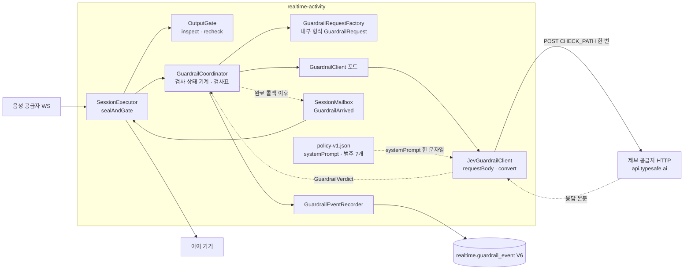

텍스트 대안: 공급자 출력이 구간으로 봉인되어 `OutputGate.inspect`를 통과하면 실행기가 검사 협력 객체 `GuardrailCoordinator`에 구간을 넘긴다. 협력 객체는 `GuardrailRequestFactory`로 내부 형식 요청을 만들고 포트 `GuardrailClient`(운영은 `JevGuardrailClient`)를 비동기로 부른다. 어댑터는 정책 리소스의 `systemPrompt`를 요청 본문에 실어 제브에 한 번 POST하고, 응답을 `GuardrailVerdict`로 바꿔 완료 콜백으로 돌려준다. 콜백은 결과를 `SessionMailbox`의 `GuardrailArrived` 메시지로 넣고 실행기 스레드가 꺼내 협력 객체의 `onArrived`로 처리한다. 허용이면 `recheck` 뒤 기기로 재생하고, 모든 결과는 `GuardrailEventRecorder`가 `guardrail_event`에 사유 코드 · 정책 판 · 지연만 비동기로 기록한다.

### Interaction Diagrams (제브 검사 한 턴, 현재 코드)

#### 9) 공급자 출력 → inspect → 제브 검사 → 결과 소비

줄 번호는 HEAD `421e1ad` 기준이며 `SessionExecutor`의 연결 줄과 `GuardrailCoordinator`의 `start` · `resolve` 구간은 얕게 읽었다.

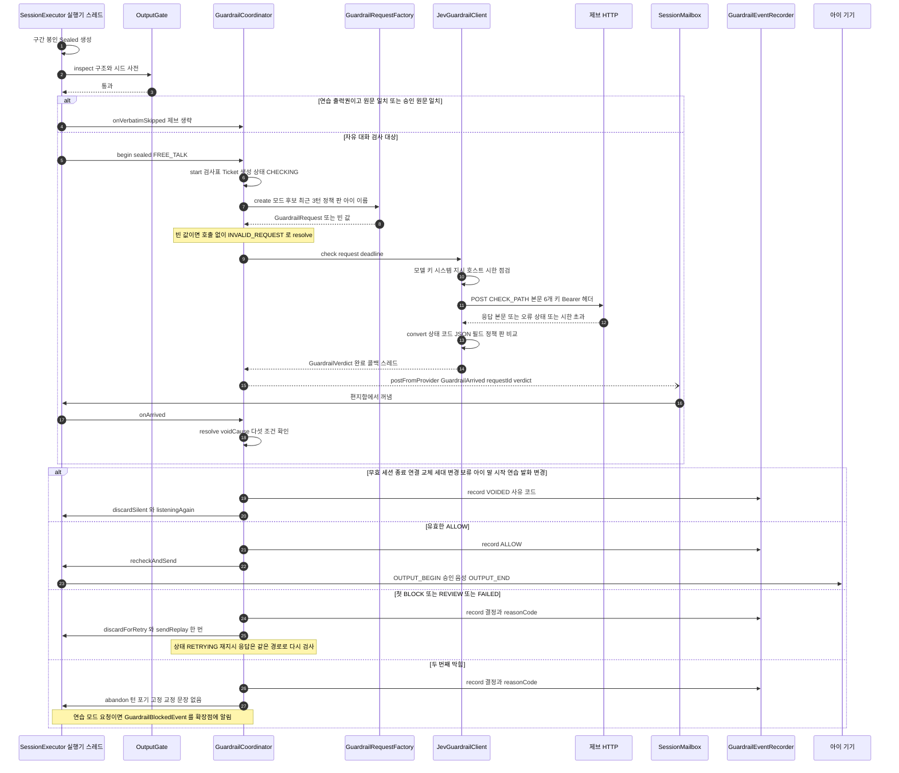

텍스트 대안: 실행기가 봉인한 구간이 `OutputGate.inspect`를 통과하면, 연습 원문 일치 · 승인 원문 일치는 제브를 생략하고 자유 대화 구간은 `GuardrailCoordinator.begin`으로 검사를 시작한다. 협력 객체는 검사표를 만들고 팩토리로 내부 형식 요청을 만든 뒤(만들 수 없으면 호출 없이 막힘으로 센다) `JevGuardrailClient.check`를 부른다. 어댑터는 모델 · 키 · 시스템 지시 · 호스트 · 시한을 점검하고 제브에 한 번 POST한 다음 `convert`로 응답을 `GuardrailVerdict`로 바꾼다. 완료 콜백은 결과를 편지함의 `GuardrailArrived`로 넣고 실행기가 `onArrived`로 처리한다. 검사표 유효 조건이 어긋나면 재생도 재지시도 없이 `VOIDED`로 기록하고 듣는 중으로 돌아간다. 유효한 ALLOW만 `recheck` 뒤 기기로 재생한다. 첫 막힘은 턴당 한 번 재지시하고, 두 번째 막힘은 턴을 포기한다. 자동 ALLOW는 없다.

#### 10) 어댑터 안: 응답 본문이 GuardrailVerdict가 되는 길 (`convert`)

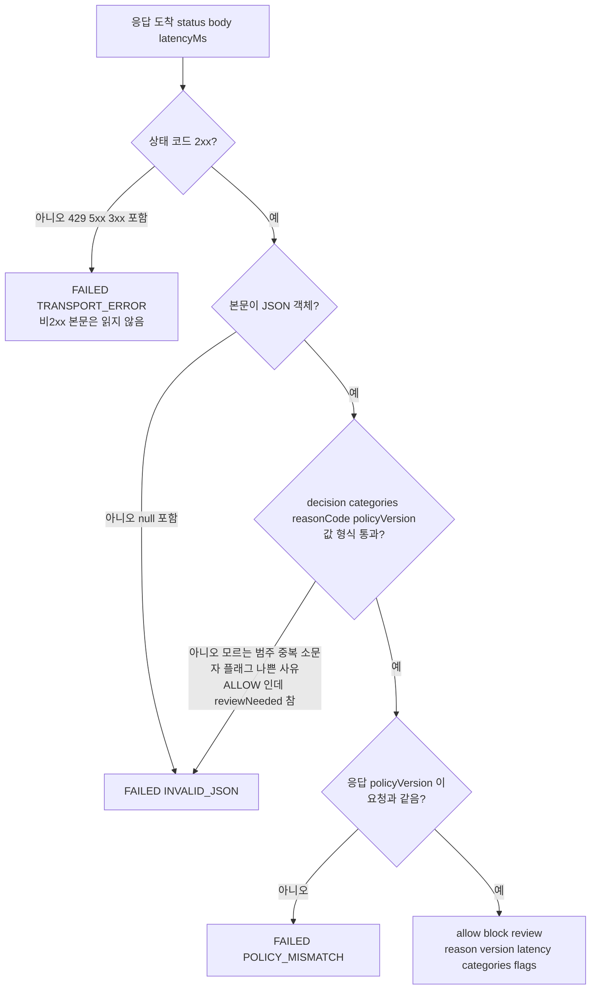

텍스트 대안: 어댑터는 상태 코드가 2xx가 아니면 본문을 읽지 않고 `TRANSPORT_ERROR`로 끝낸다. 2xx이면 본문 전체를 JSON 객체로 읽어 `decision`(`ALLOW|BLOCK|REVIEW`) · `categories`(필수, 7개 이름 안, 중복 불가) · `policyFlags`(선택) · `reasonCode`(필수 정규식) · `policyVersion`(필수 1 ~ 80자) · `reviewNeeded`(선택)를 검사하고, 하나라도 어기면 `INVALID_JSON`이다. 응답 정책 판이 요청의 판과 다르면 `POLICY_MISMATCH`, 모두 통과해야 `GuardrailVerdict`의 ALLOW · BLOCK · REVIEW가 된다. 이 가정은 공식 응답 형식(`model · answers · usage`)과 다르다(api-documentation.md 외부 API 절).

### 공급자 선 형식과 결합한 자리 (사실)

| 자리 | 가정 형식에 묶인 내용 | 증거 |
|---|---|---|
| `JevGuardrailClient.CHECK_PATH` · `endpointOf` | 경로 `/v1/guardrail/check` | 정의 59줄, 사용 108줄, 시험 `JevGuardrailClientTest` 114 · 217줄 |
| `JevGuardrailClient.requestBody` | 닫힌 키 6개 | 공식 요청(`state · model · questions`)과 겹치는 키는 `model` 하나 |
| `JevGuardrailClient.convert` | 응답 최상위 6개 키, `POLICY_MISMATCH` | 공식 응답(`model · answers · usage`)에 `reasonCode · policyVersion · categories`가 없다 |
| `guardrail/policy-v1.json` | `systemPrompt`가 "JSON 한 객체 출력"을 지시하고 필드 이름을 나열 | 가정 형식과 한 쌍 |
| `guardrail-result.schema.json` 첫 예시 | 시험이 공급자 응답으로 그대로 전송 | `theContractExampleOfTheResultSchemaIsTheAssumedResponseFormat` |
| `GuardrailVerdict` · `guardrail_event` | `reasonCode`(null 불가 + 정규식) · `policyVersion`(null 불가) 요구 | 생성자 검증 · V6 `NOT NULL` + CHECK |
| `TimeLiteralScanTest` 허용 목록 | 어댑터의 `.orTimeout(limit.toNanos(), TimeUnit.NANOSECONDS)` 줄 문자열 | 91줄 |

### 위험 요약 (사실만, 해법은 정하지 않음)

상세와 ID는 [code-quality-assessment.md](code-quality-assessment.md)의 JEV-F1 ~ JEV-F12가 정본이다. 구조에 걸리는 것: 공식 응답에 없는 값을 소비 구조가 요구함(JEV-F2), 분류 체계 7개 대 11개 불일치와 7개에 묶인 네 곳(JEV-F3), 문턱 설정 키 없음(JEV-F4), 확률을 담을 자리 없음(JEV-F5), 팩토리 대 어댑터 책임 위치(JEV-F1), 실호출 증거 없음(JEV-F11).

---

## 구현 전 U13 분석 (2026-10-17, main `6a78536` 코드 — 이력, 구현으로 달라진 부분은 위 절이 우선)

> 아래는 U13 구현 전에 확인한 삽입 지점 · 함정 · 제약이다. "신설 후보"로 적힌 제브 협력 객체는 이제 `GuardrailCoordinator`로 존재하고, `guardrail` 패키지도 생겼다. 세대 번호 · 대기 중 충돌 · 승인 원문 생략에 관한 분석은 구현이 어떻게 풀었는지 이번 스캔이 확인하지 않은 부분이 있어 그대로 보존한다.

### 현재 흐름과 삽입 지점
1. 공급자 출력 조각(`onOutputChunk` ~2096)을 `OutputGeneration`이 받을지 정하고 `SegmentBuffer`에 쌓는다. 조각마다 `SEGMENT_QUIET` 타이머(기본 800ms, 시험 50ms)를 다시 건다.
2. 조용 시간 만기(`onOutputQuiet` ~2156) 또는 아이 입력 재개(`onInputTranscriptDelta` ~1982)가 `sealAndGate(movedOn)`(~2782)을 부른다.
3. `sealAndGate`: 봉인 → `gate.inspect`(구조 · 시드 사전) → 연습이 출력을 쥐고 있으면 `pendingPracticeSpeech.matches`가 아닐 때 `GATE_PATTERN` 폐기(~2805-2809) → `gate.recheck`(NOT_ACTIVE 판정 · 출력 레인 예약) → `send`.
4. `send`(~2831): `transcripts.aiFinal(text, true, …)`가 보호자 화면 승인 → PCM `OutputBundle`(세대 확인 콜백) → `sendOutput`.
5. `discard`(~2866): `aiFinal(text, false)` → 연습 발화면 `PRACTICE_DISCARD` → `correctAfterDiscard`(고정 교정 문장, 세대당 1회 · 연달아 2회) → `WAITING_FILLER` 또는 `listeningAgain`.

**제브 삽입 지점은 `inspect` 통과 직후, 연습 원문 일치 뒤, `recheck` 직전(~2810)**이다. `OutputGate`는 동기 · 순수 클래스라 비동기 대기를 담을 수 없으므로 단계는 실행기 쪽 협력 객체로 얹고, 결과는 `SessionMailbox` 메시지로 실행기 스레드에 돌려놓는다. `recheck`는 ALLOW가 돌아온 뒤에 불러야 한다. (구현 뒤: 위 9) 그림이 현재 모양이다.)

### 세대 번호가 둘이다
| 이름 | 올리는 곳 | 막는 것 |
|---|---|---|
| 기기 프레임 세대 `outputGeneration`(`AtomicLong`) | `bumpGeneration` ~3864, `teardown` ~3903 (끼어들기 · 종료 의도 · 연습 `speak` · 연결 교체 · 끊김) | 기기로 나가는 PCM, `recheck`의 `activeAndCurrent` |
| 공급자 출력 세대 `outputGen`(`OutputGeneration`) | `bumpOutput` ~2141, `sendInstruction` ~2216 (지시 송신 · 판정 턴 · 보류 해제 · 연습 폐기) | 공급자 조각 |

지시 송신 · 판정 턴 · 보류 해제는 기기 세대를 올리지 않으므로 지금의 `sealed.generation() == outputGeneration.get()` 검사만으로는 대기 중 응답 세대 변경을 못 잡는다. 늦은 ALLOW가 유효하려면 ① 검사표의 요청 id 일치 ② 두 세대 모두 불변 ③ ACTIVE · 같은 연결 · `terminated` 아님 · `outputHeld()` 아님 ④ 연습 발화면 `pendingPracticeSpeech`가 그대로 ⑤ 판정 턴 열림 아님을 모두 만족해야 한다. 검사표는 같은 `Sealed` 인스턴스(전사와 PCM이 한 `outputGen` 한 구간에서 불변으로 만들어짐)를 쥐고 다시 봉인하거나 버퍼에서 다시 읽지 않는다. 이 전사는 공급자 모델의 출력 전사이지 PCM의 독립 받아쓰기가 아니므로 소리와 글의 실제 일치는 코드로 검증할 수 없다(AC2.1.5의 한계). (구현 뒤: `GuardrailCoordinator.voidCause`가 연결 · 세대 두 개 · 보류 · 입력 그룹 열림 · 연습 발화 변경을 확인한다.)

### 대기 중 충돌 함정
- `TranscriptWriter.aiStart`는 열린 AI 행이 있으면 그 번호를 재사용한다. 대기 중 행을 열어 두면 다음 조각이 같은 행을 쓰고, `FINAL · false`로 닫으면 늦은 ALLOW로 `approved=true`로 바꿀 수 없다(`TranscriptRepository.UPSERT`는 `PARTIAL`일 때만 덮음). 세션당 동시 검사 1건과 대기 중 도착 조각의 처리(버림 대 보관)를 정해야 한다. (구현 뒤: 코디네이터가 AI 행을 보관 손잡이 `Held`로 빼고 대기열 1칸을 둔다.)
- 기기는 대기 중 '생각 중'을 유지해야 하나 `discard()`는 `WAITING_FILLER` 또는 `listeningAgain()`으로 간다. `thinking()` · `listeningAgain()`에 제브 대기용 THINKING 유지 조건이 필요하다. (구현 뒤: `guardrail.holdsThinking()`이 연결 지점으로 보인다.)
- `outputHeld()` 조건에 새 항목을 더하면 `watchHold`(~2237)가 풀림 시점에 `HOLD_RELEASED`로 세대를 올린다.

### 승인 원문 생략과 보호자 숨김
- 일치 후크 두 곳: 연습 `PracticeSpeech.matches`(`pendingPracticeSpeech`, 서버 기억)와 `LiveContentRegistry.matchApproved`(승인 발화 · 등록 대본). 두 경로 모두 ASCII 공백 제거 정규화이고 시드 사전의 NFKC와 섞지 않는다. `UNKNOWN`이면 생략 금지다. (구현 뒤 `ApprovedVerbatimPort`와 `guardrail.verbatimSource` 호출이 `SessionExecutor`에 보인다.)
- 보호자 숨김은 새 필터 없이 `aiFinal(…, approved=false)`로 이미 구현되어 있다(진행 조회 `TranscriptRepository.SELECT_VISIBLE_AFTER`, 기록 · PDF `ResultSnapshotBuilder`). 필요한 변경은 승인 시점을 ALLOW 뒤로 두는 것이다.

### 구현 전 Interaction Diagrams (U13 거래 — 이력)

#### 6) 아이 말 → 구간 봉인 → inspect → [제브] → recheck → send (구현 전 삽입 지점 표시)

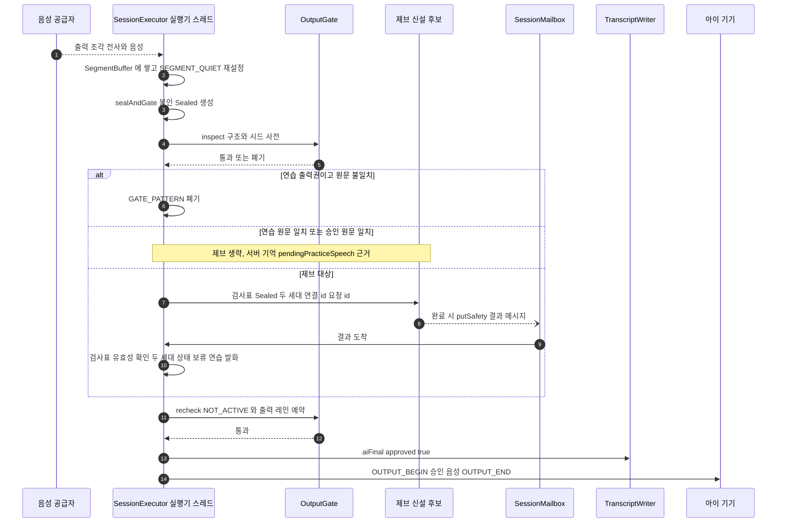

텍스트 대안: 공급자 출력이 구간으로 봉인되면 실행기는 구조 · 시드 사전 검사를 하고, 제브 대상이면 같은 `Sealed`를 검사표에 담아 비동기로 요청한다. 결과는 편지함 메시지로 돌아와 두 세대 번호와 상태가 그대로일 때만 유효하다. 그 뒤 `recheck`를 하고 전사를 승인한 다음 기기로 보낸다. 연습 원문 일치 · 승인 원문 일치면 제브를 생략하고 바로 `recheck`로 간다. 이 그림은 구현 전 삽입 지점과 제약의 표시이며 현재 모양은 위 9) 그림이다.

#### 7) 판정 턴 보류 (U11, 제브와의 상호작용)

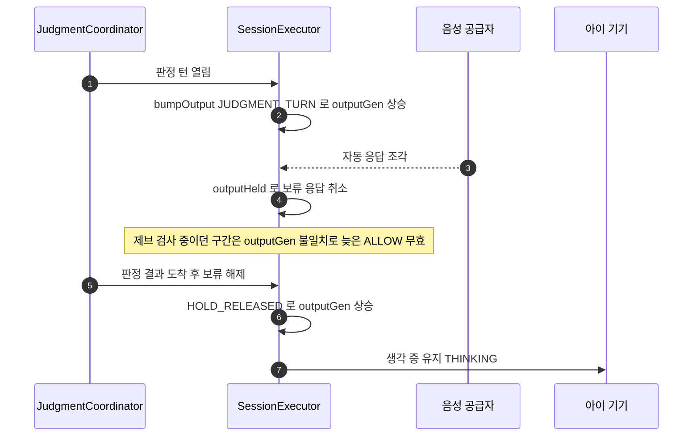

텍스트 대안: 판정 턴이 열리면 공급자 출력 세대가 올라가 진행 중이던 제브 검사의 늦은 허용은 세대 불일치로 무효가 된다. 보류 해제도 세대를 올린다. 기기 프레임 세대는 올라가지 않으므로 두 번호를 모두 비교해야 한다.

#### 8) 승인 원문 생략 (approved-text bypass)

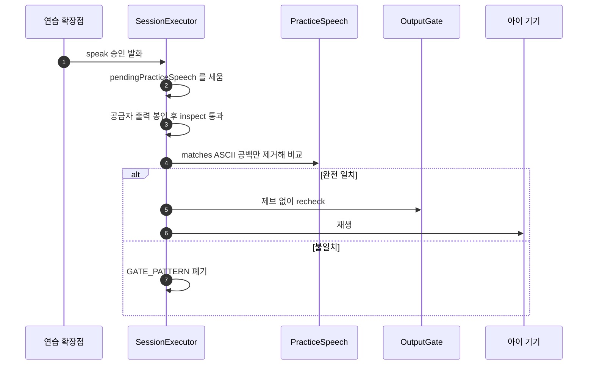

텍스트 대안: 연습 확장점이 승인 발화를 말하라고 지시하면 실행기가 `pendingPracticeSpeech`를 세운다. 공급자 출력이 봉인되어 1차 검사를 통과하면 공백만 제거해 원문과 비교하고, 같을 때만 제브를 생략해 `recheck` 후 재생한다. 다르면 폐기한다. 자유대화의 `approvedContent` 음성 파일 재생은 게이트 밖의 기기 재생 명령이라 대상이 아니다.

### 구현 전 위험 요약
동시성(완료 콜백은 다른 스레드, 반드시 편지함으로) · `SEGMENT_QUIET`와 `pendingOutputChunks` 레이스 · 대기 중 세션 종료와 정산(`teardown`이 세대를 올림) · 연결 교체(검사표에 연결 id) · 같은 응답 꼬리 조각 · 제브 대기만큼 늦어지는 첫 소리(`LatencyRecorder`의 `tGatePass` 의미 변화) · `segment-quiet` 50ms 시험 흔들림 · R-F1 · R-M11. 상세와 갭 표는 [code-quality-assessment.md](code-quality-assessment.md)가 정본이다.

---

> 현재 범위의 정본(U14 갱신절, 보존 이력)은 바로 아래다. 그 뒤 원문은 보존 이력이며 재검증 범위는 timestamp에 한정한다.

## U14 Architecture Analysis — 현재 흐름

후보의 실제 저장 책임은 core.practice.CandidateRegistry → PracticeGoalRepository, 검증은 core.result.CandidateScreen에 나뉜다. SessionResultHandler는 외부 AI를 트랜잭션 밖에서 부르고 JobContext.commit으로 결과를 확정한 뒤 후보를 등록한다. JobRunner는 보호자 → 작업 → 리포트 잠금, 시도 번호·lease 재확인, 영속 pending_candidates 복구를 보존한다.

ReportAssembler는 SceneChipMapper.text를 그대로 사용해 표시와 집계 의미가 결합되어 있다. U14에서는 저장 시점·27 투영·리포트 문구의 경계를 나눌 필요가 있다. U15 ChildKnowledgeService 조회는 소유자·동의·삭제 상태를 검사하고 불가 시 빈 목록을 돌려준다. 생성 실패는 NONE이며 결과 확정을 되돌리면 안 된다.

## Interaction Diagrams — U14 변경 전 경계

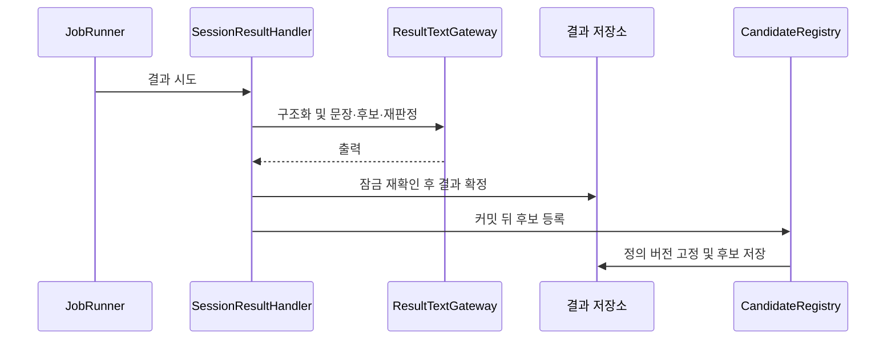

텍스트 대체: AI 호출 뒤 결과를 확정하고 후보 등록은 커밋 뒤 수행한다. 현재는 행동 정의 기반 후보이며 U14의 자유 생성 후보·씨앗 연결은 아직 없다. 아래 기존 U15 미구현 설명은 과거 자료다.

---

# 아키텍처 (Architecture)

> 최신 확인: 2026-10-16, HEAD 7e30ee8, U15 집중 분석. 아래 최신 절이 U15 관련 과거 설명보다 우선한다. 이전 분석 본문은 이력으로 보존하며 이번 범위 밖의 검증 주장은 shallow로 낮췄다.

## U15 현재 구조와 확장 경계

PragmaticsKnowledge는 KnowledgeJdbcRepository, MujoongClock, KnowledgeProperties, 선택적 KnowledgeGraphLookup에 의존한다. 공개 행동키 조회만 존재한다. 그래프를 켰는데 어댑터가 없으면 초기화에 실패하며 꺼짐에서는 호출하지 않는다. Neo4j 어댑터·메모리 대역은 아직 없다. CoreLunaClient는 실제 존재하며 OPENAI_API_KEY가 있을 때만 구성된다. 아래 과거 기록의 텍스트 AI 미연결 설명을 현재 Luna 구현에 적용하지 않는다.

삭제는 DeletionCommander가 참가자를 순서대로 실행하고 예외를 재시도한다. 결과 삭제가 70이므로 제안된 graph 참가자 80 이전에 결과를 참조하는 restrictive FK가 삭제를 막지 않도록 설계해야 한다. 조회 실패의 빈 값과 삭제 실패의 재시도는 서로 다른 정책이다. 생성/삭제 경쟁은 GuardianWriteLock과 삭제 상태 재검증으로 해결할 설계 대상이다.

## Interaction Diagrams

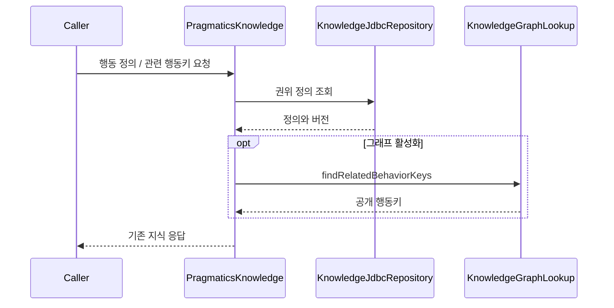

텍스트 대체: 호출자는 PragmaticsKnowledge를 사용한다. 정의는 PostgreSQL에서 조회하고 그래프가 활성화된 경우에만 선택적 공개 행동키 포트를 호출한다. 이 그림은 현재 동작이며 U15 아동별 생성·저장은 구현 전이다.

## 이전 분석 기록 — 2026-10-15, 현재 범위 밖은 재검증하지 않음

> 기준: 커밋 `72d7034`, 2026-10-15 전체 재스캔. 구성 요소 목록 · 책임은 [component-inventory.md](component-inventory.md), 엔드포인트 목록은 [api-documentation.md](api-documentation.md)가 정본이다. 이 문서는 구조 · 흐름 · 결정만 적는다.

## Architecture Analysis

### System Overview

두 개의 Spring Boot 앱과 한 개의 Next.js 웹 앱, 한 개의 PostgreSQL 인스턴스로 이뤄진 시스템이다.

- **core-api**(8080): 보호자 REST · 기기 부트스트랩 REST · 계정/동의/아이/기기 등록 · 활동 시작과 조회 · 연습 목표/상황 생성 · 결과 작업 · 리포트 PDF · 웹 푸시. 스키마 `core`.
- **realtime-activity**(8081): 아이 기기 WSS 게이트웨이(`/ws/device`) · 세션 수명 주기 · 음성 공급자 중계 · 출력 게이트 · 대화 기록 · 원음 녹음 · 연습 런타임. 스키마 `realtime`.
- **frontend**: 한 개의 Next.js App Router 앱이 `/parent`(보호자)와 `/device`(아이 기기) 두 화면 묶음을 제공한다.
- **contract-model**: 두 앱이 함께 쓰는 계약 타입 라이브러리(WS 메시지 · 이벤트 · 상태 enum · 오류 봉투 · 시계 · 로그). Spring 의존 없음.
- **PostgreSQL 16**: 한 인스턴스, 스키마 · 역할 분리(`core`/core_app, `realtime`/realtime_app). 마이그레이션은 앱이 아니라 별도 `migrate` 이미지(Flyway)가 실행한다.
- 앞단 **Nginx**(demo)가 TLS를 끝내고 프런트 · 두 앱으로 경로를 나눈다.

### Architectural Style

**분리된 두 서비스 + 공유 계약 라이브러리 + 단일 DB 스키마 분리**(작은 마이크로서비스 2개, 모듈형 내부). 근거:

- Gradle 모듈 사이에서 `core-api` ↛ `realtime-activity` 직접 의존이 없고, CI 불변식 샘플(`bad-core-depends-realtime.yml`)과 ArchUnit 시험(`core/arch` · `realtime/arch`)이 이를 막는다.
- 앱 사이 통신은 내부 HTTP(`/internal/*`, 내부 토큰)와 Outbox/Inbox 영속 이벤트(HTTP 전달)뿐이다.
- 각 앱 내부는 기능 패키지(core 23개 · realtime 17개)로 나뉜 모듈형 모놀리스다.
- 배포는 demo 단일 EC2 호스트의 Docker Compose(IaC 없음).

### Component Relationships

```mermaid
flowchart LR
    subgraph Browser["브라우저"]
        P["frontend /parent<br/>보호자 화면"]
        D["frontend /device<br/>아이 기기 화면"]
    end
    N["Nginx<br/>TLS · 경로 분기"]
    subgraph Core["core-api :8080"]
        CW["web · security<br/>보호자 REST"]
        CA["activity · practice"]
        CR["result · report · record"]
        CN["notification<br/>웹 푸시"]
        CM["messaging<br/>Outbox/Inbox"]
        CT["textai · ResultTextProvider<br/>(기본 UNAVAILABLE)"]
    end
    subgraph RT["realtime-activity :8081"]
        RG["gateway<br/>/ws/device"]
        RS["session<br/>SessionExecutor"]
        RV["voice<br/>ProviderClient"]
        RGT["gate · dialog"]
        RP["practice<br/>(판정 · 단서 기본 미연결)"]
        RM["messaging<br/>Outbox/Inbox"]
        RL["log · recording"]
    end
    DB[("PostgreSQL 16<br/>schema core / realtime")]
    VP["외부 음성 AI<br/>wss api.openai.com"]
    G["Google OAuth"]
    WP["Web Push 서비스"]
    P --> N
    D --> N
    N --> CW
    N --> RG
    CW --> CA
    CA -- "내부 HTTP /internal/sessions" --> RS
    RS -- "내부 HTTP /internal/devices/verify-token 등" --> CW
    RP -- "내부 HTTP /internal/practice/scenarios" --> CA
    RG --> RS
    RS --> RV
    RS --> RGT
    RS --> RP
    RS --> RL
    RV --> VP
    CM <-->|"이벤트 /internal/events"| RM
    CR --> CT
    CA --> CT
    CR --> CN
    CN --> WP
    CW --> G
    Core --> DB
    RT --> DB
```

텍스트 대안: 브라우저의 보호자 화면과 기기 화면은 Nginx를 거쳐 각각 core-api REST와 realtime-activity WebSocket에 닿는다. core-api는 활동을 시작할 때 realtime-activity의 내부 HTTP를 부르고, realtime-activity는 기기 토큰 검증 · 연결 보고 · 연습 상황 조회를 core-api 내부 HTTP로 부른다. 두 앱은 Outbox/Inbox 이벤트를 서로의 `/internal/events`로 전달한다. realtime-activity만 외부 음성 AI와 WebSocket으로 연결하고, core-api만 Google OAuth · 웹 푸시 · 텍스트 AI 포트를 쓴다. 두 앱은 같은 PostgreSQL의 서로 다른 스키마를 쓴다. (2026-10-18 보충: realtime-activity는 제브 안전 검사 공급자 HTTP도 부른다 — 위 "제브 어댑터 선 형식 집중 갱신" 절.)

### Data Flow

1. **활동 시작**: 보호자 REST → Core가 활동 · 세션 패키지를 만들고 → Realtime `POST /internal/sessions` → Realtime이 기기 WS로 `START_SESSION` → 기기 `ACK` · `DEVICE_READY` → 공급자 세션 시작.
2. **음성 턴**: 기기 마이크 PCM16LE 24kHz 모노 20ms 프레임(바이너리 0x01, 960바이트) → Realtime `InputRelay` → 공급자 `session.input_audio.append` → 공급자 출력 텍스트 · 음성 → `OutputGate`가 문장 단위로 승인/폐기 → 승인분만 기기 재생(`OUTPUT_BEGIN/END`, `PLAY_APPROVED_CONTENT`).
3. **상태 전파**: Realtime 세션 전이 → `SessionStateChanged` Outbox → Core Inbox → Core 세션 뷰 · 보호자 화면 폴링(react-query).
4. **결과**: 세션 종료 → `SessionRecordCaptured`(대화 기록 스냅샷) → Core 결과 작업(JobRunner) → 결과 수준 · AI 문장(텍스트 AI) · 금지 표현 검사 → 결과 상태 → 웹 푸시.
5. **삭제**: Core `DeletionRequested` → Realtime 삭제 참여자 → `DeletionCompleted`.

### Interaction Diagrams

#### 1) 자유 대화 시작 → 첫 턴

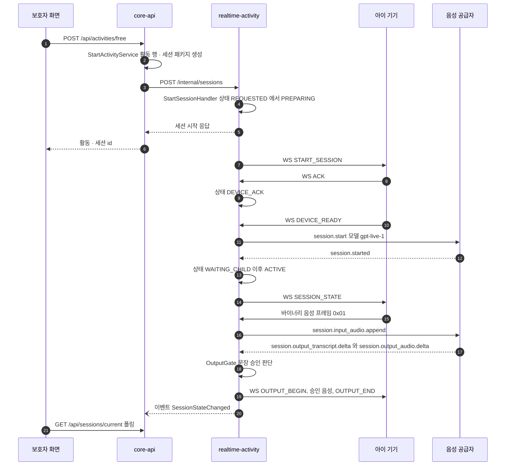

텍스트 대안: 보호자가 자유 대화를 시작하면 Core가 활동을 만들고 Realtime 내부 API로 세션을 연다. Realtime은 기기에 START_SESSION을 보내고, 기기의 ACK · DEVICE_READY를 받은 뒤 공급자 세션을 연다. 아이 음성은 바이너리 프레임으로 들어와 공급자로 중계되고, 공급자 출력은 출력 게이트를 통과한 것만 기기로 재생된다. 상태 변화는 이벤트로 Core에 전달되고 보호자 화면은 폴링으로 본다.

#### 2) 종료 → 결과 생성

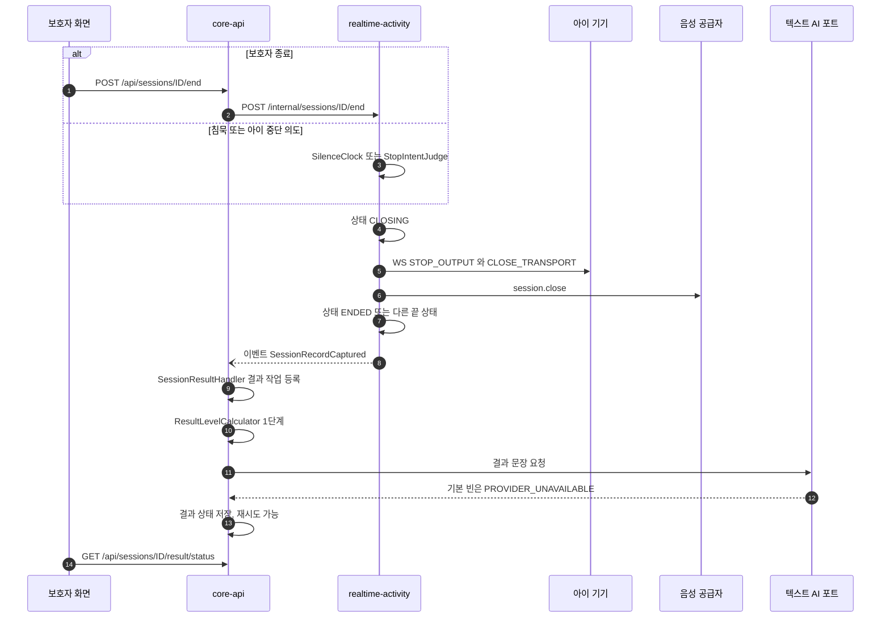

텍스트 대안: 보호자 종료는 Core를 거쳐 Realtime 내부 종료 API로, 침묵 · 아이 중단 의도는 Realtime 안에서 바로 종료를 시작한다. Realtime은 CLOSING에서 기기 출력과 전송을 닫고 공급자 세션을 닫은 뒤 끝 상태로 간다. 대화 기록 스냅샷 이벤트를 받은 Core는 결과 작업을 돌리는데, 지금 기본 텍스트 AI 빈은 항상 실패하므로 운영 환경에서는 AI 결과 문장이 만들어지지 않는다.

#### 3) 연습 활동 준비

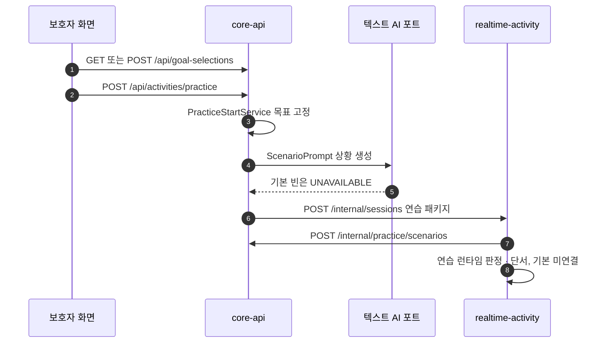

텍스트 대안: 연습 시작 시 Core가 목표를 고정하고 텍스트 AI로 상황을 만들어 Realtime에 넘기며, Realtime은 필요할 때 Core 내부 API로 상황을 다시 조회한다. 상황 생성 · 판정 · 단서의 기본 공급자는 모두 미연결이라 생성 실패 시 `SCENARIO_GEN_FAILED` 경로를 탄다(실패 처리 본문은 얕게 봄).

### Key Design Decisions

| 결정 | 근거 · 위치 | 영향 |
|---|---|---|
| 앱 2개 분리, 직접 의존 금지 | `settings.gradle.kts`, ArchUnit, CI 불변식 | 음성 실시간 부하와 보호자 REST를 따로 배포 · 확장. 대신 내부 HTTP · 이벤트 계약 관리 비용 |
| 계약 정본은 `contracts/`, 코드 타입은 `contract-model` | `contracts/README.md` 소유 · 깨는 변경 규칙 | 계약 변경 시 정본 · `deviations.md` · 계약 시험 · 프런트 파서를 함께 바꿔야 함 |
| Outbox/Inbox + HTTP 전달 | `core.messaging` · `realtime.messaging`, 재시도 backoff 설정 | 브로커 없이 최소 한 번 전달. 수신 측 멱등 처리 필요 |
| 한 DB, 스키마 · 역할 분리, 마이그레이션은 별도 이미지 | `infra/migrate/flyway-{core,realtime}.conf`, 앱 `spring.flyway.enabled=false` | 앱이 스키마를 바꾸지 않음. 번호 순서 · expand 검사 · 승인 목록 필요(TD-7) |
| 음성 공급자 SDK 없이 JDK WebSocket, 허용 호스트 고정 | `ProviderHosts`(`api.openai.com`), `ProviderClient` | 의존 최소화. 선 형식을 직접 소유(TD-2) |
| 출력 게이트로 공급자 출력을 문장 단위 승인 | `realtime.gate.OutputGate` · `SeedDictionary` | 아동 안전. 지연 증가 |
| AI 포트는 인터페이스 + 기본 실패 빈 | `TextAiConfiguration`, `ResultTextConfiguration`, `PracticeRuntimeConfiguration:46-51` | 비밀 없이도 기동 · 시험 가능(fail-closed). 운영 어댑터가 없음(TD-1) |
| 시간 값은 설정 키로, 계약 문서와 대조 | `mujoong.timing.*` ↔ `contracts/timing.md` ↔ 프런트 `timing-defaults.json` | 값 변경 시 세 곳 동시 수정(TD-6) |
| 한 Next.js 앱에 `/parent` · `/device` 공존, ESLint로 경계 | `frontend/eslint.config.mjs` | 배포 단순. import 경계는 린트 규칙에 의존 |

### Improvement Opportunities

1. **AI 공급자 어댑터 추가**(TD-1): 텍스트 AI · 결과 문장 · 판정 · 단서의 운영 어댑터를 포트 뒤에 붙이고, 기본 실패 빈은 시험 · 비밀 없는 기동용으로만 남긴다. 갱신 문서(`15_기술명세_AI동작_1015` · `40_기능명세_GPT-Live`)와 맞출 때 첫 후보 경계.
2. **음성 공급자 선 형식 격리**(TD-2): `ProviderRequestFactory` · `ProviderClient`의 type 문자열을 한 어댑터로 모으고, 가짜 공급자(`tools/fake-provider/`, `test-support/.../provider/`)와 같은 정의를 공유하면 실공급자 형식 변경 비용이 줄어든다.
3. **`SessionExecutor` 분해**(TD-4): 3,388줄에 상태 · 타이머 · 출력 · 연습 확장이 섞여 있다. 문서 차이로 세션 동작을 바꿀 때 변경 범위가 커진다.
4. **시간 값 단일 정본화**(TD-6): 설정 · 계약 문서 · 프런트 JSON 세 곳을 생성 또는 시험으로 묶는다(현재는 시험 대조).
5. **서식 검사 CI 추가**(TD-5): Java 포매터 · Prettier 검사 부재로 압축 서식이 막히지 않는다.

## 보안 · 준수 관점 요약

- 보호자 REST: Spring Security + JDBC 세션, CSRF(`/api/session/csrf`), Origin 검사, 속도 제한(`SlidingWindowRateLimiter`). 기기: 쿠키 인증 필터 · 기기 토큰(Core가 검증).
- 내부 API: 양쪽 `InternalTokenFilter`(Realtime은 Spring Security 없이 이 필터만).
- 외부 호스트 고정: 음성 공급자 `api.openai.com`, 웹 푸시는 공개 DNS · 고정 HTTP 클라이언트(`PinnedPushHttpClient` · `PublicPushEndpointPolicy`). 제브 검사 공급자는 `api.typesafe.ai`만 허용(`JevHosts.ALLOWED_HOSTS`).
- 오류 응답에서 메시지 · 스택 숨김(`server.error.*`), 관리 포트 9090은 127.0.0.1 바인딩.
- 아동 데이터 삭제는 삭제 참여자 패턴(양쪽 `*DeletionParticipant`)과 삭제 이벤트로 처리.

---

## U11 집중 갱신 (261016-u11-judgment-turn, 2026-10-16 스캔 — main 병합 때 보존한 절)

> main의 U14 · U15 갱신본을 바탕으로 두고, U11 작업 기록의 집중 스캔에서 갱신한 절만 아래에 보존했다. 줄 번호 · 커밋은 2026-10-16 `9bcc706` 기준이며 PR1(선 형식 정비) 이전 코드다.

#### 4) (2026-10-16 갱신) 아이 말 끝 → 공급자 응답 → 보류 또는 게이트 — 현재 코드

판정 턴(U11)이 끼어들 자리를 보이려고 지금 실행기의 처리 순서를 그렸다. 줄 번호는 `SessionExecutor.java` 기준이다. (2026-10-18 보충: 이 그림의 `sealAndGate`에 제브 검사 단계가 U13 구현으로 얹혔다 — 위 9) 그림.)

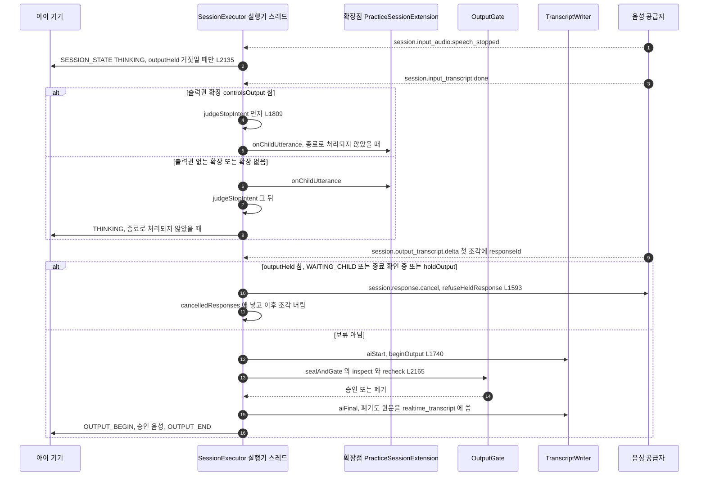

텍스트 대안: 공급자가 아이 말 끝(`speech_stopped`)을 알리면 실행기는 출력 보류 중이 아닐 때만 기기에 '생각 중'(THINKING)을 보낸다. 확정 전사가 오면, 출력권을 가진 확장(U5b 연습)일 때는 종료 의도 판정을 먼저 하고 종료가 아니면 확장점에 발화를 넘긴다. 출력권이 없을 때는 확장점에 먼저 넘기고 그 뒤 종료 의도를 판정한다. 공급자 응답의 첫 조각이 올 때 출력 보류 중(참여 확인 대기 · 종료 확인 질문 중 · 확장점 보류)이면 그 응답을 공급자에 취소 요청하고 이후 조각을 버린다. 보류가 아니면 전사 기록기에 AI 행을 열고, 문장 구간을 게이트에 넣어 승인분만 기기로 재생한다. 게이트가 폐기한 문장도 원문이 대화 기록 표에 남고 표시 · 스냅숏에서만 걸러진다. 판정 턴의 "보류 출력은 음성은 버리고 전사는 `judgment_live`에만 남긴다"를 담을 갈래가 지금은 없다(U11-R3).

#### 5) (2026-10-16 갱신) 확장점 비동기 결과 · 공급자 송신 경로 — 현재 코드

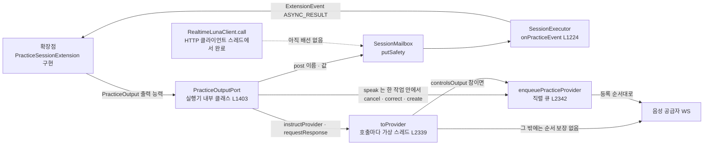

텍스트 대안: 확장점은 실행기를 직접 부르지 않고 실행기가 준 출력 능력(`PracticeOutput`)만 쓴다. 다른 스레드에서 끝난 작업 결과는 `post`로 편지함에 들어가고, 실행기가 꺼내 `ASYNC_RESULT` 사건으로 확장점에 돌려준다. Luna 호출부의 완료 콜백은 HTTP 클라이언트 스레드에서 돌기 때문에 같은 편지함 경로로 넘겨야 하지만 지금은 연결이 없다. 공급자 송신은 두 갈래다. 출력권을 가진 확장이면 모든 송신이 직렬 큐를 타서 등록 순서가 지켜진다. 그 밖에는 `toProvider`가 송신마다 가상 스레드를 따로 띄워 `instructions.correct` 다음 `response.create` 같은 순서가 보장되지 않는다(U11-R2).

### U11 판정 턴 접점 (2026-10-16 집중 스캔)

U11(판정 턴 기반, 정본 지시서 `docs/units/u11/brief.md`)이 고치거나 기댈 지점을 코드 사실로 모았다. 설계 판단은 Functional Design 몫이고, 여기서는 사실과 제약만 적는다.

| 접점 | 지금 코드 | U11이 기댈 수 있는 것 | 제약 · 빈틈 |
|---|---|---|---|
| 확장점 포트(C-DS3) | `session.PracticeSessionExtension` — 시점 5개(`onActive` · `onChildUtterance` · `onExtensionEvent` · `onSettle` · `practiceRecord`), 출력 능력 `PracticeOutput` 10개(`speak` · `cancelSpeech`는 `default false`), `ExtensionEvent.Kind` 4개 | `default` 메서드로 능력을 더하는 선례, 열거 값을 다 훑는 `switch`가 없어 `Kind` 추가가 컴파일을 깨지 않음 | 포트는 U11 소유, U12는 구현만. 실행기 → 확장점 한 방향을 지켜야 함 |
| 판정 호출(C-DS4) | `luna.RealtimeLunaClient.call(LunaRequest)` → `CompletionStage<LunaResult>`, 시한 = min(마감, `live-budget`), 재시도 없음, Future 취소 시 HTTP 취소 | 요청 스키마 검증 · 입력 정리(`LunaInputSanitizer`) · 감사 로그가 이미 있음 | 키 없으면 빈 없음(U11-R6). 출력 스키마가 선택지 집합을 묶지 않음(U11-R5). `JudgeClient` 포트 없음 |
| 판 리소스 | `content.LiveContentRegistry.plan(sessionId)`의 `judgmentSetVersion`, `LiveContentResources.judgment()`(J1 ~ J6 선택지, 순서 고정) | 세션별 판 고정 | 프롬프트 지시문 · `promptVersion` 정본 없음 |
| 출력 보류 | `outputHeld()`(L1600) = WAITING_CHILD · 종료 확인 중 · 확장점 `holdOutput`, 보류면 응답 **취소** | 세대 번호(`bumpGeneration`) · 취소 목록 선례 | 보류 출력 전사를 따로 남길 갈래 없음(U11-R3), '생각 중' 충돌(U11-R11) |
| 게이트 단계 | `OutputGate` 상태 없음, `sealAndGate`(L2165 ~ L2206) `inspect` → (출력권 확장 원문 일치) → `recheck` | U13 제브 단계 자리 = `inspect` 뒤 · `recheck` 앞 | 같은 메서드를 U13이 고침(U11-R10) |
| 응답 준비 시계 | `SessionTimers.Kind` 11종에 판정용 없음, 시간 값은 `timing().judgment().responseReady()`로 읽힘 | 말 끝 기준 시각 후보 `SpeechStopped`(L1642) · `InputTranscriptDone`(L1660) | 시계 종류 추가는 실행기 수정 |
| 장애 취소 | `providerLost()`(L1758) · `abortProviderLost()`(L1780) · `startPause`(L2046) | 이 경로에 판정 턴 취소를 묶을 수 있음 | 늦은 결과 비교 기준(판정 차례 id) 없음(U11-R12) |
| 종료 표현 | `judgeStopIntent`(L1809), 호출 순서가 출력권 여부에 따라 다름(L1676 ~ L1688) | 등록 표현 → 판정 멈춤 | J6 · `StopIntentJudge` 겹침(U11-R7) |
| 기록 이벤트(C-DS2) | `RecordCaptureService` → `SessionRecordCaptured.record`는 `Map`, `record.practice` = `practiceRecord()` 그대로 | `flowVersion`은 `record.practice` 안 값이라 계약 타입 변경 불필요(편차 U8-d) | 채우는 일은 U12 |
| 저장(V5 `judgment_live`) | V4 관례: `realtime.` 접두 · `id uuid` · `session_id` 외래 키 · `guardian_id` + 색인 · `data jsonb` + `CHECK` | 삭제 참여자 `order()` 틀 | 판 번호 단언 "4"(U11-R4), 삭제 순서 · `DeletionCompleted.counts` 열린 질문(U11-R13) |

### U11 관점 위험 (2026-10-16 집중 스캔)

상세 · 증거는 [code-quality-assessment.md](code-quality-assessment.md) 6절이 정본이다. 구조에 걸리는 것만 요약한다.

- **U11-R1 선 형식 불확실(중단 조건)**: 응답 생성 확인 사건이 없어 '지시 뒤 응답만 통과'를 세대 번호 · 취소 목록 가정에 둔다. FR12.2 실호출 결과 전에는 선 형식을 바꾸지 않는다(ADR-007).
- **U11-R2 송신 순서**: 출력권 없는 경로의 `toProvider`가 송신마다 스레드를 띄워 순서가 보장되지 않는다. 시험 장치 `ManualLauncher`는 이 경쟁을 드러내지 못한다.
- **U11-R3 보류 출력 전사**: 보류 = 취소, 폐기 전사도 `realtime_transcript`에 원문 저장. 보류 출력은 구간 버퍼 · 전사 기록기 **앞**에서 갈라야 한다.
- **U11-R9 패키지 제약**: `luna`는 `voice` · 로그 프레임워크 · Jackson을, `gate` · `voice`는 JDBC · 저장소 · Outbox를 참조할 수 없다 → `JudgeClient` 구현 · `judgment_live` 저장소는 새 패키지에 둔다.
- **U11-R10 파일 소유**: `SessionExecutor`는 U13 · U12가 이어서 고친다.
