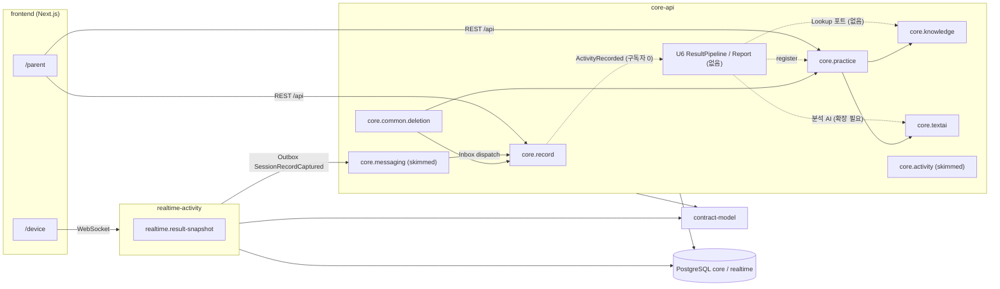
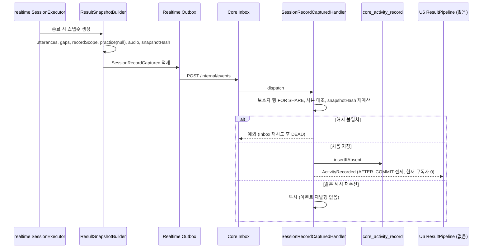
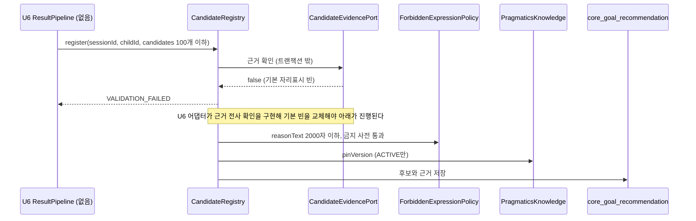
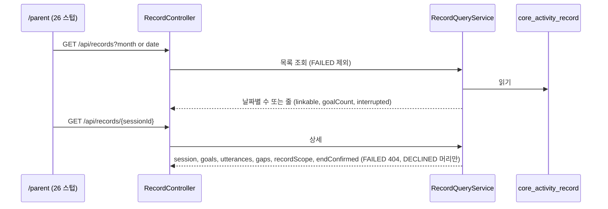
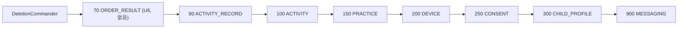

# 아키텍처 (Architecture)

> 기준 커밋 `7a22b67`. 컴포넌트 상세는 `component-inventory.md`, 의존 표는 `dependencies.md`, API 목록은 `api-documentation.md`에 한 번만 적고 여기서는 관계와 흐름만 다룬다.

## Architecture Analysis

### System Overview

두 개의 Spring Boot 앱과 한 개의 Next.js 앱, 공용 계약 라이브러리로 된 시스템이다.

- **core-api**(:8080) — 보호자 API · 기기 등록 · 활동 사본 · 활동 기록 · 연습 Core · 계정 삭제 지휘 · Core 메시징. Spring Security · 세션(JDBC) 사용.
- **realtime-activity**(:8081) — 기기 WebSocket · 세션 실행기 · 음성 중계 · 출력 게이트 · 전사 · 원음 · 결과 입력 스냅숏. Spring Security 없음(내부 토큰 · 기기 토큰).
- **frontend** — Next.js App Router 한 앱, `/parent` · `/device` 두 영역(ESLint로 import 경계 강제).
- **contract-model** — 두 앱 공용 계약(이벤트 payload · 오류 코드 · 상태 열거 · WS 메시지 · 시계 · JSON 코덱 · 로그). Spring · JPA 없음.
- 데이터: PostgreSQL 16 한 인스턴스, 스키마 `core` · `realtime` 분리, 이력 표 `flyway.core_schema_history` · `flyway.realtime_schema_history`. 마이그레이션은 앱이 아닌 migrate 컨테이너가 적용하고, 앱은 기동 때 `SchemaVersionCheck`로 확인만 한다.

### Architectural Style

**두 개의 모듈형 모놀리스(서비스 2개) + 이벤트 통합.**

- 근거: 앱 사이 코드 의존 0(ArchUnit `CoreArchTest`가 core → `kr.mujoong.realtime` 참조를 막음). 통신은 내부 HTTP(C-INT, 내부 토큰) · Outbox/Inbox 이벤트 6종뿐.
- 앱 안은 기능 패키지(`record` · `practice` · `knowledge` · `textai` …) 단위 모듈. 모듈 사이 확장은 **Java 포트 + `@ConditionalOnMissingBean` 기본 빈**(뒤 유닛이 같은 타입 빈을 두면 교체)과 **Spring 앱 이벤트**(`ActivityRecorded`, 커밋 뒤 전달)로 한다.
- 시계 · 시간 값은 주입(`mujoong.timing.*`, 시스템 시각 직접 읽기 금지 — ArchUnit · `TimeLiteralScanTest` · `NoSqlNowTest`).

### Component Relationships

텍스트 대안: 보호자 화면은 Core REST(`core.record` · `core.practice`)를, 아이 기기는 Realtime WebSocket을 부른다. Realtime은 활동이 끝나면 결과 입력 스냅숏을 `SessionRecordCaptured`로 Outbox에 넣고, Core 메시징(Inbox)이 `core.record`에 넘긴다. `core.record`는 원장에 처음 저장할 때 `ActivityRecorded`를 내지만 받는 쪽이 없다. 점선은 U6가 만들 연결이다: ResultPipeline이 `ActivityRecorded`를 구독하고, `core.practice`의 `CandidateRegistry`로 후보를 넣고, `core.knowledge`에서 행동 정의를 읽고(포트 없음), `core.textai`로 분석 AI를 부른다(메서드 확장 필요). 계정 삭제 지휘(`core.common.deletion`)는 순서 상수대로 참가자를 부른다. 두 앱 모두 `contract-model`과 PostgreSQL을 쓴다.

### Data Flow

1. 활동 중 데이터는 `realtime` 스키마에만 쓴다(전사 · 원음 · 세션 상태).
2. 종료 시 `ResultSnapshotBuilder`가 `realtime.realtime_result_input_snapshot`(realtime V3)에 스냅숏을 저장: `{utterances, gaps, recordScope{from,to}, practice, audio}` + `snapshotHash`. DECLINED · ACTIVE 전 종료는 utterances · audio 빈 목록. `practice`는 `PracticeSessionExtension` 값인데 현재 `NoOpPracticeSessionExtension`이라 **null**(편차 U4b-d).
3. `SessionRecordCaptured`(Realtime → Core, Outbox/Inbox) → `SessionRecordCapturedHandler`가 `core.core_activity_record`(core V3)에 멱등 저장.
4. 보호자 조회는 `RecordQueryService`가 원장을 읽어 노출 금지 필드를 뺀 모양으로 응답.
5. 계정 삭제는 Core가 `DeletionRequested`를 Realtime에 보내고 Core 참가자들을 순서대로 실행, Realtime은 `DeletionCompleted`로 답한다.

### Key Design Decisions (코드에서 관찰한 것)

| 결정 | 관찰 근거 | 영향 |
|---|---|---|
| 앱 사이 코드 의존 금지, 이벤트 · 내부 HTTP만 | ArchUnit `CoreArchTest` ① | U6는 Realtime 코드를 직접 쓸 수 없다. 입력은 Core 원장뿐 |
| 기록 첫 저장 때만 `ActivityRecorded` 발행(멱등) | `SessionRecordCapturedHandler`: `insertIfAbsent`가 처음일 때만 publish, 같은 해시 재수신 무시, 다른 해시는 `EventConflict` | 재시작 · 리스너 실패로 놓친 결과 작업을 다시 잡을 경로가 없다 — U6 JobRunner가 접수 누락 복구를 다뤄야 한다 |
| 확장점은 포트 + 교체 가능한 기본 빈 | `PracticePortConfiguration` · `ScenarioConfiguration` · `TextAiConfiguration`의 `@ConditionalOnMissingBean` | U6가 같은 타입 빈을 두면 기본 자리표시가 빠진다(실행기 수정 불필요) |
| 시간 값은 `contracts/timing.md` ↔ `application.yml` ↔ `CoreProperties` 3중 일치 | `ConfigKeyContractTest` | `result.job-attempts` · `report.ready-target`을 쓰려면 세 곳을 같이 고쳐야 한다 |
| 마이그레이션은 더하기만, 파괴 문장은 승인 목록 | CI `infra-validate` + `infra/migration-approvals.txt` | V5가 새 표만 더하면 승인 불필요, 기존 표 FK · 제약 강화는 승인 줄 필요 |
| 계정 삭제는 순서 상수 참가자 체인 | `DeletionParticipant`(90 · 100 · 150 · 200 · 250 · 300 · 900) | U6 결과는 활동 기록(90)보다 먼저(70) 지워야 한다 |

## Interaction Diagrams

### 1. 활동 종료 → 활동 기록 → (U6) 결과 작업 접수

텍스트 대안: Realtime 실행기가 끝나면 스냅숏을 만들어 Outbox로 `SessionRecordCaptured`를 보낸다. Core Inbox가 핸들러에 넘기고, 핸들러는 보호자 행을 잠그고 해시를 다시 계산한다. 불일치면 예외로 재시도 끝에 DEAD, 처음이면 원장에 넣고 `ActivityRecorded`를 낸다(지금은 받는 쪽 없음). 같은 해시 재수신은 조용히 무시한다.

### 2. (U6 예정) 결과 작업이 목표 후보를 등록하는 경로 — 현재 동작

텍스트 대안: `register`는 먼저 `CandidateEvidencePort`로 근거를 확인하는데, 기본 빈이 늘 false라 지금은 모든 등록이 VALIDATION_FAILED다. U6가 근거 전사 확인 어댑터를 두면 그 뒤로 금지 표현 검사, 보호자 잠금, 행동 정의 pin(ACTIVE만), 후보 · 근거 저장이 이어진다.

### 3. 보호자 기록 조회 (U4a, 26 · 27 재료)

텍스트 대안: 현재 프런트 26 페이지는 redirect만 하므로 이 API를 부르는 클라이언트가 없다. API 자체는 달력용 날짜별 수, 그날 목록, 상세(대화 기록 칸)를 내고, 판정 · 구조화 · 08 원문은 응답에 없다.

### 4. 계정 삭제 순서 (U6가 70으로 끼어들 자리)

텍스트 대안: 삭제 지휘자는 순서 상수가 작은 참가자부터 부른다. 지금은 90(활동 기록) → 100 → 150 → 200 → 250 → 300 → 900이고, U6 결과 데이터(작업 · 결과 · 구조화 · 장면 판정 · 리포트 · PDF)는 활동 기록을 가리키므로 70으로 먼저 지워야 한다. U7은 60을 쓸 예정이다(지시서).

## U6 접점 요약

| 접점 | 현재 상태 | 위치 |
|---|---|---|
| 입력 이벤트 | `ActivityRecorded` 발행됨, 운영 구독자 0 | `core/record/ActivityRecorded.java`, `SessionRecordCapturedHandler.java` |
| 입력 데이터 | 원장 transcript · gaps · practice JSON, PRACTICE의 practice는 U5b 전 null | `core.core_activity_record`(V3), `realtime/session/ResultSnapshotBuilder.java` |
| 후보 출력 | `CandidateRegistry.register` 있음, 근거 포트 기본 false | `core/practice/CandidateRegistry.java:173`, `PracticePortConfiguration.java:12` |
| 지식 읽기 | `ScenarioLookup` · `BehaviorDefinitionLookup` 없음, 재료 `ScenarioRepository.find` · `PragmaticsKnowledge.requireVersion` | `core/practice/`, `core/knowledge/` |
| 분석 AI | `TextAiProvider` · `TextAiGateway`는 `generateScenario`만, 기본 UNAVAILABLE | `core/textai/` |
| 보호자 API | C5 경로 없음 | `contracts/parent-api.yaml` |
| 데이터 | core 최신 V4, V5 자리 비어 있음, `core_goal_recommendation.structured_experience_id`(FK 없음) | `db/migration/core/` |
| 삭제 | 70 상수 없음 | `core/common/deletion/DeletionParticipant.java` |
| PDF | 라이브러리 · 한글 글꼴 · 쓰기 가능 볼륨 없음 | `libs.versions.toml`, `core-api/Dockerfile`, `infra/compose.demo.yml` |
| 화면 | 26 redirect 스텁, 17 「오늘 기록 보기」 감춤 | `frontend/src/app/parent/records/page.tsx`, `Done17.tsx` |
| 알림(U7) | 코드 없음 | — |

### Improvement Opportunities

- **결과 작업 접수 누락 복구**: `ActivityRecorded`가 한 번만 나므로, 결과 작업 표를 원장과 대조해 빠진 세션을 다시 접수하는 경로(기동 시 · 주기)가 필요하다.
- **AI 게이트웨이 확장 방식**: `TextAiProvider`에 작업별 메서드를 더할지, 작업 종류를 인자로 받는 일반 메서드를 둘지 설계에서 정해야 한다(U5a 동작 보존 전제).
- **금지 표현 사전 이원화**: U5a txt 사전과 ai-io.md 6.6 JSON(`appliesTo`) 형식이 다르고 `CandidateRegistry`가 같은 정책을 쓰므로, 넓히면 U5a 동작이 바뀐다.
- **설정 키 이름 통일**: ai-io.md `mujoong.ai.*` ↔ 코드 `mujoong.text-ai.*`.

## Sources

- 개발자 스캔 `.../inception/reverse-engineering/developer-scan.md`(Build Dependencies · APIs Discovered · Technical Debt Signals · U6 관련 코드 위치)
- `docs/units/u6/brief.md`(70 삭제 순서, U7 60)
