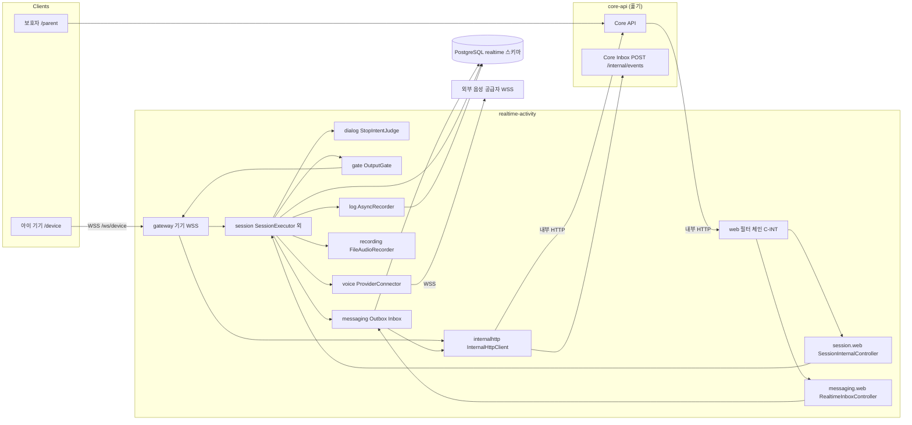
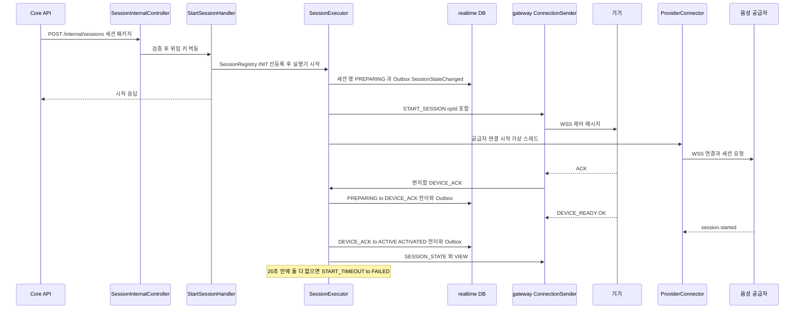
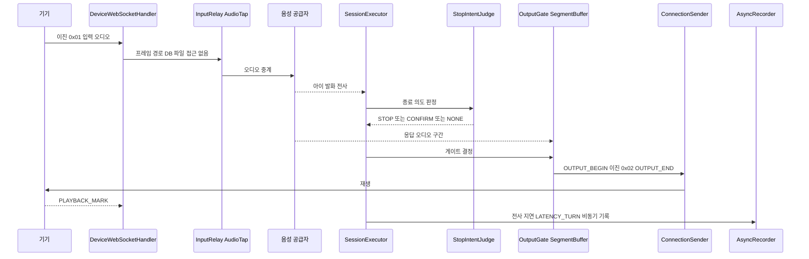
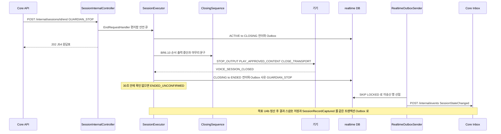
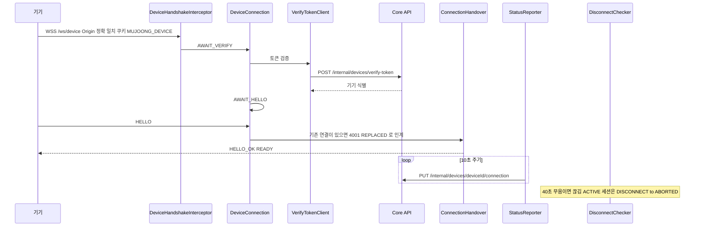
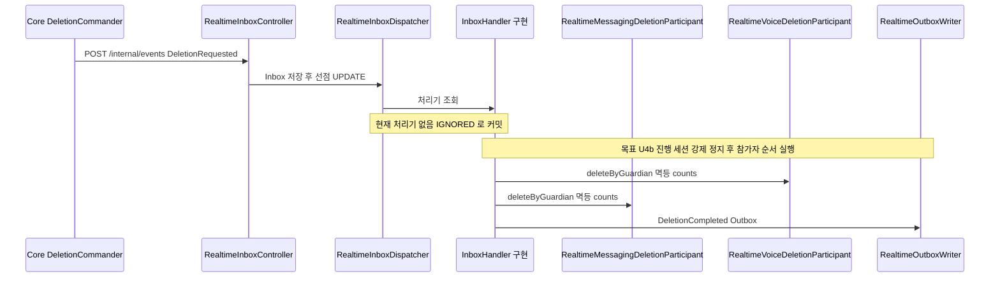

# 아키텍처 (Architecture)

> 기준 커밋 `3748083` · 집중 스캔. Realtime 앱 내부는 깊게, Core · 프런트 · 인프라는 경계만 본 결과다. 패키지별 책임 · 의존 표는 `component-inventory.md`, API 상세는 `api-documentation.md`에 있고 여기서는 구조와 흐름만 다룬다.

## Architecture Analysis

### System Overview

무중 백엔드는 Gradle 멀티 프로젝트 `mujoong-backend` 하나에 **두 개의 독립 배포 Spring Boot 앱**(Core API · Realtime Activity)과 **공유 계약 라이브러리**(`contract-model`)를 둔다. 두 앱은 PostgreSQL 한 대를 쓰지만 스키마(`core` · `realtime`)와 DB 역할을 나누고, 서로의 코드 · 스키마를 참조하지 않는다(ArchUnit으로 강제). 통신은 (1) 동기 내부 HTTP(`X-Internal-Token`)와 (2) Outbox → HTTP → Inbox 영속 이벤트 두 가지뿐이다.

Realtime은 기기 WSS 연결과 외부 음성 공급자 WSS를 동시에 붙잡는 **상태 보유(stateful) 단일 인스턴스** 앱이다(`@SingleInstanceAssumption`). 세션마다 직렬 실행기 하나가 편지함을 소비하며 상태 전이의 유일한 승자가 된다.

### Architectural Style

**계약 우선 2-서비스 구성 + 각 앱 내부는 패키지 단위 모듈러 모놀리스, 앱 사이 이벤트 구동(Outbox/Inbox).** 근거:

- 배포 단위 분리: `realtime-activity.jar`(포트 8081, 관리 9090)와 core-api가 각자 bootJar · Dockerfile을 가진다.
- 데이터 소유 분리: Realtime은 `realtime` 스키마만(`default_schema: realtime`, 역할 `realtime_app`), core 참조 금지(`RealtimeArchTest.realtimeNeverReferencesCoreCodeOrTheCoreSchema`).
- 계약 정본이 코드 밖 `contracts/`(OpenAPI · AsyncAPI · JSON Schema 51개)에 있고, 공통 이름은 `contract-model`(Spring · JPA 의존 금지)에만 둔다.
- 앱 내부는 계층형이 아니라 업무 패키지(`session` · `gateway` · `voice` · `gate` · `log` · `messaging` …)로 나뉜다.
- 동시성 모델: 세션당 액터형 직렬 실행기(`SessionExecutor` + `SessionMailbox`), 연결당 송신 스레드, 이름 있는 주기 작업 스레드 5종, 가상 스레드(`TaskLauncher`).

### Component Relationships

텍스트 대체: 보호자는 Core에만, 기기는 Realtime `gateway`에 WSS로 붙는다. Core는 내부 HTTP로 Realtime `web` 필터 체인을 지나 `session.web`(세션 시작 · 끝내기 · 조회) 또는 `messaging.web`(Inbox)에 닿는다. `session` 실행기가 `dialog`(종료 의도) · `gate`(출력 관문) · `voice`(공급자 WSS) · `log` · `recording` · `messaging`(Outbox)을 부른다. `gate`의 통과 결과는 `gateway`를 거쳐 기기로 간다. `gateway`(토큰 검증 · 상태 보고)와 `messaging`(Outbox 송신)은 `internalhttp`로 Core를 부른다. 영속은 모두 `realtime` 스키마다.

### Data Flow

1. **제어 경로(동기)**: Core → `POST /internal/sessions` → `StartSessionHandler`가 `SessionRegistry`에 INIT 선등록 → 실행기가 세션 행 생성 · START_SESSION 송신. 이후 사건은 모두 `SessionMailbox`(안전 L0H 무제한 · 일반 L0N 1,000)로 들어가 실행기 한 스레드가 처리한다.
2. **전이 기록**: 한 전이 = 한 짧은 트랜잭션(`TransitionService`/`SessionTransitions`) 안에서 세션 행 갱신 + `RealtimeOutboxWriter`로 `SessionStateChanged` 삽입(활성 트랜잭션 필수). 전이 승자만 부수 효과를 실행한다.
3. **이벤트 송신(비동기)**: `RealtimeOutboxSender`(전용 스레드, `SKIP LOCKED`)가 Outbox 행을 Core `POST /internal/events`로 보낸다. 제어 이벤트는 `ControlEventRearm`이 재무장한다.
4. **이벤트 수신**: Core → `POST /internal/events` → `RealtimeInboxReceiver` 저장 → `RealtimeInboxDispatcher`(선점 UPDATE)가 `InboxHandler`로 배분. 처리기가 없으면 IGNORED로 커밋. `RealtimeInboxRepoller`가 남은 행을 다시 집는다.
5. **오디오 경로(프레임 경로)**: 기기 이진 프레임 0x01 → `InputRelay`/`AudioTap` → 공급자. 공급자 출력 → `OutputGate`/`SegmentBuffer`(20초 상한) → `ConnectionSender` → 기기 0x02. 프레임 경로에서는 JDBC · 파일 · Outbox 접근 금지(ArchUnit) — 기록은 `AsyncRecorder` · `FileAudioRecorder` 전용 스레드로 넘긴다.
6. **조회**: Core → `GET /internal/sessions/{id}/view?sinceSeq` → `SessionViewQuery`가 전사 · 끊김 구간을 묶어 돌려준다.

### Key Design Decisions

| 결정 | 근거(코드) | 함의 |
|---|---|---|
| 세션당 직렬 실행기 + 편지함(액터형) | `SessionExecutor` · `SessionMailbox` · `SessionRegistry` | 잠금 없이 경쟁 사건을 정렬. 대신 실행기 클래스가 커짐(1,832줄) |
| 전이와 이벤트를 같은 트랜잭션에 (Transactional Outbox) | `RealtimeOutboxWriter`가 활성 트랜잭션 요구 | 전이 손실 · 유령 이벤트 없음. 송신은 최소 1회 → 수신 측 멱등 필요 |
| 앱은 Flyway를 실행하지 않음 | `spring.flyway.enabled: false`, `SchemaVersionCheck`가 이력 표만 읽음 | 마이그레이션은 migrate 컨테이너(`mujoong_owner`)가 적용. 기동 시 스키마 판 불일치면 거부 |
| 시간 값 단일 정본 | `contracts/timing.md` ↔ `application.yml` ↔ `RealtimeProperties`, `ConfigKeyContractTest` · `TimeLiteralScanTest` | 새 시간 키는 세 곳을 함께 고쳐야 함 |
| 시계 추상화 | `MujoongClock` · `TimerDriver` · `TimerClocks`(safety · 기타), 시스템 시계 직접 읽기 금지(ArchUnit) | 결정적 시험(`ManualTime` · `MutableClock`) 가능 |
| 공급자 SDK 미사용 · 단일 요청 생성 경로 | JDK `java.net.http.WebSocket`, `ProviderRequestFactory`, 호스트 허용 목록 코드 상수 | 공급자 교체 · 감사 용이. 요청 모양 변경은 팩토리 한 곳 |
| Spring Security 없음 | 보안 체인은 내부 토큰 필터(C-INT)와 WSS 핸드셰이크(Origin · 쿠키 · Core 토큰 검증)뿐 | 공격면 축소. 내부 포트 노출 통제는 인프라(Nginx · Compose)에 의존 |
| 단일 인스턴스 가정 | `@SingleInstanceAssumption`, `SingleInstanceMarkerTest` | 메모리 상태(레지스트리 · 소켓) 수평 확장 불가. 확장 시 재설계 필요 지점이 표식으로 남아 있음 |
| 재시작 시 비종료 세션 정리 | `RealtimeStartupSequence` S2 ~ S6: 비종료 세션 → FAILED(SERVER_RESTART) | 재시작은 진행 세션을 잃는다(의도된 단순화) |

### Improvement Opportunities

- **`SessionExecutor` 비대화 억제**: 판정은 순수 클래스(`StopIntentJudge`, 되살릴 `JoinTracker`)로 빼고 실행기는 배선만 하는 기존 패턴을 U4b에서도 지키는 것이 바람직하다(결정은 functional-design 몫).
- **사유 결정 위치**: `TransitionTable.END_REASONS`가 도착 상태 → 사유를 고정한다. 같은 CLOSING → ENDED라도 사유가 여럿이 되는 U4b 설계와 맞지 않으므로 사건(Trigger)이 사유를 지니는 모양으로 옮겨야 한다.
- **Inbox 처리기 공백**: `InboxHandler` 구현이 `DeviceReleasedHandler` 하나뿐이라 `DeletionRequested`가 조용히 IGNORED가 된다.
- 위 항목들의 근거 위치는 `code-quality-assessment.md`에 있다.

## Interaction Diagrams

아래 다이어그램은 **현재 코드(U1 · U3)** 기준이다. U4b가 바꾸거나 새로 만드는 지점은 각 다이어그램 아래 「U4b 변경점」에 따로 적었다.

### 1. 세션 시작 → 기기 ACK → ACTIVE

텍스트 대체: Core가 세션 패키지를 보내면 컨트롤러 → `StartSessionHandler`가 레지스트리에 INIT으로 선등록하고 실행기를 띄운다. 실행기는 PREPARING 행과 `SessionStateChanged` Outbox를 한 트랜잭션에 쓰고 START_SESSION을 기기로, 공급자 연결을 병행한다. 기기 ACK → DEVICE_ACK, 그리고 DEVICE_READY(OK)와 공급자 `session.started`가 모두 오면 ACTIVATED → ACTIVE. 20초(`device-ack-timeout`) 안에 못 채우면 FAILED(DEVICE_NO_ACK 또는 PROVIDER_UNAVAILABLE), 공급자 실패면 즉시 FAILED.

U4b 변경점: ACTIVATED의 도착이 ACTIVE에서 **WAITING_CHILD**로 바뀌고, 시작 안내 재생 → `JoinTracker` 판정 → ACTIVE 또는 DECLINED가 뒤따른다(설계 3.1). 참여 대기 동안 공급자 응답은 막는다.

### 2. 음성 한 턴 (ACTIVE)

텍스트 대체: 입력 프레임은 `InputRelay`로 공급자에 흐른다(프레임 경로는 DB · 파일 · Outbox 금지). 아이 발화 전사가 오면 실행기가 `StopIntentJudge`로 판정한다. 공급자 응답은 `OutputGate`/`SegmentBuffer`를 지나 `ConnectionSender`가 OUTPUT_BEGIN · 0x02 · OUTPUT_END로 기기에 보낸다. 전사 · 지연은 `AsyncRecorder`, 원음은 `FileAudioRecorder` 전용 스레드가 기록한다. 현재 STOP이면 출력만 막고 ACTIVE를 유지(`stopIntent`), CONFIRM은 `CHILD_STOP_UNCLEAR` 이벤트만, 적극적 계속이면 `CHILD_STOP_LIFTED`로 푼다(`SessionExecutor.java:811-838`).

U4b 변경점: STOP → CLOSING(CHILD_STOP), CONFIRM → 승인 확인 질문 재생 → 대답으로 확정 또는 대화 지속. 공백 4분 경고 · 6분 종료(SILENCE)와 점선 10초 기술 일시정지가 더해진다.

### 3. 끝내기 → CLOSING → ENDED, 그리고 SessionRecordCaptured (Outbox)

텍스트 대체: Core 끝내기 요청 → `EndRequestHandler`가 안전 큐로 넣고 J54 응답표대로 응답(현재 `CONSENT_WITHDRAWN`은 400). 실행기가 ACTIVE → CLOSING을 기록하고 `ClosingSequence`가 BR6.10 순서(출력 중단 → 마무리 승인 문구 → CLOSE_TRANSPORT)를 수행한다. 기기의 VOICE_SESSION_CLOSED로 ENDED, 30초(`closing-confirm`) 안에 없으면 ENDED_UNCONFIRMED. 모든 전이의 `SessionStateChanged`는 Outbox 송신기가 Core Inbox로 보낸다.

U4b 변경점(현재 없음): 종료 후 정산(`record-settle`) → 결과 입력 스냅숏 표(realtime V3) 저장 → `SessionRecordCaptured`를 Outbox로 1회 발행. 현재 이 이벤트를 쓰는 Realtime 코드가 없다. CHILD_STOP · SILENCE · CONSENT_WITHDRAWN · DECLINED에도 같은 마무리 인사 1회. 사유는 사건이 정한다.

### 4. 기기 연결 (기기 등록 이후의 연결 · 인계 · 끊김)

기기 **등록**(8자리 코드 · claim)은 Core의 책임이다(`contracts/device-api.yaml`, 이번 스캔에서 깊게 보지 않음). Realtime은 등록된 기기의 **연결**을 맡는다.

텍스트 대체: 기기가 Origin · 쿠키를 갖춰 `/ws/device`에 붙으면 AWAIT_VERIFY → Core `verify-token`으로 검증 → AWAIT_HELLO → HELLO 수신 시 `ConnectionHandover`가 이전 연결을 4001 REPLACED로 닫고 HELLO_OK → READY. `StatusReporter`가 10초마다 Core에 연결 상태를 보고하고, `DisconnectChecker`가 40초 무음을 끊김으로 판정한다. 끊김 시계는 현재 ACTIVE에서만 유효(`onDisconnectCheck`, `SessionExecutor.java:1480`). Core가 기기를 해제하면 `DeviceReleased` 이벤트가 Inbox → `DeviceReleasedHandler`로 들어온다.

U4b 변경점: 끊김 처리를 WAITING_CHILD까지 넓힌다(US6.6).

### 5. 계정 삭제 (DeletionRequested → DeletionCompleted)

텍스트 대체: Core `DeletionCommander`가 `DeletionRequested`를 보내면 Realtime Inbox에 저장되고 디스패처가 처리기를 찾는다. **현재는 처리기가 없어 IGNORED로 커밋**된다. 두 참가자(`RealtimeMessagingDeletionParticipant` · `RealtimeVoiceDeletionParticipant`, 멱등 · `Map<String,Integer>` counts 반환)는 준비돼 있지만 부르는 곳이 없고, 세션 행을 지우는 참가자는 없다. U4b 목표는 처리기 신설: 진행 세션 강제 정지(`deletion-stop-wait`) → 참가자 순서 실행 → `DeletionCompleted` Outbox 발행.

## Sources
- 개발자 스캔 `developer-scan.md` (Packages Found · APIs Discovered · Handoff 1 ~ 5)
- `TransitionTable.java` 20 ~ 100행, `application.yml` 1 ~ 80행, `realtime-activity/build.gradle.kts` 직접 확인
- `docs/units/u4b/design.md` 1절(U4b 변경점 서술용)
