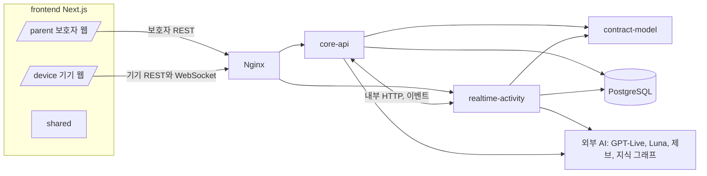
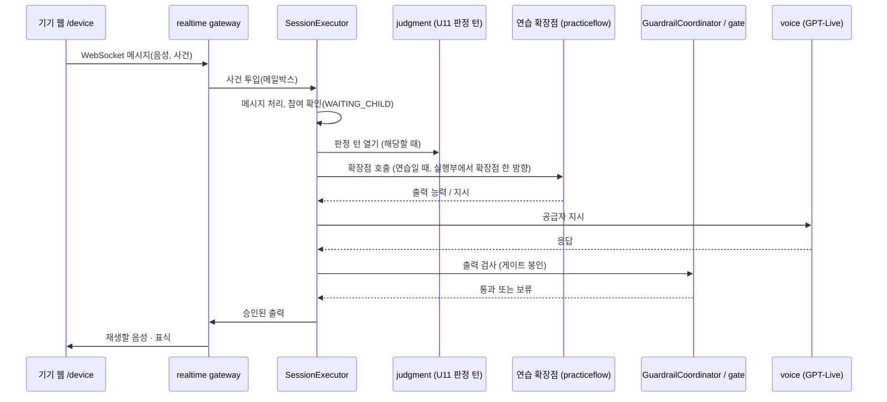
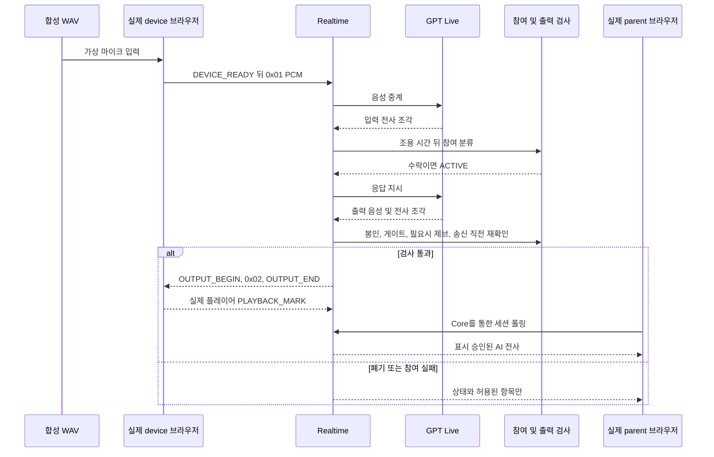
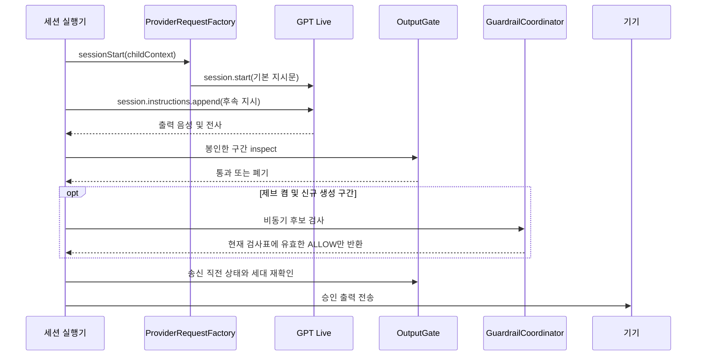

## Architecture Analysis

> 기준: 커밋 570a625. 컴포넌트 목록은 `component-inventory.md`, 외부 접점은 `api-documentation.md`가 정본이다.

### System Overview

한 저장소 안에 백엔드 두 앱(core-api, realtime-activity), 그들이 공유하는 계약 라이브러리(contract-model), 프런트 한 앱(Next.js, `/parent` · `/device`), 개발 도구(tools), 배포 구성(infra), 계약 문서(contracts)가 있다. 두 앱은 같은 PostgreSQL을 쓰되 서로의 코드나 표를 읽지 않고 내부 HTTP와 이벤트(발신함 · 수신함)로만 통신한다(R-F5, ArchUnit이 강제).

### Architectural Style

Hybrid: 모듈형 멀티 프로젝트(Gradle) 위의 **두 개의 배포 가능한 서비스**(core-api, realtime-activity) + 별도 웹 프런트 + Nginx 앞단. 근거: `backend/settings.gradle.kts`의 모듈 구성, 모듈별 Dockerfile, ArchUnit의 상호 참조 금지 규칙. 각 앱 안은 기능 패키지(`kr.mujoong.core.*`, `kr.mujoong.realtime.*`) 구조이고 경계 인터페이스는 `*Port`, 구현은 `*Adapter`로 둔다.

### Component Relationships



텍스트 대체: 보호자 웹은 core-api로, 기기 웹은 core-api(REST)와 realtime-activity(WebSocket)로 Nginx를 거쳐 간다. 두 앱은 내부 HTTP와 이벤트로만 통신하고 contract-model만 공유한다. 프런트의 `/parent` ↔ `/device` ↔ `shared`는 서로 import 금지다(R-F4, ESLint).

### Data Flow

- 보호자 요청은 core-api 컨트롤러(기능 패키지 `web`) → 서비스 → 저장소 순으로 흐르고, 오류는 `CoreApiException.of(ErrorCode)` → `ApiExceptionHandler` → `{code, message, traceId}` 봉투로 나간다.
- 세션 실행은 realtime-activity 한 곳에서 단일 스레드 메일박스 모델로 돈다. 사건(기기 메시지, 시계 만료, 공급자 응답, 내부 호출)이 `SessionExecutor`에 들어가 구역별 처리를 거친다. 구역 구성은 `code-structure.md`.
- 앱 사이 비동기 전달은 발신함 · 수신함(`messaging`, `contracts/events.asyncapi.yaml`)이다.

### Interaction Diagrams

**1) 기기 한 턴(자유 대화)**: 처리 순서는 현재 `SessionExecutor` 한 파일의 위아래 위치로만 드러난다(제안서 2절). 아래는 구역 순서를 따른 흐름이다.



**2) 보호자 활동 시작과 정리**

```mermaid
sequenceDiagram
  participant Par as /parent 웹
  participant Core as core-api
  participant RT as realtime-activity
  participant Dev as 기기
  Par->>Core: 활동 시작 요청
  Core->>RT: 내부 HTTP 시작(시작 패키지)
  RT-->>Core: 접수 결과
  Dev->>RT: WebSocket 대화
  RT-->>Core: 이벤트(발신함, 수신함)
  Par->>Core: 라이브 조회 / 종료
  Core-->>Par: 상태, 결과, 리포트
```

(1)은 핸드오프 구역 표, (2)는 `contracts/` 이름과 핸드오프 API 목록에서 정리한 흐름이다. 개별 엔드포인트 수와 core-api 내부는 이번 스캔에서 깊게 읽지 않았다.

### Key Design Decisions

- 실행부 → 확장점 한 방향만 둔다(`PracticeFlowArchTest`의 `EXECUTOR_KNOWS_NO_FLOW`). 확장점은 실행부를 부르지 않고 정해진 출력 능력만 낸다.
- 단일 스레드 메일박스 + 단일 인스턴스 가정 표식(`SingleInstanceAssumption`, 시험 표 SI-2 · SI-9가 `SessionExecutor`를 직접 가리킴).
- 시각은 `MujoongClock` 주입, 시간 값은 `mujoong.timing.*` 설정 키에서만 읽는다(R-F6, R-F7).
- 계약(`contracts/`)과 코드는 대조 시험이 묶는다(`ConfigKeyContractTest`, `ErrorCodeTest` 등).
- 외부 AI 호출부는 두 앱에 각자 두고 공용 계약 모듈에 두지 않는다.

### Improvement Opportunities

이번 의도의 후보이며 자세한 근거는 `code-quality-assessment.md`다.

- `SessionExecutor`를 역할별 협력 객체로 나누고 분배 순서를 한 곳에서 읽히게 한다.
- `realtime.practice`(레거시) / `realtime.practiceflow`(새 흐름)의 이름 혼동을 줄인다.
- 프런트 화면 번호 · 유닛 번호 이름을 기능 이름으로 바꾸고 요청 · 오류 · 이동 처리 위치를 통일한다.

## 집중 조사 보강 — 261020-synthetic-voice-e2e

앞 구조·수치는 570a625의 이력이다. 현재 소스에서 실제 기능 경로는 parent/features, parent/common, device/features로 정리됐고 SessionExecutor는 JoinFlow 등 협력 객체를 사용한다. 이번 검증 범위는 timestamp의 개별 파일뿐이다.

### Interaction Diagrams — 합성 말소리 진단 경로



텍스트 대체: 합성 WAV는 실제 브라우저 마이크 캡처를 거쳐 서버와 공급자에 간다. 참여 수락 뒤 생성 응답은 완전성·금지 패턴·제브·송신 직전 검사에 통과해야 기기 음성과 보호자 AI 글로 나간다. 보호자 경로는 Core 내부 조회를 거치며 위 그림의 R 화살표는 이를 축약했다. Mermaid의 participant, alt/else/end 균형과 화살표 문법을 수동 확인했다.

### 직접 probe와 앱 경로의 차이

GptLiveProbe는 운영 공급자 송수신 부품을 재사용하지만 공급자에 직접 붙는다. 앱의 JoinFlow, OutputGate, SessionViewQuery, Web Audio는 이 probe의 경로에 없다. DeviceSimulator는 앱 서버를 통과하지만 톤을 입력하고 재생 표식을 타이머로 만든다. 어느 한 도구의 성공도 위 전체 거래의 성공 근거가 되지 않는다.

### 관측 경계

WAITING_CHILD의 아이 전사는 저장하지 않고 참여 판단에만 쓰며 GPT 자동 출력도 보류한다. ACTIVE에서 입력 전사 delta는 열린 출력 구간을 sealEarly로 닫을 수 있다. 출력이 마지막 조각 후 800ms만큼 조용하지 않았다면 complete=false가 되어 GATE_EMPTY로 폐기된다. 이는 교차 조각 무응답의 재현 후보이며 이번 수동 테스트의 확정 원인은 아니다.

## 집중 조사 보강 — 261020-service-guardrail-replac

기준: 2026-10-20, 커밋 2e3d7b0. 이전 절은 이전 의도의 기록으로 보존했다. 이번 검증 범위는 timestamp의 개별 파일에 한정한다.

### 현재 연결점과 교체 경계

ProviderRequestFactory.sessionStart → DialogInstructions.role + JOIN_FIRST_QUESTION이 현재 기본 지시를 만든다. ChildContext는 이름·나이·관심사만 제공하며 공급자 요청 형식은 네 type으로 제한된다. 새 지시문은 이 경계의 정책 자원/조립 후보이고 ZIP JSON 자체를 API 본문으로 보내지 않는다. 시작 안내는 JoinFlow가 승인 음성을 재생하고 참여를 확인하므로 모델 안내와 중복되지 않도록 서버 책임을 유지해야 한다. 이후 InstructionTemplates 및 연습 지시도 누적되므로 초기 프롬프트 교체만으로 정책 충돌이 사라지지는 않는다.

### Interaction Diagrams — 현행 가드레일 경로



텍스트 대체: 초기·후속 지시가 모델 출력을 만들고 서버가 봉인·사전 검사·필요한 JEV 검사·송신 직전 검사를 수행한다. JEV OFF 및 승인 원문 일치 생략 경로가 있으므로 모든 출력이 JEV를 통과한다고 단정하지 않는다. opt/end·참여자·화살표 문법은 수동 확인했다.

