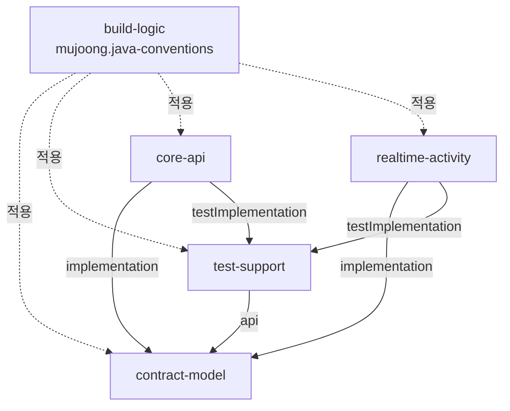

# 의존 관계 (Dependencies)

> 기준: 커밋 `72d7034`, 2026-10-15 전체 재스캔. 판 번호는 [technology-stack.md](technology-stack.md), 엔드포인트는 [api-documentation.md](api-documentation.md)가 정본이다.

## 1. 내부 모듈 의존 (빌드)

텍스트 대안: `core-api`와 `realtime-activity`는 `contract-model`을 implementation으로, `test-support`를 testImplementation으로 쓴다. `test-support`는 `contract-model`을 api로 노출한다. `build-logic` 규약 플러그인은 네 모듈 모두에 적용된다. `core-api`와 `realtime-activity` 사이에는 빌드 의존이 없다(ArchUnit · CI 불변식이 막음).

## 2. 런타임 의존 (앱 사이)

| 방향 | 수단 | 내용 |
|---|---|---|
| core-api → realtime-activity | 내부 HTTP | 세션 시작 · 종료 · 뷰 조회 |
| realtime-activity → core-api | 내부 HTTP | 기기 토큰 검증 · 연결 보고 · 연습 상황 조회 |
| 양방향 | Outbox/Inbox(HTTP `/internal/events`) | 이벤트 6종 |
| 두 앱 → PostgreSQL | JDBC | 같은 인스턴스, 스키마 · 역할 분리(`core`/core_app, `realtime`/realtime_app) |
| migrate 이미지 → PostgreSQL | Flyway | `infra/migrate/flyway-{core,realtime}.conf` |
| frontend → 두 앱 | HTTPS(Nginx 경유) | `/parent` → core REST, `/device` → core 기기 REST + realtime WS |

## 3. 외부 의존 (런타임 서비스)

| 의존 | 사용 앱 | 접점 | 비고 |
|---|---|---|---|
| 음성 AI 공급자 | realtime-activity | `voice.ProviderClient`, 호스트 고정 `api.openai.com` | 선 형식 자체 정의(TD-2) |
| 텍스트 AI | core-api | `textai.TextAiProvider`, `result.ResultTextProvider` | 운영 어댑터 없음(TD-1) |
| 연습 판정 · 단서 공급자 | realtime-activity | `EvaluationProvider`, `CueProvider` | 기본 미연결(TD-1) |
| Google OAuth | core-api | `identity.Google*` | |
| Web Push 서비스 | core-api | push2u, `notification.VapidPushSender` | 공개 DNS 정책 · 고정 HTTP 클라이언트 |
| Neo4j | core-api | `knowledge.KnowledgeGraphLookup` | 꺼짐, 어댑터 없음(TD-3) |

## 4. 외부 라이브러리 의존 (모듈별 주요)

| 모듈 | 주요 의존 |
|---|---|
| contract-model | Jackson 3(직접 import는 `kr.mujoong.contract.json` 한 곳). Spring · JPA 없음 |
| core-api | Spring Boot(webmvc · security · session-jdbc · data-jpa · jdbc · flyway · actuator · validation), PostgreSQL JDBC, Micrometer Prometheus, springdoc(dev · test), openhtmltopdf-pdfbox, push2u-core, HttpClient5 |
| realtime-activity | Spring Boot(webmvc · websocket · data-jpa · jdbc · flyway · actuator · validation), PostgreSQL JDBC, Micrometer Prometheus, JDK WebSocket |
| test-support | Testcontainers PostgreSQL, Java-WebSocket, JUnit |
| 백엔드 시험 공통 | JUnit 5 · AssertJ · Mockito · ArchUnit · json-schema-validator · JaCoCo |
| frontend | Next.js · React · react-query, 시험 Vitest · Testing Library · jsdom, 린트 ESLint |
| tools | ws, Vitest |

보안 판 고정: `build-logic`이 Jackson 2/3 BOM과 Tomcat embed를 상향 고정한다. 취약점 예외는 `ci/security-exceptions.yml`(만료 검사 `ci/security-gate.py`).

## 5. 변경 연쇄 (함께 바뀌어야 하는 것)

| 바꾸는 것 | 함께 바꿀 것 |
|---|---|
| `contracts/` 계약 | `contract-model` 타입 · `contracts/deviations.md` · 계약 시험(ContractFilesTest 등) · 프런트 `shared/protocol` 파서 |
| 음성 공급자 선 형식 | `realtime/voice/*` · `tools/fake-provider/` · `backend/test-support/.../provider/` |
| 시간 값 | 두 앱 `application.yml` · `contracts/timing.md` · `frontend/src/shared/timing/timing-defaults.json` |
| DB 스키마 | 다음 번호(core V8 · realtime V5) · 제약 강화 시 `infra/migration-approvals.txt` |
| 파일 추가 · 이동 | `backend/coverage-scope/*.txt` · `frontend/coverage-scope/*.json` · 유닛 시험 태그 |
