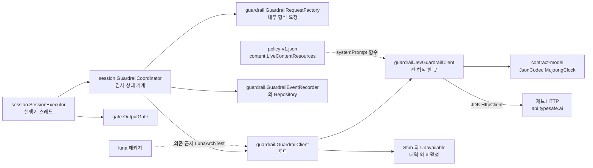
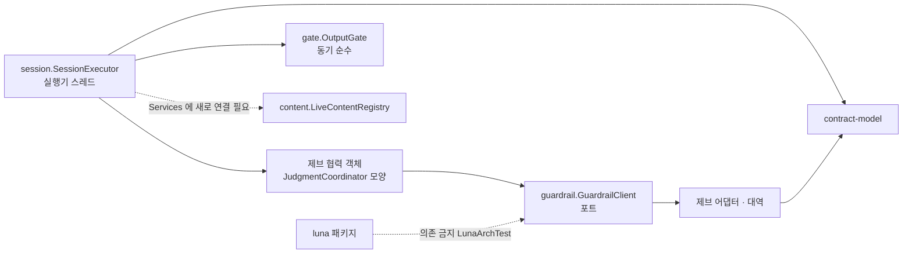
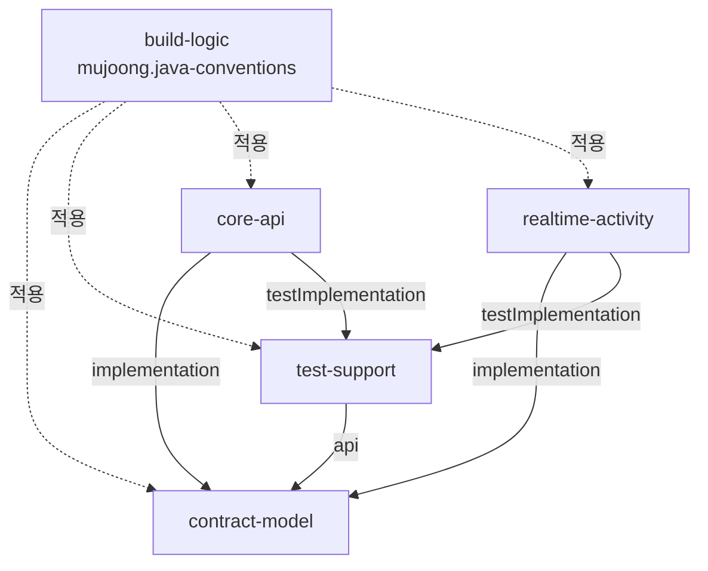
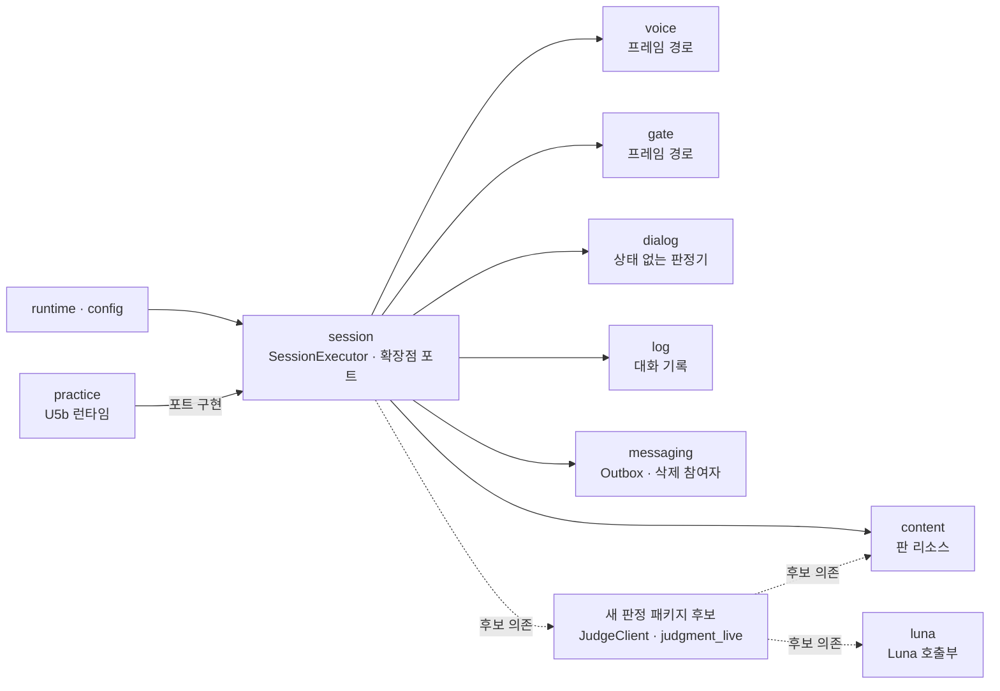

> 현재 범위의 정본은 바로 아래 "제브 어댑터 선 형식 집중 갱신" 절이다(`backend/realtime-activity` · `contracts` · `docs/units/u13` 한정, 2026-10-18, HEAD `421e1ad`). 그 뒤 구현 전 U13 절 · U14 절 · U15 절 · 원문은 보존 이력이며 재검증 범위는 timestamp에 한정한다.

## 제브 어댑터 선 형식 집중 갱신 — 제브 단계의 의존 방향 (261017-jev-adapter-format, 2026-10-18)

텍스트 대안: 실행기는 `OutputGate`(동기)와 검사 협력 객체 `GuardrailCoordinator`를 부르고, 협력 객체는 팩토리로 내부 형식 요청을 만든 뒤 포트 `GuardrailClient` 뒤의 구현(운영 `JevGuardrailClient`, 대역 `StubGuardrailClient`, 비활성 `UnavailableGuardrailClient`)을 비동기로 부르며 결과를 `GuardrailEventRecorder`로 기록한다. 어댑터는 `contract-model`의 `JsonCodec` · `MujoongClock`과 JDK `HttpClient`만 쓰고, 정책 리소스의 시스템 지시를 `GuardrailConfiguration`이 함수로 넘겨 받는다. `luna` 패키지는 `guardrail`에 의존할 수 없다(`LunaArchTest`).

- 공급자 선 형식을 아는 코드는 `JevGuardrailClient` 한 파일이다(`requestBody` · `convert` · `CHECK_PATH`). 포트 · 협력 객체 · 기록기는 내부 형식(`GuardrailRequest` · `GuardrailVerdict`)에만 기댄다. 그래서 선 형식을 바꿔도 포트가 그대로이면 소비자 쪽은 닿지 않지만, 소비자가 요구하는 값(`reasonCode` · `policyVersion`)을 응답에서 채우는 방식은 어댑터 책임으로 묶여 있다(JEV-F2).
- `GuardrailPackageArchTest`가 `guardrail` 패키지 의존 경계를 강제한다. `gate` · `voice`는 JDBC · 저장소 · Outbox를 참조할 수 없어(`RealtimeArchTest`) 기록 저장소 · 기록기는 `guardrail` 패키지에 있다. 제브 호출부는 `contract-model` 같은 공용 모듈에 두지 않고 realtime에 있다(R-F5 · 팀 학습).
- 비밀 이름 `JEV_API_KEY` · 환경 변수 `JEV_MODE` · `JEV_BASE_URL` · `JEV_MODEL`: 비밀 이름 목록(R-M9: `README.md` · `log-hygiene-check` · `render-env` · `infra-validate` · `ci.yml` · `image-checks.sh` · `gen-env.sh` 등)에는 `JEV_API_KEY` · `JEV_BASE_URL`이 있고(`image-checks.sh:271` 자리값, `gen-env.sh`는 검증 스택 빈 값 — 얕게 확인), 새 비밀 이름은 이번에 확인한 범위에서 없다.
- 마이그레이션: realtime V6(`V6__u13_jev_guardrail.sql`)이 사용됨. 다음 번호는 V7 이상이며 병합 순서는 번호 순서를 따른다(Flyway `outOfOrder` 꺼짐, R-M2).

### 변경 연쇄 (선 형식 또는 설정 키를 바꿀 때 함께 보는 곳, 사실만)

| 바꾸는 것 | 함께 닿는 곳 |
|---|---|
| 요청 본문 · 경로 | `JevGuardrailClient.requestBody/CHECK_PATH/endpointOf`, `JevGuardrailClientTest` 1 · 3 · 6(경로 참조 114 · 217줄), `JevLiveProbe`(어댑터 호출), `docs/units/u13/{brief,design,report}.md`의 경로 서술, 필요 시 `contracts/ai-io.md` · `deviations.md` |
| 응답 읽기 · 변환 | `JevGuardrailClient.convert`, `JevGuardrailClientTest` 2 · 3 · 7 · 8, `guardrail-result.schema.json` 첫 예시(시험이 그대로 전송), `U8ContractSchemasTest` |
| 분류 체계(7개 → 다른 개수) | `policy-v1.json` `categories` · `modes`, `LiveContentResources.GUARDRAIL_CATEGORY_COUNT`, `guardrail-result.schema.json` enum, `JevGuardrailClient.CATEGORIES`, `LiveContentRegistryTest` · `U8RealtimeStartupChecksTest` · `U8ContractSchemasTest` |
| `GuardrailProperties` 키 추가(예: 문턱) | `GuardrailProperties` · `application.yml` · `ai-io.md` 10.11 · `deviations.md` U13 행 · `new GuardrailProperties(...)` 시험 호출부 5곳 · 어댑터 생성자 또는 `GuardrailConfiguration` 배선(`ConfigKeyContractTest`는 레코드와 yml이 맞으면 통과) |
| 어댑터 `.orTimeout(...)` 줄 문자열 | `TimeLiteralScanTest` 허용 목록(91줄) |
| `GuardrailVerdict`에 필드 추가 | 포트 소비자(`GuardrailCoordinator`) · `FakeGuardrailClient` · `StubGuardrailClientTest`(`GuardrailVerdict.block("SELF_HARM", ...)`처럼 임의 범주도 만든다) · `JevLiveProbe`(`v.categories()`) |
| `guardrail_event` 칸 추가 | 새 마이그레이션(V7 이상), `GuardrailEventRecord` · `Recorder` · `Repository`, `GuardrailEventSchemaIT`/`GuardrailEventRepositoryIT`, 하드코딩 판 번호 단언, `infra/migration-approvals.txt`(제약 강화인 경우) |
| 계약 문서 변경 | R-M10: 같은 작업에서 `contracts/`도 고치며 `ci-gate` 전 작업이 돈다 |

---

## 구현 전 U13 의존 방향 (2026-10-17 — 이력)

> 구현 전에는 `guardrail` 패키지와 협력 객체가 후보였다. 현재 모양은 위 절이 우선한다. 아래의 "`LiveContentRegistry` 운영 호출자 없음 · `Services`에 없음"은 구현 전 사실이고, 구현 뒤에는 `ApprovedVerbatimPort`와 `guardrail.verbatimSource` 호출이 보인다(이번 스캔은 이름만 확인).

텍스트 대안: 실행기는 `OutputGate`(동기)와 제브 협력 객체를 부르고, 협력 객체는 포트 `GuardrailClient` 뒤의 어댑터 · 대역을 비동기로 부른다. `luna` 패키지는 `guardrail`에 의존할 수 없다(`LunaArchTest.LUNA_FORBIDDEN_DEPENDENCIES`). `LiveContentRegistry`는 운영 호출자가 없고 `SessionExecutor.Services`에 연결되어 있지 않다(G10).

- `guardrail` → `luna` · `voice` · `judgment` 의존을 막는 규칙은 아직 없다. 의도적으로 막는 ArchUnit 규칙을 더하는 것을 검토한다(R-F2는 기존 규칙 약화 금지이지 추가 금지가 아니다). (구현 뒤 `GuardrailPackageArchTest`가 있으나 규칙 내용은 이번 스캔에서 읽지 않았다.)
- 제브 호출부는 `contract-model` 같은 공용 모듈에 두지 않고 realtime에 둔다(R-F5 · 팀 학습). `gate` · `voice`는 JDBC · 저장소 · Outbox를 참조할 수 없고(`RealtimeArchTest`), `luna`는 `voice` · 로그 프레임워크 · Jackson을 참조할 수 없다. 그래서 기록 저장소 · 기록기는 `guardrail` 새 패키지에 둔다.
- `RealtimeStartupChecks.Inputs` 레코드에 필드를 더하면 이 생성자를 쓰는 시험(`U8RealtimeStartupChecksTest` · `RealtimeStartupChecksTest` · `OpenAiKeyStartupChecksTest` 등)이 컴파일에 영향을 받는다. 오버로드 유지 패턴을 따른다.
- 비밀 이름 `JEV_API_KEY`는 R-M9 목록(`README.md` · `log-hygiene-check` · `render-env`(OPTIONAL) · `infra-validate`(realtime만) · `ci.yml` · `image-checks.sh` · `gen-env.sh`(검증 스택은 빈 값) 등)에 이미 있다. 새 비밀 이름은 없다. demo 프로필에서 필수로 바꾸는 규칙이 검증 스택과 맞는지는 읽지 않았다(G4).
- 마이그레이션 V6은 U12(V7)보다 먼저 병합되어야 한다(Flyway `outOfOrder` 꺼짐).

---

> 현재 범위의 정본(U14 갱신절, 보존 이력)은 바로 아래다. 그 뒤 원문은 보존 이력이며 재검증 범위는 timestamp에 한정한다.

## U14 집중 갱신 — 실제 의존

SessionResultHandler → ResultTextGateway, OutputChecker, CandidateScreen, CandidateRegistry, 결과/장면 저장소. CandidateRegistry → PracticeGoalRepository, PracticeAccountPort, CandidateEvidencePort, PragmaticsKnowledge. ReportAssembler → SceneChipMapper. U14 소유 이전 시 기존 import·서비스 생성자·시험 대역을 깨지 않게 경계를 제공해야 한다.

U15 SeedGenerationService → ChildKnowledgeService + Optional<CoreLunaClient> + SeedContentValidator이며 기능 비활성·키 없음은 정상 NONE이다. 후보 확정 이후 별도 실패 경계에서 호출하고 결과 상태와 결합하지 않는다. 후보 참조·버전과 활동 id를 안정적으로 묶어 재처리 시 중복 생성되지 않아야 한다.

GOAL_CANDIDATES/REJUDGMENT/RESULT_TEXT의 JOB_ATTEMPT 정책은 작업 수준에서 재시도한다. 안쪽 재시도를 더하지 않는다. 이전 전체 의존 목록은 이번에 전체 재확인한 것이 아니다.

---

# 의존 관계 (Dependencies)

> 최신 확인: 2026-10-16, HEAD 7e30ee8, U15 집중 분석. 아래 최신 절이 U15 관련 과거 설명보다 우선한다. 이전 분석 본문은 이력으로 보존하며 이번 범위 밖의 검증 주장은 shallow로 낮췄다.

## U15 의존과 선택적 구성

core-api → contract-model(운영), test-support(시험). PragmaticsKnowledge → JDBC + clock + properties + optional graph. CoreLunaClient → sanitizer + schemas + transport + event logger + clock + JsonCodec. DeletionCommander → ordered participants + TransactionTemplate.

OPENAI_API_KEY 없는 기본 CI에서 CoreLunaClient는 미구성이다. 생성 서비스는 이 경로를 지원해야 한다. Neo4j 사용 시 기존 NEO4J_AUTH 전달 배선을 core에도 연결해야 하며 새 비밀 이름을 만들지 않는다. 전체 저장소 무순환을 검증한 것은 아니다.

## 이전 분석 기록 — 2026-10-15, 현재 범위 밖은 재검증하지 않음

> 기준: 커밋 `72d7034`, 2026-10-15 전체 재스캔. 판 번호는 [technology-stack.md](technology-stack.md), 엔드포인트는 [api-documentation.md](api-documentation.md)가 정본이다.

## 1. 내부 모듈 의존 (빌드)

텍스트 대안: `core-api`와 `realtime-activity`는 `contract-model`을 implementation으로, `test-support`를 testImplementation으로 쓴다. `test-support`는 `contract-model`을 api로 노출한다. `build-logic` 규약 플러그인은 네 모듈 모두에 적용된다. `core-api`와 `realtime-activity` 사이에는 빌드 의존이 없다(ArchUnit · CI 불변식이 막음).

## 2. 런타임 의존 (앱 사이)

| 방향 | 수단 | 내용 |
|---|---|---|
| core-api → realtime-activity | 내부 HTTP | 세션 시작 · 종료 · 뷰 조회 |
| realtime-activity → core-api | 내부 HTTP | 기기 토큰 검증 · 연결 보고 · 연습 상황 조회 |
| 양방향 | Outbox/Inbox(HTTP `/internal/events`) | 이벤트 6종 |
| 두 앱 → PostgreSQL | JDBC | 같은 인스턴스, 스키마 · 역할 분리(`core`/core_app, `realtime`/realtime_app) |
| migrate 이미지 → PostgreSQL | Flyway | `infra/migrate/flyway-{core,realtime}.conf` |
| frontend → 두 앱 | HTTPS(Nginx 경유) | `/parent` → core REST, `/device` → core 기기 REST + realtime WS |

## 3. 외부 의존 (런타임 서비스)

| 의존 | 사용 앱 | 접점 | 비고 |
|---|---|---|---|
| 음성 AI 공급자 | realtime-activity | `voice.ProviderClient`, 호스트 고정 `api.openai.com` | 선 형식 자체 정의(TD-2) |
| 제브 안전 검사 (2026-10-18 보충) | realtime-activity | `guardrail.JevGuardrailClient`, 호스트 고정 `api.typesafe.ai` | 선 형식은 가정이며 공식 형식과 다름, 실호출 증거 없음(JEV-F11) |
| 텍스트 AI | core-api | `textai.TextAiProvider`, `result.ResultTextProvider` | 운영 어댑터 없음(TD-1) |
| 연습 판정 · 단서 공급자 | realtime-activity | `EvaluationProvider`, `CueProvider` | 기본 미연결(TD-1) |
| Google OAuth | core-api | `identity.Google*` | |
| Web Push 서비스 | core-api | push2u, `notification.VapidPushSender` | 공개 DNS 정책 · 고정 HTTP 클라이언트 |
| Neo4j | core-api | `knowledge.KnowledgeGraphLookup` | 꺼짐, 어댑터 없음(TD-3) |

## 4. 외부 라이브러리 의존 (모듈별 주요)

| 모듈 | 주요 의존 |
|---|---|
| contract-model | Jackson 3(직접 import는 `kr.mujoong.contract.json` 한 곳). Spring · JPA 없음 |
| core-api | Spring Boot(webmvc · security · session-jdbc · data-jpa · jdbc · flyway · actuator · validation), PostgreSQL JDBC, Micrometer Prometheus, springdoc(dev · test), openhtmltopdf-pdfbox, push2u-core, HttpClient5 |
| realtime-activity | Spring Boot(webmvc · websocket · data-jpa · jdbc · flyway · actuator · validation), PostgreSQL JDBC, Micrometer Prometheus, JDK WebSocket (제브 어댑터는 JDK `HttpClient`) |
| test-support | Testcontainers PostgreSQL, Java-WebSocket, JUnit |
| 백엔드 시험 공통 | JUnit 5 · AssertJ · Mockito · ArchUnit · json-schema-validator · JaCoCo |
| frontend | Next.js · React · react-query, 시험 Vitest · Testing Library · jsdom, 린트 ESLint |
| tools | ws, Vitest |

보안 판 고정: `build-logic`이 Jackson 2/3 BOM과 Tomcat embed를 상향 고정한다. 취약점 예외는 `ci/security-exceptions.yml`(만료 검사 `ci/security-gate.py`).

## 5. 변경 연쇄 (함께 바뀌어야 하는 것)

| 바꾸는 것 | 함께 바꿀 것 |
|---|---|
| `contracts/` 계약 | `contract-model` 타입 · `contracts/deviations.md` · 계약 시험(ContractFilesTest 등) · 프런트 `shared/protocol` 파서 |
| 음성 공급자 선 형식 | `realtime/voice/*` · `tools/fake-provider/` · `backend/test-support/.../provider/` |
| 시간 값 | 두 앱 `application.yml` · `contracts/timing.md` · `frontend/src/shared/timing/timing-defaults.json` |
| DB 스키마 | 다음 번호(core V8 · realtime V5 — 2026-10-18 보충: realtime은 V7 이상) · 제약 강화 시 `infra/migration-approvals.txt` |
| 파일 추가 · 이동 | `backend/coverage-scope/*.txt` · `frontend/coverage-scope/*.json` · 유닛 시험 태그 |

---

## U11 집중 갱신 (261016-u11-judgment-turn, 2026-10-16 스캔 — main 병합 때 보존한 절)

> main의 U14 · U15 갱신본을 바탕으로 두고, U11 작업 기록의 집중 스캔에서 갱신한 절만 아래에 보존했다. 줄 번호 · 커밋은 2026-10-16 `9bcc706` 기준이며 PR1(선 형식 정비) 이전 코드다.

## 6. (2026-10-16 갱신) realtime-activity 안 패키지 의존 · 구조 제약

텍스트 대안: 세션 실행기(`session`)가 공급자(`voice`) · 게이트(`gate`) · 대화 판정기(`dialog`) · 판 리소스(`content`) · 대화 기록(`log`) · 메시징(`messaging`)을 쓰고, 실행 배선(`runtime` · `config`)이 실행기를 만든다. 레거시 연습 런타임(`practice`)은 실행기의 확장점 포트를 구현한다. Luna 호출부(`luna`)는 지금 아무 패키지도 부르지 않는다. 점선은 U11이 만들 수 있는 새 판정 패키지의 후보 의존이며 설계 결정이 아니다.

구조 제약(ArchUnit, 바꾸지 않음 — R-F2):

| 규칙 | 위치 | U11 영향 |
|---|---|---|
| `luna`는 `voice` · 제브 · 로그 프레임워크 · Jackson 참조 금지 | `arch/LunaArchTest` L31 ~ L37 | 판정 조립 · 결과 해석은 `luna` 밖에 둔다 |
| `gate` · `voice`는 프레임 경로 — JDBC · 저장소 · Outbox 참조 금지 | `arch/RealtimeArchTest` L174 ~ L180 | `judgment_live` 저장소 · `JudgeClient` 구현은 `gate` · `voice` 밖에 둔다 |
| 시스템 시각 직접 읽기 금지(`NO_SYSTEM_TIME`) | `arch/RealtimeArchTest` | 판정 시각은 `MujoongClock` 주입 |
| 운영 코드가 시험 코드 참조 금지(`NO_TEST_CODE_IN_PRODUCTION`) | `arch/RealtimeArchTest` | 판정 대역은 시험 소스에 |
| 숫자 시간 리터럴 허용 목록(쓰이지 않는 항목도 실패) | `arch/TimeLiteralScanTest` | 응답 준비 대기 · 시한은 `timing().judgment()`에서만 |
| 단일 인스턴스 가정 표시 | `arch/SingleInstanceMarkerTest` | 판정 상태가 메모리에만 있으면 표시 대상인지 확인 |
| U8 판 리소스 경계 | `arch/U8LiveContentArchTest` | 판 리소스는 `content`를 거쳐 읽는다(본문 얕게 봄) |
