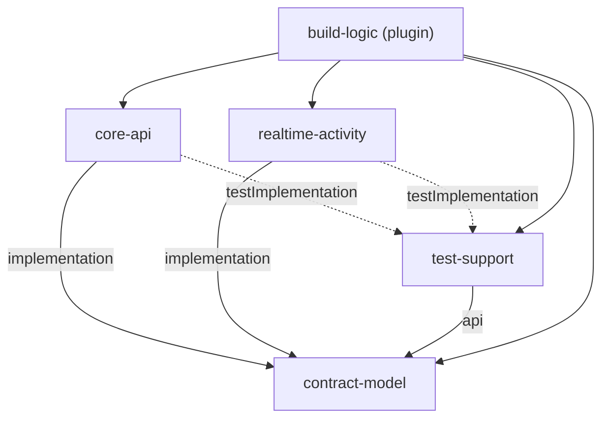

# 의존 관계 (Dependencies)

> 기준 커밋 `7a22b67`. 외부 라이브러리 판은 `technology-stack.md`에만 적는다.

## 빌드 모듈 의존

텍스트 대안: core-api와 realtime-activity는 contract-model을 implementation으로, test-support를 testImplementation으로 쓴다. test-support는 contract-model을 api로 다시 내보낸다. 모든 모듈은 build-logic 플러그인과 Spring Boot BOM 플랫폼을 쓴다.

- **core-api ↔ realtime-activity: 코드 의존 없음**(ArchUnit ①). 앱 사이는 내부 HTTP(`contracts/internal-api.yaml`)와 Outbox/Inbox 이벤트(`api-documentation.md` 3절)뿐.
- **시험 입력**: 백엔드 시험 태스크가 `contracts/` · `infra/postgres` · `infra/seed` · `infra/migrate` · `infra/seed-audio` · 두 앱의 `db/` 리소스를 입력으로 잡는다(바뀌면 다시 돈다).

## core-api 안 패키지 의존 (U6 관련)

| 쓰는 쪽 | 쓰이는 쪽 | 방식 |
|---|---|---|
| `record` | `messaging` (Inbox) | `SessionRecordCapturedHandler`가 Inbox 핸들러로 호출됨 |
| `record` | (구독자) | `ActivityRecorded` Spring 사건 발행 — 받는 쪽 0 |
| `practice` | `knowledge` | `PragmaticsKnowledge.pinVersion` · `requireVersion` |
| `practice` | `textai` | `TextAiGateway.generateScenario`, `ForbiddenExpressionPolicy` |
| `practice` | U6 (예정) | `CandidateEvidencePort` · `GoalMetadataPort` 구현을 U6가 공급 |
| `common.deletion` | `record` · `practice` · `messaging` · … | `@Order` 참가자 호출 |
| U6 (예정) | `record` · `practice` · `knowledge` · `textai` | 구독 · 등록 · 읽기 포트 · 분석 AI |

U6 지시서 제약: U6는 U5a 저장소를 다른 패키지에서 직접 읽지 않고 그 컴포넌트의 공개 서비스(`ScenarioLookup` · `BehaviorDefinitionLookup`)로 읽는다.

## 데이터 의존 (스키마)

| 순서 | core | realtime |
|---|---|---|
| V1 | base | base |
| V2 | U2 계정 | U3 |
| V3 | U4a 활동 Core(`core_activity_record`) | U4b(`realtime_result_input_snapshot`) |
| V4 | U5a 연습 Core(`core_goal_recommendation` · `core_recommendation_evidence` …) | — |
| V5 | **U6 예정** `V5__u6_results_report.sql`(더하기만) | 변경 없음 |
| V6 · V7+ | U7 · U5b(core 변경 시) | U5b V4 |

`outOfOrder` 기본 false라 병합 순서가 번호 순서를 따라야 한다(지시서: U6 → U7). U6 결과 표는 `core_activity_record`(PK `session_id`)를 가리키게 되므로 삭제 순서 70 < 90.

## 외부 서비스 의존

- PostgreSQL 16(유일한 영속 저장소). Neo4j는 선택(꺼지면 `relatedBehaviorKeys` 빈 목록).
- 텍스트 AI · 음성 공급자: 포트 뒤에 있음, 기본 UNAVAILABLE / 시험은 가짜 공급자(test-support · tools).
- Google OAuth(보호자 로그인).

## Sources

- 개발자 스캔 `.../developer-scan.md`(Build Dependencies · U6 관련 코드 위치 · Risks)
- `docs/units/u6/brief.md`(V5 · 병합 순서 · 공개 서비스 제약)
