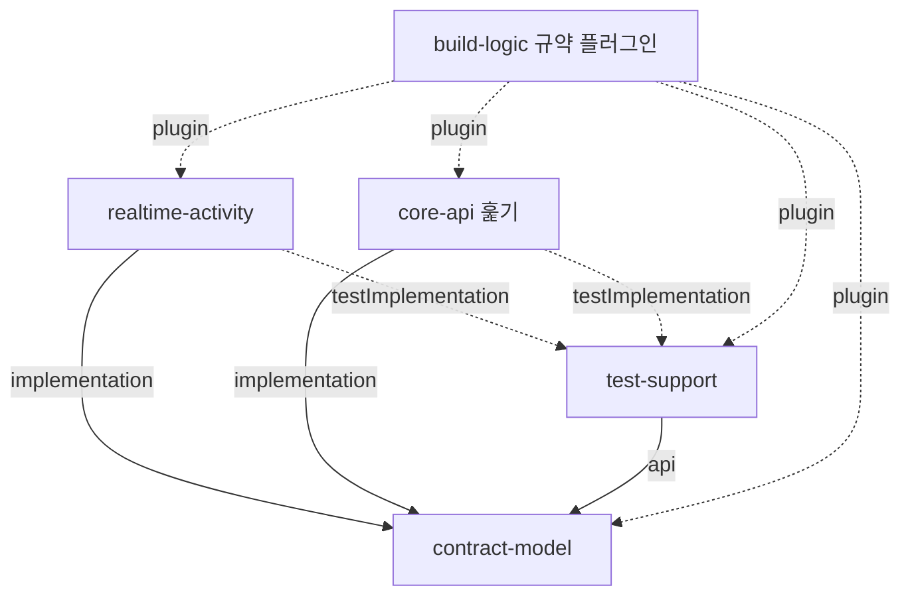

# 의존성 (Dependencies)

> 기준 커밋 `3748083`. 라이브러리 판 번호는 `technology-stack.md`에 한 번만 적었고, 여기서는 의존의 방향 · 경계 · 규칙을 다룬다. 패키지 단위 의존은 `component-inventory.md`.

## 1. 내부 모듈 의존 (Gradle)

텍스트 대체: `realtime-activity`와 `core-api`는 `contract-model`에 implementation으로 의존한다. `test-support`는 `contract-model`을 api로 노출하며, 두 앱은 `test-support`에 testImplementation으로만 의존한다. 모든 모듈은 `build-logic`의 `mujoong.java-conventions` 플러그인을 쓴다.

### 금지된 의존 (강제 장치)

| 금지 | 강제 |
|---|---|
| `realtime-activity` → `core-api` 코드 · `core` 스키마 | `RealtimeArchTest.realtimeNeverReferencesCoreCodeOrTheCoreSchema` |
| 운영 코드 → `test-support` | `RealtimeArchTest` + `verifyBootJarHasNoTestClasses` 작업 |
| `contract-model` → Spring · JPA | ArchUnit(contract-model) |
| 프레임 경로 → JDBC · 파일 · Outbox | `RealtimeArchTest` |
| 시스템 시계 직접 읽기 | `RealtimeArchTest` |
| voice 밖에서 공급자 클라이언트 사용 · 팩토리 밖 요청 생성 | `RealtimeArchTest` |
| 운영 소스의 시간 숫자 상수 | `TimeLiteralScanTest`(허용 목록) |

## 2. 런타임 서비스 의존 (Realtime 기준)

| 대상 | 방향 | 수단 | 실패 시 |
|---|---|---|---|
| PostgreSQL `realtime` 스키마 | Realtime → DB | JDBC · HikariCP(최대 10), 역할 `realtime_app` | `DbRetry` · `DbPoolWaitMonitor`, 기동 시 `SchemaVersionCheck` · `DataClassCheck`가 거부 |
| Core API (내부 HTTP) | Realtime → Core | `InternalHttpClient`(JDK HttpClient), `X-Internal-Token` | 토큰 검증 실패 시 기기 연결 거부, 상태 보고는 주기 재시도, Outbox는 재송신 |
| Core API (호출자) | Core → Realtime | 내부 HTTP 4개 | 준비 전 `ReadinessGateFilter`가 거절 |
| 외부 음성 공급자 | Realtime → 공급자 | JDK WebSocket, `PROVIDER_API_KEY` | 연결 · 시작 실패는 PROVIDER_FAILED → FAILED(PROVIDER_UNAVAILABLE) |
| 기기 | 기기 → Realtime | WSS `/ws/device` | 40초 무음이면 끊김(ACTIVE 세션 ABORTED) |
| 파일 시스템 | Realtime → 디스크 | `FileAudioRecorder` PCM 파일 | 전용 스레드에서 처리 |
| migrate 컨테이너 | 배포 시 | Flyway(`infra/migrate/flyway-realtime.conf`, 소유 역할 `mujoong_owner`) | 앱은 이력 판만 확인 |

## 3. 비밀 · 환경 변수 (이름만, 값은 어느 파일에도 없음)

`SPRING_DATASOURCE_PASSWORD`(렌더러가 `DB_REALTIME_PASSWORD`를 매핑) · `INTERNAL_SERVICE_TOKEN` · `PROVIDER_API_KEY` · `MUJOONG_OBSERVABILITY_OWNER_HASH_SECRET`. 주소 재정의: `SPRING_DATASOURCE_URL` · `MUJOONG_INTERNALHTTP_COREBASEURL` · `MUJOONG_PROVIDER_URL` · `SERVER_TOMCAT_REMOTEIP_INTERNALPROXIES`.

## 4. 공유 파일 · 병합 결합점 (U4b 관점)

같은 파일을 여러 유닛이 고치므로 병합 순서와 충돌 해소가 필요한 곳이다.

| 파일 | 함께 고치는 쪽 | 규칙 |
|---|---|---|
| `backend/realtime-activity/src/main/resources/db/migration/realtime/V3__*.sql` | U4b(V3) · U5b(V4) | Flyway `outOfOrder` 꺼짐 → V3(U4b)가 먼저 main에 |
| `contracts/timing.md` · `contracts/deviations.md` | U4b · U5b | 양쪽 행을 모두 둔다 |
| 스키마 판 기대값 시험(`RealtimeSchemaIT` · core `FlywayConfIT` · `SchemaPrivilegeIT`) | 마이그레이션을 더하는 모든 유닛 | 판 · 표 수가 하드코딩됨(`code-quality-assessment.md` 참고) |
| `contract-model` `SnapshotHashGoldenTest` | U4a(Core 구독자) · U4b(생산자) | 골든 값이 두 앱의 계약 |
| `DeletionParticipant` 순서 상수 | Core 각 유닛 | Core 쪽 관례. Realtime 참가자 순서는 U4b 처리기가 정함 |
| `backend/coverage-scope/*.txt` | 유닛별 | 유닛마다 자기 파일 |

## 5. 외부 서드파티 위험 메모

- 공급자 SDK를 쓰지 않아 SDK 판 위험은 없지만, 공급자 프로토콜 변경은 `ProviderClient` · `ProviderRequestFactory`가 직접 흡수해야 한다.
- 보안 판 덮어쓰기(Tomcat · Jackson)는 Boot BOM 갱신 시 정리해야 하는 임시 장치다.
- Spring Boot 4.1 · Jackson 3은 비교적 새 메이저 판이며, 3.5.x로 내리는 퇴로가 문서화돼 있다.

## Sources
- 개발자 스캔 `developer-scan.md` (Build System · Test Coverage 구조 시험 · Handoff Risks)
- `backend/realtime-activity/build.gradle.kts` · `application.yml` 머리 주석 직접 확인, `docs/units/README.md` 「병합 순서」(훑기)
