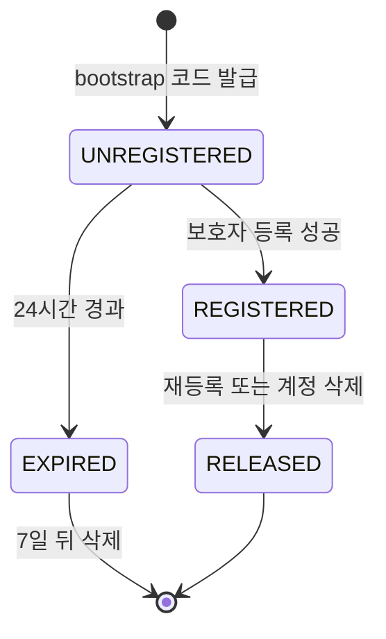
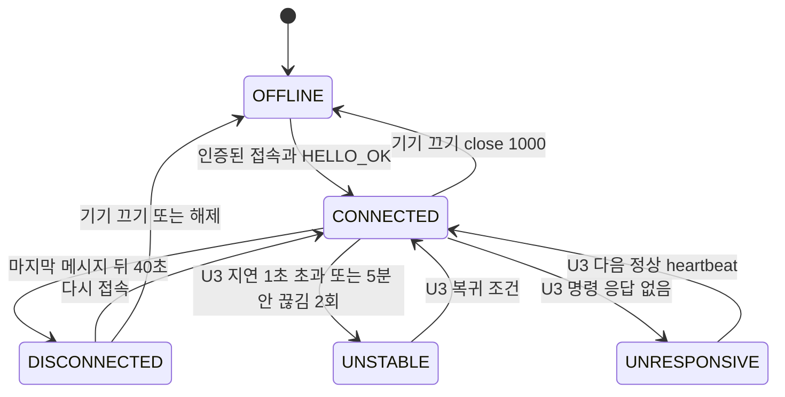
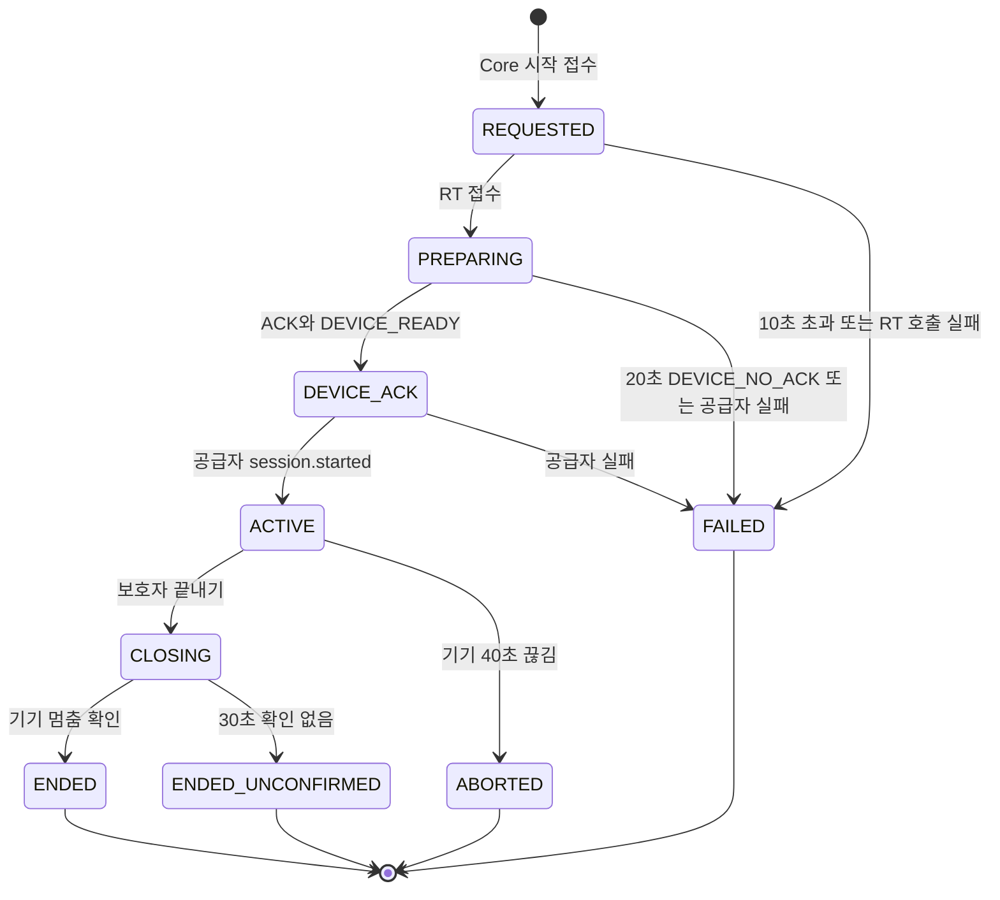
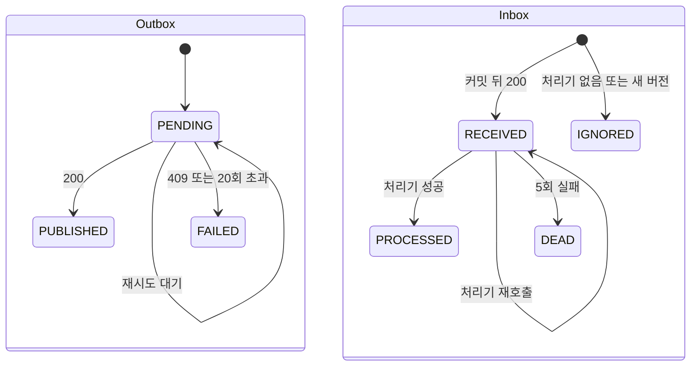
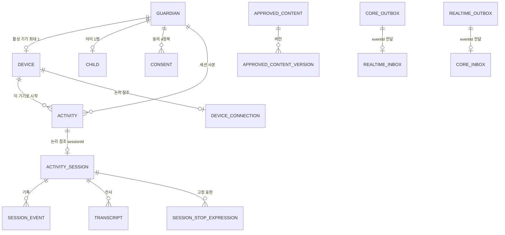

# U1 u1-walking-skeleton — 기능 명세 (Functional Design 3.1)

> Functional Design(3.1) 산출물 · U1 워킹 스켈레톤 · 깊이 Standard · 2026-10-09 (클라우드 세션, 팀장 대리 판단)
> 입력: `unit-of-work.md`(U1 정의), `unit-of-work-story-map.md`(U1이 닿는 스토리 8개), `requirements.md`, `components.md`(컴포넌트 · J1 ~ J14 · 기기 상태 대응표), `contract-summary.md`(C2 · C7 · C8 · C9 · C11 · 시간 계약 · J20 ~ J31), 질문 파일 `functional-design-questions.md`(Q1 ~ Q12).
> 이 문서는 **순서 있는 동작(워크플로)과 상태 기계, 화면 흐름**의 원천이다. 데이터 모양은 `entities.md`, 결정 규칙은 `rules.md`(BRx.y). 아래 ER 그림과 규칙 요약은 두 문서에서 파생한 보기이고 원천은 그쪽 yaml이다.

## 1. 범위와 읽는 법

U1은 "세 실행 단위(Next.js · Core · Realtime)가 실제로 붙어 한 번 끝까지 돈다"는 증명이다(J16). 그래서 **완성**하는 것과 **지나가기만** 하는 것이 나뉜다(J42).

| 구분 | 컴포넌트 | 이 문서에서의 깊이 |
|---|---|---|
| 완성 | DeviceRegistry · CoreMessaging · RealtimeMessaging · DeviceWeb D0 · 실행 골격 | 워크플로 · 상태 · 규칙 전부 |
| 최소 경로 | GuardianIdentity(시험 로그인) · ParentWeb(04 기기 구역 · 05a · 08 · 12 상태 · P1 · 17 종료) · ActivityCoordinator · SessionLifecycle · DeviceGateway · VoiceRelay · OutputGate · ConversationLog · ApprovedContentCatalog(시드) · DeviceWeb T19 | 스켈레톤이 지나가는 만큼만. 완성은 소유 유닛(7절) |

워크플로 표기: **Core** = Core API Spring, **RT** = Realtime Activity Spring, **기기** = 아이 기기 웹(/device), **보호자** = 보호자 웹(/parent). 오류 응답은 `BR8.6`의 코드를 쓴다.

## 2. 워크플로

### W1. 아이 기기 처음 켜기 → 등록 대기 → 토큰 수령 (D0, 규칙 BR1 · BR3.1 · BR9.1 ~ BR9.3)

1. 기기가 `/device`를 열면 `GET /api/device/me`를 부른다. 200이면 W4(T19)로 간다.
2. 401이면 bootstrap 쿠키가 있는지 본다. 있으면 `GET /api/device/bootstrap/status`를 부른다.
   - `REGISTERED`(보호자가 이미 등록했는데 토큰을 아직 못 받음) → 5단계로.
   - `PENDING` → 3단계로.
   - `EXPIRED` 또는 401 `BOOTSTRAP_NOT_FOUND` → 3단계로(새 코드).
3. 기기가 `POST /api/device/bootstrap`을 부른다. **Core**:
   1. IP 속도 제한을 확인한다(BR1.6). 같은 쿠키의 반복 요청은 세지 않는다.
   2. 쿠키 비밀의 해시로 행을 찾는다. 행이 UNREGISTERED이고 만료 전이면 같은 코드 · 만료 시각을 돌려준다(BR1.3).
   3. 아니면 SecureRandom으로 코드 · 비밀을 만들고 UNREGISTERED 행을 저장한다(코드 충돌이면 최대 5번 다시, BR1.2). `Set-Cookie MUJOONG_DEVICE_BOOTSTRAP`(BR1.5)과 `201 {code, expiresAt}`.
   4. 행이 이미 REGISTERED(등록됨, claim 전)이면 `409 ALREADY_REGISTERED` — 기기는 5단계로 간다.
4. 기기가 D0에 안내와 큰 코드(4 · 4)를 보이고 2초마다 `bootstrap/status`를 부른다. 상태가 `EXPIRED`가 되면 조용히 3단계를 다시 한다. 상태가 `REGISTERED`가 되면 5단계로.
5. 기기가 `POST /api/device/bootstrap/claim`을 부른다. **Core**: 비밀이 REGISTERED 행과 맞고 first_connected_at이 비어 있으면 새 토큰을 만들어 해시를 저장하고 `Set-Cookie MUJOONG_DEVICE`(BR3.1) + `200 {deviceId}`를 돌려준다. 응답이 유실돼 기기가 다시 부르면 토큰이 새로 바뀌고 앞 토큰은 무효가 된다. first_connected_at이 있으면 `410 BOOTSTRAP_CLOSED`(기기는 `/device/me`로 확인).
6. 기기가 「등록되었어요」를 3초 보인 뒤 T19(꺼짐)로 간다.

실패 분기: 429 · 503 · 네트워크 오류는 마지막 화면을 두고 5초 뒤 같은 요청을 다시 한다(BR9.4). 쿠키가 지워진 기기는 항상 3단계부터 새 행이 된다(BR9.3).

### W2. 보호자 기기 등록 (05a, 규칙 BR2)

1. 보호자가 05a에서 8칸(4 + 4)을 채우면 「등록」이 켜진다(BR2.8). 누르면 단추가 꺼지고 `POST /api/device/register {code}`(CSRF 헤더 포함)를 보낸다.
2. **Core**가 순서대로 검사한다.
   1. 세션으로 보호자를 확인한다(없으면 401). 삭제 접수 보호자면 403 `ACCOUNT_DELETION_IN_PROGRESS`(BR2.2).
   2. 보호자별 실패 제한을 확인한다(10분에 10회 초과 → 429, BR2.6).
   3. 코드를 정규화하고 형식을 검사한다(8글자 영숫자 아니면 400, BR2.1).
   4. 같은 보호자에게 활성(REGISTERED) 기기가 이미 있으면 BR2.4로 판단한다 — 교체 불가면 `409 DEVICE_ALREADY_ACTIVE`.
   5. 한 트랜잭션에서 코드로 UNREGISTERED · 만료 전 행을 찾아 조건부 UPDATE로 REGISTERED로 바꾼다(BR2.3). 갱신 행 수가 1이 아니면 `409 CODE_ALREADY_REGISTERED` 또는 `404 CODE_NOT_FOUND`.
   6. 교체 경로였다면 같은 트랜잭션에서 옛 기기를 RELEASED로 바꾸고 `DeviceReleased` Outbox 행을 쓴다(BR2.5).
   7. 커밋하고 `201 {deviceId, codePrefix, registeredAt}`.
3. 성공이면 실패 카운터를 지우고 보호자 화면은 05로 간다(BR2.7). 실패면 빨간 카드를 보이고 입력을 유지한다.
4. (교체 경로) **RT**가 `DeviceReleased`를 받아 옛 기기의 열린 연결을 4401로 닫는다(BR3.8, W7).

### W3. 연결 상태 판정을 읽어 04 · 05에 보이기 (규칙 BR4)

1. 보호자 앱이 `GET /api/home`(또는 `/api/device`)을 부른다.
2. **Core**가 DeviceRegistry의 등록 축과 사본(reported_connection_state · reported_at)을 읽고 BR4.3의 순서로 계산한다: 활성 기기 없음 → NONE, 사본 없음 → UNRESPONSIVE, 30초 넘게 새 보고 없음 → UNKNOWN, 그 밖에는 사본 상태를 STABLE · UNSTABLE · DISCONNECTED · UNRESPONSIVE로 옮긴다.
3. 응답 `DeviceView{registration, network, verdict}`(BR4.6)에는 비밀 · 해시 · 전사가 없다. 화면은 색 + 상태명 + 사유를 함께 보이고 `canStart`가 아니면 탭을 잠근다(BR4.5).
4. 이 읽기는 부수 효과가 없다(예약을 만들지 않는다). 시작 검사(W5)는 같은 계산을 다시 한다 — 화면 값을 믿지 않는다.

### W4. 기기 켜기 → WSS 접속 → 연결 상태 보고 (T19 최소, 규칙 BR3.6 · BR3.7 · BR4.8 · BR9.5)

1. T19 꺼짐에서 「켜기」를 누르면 마이크 · 소리 허용을 요청한다. 거부면 문구를 보이고 끝(연결하지 않음).
2. 허용되면 화면 켜짐 유지를 잡고 `wss://{host}/ws/device`에 접속한다. 쿠키 `MUJOONG_DEVICE`가 실린다.
3. **RT**가 Origin을 확인하고(아니면 403) 업그레이드를 받은 뒤 쿠키 토큰으로 Core `POST /internal/devices/verify-token`(제한 1초)을 부른다. 401이면 4401로, 1초 초과면 1013으로 닫는다. 5초 안에 HELLO가 없으면 4408.
4. 확인되면 RT는 같은 기기의 옛 연결이 있으면 4001로 닫고(BR3.7) DeviceConnection을 CONNECTED로 바꾸며 `DeviceStatusChanged`를 Outbox에 쓴다. 기기에는 `HELLO_OK`(connectionId · serverTime · heartbeatIntervalMs · audio)를 보낸다.
5. 기기는 5초마다 `HEARTBEAT`를 보내고 RT는 같은 hbSeq로 `HEARTBEAT_ACK`를 답한다. RT는 마지막 기기 메시지 시각을 last_seen_at에 반영한다.
6. RT는 10초마다 연결 행 전부를 Core `PUT /internal/devices/{id}/connection`으로 보고한다(제한 1초, 유실 허용, BR4.8).
7. 기기 메시지가 40초 끊기면 RT는 DISCONNECTED로 바꾸고 이벤트를 쓴다. 진행 중 세션이 있으면 W8의 ④(BR6.12)로 ABORTED(DISCONNECT).
8. 「끄기」는 기기가 재생 · 마이크를 정리하고 close 1000(DEVICE_OFF)으로 닫는다. RT는 이를 OFFLINE으로 기록한다(끊김과 구분). 활동 중이면 연결 끊김처럼 40초 경로를 탄다(BR9.5, J53).
9. **Core**의 처리기가 `DeviceStatusChanged`와 주기 보고를 BR4.1대로 받아 사본을 최신 값으로만 갱신한다.

### W5. 자유대화 시작 (08 → 12, 스켈레톤 슬라이스, 규칙 BR6.1 ~ BR6.7)

1. 보호자가 08에서 「자유대화 시작」을 누르면(전송 중 단추 꺼짐, BR6.4) `POST /api/activities/free {idempotencyKey, context?}`를 보낸다.
2. **Core**가 검사한다(첫 사유 하나만, BR6.1): 삭제 접수 → 동의 → 진행 중 세션 → 기기 안정. 같은 `idempotencyKey`면 첫 응답을 그대로(BR6.2).
3. 한 트랜잭션에서 `core_activity`(REQUESTED, status_version 0, sessionId 발급)를 저장한다. 진행 중 세션의 부분 유일 색인이 겹침을 막는다(BR6.3).
4. 커밋 뒤 Core가 세션 패키지를 만들어 RT `POST /internal/sessions`(제한 3초)를 부른다(BR6.5). 같은 sessionId로 한 번 더 재시도할 수 있다.
5. **RT**(BR6.6): 같은 sessionId가 있으면 현재 상태를 돌려주고, 기기 연결이 CONNECTED가 아니면 423 `DEVICE_NOT_CONNECTED`, 종료 아닌 세션이 있으면 409. 통과하면 한 트랜잭션에서 `ActivitySession`(PREPARING, status_version 1) + 기본 종료 표현 + `SessionStateChanged(PREPARING)` Outbox를 쓰고 `202 {PREPARING}`.
6. Core는 202를 받으면 보호자에게 `202 {sessionId, status: REQUESTED}`를 돌려주고 12로 보낸다. 사본은 이벤트로 PREPARING이 된다(BR6.14). 409 · 423 · 503이면 그 사유로 시작을 거절한다. Realtime을 부를 수 없으면(시간 초과 · 연결 실패 · 503) Core가 사본을 FAILED로 닫고 `503 REALTIME_UNAVAILABLE`, 이어 best-effort 끝내기를 보낸다(BR6.7).
7. **RT**가 커밋 뒤 두 가지를 한다. (가) 공급자 연결: 서버 키로 GPT-Live에 접속해 `session.start` → `session.started`를 기다린다(BR7.2). (나) 기기: `START_SESSION{approvedAudio[CLOSING, WAITING_FILLER]}`를 보내고 `ACK`와 `DEVICE_READY`(mic OK · player OK · prefetch OK)를 기다린다.
8. 20초(session.device-ack-timeout) 안에 ACK와 DEVICE_READY가 모두 오면 DEVICE_ACK로, 공급자 `session.started`까지 확인되면 ACTIVE로 전이한다(전이마다 status_version + 1 + 이벤트). 20초 안에 안 오면 FAILED(DEVICE_NO_ACK) + 기기 UNRESPONSIVE. 공급자 연결이 실패하면 FAILED(PROVIDER_UNAVAILABLE).
9. ACTIVE가 되면 RT는 기기에 `SESSION_STATE{LISTENING}`을 보낸다. 기기는 입력 음성 프레임(0x01)을 보내기 시작한다(W6).
10. 10초(session.preparing-timeout) 안에 Core가 PREPARING 이벤트를 받지 못하면 Core 사본을 FAILED로 닫고 08로 돌아가 사유를 보인다(BR6.12 ①).

### W6. 음성 1턴 (아이 한 마디 → 모델 응답 → 게이트 → 기기 재생 · 12 말풍선, 규칙 BR7)

1. 기기가 마이크 프레임을 20ms(960바이트)마다 보낸다. **RT**는 순번 순으로 공급자 `session.input_audio.append`에 전달한다(BR7.1). 원음은 메모리에서만 쓰고 쓰지 않는다.
2. 공급자의 `session.input_transcript.delta`로 아이 전사를 조립해 Transcript(CHILD, PARTIAL → FINAL, sequence_no 증가)에 저장한다. 확정되면 보호자 12에 말풍선으로 나갈 수 있다(approved_for_display true).
3. 공급자가 응답을 시작하면 `session.output_audio.delta`와 `session.output_transcript.delta`가 온다. RT 게이트는 출력 음성을 **서버 버퍼에만** 둔다(기기로 직행하지 않는다, BR7.3).
4. 출력 전사가 800ms 조용해지거나 아이 입력이 다시 시작되면 구간이 확정된다. 게이트가 BR7.4로 검사한다.
   - 통과 → `OUTPUT_BEGIN{playbackId, source GPT_LIVE}` → 0x02 프레임들 → `OUTPUT_END`. AI 전사 행의 approved_for_display를 true로(BR7.5).
   - 폐기 → 버퍼를 비우고 WAITING_FILLER 승인 문구를 `PLAY_APPROVED_CONTENT`로 재생한다. 폐기 구간의 전사는 보호자에게 나가지 않는다.
5. 기기는 재생을 시작하고 `PLAYBACK_MARK{STARTED}`, 끝나면 `COMPLETED`를 보낸다. T19는 재생하는 동안 '말하는 중'을 보인다(BR9.6). 기기는 승인 경로 밖의 소리를 내지 않는다(BR7.6).
6. 보호자 12는 2초마다 `GET /api/sessions/{id}?sinceSeq=n`으로 새 말풍선(아이 전사 · 승인된 AI 말)을 받는다(BR6.15).

### W7. 기기 해제 (재등록 · 계정 삭제) 전파 (규칙 BR3.8)

1. 교체 등록(W2) 또는 계정 삭제 지휘(U2)가 같은 트랜잭션에서 Device를 RELEASED로 바꾸고 `DeviceReleased{deviceId, guardianId, reason}`를 Core Outbox에 쓴다.
2. Core 발송 폴러가 RT `POST /internal/events`로 보낸다(W9). RT Inbox가 커밋하고 200을 돌려준다.
3. RT 처리기가 해당 deviceId의 열린 연결에 4401을 보내 닫고 DeviceConnection을 OFFLINE으로 바꾼다. 이후 그 토큰의 접속은 verify-token에서 401이다.
4. 기기 웹은 4401을 받으면 `/device/me`로 확인하고 401이면 D0으로 간다(BR9.7).

### W8. 끝내기 (P1 → 17, 규칙 BR6.9 ~ BR6.12)

1. 보호자가 P1 「네, 끝낼게요」를 누르면 `POST /api/sessions/{id}/end {requestId}`를 보낸다. 「아니오」면 12 그대로.
2. **Core**: 소유를 확인하고(404), 종료 가능 상태(ACTIVE)가 아니면 `409 SESSION_NOT_ACTIVE`. 이미 CLOSING 이후면 현재 상태를 돌려준다(멱등). RT `POST /internal/sessions/{id}/end{requestId, reason GUARDIAN_STOP}`(제한 2초). RT에 닿지 않으면 `503 REALTIME_UNAVAILABLE`("전송하지 못함", 종료 요청됨 표시 없음). 성공이면 `202 {CLOSING}`.
3. **RT**: ACTIVE → CLOSING(termination_requested_at 기록, `SessionStateChanged(CLOSING)`). 서버 출력 버퍼를 취소하고 기기에 `STOP_OUTPUT`을 보낸다. 이후 게이트는 일반 출력을 통과시키지 않는다.
4. RT가 세션에 고정된 CLOSING 승인 문구를 `PLAY_APPROVED_CONTENT`로 정확히 한 번 보낸다(길이 3초 이내). 기기가 재생하고 `PLAYBACK_MARK{COMPLETED}`를 보낸다.
5. RT가 `CLOSE_TRANSPORT{reason GUARDIAN_STOP}`을 보낸다. 기기는 마이크 송신 · 재생 · 대기열을 정리하고 `VOICE_SESSION_CLOSED{outputStoppedAt, micClosedAt}`를 보낸다. WSS는 대기용으로 남는다.
6. RT가 공급자 세션을 닫고 ENDED(confirmed true, end_reason GUARDIAN_STOP, ended_at)로 전이하며 `SessionStateChanged(ENDED)`를 쓴다. 기기는 대기(STANDBY)로 돌아간다.
7. 3단계부터 30초(session.closing-confirm) 안에 5단계의 확인이 없으면 ENDED_UNCONFIRMED(confirmed false)로 전이한다. CLOSING 중에는 끊김 전이가 없다(B11).
8. Core 사본이 이벤트를 받아 종료로 바뀐다. 보호자는 17에서 '마무리 중' → 종료를 본다(정리 중 · 정리 끝은 U4 · U6).

### W9. 영속 이벤트 전달 (Outbox → HTTP → Inbox, 규칙 BR5)

보내는 앱:
1. 업무 변경과 같은 트랜잭션에서 Outbox 행(PENDING, available_at = now, payload_hash)을 저장한다(BR5.1).
2. 500ms 폴러가 보낼 때가 된 PENDING 행을 만든 순서로 20개까지 직렬로 `POST /internal/events`(헤더 X-Internal-Token, 제한 3초)로 보낸다(BR5.2).
3. 200 → PUBLISHED(payload 비움, BR5.11). 409 · 400 · 401 → 즉시 FAILED + 경고. 시간 초과 · 연결 실패 · 5xx → retry_count + 1, available_at = now + 1 · 2 · 4 · 8 · 16 · 30초(그 뒤 30초), 20회 넘으면 FAILED + 경고(BR5.3).

받는 앱:
4. 내부 인증과 봉투를 검사한다(BR5.4). 본문이 틀리면 400.
5. 같은 eventId가 있으면: 해시가 같으면 200(중복). 해시가 다르면 경고 로그 + 409(BR5.5).
6. 없으면 Inbox 행(RECEIVED)을 커밋하고 **그다음에** 200을 돌려준다(BR5.6).
7. 비동기로 eventType별 처리기를 호출한다. 처리기는 멱등이다(BR5.7). 성공 → PROCESSED(payload 비움). 처리기가 없거나 schemaVersion이 너무 새것이면 IGNORED + 200(BR5.9).
8. 처리기 예외 → 1 · 2 · 4 · 8 · 16초 간격으로 5번 재호출, 그래도 실패하면 DEAD + 경고(BR5.8).
9. 앱 시작 때 자기 스키마의 끝나지 않은 Outbox/Inbox 행을 폴러가 평소대로 다시 집는다(BR5.12).

## 3. 상태 기계

### SM1. Device 등록 상태

<!-- Text fallback: 코드 발급으로 UNREGISTERED가 생긴다. 보호자가 등록하면 REGISTERED, 24시간이 지나면 EXPIRED(7일 뒤 삭제). REGISTERED는 재등록 또는 계정 삭제로 RELEASED가 된다. EXPIRED와 RELEASED는 끝 상태다. -->

| 전이 | 조건 | 규칙 |
|---|---|---|
| UNREGISTERED → REGISTERED | 조건부 UPDATE가 1행 갱신 | BR2.3 |
| UNREGISTERED → EXPIRED | now > code_expires_at (조회 때 또는 정리 작업) | BR1.4 |
| REGISTERED → RELEASED | 같은 보호자가 새 코드를 등록하고 옛 기기가 연결돼 있지 않을 때, 또는 계정 삭제 | BR2.4 · BR2.5 |
| 그 밖 | 허용하지 않음 | 상태 검사 |

### SM2. 기기 연결 상태 (Realtime 원장, U1 슬라이스는 굵게)

<!-- Text fallback: U1이 쓰는 전이는 OFFLINE→CONNECTED(접속), CONNECTED→OFFLINE(끄기), CONNECTED→DISCONNECTED(40초), DISCONNECTED→CONNECTED(재접속), DISCONNECTED→OFFLINE(끄기 또는 해제)다. UNSTABLE과 UNRESPONSIVE는 U3가 판정한다. -->

Core의 `Device.reported_connection_state`는 이 상태의 사본이며 읽을 때 BR4.3으로 5단계 표시와 `canStart`가 된다.

### SM3. 세션 상태 (U1 슬라이스)

<!-- Text fallback: REQUESTED(Core만)에서 RT 접수로 PREPARING, 기기 ACK와 READY로 DEVICE_ACK, 공급자 시작 확인으로 ACTIVE가 된다. ACTIVE는 보호자 끝내기로 CLOSING, 기기 40초 끊김으로 ABORTED가 된다. CLOSING은 기기 확인으로 ENDED, 30초 확인 없으면 ENDED_UNCONFIRMED가 된다. 시작 단계의 10초 초과와 20초 초과, 공급자 실패는 FAILED다. WAITING_CHILD와 DECLINED, CHILD_STOP, SILENCE, CONSENT_WITHDRAWN 경로는 U4가 더한다. -->

| 전이 | 주인 | 시한 · 조건 | 사본 · 이벤트 | 규칙 |
|---|---|---|---|---|
| (없음) → REQUESTED | Core | 시작 검사 통과 | Core 사본만, status_version 0 | BR6.1 ~ BR6.3 |
| REQUESTED → PREPARING | RT | Realtime 접수 | SessionStateChanged v1 | BR6.6 |
| REQUESTED → FAILED | Core | session.preparing-timeout 또는 Realtime 호출 실패 | 로컬 FAILED(version 0) | BR6.7 · BR6.12 |
| PREPARING → DEVICE_ACK | RT | ACK + DEVICE_READY 20초 안 | SessionStateChanged | BR6.8 |
| PREPARING · DEVICE_ACK → FAILED | RT | DEVICE_NO_ACK · PROVIDER_UNAVAILABLE · SERVER_RESTART | SessionStateChanged(failureCode) | BR6.8 · BR6.13 |
| DEVICE_ACK → ACTIVE | RT | 공급자 `session.started` | SessionStateChanged, started_at | BR6.8 · BR7.2 |
| ACTIVE → CLOSING | RT | 보호자 끝내기 수락 | SessionStateChanged | BR6.9 |
| CLOSING → ENDED | RT | VOICE_SESSION_CLOSED | SessionStateChanged(confirmed true) | BR6.10 |
| CLOSING → ENDED_UNCONFIRMED | RT | session.closing-confirm | SessionStateChanged(confirmed false) | BR6.12 ③ |
| ACTIVE → ABORTED | RT | device.disconnect | SessionStateChanged(DISCONNECT) | BR6.12 ④ |

### SM4. Outbox · Inbox 행 상태

<!-- Text fallback: Outbox 행은 PENDING으로 시작해 200을 받으면 PUBLISHED, 재시도 대기 중이면 PENDING에 머물고, 409나 20회 초과면 FAILED가 된다. Inbox 행은 커밋 뒤 RECEIVED, 처리기가 성공하면 PROCESSED, 재호출 중이면 RECEIVED, 5번 실패하면 DEAD다. 처리기가 없거나 새 버전이면 곧바로 IGNORED다. -->

## 4. 화면 흐름 (U1이 그리는 화면)

| 화면 | 상태 | 이동 · 동작 | 규칙 |
|---|---|---|---|
| D0 (D-00) 처음 켜기 | 코드 표시 / 등록 대기 / 등록되었어요(3초) | 등록 완료 → T19, 쿠키 삭제 → 새 코드 | BR9.1 ~ BR9.3 |
| T19 (D-19) 상태 화면(최소) | 꺼짐 / 대기 / 듣는 중 / 말하는 중 / 마무리 / 마이크 허용 안 됨 | 「켜기」 → 대기, 「끄기」 → 꺼짐, 토큰 거부 → D0 | BR9.5 ~ BR9.7 |
| 05a 코드 등록 | 입력 / 등록 중 / 오류 카드 | 성공 → 05, 「취소」 · 「←」 → 05 | BR2.8 |
| 04 대화 기기 구역(최소) | 안정 / 불안정 / 끊김 / 응답 없음 / 확인 불가 / 기기 없음 | 「기기 등록」 → 05a, 탭 열림 · 잠김 | BR4.5 · BR4.6 |
| 08 자유대화 준비(최소) | 입력 / 전송 중 / 거절 사유 | 시작 → 12 | BR6.1 · BR6.4 |
| 12 진행(최소) | 시작 직후 라벨 / 말풍선 / 확인 불가 | 「끝내기」 → P1, 2초 폴링 | BR6.15 |
| P1 끝내기 확인 | 확인 | 「네」→ 17, 「아니오」→ 12 | BR6.9 |
| 17 종료(최소) | 마무리 중 / 종료 | (정리 중 · 정리 끝은 U4 · U6) | BR6.10 |

화면 문구는 문구표(`10_화면설계_v1.5j`)이고 문구가 비어 있는 곳은 B26을 따른다. 아이 기기 화면에는 기술 문구를 보이지 않는다(BR9.4).

## 5. ER 보기 (entities.md에서 파생)

<!-- Text fallback: 보호자는 활성 기기 최대 1, 아이 1명, 동의 여러 개, 세션 사본 여러 개를 가진다. 기기는 여러 세션 사본의 시작 기기이고 연결 행과 1:1 논리 참조다. 세션 사본과 Realtime 세션 행은 sessionId로 1:1 논리 참조하며 Realtime 세션은 사건 · 전사 · 고정 종료 표현을 가진다. 승인 문구는 여러 버전을 가진다. Core Outbox 행은 eventId로 Realtime Inbox 행에, Realtime Outbox 행은 Core Inbox 행에 전달된다. -->

## 6. 규칙 요약 (rules.md에서 파생)

| 묶음 | 핵심 |
|---|---|
| BR1 부트스트랩 | 8글자 31알파벳, 24시간, 같은 쿠키는 같은 코드, 비밀 해시, 발급 속도 제한 |
| BR2 등록 | 조건부 UPDATE 한 건, 활성 기기가 연결돼 있지 않으면 교체(옛 기기 RELEASED + DeviceReleased), 실패 제한 |
| BR3 토큰 · 인증 | claim 회전 → 첫 연결에서 닫힘, 만료 없음, WSS Origin + 쿠키, 새 연결이 옛 연결 대체, 내부 공유 비밀 |
| BR4 연결 사본 | 최신 보고만, 읽을 때 계산, 30초 stale, 시작 가능 = 안정 |
| BR5 메시징 | 같은 트랜잭션, 직렬 발송 + 백오프, 커밋 뒤 ACK, 해시 중복 · 충돌, 끝나면 페이로드 비움 |
| BR6 세션 슬라이스 | 거절 순서 · 멱등 · 1개, 전이표, 끝내기 + 인사 1회, 네 안전 시한, 재시작 FAILED |
| BR7 음성 · 게이트 | 준비 뒤 입력, 서버 키, 800ms 구간, 폐기 → 대체 문구, 승인된 소리만 |
| BR8 공통 | 스키마 · 역할, Flyway, 프로필, 404 숨김, 오류 봉투, 로그 위생, CSRF, Nginx |
| BR9 기기 웹 | me → status → bootstrap, D0 3초, 쿠키 삭제 → D0, 켜기 · 끄기만 |

## 7. 소유 유닛에 넘기는 몫

U1이 완성하지 않고 지나가기만 한 것과, 뒤 유닛이 U1의 무엇에 기대는지.

| 유닛 | U1이 남기는 것 | 그 유닛이 완성할 것 |
|---|---|---|
| U2 | 시험 로그인 · 시드 동의 · 아이 · 승인 문구 · 세션 쿠키 계층(Spring Session JDBC) · 오류 봉투 · 소유 404 규칙 · 05a 등록 API | 구글 OAuth 로그인으로 교체, 02 · 02-1 · 03 · 04 전체 · 05 · SET-01 · 설정 시트, 동의 4항목 로직, 승인 문구 버전 관리, 계정 삭제 지휘 틀, 재등록 진입 단추(OQ12) |
| U3 | WSS 접속 · HELLO · heartbeat · 새 연결이 옛 연결 대체 · OFFLINE / CONNECTED / DISCONNECTED 보고 · 출력 게이트 최소 규칙 · 입력 음성 중계 · T19 최소 | 연결 5단계 판정(UNSTABLE · UNRESPONSIVE · 5분 창 · 히스테리시스), 명령 ACK · playbackMark 정식 처리, 재연결 resume, 정식 구간 분할 · 금지 표현 사전 v1 · 역할 규칙, 끼어들기 0.5초, 원음 저장, T19 8상태 · 표정 · 문구 |
| U4 | 세션 상태 전이표 · 네 안전 시한 · 시작 검사 · 멱등 · 끝내기 · 마무리 인사 · Core 사본 · 12 폴링 최소 · 17 최소 | WAITING_CHILD · 참여 확인 · DECLINED · 공백 4 · 6분 · 10초 점선 · 기술적 일시 정지 · CHILD_STOP · 11개 상태 전부 · 08 네 칸 저장 · 04 지금 활동 · SessionRecordCaptured · 시간 경계값 시험 |
| U5 | 같은 세션 패키지 구조 · 승인 문구 고정 규칙 · 게이트 틀 | 연습 경로 확장(ActivityCoordinator · SessionLifecycle · OutputGate · VoiceRelay) |
| U6 | 메시징 틀 · 처리기 등록 표 | ActivityRecorded · 결과 작업 · 17 정리 상태 · 26 ~ 30 |
| U7 | DeviceStatusChanged 이벤트와 사본(기기 상태 수신 중단 감지 입력) | Notification |

각 유닛은 자기 데이터의 **계정 삭제 참가자**를 완료 조건에 넣는다(공통 완료 조건, J19). U1의 참가자는 Device(해제 + 토큰 무효 + DeviceReleased)와 Outbox/Inbox 행(`guardian_id`로 삭제)이다.

## 8. 준하 제안(가정)

사람 지시(2026-10-09)와 `docs/cloud_handoff.md` 2절에 따라 팀장(준하)의 대리가 정했다. 질문 · 선택지 · 까닭은 `functional-design-questions.md`.

| 번호 | 준하 제안(가정) | 근거 | 확정 단계 |
|---|---|---|---|
| J42 | U1 '완성' = DeviceRegistry · CoreMessaging · RealtimeMessaging · D0 · 실행 골격. 나머지는 스켈레톤이 지나갈 만큼만 만들고 주 유닛이 완성한다. 주 유닛 몫 AC는 추적에서 Deferred | Q1 · J17 · J18 | 각 유닛 3.1 |
| J43 | U1의 V1 마이그레이션이 완성 소유 표 + 스켈레톤 경로가 지나는 표를 Domain Design 최종 컬럼으로 한 번에 만들고 소유 유닛은 더하기만 한다 | Q2 · 계약 10절 | 3.5 Code Generation |
| J44 | dev · demo 프로필 전용 DevSeedRunner(멱등) + `POST /api/dev/login`(운영 404). 세션 계층은 운영과 같은 Spring Session JDBC | Q3 · AC1.1.7 · NFR9 | U2(구글 로그인으로 교체) |
| J45 | 코드는 UNREGISTERED 부분 유일 색인 + 최대 5번 재추첨, 같은 쿠키는 같은 코드, 만료는 EXPIRED로 바꿔 코드를 비우고 7일 뒤 삭제, 이미 등록된 쿠키의 bootstrap은 409 ALREADY_REGISTERED | Q4 · AC6.1.5 · OQ13 | 3.5 |
| J46 | 재등록 허용 = 옛 기기 마지막 보고가 OFFLINE · DISCONNECTED · UNRESPONSIVE이거나 30초 넘게 보고 없음. CONNECTED · UNSTABLE이면 409. 동시 등록은 조건부 UPDATE | Q5 · J13 · AC2.2.6 | OQ12(보호자 쪽 진입 단추) |
| J47 | 연결 사본은 최신 시각 우선, 보고 없는 등록 기기 = UNRESPONSIVE, 30초 stale = UNKNOWN, RT는 영속 연결 행 전부를 10초마다 보고, 판정은 읽을 때 계산 | Q6 · B6 · B7 | U3(판정 완성) |
| J48 | 시작 거절 우선순위 CONSENT_MISSING → SESSION_IN_PROGRESS → DEVICE_NOT_STABLE, 진행 중 세션은 core_activity 부분 유일 색인 | Q7 · AC3.1.6 · AC3.1.8 | U4 |
| J49 | Outbox 폴러 500ms · 20개 직렬 · 막지 않음, 409 즉시 FAILED, 수신 해시 중복 · 충돌, 처리기 5회 재호출 후 DEAD, 모르는 type · 새 버전 IGNORED | Q8 · ADR-010 · J26 | NFR Design(3.3) |
| J50 | PUBLISHED · PROCESSED · IGNORED가 되면 payload_json을 {} 로 비우고(해시 · 식별만 남김), 실패 행은 7일 뒤 비운다. Outbox/Inbox에 guardian_id 열을 더한다(ERD v0.2) | Q9 · NFR9 · ADR-010 | NFR Design(3.3) |
| J51 | 스켈레톤에도 네 시한(REQUESTED 10초 · DEVICE_ACK 20초 · CLOSING 30초 · 끊김 40초)을 넣어 계정당 1개 잠금을 막는다(J16 보정). 나머지 시간 규칙은 U4 | Q10 · J16 · 계약 7절 | U4 |
| J52 | 게이트 최소 규칙: 출력 구간 = 출력 전사 800ms 조용 또는 아이 입력 재개, 빈 전사 · 시드 금지 패턴이면 폐기 → WAITING_FILLER 재생 | Q11 · FR7.8 · NFR1 | U3 |
| J53 | 활동 중 「끄기」 = 연결 끊김 40초 경로(B16, 계약 11절의 열린 질문 닫음). Realtime 재시작 → 종료 아닌 세션 FAILED(SERVER_RESTART) | Q12 · B16 · ADR-010 | U4 |

## 9. 열린 질문

| 질문 | 막는 곳 | 결정 단계 |
|---|---|---|
| 허용 Origin의 실제 값(서비스 도메인)과 인증서 방식 | BR3.6 · BR8.9 | 3.4 Infrastructure Design · 클라우드 담당(E3) |
| CSRF 토큰 취득 경로와 재취득 시점 | BR8.8 | 3.3 NFR Design |
| GPT-Live 실제 오디오 형식이 J27(PCM16 · 24kHz)과 다르면 변환 위치(VoiceRelay)와 지연 | BR7.1 | 10/13 POC → U3 |
| 승인 문구 음성 파일을 만드는 방법(사전 녹음 · TTS) | BR6.5 · BR7.4 | U2 · U5 |
| 시드 정책 버전 문자열과 시드 아이 이름 · 나이 | J44 | U2(OQ7) |
| 08 요청에서 Realtime 접수 전 실패 · 10초 초과의 `failureCode`: 계약 SessionSummary에 맞는 값이 없어 비워 둠 — U4가 새 값(예: START_TIMEOUT)을 더할지 | BR6.7 · BR6.12 ① | U4(더하기만 안전) |
| `POST /api/device/bootstrap`의 409 `ALREADY_REGISTERED` 응답을 계약 4.1절에 더함 (더하기만 안전) | BR1.3 | 3.5에서 contracts 파일에 반영 |
