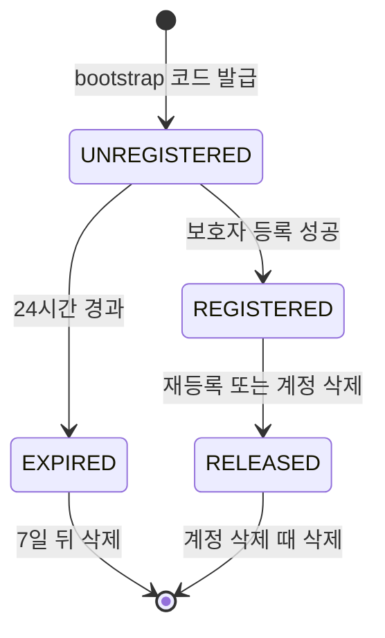
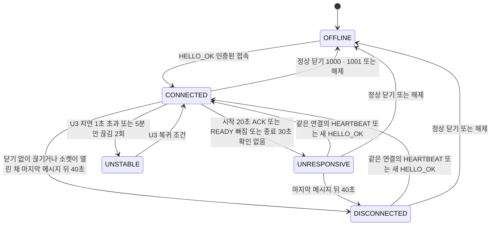
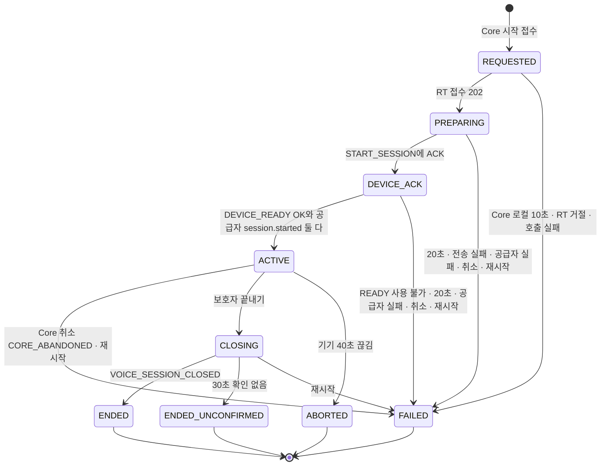
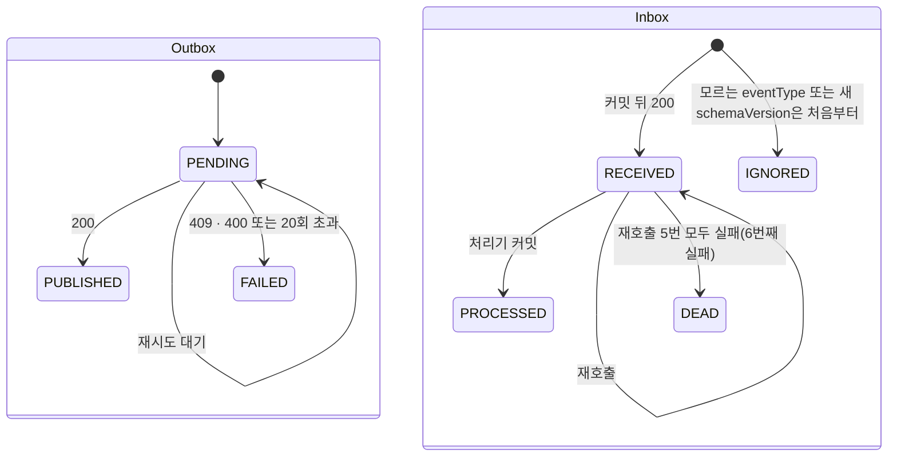
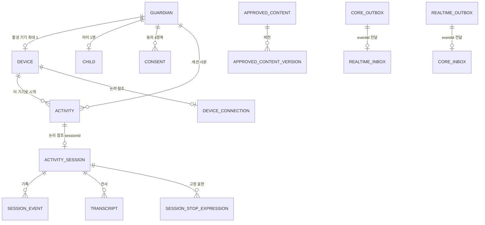

# U1 u1-walking-skeleton — 기능 명세 (Functional Design 3.1)

> Functional Design(3.1) 산출물 · U1 워킹 스켈레톤 · 깊이 Standard · 2026-10-09 (클라우드 세션, 팀장 대리 판단)
> 입력: `unit-of-work.md`(U1 정의), `unit-of-work-story-map.md`(U1이 닿는 스토리 8개), `requirements.md`, `components.md`(컴포넌트 · J1 ~ J14 · 기기 상태 대응표), `contract-summary.md`(C2 · C7 · C8 · C9 · C11 · 시간 계약 · J20 ~ J31), `mockups.md`(9절 제안 문구 9-1 ~ 9-31) · `interaction-spec.md`(화면 상태 · 문구), 질문 파일 `functional-design-questions.md`(Q1 ~ Q19).
> 이 문서는 **순서 있는 동작(워크플로)과 상태 기계, 화면 흐름**의 원천이다. 데이터 모양은 `entities.md`, 결정 규칙은 `rules.md`(BRx.y, 규칙 89개). 아래 ER 그림과 규칙 요약은 두 문서에서 파생한 보기이고 원천은 그쪽 yaml이다. 이 문서의 준하 제안(가정)은 J42 ~ J60이다(8절).

## 1. 범위와 읽는 법

U1은 "세 실행 단위(Next.js · Core · Realtime)가 실제로 붙어 한 번 끝까지 돈다"는 증명이다(J16). 그래서 **완성**하는 것과 **지나가기만** 하는 것이 나뉜다(J42).

| 구분 | 컴포넌트 | 이 문서에서의 깊이 |
|---|---|---|
| 완성 | DeviceRegistry · CoreMessaging · RealtimeMessaging · DeviceWeb D0 · 실행 골격 | 워크플로 · 상태 · 규칙 전부 |
| 최소 경로 | GuardianIdentity(시험 로그인) · ParentWeb(04 기기 구역 · 05a · 05 라우트 스텁 · 08 · 12 · P1 · 17) · ActivityCoordinator · SessionLifecycle · DeviceGateway · VoiceRelay · OutputGate · ConversationLog · ApprovedContentCatalog(시드) · DeviceWeb T19 | 스켈레톤이 지나가는 만큼만. 완성은 소유 유닛(7절) |

워크플로 표기: **Core** = Core API Spring, **RT** = Realtime Activity Spring, **기기** = 아이 기기 웹(/device), **보호자** = 보호자 웹(/parent). 오류 응답은 `BR8.6`의 코드를 쓴다. 화면 문구는 `mockups 9-x`처럼 mockups.md 9절의 번호로 가리킨다.

## 2. 워크플로

### W1. 아이 기기 처음 켜기 → 등록 대기 → 토큰 수령 (D0, 규칙 BR1 · BR3.1 · BR3.2 · BR9.1 ~ BR9.4)

1. 기기가 `/device`를 열면 `GET /api/device/me`를 부른다. 200이면 W4(T19 꺼짐)로 간다(J56).
2. 401이면 항상 `GET /api/device/bootstrap/status`를 부른다. bootstrap 쿠키는 HttpOnly라 기기 웹 JS가 유무를 볼 수 없으므로 서버가 판정한다(쿠키가 없거나 모르는 값이면 서버가 401 `BOOTSTRAP_NOT_FOUND`로 답한다, BR1.7). 기기 웹은 bootstrap과 claim을 한 번에 하나만 보내고 응답이 올 때까지 같은 요청을 다시 보내지 않는다(단일 비행, BR9.1).
   - `REGISTERED`(보호자가 이미 등록했는데 토큰을 아직 못 받음) → 5단계로.
   - `PENDING` → 3단계로(같은 코드를 이어 받는다, BR1.3).
   - `EXPIRED`(claim 전에 교체 등록으로 풀린 행도 EXPIRED로 답한다) 또는 401 `BOOTSTRAP_NOT_FOUND` → 3단계로(새 코드).
3. 기기가 `POST /api/device/bootstrap`을 부른다. **Core**:
   1. IP 속도 제한(IP당 1시간 20회)을 확인한다(BR1.6). IP는 Nginx가 `X-Forwarded-For`를 `$remote_addr`로 덮어써 넘긴 값이고 클라이언트가 보낸 헤더는 쓰지 않는다(BR8.9). IPv6는 앞 64비트로 묶어 센다. 같은 쿠키의 반복 요청은 세지 않는다(코드 발급 남용만 막는다. 계약 7절 `bootstrap.rate-limit`의 적용 범위를 좁힌 것, J59(k)). 창을 넘으면 429 `RATE_LIMITED`.
   2. 쿠키 비밀의 해시로 행을 찾는다. 행이 UNREGISTERED이고 만료 전이면 같은 코드 · 만료 시각을 돌려준다(BR1.3).
   3. 쿠키가 없거나 모르는 값이거나 행이 EXPIRED · RELEASED이면 SecureRandom으로 코드 · 비밀을 만들고 UNREGISTERED 행을 저장한다. 뽑은 코드가 UNREGISTERED 행과 겹치면(유일 위반) 새로 뽑으며, 첫 추첨을 포함해 총 5번까지 시도하고 5번 모두 겹치면 503 `CODE_ISSUE_FAILED`다(BR1.2). `Set-Cookie MUJOONG_DEVICE_BOOTSTRAP`(BR1.5)과 `201 {code, expiresAt}`.
   4. 행이 이미 REGISTERED(등록됨, claim 전)이면 `409 ALREADY_REGISTERED`(J59(a)) — 2단계의 status 조회와 이 호출 사이에 보호자의 등록이 끼어든 경쟁에서도 같다. 기기는 이 409를 받으면 5단계 claim으로 간다(BR9.1).
4. 기기가 D0에 안내와 큰 코드(`7F3K · 92QD` 꼴, 4 · 4)를 보이고 2초마다 `bootstrap/status`를 부른다. 상태가 `EXPIRED`가 되면 조용히 3단계를 다시 한다. 상태가 `REGISTERED`가 되면 5단계로.
5. 기기가 `POST /api/device/bootstrap/claim`을 부른다. **Core**: 비밀이 REGISTERED 행과 맞고 first_connected_at이 비어 있으면(행 잠금 아래에서 처리) 새 토큰을 만들어 해시를 저장하고 `Set-Cookie MUJOONG_DEVICE`(BR3.1) + `200 {deviceId}`를 돌려준다. 응답이 유실돼 기기가 다시 부르면 토큰이 새로 바뀌고 앞 토큰은 무효가 된다(첫 연결 전의 회전, BR3.3). 오류와 기기의 동작:
   - 200 → 6단계로.
   - 401 `BOOTSTRAP_NOT_FOUND`(쿠키 없음 · 모르는 비밀, J59(b)) → 3단계로(새 bootstrap).
   - 410 `BOOTSTRAP_CLOSED`(행이 EXPIRED · RELEASED이거나 first_connected_at이 있음) → `/device/me`로 확인한다(200이면 T19 꺼짐, 401이면 3단계).
   - 409 `NOT_REGISTERED_YET`(PENDING) → 2초 뒤 status를 다시 조회한다(2단계).
6. 기기가 「등록되었어요」를 3초 보인 뒤 T19 **꺼짐**으로 간다. 마이크 · 소리 허용은 사용자 동작이 있어야 받을 수 있어 자동으로 연결하지 않고, 기기는 「켜기」를 눌러야 대기가 된다(J56).

실패 분기: D0에서 아직 코드를 받지 못한 상태(첫 로드 · 코드 요청의 429 · 503 · 네트워크 오류)는 '연결을 확인하는 중'(개발명세 D-00 오류 · interaction-spec 4절)을 보이고 5초 뒤 같은 요청을 다시 한다. 이미 코드가 보이는 중의 status 폴링 실패와 T19의 HTTP 실패는 마지막 화면을 그대로 두고 5초 뒤 다시 한다(BR9.4). T19 '다시 연결하고 있어요'(mockups 9-31)는 U3 몫이다. 쿠키가 지워진 기기는 항상 2단계의 401로 시작해 3단계에서 새 행이 된다(BR9.3).

### W2. 보호자 기기 등록 (05a, 규칙 BR2)

1. 보호자가 05a에서 8칸(4 + 4, OTP식)을 채우면 「등록」이 켜진다(BR2.8). 누르면 단추가 꺼지고 '등록하고 있어요'(mockups 9-9)를 보이며 `POST /api/device/register {code}`(X-CSRF-TOKEN 헤더 필수, BR8.8)를 보낸다.
2. **Core**가 트랜잭션 밖에서 빠른 거절 검사를 한다.
   1. 세션으로 보호자를 확인한다(없으면 401). 삭제 접수 보호자면 403 `ACCOUNT_DELETION_IN_PROGRESS`(BR2.2).
   2. 보호자별 실패 제한을 확인한다(10분에 10회 초과 → 429 `TOO_MANY_ATTEMPTS`, BR2.6). 실패 횟수는 400 · 404 · 409로 끝난 요청마다 세고, 같은 보호자의 재시도가 받는 201(3.2)은 세지 않는다.
   3. 코드를 정규화하고 형식을 검사한다(8글자 영숫자가 아니면 400 `VALIDATION_FAILED`, BR2.1, J59(d)).
3. **Core**가 한 트랜잭션에서 순서대로 한다. 락 순서는 보호자 행 → 코드 행 → 옛 기기 행이다(BR2.2 · BR2.5).
   1. 보호자 행을 `FOR SHARE`로 다시 읽어 ACTIVE일 때만 진행한다. 아니면 403 `ACCOUNT_DELETION_IN_PROGRESS`. 삭제 접수는 같은 행을 갱신하므로 접수와 등록 커밋이 겹쳐도 삭제된 계정에 REGISTERED 기기가 남지 않는다(BR2.2).
   2. 코드로 UNREGISTERED이고 만료 전인 행을 찾아 `FOR UPDATE`로 잠근다. 없으면 같은 코드의 REGISTERED 또는 RELEASED 행이 있는지 본다. 그 행이 REGISTERED이고 `guardian_id`가 요청한 보호자와 같으면(등록은 커밋됐는데 응답이 유실돼 같은 코드로 다시 보낸 경우) 409 대신 3.3 ~ 3.5를 건너뛰고 첫 성공과 같은 `201 {deviceId, codePrefix, registeredAt}`로 답한 뒤 4단계로 간다(J59(m)). 그 밖의 REGISTERED · RELEASED 행이면 `409 CODE_ALREADY_REGISTERED`, 나머지(없는 코드 · 만료 · EXPIRED · 발급 알파벳 밖 글자 0 · 1 · I · L · O)는 `404 CODE_NOT_FOUND`다(BR2.1 ① ② ③).
   3. 같은 보호자의 REGISTERED(옛) 기기가 있으면 `FOR UPDATE`로 잠그고 이 시점의 연결 상태 사본으로 BR4.3 판정을 다시 한다(BR2.4). 판정이 STABLE 또는 UNSTABLE이면 `409 DEVICE_ALREADY_ACTIVE`. 그 밖의 모든 경우(한 번도 보고가 없던 기기 · OFFLINE · DISCONNECTED · UNRESPONSIVE · UNKNOWN)는 교체를 허용하고 3.4로 간다. 옛 기기가 없으면 3.5로 간다.
   4. (교체 경로) 옛 행을 조건부 UPDATE로 RELEASED(`release_reason REREGISTERED`, `device_token_hash` 비움)로 바꾸고 갱신 행 수가 1인지 확인한 뒤 같은 트랜잭션에서 `DeviceReleased` Outbox 행을 쓴다(BR2.5). 보호자당 REGISTERED 하나의 부분 유일 색인은 지연시킬 수 없으므로 이 단계가 3.5보다 먼저다.
   5. 새 행을 조건부 UPDATE로 REGISTERED로 바꾼다(BR2.3). 갱신 행 수가 0이면 트랜잭션 전체를 되돌려(교체 경로라면 옛 기기 해제도 취소돼 옛 기기는 그대로다) 행을 다시 읽고 3.2와 같은 분기(같은 보호자의 REGISTERED이면 201, 그 밖의 REGISTERED · RELEASED이면 409 `CODE_ALREADY_REGISTERED`, 나머지는 404)로 답한다. 어느 단계든 부분 유일 색인 위반(23505)과 옛 기기 조건부 해제의 0행은 `409 DEVICE_ALREADY_ACTIVE`로 번역한다(BR2.4).
   6. 커밋하고 `201 {deviceId, codePrefix, registeredAt}`.
4. 성공이면 실패 카운터를 지우고 보호자 화면은 05로 간다(BR2.7). 05는 U2 화면이라 U1에서는 `/parent/device` 라우트 스텁이 04로 되돌린다(J57, 4절). 실패면 없는 코드(404) · 이미 등록된 코드(409, mockups 9-10) · 429는 빨간 카드를 보이고 입력을 지우지 않는다. 네트워크 오류 · 5xx는 토스트 + 「다시 시도」다(BR2.8).
5. (교체 경로) **RT**가 `DeviceReleased`를 받아 옛 기기의 열린 연결을 4401로 닫는다(BR3.8, W7).

### W3. 연결 상태 판정을 읽어 04 · 05에 보이기 (규칙 BR4)

1. 보호자 앱이 `GET /api/home`(또는 `/api/device`)을 부른다.
2. **Core**가 DeviceRegistry의 등록 축과 사본(reported_connection_state · reported_at)을 읽고 BR4.3의 순서로 계산한다: 활성 기기 없음 → NONE, 사본 없음 → UNRESPONSIVE, 30초 넘게 새 보고 없음 → UNKNOWN, 그 밖에는 사본 상태를 STABLE(CONNECTED) · UNSTABLE · DISCONNECTED · UNRESPONSIVE(UNRESPONSIVE 또는 OFFLINE)로 옮긴다. 재등록 허용 판정(W2 3.3)도 같은 계산을 쓴다.
3. 응답 `DeviceView{registration, network, verdict}`(BR4.6)에는 비밀 · 해시 · 전사가 없다. 화면은 색 + 상태명 + 사유를 함께 보이고 `canStart`가 아니면 탭을 잠근다(BR4.5). 「기기 상태 보기 ›」는 등록된 기기라면 어느 상태든 05로 가고, 등록이 없으면 「기기 등록」(→ 05a)만 둔다(BR4.6).
4. 이 읽기는 부수 효과가 없다(예약을 만들지 않는다). 시작 검사(W5)는 같은 계산을 다시 한다 — 화면 값을 믿지 않는다.

### W4. 기기 켜기 → WSS 접속 → 연결 상태 보고 (T19 최소, 규칙 BR3.4 · BR3.6 · BR3.7 · BR4.1 · BR4.8 · BR9.5 · BR9.7)

1. T19 꺼짐에서 「켜기」를 누르면 마이크 · 소리 허용을 요청한다. 거부면 문구를 보이고 끝(연결하지 않음). 등록 직후 기기는 꺼짐으로 착지하므로 허용은 항상 이 사용자 동작에서 받는다(J56).
2. 허용되면 화면 켜짐 유지를 잡고 `wss://{host}/ws/device`에 접속한다. 쿠키 `MUJOONG_DEVICE`가 실린다.
3. **RT**가 Origin을 확인하고(아니면 403) 업그레이드를 받은 뒤 쿠키 토큰으로 Core `POST /internal/devices/verify-token`(제한 1초)을 부른다. 결과는 그 연결 하나에만 묶고 캐시하지 않으며 연결마다 Core에 확인한다(BR3.4, J59(j)). 401이면 4401로, 1초 초과면 1013으로 닫는다. 5초(device.hello-timeout) 안에 HELLO가 없으면 4408, HELLO 형식이 틀리면 4400. 이렇게 HELLO_OK 전에 닫히는 연결은 같은 기기의 옛 연결을 건드리지 않는다(BR3.7).
4. HELLO를 수락하면 RT는 `HELLO_OK`를 보내는 시점(BR4.8 ① CONNECTED와 같은 시점)에 한 트랜잭션에서 그 기기의 DeviceConnection 행을 `FOR UPDATE`로 잠근다(첫 접속이면 `INSERT ... ON CONFLICT (device_id) DO UPDATE`). 읽은 옛 connection_id가 있고 그 소켓이 살아 있으면 4001 REPLACED로 닫은 뒤 connection_id · connection_state(CONNECTED) · connection_since를 새 값으로 덮고 `DeviceStatusChanged`를 같은 트랜잭션에 Outbox로 쓴다(BR3.7, J59(l)). 잠금을 나중에 얻은 연결이 이기며 기대값 비교는 하지 않는다. 기기에는 `HELLO_OK`(connectionId · serverTime · heartbeatIntervalMs · audio)를 보낸다. 인증만 되고 HELLO가 오지 않는 5초 동안은 CONNECTED가 아니다. 교체 이후의 DISCONNECTED · UNRESPONSIVE · OFFLINE 기록과 해당 DeviceStatusChanged는 `WHERE device_id AND connection_id` 조건부이고 행 수가 0이면 버린다 — 4001로 대체돼 닫힌 옛 연결과 HELLO_OK 전에 닫힌 연결(1013 · 4400 · 4401 · 4408)의 close 처리는 새 연결의 상태를 덮지 않는다. DeviceReleased 처리(W7, BR3.8)의 OFFLINE만 이 조건 대신 `device_id`만 조건으로 한다.
5. 기기는 5초마다 `HEARTBEAT`를 보내고 RT는 같은 hbSeq로 `HEARTBEAT_ACK`를 답한다. RT는 마지막 기기 메시지 시각을 last_seen_at에 반영한다.
6. RT는 10초마다 연결 행 전부(OFFLINE 포함)를 Core `PUT /internal/devices/{id}/connection`으로 보고한다(제한 1초, 유실 허용, BR4.8). 본문의 `state`와 `reportedAt`은 필수이고 없으면 400 `INVALID_ENVELOPE`다(J59(i)). `reportedAt`은 그 보고가 담은 연결 행을 읽은 시각(전송 시각이 아님)이고 `DeviceStatusChanged.occurred_at`은 상태 UPDATE를 실행한 시각(`clock_timestamp`, 트랜잭션 시작 시각이 아님)이며 둘은 같은 RT 시계를 쓴다(BR4.8).
7. 닫기 프레임 없이 끊긴 연결(1006 등)과, 소켓은 열려 있지만 40초 동안 메시지가 없는 연결은 RT가 영속 last_seen_at 기준 주기 점검으로 DISCONNECTED로 바꾸고 이벤트를 쓴다. 기록은 `WHERE device_id AND connection_id AND last_seen_at <= 점검시각 − 40초` 조건부라 점검이 읽은 뒤 도착한 HEARTBEAT를 덮지 않는다(BR4.8 ②). DISCONNECTED 또는 UNRESPONSIVE가 된 연결이라도 소켓이 같은 connection_id로 살아 있어 다음 HEARTBEAT가 오면 RT가 `WHERE connection_id`로 CONNECTED로 되돌리고 이벤트를 쓴다(BR4.8 ③). 세션의 40초는 이와 별개다: 진행 중(ACTIVE) 세션이 있으면 그 세션의 START_SESSION을 받은 소켓이 마지막으로 기기 메시지를 받은 시각이 40초 지날 때 BR6.12 ④로 ABORTED(DISCONNECT)가 되며, 이 시계는 Realtime 메모리의 세션별 값이라 영속 last_seen_at을 쓰지 않는다(RT 재시작은 BR6.13이 비종료 세션을 FAILED로 닫는다). 그 소켓이 닫히거나 4001로 대체된 뒤 새 연결이 HELLO_OK를 받아도 새 연결의 메시지는 이 시계를 되돌리지 않고, 새 연결이 진행 중 세션에 자동으로 붙지도 않는다(이어가기는 U3, BR3.7).
8. 닫기 프레임을 받은 정상 닫기(「끄기」 close 1000 DEVICE_OFF, 브라우저의 페이지 이탈 1001)는 RT가 즉시 OFFLINE으로 기록한다(끊김과 구분, `WHERE device_id AND connection_id` 조건부라 이미 대체된 옛 연결의 닫기는 새 연결의 상태를 덮지 않는다). 서버가 보내는 1001(재시작 · 배포)은 해당하지 않는다. 「끄기」는 기기가 재생 · 마이크를 정리한 뒤 닫는다. 활동 중이면 별도 즉시 종료 신호 없이 연결 끊김과 같은 40초 경로를 탄다(BR9.5, J53).
9. RT는 기기 연결 판정을 UNRESPONSIVE로 기록하고 `DeviceStatusChanged`를 쓰는 경우를 둘로 좁힌다(BR4.8 ③, J55). (가) START_SESSION 뒤 20초 안에 ACK 또는 DEVICE_READY가 빠졌을 때(BR6.12 ②. START_SESSION 전송 자체가 소켓 없음 · 전송 예외로 실패한 경우도 같다, BR6.6 ⑤). (나) CLOSING 뒤 30초 안에 VOICE_SESSION_CLOSED가 없을 때(BR6.12 ③). ACK와 DEVICE_READY가 모두 왔는데 공급자 쪽 문제로 실패한 경우, 그리고 DEVICE_READY가 mic · player UNAVAILABLE이라고 답한 경우에는 기기가 응답한 것이므로 쓰지 않는다. UNRESPONSIVE는 7단계대로 같은 connection_id의 다음 HEARTBEAT로, 또는 새 연결의 HELLO_OK로 CONNECTED가 된다.
10. 기기 웹의 닫기 코드별 동작(BR9.7): 4401은 W7, 4001은 D0이 아니라 꺼짐(자동 재접속 없음, BR3.7), 그 밖의 코드(1001 · 1011 · 1013 · 4400 · 4408)는 켜짐 상태일 때 마지막 화면을 유지하고 5초 간격으로 다시 접속한다(「끄기」 뒤에는 하지 않는다). 1 · 2 · 4초 백오프 · HELLO resume · '다시 연결하고 있어요' 표시는 U3가 완성한다.
11. **Core**의 처리기가 `DeviceStatusChanged`와 주기 보고를 BR4.1대로 받아 사본을 한 문장의 조건부 UPDATE로 최신 값으로만 갱신한다(이벤트는 Inbox 행의 occurred_at, 보고는 reportedAt이 기준). 보고에서 `rttMs` · `recentDisconnects` · `lastSeenAt`이 없으면 `COALESCE(:x, 기존 열)`로 기존 값을 유지하고 NULL을 쓰지 않으며, 이벤트 경로에는 reportedAt이 없어 Inbox 행의 occurred_at을 비교 시각으로 쓴다.
12. RT가 재시작하면 CONNECTED · UNSTABLE이던 연결 행은 connection_id를 비우고 DISCONNECTED로 바꾸며 이벤트를 같은 트랜잭션에 쓴다(죽은 소켓이 안정으로 보이지 않게, BR6.13).

### W5. 자유대화 시작 (08 → 12, 스켈레톤 슬라이스, 규칙 BR6.1 ~ BR6.8 · BR6.12 ① ② · BR6.14)

1. 보호자가 08에서 「자유대화 시작」을 누르면(전송 중 단추 꺼짐, BR6.4) `POST /api/activities/free {idempotencyKey, context?}`를 보낸다.
2. **Core**가 순서대로 처리한다(BR6.1). 로그인(401)과 삭제 접수(403) 확인 뒤, **같은 `idempotencyKey`가 있으면**(보호자 ID와 키로 조회) 본문 해시가 같을 때 첫 응답 `{sessionId, status}`를 그대로 돌려주고 이후 검사 없이 끝낸다(해시가 다르면 409 `IDEMPOTENCY_CONFLICT`). 단 그 키의 행이 로컬 FAILED(`local_failed`)이면 Activity에 저장한 `start_result_code`(202 · 423 · 409 · 503, 로컬 FAILED이면 필수)를 그대로 재생한다 — 503 `REALTIME_UNAVAILABLE`(BR6.7), 423 `DEVICE_NOT_STABLE` 또는 409 `SESSION_IN_PROGRESS`(BR6.6), 202 `{sessionId, status: REQUESTED}`(BR6.12 ① 시한이었던 행. 12가 폴링으로 FAILED를 받아 08로 돌아간다). 새 시작은 새 키로만 한다(BR6.2). **새 키일 때만** 동의(403 `CONSENT_MISSING`) → 진행 중 세션(409 `SESSION_IN_PROGRESS`) → 기기 안정(423 `DEVICE_NOT_STABLE`) 순으로 검사해 첫 사유 하나만 거절한다. 진행 중 세션 검사에서 막는 사본이 REQUESTED가 아니면 거절하기 전에 Realtime 진행 조회(BR6.15의 view, 제한 1초)로 한 번 대조한다: 받은 status · statusVersion을 BR5.10의 조건부 UPDATE로 사본에 반영한 뒤 다시 판정하고, Realtime이 모르는 세션이면 사본을 로컬 FAILED(failure_code 비움)로 닫고 다시 판정한다(이벤트가 FAILED · DEAD로 끝나 사본이 영구히 낡은 경우의 계정 잠김 방지). 조회가 실패하면 사본대로 409다. 08은 mockups 9-12의 해당 사유 문구 하나만 보인다.
3. 한 트랜잭션에서 `core_activity`(REQUESTED, status_version 0, sessionId 발급)를 저장한다. 진행 중 세션의 부분 유일 색인이 겹침을 막는다(BR6.3). 같은 키가 동시에 겹쳐 (guardian_id, key) 유일 위반이 나면 승자 행을 다시 읽어 같은 응답을 돌려주고, 진행 중 세션 색인 위반이면 먼저 같은 키 행을 다시 읽어 있으면 재생하고 없을 때만 409 `SESSION_IN_PROGRESS`다. 두 번째 요청을 보낸 08은 사유 문구 하나만 보이고(같은 탭이 이미 첫 응답으로 12에 갔다면 이동하지 않는다), 첫 세션의 12는 첫 요청을 보낸 화면이 열고 있다. 다른 화면에서 진행 중 세션의 12로 들어가는 길은 U4가 완성한다(BR6.3).
4. 커밋 뒤 Core가 세션 패키지(sessionId · idempotencyKey · 동의 스냅샷 · 아이 문맥 · 종료 표현 · 승인 문구 등, BR6.5)를 만들어 RT `POST /internal/sessions`(제한 3초)를 부른다. 연결 거부 · 503 등 확정 실패는 바로, 시간 초과는 같은 sessionId로 1회 재시도(RT가 멱등, BR6.6 ①)한 뒤에도 실패하면 6단계의 FAILED 경로(BR6.7)로 간다.
5. **RT**(BR6.6): ① 같은 sessionId가 있으면 현재 상태를 202로 돌려준다. ② 기기 연결이 CONNECTED가 아니면(DeviceConnection 행과 살아 있는 소켓 레지스트리에 그 connection_id가 모두 있어야 한다) 423 `DEVICE_NOT_CONNECTED`. ③ 종료 아닌 세션이 있으면 409 `SESSION_IN_PROGRESS`(2차 방어). Core가 취소한 sessionId의 늦은 시작은 409 `SESSION_NOT_ACTIVE`(10분 묘비). ④ 통과하면 한 트랜잭션에서 `ActivitySession`(PREPARING, status_version 1) + 기본 종료 표현(코드 상수 ‘무중아 그만할래’, `realtime_session_stop_expression`에 `is_default` true 한 행. `core_stop_expression`은 U1이 비워 둔다, BR6.5) + `SessionStateChanged(PREPARING)` Outbox를 쓰고 `202 {PREPARING}`. ActivitySession INSERT는 `ON CONFLICT (id) DO NOTHING`으로 하고, 충돌이거나 보호자 · 기기 부분 유일 색인 위반이면 sessionId로 다시 읽어 행이 있으면 ①처럼 현재 상태를 202로 돌려준다(행이 없을 때만 409 `SESSION_IN_PROGRESS`). 그래서 Core의 시간 초과 재시도가 첫 호출과 겹쳐도 재시도가 실패를 만들지 않는다(BR6.6).
6. **Core**는 RT의 응답으로 갈린다.
   - 202 → 보호자에게 `202 {sessionId, status: REQUESTED}`를 돌려주고 12로 보낸다. 사본은 이벤트로 PREPARING이 된다(BR6.14).
   - RT가 확정 거절(409 `SESSION_IN_PROGRESS` · 423 `DEVICE_NOT_CONNECTED`)이면 같은 처리 안에서 방금 만든 사본을 `WHERE status = REQUESTED AND status_version = 0` 조건부로 로컬 FAILED(failure_code 비움, status_version 0, `start_result_code`에 번역한 응답 코드)로 닫고 보호자에게 번역해 돌려준다: 423 → 423 `DEVICE_NOT_STABLE`, 409 → 409 `SESSION_IN_PROGRESS`(Core가 모르는 진행 세션이 있다는 신호이므로 운영 경고 로그를 남긴다). 내부 코드는 내보내지 않는다. 갱신 행 수가 0이면 RT 이벤트가 사본을 앞선 것이므로 로컬 FAILED로 만들지 않고 `202 {sessionId, status: REQUESTED}`를 돌려준다. RT가 409 · 423을 돌려준 경우에는 RT에 세션이 없으므로 취소가 필요 없다(시간 초과 재시도 뒤의 409는 BR6.7처럼 취소를 보낸다, BR6.6).
   - 시간 초과(1회 재시도 뒤) · 연결 실패 · 503이면 Core가 사본을 `WHERE status = REQUESTED AND status_version = 0` 조건부로 로컬 FAILED(end_reason FAILED, failure_code 비움, status_version 0, local_failed, `start_result_code` 503)로 닫아 계정 잠김을 막고 `503 REALTIME_UNAVAILABLE`을 돌려준다. 갱신 행 수가 0이면(호출이 사실은 성공해 RT 이벤트가 사본을 앞섬) 취소를 보내지 않고 `202 {sessionId, status: REQUESTED}`를 돌려준다. 1이면 이어 RT에 취소 `POST /internal/sessions/{sessionId}/end {requestId = sessionId, reason CORE_ABANDONED}`(제한 2초, 멱등)를 보낸다. RT는 모르는 sessionId면 10분 묘비 + 202, PREPARING · DEVICE_ACK · ACTIVE면 FAILED(end_reason FAILED)로 닫고 공급자 세션을 닫으며 START_SESSION이 나갔고 연결이 살아 있으면 기기에 `CLOSE_TRANSPORT(FAILED)`를 보내고 SessionStateChanged를 쓴다, CLOSING이면 그대로 202, 종료 상태면 202 무동작이다(W8의 응답표, BR6.7, J54).
7. **RT**가 커밋 뒤 두 가지를 한다. (가) 공급자 연결: 서버 키로 GPT-Live에 접속해 `session.start` → `session.started`를 기다린다(BR7.2). (나) 기기: `START_SESSION{approvedAudio[CLOSING, WAITING_FILLER]}`를 보내고 `ACK`와 `DEVICE_READY`(mic · player · prefetch)를 기다린다. START_SESSION 전송이 소켓 없음 · 전송 예외로 실패하면 20초를 기다리지 않고 같은 처리 안에서 즉시 PREPARING → FAILED(DEVICE_NO_ACK)로 전이하고 기기 연결 판정을 UNRESPONSIVE로 기록한다(BR6.6 ⑤, BR4.8 ③).
8. 20초(session.device-ack-timeout, START_SESSION 송신을 시도한 시각부터. 송신이 일어나지 못하면 7단계의 즉시 FAILED) 안에 다음 전이가 일어난다(BR6.8). 모든 전이는 조건부 UPDATE로 승자 하나만 성립하고 status_version + 1 + 이벤트를 쓴다.
   - PREPARING → DEVICE_ACK: START_SESSION에 대한 `ACK`만이 조건이다(계약 4.2절). DEVICE_READY는 이 전이의 조건이 아니다.
   - DEVICE_ACK → ACTIVE: DEVICE_READY(mic OK · player OK, prefetch는 OK · PARTIAL 모두 수락 — 빠진 음원은 재생 때 audioUrl로 받고 실패하면 PLAYBACK_MARK FAILED로 BR6.10 ③의 실패 분기를 탄다)와 공급자 `session.started`가 둘 다 확인되면 전이한다. 둘 중 먼저 온 것은 기억해 두고, 나중 것이 전이를 일으킨다.
   - 실패 경로:
     - DEVICE_ACK에서 DEVICE_READY의 mic 또는 player가 UNAVAILABLE이면 20초를 기다리지 않고 즉시 DEVICE_ACK → FAILED(DEVICE_NO_ACK).
     - 20초 안에 ACK 또는 DEVICE_READY가 빠졌으면 FAILED(DEVICE_NO_ACK)이고 기기 연결 판정을 UNRESPONSIVE로 기록한다(W4 9단계, J55). ACK와 DEVICE_READY는 왔는데 `session.started`가 없으면 FAILED(PROVIDER_UNAVAILABLE) — 이 20초 시한은 DEVICE_READY OK 뒤 `session.started`를 기다리는 구간까지 덮는다(J59(h)). 공급자 연결이 실패해도 FAILED(PROVIDER_UNAVAILABLE).
     - 20초 시한처럼 출발 상태가 둘 이상인 FAILED 전이(PREPARING · DEVICE_ACK, 취소의 PREPARING · DEVICE_ACK · ACTIVE)는 세션 행을 `FOR UPDATE`로 읽어 현재 상태로 failure_code를 정한 뒤 `WHERE status = 읽은 상태`로 쓴다. 0행이면 한 번 다시 읽어 아직 출발 집합 안이면 다시 시도하고, 20초 시한이 만난 ACTIVE · 종료 상태는 이미 충족된 것으로 보고 무시한다(BR6.8).
     - FAILED로 전이할 때 기기 연결이 살아 있고 START_SESSION이 이미 나갔으면 RT는 기기에 `CLOSE_TRANSPORT(reason FAILED)`를 보내 마이크 전송을 멈추고 `SESSION_STATE{STANDBY}`로 되돌린다. VOICE_SESSION_CLOSED는 기다리지 않는다.
     - 이때 12는 폴링에서 FAILED를 받아 08로 돌아가 사유 카드를 보인다(4절 이동 표).
9. ACTIVE가 되면 RT는 기기에 `SESSION_STATE{LISTENING}`을 보낸다. 입력 음성 프레임(0x01)은 기기가 DEVICE_READY 뒤부터 보낼 수 있고(계약 4.2절) RT는 ACTIVE(DEVICE_READY OK와 공급자 session.started 확인) 전에 온 프레임을 공급자로 보내지 않고 버리며 버퍼링하지 않는다. ACTIVE 이후의 프레임부터 공급자로 중계된다(W6, BR7.1).
10. 10초(session.preparing-timeout) 안에 Core가 PREPARING 이벤트를 받지 못하면 Core 사본을 로컬 FAILED(`WHERE status = REQUESTED AND status_version = 0`일 때만, local_failed true, `start_result_code` 202)로 닫고 6단계의 취소(CORE_ABANDONED)를 보낸다. 갱신 행 수가 0이면 그 사이 RT 이벤트가 사본을 앞선 것이므로 로컬 FAILED로 만들지도 취소를 보내지도 않는다. 12는 08로 돌아가 사유를 보인다(BR6.12 ①). Core 사본은 RT의 `SessionStateChanged`로만 진행한다(BR6.14, BR5.10).
    - 사본 반영: `payload.statusVersion`이 사본의 status_version보다 클 때만 한 문장의 조건부 UPDATE로 덮어쓴다. 사본의 observed_at은 Core가 사본을 마지막으로 갱신한 시각이다. 낡은 이벤트라도 status가 ACTIVE이고 사본 started_at이 비어 있으면 started_at만 따로 채운다(`WHERE started_at IS NULL`, status · status_version은 건드리지 않는다).
    - 로컬 FAILED 사본이 RT에 남은 세션을 놓친 경우의 정리: 로컬 FAILED 사본은 이후 RT 이벤트를 반영하지 않는다. 그 조건부 UPDATE가 0행이면 처리기가 사본을 다시 읽어, 사본이 local_failed이고 `payload.status`가 종료 상태가 아니면 같은 취소(CORE_ABANDONED)를 RT에 다시 보내고 호출이 실패하면 예외로 BR5.8 재호출에 맡긴다. 그 밖의 0행(낮거나 같은 statusVersion)만 버린다(BR5.10 · BR6.14 · BR6.7).

### W6. 음성 1턴 (아이 한 마디 → 모델 응답 → 게이트 → 기기 재생 · 12 말풍선, 규칙 BR7)

1. 기기가 마이크 프레임을 20ms(960바이트)마다 보낸다. **RT**는 세션이 ACTIVE가 된 뒤 온 프레임을 순번 순으로 공급자 `session.input_audio.append`에 전달한다(BR7.1). 그 전의 프레임과 세션 없음 · 종료 · FAILED 전이 뒤의 프레임은 버린다. 원음은 메모리에서만 쓰고 디스크 · DB · Outbox · 로그에 쓰지 않는다(원음 파일 저장은 U3).
2. 공급자의 `session.input_transcript.delta`로 아이 전사를 조립해 Transcript(CHILD, PARTIAL → FINAL, sequence_no 증가)에 저장한다. 확정되면 보호자 12에 말풍선으로 나갈 수 있다(approved_for_display true).
3. 공급자가 응답을 시작하면 `session.output_audio.delta`와 `session.output_transcript.delta`가 온다. RT 게이트는 출력 음성을 **서버 버퍼에만** 둔다(기기로 직행하지 않는다, BR7.3).
4. 출력 전사가 800ms 조용해지거나 아이 입력이 다시 시작되면 구간이 확정된다. 게이트가 BR7.4로 검사한다.
   - 통과 → `OUTPUT_BEGIN{playbackId, source GPT_LIVE}` → 0x02 프레임들 → `OUTPUT_END`. AI 전사 행을 FINAL로 바꾸는 일과 approved_for_display true 판정은 같은 트랜잭션에서 커밋한다(BR7.5).
   - 폐기 → 버퍼를 비우고 WAITING_FILLER 승인 문구를 `PLAY_APPROVED_CONTENT`로 재생한다. 폐기 구간의 전사는 approved_for_display false로 남아 보호자에게 나가지 않는다.
5. 기기는 재생을 시작하고 `PLAYBACK_MARK{STARTED}`, 끝나면 `COMPLETED`를 보낸다. T19는 재생하는 동안 '말하는 중'을 보인다(BR9.6). 기기는 승인 경로 밖의 소리를 내지 않는다(BR7.6).
6. 보호자 12는 2초마다 `GET /api/sessions/{id}?sinceSeq=n`으로 새 말풍선(아이 전사 · 승인된 AI 말)을 받는다(BR6.15). 응답은 계약 LiveView 중 U1이 채우는 값(SessionSummary와 statusVersion · serverTime · observedAt · stale · items · nextSeq)이다. nextSeq는 응답 items의 최대 seq이고 items가 비면 요청의 sinceSeq이며, 확정 전 행이 있으면 그중 가장 작은 seq − 1을 넘지 않는다. 조회가 실패하면 Core 사본으로 답하고 items를 비우며 nextSeq는 요청의 sinceSeq로 둔다. `observedAt`은 Core가 마지막으로 Realtime에서 받은 시각(조회 성공 응답 수신과 사본 갱신 중 늦은 값, Core 메모리 허용)이고, `now − observedAt`이 `core.device-status-stale`(30초)을 넘을 때 `stale` = true여서 12가 '기기 상태를 확인할 수 없어요 · 마지막 확인 hh:mm'(mockups 9-16)을 보인다. 04 · 05의 BR4.3 ③과 같은 30초 기준이며 조회 한 번의 실패만으로는 stale이 아니다(BR6.15).

### W7. 기기 해제 (재등록 · 계정 삭제) 전파 (규칙 BR3.8)

1. 교체 등록(W2) 또는 계정 삭제 지휘(U2)가 같은 트랜잭션에서 Device를 RELEASED로 바꾸고 `DeviceReleased{deviceId, guardianId, reason}`를 Core Outbox에 쓴다. 계정 삭제에서는 Device 참가자(BR2.10)가 이 일을 하고 기기 행을 지우지만 처리에 필요한 deviceId는 Outbox payload가 가지므로 RT는 행이 없어도 연결을 닫는다.
2. Core 발송 폴러가 RT `POST /internal/events`로 보낸다(W9). RT Inbox가 커밋하고 200을 돌려준다.
3. RT 처리기가 해당 deviceId의 열린 연결에 4401을 보내 닫고 DeviceConnection을 OFFLINE으로 바꾼다. 이 기록은 `WHERE device_id`만 조건으로 하고 connection_id를 비워(재시작 뒤 DISCONNECTED 행도 포함) 연결 대체의 connection_id 조건(W4 4단계)을 적용하지 않는다. 처리기는 멱등이다. 이후 그 토큰의 접속은 verify-token에서 401이다.
4. 기기 웹은 4401을 받으면 `/device/me`로 확인하고 401이면 D0으로 간다(BR9.7). 4001(다른 창이 대체)은 D0이 아니라 꺼짐이다(BR3.7).

### W8. 끝내기 (P1 → 17, 규칙 BR6.9 ~ BR6.12)

1. 12의 「끝내기」는 세션이 ACTIVE가 되기 전에는 꺼져 있다(BR6.9). 보호자가 P1 「네, 끝낼게요」를 누르면 `POST /api/sessions/{id}/end {requestId}`를 보낸다. 「아니오」면 12 그대로.
2. **Core**: 소유를 확인하고(404), 사본이 종료 상태(ENDED · ENDED_UNCONFIRMED · ABORTED · FAILED)일 때만 RT를 부르지 않고 `409 SESSION_NOT_ACTIVE`로 답한다. 그 밖의 상태는(사본이 늦어 PREPARING · DEVICE_ACK여도) RT `POST /internal/sessions/{id}/end {requestId, reason GUARDIAN_STOP}`(제한 2초)를 부르고 **RT의 응답을 최종으로 삼는다**(아래 응답표, J54). RT가 202면 보호자에게 `202 {CLOSING}`, 409면 `409 SESSION_NOT_ACTIVE`. RT에 닿지 않으면 `503 REALTIME_UNAVAILABLE`. 12는 이 결과로 움직인다.
   - 202 → 17('마무리 중')로 간다.
   - 409 → 12가 세션 상태를 한 번 다시 읽는다(GET /api/sessions/{id}). 종료 상태이면 17로 가서 실제 사유를 보고, PREPARING · DEVICE_ACK이면 12에 머물며 토스트만 보인다. 오류 코드만으로 17로 가지 않는다.
   - 503 · 401 · 시간 초과 · 보호자 폰의 네트워크 오류 → '끝내기 요청을 보내지 못했어요. 인터넷을 확인해 주세요.'(mockups 9-18)를 보이고 종료 요청됨으로 표시하지 않는다(세션은 ACTIVE 그대로).
3. **RT**: ACTIVE → CLOSING(조건부 UPDATE로 승자 하나, termination_requested_at · requestId 기록, `SessionStateChanged(CLOSING)`). 서버 출력 버퍼를 취소하고 기기에 `STOP_OUTPUT(reason GUARDIAN_STOP)`과 `SESSION_STATE{view: CLOSING}`을 함께 보낸다. 이후 게이트는 일반 출력을 통과시키지 않는다(BR6.10 ①).
4. RT가 세션에 고정된 CLOSING 승인 문구를 새 playbackId의 `PLAY_APPROVED_CONTENT`로 정확히 한 번 보낸다(길이 3초 이내). 기기가 재생하고 `PLAYBACK_MARK`를 보낸다.
5. RT는 4단계에서 보낸 playbackId와 같은 `PLAYBACK_MARK`가 COMPLETED · STOPPED · FAILED 중 하나로 오면 `CLOSE_TRANSPORT{reason GUARDIAN_STOP}`을 보낸다. 다른 playbackId의 마크(3단계 STOP_OUTPUT으로 멈춘 이전 출력의 STOPPED 등)는 CLOSE_TRANSPORT의 근거로 쓰지 않는다. FAILED(승인 음성을 못 받은 경우 포함)이면 마무리 인사 없이 종료로 가며 종료 확인은 6단계로만 정한다. 기기는 마이크 송신 · 재생 · 대기열을 정리하고 `VOICE_SESSION_CLOSED{outputStoppedAt, micClosedAt}`를 보낸다. WSS는 대기용으로 남는다.
6. RT가 `VOICE_SESSION_CLOSED`를 받으면 공급자 세션을 닫고 ENDED(confirmed true, end_reason GUARDIAN_STOP, ended_at)로 전이하며 `SessionStateChanged(ENDED)`를 쓴다. ENDED 전이(7단계의 ENDED_UNCONFIRMED 전이도 같다) 뒤 기기 연결이 살아 있으면 RT가 `SESSION_STATE{view: STANDBY}`를 보내 기기를 대기로 돌린다(BR6.10 ④, BR9.6).
7. 3단계부터 30초(session.closing-confirm) 안에 6단계의 확인이 없으면 ENDED_UNCONFIRMED(confirmed false, end_reason UNCONFIRMED)로 전이하고 기기 연결 판정을 UNRESPONSIVE로 기록한다(W4 9단계, J55). CLOSING 중에는 끊김 전이가 없다(B11).
8. Core 사본이 이벤트를 받아 종료로 바뀐다. 보호자는 17에서 '마무리 중' → 종료를 본다(정리 중 · 정리 끝은 U4 · U6).

**Realtime end 응답표**(`POST /internal/sessions/{id}/end`, J54 · BR6.7 · BR6.9). 응답은 RT의 세션 행 상태로 정한다.

| RT가 본 세션 상태 | reason `GUARDIAN_STOP`(보호자 끝내기) | reason `CORE_ABANDONED`(Core가 포기한 세션 정리) |
|---|---|---|
| 모르는 sessionId | 정하지 않음(9절) | 10분 묘비를 두고 202. 그 sessionId의 늦은 시작은 409 `SESSION_NOT_ACTIVE` |
| PREPARING · DEVICE_ACK | 409 `SESSION_NOT_ACTIVE`(WAITING_CHILD 추가는 U4) | FAILED(end_reason FAILED, failure_code 비움)로 닫고 공급자 세션을 닫는다. START_SESSION이 나갔고 연결이 살아 있으면 기기에 `CLOSE_TRANSPORT(FAILED)`. 202 |
| ACTIVE | 202 `{CLOSING}`(첫 수락) | 위와 같이 FAILED로 닫는다. 202 |
| CLOSING | 202 `{CLOSING}`(requestId가 같든 다르든 재처리 없음 — 종료 요청 1건 · 기기 종료 명령 1회 · 전이 1회) | 그대로 두고 202 |
| ENDED · ENDED_UNCONFIRMED · ABORTED · FAILED | 409 `SESSION_NOT_ACTIVE` | 202(무동작) |

### W9. 영속 이벤트 전달 (Outbox → HTTP → Inbox, 규칙 BR5)

보내는 앱:
1. 업무 변경과 같은 트랜잭션에서 Outbox 행(PENDING, available_at = now, payload_hash)을 저장한다(BR5.1).
2. 500ms 폴러가 보낼 때가 된 PENDING 행을 만든 순서로 20개까지 직렬로 `POST /internal/events`(헤더 X-Internal-Token, 제한 3초)로 보낸다(BR5.2).
3. 200 → PUBLISHED(payload 비움, BR5.11). 409 `EVENT_CONFLICT` · 400 `INVALID_ENVELOPE`(재시도해도 같은 결과) → 즉시 FAILED + 경고. 401을 포함한 시간 초과 · 연결 실패 · 나머지 4xx · 5xx → retry_count + 1, available_at = now + 1 · 2 · 4 · 8 · 16 · 30초(그 뒤 30초). retry_count가 20인 행이 또 실패하면 FAILED + 경고(BR5.3). 401은 배포 중 두 앱의 비밀이 잠시 어긋난 일시 상태일 수 있어 재시도한다.

받는 앱:
4. 내부 인증과 봉투를 검사한다(BR5.4). 본문이 틀리면 400.
5. 같은 eventId가 있으면: 해시가 같으면 200(중복). 해시가 다르면 경고 로그 + 409(BR5.5).
6. 없으면 Inbox 행(RECEIVED, next_attempt_at = received_at)을 커밋하고 **그다음에** 200을 돌려준다(BR5.6). 단 등록된 처리기가 없는 eventType이거나 schemaVersion이 앱이 아는 최대값보다 크면 처음부터 IGNORED(payload를 비워)로 커밋하고 200이다 — RECEIVED를 거치지 않는다(BR5.9).
7. 등록된 처리기가 있는 RECEIVED 행만 비동기로 eventType별 처리기를 호출한다. 호출 전에 선점 UPDATE(`SET next_attempt_at = now + 30초 WHERE status = RECEIVED AND next_attempt_at <= now`)의 행 수가 1일 때만 부르므로 첫 호출과 재호출 폴러가 같은 행을 중복 호출하지 않는다. 처리기의 업무 변경과 PROCESSED 표시(payload 비움)는 같은 로컬 트랜잭션이고, 처리기는 멱등이다(BR5.7). 사본 갱신은 한 문장의 조건부 UPDATE이고, 0행이면 행을 다시 읽어 로컬 FAILED 사본에 종료 상태가 아닌 이벤트가 온 경우만 CORE_ABANDONED 취소를 다시 보내며 그 밖의 0행만 버린다(BR5.10 · BR6.14, W5 10단계).
8. 처리기 예외 → 1 · 2 · 4 · 8 · 16초 간격으로 5번 재호출, 그래도 실패하면(6번째 실패) DEAD + 경고(BR5.8).
9. 앱 시작 때 자기 스키마의 끝나지 않은 행을 다시 집는다. Outbox는 PENDING 중 available_at이 지난 행을 폴러가 평소대로 집는다. Inbox는 HTTP 수신을 열기 전에 `UPDATE inbox SET next_attempt_at = now WHERE status = RECEIVED` 한 문장으로 모든 RECEIVED 행의 다음 시도 시각을 당긴 뒤(retry_count는 바꾸지 않는다) 7단계의 평소 선점 경로로 한 번씩 처리기에 넘긴다(200 직후 처리기 호출 전에 죽은 행과 선점 30초 안에 죽은 행도 구한다, BR5.12 · BR5.7).

## 3. 상태 기계

### SM1. Device 등록 상태

<!-- Text fallback: 코드 발급으로 UNREGISTERED가 생긴다. 보호자가 등록하면 REGISTERED, 24시간이 지나면 EXPIRED(7일 뒤 삭제). REGISTERED는 재등록 또는 계정 삭제로 RELEASED가 된다. EXPIRED와 RELEASED는 끝 상태이고, EXPIRED 행은 7일 뒤 정리 작업이, RELEASED 행은 계정 삭제 참가자(BR2.10)가 지운다. -->

| 전이 | 조건 | 규칙 |
|---|---|---|
| UNREGISTERED → REGISTERED | 조건부 UPDATE가 1행 갱신. 같은 보호자의 REGISTERED 행으로 같은 코드의 재시도가 오면 상태 변화 없이 첫 성공과 같은 201(실패 횟수에 세지 않음) | BR2.1 ② · BR2.3 |
| UNREGISTERED → EXPIRED | now > code_expires_at (조회 때 또는 정리 작업). 코드 열 값은 남고 UNREGISTERED 부분 유일 색인에서만 빠진다 | BR1.4 |
| REGISTERED → RELEASED | 같은 보호자가 새 코드를 등록하고 옛 기기의 BR4.3 판정이 STABLE · UNSTABLE이 아닐 때(옛 행을 먼저 해제), 또는 계정 삭제 | BR2.4 · BR2.5 · BR2.10 |
| EXPIRED · RELEASED → (삭제) | EXPIRED는 7일 뒤 정리 작업(보호자가 없는 행이라 계정 삭제 참가자의 대상이 아니다), RELEASED는 계정 삭제 참가자가 그 보호자의 기기 행을 모두 지울 때 | BR1.4 · BR2.10 |
| 그 밖 | 허용하지 않음 | 상태 검사 |

### SM2. 기기 연결 상태 (Realtime 원장)

<!-- Text fallback: U1이 쓰는 전이는 OFFLINE→CONNECTED(HELLO_OK), CONNECTED→OFFLINE(정상 닫기 또는 해제), CONNECTED→DISCONNECTED(닫기 없이 끊겼거나 소켓이 열린 채 마지막 메시지 뒤 40초), DISCONNECTED→CONNECTED(같은 connection_id의 다음 HEARTBEAT 또는 새 연결의 HELLO_OK), DISCONNECTED→OFFLINE(정상 닫기 또는 해제), CONNECTED→UNRESPONSIVE(START_SESSION 뒤 20초 안에 ACK 또는 DEVICE_READY가 빠짐, 또는 CLOSING 뒤 30초 안에 VOICE_SESSION_CLOSED가 없음), UNRESPONSIVE→CONNECTED(같은 connection_id의 다음 HEARTBEAT 또는 새 연결의 HELLO_OK), UNRESPONSIVE→DISCONNECTED(마지막 메시지 뒤 40초) · OFFLINE(정상 닫기 또는 해제)다. UNSTABLE 판정과 복귀는 U3가 한다. -->

CONNECTED로 바꾸는 쓰기는 HELLO_OK 시점의 `FOR UPDATE` 교체이고(BR3.7), 그 뒤 DISCONNECTED · UNRESPONSIVE · OFFLINE 기록은 Realtime(DeviceGateway)이 `WHERE device_id AND connection_id` 조건부로 쓴다. 다만 같은 연결의 HEARTBEAT로 CONNECTED로 되돌리는 쓰기는 `WHERE connection_id`이고, DeviceReleased 처리의 OFFLINE만 `device_id`만 조건으로 한다(BR3.8). Core의 `Device.reported_connection_state`는 이 상태의 사본이며 읽을 때 BR4.3으로 5단계 표시와 `canStart`가 된다.

| 전이 | 조건 | 규칙 |
|---|---|---|
| OFFLINE → CONNECTED | 인증된 연결이 HELLO를 보내 HELLO_OK를 받을 때(인증만 된 5초 동안은 아니다). 이 시점에 기기 행을 `FOR UPDATE`로 잠그고 같은 기기의 옛 연결이 있으면 4001로 닫은 뒤 connection_id를 바꾼다. 나중에 잠금을 얻은 연결이 이긴다 | BR3.6 · BR3.7 · BR4.8 ① |
| CONNECTED → OFFLINE | 닫기 프레임을 받은 정상 닫기(「끄기」 1000 DEVICE_OFF, 페이지 이탈 1001). 서버가 보내는 1001은 해당하지 않는다. 활동 중이어도 세션은 같은 40초 경로를 탄다 | BR4.7 · BR4.8 ② · BR9.5 |
| CONNECTED → DISCONNECTED | 닫기 프레임 없이 끊긴 연결(1006 등), 또는 소켓은 열려 있지만 마지막 기기 메시지 뒤 40초 동안 메시지가 없음(device.disconnect, 영속 last_seen_at 기준 주기 점검. 기록은 `last_seen_at <= 점검시각 − 40초` 조건부라 점검 뒤 도착한 HEARTBEAT를 덮지 않는다). RT 재시작 때 CONNECTED · UNSTABLE 행도 DISCONNECTED로 바꾼다 | BR4.8 ② · BR6.13 |
| DISCONNECTED → CONNECTED | 소켓이 같은 connection_id로 살아 있어 다음 HEARTBEAT가 옴(`WHERE connection_id`), 또는 같은 기기가 다시 접속해 새 연결의 HELLO_OK. U1의 기기 웹은 켜짐 상태에서 5초 간격으로 다시 접속한다 | BR4.8 ① ③ · BR9.7 |
| DISCONNECTED → OFFLINE | 정상 닫기 또는 해제(DeviceReleased의 4401) | BR3.8 · BR4.8 ② |
| CONNECTED → UNRESPONSIVE | 명령 시한 초과 두 가지에만(U1이 설정): START_SESSION 뒤 20초 안에 ACK 또는 DEVICE_READY가 빠짐(전송 실패 포함, BR6.12 ② · BR6.6 ⑤) 또는 CLOSING 뒤 30초 안에 VOICE_SESSION_CLOSED가 없음(③). 둘 다 도착했는데 공급자 쪽 문제로 실패한 경우에는 쓰지 않는다. DeviceStatusChanged를 쓴다 | BR4.8 ③ · BR6.12 · J55 |
| UNRESPONSIVE → CONNECTED | 같은 connection_id의 다음 HEARTBEAT 또는 새 연결의 HELLO_OK(U1이 해제) | BR4.8 ③ · J55 |
| UNRESPONSIVE → DISCONNECTED · OFFLINE | 마지막 기기 메시지 뒤 40초 · 정상 닫기 또는 해제 | BR4.8 ② · BR3.8 |
| CONNECTED ↔ UNSTABLE | 지연 1초 초과 또는 5분 안 끊김 2회 → 불안정, 복귀 조건(히스테리시스) → 안정. U3가 완성한다 | BR4.4 · BR4.8 |
| 어느 상태든 → OFFLINE | DeviceReleased 처리(재등록 · 계정 삭제): 열린 연결에 4401. `device_id`만 조건으로 하고 connection_id를 비운다 | BR3.8 |

### SM3. 세션 상태 (U1 슬라이스)

<!-- Text fallback: REQUESTED(Core만)에서 RT 접수로 PREPARING이 되고, START_SESSION에 대한 ACK만으로 DEVICE_ACK가 된다(DEVICE_READY는 조건이 아니다). DEVICE_ACK에서 DEVICE_READY(mic · player OK)와 공급자 session.started가 둘 다 확인되면 ACTIVE가 되고 나중 것이 전이를 일으킨다. ACTIVE는 보호자 끝내기로 CLOSING, 기기 40초 끊김으로 ABORTED가 된다. CLOSING은 VOICE_SESSION_CLOSED로 ENDED, 30초 확인 없으면 ENDED_UNCONFIRMED가 된다. REQUESTED는 Core 로컬 시한 10초 · RT 거절 · 호출 실패로 FAILED가 된다. PREPARING은 20초 시한 · START_SESSION 전송 실패 · 공급자 실패 · Core 취소(CORE_ABANDONED) · RT 재시작으로 FAILED가 되고, DEVICE_ACK는 DEVICE_READY의 mic 또는 player 사용 불가(즉시) · 20초 시한 · 공급자 실패 · 취소 · 재시작으로, ACTIVE는 Core 취소 · 재시작으로, CLOSING은 재시작으로 FAILED가 된다. 출발 상태가 둘 이상인 FAILED 전이(시한 · 취소 · 재시작)는 세션 행을 FOR UPDATE로 읽은 뒤 읽은 상태를 조건으로 쓴다. WAITING_CHILD와 DECLINED, CHILD_STOP, SILENCE, CONSENT_WITHDRAWN 경로는 U4가 더한다. -->

| 전이 | 주인 | 시한 · 조건 | 사본 · 이벤트 | 규칙 |
|---|---|---|---|---|
| (없음) → REQUESTED | Core | 시작 검사 통과(새 키일 때만) | Core 사본만, status_version 0 | BR6.1 ~ BR6.3 |
| REQUESTED → PREPARING | RT | Realtime 접수(202) | SessionStateChanged v1 | BR6.6 |
| REQUESTED → FAILED | Core | session.preparing-timeout(10초), RT 확정 거절(409 · 423), 호출 실패(시간 초과는 1회 재시도 뒤). 쓰기는 `WHERE status = REQUESTED AND status_version = 0` 조건부이고 0행이면 로컬 FAILED로 만들지 않는다(시작 호출의 응답은 202 REQUESTED) | 로컬 FAILED(version 0, local_failed, `start_result_code` 저장 — 거절은 번역한 423 · 409, 호출 실패는 503, 10초는 202). 시간 초과 · 연결 실패 · 503 · 10초는 이어 RT에 취소(CORE_ABANDONED) | BR6.6 · BR6.7 · BR6.12 ① |
| (PREPARING · DEVICE_ACK · ACTIVE · CLOSING 사본) → FAILED | Core | 시작 검사의 진행 중 세션 판정에서 사본이 REQUESTED가 아니면 Realtime 진행 조회로 한 번 대조(BR6.1 ②). Realtime이 모르는 세션일 때만 | 로컬 FAILED(failure_code 비움). 모르는 세션이 아니면 받은 status · statusVersion을 BR5.10의 조건부 UPDATE로 사본에 반영한다 | BR6.1 ② · BR6.17 |
| PREPARING → DEVICE_ACK | RT | START_SESSION에 대한 `ACK`만(계약 4.2절). DEVICE_READY는 이 전이의 조건이 아니다 | SessionStateChanged | BR6.8 |
| DEVICE_ACK → ACTIVE | RT | DEVICE_READY(mic · player OK, prefetch OK · PARTIAL)와 공급자 `session.started`가 둘 다 확인되면, 나중 것이 전이를 일으킨다(먼저 온 것은 기억해 둔다). 이어 입력 음성 중계를 시작한다 | SessionStateChanged. Core 사본의 started_at은 처음 ACTIVE가 된 이벤트의 at(낡은 ACTIVE 이벤트라도 started_at이 비어 있으면 그 값만 채운다) | BR6.8 · BR7.2 · BR6.14 |
| DEVICE_ACK → FAILED | RT | DEVICE_READY의 mic 또는 player가 UNAVAILABLE이면 20초를 기다리지 않고 즉시 | failure_code DEVICE_NO_ACK + 연결이 살아 있고 START_SESSION이 나갔으면 기기에 CLOSE_TRANSPORT(FAILED). 기기가 응답했으므로 기기 연결 판정은 UNRESPONSIVE로 쓰지 않는다 | BR6.8 |
| PREPARING → FAILED | RT | START_SESSION 전송 실패(소켓 없음 · 전송 예외)이면 20초를 기다리지 않고 즉시 | failure_code DEVICE_NO_ACK + 기기 연결 판정 UNRESPONSIVE. START_SESSION이 나가지 않았으므로 CLOSE_TRANSPORT는 없다 | BR6.6 ⑤ · BR6.8 |
| PREPARING · DEVICE_ACK → FAILED | RT | session.device-ack-timeout(20초, 송신 시도 시각부터): ACK · DEVICE_READY가 빠짐 → DEVICE_NO_ACK(+ 기기 UNRESPONSIVE), 둘은 왔는데 `session.started`가 없음 → PROVIDER_UNAVAILABLE. 공급자 연결 실패 → PROVIDER_UNAVAILABLE. 출발 상태가 둘이라 세션 행을 `FOR UPDATE`로 읽어 failure_code를 정하고 `WHERE status = 읽은 상태`로 쓴다(0행이면 한 번 다시 읽어 아직 출발 집합 안이면 다시 시도, ACTIVE · 종료 상태는 무시) | SessionStateChanged(failureCode). 연결이 살아 있고 START_SESSION이 나갔으면 CLOSE_TRANSPORT(FAILED) | BR6.8 · BR6.12 ② · BR7.2 |
| PREPARING · DEVICE_ACK · ACTIVE → FAILED | RT | Core 취소 reason CORE_ABANDONED(출발 상태가 셋이라 위와 같은 `FOR UPDATE` 읽기 + 조건부 쓰기) | end_reason FAILED, failure_code 비움. 연결이 살아 있고 START_SESSION이 나갔으면 CLOSE_TRANSPORT(FAILED) | BR6.7 · BR6.8 · BR6.14 |
| PREPARING · DEVICE_ACK · ACTIVE · CLOSING → FAILED | RT | Realtime 시작(재시작) | failure_code SERVER_RESTART. 보낼 연결이 없어 CLOSE_TRANSPORT는 없다 | BR6.8 · BR6.13 |
| ACTIVE → CLOSING | RT | 보호자 끝내기 수락(GUARDIAN_STOP) | SessionStateChanged. 기기에 STOP_OUTPUT과 SESSION_STATE{CLOSING} | BR6.9 · BR6.10 |
| CLOSING → ENDED | RT | VOICE_SESSION_CLOSED | SessionStateChanged(confirmed true, end_reason GUARDIAN_STOP). 연결이 살아 있으면 SESSION_STATE{STANDBY} | BR6.10 |
| CLOSING → ENDED_UNCONFIRMED | RT | session.closing-confirm(30초) | SessionStateChanged(confirmed false, end_reason UNCONFIRMED) + 기기 연결 판정 UNRESPONSIVE. 연결이 살아 있으면 SESSION_STATE{STANDBY} | BR6.12 ③ · BR6.10 |
| ACTIVE → ABORTED | RT | device.disconnect(40초): 그 세션의 START_SESSION을 받은 소켓의 마지막 기기 메시지 수신 시각 기준(Realtime 메모리의 세션별 값) | SessionStateChanged(end_reason DISCONNECT) | BR6.12 ④ |

모든 전이는 `UPDATE ... SET status = :to, status_version = status_version + 1 WHERE id = :id AND status = :from`의 행 수가 1일 때만 성립하고 그때만 이벤트와 STOP_OUTPUT · PLAY_APPROVED_CONTENT · CLOSE_TRANSPORT 같은 부수 효과를 낸다(승자 하나). 행 수 0이면 다른 전이가 이긴 것이므로 무시하고 SessionEvent에 기록한다(BR6.8). 출발 상태가 둘 이상인 FAILED 전이는 위 표대로 `FOR UPDATE`로 읽은 상태를 조건으로 쓰고 0행이면 한 번 다시 읽는다. 종료 상태는 되돌아가지 않는다. end_reason은 ENDED = GUARDIAN_STOP, ENDED_UNCONFIRMED = UNCONFIRMED, ABORTED = DISCONNECT, FAILED = FAILED다. Core 사본은 ended_at을 종료 상태 이벤트의 at으로, observed_at을 Core가 사본을 마지막으로 갱신한 시각으로 채운다(BR6.14).

### SM4. Outbox · Inbox 행 상태

<!-- Text fallback: Outbox 행은 PENDING으로 시작해 200을 받으면 PUBLISHED, 재시도 대기 중이면 PENDING에 머물고, 409나 400이면 즉시 FAILED, 20번 재시도한 뒤 또 실패해도 FAILED가 된다(401을 포함한 그 밖의 실패는 재시도한다). Inbox 행은 등록된 처리기가 있으면 커밋 뒤 RECEIVED, 처리기 트랜잭션이 커밋되면 PROCESSED, 선점 뒤 재호출 중이면 RECEIVED, 처리기가 실패해 5번 다시 불렀는데도 실패하면(6번째 실패) DEAD다. 처리기가 없는 eventType이거나 schemaVersion이 앱이 아는 최대값보다 크면 RECEIVED를 거치지 않고 처음부터 IGNORED(payload를 비운 채)로 커밋하고 200을 돌려준다. 앱이 시작할 때는 HTTP 수신을 열기 전에 RECEIVED 행의 next_attempt_at을 now로 당긴 뒤 평소의 선점 경로로 한 번씩 처리기에 넘긴다. -->

## 4. 화면 흐름 (U1이 그리는 화면)

| 화면 | 상태 | 이동 · 동작 | 규칙 |
|---|---|---|---|
| D0 (D-00) 처음 켜기 | 코드 표시 / 등록 대기 / 등록되었어요(3초) / 연결을 확인하는 중 | 등록 완료 → T19 꺼짐(J56), 쿠키 삭제 · 401 → 새 코드, bootstrap이 409 `ALREADY_REGISTERED`(등록이 끼어든 경쟁)이면 claim 뒤 같은 길 | BR9.1 ~ BR9.4 |
| T19 (D-19) 상태 화면(최소) | 꺼짐 / 대기 / 듣는 중 / 말하는 중 / 마무리 / 마이크 허용 안 됨 | 「켜기」 → 마이크 허용 뒤 대기, 「끄기」 → 꺼짐, 토큰 거부(4401 → me 401) → D0, 4001 → 꺼짐. 마무리 · 대기 복귀는 서버가 보내는 SESSION_STATE{CLOSING}(STOP_OUTPUT과 함께) · SESSION_STATE{STANDBY}(종료 전이 뒤)로 받고, '말하는 중'은 승인된 소리를 실제로 재생하는 동안만이다 | BR9.5 ~ BR9.7 · BR6.10 |
| 05a 코드 등록 | 입력 / 등록 중 / 오류 카드 | 성공 → 05, 「취소」 · 「←」 → 05 | BR2.7 · BR2.8 |
| 05 우리 집 기기 (U2 소유, U1은 임시 착지) | 라우트 스텁 | `/parent/device`에 들어오면 04로 되돌린다(U2가 두 줄 + 판정 카드로 교체, J57). 05a 성공 · 「취소」 · 「←」, 04 「기기 상태 보기 ›」, 잠긴 탭 토스트 뒤의 "05로 간다"는 U1에서 이 스텁을 거쳐 04에 닿는다 | BR2.7 · BR2.8 · BR4.5 · BR4.6 |
| 04 대화 기기 구역(최소) | 안정 / 불안정 / 끊김 / 응답 없음 / 확인 불가 / 기기 없음 | 「기기 등록」(등록이 없을 때만) → 05a, 「기기 상태 보기 ›」(등록된 기기면 어느 상태든) → 05, 탭 열림 · 잠김(잠긴 탭을 누르면 토스트 mockups 9-6 뒤 05) | BR4.5 · BR4.6 |
| 08 자유대화 준비(최소) | 입력 / 전송 중 / 거절 사유 | 시작 → 12, 거절은 사유 문구 하나(mockups 9-12), 12에서 FAILED로 돌아오면 사유 카드 | BR6.1 · BR6.4 |
| 12 진행(최소) | 시작 직후 라벨(mockups 9-13) / 말풍선 / 기기 상태 확인 불가(mockups 9-16 — 응답의 `stale`이 true일 때. `now − observedAt`이 30초를 넘을 때만이며 조회 한 번의 실패만으로는 아니다, observedAt은 Core가 마지막으로 Realtime에서 받은 시각) | 「끝내기」(ACTIVE 전에는 꺼짐) → P1, 2초 폴링, 받은 status별 이동은 아래 표 | BR6.9 · BR6.15 |
| P1 끝내기 확인 | 확인 | 「네」 → 202면 17, 409면 12가 상태를 다시 읽어 종료 상태일 때만 17(PREPARING · DEVICE_ACK면 12에 머물며 토스트), 전송 실패는 12에서 토스트(mockups 9-18). 「아니오」 → 12 | BR6.9 |
| 17 종료(최소) | 마무리 중 / 종료 사유 | 사유 한 줄은 아래 표(정리 중 · 정리 끝은 U4 · U6) | BR6.10 · BR6.15 |

**12가 폴링에서 받은 세션 상태별 이동(U1 최소)** — P2 팝업과 사유별 문구 전체는 U4가 완성한다.

| 받은 status | 12의 동작 | 문구 · 규칙 |
|---|---|---|
| REQUESTED · PREPARING · DEVICE_ACK | 12에 머문다. 「끝내기」는 꺼져 있다 | 시작 직후 라벨 '준비하고 있어요'(REQUESTED · PREPARING) · '기기가 응답했어요'(DEVICE_ACK, 기기의 ACK를 받은 상태), mockups 9-13 · BR6.15 |
| ACTIVE | 12에 머문다. 말풍선을 받고 「끝내기」가 켜진다 | BR6.15 |
| FAILED | 08로 돌아가 사유 카드 한 종류를 보인다. failureCode와 무관(사유별 구분은 U4). Core 로컬 FAILED(BR6.6 확정 거절 · BR6.7 호출 실패 · BR6.12 ① 10초 시한)와 Realtime이 닫은 FAILED(DEVICE_READY 사용 불가 · 20초 시한 · 취소 · 재시작)가 모두 같은 이동이다. 같은 키 재요청이 202를 재생하는 경우에도(BR6.2) 12가 폴링으로 FAILED를 받아 08로 돌아간다 | mockups 9-12의 DEVICE_NO_ACK 문구 '기기가 응답하지 않아 시작하지 못했어요. 기기를 확인하고 다시 시도해 주세요.' · BR6.2 · BR6.8 · BR6.12 ① |
| CLOSING | 17 '마무리 중' | 17 제목 '오늘 자유대화를 마무리하고 있어요' · BR6.10 |
| ENDED | 17 종료 | 사유 줄 '보호자가 끝냈어요'(mockups 9-19) |
| ENDED_UNCONFIRMED | 17 종료 | 사유 '기기 응답 없이 끝냈어요' + 본문(C.S-17.58) · BR6.12 ③ |
| ABORTED | 17 종료(P2 팝업은 U4) | 사유 '연결이 끊겨 끝났어요' + 본문(C.S-17.71) · BR6.12 ④ |

화면 문구는 문구표(`10_화면설계_v1.5j`)이고, 문구표에 없는 곳은 mockups.md 9절의 제안 문구(9-1 ~ 9-31)를 임시 문구로 쓴다. 아이 기기 화면에는 기술 문구를 보이지 않고 예외는 D0의 '연결을 확인하는 중'과 마이크 허용 거부 안내뿐이다(BR9.4).

## 5. ER 보기 (entities.md에서 파생)

<!-- Text fallback: 보호자는 활성 기기 최대 1, 아이 1명, 동의 여러 개, 세션 사본 여러 개를 가진다. 기기는 여러 세션 사본의 시작 기기이고 연결 행과 1:1 논리 참조다. 세션 사본과 Realtime 세션 행은 sessionId로 1:1 논리 참조하며 Realtime 세션은 사건 · 전사 · 고정 종료 표현을 가진다. 승인 문구는 여러 버전을 가진다. Core Outbox 행은 eventId로 Realtime Inbox 행에, Realtime Outbox 행은 Core Inbox 행에 전달된다. -->

## 6. 규칙 요약 (rules.md에서 파생)

규칙은 모두 89개다(BR1 7 · BR2 10 · BR3 9 · BR4 8 · BR5 14 · BR6 17 · BR7 6 · BR8 11 · BR9 7).

| 묶음 | 핵심 |
|---|---|
| BR1 부트스트랩 (7) | 8글자 31알파벳, 24시간, 같은 쿠키는 같은 코드, 비밀 해시, 코드 겹침은 첫 추첨을 포함해 총 5번 시도(모두 겹치면 503), 이미 등록된 쿠키의 bootstrap은 409로 claim 안내, Nginx가 덮어쓴 IP로 발급 속도 제한(같은 쿠키의 반복 요청은 세지 않음), 만료 · 해제 행은 EXPIRED로 응답 |
| BR2 등록 (10) | 코드 조회 404 · 409 구분(같은 보호자의 재시도는 201이고 실패 횟수에 세지 않음), 조건부 UPDATE 한 건, 활성 기기 판정이 안정 · 불안정이 아니면 교체(보호자 → 코드 → 옛 기기 순 잠금, 옛 기기 먼저 RELEASED + DeviceReleased, 실패 시 전체 롤백), 실패 제한, 계정 삭제 참가자(Device) |
| BR3 토큰 · 인증 (9) | claim 회전(회전한 앞 토큰은 무효) → 첫 연결에서 닫힘(401 · 409 · 410), 만료 없음, 연결마다 verify-token(캐시 없음), WSS Origin + 쿠키, HELLO_OK 시점에 기기 연결 행을 `FOR UPDATE`로 잠가 옛 연결 대체(이후 기록은 connection_id 조건부, DeviceReleased 처리만 device_id 조건, 이어가기는 U3), 내부 공유 비밀 |
| BR4 연결 사본 (8) | 최신 보고만(조건부 UPDATE, state · reportedAt 필수), 읽을 때 계산, 30초 stale, 시작 가능 = 안정, 정상 닫기는 OFFLINE · 소켓이 열린 채 40초 무음도 DISCONNECTED(같은 연결의 HEARTBEAT로 CONNECTED 복귀) · 명령 시한(ACK 또는 READY 빠짐 20초, 종료 확인 없음 30초)만 UNRESPONSIVE |
| BR5 메시징 (14) | 같은 트랜잭션, 직렬 발송 + 백오프(409 · 400만 즉시 FAILED), 커밋 뒤 ACK(모르는 eventType · 새 schemaVersion은 처음부터 IGNORED), 해시 중복 · 충돌, 처리기 선점 + 같은 트랜잭션 PROCESSED, 0행이면 다시 읽어 재취소, 시작 때 RECEIVED 시각을 당겨 선점 경로로, 끝나면 페이로드 비움, 계정 삭제 참가자(앱마다 하나) |
| BR6 세션 슬라이스 (17) | 멱등 먼저(로컬 FAILED는 start_result_code 재생) + 거절 순서 · 하나만(비REQUESTED 사본은 거절 전 Realtime 대조), 전이표(ACK만으로 DEVICE_ACK, READY 사용 불가는 DEVICE_ACK에서 FAILED, ACTIVE = READY OK + session.started, 다중 출발 FAILED는 FOR UPDATE + 조건부 쓰기, 승자 하나), 끝내기 응답표 + 마무리 인사 1회(playbackId 매칭, SESSION_STATE CLOSING · STANDBY), Core 포기 세션 정리, 네 안전 시한(세션 40초 시계는 Realtime 메모리), 재시작 FAILED |
| BR7 음성 · 게이트 (6) | ACTIVE 뒤에만 입력 중계(ACTIVE 전 프레임은 버림), 서버 키, 800ms 구간, 폐기 → 대체 문구, 승인된 소리만 |
| BR8 공통 (11) | 스키마 · 역할, Flyway, 시험 로그인은 dev 한정(시드에 기본 종료 표현 없음), 404 숨김, 오류 봉투, 로그 위생, CSRF(정확한 경로 면제 목록), Nginx(XFF 덮어쓰기) |
| BR9 기기 웹 (7) | me → status → bootstrap(409면 claim), D0 3초, 쿠키 삭제 → D0, 켜기 · 끄기만, 등록 뒤 꺼짐 착지, 마무리 · 대기 복귀는 SESSION_STATE로, 닫기 코드별 동작 |

## 7. 소유 유닛에 넘기는 몫

U1이 완성하지 않고 지나가기만 한 것과, 뒤 유닛이 U1의 무엇에 기대는지.

| 유닛 | U1이 남기는 것 | 그 유닛이 완성할 것 |
|---|---|---|
| U2 | 시험 로그인(dev 프로필 한정, J44) · 시드 동의 · 아이 · 승인 문구 · 세션 쿠키 계층(Spring Session JDBC) · 오류 봉투 · 소유 404 규칙 · 05a 등록 API · 05 라우트 스텁(`/parent/device` → 04, J57) · CSRF 면제 경로 목록 | 구글 OAuth 로그인으로 교체(demo · prod는 구글 로그인만), 02 · 02-1 · 03 · 04 전체 · 05(스텁 교체, 판정 카드 · 05 문구 AC2.1.1 ~ AC2.1.6) · SET-01 · 설정 시트, 동의 4항목 로직, 승인 문구 버전 관리와 정식 문구 · 제작 방법(J60), 계정 삭제 지휘 틀(Core 쪽 참가자 호출 순서는 core_activity(U4) → Device(BR2.10) · 메시징 Core 쪽(BR5.14) 등 → 보호자 행 삭제는 맨 뒤), 재등록 진입 단추(OQ12), '안내 토스트 → 01'(AC1.1.9) |
| U3 | WSS 접속 · HELLO · heartbeat · 연결마다 verify-token(캐시 없음, J59(j)) · HELLO_OK 시점에 행을 `FOR UPDATE`로 잠가 옛 연결 대체(진행 중 세션에 자동으로 붙지 않음, BR3.7) · OFFLINE / CONNECTED / DISCONNECTED 보고(소켓이 열린 채 40초 무음도 DISCONNECTED, 같은 연결의 HEARTBEAT로 CONNECTED 복귀) · 명령 시한(ACK 또는 READY 빠짐 20초 · 종료 확인 없음 30초)에만 UNRESPONSIVE 설정 · 해제(J55) · 닫기 코드별 기기 웹 동작(5초 간격 재접속, BR9.7) · 출력 게이트 최소 규칙 · 입력 음성 중계(ACTIVE 전 프레임은 버림) · T19 최소 | 연결 판정 완성(UNSTABLE · 5분 창 · 지연 1초 · 히스테리시스 · 정식 명령 ACK에 따른 UNRESPONSIVE 확장), 재연결 이어가기(HELLO resume, BR3.7) · 닫기 코드별 재접속 간격(device.reconnect-backoff 1 · 2 · 4초 뒤 5초) · '다시 연결하고 있어요'(mockups 9-31), playbackMark 정식 처리, 정식 구간 분할 · 금지 표현 사전 v1 · 역할 규칙, 끼어들기 0.5초, 원음 저장(RAW_AUDIO, 동의된 세션의 원음 파일, BR7.1), VoiceRelay의 ACTIVE 중 공급자 끊김 감지 · 전이(BR6.8에 없음), T19 8상태 · 표정 · 문구 |
| U4 | 세션 상태 전이표(조건부 승자 하나, DEVICE_ACK = ACK만 · ACTIVE = READY OK + session.started, 출발 상태가 둘 이상인 FAILED 전이는 FOR UPDATE) · 네 안전 시한(세션 40초 시계는 Realtime 메모리의 세션별 값) · 시작 검사(멱등 먼저 + start_result_code 재생, BR6.1 ~ BR6.3) · 끝내기(Realtime end 응답표 J54) · 마무리 인사(playbackId 매칭) · Core 포기 세션 정리(CORE_ABANDONED) · Core 사본(열 대응, BR6.14) · 12 폴링 최소(LiveView 채울 값, BR6.15) · 12 · 17 상태별 이동 표 · 17 최소 | Realtime 쪽 계정 삭제 참가자(BR5.14)를 부르는 순서(Realtime의 DeletionRequested 처리기가 U4가 정한 순서 안에서 호출, 마지막에 DeletionCompleted Outbox 행이 PUBLISHED가 된 뒤 한 번 더) · WAITING_CHILD · 참여 확인 · DECLINED · 공백 4 · 6분 · 10초 점선 · 기술적 일시 정지 · CHILD_STOP · 11개 상태 전부(BR6.8의 U4 전이, BR6.9의 WAITING_CHILD 추가, 끊김 40초를 PREPARING · DEVICE_ACK로 넓히는 일) · BR6.12 같은 키 · 같은 코드 확장과 시간 경계값 시험 · LiveView의 technicalPause · silenceWarning · practice · gaps 채우기와 12 폴링 nextSeq(확정 전 조각 · 승인 지연 경합 재정의, J23) · 08 네 칸 저장 · 04 지금 활동 · GET /api/sessions/current · FAILED 사유별 문구 구분 · startedAt · endedAt payload 추가 · SessionRecordCaptured |
| U5 | 같은 세션 패키지 구조 · 승인 문구 고정 규칙 · 게이트 틀 | 연습 경로 확장(ActivityCoordinator · SessionLifecycle · OutputGate · VoiceRelay) |
| U6 | 메시징 틀 · 처리기 등록 표 · BR5.14의 SessionRecordCaptured 페이로드 비움 | ActivityRecorded · 결과 작업 · 17 정리 상태 · 26 ~ 30 |
| U7 | DeviceStatusChanged 이벤트와 사본(기기 상태 수신 중단 감지 입력) | Notification |

각 유닛은 자기 데이터의 **계정 삭제 참가자**를 완료 조건에 넣는다(공통 완료 조건, J19). U1의 참가자는 셋이고 모두 멱등이다(J58). 두 앱은 서로의 스키마에 쓰지 못하므로(BR8.1) 메시징 참가자는 앱마다 하나씩 따로 있다.

- **Device 참가자**(Core, BR2.10): REGISTERED 기기를 해제(토큰 무효 + DeviceReleased, reason ACCOUNT_DELETED)한 뒤 그 계정의 기기 행을 모두 지운다. U2 삭제 지휘가 호출한다.
- **메시징 참가자, Core 쪽**(`core_outbox_event` · `core_inbox_event`, BR5.14): 전달이 끝난 행만 지우고 아직 전달 · 처리 중인 제어 이벤트(DeviceReleased · DeletionRequested · DeletionCompleted)는 남기며 SessionRecordCaptured의 페이로드는 즉시 비운다. U2 삭제 지휘가 호출한다.
- **메시징 참가자, Realtime 쪽**(`realtime_outbox_event` · `realtime_inbox_event`, BR5.14): 같은 규칙을 자기 스키마에만 적용한다. Realtime의 DeletionRequested 처리기가 U4가 정한 호출 순서 안에서 부르며, Realtime 쪽 DeletionCompleted Outbox 행이 PUBLISHED가 된 뒤 U4가 다시 불러 남은 행도 지운다.

Core 쪽 호출 순서는 core_activity(U4)가 먼저 지워지고 보호자 행 삭제(U2)는 맨 뒤다. 세션 시계(BR6.12 ④의 40초)는 Realtime 메모리의 값이라 계정 삭제 참가자가 지울 영속 열이 없고, 10분 묘비도 Realtime 메모리다.

## 8. 준하 제안(가정)

사람 지시(2026-10-09)와 `docs/cloud_handoff.md` 2절에 따라 팀장(준하)의 대리가 정했다. 질문 · 선택지 · 까닭은 `functional-design-questions.md`(Q1 ~ Q19).

| 번호 | 준하 제안(가정) | 근거 | 확정 단계 |
|---|---|---|---|
| J42 | U1 '완성' = DeviceRegistry · CoreMessaging · RealtimeMessaging · D0 · 실행 골격. 나머지는 스켈레톤이 지나갈 만큼만 만들고 주 유닛이 완성한다. 주 유닛 몫 AC는 추적에서 Deferred | Q1 · J17 · J18 | 각 유닛 3.1 |
| J43 | U1의 V1 마이그레이션이 완성 소유 표 + 스켈레톤 경로가 지나는 표를 Domain Design 최종 컬럼으로 한 번에 만들고 소유 유닛은 더하기만 한다 | Q2 · 계약 10절 | 3.5 Code Generation |
| J44 | 시험 로그인과 시드는 dev 프로필 한정: DevSeedRunner(멱등)와 `POST /api/dev/login`은 프로필 dev AND `mujoong.dev-login.enabled=true`일 때만 빈이 등록되고 demo · prod는 404이며 prod에 dev가 함께 켜지면 기동을 거부한다. demo는 U2의 구글 로그인을 쓴다. 세션 계층은 운영과 같은 Spring Session JDBC | Q3 · AC1.1.7 · NFR9 | U2(구글 로그인으로 교체) |
| J45 | 코드는 UNREGISTERED 부분 유일 색인 + 첫 추첨을 포함해 총 5번 추첨(겹치면 새로 뽑고, 5번 모두 겹치면 503), 같은 쿠키는 같은 코드, 만료는 EXPIRED로 바꿔 코드는 남기고(EXPIRED 행도 코드 열 값은 남고 UNREGISTERED 부분 유일 색인에서만 빠진다) 7일 뒤 삭제, 이미 등록된 쿠키의 bootstrap은 409 ALREADY_REGISTERED(기기 웹은 claim으로 간다) | Q4 · AC6.1.5 · OQ13 | 3.5 |
| J46 | 재등록 허용 = 옛 기기 판정(BR4.3)이 STABLE · UNSTABLE이 아닐 때: 마지막 보고가 OFFLINE · DISCONNECTED · UNRESPONSIVE이거나 30초 넘게 보고 없음, 또는 보고가 한 번도 없던 기기도 교체를 허용한다. CONNECTED(30초 안 보고) · UNSTABLE이면 409. 동시 등록은 조건부 UPDATE, 교체는 옛 기기를 먼저 해제하고 실패하면 전체 롤백 | Q5 · J13 · AC2.2.6 | OQ12(보호자 쪽 진입 단추) |
| J47 | 연결 사본은 최신 시각 우선, 보고 없는 등록 기기 = UNRESPONSIVE, 30초 stale = UNKNOWN, RT는 영속 연결 행 전부를 10초마다 보고, 판정은 읽을 때 계산 | Q6 · B6 · B7 | U3(판정 완성) |
| J48 | 시작 거절 우선순위 CONSENT_MISSING → SESSION_IN_PROGRESS → DEVICE_NOT_STABLE(새 키일 때만, 같은 idempotencyKey는 이 검사보다 먼저 첫 응답을 재생), 진행 중 세션은 core_activity 부분 유일 색인 | Q7 · AC3.1.6 · AC3.1.8 | U4 |
| J49 | Outbox 폴러 500ms · 20개 직렬 · 막지 않음, 409 · 400은 즉시 FAILED(401을 포함한 그 밖의 실패는 재시도), 수신 해시 중복 · 충돌, 처리기 선점 뒤 5회 재호출 후 DEAD, 모르는 type · 새 버전 IGNORED | Q8 · ADR-010 · J26 | NFR Design(3.3) |
| J50 | PUBLISHED · PROCESSED · IGNORED가 되면 payload_json을 {} 로 비우고(해시 · 식별만 남김), 실패 행은 7일 뒤 비운다. Outbox/Inbox에 guardian_id 열을 더한다(ERD v0.2) | Q9 · NFR9 · ADR-010 | NFR Design(3.3) |
| J51 | 스켈레톤에도 네 시한(REQUESTED 10초 · 시작 명령 20초(ACK · DEVICE_READY · 공급자 session.started) · CLOSING 30초 · 끊김 40초(세션별 Realtime 메모리 시계))을 넣어 계정당 1개 잠금을 막는다(J16 보정). 나머지 시간 규칙은 U4 | Q10 · J16 · 계약 7절 | U4 |
| J52 | 게이트 최소 규칙: 출력 구간 = 출력 전사 800ms 조용 또는 아이 입력 재개, 빈 전사 · 시드 금지 패턴이면 폐기 → WAITING_FILLER 재생 | Q11 · FR7.8 · NFR1 | U3 |
| J53 | 활동 중 「끄기」 = 연결 끊김 40초 경로(B16, 계약 11절의 열린 질문 닫음). Realtime 재시작 → 종료 아닌 세션 FAILED(SERVER_RESTART) | Q12 · B16 · ADR-010 | U4 |
| J54 | Core가 로컬 FAILED로 닫은 세션의 Realtime 잔여는 내부 end reason `CORE_ABANDONED`로 정리한다. Realtime end 응답표: 모르는 세션이면 10분 묘비 + 202, PREPARING · DEVICE_ACK · ACTIVE면 FAILED로 닫고 기기에 CLOSE_TRANSPORT, CLOSING이면 그대로 202, 종료 상태면 202 무동작. GUARDIAN_STOP end: ACTIVE → 202 CLOSING, CLOSING → 202(멱등), 종료 상태 · PREPARING · DEVICE_ACK → 409 SESSION_NOT_ACTIVE | 계정 잠김과 고아 세션 방지 · Q13 (BR6.7 · BR6.8 · BR6.9 · BR6.14) | 3.5(contracts 반영, J59) · U4(PREPARING · DEVICE_ACK 확장) |
| J55 | U1이 기기 연결 판정을 UNRESPONSIVE로 기록하는 경우는 둘뿐이다: START_SESSION 뒤 20초 안에 ACK 또는 DEVICE_READY가 빠졌을 때(START_SESSION 전송 실패 포함), CLOSING 뒤 30초 안에 VOICE_SESSION_CLOSED가 없을 때. 둘 다 도착했는데 공급자 쪽 문제로 실패한 경우에는 쓰지 않는다. UNRESPONSIVE나 DISCONNECTED인 연결은 같은 connection_id의 다음 HEARTBEAT가 오거나 새 연결이 HELLO_OK를 받으면 CONNECTED로 풀린다 | B7, 응답 없음의 소유를 U1로 정해 연결 · 세션 상태 기계(SM2 · SM3)와 시작 판정(BR4.3)을 맞춘다 · Q14 (BR4.8 ③ · BR6.12 ② ③ · BR6.6 ⑤) | U3(정식 명령 ACK로 확장) |
| J56 | 등록 직후 기기는 「등록되었어요」 3초 뒤 T19 꺼짐으로 착지하고 「켜기」를 눌러야 대기가 된다(자동 연결하지 않는다 — 마이크 허용은 사용자 동작이 필요) | AC6.1.2 · AC6.2 켜기 · 끄기 규칙 · Q15 (BR9.1 · BR9.2) | 팀장(화면 설계 D-00 분기 확인) · U3(T19 완성) |
| J57 | U1에서 05(우리 집 기기)는 U2가 화면을 만들기 전까지 /parent/device 라우트가 04로 되돌리는 스텁이다. BR2.7 · BR2.8 · BR4.5는 화면 설계대로 "05로 간다"를 유지해 U2가 스텁을 교체해도 규칙이 바뀌지 않는다 | B1 완료 조건 ① · U1/U2 주 화면 분담 · Q16 | U2 |
| J58 | 계정 삭제 참가자 셋을 U1이 구현한다 — Device 참가자(BR2.10)와 메시징 Outbox/Inbox 참가자 둘(BR5.14: Core 쪽 · Realtime 쪽, 두 앱은 서로의 스키마에 쓰지 못한다). Core 쪽 둘은 U2 삭제 지휘가 부르고, Realtime 쪽은 Realtime의 DeletionRequested 처리기가 U4가 정한 호출 순서 안에서 부른다 | 공통 완료 조건 · DeletionParticipant 계약(contract-summary 8절) · J19 · Q17 · BR8.1 | U2(삭제 지휘 · Core 쪽 호출) · U4(Realtime 쪽 호출 순서) |
| J59 | 3.5에서 contracts에 더할 계약 추가 · 편차 목록 열세 개(contract-summary.md 자체는 승인 완료라 고치지 않는다): (a) POST /device/bootstrap 409 ALREADY_REGISTERED, (b) POST /device/bootstrap/claim 401 BOOTSTRAP_NOT_FOUND, (c) 503 CODE_ISSUE_FAILED, (d) 400 VALIDATION_FAILED(등록 요청과 자유대화 시작 요청, 등록의 code는 발급 알파벳 한정 pattern 대신 정규화 뒤 8글자 영숫자로 검사하고 알파벳 밖 글자는 404), (e) 403 CSRF_TOKEN_INVALID, (f) 내부 end reason CORE_ABANDONED, (g) 계약 6절 순서 문장의 'since'를 occurredAt으로, (h) session.device-ack-timeout 20초를 PROVIDER_UNAVAILABLE에도 확장, (i) PUT /internal/devices/{id}/connection 본문의 state · reportedAt 필수화(없으면 400 INVALID_ENVELOPE), (j) verify-token 결과를 캐시하지 않음(계약 5절의 캐시 문장 대신 연결마다 Core에 확인), (k) bootstrap.rate-limit은 같은 쿠키의 반복 요청을 세지 않음(계약 7절 적용 범위 좁힘), (l) 기기 연결 대체 시점을 인증이 아닌 HELLO_OK로 구체화, (m) 등록에서 같은 보호자의 재시도는 409 대신 첫 성공과 같은 201 | 구현과 승인된 계약이 어긋나는 곳을 한 목록에 모아 계약 파일에 반영한다 · Q18 (BR1.3 · BR1.6 · BR2.1 · BR3.1 · BR3.4 · BR3.7 · BR4.1 · BR6.7 · BR6.12 ② · BR8.6 · BR8.8) | 3.5 |
| J60 | CLOSING · WAITING_FILLER 승인 음성은 실제 녹음(B26) 전이므로 U1의 dev 시드는 임시 WAV 두 개를 둔다 | 스켈레톤이 마무리 인사 한 번 재생을 검증해야 한다 · Q19 (BR6.10 · BR8.4) | U2(정식 문구 · 제작 방법) |

## 9. 열린 질문

| 질문 | 막는 곳 | 결정 단계 |
|---|---|---|
| 허용 Origin의 실제 값(서비스 도메인)과 인증서 방식 | BR3.6 · BR8.9 | 3.4 Infrastructure Design · 클라우드 담당(E3) |
| CSRF 토큰 취득 경로와 재취득 시점(면제는 BR8.8의 정확한 경로 목록으로 이미 정함) | BR8.8 | 3.3 NFR Design |
| GPT-Live 실제 오디오 형식이 J27(PCM16 · 24kHz)과 다르면 변환 위치(VoiceRelay)와 지연 | BR7.1 | 10/13 POC → U3 |
| 승인 문구 음성 파일을 만드는 방법(사전 녹음 · TTS). U1은 J60의 임시 WAV로 진행 | BR6.5 · BR7.4 | U2 · U5 |
| 시드 정책 버전 문자열과 시드 아이 이름 · 나이 | J44 | U2(OQ7) |
| 08 요청에서 Realtime 접수 전 실패 · 10초 초과 · Core 로컬 FAILED의 `failureCode`: 계약 SessionSummary에 맞는 값이 없어 비워 둠 — U4가 새 값(예: START_TIMEOUT)을 더할지 | BR6.6 · BR6.7 · BR6.12 ① | U4(더하기만 안전) |
| 계약 추가 · 편차 목록(J59 (a) ~ (m), 열세 개): (a) 409 ALREADY_REGISTERED · (b) claim 401 BOOTSTRAP_NOT_FOUND · (c) 503 CODE_ISSUE_FAILED · (d) 400 VALIDATION_FAILED(등록 code pattern 완화 포함) · (e) 403 CSRF_TOKEN_INVALID · (f) 내부 end reason CORE_ABANDONED · (g) 6절 순서 문장 since → occurredAt · (h) session.device-ack-timeout의 PROVIDER_UNAVAILABLE 확장 · (i) PUT 연결 보고의 state · reportedAt 필수화 · (j) verify-token 결과를 캐시하지 않고 연결마다 확인 · (k) bootstrap.rate-limit은 같은 쿠키의 반복 요청을 세지 않음 · (l) 기기 연결 대체 시점을 HELLO_OK로 구체화 · (m) 같은 보호자의 등록 재시도는 409 대신 첫 성공과 같은 201. (a) ~ (f) · (h)는 새 enum 값 · 응답 코드 · 시한 의미 확장이고, (g) · (i) ~ (m)은 계약 문장을 좁히거나 구체화하는 편차다. 기존 입력의 의미를 바꾸는 (a) · (g) · (i) ~ (m)은 소비자가 U1 한 곳이다 | BR1.2 · BR1.3 · BR1.6 · BR2.1 · BR3.1 · BR3.4 · BR3.7 · BR4.1 · BR6.7 · BR6.12 ② · BR8.6 · BR8.8 | 3.5에서 contracts 파일에 반영(contract-summary.md는 고치지 않음) |
| 7절에 키가 없는 값의 설정 키 이름 · 값: 내부 HTTP 제한(시작 3초 · 끝내기 2초 · 조회 1초 · 토큰 확인 1초 · 상태 보고 1초), Outbox 폴러(500ms · 20건 · 재시도 간격 · 20회), Inbox 재호출 간격 · 5회 · 처리기 선점 30초, 출력 구간 조용 800ms, 묘비 10분, 실패 페이로드 7일, 코드 추첨 5회(첫 추첨 포함), D0 재시도 5초, 「등록되었어요」 3초, 연결 점검 주기 | BR8.11 · BR3.4 · BR5.2 ~ BR5.8 | 3.3 NFR Design 확정 → 3.5 contracts/timing.md에 더하기만 |
| GUARDIAN_STOP end가 Realtime이 모르는 sessionId에 오면 응답(BR6.9가 정하지 않음, 404 계열 후보). 화면은 ACTIVE 전에 「끝내기」를 꺼 두므로 보호자 화면으로는 거의 오지 않는다 | BR6.9 | 3.5 · U4 |
| 문구표 · mockups 9절에 없는 곳: 08이 503 REALTIME_UNAVAILABLE을 받았을 때 문구, 12에서 PREPARING · DEVICE_ACK 중 끝내기를 눌렀을 때 토스트 문구 | BR6.7 · BR6.9 | B26 · U4 |
| story-map US3.2 행의 '함께 만드는 유닛'과 '스켈레톤 최소 경로'에 U1(12 · 17 최소)이 빠져 있다(unit-of-work.md는 U1 주 화면에 12 · 17 최소와 진행 조회 중계를 넣음) | BR6.15 | 다음 상위 문서 개정 때 반영 |
