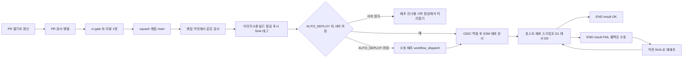
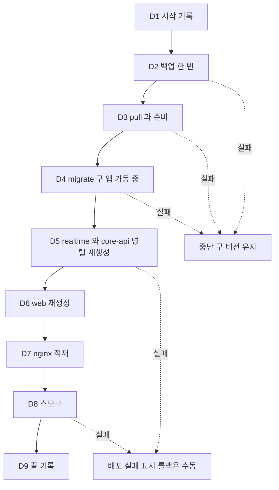

# CI/CD 파이프라인 설계 — U1 u1-walking-skeleton

> 단계: Construction · Infrastructure Design(3.4) · U1 u1-walking-skeleton · 깊이 Standard · 문서 cicd-pipeline.md (설계 ID 접두사 CD) · 담당 역할: aidlc-pipeline-deploy-agent
> 입력: `infrastructure-design-questions.md`(Q6 ~ Q8 · Q10 · Q12, 결정 보강), `reliability-design.md`(2.7 기동 순서, 2.8 정상 종료, 2.11 배포 중단 60초 예산, 2.12 백업, `## 3` 설정 키), `security-design.md`(2.10 비밀 분배표, 2.11 DB 역할 · Flyway, 2.17 CI 공급망 관문, 5.4 인계 I-1 ~ I-13), `logical-components.md`(H-1 ~ H-16, 불변식 I-1 ~ I-9), `observability-design.md`(OD-14 `deploy.log`, 점검 도우미), `performance-design.md`, `scalability-design.md`, `tech-stack-decisions.md`, `components.md`, `functional-spec.md`, `contract-summary.md`, ADR-001 · ADR-002 · ADR-006 · ADR-008
> 날짜: 2026-10-09
> 대리 판단: 질문 파일의 답 Q1 ~ Q12는 팀장(준하)의 대리 판단(가정) J85 ~ J96이다. 이 문서는 J90(비밀 관리) · J91(CI) · J92(배포 · 롤백) · J94(환경 구성) · J96(IaC 없음)을 구체화한다. 완전한 워크플로 YAML · 스크립트 본문 · IAM 정책 문서는 쓰지 않는다(3.5 이후). 새로 둔 값은 '제안(3.5 확정)'으로 표시했다. 질문 파일이 '비밀 변수 이름은 security-design 5.2의 표'라 했으나 그 표는 2.10절에 있어 2.10절을 따랐다. 이름 · 경로 · 포트 · 비밀 파일 · 로그 한도 같은 공통 사실은 같은 폴더의 infrastructure-specification.md(동시에 작성됨, 입력이 아니라 대조 대상)의 표를 정본으로 맞췄다.

## 1. 파이프라인 한눈에

### 1.1 설계 요소

| 설계 ID | 해결하는 NFRx.y | 패턴 · 결정 | 적용 위치 | 근거 |
|---|---|---|---|---|
| CD-1 | NFR9.10, NFR9.13 | GitHub Actions 하나로 PR 검사 · main 병합 · 이미지 · 배포를 잇는다. 필수 검사는 항상 도는 집계 작업 `ci-gate` 하나로 모아 경로 필터가 필수 검사를 영영 대기 상태로 두지 않게 한다 | `.github/workflows/` | J91 · org.md |
| CD-2 | NFR9.10, NFR4.10 | 불변 이미지: 앱 이미지 3종(core-api · realtime · web), 마이그레이션 이미지 1종, 인프라 번들 이미지 1종을 커밋 SHA 태그로 GHCR에 푸시한다. 환경 사이에는 같은 SHA를 옮기고 환경 차이는 Spring 프로필과 환경 변수 값뿐이다 | CI → GHCR → 호스트 | J91 · J94 |
| CD-3 | NFR9.10 | CI에서 AWS로는 GitHub OIDC로 짧은 수명의 역할을 맡고 장기 액세스 키를 두지 않는다. 역할은 배포 실행에 필요한 최소 권한만 갖고 비밀을 읽지 못한다 | IAM 역할 · SSM 문서 | J90 |
| CD-4 | NFR4.10, NFR4.9 | 배포는 재생성(recreate) 방식이다. CI가 SSM Run Command로 호스트의 배포 스크립트 하나를 실행한다. 병렬 재생성으로 중단 60초 예산을 지킨다 | 배포 스크립트 D1 ~ D9 | J92 · RD-19 |
| CD-5 | NFR4.13, NFR9.7 | 마이그레이션은 배포의 단일 단계(`migrate` 일회성)이고 expand/contract만 허용한다. 실패하면 앱을 건드리지 않는다 | D4 · CI 정적 검사 | J77 · J84 |
| CD-6 | NFR4.10, NFR4.11 | 롤백은 직전 성공 SHA로 같은 스크립트를 다시 실행하는 것이고 앱만 되돌린다. DB는 되돌리지 않는다 | 2.8절 | J92 |
| CD-7 | NFR9.11 | 환경 승격 dev → ci → demo. 같은 이미지가 이동하고 prod 환경은 이번 범위에 만들지 않는다. 승격 조건은 `ci-gate` 통과와 이미지 점검 통과다 | 2.4절 | J94 |
| CD-8 | NFR9.10, NFR9.13, NFR9.6 | 공급망 관문: 의존성 취약점 · 비밀 스캔 · 이미지와 번들 grep · 환경 파일 부재 · Nginx 설정 문법 · Compose 불변식 | 2.2 · 2.13절 | SD-16 |
| CD-9 | NFR4.8, NFR4.10 | 배포 사실은 호스트 `deploy.log`에 한 줄씩 남기고 가용성 집계가 짝 지은 구간만 제외한다. 중단 시간은 1초 샘플러로 잰다 | 2.10절 | RD-18 · RD-19 · OD-14 |
| CD-10 | NFR4.9 | 서버는 필요할 때만 켜므로 정지 중 병합은 배포를 건너뛰고(실패 아님) 켠 뒤 수동으로 따라잡는다 | 2.11절 | J95 |
| CD-11 | NFR4.14, NFR9.10 | 비밀은 저장소 · 이미지 · 로그에 없다. 호스트의 배포 스크립트만 Parameter Store에서 읽어 서비스별 파일(`/opt/mujoong/env/<service>.env`, root 소유 600)로 렌더링한다 | 2.5절 | J90 · SD-12 |

### 1.2 파이프라인 구성도

텍스트 대체: PR을 열면 검사들이 병렬로 돌고 집계 작업 `ci-gate`와 리뷰 1명이 병합 조건이다. squash 병합 뒤 같은 검사를 병합 커밋에서 다시 돌리고 이미지 5종을 SHA 태그로 GHCR에 푸시한다. 그다음 자동 배포가 켜져 있고 서버가 켜져 있으면 OIDC 역할을 맡아 SSM으로 호스트 배포 스크립트를 실행한다. 서버가 꺼져 있으면 배포를 건너뛰고 켠 뒤 시작 점검에서 따라잡으며, 자동 배포가 꺼져 있으면 수동 실행으로 같은 경로를 탄다. 배포가 실패하면 자동 롤백 없이 사람이 직전 SHA로 다시 실행한다.

텍스트 대체: 배포 스크립트는 D1 시작 기록, D2 백업, D3 pull과 준비, D4 마이그레이션, D5 realtime · core-api 병렬 재생성, D6 web 재생성, D7 nginx 적재, D8 스모크, D9 끝 기록의 순서다. D2 ~ D4가 실패하면 구 버전이 그대로 돌고 있고, D5 이후 실패하면 배포 실패로 표시하며 롤백은 사람이 한다.

### 1.3 배포 전략 선택

| 전략 | 채택 | 이유 |
|---|---|---|
| 재생성(recreate) + 병렬 | 채택 | 단일 인스턴스를 깨지 않는다. 소켓 레지스트리 · 세션 시계가 메모리에 있어 두 버전이 동시에 돌면 안 된다(NFR7.4). 중단은 약 50초이고 기기 웹이 5초 간격으로 재접속한다(BR9.7) |
| 블루-그린 | 제외 | 두 버전 동시 기동이 단일 인스턴스 전제와 부딪힌다(J92). 메모리도 한도 합계가 두 배가 된다 |
| 카나리 · 롤링 | 제외 | 인스턴스가 하나라 나눌 대상이 없다 |
| 기능 플래그 | 사용하지 않음 | 이번 범위 밖. 환경 차이는 프로필 · 환경 변수만이다 |
| 자동 롤백 | 제외 | 롤백 자체가 50초 중단을 한 번 더 일으키고 원인을 가린다(질문 파일 분석). 스모크 실패는 배포 실패로 표시하고 롤백은 사람이 명령한다 |

## 2. 설계 상세

### 2.1 브랜치 정책

| 항목 | 규칙 | 근거 |
|---|---|---|
| 방식 | 트렁크 기반. 기본 브랜치 `main`, 작업은 짧은 수명 브랜치(1 ~ 2일 안에 병합) | org.md Way of Working |
| 장수 브랜치 · 릴리스 브랜치 | 만들지 않는다. 환경은 태그가 아니라 배포 설정과 SHA 선택으로 나눈다 | org.md |
| 병합 방식 | squash 병합. 한 Bolt가 main의 한 커밋이고 커밋 제목은 Bolt 슬러그다 | org.md |
| 브랜치 이름 · 커밋 형식 | ADR-001의 `feature/{JiraKey}-description` · `{JiraKey} type: content`는 Proposed 상태다. 제안: 브랜치 이름과 PR 본문에 Jira 키를 쓰고 squash 커밋 제목은 Bolt 슬러그를 따른다 | ADR-001 · org.md (5절 사람이 정할 것 8) |
| 보호 규칙(제안) | main 직접 푸시 금지, 강제 푸시 금지, 선형 이력, 필수 검사 `ci-gate` 통과, 최소 리뷰 1명(ADR-001), 병합 전 최신 main과 맞춤 | ADR-001 · org.md |
| main 빨간불 | main의 `ci-gate`가 실패하면 새 기능 PR보다 수정이 먼저다(트렁크 기반의 전제). 이미지 단계가 돌지 않으므로 배포도 일어나지 않는다 | 제안 |
| 시연 기준점 | 시연 전 동결은 `AUTO_DEPLOY`를 끄고 배포할 SHA를 수동으로 지정하는 것이다. 별도 릴리스 브랜치 없음 | 2.12절 |
| 서드파티 액션 | GitHub 제공 액션 외에는 커밋 SHA로 고정한다(공급망, 제안) | SD-16 |
| 권한 기본값 | 워크플로 기본 `contents: read`. `packages: write`는 이미지 작업에만, `id-token: write`는 배포 작업에만 준다 | 제안 |

### 2.2 단계 → 게이트

#### 2.2.1 단계와 게이트 표

| 단계 | 트리거 | 하는 일 | 게이트 (통과 기준) | 실패하면 |
|---|---|---|---|---|
| S1 PR 검사 | PR 열기 · 갱신 | 2.2.2의 검사 작업을 경로에 맞게 병렬로 실행 | `ci-gate` 통과와 리뷰 1명. 총 시간 15분 이내를 목표(제안) | 병합 불가 |
| S2 main 병합 | squash 병합 | 병합 커밋에서 S1과 같은 검사를 다시 실행 | 같음 | 이미지 단계로 가지 않는다. main 수정이 최우선 |
| S3 이미지 | S2 성공 | 앱 이미지 3종 · 마이그레이션 이미지 · 번들 이미지 빌드, 이미지 점검, GHCR에 SHA 태그로 푸시 | 5종 모두 SHA 태그 존재, 이미지 점검(2.3절) 통과, 이미 있는 태그는 덮어쓰지 않고 실패 | 배포하지 않음 |
| S4 배포 | S3 성공 + `AUTO_DEPLOY`가 꺼지지 않음 + 서버 켜짐. 또는 수동 실행 | OIDC 역할 → SSM 배포 문서 → 호스트 배포 스크립트(2.6절) | 스크립트 종료 코드 0, `deploy.log`에 `result=OK` | 배포 실패 표시. 롤백은 수동 |
| S5 스모크 | S4 안(D8)과 S4 뒤 CI의 공개 경로 확인 | 호스트 안 스모크 + CI 러너에서 공개 도메인으로 3종 호출과 인증서 확인 | 3종 성공, 보안 경계 3건 통과(2.6.2) | 배포 실패 표시(자동 롤백 없음) |
| S6 롤백 | 사람이 `workflow_dispatch`(mode 롤백) | 직전 성공 SHA로 같은 스크립트 재실행 | S4와 같은 게이트 | RUNBOOK 복원 절차 |

#### 2.2.2 PR 검사 작업

경로 필터: 백엔드 `backend/**`, 프런트 `frontend/**`, 인프라 `infra/**`, 계약 `contracts/**`, 워크플로 `.github/**`(디렉터리 이름은 ADR-001 기준의 제안이며 3.5가 확정). 공통 계약이나 워크플로가 바뀌면 모든 작업을 돈다. 어떤 경로도 안 바뀌면 `ci-gate`만 통과한다.

| 작업 | 내용 | 실패 기준 | 근거 |
|---|---|---|---|
| backend | Gradle 빌드, 단위 시험, Testcontainers 통합(PostgreSQL 이미지는 운영과 같은 태그), ArchUnit 경계(앱 사이 스키마 · 패키지 의존 금지 BR8.1, 운영 코드 → 시험 패키지 의존 0, 시각 직접 호출 0), 설정 키 일치 시험(코드가 읽는 `mujoong.*` 키 = 기준 표), 앱 jar에 시험 클래스 0개 | 시험 실패, 경계 위반, 라인 커버리지 80% 미만 | J91 · SD-25 · RD-23 · RD-24 |
| backend-deps | Gradle 의존성 취약점 검사 | high 이상(예외 목록에 만료되지 않은 항목이 있으면 허용) | NFR9.13 · SD-16 |
| frontend | `npm ci`, ESLint(/parent → /device import 제한 NFR11.1, 문자열 리터럴 금지 규칙 SD-19), Vitest, 빌드, 번들에서 키 형태 문자열 grep, 라인 커버리지 80% 미만 | 위반 1건 이상 | J91 · NFR11.1 |
| frontend-deps | `npm audit` | high 이상(예외 목록 허용) | NFR9.13 |
| secrets | 저장소 비밀 스캔(gitleaks류, 커밋 이력 포함), 심어 둔 가짜 비밀을 찾는지 양성 대조 | 발견 1건 이상 | NFR9.10 · SD-16 |
| infra-validate | `nginx -t`(컨테이너 안, 업스트림은 시험용 대역 이름), `docker compose config`(demo · dev 두 파일, 가짜 값 파일로만 실행하고 출력을 로그에 남기지 않는다), Compose 불변식 검사(2.2.3), 스크립트 정적 검사(shellcheck류), 마이그레이션 정적 검사(2.7.2) | 위반 1건 이상 | J91 · SD-3 · SD-12 |
| images | 이미지 빌드(PR에서는 푸시 없음), 이미지 점검(2.3.2) | 점검 실패 | J91 · SD-16 |
| ci-gate | 위 작업의 결과를 모아 건너뜀은 허용하고 실패는 불허. 보호 규칙의 필수 검사는 이것 하나다 | 필수 작업 실패 | CD-1 |

PR 검사는 실제 유료 AI API를 부르지 않고 가짜 공급자를 쓴다(ADR-002). Docker가 필요한 시험이 있으므로 GitHub 호스트 러너(고정된 이미지 버전)를 쓴다.

#### 2.2.3 Compose 불변식 검사 (infra-validate 안)

`docker compose config`를 해석해 아래를 단언한다. 값은 reliability-design.md `## 3`과 logical-components.md 불변식 I-8 · I-9와 같다.

| 번호 | 단언 | 근거 |
|---|---|---|
| 1 | 호스트에 게시하는 포트는 nginx의 80 · 443뿐이다. 관리 포트 9090을 게시한 서비스가 없다 | NFR9.6 · SD-3 |
| 2 | `stop_grace_period`가 두 앱에서 40초이고 앱 정상 종료 유예 30초보다 길다 | 불변식 I-9 |
| 3 | 컨테이너 메모리 한도 합계(프로필 `knowledge` 꺼짐)가 호스트 메모리 8GiB의 70%(5.6GiB) 이하다 | 불변식 I-8 · NFR7.2 |
| 4 | 모든 상시 서비스가 `restart: unless-stopped`와 헬스체크를 가진다 | NFR4.9 |
| 5 | 서비스별 환경 변수 이름 목록이 2.5.1의 비밀 분배표와 같다(받지 않는 컨테이너에 비밀 이름 0건) | SD-12 |
| 6 | 서비스별 `logging`이 json-file이고 한도가 monitoring-design.md 2.4.2와 같다 | J88 |
| 7 | 네트워크는 edge · backend · acme 셋이고 `backend`는 `internal`이다. nginx · web은 backend에 없고 certbot은 acme에만 있다 | H-2 · LC-12 · 인프라 명세 D-8 |
| 8 | 이미지 태그가 고정되어 있다(`latest` 없음, 앱 이미지는 변수로 받는 SHA) | SD-16 |
| 9 | 앱 서비스가 서비스당 1개(`scale` 1)다. 배포 스크립트도 2 이상을 거부한다 | NFR7.4 |
| 10 | `neo4j`가 프로필 `knowledge`에만 속한다 | 결정 보강 |

### 2.3 이미지 · 산출물 관리

#### 2.3.1 산출물과 태그

| 산출물 | 이름 (제안) | 내용 | 태그 | 쓰는 곳 |
|---|---|---|---|---|
| core-api 이미지 | `ghcr.io/<org>/mujoong-core-api` | Core 앱. 멀티 스테이지, 비루트 사용자, 최소 HTTP 클라이언트 포함 | 커밋 SHA 40자(전체) | demo 호스트 |
| realtime 이미지 | `ghcr.io/<org>/mujoong-realtime` | Realtime 앱. 같음 | 같음 | demo 호스트 |
| web 이미지 | `ghcr.io/<org>/mujoong-web` | Next.js(/parent · /device). 환경 차이는 런타임 환경 변수만(이미지 하나) | 같음 | demo 호스트 |
| 인프라 번들 이미지 | `ghcr.io/<org>/mujoong-infra` | `infra/`의 `compose.demo.yml` · `release.env`(이미지 태그 = SHA, 비밀 아님) · `bin/`(배포 · 점검 스크립트) · `nginx/`(템플릿) · `postgres/init/` · `seed-audio/` · RUNBOOK 사본. 실행하지 않는 파일 보관용 이미지 | 같음 | 배포 D3에서 호스트로 꺼냄 |
| migrate 이미지 | `ghcr.io/<org>/mujoong-migrate` | Flyway CLI + 두 앱의 마이그레이션 SQL(`db/migration/core` · `db/migration/realtime`). 일회성 실행용 | 같음 | 배포 D4 |
| 서드파티 이미지 | postgres · nginx · certbot · backup 도구 · neo4j | 번들의 Compose 파일에 태그를 고정(`latest` 금지). 갱신은 PR로 한다 | 고정 태그 | demo 호스트 |

규칙: 한 SHA의 이미지 5종은 같은 `ci-gate`를 통과한 하나의 빌드 결과에서 나온다. 이미지에는 비밀 · 환경 파일 · 빌드 인자 비밀이 없다(`.dockerignore`로 환경 파일 제외, `ENV` 금지). 이미지 라벨에 커밋 SHA를 넣는다. 태그를 덮어쓰지 않는다(이미 있으면 실패). 이미지 빌드는 CI에서 하고 호스트에서 빌드하지 않는다(ADR-006 8절의 미정이던 빌드 위치를 CI + 레지스트리로 정함).

호스트가 번들을 쓰는 이유: Compose 파일 · Nginx 템플릿 · 스크립트가 앱 이미지와 같은 SHA로 움직이면 롤백(`current` 링크와 이미지 태그를 직전 SHA로 되돌림)이 둘을 함께 되돌리고, 저장소 읽기 열쇠(배포 키)를 호스트에 두지 않아도 된다. 인프라 명세 C-5가 선호한 방식이며 대안과 비교는 5절 다르게 푼 곳 7이다.

#### 2.3.2 이미지 점검 (images 작업과 S3)

| 번호 | 점검 | 실패 기준 | 근거 |
|---|---|---|---|
| 1 | 이미지 레이어 · 프런트 번들에서 키 형태 문자열과 비밀 환경 변수 이름 grep | 1건 이상 | SD-16 |
| 2 | 비루트 사용자로 실행, 베이스 이미지 태그 고정 | 위반 | SD 5.4의 I-13 |
| 3 | 이미지 취약점 스캔(Trivy류, 제안) | high 이상(예외 목록 허용) | 제안 |
| 4 | demo 프로필 더미 기동 시험: 임시 PostgreSQL에 migrate를 적용하고 더미 비밀 · 공급자 접속 없이 두 앱이 readiness UP이 된다. 프로필 가드(S1)와 필수 환경 변수 검사를 통과해야 한다 | 기동 실패 | CD-7 (제안) |
| 5 | 번들 이미지에 환경 파일이 없고 Compose 파일이 불변식을 통과 | 위반 | 2.2.3 |
| 6 | 앱 jar에 시험 클래스 0개 | 1개 이상 | SD-25 |

#### 2.3.3 보존 · 정리

| 대상 | 보존 | 정리 방법 |
|---|---|---|
| GHCR 이미지 | 최근 병합 SHA 10개와, 현재 배포 중인 SHA, 직전 성공 SHA(롤백용)는 항상 보존(제안) | 주 1회 정리 워크플로(제안). 비공개 저장소의 저장 한도는 요금제에 따라 확인 필요 |
| 호스트 이미지 | 현재 SHA와 직전 성공 SHA 둘(롤백이 네트워크 없이 가능) | 배포 성공(D9) 뒤 나머지 앱 이미지 삭제. 루트 볼륨 30GB 기준 |
| 호스트 릴리스 폴더 | `/opt/mujoong/releases/<SHA>/` 최근 5개(제안) | D9에서 오래된 것 삭제. `current`가 가리키는 것은 항상 보존 |
| CI 산출물(시험 보고서 · 커버리지) | 14일(제안) | 워크플로 설정 |
| 배포 직전 로그 보존 파일 | 7일 또는 40개 | monitoring-design.md 2.4.3 |

### 2.4 환경 승격

| 환경 | 실행 위치 | Compose · 설정 | Spring 프로필 | 시험 로그인 | 이미지 | 승격 조건 |
|---|---|---|---|---|---|---|
| dev | 개발자 PC, localhost | `compose.dev.yml`(저장소 `infra/`), Nginx 선택 | dev | 허용(`mujoong.dev-login.enabled`는 개발자가 켬) | 로컬 빌드 가능 | 없음. PR을 열면 ci로 간다 |
| ci | GitHub Actions 러너 | Testcontainers + 이미지 더미 기동 시험 | test | 해당 없음(가짜 공급자 · 더미 비밀) | PR은 빌드만, main은 빌드 후 푸시 | `ci-gate` 통과와 이미지 점검 통과 |
| demo | EC2 1대 | `compose.demo.yml` + `/opt/mujoong/env/<service>.env` | demo | 없음. 구글 로그인은 U2 | ci가 푸시한 같은 SHA 이미지 | main 병합 뒤 배포 게이트(2.2.1 S4 · S5) |
| 측정 창 | demo와 같은 EC2, 11/2 부하 측정 때만 | `compose.loadtest.yml`을 덧씌운 Compose 프로젝트 `mujoong-lt`(인프라 명세 1.3) | dev + load-test | dev 규칙 | 같은 SHA 이미지 | demo 스택을 멈춘 동안만. 이 동안 자동 배포는 동결 |
| prod | 만들지 않음 | — | prod(코드에 존재, 기동 가드만) | — | — | 실제 아동 데이터 운영 승인(D-14) 이후 별도 결정 |

demo에 dev · test · load-test 프로필이 함께 켜지면 앱이 기동을 거부한다(SD-14 행 5 ~ 11). 배포 스크립트도 환경 파일에 `SPRING_PROFILES_ACTIVE`가 demo 하나뿐인지 D3에서 확인한다(제안, 이중 방어). 환경별로 달라지는 것은 프로필과 환경 변수 값뿐이므로 ci에서 확인한 이미지가 곧 demo의 배포물이다.

### 2.5 시크릿 (CI/CD)

#### 2.5.1 비밀 분배와 렌더링

원천은 AWS Systems Manager Parameter Store이고 경로 접두는 `/mujoong/demo/`다. Parameter 이름은 인프라 명세 3.7의 이름이고 환경 변수 이름은 security-design.md 2.10을 따른다. 값은 어느 문서에도 쓰지 않는다. 호스트의 배포 스크립트가 인스턴스 프로필 권한으로 읽어 서비스별 파일로 나눠 쓴다(D3). 한 파일 전체를 모든 서비스에 붙이지 않는다(J75(h)).

| Parameter (`/mujoong/demo/` 아래) | 종류 | 환경 변수 | 렌더되는 파일 (`/opt/mujoong/env/`) | 받는 컨테이너 | 받지 않는 컨테이너 |
|---|---|---|---|---|---|
| `db/superuser-password` | SecureString | `POSTGRES_PASSWORD` | `postgres.env` | postgres(초기화만) | 나머지 전부 |
| `db/owner-password` | SecureString | `DB_OWNER_PASSWORD` | `postgres.env`, `migrate.env` | postgres(역할 생성), migrate | core-api · realtime · web · nginx · backup |
| `db/core-password` | SecureString | `DB_CORE_PASSWORD` (core-api에서는 데이터 소스 비밀번호 키로 매핑) | `postgres.env`, `core-api.env` | postgres(역할 생성), core-api | realtime · migrate 등 |
| `db/realtime-password` | SecureString | `DB_REALTIME_PASSWORD` (realtime에서 같은 방식으로 매핑) | `postgres.env`, `realtime.env` | postgres(역할 생성), realtime | core-api 등 |
| `db/backup-password` (제안) | SecureString | `DB_BACKUP_PASSWORD` | `postgres.env`, `backup.env` | postgres(읽기 전용 역할 `mujoong_backup` 생성), backup | 앱 · migrate · web · nginx |
| `internal/service-token` | SecureString | `INTERNAL_SERVICE_TOKEN` | `core-api.env`, `realtime.env` | core-api, realtime | web · nginx · migrate · postgres · backup |
| `provider/api-key` | SecureString | `PROVIDER_API_KEY` | `realtime.env` | realtime만 | core-api를 포함한 나머지 |
| `observability/owner-hash-secret` | SecureString | `MUJOONG_OBSERVABILITY_OWNER_HASH_SECRET` | `core-api.env`, `realtime.env` | core-api, realtime | 그 밖 |
| `google/oauth-client-secret` | SecureString (U2 전에는 빈 값) | `GOOGLE_OAUTH_CLIENT_SECRET` | `core-api.env` | core-api만 | 그 밖 |
| `neo4j/auth` | SecureString (켠 뒤에만) | `NEO4J_AUTH` | `neo4j.env` | neo4j | 그 밖 |
| `registry/pull-token` (제안, 이미지가 비공개일 때만) | SecureString | 없음 | 파일로 렌더하지 않음 | 배포 스크립트의 임시 `docker login` | 모든 컨테이너 |
| `service/host` | String (비밀 아님) | `SERVICE_HOST` | `nginx.env`, `certbot.env` | nginx, certbot | 그 밖 |
| `service/allowed-origin` | String (비밀 아님) | `MUJOONG_SECURITY_ALLOWED_ORIGIN` | `nginx.env`, `web.env`, `core-api.env`, `realtime.env` | nginx · web · 앱 둘 | — |
| `acme/contact-email` | String (비밀 아님) | `ACME_CONTACT_EMAIL` | `certbot.env` | certbot | 그 밖 |

컨테이너 안에서 쓰는 변수 이름(예: 앱의 데이터 소스 비밀번호 키)은 렌더러가 매핑하며 3.5가 확정한다. 분배 범위가 정본이고 2.2.3의 단언 5가 범위를 CI에서 지킨다. `web.env`에는 비밀이 없고 허용 origin과 시간 설정 키 값만 있다.

| 규칙 | 설계 |
|---|---|
| 파일 | root 소유 권한 600(디렉터리 `/opt/mujoong/env`는 700), `get-parameters-by-path`로 읽어 `umask 077` 임시 파일에 모은 뒤 검증(필수 변수 존재 · 필수 값이 빈 문자열 아님 · 권한)하고 서비스별 파일을 원자적으로 교체. 검증 실패는 D3 실패 |
| 변경 감지 | 값이 바뀌면 해당 서비스 설정이 달라져 다음 `up`에서 그 서비스만 재생성된다(Compose의 환경 파일 변경 감지 동작은 3.5가 확인). 비밀만 바꿀 때는 같은 SHA로 수동 재배포(mode 배포) |
| 출력 | 스크립트는 값을 출력 · 기록하지 않는다(`set +x`, 로그에 이름만). CI 로그에도 값이 나오지 않는다 |
| 부팅 | 서버를 켤 때는 이미 렌더링된 파일을 쓰므로 Parameter Store 장애와 무관하게 기동한다. 렌더링은 배포 D3에서만 일어난다 |
| 이미지 · 저장소 | 빌드 인자 · `ENV` · 환경 파일 커밋 금지. 번들에도 환경 파일이 없다 |
| 회전 | 수동. 내부 토큰은 두 앱 동시 재시작, DB 비밀은 `ALTER ROLE` 뒤 파일 갱신과 해당 앱 재시작, 공급자 키는 realtime 재시작(SD-12). 배포 중 두 앱 토큰이 잠시 어긋나도 Outbox가 401을 재시도한다(NFR4.10) |
| 키 관리 | SecureString은 AWS 관리형 키(`aws/ssm`)를 쓰고 고객 관리 키는 쓰지 않는다(비용, 제안). 권한 필요 여부는 3.5가 확인 |

#### 2.5.2 CI에서 쓰는 자격

| 자격 | 저장 · 발급 | 읽는 주체 | 수명 | 비고 |
|---|---|---|---|---|
| AWS 접근(CI → SSM) | 장기 키 없음. GitHub OIDC 토큰으로 IAM 역할을 맡음 | 배포 작업(`demo` 환경 job)만 | 세션 1시간 이하(제안) | 아래 2.5.3 |
| 이미지 푸시 | 작업 범위의 `GITHUB_TOKEN`(`packages: write`) | 이미지 작업만 | 작업 동안 | 개인 토큰을 쓰지 않는다 |
| 이미지 pull(호스트) | `registry/pull-token`: 읽기 전용 토큰(이미지가 비공개일 때만, 제안) | 호스트 배포 스크립트의 임시 `DOCKER_CONFIG`. 끝나면 지운다 | 사람이 만료일을 정함(제안 90일 이하) | 패키지를 공개로 두면 필요 없다. 비공개이면 유일하게 남는 장기 자격(인프라 명세 O-7). 대안은 5절 사람이 정할 것 4 |
| CI 시험용 비밀 | 실행마다 무작위 생성, 저장하지 않음 | 시험 작업 | 실행 동안 | 비밀 스캔 허용 목록은 가짜 값의 경로 · 지문과 사유만 |
| GitHub Actions 저장소 비밀 | 0개가 목표 | — | — | 필요해지면 `demo` 환경 비밀로 둔다 |

저장소 변수(비밀 아님): `AUTO_DEPLOY`, `AWS_REGION`, 역할 ARN, 인스턴스 id, 서비스 호스트. 실제 값은 이 문서에 쓰지 않는다.

#### 2.5.3 CI 역할 권한 (최소화, 정책 문서는 3.5)

| 항목 | 내용 | 이유 |
|---|---|---|
| 신뢰 정책 | 배포 역할 `mujoong-gha-deploy`(인프라 명세 3.5). GitHub OIDC 공급자, 대상(audience) `sts.amazonaws.com`, `sub`가 이 저장소의 `demo` 환경 job으로 한정(`repo:<org>/<repo>:environment:demo`). `demo` 환경은 `main`에서만 배포하도록 제한 | PR · 포크 · 다른 브랜치가 역할을 맡지 못하게 |
| 허용 1 | `ssm:SendCommand`: 대상 인스턴스 1대(태그 `Project=mujoong` · `Environment=demo`)와 사용자 정의 SSM 문서 `mujoong-deploy` 하나 | 임의 명령 실행 문서(`AWS-RunShellScript`)를 허용하지 않아 CI가 호스트에서 마음대로 명령을 못 돌리게 한다 |
| 허용 2 | `ssm:GetCommandInvocation` · `ssm:ListCommandInvocations` | 결과 확인(자원 범위를 줄일 수 없음) |
| 허용 3 | `ssm:DescribeInstanceInformation` · `ec2:DescribeInstances` · `ec2:DescribeInstanceStatus` | 서버가 켜져 있는지 확인(읽기 전용) |
| 허용하지 않음 | Parameter Store 읽기, S3, EC2 시작 · 정지, IAM, 다른 SSM 문서 | 비밀을 CI가 읽지 못하게. 서버 켜고 끄기는 사람이 콘솔에서 한다 |
| SSM 문서 `mujoong-deploy` | 매개변수 `sha`(40자 소문자 16진수만 허용)와 `mode`(배포 또는 롤백만 허용). 본문은 호스트의 `/opt/mujoong/bin/deploy.sh` 한 줄 호출. 실행 제한 시간 900초(제안). 인프라 명세 3.6은 '매개변수 SHA 하나'로 적었으나 롤백이 마이그레이션을 건너뛰어야 해서 `mode`가 필요하다(5절 다른 문서와 맞출 것 3) | 입력을 검증해 명령 주입을 막고 CI가 할 수 있는 일을 배포 하나로 고정 |

인스턴스 프로필(호스트 쪽 권한, 역할 `mujoong-demo-ec2`)은 infrastructure-specification.md의 IAM 표(3.5)가 정본이며 이 파이프라인은 그 안에 SSM 관리형 정책과 `/mujoong/demo/` 읽기 권한이 있다고 가정한다.

### 2.6 배포 단계 순서와 중단 시간 예산

#### 2.6.1 단계

호스트의 `deploy.sh` 하나가 모든 배포를 한다(CI 배포, 수동 배포, 롤백 모두). 진입점 `/opt/mujoong/bin/deploy.sh`는 현재 릴리스의 `bin/`을 가리킨다(인프라 명세 4.2: `/opt/mujoong/bin`은 `current/bin` 링크). 두 단계로 나눈다. 1단계(D1 ~ D3)는 현재 설치된 릴리스의 진입점이 잠금 · 백업 · 대상 번들 꺼내기와 준비를 하고, 2단계(D4 ~ D9)는 대상 릴리스에 들어 있는 적용 스크립트(`deploy-apply`, 제안)로 넘겨 실행한다. 이렇게 하면 대상 SHA의 Compose 파일 · 스크립트가 서로 맞고(롤백도 옛 릴리스의 스크립트가 옛 Compose를 다룸), 새 스크립트가 한 배포 늦게 적용되는 문제가 없다. `current` 링크는 D5 ②에서 바꾸고 그 전까지 Compose 호출은 대상 릴리스의 파일을 명시해 쓴다. 아래 `docker compose` 호출은 모두 인프라 명세 4.5.4의 `mj` 래퍼(프로젝트 · 파일 · env 옵션)를 통한다. 링크는 원자적으로 교체하므로 실행 중 스크립트 파일은 바뀌지 않는다.

| 단계 | 하는 일 | 실패하면 | 서비스 중단 | 시간 예산 (제안) |
|---|---|---|---|---|
| D0 사전 점검(CI 쪽) | 서버가 켜져 있고 SSM에 온라인인지 확인, 배포 동시성 잠금(한 번에 하나, 진행 중 배포를 취소하지 않음), OIDC 역할 맡기 | 서버 정지면 건너뜀(2.11절), 그 밖은 작업 실패 | 아니오 | 1분 |
| D1 시작 기록 | 호스트 잠금(`flock`, 이미 배포 중이면 즉시 종료), 사전 거부 조건 확인(측정 창 스택 `mujoong-lt`가 돌고 있음, `mujoong-compose` 단위가 정지 상태, 서비스당 컨테이너 2개 이상 요청), 배포 id 생성, `DEPLOY_START` 한 줄 기록 | 거부 조건 · 잠금 실패는 종료 코드로 알리고 기록하지 않음 | 아니오 | 수 초 |
| D2 백업 한 번 | `docker compose exec -T backup`으로 백업 스크립트 즉시 실행(03:00 정기 백업과 `flock`으로 겹침 방지, 인프라 명세 4.4 · reliability-design.md 2.12). 마이그레이션 실패 때의 복원 지점 | 실패하면 배포 중단(복원 지점이 없다). 구 버전 유지 | 아니오 | 1분 |
| D3 pull과 준비 | 임시 `DOCKER_CONFIG`로 GHCR 로그인(비공개일 때만) → 번들 이미지에서 릴리스 폴더(`/opt/mujoong/releases/<SHA>/`) 꺼내기 → 앱 · migrate · 서드파티 이미지 pull → 환경 파일 렌더(2.5.1) → 대상 릴리스의 `docker compose config` 검증(가짜 값이 아닌 실제 환경 파일을 쓰므로 출력은 로그에 남기지 않음) → 승인 음성 동기화(`/srv/mujoong/approved-audio`, 추가 · 갱신만 하고 삭제하지 않음) → `/opt/mujoong/postgres/init`은 릴리스에 변경이 있을 때만 갱신 → 디스크 여유 5GB 이상 확인 | 실패하면 중단. 아직 아무것도 바꾸지 않았다. 구 버전 유지 | 아니오 | 5분 |
| D4 migrate | 대상 릴리스에서 `docker compose --profile migrate run --rm migrate`(구 앱이 가동 중, 소유자 역할로 Flyway 적용, 인프라 명세 2.1). 출력은 `migrate-<배포 id>.log`로 남김 | 실패하면 중단. 구 앱은 계속 돈다(2.9절 절차) | 아니오 | 5분 |
| D5 realtime · core-api 병렬 재생성 | ① 재생성 대상의 로그 보존(monitoring-design.md 2.4.3) ② `current` 링크를 새 릴리스로 교체 ③ 1초 샘플러 시작 ④ 두 서비스를 한 명령에 넣어 동시에 재생성(`docker compose up -d --no-deps realtime core-api`, 변경 없는 서비스는 건드리지 않음) ⑤ readiness 대기: realtime → core-api 순, 각 120초 제한 | 제한 시간 안에 readiness가 오지 않으면 배포 실패(`failedStep=D5`). 롤백은 수동 | 예(병렬 최대 약 50초) | 50초(최악 60초) |
| D6 web 재생성 | web 이미지가 바뀐 경우만 재생성하고 healthy 대기 60초 | 실패하면 배포 실패. API는 정상 | `/device` 화면 새로 열기만 수 초 | 수 초 |
| D7 nginx 적재 | 설정 템플릿 렌더(`SERVICE_HOST` · HSTS · 허용 origin) → 일회성으로 `nginx -t` 검증 → 통과하면 고정 경로 `/opt/mujoong/nginx`를 갱신(릴리스 링크가 아님, 인프라 명세 4.2) → `nginx -s reload`. 설정이 같으면 건너뜀. nginx 이미지가 바뀐 경우는 재생성 | `-t` 실패면 갱신 · 적재하지 않고 배포 실패(활성 설정은 그대로) | 재생성 때만 수 초 | 30초 |
| D8 스모크 | 2.6.2 | 실패하면 배포 실패(`failedStep=D8`). 자동 롤백 없음 | 아니오 | 1분 |
| D9 끝 기록 | 1초 샘플러 종료와 `downtimeSec` 계산, `DEPLOY_END` 한 줄, 이미지 · 릴리스 정리(2.3.3), 잠금 해제, 요약을 CI로 반환 | 정리 실패는 배포 결과에 영향이 없고 WARN으로 남김 | 아니오 | 수 초 |

롤백(mode 롤백)은 D2와 D4를 건너뛴다(DB를 되돌리지 않고 새 마이그레이션도 적용하지 않음). 다른 단계는 같다.

이 순서는 질문 파일 Q8의 순서(realtime → core-api → web)와 같고, D5의 '동시 재생성'은 reliability-design.md RD-19의 병렬 권고를 따르되 readiness 대기를 realtime 먼저로 하는 방식으로 Q8의 순서를 유지한 것이다(5절 다르게 푼 곳 4). Compose의 병렬 동작은 3.5의 배포 리허설로 확인한다(5절 검증 항목 V-1).

#### 2.6.2 스모크 (D8과 S5)

한 바퀴 스모크(시작 → ACTIVE → 끝내기)는 유료 공급자 호출과 로그인 수단이 필요해 배포 스모크에 넣지 않는다. 점검표의 수동 항목이다(monitoring-design.md 5절 사람이 정할 것 6).

| 번호 | 점검 | 기준 | 비고 |
|---|---|---|---|
| 8-1 | 두 앱 readiness(컨테이너 안 관리 포트) | 200 둘 | 이력 버전 확인 · DB 연결 포함 |
| 8-2 | 3종 호출 한 번(호스트의 loopback으로 nginx에 접속) | health 200이고 UP, `/device` 200, WSS 101 | monitoring-design.md 2.6.1 |
| 8-3 | 보안 경계 3건 | 외부 경로 `/actuator/health` 403, `/internal/` 403, 80 포트 요청 301 | nginx 설정 회귀 방지(NFR9.1 · NFR9.6) |
| 8-4 | 승인 음성 정적 경로 | `/media/approved/` 아래 번들 목록의 파일 하나가 200 | 읽기 전용 경로 확인 |
| 8-5 | 컨테이너 상태 | 상시 7개 running · healthy, 재생성하지 않은 컨테이너의 재시작 횟수 증가 없음 | NFR4.9 |
| 8-6 | 새 앱 컨테이너 로그에 STARTUP_RECOVERY 한 줄 | 있음 | 시작 복구(S3)가 돌았다는 증거 |
| 8-7 | 중단 시간 | `downtimeSec` 60 이하이면 `budget=OK`, 초과하면 `budget=OVER` | 초과는 배포 실패가 아니라 기록이다(A-19) |
| S5b | CI 러너에서 공개 도메인으로 3종 호출 + 인증서 만료일 | 3종 성공, 만료일 20일 이상 | 호스트 밖 관점. 서버 DNS · 보안 그룹 · 인증서 확인 |

#### 2.6.3 중단 시간 예산 (60초, NFR4.10)

| 구간 | 값 | 근거 |
|---|---|---|
| 앱 정상 종료 유예 | 30초 | `spring.lifecycle.timeout-per-shutdown-phase` |
| Compose 강제 종료까지 | 40초 | `stop_grace_period`(불변식 I-9) |
| 컨테이너 기동 → readiness | 약 20초 | reliability-design.md 2.8 |
| 병렬 재생성 중단 | 목표 50초 이하. 앱이 유예를 다 쓰고 40초에 강제 종료되면 최악 60초(예산 경계) | 불변식 I-5 |
| 순차 재생성이었다면 | 두 앱의 중단이 합쳐져 60초를 넘을 수 있어 병렬이 필요 | RD-19 |
| web 재생성 | `/device` 화면에만 수 초 | RD-19 |
| nginx 업스트림 주소 | 인프라 명세 2.1이 edge 망의 앱 · web 컨테이너에 고정 IP를 주므로 재생성해도 주소가 바뀌지 않는다. 그래서 새 앱이 readiness를 통과하는 즉시 nginx가 502를 멈춘다(재해석이나 D7 재적재에 기대지 않음). 확인은 3.5 | 인프라 명세 N-2 |
| 예산 | 60초 이하 | NFR4.10 |

측정과 판정: D5 시작부터 D8 끝까지 1초 간격 샘플러가 3종(health · wss · device)을 호스트 loopback으로 부른다. `downtimeSec` = health 또는 wss가 실패한 초가 이어진 최장 구간, `deviceDownSec` = device 실패 최장 구간. reliability-design.md RD-19는 health 기준이지만 Realtime 재시작도 보려고 wss를 더했다(5절 다르게 푼 곳 5). 배포 리허설은 3회 이상 돌려 모두 60초 이하인지 기록한다. 사용자 체감은 기기 웹의 5초 재접속과 진행 중 세션의 FAILED(SERVER_RESTART) 종료(BR6.13)가 더해진다.

### 2.7 마이그레이션과 호환 규칙

#### 2.7.1 expand/contract (CD-5)

롤백이 앱만 되돌리므로 DB 변경은 이전 앱이 그대로 쓸 수 있어야 한다(BR8.2).

| 단계 | 허용되는 변경 | 금지 | 배포 |
|---|---|---|---|
| expand | 열 · 표 · 색인 추가(열은 널 허용이거나 기본값 있음), 새 스키마 객체, 이전 앱이 무시하는 변경 | 열 삭제 · 이름 변경 · 타입 변경, 널 불허 추가(기본값 없음), 제약을 강화하는 변경 | 새 코드와 같은 배포. 이전 앱이 호환 |
| 코드 전환 | 새 열을 읽고 쓰는 코드 배포 | — | 일반 배포 |
| contract | 옛 열 삭제 · 이름 변경 | 새 코드가 안정되었다고(최소 한 시연일 정상 운영, 사람이 승인) 확인되기 전 | 별도 PR · 별도 배포. 이 배포는 롤백 창을 닫는다 |

#### 2.7.2 정적 검사 (infra-validate)

CI가 마이그레이션 파일(Core · Realtime 위치 둘)에서 expand 단계에 금지된 문장 형태(삭제 · 이름 변경 · 타입 변경 · 널 불허 추가)를 찾아 실패시킨다. contract PR만 라벨(`allow-contract`, 제안)과 리뷰어 승인으로 예외를 받는다. 이미 적용된 파일을 수정하면 Flyway 체크섬 검증이 거부하므로 고칠 때는 새 버전 파일을 더한다(`clean` 비활성).

### 2.8 롤백 절차

#### 2.8.1 절차

| 단계 | 할 일 | 비고 |
|---|---|---|
| R0 판단 | 스모크 실패(S5) 또는 배포 뒤 점검표에서 이상. 롤백할 SHA = `deploy.log`에서 마지막 `result=OK`인 `sha`(실패한 배포의 `prevSha`와 같다) | 자동 롤백 없음 |
| R1 동결 | 자동 배포를 끈다(`AUTO_DEPLOY=false`). 롤백 중 새 병합이 배포되지 않게 | 2.12절 |
| R2 실행 | Actions의 수동 배포(mode 롤백, sha 입력) 또는 SSM 세션에서 직접 스크립트 실행 | CI가 안 되면 세션으로 |
| R3 스크립트 | D1 → D3 → D5 ~ D9. D2와 D4는 건너뜀. 이미지는 호스트에 직전 SHA가 남아 있으면 pull이 즉시 끝난다 | `DEPLOY_START mode=ROLLBACK` |
| R4 DB | 되돌리지 않는다. 이전 앱은 expand된 스키마와 호환(2.7.1) | |
| R5 확인 | 스모크와 프로브 3종, 점검표 2번 | |
| R6 정리 | 문제 PR을 `git revert` PR로 되돌리거나 수정해 정상 흐름으로 배포. 이후 `AUTO_DEPLOY`를 다시 켠다 | 트렁크 기반 |

롤백 중단 시간도 60초 예산을 따른다.

#### 2.8.2 롤백이 안 되는 경우

| 경우 | 대응 |
|---|---|
| 직전 SHA 이미지가 호스트와 GHCR 모두에 없다(보존 정책 밖) | 소스에서 그 SHA를 다시 빌드해 푸시한 뒤 롤백. 예방은 2.3.3의 보존 규칙 |
| 파괴적 마이그레이션이 이미 적용되었다(금지 규칙을 우회한 경우) | 앱 롤백으로 안 풀린다. RUNBOOK 복원 절차(D2의 배포 직전 백업, RTO 60분). 복원은 삭제된 계정을 되살릴 수 있어 합성 데이터 한정이다(NFR12.4) |
| 두 앱 내부 토큰이 어긋났다 | 환경 파일을 맞추고 두 앱을 같이 재시작(Outbox가 401을 재시도) |
| 인증서 · 도메인 문제 | 롤백으로 안 풀린다. RUNBOOK 인증서 절 |

### 2.9 마이그레이션 실패 시 절차

| 실패 형태 | 증상 | 앱 상태 | 조치 |
|---|---|---|---|
| SQL 오류(문법 · 제약) | migrate 종료 코드 ≠ 0, D4 실패 | 구 앱 계속 가동. PostgreSQL은 트랜잭션 DDL이라 실패한 파일은 반영되지 않음 | `migrate-<배포 id>.log` 확인 → 새 버전 파일로 수정(`main`에 고쳐 병합) → 새 배포 |
| 체크섬 불일치(적용된 파일을 수정함) | Flyway 검증 거부 | 구 앱 계속 가동 | 파일을 원래대로 되돌리고 변경은 새 버전 파일로 |
| 락 대기 · 시간 초과 | migrate가 멈추거나 시간 초과 | 구 앱 계속 가동 | 긴 트랜잭션이 있는지 확인, 재시도. 연결 한도(max_connections 100)도 확인 |
| 연결 불가(postgres 이상) | migrate 시작 실패 | 구 앱의 readiness도 이미 실패했을 수 있음(A-5) | postgres 컨테이너 상태부터 복구(RUNBOOK) 후 재배포 |
| 일부만 적용(여러 파일 중 중간 실패) | 이력 표에 앞 파일만 기록 | 구 앱은 expand만 적용된 스키마와 호환 | 실패한 파일만 고쳐 재배포. 이력에 실패 행이 남는 드문 경우는 소유자 역할로만 수리(RUNBOOK) |
| migrate 컨테이너 자체 이상(메모리 · 이미지) | D3에서 pull 실패 또는 D4에서 비정상 종료 | 구 앱 계속 가동 | 이미지 태그 · 메모리 한도 확인 |

공통: 구 앱은 한 번도 멈추지 않았으므로 서비스 중단이 없다. 배포는 `result=FAIL failedStep=D4`로 남고 CI 작업이 실패한다. 복원이 필요하다고 판단되면 D2에서 만든 백업을 쓴다(RTO 60분). 마이그레이션 로그는 `docker compose run --rm`이 컨테이너를 지우기 때문에 배포 스크립트가 따로 파일로 남긴다.

### 2.10 `deploy.log` 형식

호스트 `/var/log/mujoong/deploy.log`. 한 줄 한 사건, 공백으로 구분한 `키=값`, 시각은 UTC. reliability-design.md 2.11의 형식(시각 · 사건 · 커밋 · 결과)을 따르고 짝 짓기용 배포 id를 더했다. 가용성 집계가 이 파일의 짝 지은 구간만 제외한다(monitoring-design.md 2.6.3).

| 키 | 값 | 쓰는 사건 | 설명 |
|---|---|---|---|
| ts | ISO 8601 UTC, 초 단위, 끝 `Z` | 모두 | 사건 시각 |
| event | `DEPLOY_START` · `DEPLOY_STEP` · `DEPLOY_END` | 모두 | 시작 · 단계 · 끝 |
| deployId | `<UTC 시각>-<SHA 앞 7자>` | 모두 | 시작과 끝을 짝 짓는 키 |
| sha | 40자 소문자 16진수 | START · END | 배포한 커밋 |
| prevSha | 40자 또는 `none` | START | 직전 성공 SHA(롤백 대상) |
| mode | `DEPLOY` · `ROLLBACK` | START | 일반 배포 또는 롤백 |
| trigger | `CI` · `MANUAL` | START | 실행 경로 |
| runId | GitHub 실행 번호 또는 `none` | START | 추적용. 개인 정보 아님 |
| step | `D2` ~ `D8` | STEP | 단계 |
| result | `OK` · `FAIL` · `ABORTED` | STEP · END | ABORTED는 스크립트가 중간에 신호로 끝난 경우 |
| failedStep | `none` 또는 단계 | END | 실패한 단계 |
| durationSec | 정수 | STEP · END | 소요 시간 |
| downtimeSec · deviceDownSec | 정수 | END | 2.6.3의 측정값(샘플러를 못 돌렸으면 `NA`) |
| budget | `OK` · `OVER` · `NA` | END | 중단 시간이 60초 이하인지 |

| 사건 | 예시 줄 (값은 자리 표시) |
|---|---|
| 시작 | `ts=2026-10-09T01:02:03Z event=DEPLOY_START deployId=20261009T010203Z-a1b2c3d sha=<40자> prevSha=<40자> mode=DEPLOY trigger=CI runId=<번호>` |
| 단계 | `ts=2026-10-09T01:03:10Z event=DEPLOY_STEP deployId=20261009T010203Z-a1b2c3d step=D4 result=OK durationSec=21` |
| 끝(성공) | `ts=2026-10-09T01:05:40Z event=DEPLOY_END deployId=20261009T010203Z-a1b2c3d sha=<40자> result=OK failedStep=none durationSec=157 downtimeSec=48 deviceDownSec=9 budget=OK` |
| 끝(실패) | `ts=2026-10-09T01:04:00Z event=DEPLOY_END deployId=20261009T010203Z-a1b2c3d sha=<40자> result=FAIL failedStep=D4 durationSec=117 downtimeSec=0 deviceDownSec=0 budget=OK` |

규칙: ① 시작과 끝은 같은 `deployId`로 짝을 짓고 짝 지은 구간만 가용성에서 제외한다. 끝이 없는 시작(스크립트 비정상 종료 · 호스트 정지)은 제외하지 않는다. ② 스크립트는 오류 종료 시 종료 처리(trap)로 끝 줄을 쓰려 하지만 쓰지 못할 수 있고 그것이 ①의 이유다. ③ 파일을 못 쓰는 상태(디스크 가득)이면 배포를 시작하지 않는다(D1 실패). ④ 값에 비밀 · 개인정보를 쓰지 않는다. ⑤ 보관 30일(logrotate, 제안). ⑥ 단계별 상세는 `/var/log/mujoong/deploy-<배포 id>.log`에 남기고 CI에는 마지막 요약 줄만 돌려준다(SSM 출력 길이 제한을 피하려고, 제안).

### 2.11 서버 정지 중 배포와 최초 배포

서버는 필요할 때만 켠다(J95). EC2가 정지된 동안에는 SSM이 오프라인이다.

| 상황 | 동작 |
|---|---|
| 병합 때 서버가 정지 | D0이 서버 오프라인을 확인하고 배포 작업을 '건너뜀'으로 끝낸다(실패 아님). 작업 요약에 '서버 정지 — 켠 뒤 수동 배포 필요'와 대상 SHA를 남긴다 |
| 서버를 켠 직후 | 시작 점검 8번(monitoring-design.md 2.5.2): `deploy.log`의 마지막 `result=OK` sha와 main 최신 SHA를 비교한다. 다르면 수동 배포(`workflow_dispatch`, sha 비워 두면 main 최신)로 따라잡는다 |
| 자동 따라잡기(채택 안 함) | 켜질 때 호스트가 GitHub에 최신 SHA를 물으려면 저장소 읽기 자격이 호스트에 필요하다. 장기 자격을 늘리므로 채택하지 않는다 |
| 서버가 켜졌으나 SSM이 아직 온라인이 아님 | D0이 1분 간격으로 최대 5분 재확인한 뒤 건너뜀(제안) |
| 켜 있는 동안 연속 병합 | 배포는 한 번에 하나(동시성 잠금), 진행 중 배포를 취소하지 않고 대기열에는 최신 하나만 남긴다(GitHub 동시성 기본 동작, 제안) |
| 최초 배포(빈 호스트) | 자동 배포 대상이 아니다. RUNBOOK의 일회성 절차(인프라 명세 4.5.1): 호스트 준비 → 데이터 볼륨 · Parameter Store 값 → 도메인과 인증서 첫 발급(nginx가 인증서 없이는 443을 못 연다) → 첫 릴리스 꺼내기와 `current` 링크 만들기 → env 렌더링 → postgres 초기화(빈 볼륨에서만) → `migrate` → 스택 기동. 진입 스크립트가 아직 없으므로 첫 릴리스의 번들 꺼내기는 RUNBOOK이 같은 절차를 손으로 한다. 이후 배포는 D3이 인증서 파일이 없으면 실패하고 RUNBOOK을 가리킨다 |
| 인스턴스 크기를 올릴 때(예: Neo4j를 켜는 유닛) | 배포가 아니라 Stop → 인스턴스 유형 변경 → Start다(RUNBOOK). 켠 뒤 시작 점검을 거치고 번들의 환경 변수에 프로필 `knowledge`를 추가하는 배포가 뒤따른다 |

### 2.12 수동 배포와 동결

| 항목 | 설계 |
|---|---|
| 수동 배포 | `workflow_dispatch`: 입력 `sha`(비우면 main 최신), `mode`(배포 또는 롤백), `reason`(한 줄). 같은 재사용 워크플로를 쓰므로 경로가 하나다 |
| 자동 배포 스위치 | 저장소 변수 `AUTO_DEPLOY`. `false`면 병합 뒤 이미지까지만 만들고 배포는 건너뛴다. 기본값은 켜짐(Q8 · J92) |
| 동결 사용처 | ① 시연 · 11/2 측정 창(측정 창에서는 demo 스택을 멈추고 `mujoong-lt`를 돌리므로 배포가 겹치면 안 되고, D1이 `mujoong-lt` 실행 중이면 거부한다) ② 롤백 중 ③ 오류 예산 위험 이상(monitoring-design.md 2.3) ④ 마이그레이션 실패 조사 중 |
| 환경 보호 | GitHub `demo` 환경: 배포 브랜치는 `main`만. 필수 승인자는 두지 않는다(org.md: 스테이징 성격은 병합 때 배포, prod 승인 단계는 이번 범위에 없음) |
| 동시성 | 배포 작업 그룹 하나, 진행 중 배포를 취소하지 않음 |
| 설정만 바꿀 때 | 비밀 · 환경 값을 바꿨으면 같은 SHA로 수동 배포(mode 배포)하여 해당 서비스만 재생성 |

### 2.13 공급망 관문 배치

security-design.md 2.17의 표를 파이프라인 단계에 배치한 것이다. 도구는 3.5가 확정한다.

| 점검 | 실행 위치 | 실패 기준 | 예외 |
|---|---|---|---|
| 백엔드 의존성 취약점 | PR · main · 주 1회 예약 실행(제안, 코드가 안 바뀌어도 새 취약점이 생김) | high 이상 | 예외 목록 |
| 프런트 의존성 취약점(`npm audit`) | 같음 | high 이상 | 예외 목록 |
| 비밀 스캔(이력 포함) | PR · main · 주 1회 전체 이력 | 발견 시 | 시험용 가짜 값의 경로 · 지문과 사유 |
| 이미지 · 번들 grep | 이미지 작업(S3) | 1건 이상 | 없음 |
| 환경 파일 부재 | secrets 작업 | 저장소에 환경 파일 있음 | 없음 |
| 재현성 | infra-validate · images | 잠금 파일 없음, `npm ci` 아님, 태그 미고정, 루트 사용자 | 없음 |
| 이미지 취약점 스캔 | 이미지 작업 | high 이상 | 예외 목록 |

예외 목록은 파일 하나(제안: `ci/security-exceptions.yml`)이고 항목마다 취약점 id · 사유 · 만료일을 적는다. 만료일이 지난 예외는 CI를 실패시킨다(NFR9.13). 비밀 스캔 허용 목록은 가짜 값의 경로 · 지문과 사유만 적는다.

### 2.14 파이프라인 지표

`deploy.log`와 Actions 실행 기록에서 아래를 센다(별도 도구 없음, 시연 뒤 한 번 요약).

| 지표 | 계산 | 용도 |
|---|---|---|
| 배포 빈도 | `DEPLOY_END` 건수 ÷ 일수 | 흐름 확인 |
| 변경 실패율 | `result=FAIL` ÷ 전체(롤백 포함) | 품질 신호. 높으면 PR 검사 보강 |
| 롤백 횟수 | `mode=ROLLBACK` 건수 | 같음 |
| 복구 시간 | FAIL 줄 → 다음 OK 줄 | 롤백 절차 점검 |
| 배포 중단 시간 | `downtimeSec` 분포, `budget=OVER` 건수 | NFR4.10 증거 |
| 리드 타임 | 병합 → `DEPLOY_END result=OK` | 파이프라인 길이 |

## 3. 수치와 설정 값

| 항목 | 값 | 단위 | 위치 | 근거 |
|---|---|---|---|---|
| 배포 서비스 중단 | 60 이하 | 초 | 배포 | NFR4.10 |
| 앱 정상 종료 유예 | 30 | 초 | 양 앱 | `spring.lifecycle.timeout-per-shutdown-phase` |
| Compose `stop_grace_period` | 40 | 초 | Compose | 불변식 I-9 |
| 컨테이너 기동 시간(가정) | 약 20 | 초 | 양 앱 | reliability-design.md 2.8 |
| readiness 대기 제한 | 앱 120, web 60 (제안) | 초 | 배포 스크립트 | 이 문서 |
| SSM 명령 실행 제한 | 900 (제안) | 초 | SSM 문서 | 이 문서 |
| 스모크 샘플 간격 | 1 | 초 | 배포 스크립트 | RD-19 |
| 디스크 여유 하한(D3) | 5 (제안) | GB | 배포 스크립트 | 이 문서 |
| SSM 온라인 재확인 | 1분 간격, 최대 5분 (제안) | 분 | CI D0 | 이 문서 |
| PR 검사 목표 시간 | 15 이내 (제안) | 분 | CI | 이 문서 |
| 커버리지 하한 | 라인 80 | % | backend · frontend | org.md Testing Posture |
| 취약점 기준 | high 이상 | 등급 | CI | NFR9.13 |
| 이미지 태그 | 커밋 SHA 40자 | — | GHCR | J91 |
| GHCR 보존 | 최근 병합 SHA 10개 + 배포 중 + 직전 성공 (제안) | 개 | 정리 워크플로 | 이 문서 |
| 호스트 보존 | 앱 이미지 2개 SHA, 릴리스 폴더 5개 (제안) | 개 | 호스트 | 이 문서 |
| `deploy.log` 보관 | 30 (제안) | 일 | logrotate | 이 문서 |
| CI 산출물 보관 | 14 (제안) | 일 | 워크플로 | 이 문서 |
| OIDC 세션 | 1 이하 (제안) | 시간 | IAM 역할 | 이 문서 |
| Parameter 경로 접두 | `/mujoong/demo/` | — | Parameter Store | J90 |
| 환경 파일 | `/opt/mujoong/env/<service>.env`, root 소유 600 | — | 호스트 | 결정 보강 |
| 배포 잠금 | `flock` 비차단, 한 번에 하나 | — | 호스트 | 이 문서 |
| 이미지 pull 토큰(`registry/pull-token`) 만료 | 90 이하 (제안, 이미지가 비공개일 때만) | 일 | GitHub | 이 문서 |
| 호스트 게시 포트 | 80 · 443 | 포트 | nginx | H-2 · NFR9.6 |

## 4. 시험 · 검증 설계

| 설계 ID | 시험 | 단계 |
|---|---|---|
| CD-1 | 일부러 실패하는 PR 시나리오로 게이트가 막는지 확인한다: 심어 둔 가짜 비밀, 취약한 의존성, 틀린 Nginx 설정, 게시 포트를 추가한 Compose, 파괴적 마이그레이션, 경계를 넘는 import, 커버리지 하락. 경로 필터로 작업이 건너뛰어도 `ci-gate`가 통과 · 실패를 올바로 내는지 | 3.5 구현 |
| CD-2 | 같은 SHA의 이미지 5종이 ci에서 시험한 빌드 결과와 같고 태그 덮어쓰기가 거부된다. 이미지 grep과 비루트 점검이 위반 샘플을 잡는다 | 3.5 구현 |
| CD-3 | 다른 브랜치 · PR 작업에서 역할 맡기가 거부된다. 역할이 Parameter Store를 읽지 못하고 임의 명령 문서를 못 보낸다. SSM 문서가 형식이 틀린 `sha`를 거부한다 | Build and Test |
| CD-4 | 배포 리허설 3회: `downtimeSec` ≤ 60, 기기 웹 자동 재접속, 병렬 재생성이 실제로 병렬인지(두 컨테이너 재생성 시작 시각 차), `deploy.log`에 START · END 짝 | Build and Test |
| CD-4 | 정지 중 서버에 병합: D0이 건너뜀으로 끝나고 켠 뒤 수동 배포로 따라잡는다 | Build and Test |
| CD-5 | 마이그레이션 실패 주입(깨진 SQL, 체크섬 불일치): 구 앱 무중단, `result=FAIL failedStep=D4`, `migrate-<배포 id>.log` 존재. expand 금지 문장이 CI에서 실패한다 | Build and Test |
| CD-6 | 롤백 리허설 1회: 직전 SHA로 복귀, D2 · D4 생략, DB 유지, 이전 앱이 expand된 스키마에서 정상, 중단 ≤ 60초 | Build and Test |
| CD-7 | demo 프로필 더미 기동 시험이 프로필 가드 위반(demo + dev)을 거부하는지, 환경 파일의 프로필이 demo 하나가 아니면 D3이 실패하는지 | 3.5 구현 |
| CD-8 | 비밀 스캔이 심어 둔 가짜 비밀을 찾는다(양성 대조), 만료된 예외가 CI를 실패시킨다, 이미지 · 번들 grep이 0건이다 | Build and Test |
| CD-9 | 합성 `deploy.log`로 `probe-daily`가 짝 지은 구간만 제외하고 끝 없는 시작은 제외하지 않는다. 샘플러가 health · wss · device 실패 구간을 맞게 센다 | 11/2 측정 |
| CD-10 | 서버 Stop/Start 뒤 시작 점검 8번이 미반영 SHA를 알려 준다 | Build and Test |
| CD-11 | 환경 파일 권한 600과 서비스별 변수 목록이 2.5.1 표와 같다(`docker compose config`), 각 컨테이너가 받지 않는 비밀을 못 본다, 스크립트 출력 · CI 로그에 값이 없다 | Build and Test |
| CD-11 | 렌더 실패(필수 Parameter 없음)면 D3에서 중단되고 구 버전이 유지된다 | 3.5 구현 |

## 5. 열린 질문과 가정

**대리 판단 (J 번호)**

| 번호 | 내용 | 정할 곳 |
|---|---|---|
| J90 | 비밀은 Parameter Store SecureString(`/mujoong/demo/`)에 두고 배포 스크립트가 인스턴스 프로필로 읽어 서비스별 파일(root 600)로 렌더링한다. CI는 OIDC | 3.5 |
| J91 | GitHub Actions, PR 검사 · main 병합 후 GHCR에 SHA 태그 푸시, 커버리지 80% 하한 | 3.5 |
| J92 | 재생성 배포, 직전 SHA 롤백(앱만), DB는 expand/contract, 스모크 실패는 배포 실패 표시(자동 롤백 없음) | 3.5 · 리허설 |
| J94 | 세 환경 dev · ci · demo, 같은 이미지, prod 없음 | 사람(prod 승인 D-14 이후) |
| J96 | IaC 없음. `infra/`가 정본이고 RUNBOOK이 재현 순서. 환경 프로비저닝 단계는 이번 범위 밖 | 3.5 이후 |
| 가정 | 시간 · 개수 값(readiness 대기 120초, SSM 제한 900초, 보존 10개 등)은 시작값이며 리허설 뒤 조정한다 | 리허설 |

**사람이 정할 것 · 열림**

| 번호 | 내용 | 정할 곳 |
|---|---|---|
| 1 | Construction Verification Command 선택. 후보: A 단위 · 통합 전체(백엔드 Gradle 검사 + 프런트 시험), B A + CI에서 migrate → 기동 → 3종 호출, C B + 기기 시뮬레이터 한 턴(가짜 공급자)으로 걷는 골격의 끝-끝 결과를 보임. org.md는 걷는 골격에 실제 끝-끝 결과를 요구하므로 C를 제안. 3.5 시작 때 사람이 고른다 | 사람 · 3.5 시작 |
| 2 | 커버리지 80% 하한의 적용 범위(백엔드 · 프런트 각각인지, 제외 목록의 승인 방식). 하한은 약화하지 않는다(org.md) | 사람 · 3.5 |
| 3 | 서비스 도메인 · 허용 origin · 인증서 방식(Let's Encrypt HTTP-01 가정). `SERVICE_HOST`, 스모크 S5b, nginx 템플릿 변수, 최초 배포의 인증서 발급이 이 값에 걸린다 | 사람 · 클라우드 담당 |
| 4 | 호스트의 이미지 pull 자격: ① 읽기 전용 토큰을 Parameter Store에 둔다(제안) ② 패키지를 공개로 둔다(저장소 공개 범위 ADR-001 미정과 함께) ③ GHCR 대신 ECR로 바꿔 장기 자격을 없앤다(J91과 다름) | 사람 |
| 5 | 병합 때 자동 배포를 기본으로 둘지. ADR-002 · ADR-006은 자동 CD를 필수가 아니라 하고 `deploy.sh` 수동 배포를 기본값으로 한다. 이 설계는 Q8을 따라 자동을 기본으로 하되 `AUTO_DEPLOY`로 끈다 | 사람 |
| 6 | 서버 정지 중 병합의 따라잡기를 켠 뒤 수동으로 할지(제안) 자동으로 할지(호스트에 저장소 읽기 자격이 필요) | 사람 |
| 7 | PR 최소 리뷰 1명, 필수 검사 `ci-gate`, 선형 이력 등 ADR-001 Proposed 규칙의 확정과 저장소 설정 반영 | 팀장 |
| 8 | squash 커밋 이름: org.md의 Bolt 슬러그와 ADR-001의 `{JiraKey} type: content` 중 무엇을 제목으로 쓸지 | 팀장 |
| 9 | 배포 · CI 실패 알림 수신 방식. GitHub 기본 알림은 각자 설정에 달려 있고 메신저 연동은 계정 · 수신자 정보가 필요해 이번 범위 밖이다(경보 연동 열린 항목과 같음) | 사람 |
| 10 | 외부 프로브 실행 위치. 이 문서에는 S5b(CI 러너에서 공개 도메인 3종 호출)가 있어 독립 관점이 하나 더 생긴다. 정본 프로브는 monitoring-design.md 5절 | 사람 |
| 11 | 오프호스트 백업과 NFR12.4. D2의 배포 직전 백업도 같은 호스트에만 있어 호스트 상실 시 복구 수단이 아니다 | 사람 |
| 12 | 예산 한도. 이 파이프라인은 Actions 사용 시간과 GHCR 저장 용량을 쓴다. 비공개 저장소의 무료 한도는 요금제에 따라 확인이 필요하다 | 팀장 |
| 13 | Neo4j를 켜는 유닛과 시점. 켜면 컨테이너 한도 합계가 6.875GiB로 70% 판정선(5.6GiB)을 넘어 인스턴스 상향이 함께 결정되어야 한다. 이 파이프라인은 프로필 `knowledge`와 불변식 3의 한도 합계 계산을 그때 갱신한다 | 해당 유닛 3.4 |
| 14 | 시연 전 동결 시점과 동결 해제 조건 | 팀장 |
| 15 | 한 바퀴 스모크(시작 → ACTIVE → 끝내기)의 인증 수단(monitoring-design.md 5절 6과 같음) | 사람 · 3.5 |

**3.5에서 확인할 것 (검증 항목)**

| 번호 | 내용 |
|---|---|
| V-1 | `docker compose up -d --no-deps realtime core-api`가 두 서비스를 실제로 동시에 재생성하는지, `depends_on` 조건이 방해하지 않는지. 안 되면 중단 시간 예산이 깨지므로 두 서비스를 따로 정지한 뒤 한 번에 기동하는 방식으로 바꾼다 |
| V-2 | `mujoong-migrate` 이미지가 두 위치를 소유자 역할로 적용하고, 실행 SHA의 SQL이 같은 SHA의 앱이 기대하는 이력 버전과 맞으며, `clean`이 꺼져 있는지. 롤백에서 옛 SQL 집합이 새 이력과 충돌하지 않도록 D4를 건너뛴다는 규칙이 지켜지는지 |
| V-3 | 사용자 정의 SSM 문서의 매개변수 검증과 출력 길이 제한 동작 |
| V-4 | `management.server.port` 9090을 쓰는 Compose 헬스체크와 스모크 8-1이 같은 호출을 쓰는지 |

**요구·설계 문서와 다르게 푼 곳**

| 번호 | 내용 | 이유 |
|---|---|---|
| 1 | ADR-002 · ADR-006은 '자동 CD는 필수가 아니다, `deploy.sh` 수동 배포가 기본값'이다. 이 설계는 Q8(J92)을 따라 병합을 자동 배포 트리거로 두되 배포는 `deploy.sh` 하나이고 `AUTO_DEPLOY`로 끌 수 있다 | org.md가 병합 때 스테이징 배포를 기본으로 한다 |
| 2 | ADR-006 8절의 '이미지 빌드 위치 미정'을 CI + GHCR로 정했다 | Q7 |
| 3 | ADR-006 12.2는 22번 포트를 팀 IP로 제한하라 했으나 Q2(J86)에 따라 22는 열지 않고 SSM만 쓴다 | Q2 |
| 4 | Q8의 순서 'realtime → core-api → web 재생성(헬스 통과 대기)'를 D5에서 realtime · core-api 동시 재생성과 readiness 대기 순서(realtime 먼저)로 풀었다. reliability-design.md 5절 '다르게 푼 곳 4'의 권고와 같다 | 순차이면 앱별 중단이 합쳐져 60초를 넘을 수 있다 |
| 5 | 중단 시간 판정에 wss를 더했다(RD-19는 health 기준) | Realtime 재시작도 중단으로 본다 |
| 6 | 롤백에서 D2(백업)와 D4(migrate)를 건너뛴다 | DB를 되돌리지 않고 새 마이그레이션도 없다 |
| 7 | 인프라 번들 이미지를 도입했다. 질문 파일에는 호스트에 Compose 파일 · 스크립트를 어떻게 전달할지가 없다. 대안은 호스트의 저장소 읽기 열쇠(장기 자격 추가), 오브젝트 저장소 경유(버킷 · 권한 추가) | 같은 SHA로 앱과 구성이 함께 움직이고 장기 자격이 늘지 않는다 |
| 8 | 임의 명령 문서 대신 입력을 검증하는 사용자 정의 SSM 문서를 쓴다 | CI 역할의 최소 권한 |
| 9 | security-design.md 5.4 I-9는 정적 음성 경로를 `/audio/approved/`(제안)로 적었으나 결정 보강이 `/media/approved/`로 정했다. 스모크 8-4는 후자를 쓴다 | 결정 보강 우선 |
| 10 | 배포 직전 로그 보존(D5 ①)을 더했다. 컨테이너 재생성이 json-file 로그를 지우기 때문이다(monitoring-design.md 2.4.3) | SLI 정본이 로그 |
| 11 | 질문 파일은 비밀 변수 이름을 security-design '5.2의 표'라 했으나 해당 표는 2.10절이다(5.2는 사람이 정할 것). 2.10절을 따랐다 | 번호 착오 |
| 12 | 인프라 명세 3.5 · 3.6은 SSM 문서 매개변수를 '이미지 SHA 하나'로 적었다. 이 설계는 `mode`(배포 또는 롤백)를 더했다 | 롤백이 D2와 D4를 건너뛰어야 한다(옛 SQL 집합이 새 Flyway 이력과 검증에서 충돌) |
| 13 | 배포 진입점을 두 단계(현재 릴리스의 D1 ~ D3, 대상 릴리스의 D4 ~ D9)로 나눴다. 인프라 명세 4.2는 `/opt/mujoong/bin`을 `current/bin` 링크로만 적었다 | 새 스크립트가 한 배포 늦게 적용되거나 옛 릴리스의 롤백이 새 Compose를 다루는 문제를 피한다 |

**다른 문서와 맞출 것**

| 번호 | 대상 | 내용 |
|---|---|---|
| 1 | infrastructure-specification.md | 컨테이너 이름 · 네트워크 · 포트 · 메모리 한도 · 헬스체크 · 볼륨 경로(`/opt/mujoong/env/` · `/opt/mujoong/releases/` · `/opt/mujoong/current` · `/opt/mujoong/bin/` · `/srv/mujoong/approved-audio` · `/var/log/mujoong/`), IAM 표에 CI 역할(2.5.3), 사용자 정의 SSM 문서, 인스턴스 프로필의 `/mujoong/demo/` 읽기 권한 |
| 2 | infrastructure-specification.md | 확인: 업스트림이 edge 망 고정 IP(인프라 명세 2.1 · N-2)라 앱 재생성 뒤 주소가 바뀌지 않아 60초 예산이 nginx 재해석에 기대지 않는다. Nginx가 만든 502 · 504에 보여 주는 정적 점검 페이지가 원래 상태 코드를 유지하는지(200으로 바꾸면 스모크 8-2와 프로브가 성공으로 오판) |
| 3 | infrastructure-specification.md | SSM 문서 `mujoong-deploy`에 매개변수 `mode`(배포 또는 롤백)를 더할 것: 3.5 · 3.6은 '매개변수 SHA 하나'로 적었으나 롤백은 D2(백업)와 D4(옛 SQL로 새 이력을 검증하면 실패)를 건너뛰어야 한다. 또는 SHA 하나로 두고 호스트가 `deploy.log`로 모드를 추론하는 안이 있으나 암묵 규칙이라 권하지 않는다 |
| 4 | infrastructure-specification.md | `compose.demo.yml`이 2.2.3의 단언 10개를 만족하는지(특히 망 셋 · `backend` internal, 게시 포트 80 · 443뿐, 서비스별 환경 변수 목록이 2.5.1과 같음) |
| 5 | infrastructure-specification.md | 호스트 레이아웃: 이 문서는 인프라 명세 4.2의 `current` → `releases/<SHA>/`, `/opt/mujoong/bin` → `current/bin`, 고정 경로 `/opt/mujoong/nginx` · `/opt/mujoong/postgres/init`를 따른다. 대신 배포 진입점이 두 단계(현재 릴리스의 1단계, 대상 릴리스의 2단계)로 도는 것을 4.5.4와 맞출 것 |
| 6 | monitoring-design.md | `deploy.log` 형식, 배포 직전 로그 보존, 1초 샘플러, `power.log`(`mujoong-compose` 단위의 정지 · 기동 완료에 묶여 측정 창의 스택 정지도 표시), 시작 · 정지 점검 |

## 6. 자체 점검

| 점검 | 결과 |
|---|---|
| (a) 필수 표 존재 | 단계 → 게이트 표(2.2.1), 브랜치 정책(2.1), 환경 승격(2.4), 시크릿(2.5), 배포 단계 순서와 중단 시간 예산(2.6), 롤백 절차(2.8), `deploy.log` 형식(2.10), 이미지 태그 · 보존(2.3), 마이그레이션 실패 절차(2.9), 의존성 취약점 · 비밀 스캔 관문(2.13), 커버리지 하한과 Construction Verification Command를 포함한 `## 5. 열린 질문과 가정`이 있다 |
| (b) 인용 BR · NFR 존재 | 인용한 NFRx.y와 BRx.y는 nfr-requirements와 functional-design/rules.md에 있는 번호만 썼다(검사 스크립트로 확인함) |
| (c) 표 열 수 | 모든 표의 머리 · 구분선 · 행의 열 수를 스크립트로 확인했다. 셀 안에 파이프 문자를 쓰지 않았다 |
| (d) 수치 충돌 | 중단 시간 60초, 정상 종료 유예 30초, `stop_grace_period` 40초, 기동 약 20초, 컨테이너 메모리 한도 합계 5.375GiB(70% 판정선 5.6GiB 이하), 백업 03:00 KST · 7일, 로그 한도(realtime 20m × 5, core-api · nginx 10m × 5, 나머지 10m × 3)는 reliability-design.md `## 3`, observability-design.md 2.15, 질문 파일, monitoring-design.md, infrastructure-specification.md(2.2 · 2.4 · 4.1)와 같다. 이름(배포 역할 `mujoong-gha-deploy`, SSM 문서 `mujoong-deploy`, 인스턴스 역할 `mujoong-demo-ec2`) · 경로 · Parameter 이름도 인프라 명세와 같고, 다른 곳은 SSM 문서의 `mode` 매개변수 하나(5절 다르게 푼 곳 12)뿐이다. observability-design.md의 migrate · certbot · backup 5m × 2는 결정 보강에 따라 10m × 3으로 통일했다. 다르게 푼 곳은 5절 표에 모두 적었다 |
