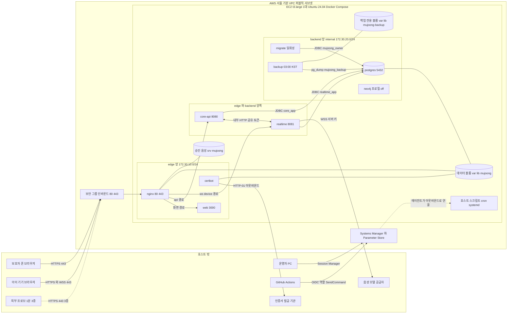

# 인프라 명세 (infrastructure-specification) — U1 u1-walking-skeleton

> 단계: Construction · Infrastructure Design (3.4) · 문서: infrastructure-specification (담당 역할: aidlc-aws-platform-agent) · 깊이 Standard · 날짜 2026-10-09 (클라우드 세션) · 3.4 재점검 결정 R4-1 ~ R4-19 반영(5.3 두 번째 표)
> 입력: `infrastructure-design-questions.md`(Q1 ~ Q12 답, 대리 판단 J85 ~ J96), `nfr-design/*.md`(`logical-components.md`의 3.4 인계 표 H-1 ~ H-16 · 컨테이너 9개 · 통신 표 C-1 ~ C-17 · 장애 도메인 표 · 불변식 I-1 ~ I-9, `reliability-design.md` `## 3`, `security-design.md`의 Nginx 설정 표 · 비밀 주입 · DB 역할 · `## 5.4`, `observability-design.md`의 헬스 · 프로브 · 수동 점검표 · 로그 보관, 성능 · 확장성 설계의 3.4 인계), `nfr-requirements/*.md`, `functional-design/*`, `inception/domain-design/components.md`, `inception/contract-design/contract-summary.md`, ADR-002 · ADR-006 · ADR-008.
> 대리 판단: J85 ~ J96은 사람 지시(2026-10-09)와 `docs/cloud_handoff.md` 2절에 따라 팀장(준하)의 대리가 정한 가정이다. 이 문서는 J85 ~ J96을 구체 자원 · 설정으로 풀고, 질문 파일 위에 얹은 결정(관리 포트 9090 · 서비스별 비밀 파일 · 읽기 전용 백업 역할 `mujoong_backup` · 정적 승인 음성 `/media/approved/` · Neo4j 프로필 꺼짐 · json-file 로그 한도 · 외부 프로브 3종 · 준비 전 503 응답)을 반영한다. J85 ~ J96은 모두 사람 확인 전의 대리 판단이며 5.1의 '승인 상태' 열에 그대로 적었다.
> 설계 문서이므로 완전한 IaC · Dockerfile · Nginx 전체 설정 · 워크플로 YAML · 스크립트 본문은 쓰지 않는다(3.5 이후). 계정 · 비밀번호 · API 키 · 서비스 도메인의 실제 값은 어디에도 없고 `<서비스 호스트>` 같은 자리 표시자만 쓴다.
> 표기: `(제안)`은 이 문서가 새로 둔 값(= 제안(3.5 확정))이다. 새 값의 목록은 5.2, 요구 · 설계 문서와 다르게 푼 곳은 5.3이다. 서비스 이름 · 포트 · 경로 · 비밀 파일 이름 · 메모리 한도 · 로그 한도 · 프로브 3종 경로는 세 문서(이 문서, monitoring-design.md, cicd-pipeline.md)의 공통 사실이며 이 문서의 표를 정본으로 맞춘다(5.5). 같은 폴더의 두 문서는 동시에 쓰이는 중이라 입력으로 삼지 않았고, 작성 중이던 monitoring-design.md가 이 문서에 요청한 항목과 값 충돌 여부만 확인했다.

## 1. 배포 구성

### 1.1 Deployment

| Facet | Choice | Rationale |
|---|---|---|
| 컴퓨트 모델 | AWS EC2 1대(서울 `ap-northeast-2`, 단일 가용 영역), `t3.large`(2 vCPU · 8 GiB, 버스트형, CPU 크레딧 모드 `unlimited` 제안), Ubuntu Server 24.04 LTS 공식 AMI, Docker Engine + Compose v2 플러그인. 앱은 컨테이너로만 돌고 호스트에는 Docker · 배포/점검 스크립트 · cron · systemd 단위만 둔다. Compose 서비스 정의는 9개(상시 7 + 일회성 `migrate` + 꺼진 `neo4j`) | ADR-006 2.1 · J85. Kubernetes · ECS Fargate · 관리형 DB는 단일 인스턴스 전제(NFR7.4)와 7일 일정에 비해 운영 복잡도만 늘어 제외했다. 8 GiB는 JVM 둘 + PostgreSQL + Next.js + 동시 세션 2개의 최소선이고 작게 시작해 11/2 실측 뒤 `t3.xlarge`로 올린다(비용 pillar). Graviton(`t4g`)은 이미지를 arm64로도 빌드 · 검증해야 해 U1에서 제외하고 약 20% 절감 후보로 둔다 |
| 리전 · 가용성 | 서울 단일 리전 · 단일 AZ. 다중 AZ · 로드 밸런서 · 자동 확장 없음. EC2 단순 자동 복구(시스템 상태 검사 실패 시 같은 EBS · EIP로 다른 호스트에서 재기동, 기본 동작)에 기대고 재기동 뒤에는 systemd 단위가 스택을 올린다 | 가용성 목표 99.0%(NFR4.8)에서 다중 AZ 비용 · 복잡도가 이득보다 크다. 호스트 상실은 NFR4.11이 RPO에서 제외한다. 신뢰성 pillar의 단일 장애점을 수용한 것이며 1.5와 5.4에 위험으로 적었다 |
| 네트워크 토폴로지 | 기본 VPC 퍼블릭 서브넷 + Elastic IP 1개 + 보안 그룹 1개(인바운드 80 · 443만). 운영 접속은 Session Manager만(22 닫음). 호스트 안은 Docker 브리지 망 둘: `edge`(nginx · web · core-api · realtime · certbot), `backend`(core-api · realtime · postgres · migrate · backup · neo4j, 외부 경로가 없는 `internal` 망). nginx · web · certbot은 backend에 없다. 호스트에 게시하는 포트는 nginx 80 · 443뿐이다. 배치도는 1.2 | J86 · J88 · NFR9.1 · NFR9.6. 사설 서브넷 · NAT 게이트웨이는 월 고정비만 늘고 인스턴스 1대에는 보안 이득이 작다. 망 둘은 J88 · H-2 그대로이고 `backend`를 `internal`로 둬 DB와 백업이 인터넷으로 나갈 수 없게 했다(N-2, D-8). certbot 전용 망을 더하는 3망 안은 기각을 유지한다(3.4 재점검 R4-1) |
| 스토리지 | 루트 gp3 30 GB(OS · Docker 이미지와 컨테이너 로그 · `/opt/mujoong` · `/var/log/mujoong` · 승인 음성) + 데이터 gp3 50 GB 별도 EBS `mujoong-demo-data`(`/var/lib/mujoong`: PostgreSQL · 인증서 · Neo4j · 측정 창 데이터) + 백업 전용 gp3 10 GB 별도 EBS `mujoong-demo-backup`(`/var/lib/mujoong-backup`: 덤프만). 셋 다 EBS 암호화. 데이터 · 백업 볼륨은 종료 시 삭제하지 않음 + 인스턴스 종료 보호 켬. EBS 스냅샷 · 오프호스트 복사는 없음(백업 볼륨도 같은 AZ라 AZ 상실은 복구 수단 없음, 5.4 O-3). 배치 상세는 4.2 | J85 · J89 · NFR4.11 · LC-8 · H-10(백업은 같은 호스트의 별도 볼륨). 데이터를 루트와 나눠 인스턴스를 다시 만들어도 볼륨을 붙여 복구하게 한다(Terminate 실수 대비, ADR-006 6.1). 백업을 PostgreSQL 데이터와 다른 EBS에 둬 데이터 볼륨 하나가 손상 · 분리 · 실수 삭제돼도 덤프가 남게 한다(D-17, 3.4 재점검 R4-4). 볼륨 암호화는 전사가 DB에 평문인 점의 보완이다(보안 설계 2.10). 스냅샷 · 오프호스트는 NFR12.4 사람 결정 전에는 하지 않는다 |
| 환경(dev/ci/demo) | `dev`(개발자 PC) · `ci`(GitHub Actions) · `demo`(EC2) 셋. 같은 이미지가 환경 사이를 이동하고 차이는 Spring 프로필과 환경 변수 값뿐이다. prod 환경은 만들지 않는다. 표와 11/2 측정 창 절차는 1.3 | J94 · NFR9.11. 시연에서 확인한 것이 곧 배포물이어야 하고 dev와 demo를 섞으면 시험 로그인이 인터넷에 열린다 |
| IaC 접근 | IaC 도구(Terraform · CDK) 미사용. 저장소 `infra/`(Compose · Nginx 템플릿 · 배포/백업/점검 스크립트 · `RUNBOOK.md`)가 정본이고 AWS 리소스는 콘솔 또는 CLI로 `RUNBOOK.md` 순서대로 만든다. 리소스 목록과 태그는 3.6, 최초 설치 순서는 4.5.1 | J96. 일회성 단일 인스턴스에 IaC 작성 · 검증 비용이 이득보다 크다. 대가로 콘솔 변경이 드리프트가 되므로 리소스 목록 표를 RUNBOOK에 두고 시연 전 눈으로 대조한다(운영 우수성 pillar의 의식된 이탈). 인스턴스가 늘거나 환경이 둘 이상 필요해지면 IaC로 승격한다 |
| 리소스 사이징 | 컨테이너 메모리 한도 합계 5.075 GiB(Neo4j 꺼짐; 명목 8 GiB의 63.4%이고 호스트 `MemTotal` 실측의 70% 이하여야 한다 — `MemTotal`은 약 7.6 GiB로 알려져 있어 70%는 약 5.3 GiB, 확인 필요), JVM 힙 1 GiB씩, PostgreSQL `max_connections` 100 · 앱 풀 합계 20, CPU 한도는 두지 않는다. 계산은 4.1 | J88 · NFR7.2 · NFR7.6. 한도를 명시해 OOM을 한 컨테이너에 가둔다. 한도는 postgres 1.0 · core-api 1.6 · realtime 1.6 GiB로 재배분했다(D-19, 3.4 재점검 R4-19). 모든 수치는 시작값이고 첫 통합 배포(10/23)의 `docker stats`와 11/2 실측으로 조정한다 |
| 호스트 하드닝 | SSH 비활성 · IMDSv2 필수(홉 1) · 스왑 없음 · 코어 덤프 끔 · 보안 패치 자동 적용(자동 재부팅 끔) · Docker 소켓은 어느 컨테이너에도 마운트하지 않음 · 환경 파일 root 600 · 컨테이너 `cap_drop ALL` · 비루트(postgres는 `user: "999:999"`) · 읽기 전용 루트. 항목 표는 1.4, 컨테이너 정책은 2.2 | NFR9.6 · NFR9.10 · NFR12.2. 방어는 보안 그룹 → Nginx → 앱 → DB 순으로 겹친다(보안 설계 2.1) |
| 시각 동기화 | chrony(Amazon Time Sync 서비스, Ubuntu EC2 기본)를 쓰고 호스트 시간대는 UTC다. 스택 기동 단위가 시각 동기화 뒤에 시작하며, 기동 직후 점검에 `chronyc tracking`의 동기 상태 Normal · 오차 1초 이내 확인을 둔다 | NFR6.4 · H-15. 앱 시한은 앱 Clock이 읽는 호스트 시각 위에 서 있어 시계 점프는 시한 발동을 앞당기거나 늦춘다. 인증서 판단과 기기 시계 환산도 같은 전제다 |
| 인스턴스 Stop/Start 정책 | 필요할 때만 Start(통합시험 · 멘토링 · 시연), 끝나면 Stop. Terminate 금지(종료 보호). Elastic IP · 데이터 볼륨 · 루트 볼륨은 유지된다. 부팅 시 스택은 systemd 단위가 자동 기동한다. 서버가 꺼진 날은 03:00 백업이 돌지 못하므로 정지 직전 · 기동 직후 백업 트리거를 더했다(4.4). 절차는 4.5.2 | J95 · ADR-006 1 · 6. 꺼진 시간에는 EBS · 퍼블릭 IPv4 비용만 든다(4.3) |
| 도메인 · TLS | 팀이 쓸 수 있는 서브도메인 하나의 A 레코드 → Elastic IP. Let's Encrypt HTTP-01(webroot)로 최초 발급하고(갱신과 같은 방식, 4.5.1) `certbot`이 하루 2회 확인 · 갱신하면 Nginx가 다시 읽는다. TLS 1.2 이상 · 80은 301 · HSTS 180일. 도메인 값은 미정이라 시연 전 필수 준비 항목이다(5.4 O-1) | J87 · NFR9.1. IP 인증서는 유효기간 · 갱신 확인 비용이 크고 localhost 시연은 네트워크가 분리된 실제 시연을 못 보인다(ADR-006 3.2) |
| 비밀 | Parameter Store SecureString(접두 `/mujoong/demo/`) → 배포 스크립트가 인스턴스 프로필 권한으로 읽어 `/opt/mujoong/env/<서비스>.env`(root 소유 600)를 서비스별로 렌더링 → Compose `env_file`. 비밀이 아닌 값(시간 설정 · HSTS · `HOSTNAME` · `PORT`)은 Compose `environment:`에 직접 적는다(3.7). 장기 액세스 키 없음(CI는 GitHub OIDC). 분배표는 3.7 | J90 · 보안 설계 SD-12. 사람이 서버에서 값을 타이핑하지 않고 접근 기록이 남는다. 컨테이너마다 자기 몫만 받는다 |
| 이미지 · 배포 | GitHub Actions가 이미지를 GHCR에 git SHA 태그로 올리고, 병합 시 OIDC 역할 → SSM Run Command(문서 `mujoong-deploy`)로 호스트 배포 스크립트를 실행한다(재생성 방식, 중단 60초 이내). 롤백은 직전 SHA로 같은 스크립트 재실행이다. 단계 · 게이트는 cicd-pipeline.md | J91 · J92 · NFR4.10. 블루-그린은 단일 인스턴스 전제(소켓 레지스트리 · 세션 시계, NFR7.4)와 맞지 않는다 |
| 관측 · 점검 | 호스트 cron 1분(원인 파악용) + 호스트 밖 외부 프로브 3종 1분(가용성 판정용). 외부 경보 · 대시보드 없음. 수동 점검표 하루 2회. EC2 기본 지표(상태 검사 · CPU · CPU 크레딧)는 콘솔에서 사람이 본다. 값은 monitoring-design.md | J93 · NFR4.8 · NFR4.15. 호스트가 죽으면 호스트 안 스크립트는 못 보므로 가용성 판정은 호스트 밖에서 한다 |
| 비용 통제 | 가동 시간 중심 통제(약 245시간/2주 이내면 US$30 안쪽, 산식은 4.3), 모든 리소스에 태그(`Project` · `Environment`), AWS Budgets 알림은 사람 결정(5.4 O-4). 개략표는 4.3 | J95. 꺼져 있어도 드는 비용(EBS · 퍼블릭 IPv4)을 표에 따로 둔다 |

### 1.2 네트워크 토폴로지 (배치도)

**텍스트 대체 (배치도).**

1. 보호자 폰과 아이 기기는 인터넷에서 보안 그룹(80 · 443만 허용)을 거쳐 nginx에만 닿는다. HTTPS와 WSS가 같은 문을 쓰고 외부 프로브도 같은 문으로 들어온다.
2. nginx(edge 망)는 경로로 갈라 화면은 web으로, `/api/`는 core-api로, `/ws/device`는 realtime으로 보낸다. `/internal/` · `/actuator/`는 바깥에서 403이다.
3. core-api와 realtime은 edge와 backend 두 망에 모두 붙는다. 서로 내부 HTTP(공유 토큰)로 부르고 Outbox/Inbox 이벤트도 그 길로 오간다. 앱 사이 호출 이름은 `core`(core-api의 backend 별칭)와 `realtime`이다.
4. postgres는 backend 망(외부 경로 없음)에만 있다. core-api는 `core_app`, realtime은 `realtime_app`, migrate는 `mujoong_owner`, backup은 읽기 전용 `mujoong_backup`으로 접속하고 덤프는 데이터 볼륨과 다른 백업 전용 EBS(`/var/lib/mujoong-backup`)에 쓴다.
5. realtime만 호스트 밖 음성 모델 공급자에 세션마다 WSS(443, 서버 키)를 연다.
6. certbot은 edge 망에 있지만 어느 서비스와도 통신하지 않고 아웃바운드로 인증서 발급 기관과 HTTP-01 통신만 한다. nginx와는 인증서 · 챌린지 볼륨만 공유한다. nginx는 승인 음성 디렉터리를 읽기 전용으로 서빙한다.
7. 운영자는 Session Manager로, CI는 OIDC 역할과 SSM Run Command로 호스트에 일한다. SSM 에이전트가 호스트에서 아웃바운드로 연결하므로 인바운드 규칙이 필요 없다. 호스트 스크립트(배포 · 점검 · 백업 트리거)와 systemd 단위는 호스트에서 돈다.
8. neo4j는 backend 망에 둘 자리만 있고 U1에서는 프로필로 꺼져 있다.

### 1.3 환경 (dev · ci · demo)

| 환경 | 위치 | 구성 | Spring 프로필 | 시험 로그인 | 비밀 | 데이터 |
|---|---|---|---|---|---|---|
| dev | 개발자 PC | `infra/compose.dev.yml`: postgres(+ 선택 nginx), 앱은 IDE 또는 컨테이너. 포트는 `127.0.0.1`에만 게시. HTTP localhost(Secure Context 예외) | dev(부하 시험 때만 부가 프로필 load-test) | 허용(`mujoong.dev-login.enabled`로 켠 때만) | 개인 PC의 `.env.local`(저장소 제외, 가짜 값만) | 임시, 언제든 삭제 |
| ci | GitHub Actions 러너(일회성) | 컨테이너 상주 없음: Testcontainers PostgreSQL, `nginx -t`, `docker compose config` 검사(가짜 값 파일로만), 이미지 빌드(푸시는 main 병합만) | test | 해당 없음(가짜 공급자) | CI 비밀 저장소 + OIDC 역할(AWS 접근은 배포 작업만) | 러너와 함께 사라짐 |
| demo | EC2 1대 | `infra/compose.demo.yml` 전체(2절) | demo | 없음(구글 로그인은 U2) | Parameter Store(3.7) | 데이터 볼륨, 합성 데이터만(NFR12.4) |
| 측정 창 | demo와 같은 EC2, 11/2 부하 측정 때만 | `infra/compose.loadtest.yml`을 덧씌워 Compose 프로젝트 `mujoong-lt`로 기동, 데이터 경로 `/var/lib/mujoong/loadtest/` | dev + load-test | dev 규칙 | 시험용 값 | 측정 뒤 삭제 |
| prod | 없음 | 만들지 않는다. prod 프로필은 코드에 있고 기동 가드만 둔다 | prod | — | — | 실제 아동 데이터 운영 승인(D-14) 뒤의 일 |

환경 사이의 차이는 규모와 프로필 · 환경 변수 값뿐이다(환경 동등성). 예외는 dev가 TLS 없는 localhost라는 것(Secure Context 예외)과 ci에 상주 컨테이너가 없다는 것이다. demo와 dev · load-test는 프로필 가드가 함께 켜는 것을 거부하므로(보안 설계 2.12) 11/2 측정은 demo 스택을 내린 측정 창에서 한다(성능 설계의 3.4 인계).

| 단계 | 측정 창 작업 (N-13) | 확인 |
|---|---|---|
| 0 | 자동 배포 동결: 저장소 변수 `AUTO_DEPLOY=false`(cicd-pipeline.md 2.12). 측정 창 동안 병합이 배포를 시도하면 D1이 측정 창 스택 실행 중이라 거부해 CI 작업이 실패로 남기 때문이다 | 변수 값 확인 |
| 1 | demo 스택 정지: 먼저 컨테이너 로그를 archive로 보존한다(monitoring-design.md 2.4.3의 보존 절차를 수동 실행). 이어서 `mujoong-compose` 단위를 멈춘다(정지 직전 백업 포함, 4.5.2). `mujoong-power-mark`가 단위의 정지 시작을 `power.log`에 자동 기록하므로 프로브 정지 구간을 수동으로 표시하지 않는다. 마지막에 **측정 창 전용 예외**로 `docker compose -p mujoong down`을 실행한다(`stop`만으로는 망이 남아 `mujoong-lt`가 같은 고정 서브넷을 만들 때 'Pool overlaps'로 거부된다. 데이터는 호스트 경로 바인드라 보존되고 `-v`는 쓰지 않는다) | 컨테이너 상주 0, demo 망 없음 |
| 2 | **계정 관리자가** 보안 그룹 인바운드 80 · 443 원본을 시험 PC의 /32로 좁힌다(시험 도구를 호스트에서 돌리면 인바운드를 모두 닫는다). 운영자 IAM에는 보안 그룹 변경 권한이 없다(3.5) | 규칙 목록 대조 |
| 3 | `compose.loadtest.yml`로 `mujoong-lt` 기동: 같은 이미지 SHA, 프로필만 dev + load-test, PostgreSQL 데이터 경로 분리 | 두 앱 readiness 200 |
| 4 | 시드 SQL 도구를 backend 망의 일회성 컨테이너로 실행해 30쌍을 입력한다. 토큰 원문은 `/var/lib/mujoong/loadtest/tokens/`(root 600, 저장소 밖)에만 둔다 | 행 수 점검 |
| 5 | 시나리오 L1 ~ L7 실행과 `host-sample` 5초 표본(CPU · 메모리, scalability-design.md 2.6의 정의). 기록 파일은 측정 직후 내려받는다 | 기록 파일 존재 |
| 6 | 정리: 측정 스택 정지 → `docker compose -p mujoong-lt down`으로 컨테이너와 `mujoong-lt` 망 제거 → 토큰 · 시험 데이터 삭제 → **계정 관리자가** 보안 그룹 복원 → `mujoong-compose` 단위를 시작해 demo 스택 재기동(`edge` · `backend`가 고정 서브넷으로 다시 만들어지고 `power.log`에 시작 완료가 자동 기록되어 프로브 제외 구간이 닫힌다) → `AUTO_DEPLOY` 복원 | `mujoong-lt` 망 없음, demo 망 재생성, demo 프로필에 dev · load-test 없음 |

측정 창의 `docker compose -p mujoong down`은 평시 금지인 수동 `down`(monitoring-design.md 2.4.3)의 유일한 예외다. 컨테이너를 지우면 json-file 로그가 사라지므로 단계 1이 먼저 archive 보존을 한다(5.5 C-8).

### 1.4 호스트 기준선

| 항목 | 설정 | 확인 | 근거 |
|---|---|---|---|
| OS · 패치 | Ubuntu Server 24.04 LTS 공식 AMI. 첫 기동에서 보안 패치를 적용하고 `unattended-upgrades`는 보안 패치만 · 자동 재부팅 끔(시연 중 재부팅 방지, 재부팅은 정지 · 기동 때 사람이 한다) | 보안 패치 대기 0건 | 운영 우수성 |
| 원격 접속 | SSH 서비스 비활성, 키 쌍 없음, 보안 그룹에 22 없음. Session Manager만 쓴다(인스턴스 프로필 3.5) | 22 포트 닫힘, 세션 접속 성공 | J86 |
| 인스턴스 메타데이터 | IMDSv2 필수, 응답 홉 제한 1(컨테이너가 인스턴스 역할 자격에 닿지 못하게 한다) | 컨테이너 안에서 메타데이터 호출 실패 | NFR9.10 |
| 스왑 · 코어 덤프 | 스왑 없음, `systemd-coredump` · `apport` 비활성, `fs.suid_dumpable=0`, 컨테이너 `ulimits` core 0, JVM 자동 힙 덤프 끔(2.5) | `swapon --show` 빈 출력 | NFR12.2 · SD-22 |
| Docker | 공식 apt 저장소의 Engine(25 이상) + Compose v2 플러그인(2.20 이상: `required: false` · `start_interval` 사용). `daemon.json`: 기본 로그 json-file 10m × 3, `shutdown-timeout` 60초, `no-new-privileges` 기본 켬, `userland-proxy` 끔. `docker` 그룹은 루트 권한과 같으므로 Session Manager 접속 계정에만 준다 | 버전 확인(3.5) | J88 · 5.7 |
| 시각 | chrony가 Amazon Time Sync 서비스를 쓰고 `chrony-wait`를 켜서 동기화 뒤에 스택을 올린다. 호스트 시간대 UTC | `chronyc tracking` 동기 상태 Normal · 오차 1초 이내 | NFR6.4 · H-15 |
| 데이터 · 백업 볼륨 | UUID로 `/var/lib/mujoong`(데이터)와 `/var/lib/mujoong-backup`(백업 전용)에 마운트(`noatime,nofail`) + Docker 서비스에 두 경로를 `RequiresMountsFor`로 지정하는 드롭인. 볼륨이 없으면 Docker가 뜨지 않아 빈 루트에 PostgreSQL이 새로 초기화되거나 덤프가 루트 볼륨에 쌓이는 사고를 막는다 | 재부팅 뒤 `findmnt` 두 경로(N-14) | 4.2 |
| 파일 권한 | `/opt/mujoong/env` 디렉터리 0700, 환경 파일 0600 root. 백업 파일 0600. 승인 음성 0644. 호스트 로그 파일은 `backup.log`만 uid 999 소유 640(그룹 root 읽기)이고 나머지는 root 640이다 | `stat` 점검(SD-12) | NFR9.10 · R4-11 |
| 로그 회전 | `/etc/logrotate.d/mujoong`: `host-collect.log` · `metrics-snapshot.log`는 매일 회전 7개, `deploy.log` · `power.log` · `backup.log`는 매일 회전 30개(모두 압축 · `copytruncate`, monitoring-design.md 2.7.4와 같은 값). 같은 파일에 배포 단위 로그 `deploy-*.log` · `migrate-*.log`의 30일 지난 파일 삭제 규칙(와일드카드)을 둔다. `archive/*.log.gz`는 7일 또는 40개 초과분 삭제를 배포 D9가 수행한다(배포 때만 쌓이는 파일이라 회전 대상이 아님) | 회전 실행 확인, 삭제 규칙 대상 목록 대조 | OD-14 · R4-11 |
| 주기 작업 | `/etc/cron.d/mujoong`: `host-collect` 분 단위(`flock -n` · `timeout 20`) | 로그 줄이 분마다 늘어남 | LC-9 |
| systemd 단위 | `mujoong-compose.service`(부팅 시 스택 기동 · 정지 시 안전 정지, 4.5.2)와 `mujoong-power-mark.service`(호스트 기동 완료와 `mujoong-compose.service`의 시작 완료 때 `POWER_READY`, 호스트 정지 시작과 `mujoong-compose.service`의 정지 시작 때 `POWER_STOP`을 `power.log`에 한 줄. 후자는 두 단위를 PartOf/After로 묶어 구현하며 11/2 측정 창의 스택 정지 · 기동도 자동 기록되고 수동 표시는 없다. 줄 형식은 monitoring-design.md 2.6.3) | `systemctl status`, 단위 정지 · 시작 뒤 `power.log` 줄(V-14) | N-9 |
| 설치 도구 | AWS CLI v2, `jq`, `curl`, `openssl`, `chrony`, Docker. 그 밖의 패키지는 두지 않는다 | — | 최소 설치 |
| 종료 보호 | 인스턴스 종료 보호 켬, 데이터 · 백업 볼륨 종료 시 삭제 안 함 | 콘솔 설정 대조 | ADR-006 6.1 |

### 1.5 Well-Architected 점검

| Pillar | 이 설계의 선택 | 수용한 트레이드오프 |
|---|---|---|
| 운영 우수성 | 저장소 `infra/` 정본 + RUNBOOK + 수동 점검표, 배포는 스크립트 | IaC 없음 = 콘솔 드리프트 위험(J96). 리소스 목록 대조로 완화 |
| 보안 | 인바운드 80 · 443뿐, SSH 없음, 망 둘 분리 + `backend` internal, 컨테이너 최소 권한, 서비스별 비밀 파일, IAM 최소 권한, EBS 암호화 | 앱 ↔ DB 구간은 평문(내부망, 보안 설계 2.10). 아웃바운드 전체 허용(J86) |
| 신뢰성 | 재시작 정책 + 헬스체크 + 시작 복구, 백업 4트리거 + 백업 전용 EBS, 종료 보호 + 분리 데이터 볼륨, 단순 자동 복구 | 단일 AZ · 단일 호스트(백업 EBS도 같은 AZ). 오프호스트 백업 없음(NFR12.4 사람 결정). hang은 수동 재시작 |
| 성능 효율 | 측정 뒤 사이징, 메모리 한도 합계 ≤ 70%, G1 GC 명시, Nginx 압축 · 캐시 · keepalive | `t3` 버스트형이라 CPU 크레딧에 기댄다(`unlimited`, 초과 과금 가능, 5.4 O-10) |
| 비용 최적화 | 필요할 때만 켬, 작은 인스턴스, 무료 구간 서비스(Parameter Store 표준 · Session Manager) | 퍼블릭 IPv4 · EBS는 꺼져 있어도 과금 |
| 지속 가능성 | 작은 인스턴스, 꺼 두는 시간 극대화, 로그 용량 상한 | Graviton 미채택(U1 일정) |

## 2. 인프라 서비스

### 2.1 Infrastructure Services

| Service | Role | Configuration | Notes |
|---|---|---|---|
| `nginx` | 바깥에 닿는 유일한 문. TLS 종료(1.2 이상) · HTTP 301 · 보안 헤더 · 경로 분기 · 정적 승인 음성 · 점검 페이지 | **이미지** 공식 `nginx` 안정판 alpine, 태그 고정; **포트** 80 · 443(호스트에 게시하는 유일한 컨테이너); **망** `edge`(고정 IP 172.30.10.10); **메모리** 128M; **헬스** 컨테이너 안 루프백 상태 경로 10초 간격; **재시작** unless-stopped, 종료 유예 10초; **tmpfs** `/var/cache/nginx` 32m · `/var/run` 4m(2.2); **볼륨** `/opt/mujoong/nginx`(렌더링된 설정 · 점검 페이지, 읽기), `/var/lib/mujoong/certbot/conf`(인증서, 읽기), `/var/lib/mujoong/certbot/www`(챌린지, 읽기), `/srv/mujoong/approved-audio`(승인 음성, 읽기); **비밀 파일** `/opt/mujoong/env/nginx.env`(비밀 없음: 서비스 호스트 · 허용 origin); **환경** HSTS 값은 Compose `environment:`(3.7 비밀 아님 행); **로그** 10m × 5 | 설정 값은 3.2 · 3.3. 인증서 갱신 표지 파일(`renewed.flag`) 변경을 컨테이너 안 보조 루프가 60초마다 확인해 `nginx -s reload`한다(Docker 소켓 없이). 업스트림은 고정 IP라 재생성해도 주소가 바뀌지 않는다. 설정이 바뀐 배포에서는 배포 스크립트가 렌더링 결과를 `nginx -t`로 검증한 뒤 고정 경로 디렉터리를 갱신하고 적재한다(검증 실패 시 적재하지 않음). 설정은 릴리스 링크가 아니라 고정 경로에서 마운트한다(4.2). 최초 발급 전에는 인증서가 없어 443이 뜨지 않으므로 인증서 없이 뜨는 80 전용 임시 설정으로 먼저 기동하고 발급 뒤 443 설정을 적재한다(4.5.1 5-c) |
| `web` | Next.js 한 앱(`/parent` · `/device`). 상태 없음, 서버에서 다른 서비스를 부르지 않는다(C-17) | **이미지** Node.js 22 LTS 기반 Next.js 독립 실행 빌드, 태그 = git SHA; **포트** 3000(게시 안 함); **망** `edge`(172.30.10.11); **메모리** 512M; **헬스** `GET /healthz`(가벼운 라우트, 제안) 10초 간격; **재시작** unless-stopped, 유예 10초; **볼륨** 없음(tmpfs `/tmp` 64m · `.next/cache` 64m); **비밀 파일** `/opt/mujoong/env/web.env`(비밀 없음: 허용 origin만); **환경** Compose `environment:`에 `HOSTNAME=0.0.0.0` · `PORT=3000` · 시간 설정 키 값(3.7 비밀 아님 행); **로그** 10m × 3 | `NEXT_PUBLIC_*`에 비밀을 두지 않는다(NFR9.10). 시간 설정(`mujoong.timing.*`)은 서버 컴포넌트가 기동 환경 변수에서 읽어 첫 응답에 싣는다(LC-2, NFR6.1). Next.js 독립 실행 서버는 `HOSTNAME` 환경 변수로 바인드하는데 Docker가 이 값을 컨테이너 ID로 채우면 컨테이너 IP에만 바인드되어 루프백 헬스체크가 영구 실패하고 nginx가 뜨지 않으므로 `HOSTNAME=0.0.0.0` · `PORT=3000`을 명시한다(3.4 재점검 R4-16). `/device` 정적 페이지는 외부 프로브 대상이다 |
| `core-api` | 보호자 REST · 기기 REST · 내부 API · Core Outbox/Inbox(Spring 앱 하나) | **이미지** Java 21 LTS JRE 기반, 태그 = git SHA; **포트** 서비스 8080, 관리 9090(컨테이너 루프백만, 게시 안 함); **망** `edge`(172.30.10.12) + `backend`(별칭 `core`); **메모리** 1.6G(JVM 힙 1 GiB); **헬스** readiness(관리 포트, 2.3); **재시작** unless-stopped, 유예 40초; **기동 의존** postgres(healthy) · migrate(완료)만(realtime을 기다리지 않음, D-18); **볼륨** 없음(tmpfs `/tmp` 64m); **비밀 파일** `/opt/mujoong/env/core-api.env`(DB `core_app` 비밀 · 내부 토큰 · ownerHash 비밀 · 구글 OAuth 비밀(U2 전에는 파라미터가 없어 렌더러가 빈 변수로 둠, 3.7)); **로그** 10m × 5(비차단 모드) | DB 역할 `core_app`, 풀 10, `spring.flyway.enabled=false` · `ddl-auto=validate`(BR8.1). 서비스당 컨테이너 1개이며 `--scale`을 금지한다(NFR7.4). JVM 옵션은 2.5. `/actuator/**`는 관리 포트에만 있고 Nginx는 관리 포트로 프록시하지 않는다 |
| `realtime-activity` (Compose 서비스 `realtime`) | 기기 WSS · 세션 상태 기계 · 음성 모델 공급자 중계 · 출력 게이트 · 전사 기록 · Realtime Outbox/Inbox | **이미지** core-api와 같은 틀(별도 이미지), 태그 = git SHA; **포트** 서비스 8081(계약), 관리 9090(루프백만); **망** `edge`(172.30.10.13) + `backend`; **메모리** 1.6G(힙 1 GiB); **헬스** readiness(관리 포트); **재시작** unless-stopped, 유예 40초; **기동 의존** postgres(healthy) · migrate(완료)만; **볼륨** 없음(tmpfs `/tmp` 64m); **비밀 파일** `/opt/mujoong/env/realtime.env`(DB `realtime_app` 비밀 · 내부 토큰 · 공급자 키 · ownerHash 비밀); **로그** 20m × 5(비차단 모드) | 호스트 밖으로 나가는 유일한 앱 연결(공급자 WSS 443, 세션마다 별도). 코어 덤프 0 · 힙 덤프 끔 · 스왑 없음(원음 비저장, NFR12.2). 서비스 이름은 계약이 쓰는 `realtime`이고 논리 이름은 realtime-activity다(N-3). 공급자 접속 주소는 demo에서 허용 호스트 목록 안이어야 기동한다(SD-25) |
| `postgres` | 영속 저장(물리 1개, 스키마 `core` · `realtime`, 역할 4개) | **이미지** PostgreSQL 16 공식 이미지(Debian 계열), 태그 고정; **실행 사용자** `user: "999:999"`(이미지 entrypoint의 root 단계 · `gosu` 전환을 건너뜀, 이미지 기본 root 시작은 쓰지 않음); **포트** 5432(게시 안 함); **망** `backend`; **메모리** 1.0G, `shm_size` 128M; **tmpfs** `/var/run/postgresql`(uid=999) 8m · `/tmp` 64m; **헬스** `pg_isready -h 127.0.0.1`(TCP) 5초 간격, 시작 유예 30초; **재시작** unless-stopped, 유예 60초; **볼륨** `/var/lib/mujoong/postgres/data`(읽기/쓰기), `/opt/mujoong/postgres/init`(초기화 스크립트, 읽기); **비밀 파일** `/opt/mujoong/env/postgres.env`(슈퍼유저 · owner · core_app · realtime_app · mujoong_backup 비밀번호); **로그** 10m × 3 | 데이터 디렉터리가 이미 uid 999 · 0700이라 entrypoint의 소유권 정리가 필요 없다(4.2). 초기화 스크립트는 빈 데이터 디렉터리에서 한 번만 돌고(J84(d)) 데이터베이스 `mujoong`(제안), 역할 4개, 스키마 `core` · `realtime` · `flyway`, 권한 · 기본 권한, `public` 권한 회수, 데이터 등급 표지(`mujoong_db.data_class = synthetic`)를 만든다. 접속은 backend 서브넷의 `scram-sha-256`만 허용한다. TCP로 점검해 초기화용 임시 서버를 건강으로 오인하지 않는다. 설정값 · 역할 연결 한도는 2.5. `cap_drop ALL` · `read_only`로 기동하는지는 V-11이 확인한다 |
| `migrate` | 일회성. `mujoong_owner`로 Flyway를 적용하고 종료한다(앱은 validate만, BR8.1 · BR8.2) | **이미지** `mujoong-migrate`(Flyway CLI + 두 앱의 마이그레이션 SQL, 태그 = git SHA, 제안); **포트** 없음; **망** `backend`; **메모리** 512M(제안, 배포 중 일시); **tmpfs** `/tmp` 64m; **헬스** 없음(성공 = 종료 코드 0); **재시작** no; **프로필** `migrate`; **비밀 파일** `/opt/mujoong/env/migrate.env`(`mujoong_owner` 비밀번호만); **로그** 10m × 3 | 위치 둘(`db/migration/core` · `db/migration/realtime`), 이력 표 둘(`flyway` 스키마), `clean` 비활성. 평시 부팅에는 실행하지 않고 배포 스크립트가 `docker compose run --rm migrate`로 부른다(서비스를 직접 지정하면 프로필이 자동으로 켜진다). 앱의 `depends_on.migrate`는 `required: false`(프로필이 꺼진 부팅에서 요구하지 않음). 실패하면 앱을 재생성하지 않고 배포를 실패로 표시한다(구 버전은 계속 동작) |
| `certbot` | 인증서 발급 · 갱신(HTTP-01 webroot) | **이미지** 공식 `certbot/certbot`, 태그 고정; **포트** 없음; **망** `edge`(고정 IP 없음, 어느 서비스와도 통신하지 않고 외부로만 나감); **메모리** 128M; **헬스** 갱신 루프 프로세스 존재 확인 60초 간격(갱신 성공 여부는 인증서 남은 일수 점검이 잡는다); **재시작** unless-stopped; **tmpfs** `/tmp` 16m · 작업 · 로그 경로 32m(경로는 3.5 확정, V-11); **볼륨** `/var/lib/mujoong/certbot/conf`(읽기/쓰기), `/var/lib/mujoong/certbot/www`(읽기/쓰기); **비밀 파일** `/opt/mujoong/env/certbot.env`(서비스 호스트 · 연락 이메일, 비밀 아님); **로그** 10m × 3 | 12시간마다 `certbot renew`(하루 2회 확인, 만료 30일 전부터 실제 갱신), 갱신되면 deploy hook이 표지 파일을 갱신해 Nginx가 다시 읽는다. 최초 발급도 갱신과 같은 webroot 방식으로 한다: 인증서 없이 뜨는 80 전용 임시 Nginx 설정으로 먼저 기동 → `certbot certonly --webroot -w /var/www/certbot`(컨테이너 안 경로) → 443 설정 적재(4.5.1 5-c). standalone으로 발급하면 renewal 설정의 authenticator가 standalone으로 저장돼 이후 갱신이 80 포트를 직접 잡으려다 nginx 때문에 실패하므로 쓰지 않는다. 설치 직후 `certbot renew --dry-run` 성공을 확인한다(4.5.1 5-d, 3.4 재점검 R4-14). 리허설은 `--dry-run` 또는 staging 기관. 128M는 갱신 중 부족할 수 있어 첫 갱신 때 실측한다 |
| `backup` | 매일 03:00(KST) 논리 백업(`pg_dump` 사용자 DB 전체 + 역할 정의 덤프), 7일 보관 | **이미지** 태그 고정 비루트 이미지: PostgreSQL 16 클라이언트(`pg_dump` · `pg_restore`) + root가 필요 없는 스케줄러(supercronic류) + `flock`(후보 확정은 V-15); **실행 사용자** 비루트 uid 999; **환경** `TZ=Asia/Seoul`; **스크립트** 번들의 `backup/`을 고정 경로 `/opt/mujoong/backup`(읽기 전용)으로 렌더링해 마운트하고 스케줄 정의(03:00 KST)도 그 경로의 파일이다; **포트** 없음; **망** `backend`; **메모리** 128M; **tmpfs** `/tmp` 32m; **헬스** 스케줄러 프로세스 확인 60초; **재시작** unless-stopped, 유예 60초; **볼륨** `/var/lib/mujoong-backup`(읽기/쓰기, 백업 전용 EBS), `/var/log/mujoong`(읽기/쓰기, 디렉터리가 root 0755라 uid 999는 `backup.log`만 쓸 수 있음), `/opt/mujoong/backup`(읽기 전용); **비밀 파일** `/opt/mujoong/env/backup.env`(`mujoong_backup` 비밀번호 · 보관 일수); **로그** 10m × 3 | 읽기 전용 역할 `mujoong_backup`(`pg_read_all_data`)으로 접속한다(J84(b), 이 역할은 J84의 세 역할 목록에 추가되는 항목이며 NFR12.4는 해소되지 않는다). 데이터 등급 표지가 `synthetic`이 아니면 실행을 거부한다(SD-24). 트리거 4종과 복원은 4.4. `flock`으로 겹침을 막고 임시 파일 → 검증 → 이름 변경으로 확정한다(reliability-design.md 2.12). 배포 직전 백업(`docker compose exec -T backup <스크립트>`)도 고정 경로의 같은 스크립트를 부르고, 스케줄 정의가 바뀐 릴리스는 backup 컨테이너 재시작이 필요하다(3.4 재점검 R4-12) |
| `neo4j` (프로필 `knowledge`, 꺼짐) | 공통 지식 그래프. U1은 쓰지 않는다(LC-10, H-16) | **이미지** 켜는 유닛이 정함(Neo4j Community 후보); **포트** 7474 · 7687(게시 안 함); **망** `backend`; **메모리** 1.5G(켜면 한도 합계 6.575 GiB); **헬스** Bolt 포트 확인(켤 때 확정); **재시작** unless-stopped; **볼륨** `/var/lib/mujoong/neo4j/data` · `/var/lib/mujoong/neo4j/logs`; **비밀 파일** `/opt/mujoong/env/neo4j.env`(켤 때 만듦); **로그** 10m × 3 | 프로필이 꺼진 채 `docker compose config`가 유효해야 한다. 켜는 조건: ① 인스턴스를 `t3.xlarge`(16 GiB)로 올려(유형 변경은 계정 관리자, 3.5) 한도 합계 6.575 GiB가 `MemTotal` 실측의 70%(명목 16 GiB 기준 11.2 GiB) 이하가 되게 ② 켜는 유닛이 3.2에서 NFR7.2를 재측정 ③ 이 문서의 4.1 · 3.1 표를 갱신. Core만 접속한다(공통 지식 경계) |
| 호스트 cron 프로브 (`host-collect`) | 컨테이너가 아니라 호스트 cron 스크립트. 1분마다 원인 파악용 점검 결과를 파일에 남긴다(LC-9) | **스케줄** `/etc/cron.d/mujoong` 1분, `flock -n` · `timeout 20`; **실행** `/opt/mujoong/bin/host-collect.sh`(고정 진입점, 현재 릴리스의 스크립트를 부름, 4.2); **출력** `/var/log/mujoong/host-collect.log` · `metrics-snapshot.log`; **점검 항목** 컨테이너 상태 · 앱 readiness(컨테이너 안에서 관리 포트 호출) · 재시작 횟수 · 디스크(루트 · 데이터 · 백업 볼륨) · 인증서 남은 일수 · 마지막 성공 백업 나이 · 시계 · 호스트 CPU · 메모리 · 지표 스냅샷; **메모리** 호스트 프로세스(수 MB) | 가용성 판정에는 쓰지 않는다(호스트가 죽으면 못 봄). 기준 수치 · 필드 형식은 monitoring-design.md. 컨테이너 안 호출을 하려면 앱 이미지에 최소 HTTP 클라이언트(curl 또는 wget)가 있어야 한다(3.5 이미지 정의에서 확인, 5.7). EC2 기본 지표는 콘솔에서 사람이 본다 |
| 외부 프로브 | 호스트 밖에서 1분마다 3종을 호출해 가용성 SLI의 유일한 원천이 된다(NFR4.8) | **실행 위치** 미정(팀 PC 스케줄 작업 또는 무료 외부 pinger, 사람 결정 5.4 O-2); **주기** 1분 · 호출당 5초 제한 · 재시도 없음 · TLS 검증 유지; **호출** 3종은 2.6; **출력** 결과 파일 한 줄(형식은 monitoring-design.md); AWS 리소스 없음, 비밀 없음(쿠키 · 토큰을 쓰지 않음) | 인증서 만료 · 도메인 오류도 실패로 센다. 계획된 Stop 구간은 `power.log`로 제외하는 안을 monitoring-design.md가 제안했고 NFR4.8 문구와 다르므로 사람이 확인한다(5.4 O-8). 실행 위치가 꺼지면 그 분은 미관측이다 |

### 2.2 컨테이너 공통 정책

| 항목 | 값 | 적용 | 근거 |
|---|---|---|---|
| 재시작 정책 | `restart: unless-stopped`, 단 `migrate`는 `no` | 상시 서비스 전부 | NFR4.9 · ADR-006 6.2. Compose는 unhealthy를 재시작하지 않으므로 hang은 수동 절차(4.5.4)로 둔다 |
| 서비스당 컨테이너 | 1개. `--scale` · `deploy.replicas`를 쓰지 않고 배포 스크립트가 2 이상을 거부한다 | 전부 | NFR7.4 · SCD-4 |
| 기동 순서 | `depends_on`: realtime · core-api는 postgres(healthy)와 migrate(성공 종료, 프로필일 때만, `required: false`)만 가진다 — core-api는 realtime의 healthy를 기다리지 않는다(Core는 부팅 때 Realtime을 호출하지 않음, D-18). web은 core-api(healthy) 뒤(부팅 편의), nginx는 web · core-api · realtime이 모두 healthy가 된 뒤. certbot · backup은 nginx · postgres 뒤. 배포 재생성에서는 `up -d --no-deps realtime`과 `up -d --no-deps core-api`를 별도 프로세스로 동시에 실행하고 둘 다 wait한다 | 전부 | RD-12 · RD-19 · H-3 |
| 이름 | Compose 프로젝트 이름 `mujoong`, `container_name` 미지정. 서비스 이름이 정본이고 모든 절차는 `docker compose ... <서비스>` 형식으로 쓴다 | 전부 | N-3 |
| 프로세스 | `init: true`, 비루트 사용자(앱 uid 10001 · web uid 1000, postgres는 `user: "999:999"` — 이미지 entrypoint의 root 단계(소유권 정리 · `gosu` 전환)를 건너뛰고 이미지 기본 root 시작은 쓰지 않는다, backup은 비루트 uid 999의 스케줄러 이미지, nginx 워커 · certbot은 이미지 기본), `read_only: true` + 필요한 경로만 tmpfs. tmpfs마다 `size=` 상한을 둔다(아래 tmpfs 행) | 전부 | 공급망 재현성(SD-16, I-13) · R4-12 |
| tmpfs 상한 | 앱 둘 `/tmp` 64m, web `/tmp` 64m · `.next/cache` 64m, postgres `/var/run/postgresql`(uid=999) 8m · `/tmp` 64m, migrate `/tmp` 64m, backup `/tmp` 32m, certbot `/tmp` 16m · 작업 · 로그 경로 32m, nginx `/var/cache/nginx` 32m · `/var/run` 4m (모두 `size=` 지정, 정확한 경로는 3.5) | 서비스별 | tmpfs는 메모리로 잡혀 컨테이너 한도 안에서 계산된다(4.1). 상한이 없으면 임시 파일이 한도를 잠식한다. R4-12 · R4-16 |
| 권한 | `cap_drop: ALL`(nginx만 CHOWN · SETGID · SETUID · NET_BIND_SERVICE 추가), `no-new-privileges`. postgres · backup은 비루트로 시작해 추가 권한이 필요 없다. `privileged` · `network_mode: host` · Docker 소켓 마운트 없음. 모든 서비스(certbot · web 포함)가 이 정책으로 기동하는지는 V-11이 확인한다 | 전부 | NFR9.13 · 최소 권한 · R4-12 |
| 메모리 | `mem_limit`과 `memswap_limit`을 같은 값으로(스왑 불가) | 전부 | NFR4.12 · 4.1 |
| 프로세스 수 | `pids_limit`: 앱 512, 그 밖 256(제안) | 전부 | 폭주 격리 |
| 코어 덤프 | `ulimits` core 0 | 전부 | NFR12.2 · SD-22 |
| 종료 유예 | `stop_grace_period`: core-api · realtime 40초(> 앱 유예 30초, I-9), postgres · backup 60초, 그 밖 10초. 호스트 `shutdown-timeout` 60초 | 서비스별 | reliability-design.md 2.8 |
| 이미지 태그 | 자체 이미지는 git SHA, 서드파티는 버전 태그 고정(`latest` 금지). 다이제스트 기록은 3.5 | 전부 | I-13 |
| 비밀 주입 | `env_file`만 쓰고 Compose 파일에 값을 쓰지 않는다. `docker compose config` 출력은 env_file 값을 펼치므로 호스트에서는 출력을 로그 · 대화에 붙이지 않는다(CI는 가짜 값 파일로만 실행) | 전부 | NFR9.10 |
| 프로필 | `migrate`, `knowledge`. 시험 오버레이는 별도 파일(`compose.loadtest.yml`) | 해당 서비스 | H-1 |
| 로그 | json-file, 한도는 2.4. 앱 둘은 비차단 모드(`mode: non-blocking`, 버퍼 4m, 제안)로 로그 드라이버 지연이 음성 경로를 막지 않게 한다. 버퍼가 차면 줄을 버린다 | 서비스별 | SCD-5(비차단 appender) |

이 표와 2.1 · 2.3 · 2.4 · 4.1은 cicd-pipeline.md 2.2.3의 Compose 불변식(게시 포트 80 · 443뿐 · 관리 포트 미게시, 앱 `stop_grace_period` 40초, 메모리 한도 합계 ≤ 호스트 `MemTotal` 실측의 70%(합계 5.075 GiB), 상시 서비스의 재시작 정책 · 헬스체크, 서비스별 비밀 분배, 로그 한도, 네트워크 둘, 태그 고정, 서비스당 1개, neo4j 프로필)이 단언할 값의 정본이다. 이 불변식은 `compose.demo.yml`에만 적용한다(`compose.dev.yml`은 127.0.0.1 게시를 허용하므로 대상이 아니다). 네트워크는 `edge` · `backend` 둘이고 `backend`는 `internal`이며 nginx · web · certbot은 backend에 없다. 서비스별 환경 변수 이름 목록이 분배표와 같아야 한다는 단언은 비밀 변수에만 적용하고, 3.7의 '비밀 아님' 행(Compose `environment:`)은 대상이 아니다.

### 2.3 헬스체크

| 서비스 | 점검 | 간격 | 제한 | 재시도 | 시작 유예 | 의미 |
|---|---|---|---|---|---|---|
| nginx | 컨테이너 안 루프백 상태 경로(포트 80 서버의 `allow 127.0.0.1` 한 경로) | 10초 | 3초 | 3 | 10초 | 프로세스가 요청을 받는다. 설정 유효성은 `nginx -t`가 따로 본다 |
| web | `GET http://127.0.0.1:3000/healthz` | 10초 | 3초 | 3 | 20초 | Next.js가 컨테이너 루프백에서 응답한다(`HOSTNAME=0.0.0.0`이 전제, 3.7) |
| core-api | `GET http://127.0.0.1:9090/actuator/health/readiness` | 10초 | 3초 | 3 | 60초 (`start_interval` 2초) | DB 연결 + 이력 버전 + validate + 시작 복구 완료(OD-11). host-collect의 앱 readiness 호출과 같은 요청이다 |
| realtime | 위와 같음 | 10초 | 3초 | 3 | 60초 (`start_interval` 2초) | 같음. Core 상태에 의존하지 않는다 |
| postgres | `pg_isready -h 127.0.0.1 -d mujoong -U mujoong_owner` | 5초 | 3초 | 12 | 30초 | 초기화가 끝나고 TCP 접속을 받는다 |
| backup | 스케줄러 프로세스 존재 | 60초 | 5초 | 3 | 30초 | cron이 살아 있다. 백업 성공 여부는 마지막 성공 백업 나이로 본다 |
| certbot | 갱신 루프 프로세스 존재 | 60초 | 5초 | 3 | 30초 | 갱신 스케줄이 살아 있다. 갱신이 성공했는지는 인증서 남은 일수 점검이 본다 |
| migrate · neo4j | 없음 | — | — | — | — | 일회성(성공 = 종료 코드 0) · 꺼진 서비스(켤 때 확정) |

헬스체크는 기동 순서와 기동 직후 트래픽 차단만 보장한다. 실행 중 readiness 실패는 앱이 직접 503을 답하고(NFR4.13), Compose는 unhealthy 컨테이너를 재시작하지 않는다(NFR4.9). 별도 오토힐 도구를 두지 않으므로 외부 프로브 · host-collect · 점검표로 감지하고 수동 `docker compose restart <서비스>`로 복구한다(4.5.4). 간격 · 재시도는 모두 제안이다(N-4).

### 2.4 로그 한도

기간 추정 = `max-size × max-file ÷ 하루 로그량`이며 상한은 기간을 보장하지 않는다. 하루 로그량은 observability-design.md 2.15의 추정이다.

| 서비스 | max-size × max-file | 총 상한 | 하루 추정 | 기간 추정 | 비고 |
|---|---|---|---|---|---|
| realtime | 20m × 5 | 100MB | 약 6.4MB | 약 15일 | 공통값 10m × 5면 여유 1.5배뿐이라 올림 |
| core-api | 10m × 5 | 50MB | 약 2.0MB | 약 25일 | |
| nginx | 10m × 5 | 50MB | 약 1 ~ 3MB(폴링 2xx 제외 후) | 약 17일 이상 | 접근 로그 형식은 3.3 |
| web | 10m × 3 | 30MB | 낮음 | 7일 이상 | |
| postgres | 10m × 3 | 30MB | 낮음 | 7일 이상 | `log_error_verbosity=terse` |
| migrate | 10m × 3 | 30MB | 매우 낮음 | 7일 이상 | 배포 스크립트가 따로 파일로도 남김 |
| certbot | 10m × 3 | 30MB | 매우 낮음 | 7일 이상 | |
| backup | 10m × 3 | 30MB | 매우 낮음 | 7일 이상 | |
| neo4j(켠 뒤) | 10m × 3 | 30MB | 후속 유닛 | 후속 유닛 | |
| 합계 상한(neo4j 꺼짐) | — | 350MB | — | — | 루트 볼륨 30 GB의 1.2% |

컨테이너를 다시 만들면 json-file 로그가 사라지므로 배포 직전 로그 보존은 배포 스크립트가 한다(monitoring-design.md 2.4.3, cicd-pipeline.md). 시연 전 `docker logs`로 하루 로그량을 확인해 추정과 비교하고 11/2 측정 기록은 회전 전에 파일로 내려받는다.

### 2.5 JVM · PostgreSQL 값

JVM 옵션은 두 앱의 `JAVA_TOOL_OPTIONS`(비밀 아님, Compose `environment:`)로 준다.

| 옵션 | 값 | 적용 | 이유 |
|---|---|---|---|
| 힙 | `-Xmx1g`, `-Xms512m`(제안) | core-api · realtime | J88(힙 1G). 컨테이너 한도 1.6G 안에 비힙 몫을 남긴다 |
| GC | `-XX:+UseG1GC` 명시(제안) | core-api · realtime | 컨테이너 한도 1.6G는 JVM이 '서버급(약 1.8 GiB 이상)'으로 보지 않는 구간이라 기본이 직렬 GC가 된다. 음성 중계의 정지 시간을 줄이려 G1을 명시한다 |
| OOM | `-XX:+ExitOnOutOfMemoryError`, `-XX:-HeapDumpOnOutOfMemoryError` | core-api · realtime | 즉시 종료해 Compose가 올리고 힙 덤프(원음 포함 가능)를 남기지 않는다(SD-22) |
| 비힙 상한 | `-XX:MaxMetaspaceSize=160m`, `-XX:ReservedCodeCacheSize=64m`, `-XX:MaxDirectMemorySize=96m`(제안) | core-api · realtime | 합이 한도를 넘지 않게 상한을 둔다(아래 표) |
| 시간대 | `-Duser.timezone=UTC` | core-api · realtime | 시각은 UTC(앱 Clock, 로그 `ts`) |
| 핀 고정 진단 | `-Djdk.tracePinnedThreads=short` | 측정 창에서만 | 가상 스레드 핀 고정 확인(성능 설계 3.4 인계). demo에는 켜지 않는다 |

| JVM 메모리 상한 합산 (앱 하나) | 상한 | 비고 |
|---|---|---|
| 힙 | 1,024 MB | `-Xmx1g` |
| 메타스페이스 | 160 MB | 상한값, 보통 100 MB 안팎 |
| 코드 캐시 | 64 MB | 상한값 |
| 직접 메모리 | 96 MB | WSS 프레임 버퍼 등 |
| 스레드 스택 · GC 구조 · 기타 | 약 150 MB | 플랫폼 스레드 약 30개 + G1 보조 구조(가정) |
| 합계 | 약 1,494 MB(1.46 GiB) | 컨테이너 한도 1.6 GiB(1,638 MB) 아래, 여유 약 144 MB(= tmpfs `/tmp` 상한 64m + 컨테이너 안 `exec` 점검 프로세스 + 버퍼 몫). 얇으므로 첫 통합 배포(10/23)와 11/2에 `docker stats`의 RSS를 한도와 비교한다(V-13) |

| PostgreSQL 설정 | 값 | 이유 |
|---|---|---|
| `max_connections` | 100 | NFR7.6. 풀 합계 20 + 풀 밖 연결 4 이하 |
| 역할 연결 한도(`ALTER ROLE ... CONNECTION LIMIT`) | core_app 12 · realtime_app 12 · mujoong_owner 4 · mujoong_backup 2 (제안) | 풀 10 + 기동 가드 선택 1 + 여유 1. 한 앱의 연결 폭주가 다른 앱 연결을 막지 않게 한다(NFR4.12) |
| `shared_buffers` | 256MB | 컨테이너 1.0G의 1/4, 데이터는 수십 MB 규모 |
| `effective_cache_size` | 512MB | 한도 1.0G에서 `shared_buffers` · 연결 몫을 뺀 페이지 캐시 가정(플래너 힌트일 뿐 할당이 아님) |
| `work_mem` · `maintenance_work_mem` | 4MB · 64MB | 연결 수가 적고 질의가 단순하다(성능 설계의 인덱스 질의) |
| `random_page_cost` | 1.1 | gp3(SSD) |
| `password_encryption` | scram-sha-256 | 보안 설계 2.11 |
| `listen_addresses` | `*`(컨테이너 안) | 접근은 `backend` 망 + `pg_hba`(backend 서브넷 `scram-sha-256`, 그 밖 reject)로 제한 |
| `timezone` · `log_timezone` | UTC | 앱 Clock과 맞춤. 백업 스케줄만 KST |
| `log_error_verbosity` · `log_statement` · `log_min_duration_statement` | terse · none · -1 | DETAIL · HINT에 키 값이 실리는 것을 막는다(SD-15 층 7) |
| 지속성 | `fsync` · `synchronous_commit` 기본(켬) | 데이터 안전 우선 |
| `shm_size`(컨테이너) | 128M | 기본 64M가 병렬 질의의 동적 공유 메모리에 모자랄 수 있다 |

### 2.6 외부 프로브 3종

경로 · 판정 기준은 이 단계가 확정한다. 호출 파라미터의 형식 · 기록은 monitoring-design.md가 정한다.

| 호출 | 요청 | 성공 판정 | 비고 |
|---|---|---|---|
| health | `GET https://<서비스 호스트>/api/health` | 5초 안에 HTTP 200이고 본문 `status`가 `UP` | Core의 readiness 반영(DB · 이력 버전 · 시작 복구). 세부 정보 없음. 앱이 NOT_READY면 503, Core가 접속 불가면 Nginx 502 |
| device | `GET https://<서비스 호스트>/device` | 5초 안에 HTTP 200(본문 검사 없음) | Nginx → web 경로. 정적 껍데기라 다른 서비스에 의존하지 않는다 |
| wss | `GET https://<서비스 호스트>/ws/device` + `Connection: Upgrade` · `Upgrade: websocket` · `Sec-WebSocket-Version: 13` · 무작위 `Sec-WebSocket-Key` · `Origin: <허용 origin>`, 쿠키 없음 | 5초 안에 응답 상태 줄이 `101 Switching Protocols`. 프레임은 읽지 않고 즉시 끊는다 | 업그레이드 뒤 앱이 4401로 닫는 것은 정상이다(쿠키 없는 업그레이드는 INFO, J75(m)). Realtime이 멈추면 Nginx가 502라 실패. 외부 pinger가 WSS를 못 하면 HTTP 전용 모드(업그레이드 헤더 없이 호출, Realtime의 400 · 426 = 성공, 502 · 접속 불가 = 실패, 모드를 결과 줄에 남김) |
| 공통 | 호출당 5초 제한 · 재시도 없음 · TLS 검증 유지 · 분당 한 줄 | 세 호출이 모두 성공이어야 성공한 분 | 한 호출 실패는 곧 실패한 분(NFR4.8). 서버를 일부러 끈 구간의 처리는 5.4 O-8 |

## 3. 공유 인프라와 접근 경계

### 3.1 Shared Infrastructure

| Shared Resource | Owner Unit | Consumer Units | Access Boundary |
|---|---|---|---|
| PostgreSQL 인스턴스와 스키마(`core` · `realtime` · `flyway`) | U1 | U2 · U4 · U5 · U6 · U7(core 스키마), U3 · U4 · U5(realtime 스키마) | 앱 역할로만 접속. 스키마 변경은 `migrate`(mujoong_owner)의 Flyway만(BR8.2: 뒤 유닛은 열 · 색인을 더하기만). 새 스키마는 init이 다시 돌지 않으므로 슈퍼유저 수동 적용 + RUNBOOK 기록(J84(d)) |
| DB 역할 4개(`mujoong_owner` · `core_app` · `realtime_app` · `mujoong_backup`)와 연결 한도 | U1 | U2 ~ U7 | `core_app`은 core만, `realtime_app`은 realtime만 쓰기(NFR9.7). 소유자 역할은 `migrate`만 받고 앱 컨테이너에는 주입하지 않는다. 새 역할 추가는 U1 init 변경 + 이 표 갱신 |
| Nginx 라우트 허용 목록(`infra/nginx/` 템플릿) | U1 | U2(구글 로그인 시작 · 콜백 경로), U3(기기 REST · `/ws/device` 확장), U4 ~ U7(`/api/` 하위 REST), U7(웹 푸시) | 3.2 표가 정본. 새 경로는 PR + `nginx -t` + 이 표 갱신으로만 더한다. `/internal/` · `/actuator/` 403 규칙은 바꾸지 않고 포괄 `/api` 전달을 넓히지 않는다(BR8.9) |
| Docker 망 2개(`edge` · `backend`)와 고정 IP, 호스트 게시 포트(80 · 443뿐) | U1 | U2 ~ U7 | 후속 컨테이너는 망 소속을 이 문서에 먼저 적고 더한다. DB 컨테이너를 edge에 붙이지 않는다. 게시 포트는 `compose.demo.yml`에 대해 `docker compose config`로 80 · 443만임을 CI가 확인(dev는 127.0.0.1 게시 허용) |
| Compose 파일 · 배포 스크립트 · 호스트 레이아웃(`infra/` → `/opt/mujoong/current`) | U1 | U2 ~ U7 | 유닛은 자기 서비스의 환경 변수 · 설정 키 · 프로필 항목만 더한다. 서비스 추가(PDF 렌더러, Neo4j 켜기 등)는 해당 유닛 3.4가 4.1 메모리 표와 함께 정한다. PR 리뷰 필수 |
| CI/CD 파이프라인(GitHub Actions 워크플로 · OIDC 배포 역할 · SSM 문서 · GHCR 이름 공간) | U1 | U2 ~ U7 | 유닛은 자기 빌드 작업과 경로 필터만 더한다. 배포 역할은 SSM 문서 `mujoong-deploy` 실행만 허용(3.5). 단계 · 게이트는 cicd-pipeline.md |
| 비밀 저장소(Parameter Store `/mujoong/demo/` + 서비스별 env 파일) | U1 | U2(구글 OAuth 비밀), U3(공급자 키 사용), U5 · U6(Core의 사후 텍스트 AI 키), U7(웹 푸시 VAPID 키) | 새 비밀은 새 파라미터 + 받는 컨테이너 한 곳을 3.7 표에 먼저 적는다. 컨테이너 사이 비밀 공유 금지, 앱 · 이미지 · 로그 · 문서에 값 금지(NFR9.10) |
| 정적 승인 음성(`/srv/mujoong/approved-audio` → `/media/approved/`) | U1 | U2(승인 문구 · 정책 버전), U4(시작 안내 · 재안내 음성) | 앱 컨테이너에는 마운트하지 않아 앱이 쓸 수 없다(읽기는 Nginx뿐). 쓰기 주체는 배포가 `infra/seed-audio/`에서 복사하는 것뿐이다. U2에 문구 편집 화면이 생기면 쓰기 주체를 다시 정한다(5.4 O-14 · O-16). 개인정보 없음 |
| 참조 데이터 시드(`infra/seed/`: 현재 정책 버전 1건 · 승인 문구 CLOSING · WAITING_FILLER) | U1 | U2(정책 버전 · 승인 문구), U4(시작 안내 · 재안내 문구) | demo에는 dev 시드가 없어 첫 배포에서 멱등 SQL로 한 번 적용한다(4.5.1 5-b). 합성 값만 있고 개인정보가 없다. 음성 경로는 `/media/approved/` 아래 파일명이다. 쓰기 주체는 U2 편집 화면 전까지의 임시 규칙이다(5.4 O-16) |
| Neo4j(프로필 `knowledge`, 꺼짐) | U1(정의만) | U5 · U6(화용 지식 조회) | Core만 접속한다(공통 지식 경계). 켜는 유닛이 3.2 재측정 + 인스턴스 상향 + 이 문서 갱신을 함께 한다(5.4 O-5) |
| 백업 전용 볼륨(`mujoong-demo-backup`)과 `backup` 컨테이너(`/var/lib/mujoong-backup`, 스크립트 `/opt/mujoong/backup`) | U1 | U2(계정 삭제와 백업 충돌, NFR12.4), U3 ~ U7(자기 표 포함) | 합성 데이터 한정(`data_class` 표지로 강제, SD-24). 읽기 전용 역할만 쓰고 복원은 운영자만 한다. 데이터 볼륨과 다른 EBS지만 같은 AZ이며 오프호스트 복사는 없다 |
| 서비스 도메인 · 인증서 · Elastic IP · 허용 origin | U1 | U2(구글 리디렉션 URI 등록), U7(웹 푸시는 HTTPS 필수) | origin은 하나(`MUJOONG_SECURITY_ALLOWED_ORIGIN`). 도메인이 바뀌면 인증서 · CSP · Origin 확인 · OAuth 등록을 함께 바꾼다 |
| 호스트 자원 예산(8 GiB · 2 vCPU · 디스크)과 4.1 메모리 표 | U1 | U2 ~ U7 | 컨테이너 한도 합계 ≤ 호스트 `MemTotal` 실측의 70%(I-8, NFR7.2; 현재 합계 5.075 GiB). 새 한도는 4.1 표를 먼저 고쳐 합계를 확인한 뒤에만 더한다 |
| 호스트 점검 · 기록 파일(`/var/log/mujoong/` 아래 `host-collect.log` · `metrics-snapshot.log` · `deploy.log` · `power.log` · `backup.log` 등)과 점검표 | U1 | U2 ~ U7 | 형식 · 보관은 monitoring-design.md. 유닛은 자기 사건 코드와 지표를 허용 표에 더하는 것으로 참여한다. 파일에 개인정보 · 비밀을 쓰지 않는다(NFR9.8) |

### 3.2 Nginx 라우팅 허용 목록

이 표 밖의 경로가 Core나 Realtime에 닿는 길은 없다. Nginx는 정확 일치(`=`) > 가장 긴 `^~` 접두 > 일반 접두(`/`) 순으로 고르고 정규식 location은 쓰지 않는다. 표의 순서는 읽기 순서일 뿐이다. `core-api:8080` · `realtime:8081` · `web:3000`은 `edge` 망의 서비스 이름이다. Nginx는 관리 포트(9090)로 프록시하지 않는다.

| 순서 | 포트 · location | 목적지 | 인증 · 제한 | 비고 |
|---|---|---|---|---|
| 0-a | 80 · `^~ /.well-known/acme-challenge/` | 정적 webroot(호스트 `/var/lib/mujoong/certbot/www`, 컨테이너 `/var/www/certbot`, 읽기) | 없음 | 발급 · 갱신 챌린지만. 최초 발급 전에는 이 location과 80 전용 서버만 있는 임시 설정으로 뜬다(4.5.1 5-c) |
| 0-b | 80 · 그 밖 전부 | `301 https://<서비스 호스트>$request_uri` | 요청의 Host를 되돌리지 않는다. 모르는 Host는 연결 종료(444) | NFR9.1 |
| 1 | 443 · `^~ /internal/` | 403(프록시 없음) | — | 두 앱의 내부 API(NFR9.6, BR3.9) |
| 2 | 443 · `^~ /actuator/` | 403 | — | 관리 포트가 따로 있어 이중 방어 |
| 3 | 443 · `= /api/health` | core-api:8080 | 인증 · CSRF 면제, GET만, 응답은 200 `{status: UP}` 또는 앱이 직접 낸 503이고 core-api에 닿지 못하면 Nginx의 502(3.3) | 외부 프로브가 쓰는 유일한 헬스 경로 |
| 4 | 443 · `= /api/device/bootstrap` | core-api:8080 | `limit_req` 30r/m burst 20 → 429 RATE_LIMITED 봉투 | 앞 방어선. 앱 한도(IP당 1시간 20회)가 정본(NFR9.9) |
| 5 | 443 · `^~ /api/` | core-api:8080 | 앱 인증(보호자 세션 · 기기 쿠키) + CSRF, 본문 64k, 읽기 제한 15초 | 보호자 · 기기 REST |
| 5-a | 443 · `/oauth2/authorization/google` · `/login/oauth2/code/google` | core-api:8080 | 앱(OAuth state) | U2가 더하는 예약 행. 추가 시 이 표를 갱신 |
| 6 | 443 · `= /ws/device` | realtime:8081 | Origin · 기기 쿠키는 앱이 판정, 읽기 · 쓰기 제한 75초, 버퍼링 끔 | WSS 업그레이드 통과(BR8.9) |
| 7 | 443 · `^~ /media/approved/` | 정적(읽기 전용 `/srv/mujoong/approved-audio`) | 인증 없음, GET · HEAD만, 디렉터리 목록 끔, 허용 확장자만 | 개인정보 없는 승인 음성, 캐시 짧게(NFR1.1) |
| 8 | 443 · `^~ /_next/static/` | web:3000 | 인증 없음 | 불변 캐시 |
| 9 | 443 · `/` | web:3000 | 인증은 앱, HTML은 Next.js가 CSP(nonce)를 낸다 | `/parent` · `/device` · `/healthz` |

### 3.3 Nginx 설정 값

보안 설계 2.2의 값 중 3.4가 확정할 것을 정한다. 완전한 설정 파일은 3.5가 `infra/nginx/`에 만든다(템플릿 변수: 서비스 호스트 · 허용 origin · HSTS 값).

| 영역 | 값 | 출처 · 비고 |
|---|---|---|
| TLS | `TLSv1.2 TLSv1.3`만, 암호군은 Mozilla intermediate(시점 값은 3.5), `ssl_session_tickets off`, 세션 캐시 10m(제안), HTTP/2 켬(WSS는 HTTP/1.1 업그레이드) | NFR9.1. OCSP stapling은 끈다(5.3 D-3) |
| 기본 서버 | 443은 `ssl_reject_handshake on`의 기본 서버 + 서비스 호스트 서버, 80은 ACME 외 301 · 모르는 Host 444 | 보안 설계 2.2 |
| 보안 헤더 | HSTS `max-age=15552000`(180일, `includeSubDomains` · `preload` 없음), `X-Content-Type-Options: nosniff`, `Referrer-Policy: strict-origin-when-cross-origin`, `Permissions-Policy: microphone=(self), camera=(), geolocation=()`. CSP는 API · 정적 음성 · 오류 응답만 Nginx가 닫힌 값(`default-src 'none'; frame-ancestors 'none'`)으로 내고 Next.js HTML은 앱이 내는 값을 통과시킨다. 모든 location이 같은 포함 파일을 쓴다 | NFR9.12 · NFR10.4 · SD-2 |
| 요청 크기 · 수신 시간 | `client_max_body_size 64k`(413은 400 VALIDATION_FAILED 봉투), `client_header_timeout` · `client_body_timeout` 각 10초 | NFR9.9 · J75(b) |
| 프록시 시간 | 연결 3초(제안), REST 읽기 · 쓰기 15초(불변식 I-4), 화면(web) 읽기 15초(제안), `/ws/device` 읽기 · 쓰기 75초(불변식 I-1) | LC §2.4 |
| 업스트림 | `core-api` · `web`에 `keepalive 16`(제안, `proxy_http_version 1.1`), `/ws/device`는 `proxy_buffering off` + 업그레이드 헤더 전달. 업스트림 주소는 `edge`의 고정 IP(N-2)라 컨테이너를 재생성해도 바뀌지 않아 Nginx가 주소를 다시 해석할 필요가 없다(재해석 방식 대신 고정 IP를 택함) | 성능 설계 3.4 인계(WSS 쓰기 버퍼링 끔) · cicd-pipeline.md 요청 |
| 클라이언트 IP · 추적 | `X-Forwarded-For`를 `$remote_addr`로 덮어쓰기(이어 붙이지 않음), `X-Real-IP` 같은 값, `X-Forwarded-Proto https`, `X-Trace-Id`를 `$request_id`로 덮어쓰기. 앱은 Nginx의 고정 IP(172.30.10.10)에서 온 요청에서만 `X-Forwarded-For`를 읽는다(`server.tomcat.remoteip.internal-proxies`에 그 IP 하나) | BR1.6 · NFR9.9 · NFR5.7 |
| 속도 제한 | `limit_req_zone` 10m, bootstrap에만 30r/m burst 20 nodelay, 429 봉투 | NFR9.9 · SD-3 |
| 압축 | gzip 한 곳(레벨 5, 최소 1KB, `text/html` · `text/css` · `application/javascript` · `application/json` · `image/svg+xml`), WSS · 음성 파일은 제외 | NFR5.6 (제안) |
| 캐시 | `/_next/static/`는 `public, max-age=31536000, immutable`. `/media/approved/`는 `public, max-age=300`(짧게, 제안; 파일 이름에 문구 버전이 있으면 불변으로 올릴 수 있음). HTML · API는 캐시하지 않는다(앱이 `no-store`) | NFR5.6 · 브리프 |
| 접근 로그 | 한 줄 `키=값`: `ts` · `requestId`(= `$request_id` = traceId) · `method` · `uri`(쿼리 없음) · `status` · `bytes` · `rt` · `urt` · `upstream` · 클라이언트 주소. 쿠키 · Referer · 본문 · 쿼리 없음. `GET /api/device/bootstrap/status` · 12 진행 조회 · `/api/health`의 2xx · 304는 기록하지 않고 오류와 나머지는 모두 기록 | NFR9.8 · OD-7. 클라이언트 주소 포함은 합성 데이터에 한한 제안이고 실제 데이터 전 재검토(5.4 O-15) |
| 오류 응답 | `error_page 502 504`로 **상태 코드를 유지**한 채 본문만 바꾼다(`=503` 같은 상태 치환 금지): 화면 경로는 정적 점검 페이지(`/opt/mujoong/nginx/html/maintenance.html`, 502 · 504 안내, 상태는 그대로 502 또는 504), `/api/` · `/ws/device`는 오류 봉투 모양의 고정 JSON(제안: 계약 코드 추가 X-3 확정 전까지 코드 없는 본문, 상태는 그대로 502 또는 504). `proxy_intercept_errors off`라 앱이 직접 낸 503 JSON(준비 전, NFR4.13)은 가로채지 않고 그대로 통과한다 | NFR4.13 · 브리프. 앱이 준비 전이면 앱이 직접 503, Nginx 502는 업스트림 접속 불가일 때만. CI · 스모크 단언: 업스트림 컨테이너 정지 시 응답 상태가 502(5.5 C-11). monitoring-design.md의 프로브 실패 패턴표(502 접속 불가 / 503 준비 전)와 같다(3.4 재점검 R4-17) |
| 노출 최소화 | `server_tokens off`, 워커 `auto` · 연결 1024 | NFR9.12 |

### 3.4 보안 그룹

| 방향 | 프로토콜 · 포트 | 상대 | 목적 | 비고 |
|---|---|---|---|---|
| 인바운드 | TCP 80 | 0.0.0.0/0 | ACME HTTP-01 + HTTP → HTTPS 301 | 인증서 갱신이 이 규칙에 기댄다. 측정 창에서는 계정 관리자가 좁힌다(1.3) |
| 인바운드 | TCP 443 | 0.0.0.0/0 | HTTPS · WSS | 아이 기기와 보호자 폰의 네트워크를 알 수 없어 전체 허용 |
| 인바운드 | 그 밖 전부(22 포함) | — | 없음 | Session Manager는 인바운드가 필요 없다. IPv6 · ICMP 규칙 없음 |
| 아웃바운드 | 전체 허용 | 0.0.0.0/0 | 음성 모델 공급자 WSS 443, 이미지 저장소 443, 패키지 저장소 80 · 443, 인증서 발급 기관 443, SSM 엔드포인트 443, DNS | J86. 목적지가 정해져 있어 좁힐 수 있다(5.4 O-11). 시각 동기화는 링크 로컬 주소라 규칙과 무관 |
| 호스트 게시 포트 | 80 · 443 | nginx 컨테이너뿐 | 앱 · DB · 관리 포트는 어떤 경우에도 호스트에 게시하지 않는다 | `docker compose config` 검사로 확인. Docker가 방화벽 규칙을 직접 만들므로 보안 그룹이 실제 벽이다 |

### 3.5 IAM

| 주체 | 방식 | 허용 | 범위 | 금지 · 비고 |
|---|---|---|---|---|
| EC2 인스턴스 역할 `mujoong-demo-ec2`(인스턴스 프로필) | 관리형 정책 `AmazonSSMManagedInstanceCore`(에이전트 등록 · Session Manager) + 인라인 정책 | `ssm:GetParameter` · `ssm:GetParameters` · `ssm:GetParametersByPath` | 리소스는 `parameter/mujoong/demo`와 `parameter/mujoong/demo/*` 둘만(`GetParametersByPath`는 조회 경로 자체를 리소스로 평가하는 것으로 알려져 있어 둘 다 적는다. 실호출 확인은 V-12) | S3 · EC2 API · IAM 권한 없음. 기본 SSM 관리형 키(`aws/ssm`) 사용 시 별도 KMS 권한이 필요 없다고 가정(5.7 확인). 고객 관리형 키를 쓰면 `kms:Decrypt`를 그 키 하나에 한정해 더한다 |
| GitHub Actions 배포 역할 `mujoong-gha-deploy` | GitHub OIDC 연합(`token.actions.githubusercontent.com`, 대상 `sts.amazonaws.com`), 짧은 수명(최대 1시간) | `ssm:SendCommand` · `ssm:GetCommandInvocation` · `ssm:ListCommandInvocations`, 읽기 전용 `ssm:DescribeInstanceInformation` · `ec2:DescribeInstances` · `ec2:DescribeInstanceStatus`(서버가 켜져 있는지 확인) | SendCommand는 SSM 문서 `mujoong-deploy`와 대상 인스턴스(태그 `Project=mujoong` · `Environment=demo`)에만. 신뢰 조건은 이 저장소의 `demo` 환경 job(`sub`가 `repo:<org>/<repo>:environment:demo`)으로 한정하고 `demo` 환경은 main에서만 배포 | 장기 액세스 키 없음. 임의 셸 문서(`AWS-RunShellScript`) 실행 권한 없음 — 문서는 `sha`(40자 소문자 16진수)와 `mode`(배포 또는 롤백)만 받아 호스트의 고정 진입점 스크립트를 부른다(cicd-pipeline.md 2.5.3). Parameter Store 읽기 · S3 · EC2 시작/정지 · IAM 권한 없음 |
| 운영자(팀원) | 팀 IAM 주체 + MFA(구성원은 사람 결정 5.4 O-9) | `ssm:StartSession`(대상 인스턴스에 한정), 콘솔 읽기, 인스턴스 Start · Stop(해당 인스턴스 ARN에 한정) | 인스턴스 태그 조건 | Terminate 금지(종료 보호 + 정책에서 제외). 보안 그룹 변경과 인스턴스 유형 변경 권한은 없다 — 계정 관리자가 한다(1.3 측정 창, 5.4 O-5). 세션 접속은 CloudTrail 기본 기록에 남는다(추가 trail 없음) |
| 계정 관리자(팀 AWS 계정 소유 주체) | 팀 IAM 주체 + MFA(구성원은 사람 결정 5.4 O-9) | 보안 그룹 인바운드 변경(`ec2:AuthorizeSecurityGroupIngress` · `ec2:RevokeSecurityGroupIngress`)과 인스턴스 유형 변경(`ec2:ModifyInstanceAttribute`) 등 운영자 권한 밖의 작업 | 측정 창 단계 2 · 6(1.3), Neo4j를 켤 때의 인스턴스 유형 변경(5.4 O-5) | 운영자 IAM에는 이 권한을 주지 않는다. 변경 뒤 규칙 목록을 3.4 표와 대조한다. 일상 운영에는 쓰지 않는다 |
| 컨테이너 | AWS 자격 없음 | — | — | IMDSv2 홉 1이라 인스턴스 역할 자격에 닿지 못한다. 앱은 AWS API를 쓰지 않는다 |
| 이미지 저장소(GHCR) | 푸시는 워크플로의 작업 범위 토큰(`packages: write`), 풀은 공개 패키지면 인증 없음 | — | 비공개면 읽기 전용 토큰 `GHCR_PULL_TOKEN` 1개를 Parameter Store에(3.7). 배포 스크립트의 임시 로그인에만 쓰고 끝나면 지운다 | 이 경우만 장기 자격이 하나 남는다(5.4 O-7) |

### 3.6 AWS 리소스 목록과 태그

RUNBOOK이 재현하는 목록이다(IaC 대신, J96). 시연 전 이 표와 콘솔을 눈으로 대조한다.

| 리소스 | 이름 · 식별 | 핵심 설정 | 만드는 시점 |
|---|---|---|---|
| EC2 인스턴스 | `mujoong-demo` | `t3.large` · Ubuntu 24.04 · 기본 VPC 퍼블릭 서브넷 · 인스턴스 프로필 · IMDSv2 필수(홉 1) · 종료 보호 · CPU 크레딧 `unlimited` · 키 쌍 없음 | 4.5.1 단계 1 |
| EBS 루트 | `mujoong-demo-root` | gp3 30 GB · 암호화 · 종료 시 삭제 | 인스턴스와 함께 |
| EBS 데이터 | `mujoong-demo-data` | gp3 50 GB · 암호화 · 종료 시 삭제 안 함 · 인스턴스와 같은 AZ · `/var/lib/mujoong`(PostgreSQL · 인증서 · Neo4j · 측정 창 데이터) | 단계 1 |
| EBS 백업 | `mujoong-demo-backup` | gp3 10 GB · 암호화 · 종료 시 삭제 안 함 · 인스턴스와 같은 AZ · `/var/lib/mujoong-backup`(덤프 전용) | 단계 1 |
| Elastic IP | `mujoong-demo-eip` | 인스턴스에 연결. Stop 중에도 유지(퍼블릭 IPv4 과금) | 단계 1 |
| 보안 그룹 | `mujoong-demo-sg` | 3.4 | 단계 1 |
| IAM 역할 · 인스턴스 프로필 | `mujoong-demo-ec2` | 3.5 | 단계 1 |
| IAM OIDC 공급자 · 배포 역할 | `token.actions.githubusercontent.com` · `mujoong-gha-deploy` | 3.5 | 단계 1 |
| SSM 문서 | `mujoong-deploy`(Command 유형, 매개변수 `sha` · `mode`) | 호스트의 `/opt/mujoong/bin/deploy.sh`(고정 진입점)를 호출 | 단계 1 |
| Parameter Store 파라미터 | `/mujoong/demo/...` | 3.7 | 단계 4 |
| AWS Budgets | `mujoong-demo-monthly` | 월 예산과 알림(수신자 · 한도는 사람 결정 5.4 O-4) | 사람 결정 뒤 |
| DNS A 레코드 | 서비스 서브도메인 → Elastic IP(TTL 300초) | 도메인 등록처(AWS 밖일 수 있음) | 단계 2 |

| 태그 | 값 | 목적 |
|---|---|---|
| `Project` | `mujoong` | 비용 배분 · IAM 조건 |
| `Environment` | `demo` | IAM 조건 · 환경 구분 |
| `ManagedBy` | `runbook` | 수동 관리 표시(드리프트 대조 기준) |
| `Owner` | 팀 이름 | 담당 표시 |

### 3.7 비밀 분배

값은 어느 문서에도 쓰지 않고 이름만 적는다. 이 표가 비밀 분배의 정본이다: 파라미터는 `/mujoong/demo/` 아래이고 **파라미터 이름 = 환경 변수 이름**(보안 설계 2.10 표의 이름)이다. cicd-pipeline.md 2.5.1의 첫 열은 이 표의 이름과 글자 그대로 같다(5.5 C-4). `DB_BACKUP_PASSWORD` · `NEO4J_AUTH` · `SERVICE_HOST` · `ACME_CONTACT_EMAIL` · `GHCR_PULL_TOKEN`은 제안이다. 컨테이너 안에서 쓰는 변수 이름이 다른 경우(데이터 소스 비밀번호)는 렌더러가 매핑한다. 컨테이너마다 `/opt/mujoong/env/<서비스>.env`(root 소유 600)에서 자기 몫만 받는다. 표의 마지막 네 행('비밀 아님')은 파라미터가 없고 Compose `environment:`에 직접 적는다. CI 불변식 5(환경 변수 이름 목록 = 분배표)는 비밀 변수에만 적용한다.

| 파라미터 | 형 | 컨테이너 안 변수 | 받는 컨테이너 · 파일 | 비고 |
|---|---|---|---|---|
| `POSTGRES_PASSWORD` | SecureString | `POSTGRES_PASSWORD` | postgres(`postgres.env`) | init 전용. 앱 · migrate에 주지 않는다 |
| `DB_OWNER_PASSWORD` | SecureString | `DB_OWNER_PASSWORD` | postgres(역할 생성), migrate(`migrate.env`) | core-api · realtime · web · nginx · backup은 받지 않는다 |
| `DB_CORE_PASSWORD` | SecureString | `DB_CORE_PASSWORD`(postgres) / `SPRING_DATASOURCE_PASSWORD`(core-api) | postgres(역할 생성), core-api(`core-api.env`) | realtime · migrate는 받지 않는다 |
| `DB_REALTIME_PASSWORD` | SecureString | `DB_REALTIME_PASSWORD`(postgres) / `SPRING_DATASOURCE_PASSWORD`(realtime) | postgres(역할 생성), realtime(`realtime.env`) | core-api는 받지 않는다 |
| `DB_BACKUP_PASSWORD` | SecureString | `DB_BACKUP_PASSWORD` | postgres(역할 생성), backup(`backup.env`) | 읽기 전용 역할 `mujoong_backup` |
| `INTERNAL_SERVICE_TOKEN` | SecureString | `INTERNAL_SERVICE_TOKEN` | core-api, realtime | web · nginx · migrate · postgres · backup은 받지 않는다 |
| `PROVIDER_API_KEY` | SecureString | `PROVIDER_API_KEY` | realtime만 | 기기 · core-api에 주지 않는다(BR7.6) |
| `MUJOONG_OBSERVABILITY_OWNER_HASH_SECRET` | SecureString | 같음 | core-api, realtime | 같은 소유 id가 두 앱에서 같은 해시가 되려면 같은 값 |
| `GOOGLE_OAUTH_CLIENT_SECRET` | SecureString | 같음 | core-api만 | U2 전에는 파라미터를 만들지 않는다(Parameter Store는 빈 값을 저장할 수 없다). 렌더러가 없는 파라미터를 빈 변수로 둔다 |
| `NEO4J_AUTH` | SecureString | 같음 | neo4j(`neo4j.env`) | 켠 뒤에만 |
| `GHCR_PULL_TOKEN` | SecureString | 없음(env 파일로 렌더링하지 않음) | 배포 스크립트의 임시 `docker login`만 | 이미지가 비공개일 때만(5.4 O-7). 유일하게 남는 장기 자격 |
| `SERVICE_HOST` | String | 같음 | nginx, certbot | 비밀 아님. Nginx 서버 이름 · 인증서 대상. 저장소 변수의 같은 값 |
| `MUJOONG_SECURITY_ALLOWED_ORIGIN` | String | 같음 | nginx, web, core-api, realtime | 비밀 아님. CSP · Origin 확인에 같은 값 |
| `ACME_CONTACT_EMAIL` | String | 같음 | certbot | 비밀 아님(발급 기관 연락처) |
| (파라미터 없음) | 비밀 아님 | 시간 설정 키 값(`mujoong.timing.*`에 해당하는 환경 변수) | web, core-api, realtime(Compose `environment:`) | NFR6.1. 값의 정본은 reliability-design.md `## 3`과 timing.md. 비밀이 아니므로 분배표(비밀)의 대상이 아니다 |
| (파라미터 없음) | 비밀 아님 | HSTS 값(`max-age=15552000`) | nginx(Compose `environment:`) | Nginx 템플릿 변수. 값은 3.3 |
| (파라미터 없음) | 비밀 아님 | `HOSTNAME=0.0.0.0` · `PORT=3000` | web(Compose `environment:`) | Next.js 독립 실행 서버가 컨테이너 루프백에서도 응답하게 한다. Docker는 `HOSTNAME`을 컨테이너 ID로 채우므로 명시해야 헬스체크가 통과한다(2.1, 2.3) |
| (파라미터 없음) | 비밀 아님 | `SPRING_PROFILES_ACTIVE=demo` | core-api, realtime(Compose `environment:`) | 환경 프로필은 하나만 켠다(`demo`). dev · test · load-test와 함께 켜면 앱이 기동을 거부한다(보안 설계 2.12 표). cicd-pipeline.md 2.4의 D3 점검이 이 값을 확인한다 |
| (파라미터 없음) | 비밀 아님 | `JAVA_TOOL_OPTIONS` | core-api, realtime(Compose `environment:`) | JVM 옵션(2.5) |

렌더링 규칙: ① 배포 스크립트가 인스턴스 프로필 권한으로 `get-parameters-by-path`를 호출해 임시 파일(`umask 077`)에 모은 뒤 서비스별 파일을 원자적으로 교체한다. ② 값을 표준 출력 · 로그에 쓰지 않는다(SSM Run Command 출력은 보관될 수 있다). ③ 부팅은 이미 렌더링된 파일을 쓰므로 Parameter Store 장애와 무관하게 기동한다. ④ 회전은 수동이다: 내부 토큰은 두 앱 동시 재생성, DB 비밀은 슈퍼유저 `ALTER ROLE` 뒤 파라미터 갱신과 해당 앱 재생성, 공급자 키는 realtime 재생성(보안 설계 2.10). ⑤ `get-parameters-by-path --recursive`의 실호출 확인(V-12) 전에는 렌더러가 이 표의 이름 목록으로 `get-parameters`를 호출하는 방식도 쓸 수 있다(IAM이 조회 경로 리소스를 다르게 평가하는 경우의 대비). ⑥ 필수 파라미터가 없거나 값이 비면 렌더링을 실패시키되, U2 전에는 만들지 않는 파라미터(`GOOGLE_OAUTH_CLIENT_SECRET`)만 허용 목록으로 빈 변수를 둔다.

## 4. 데이터 · 용량 · 비용 · 운영 순서

### 4.1 용량 · 메모리 예산

| 서비스 | 한도 | 8 GiB 대비 | 내역 · 근거 |
|---|---|---|---|
| postgres | 1.0 GiB | 12.5% | `shared_buffers` 256MB + 연결 몫(풀 합계 20 + 풀 밖 4 이하) + `maintenance_work_mem` 64MB + `shm_size` 128M 안의 공유 메모리 + 회수 가능한 페이지 캐시. 데이터가 수십 MB라 캐시 몫이 작아도 된다 |
| core-api | 1.6 GiB | 20.0% | 힙 1 GiB + 비힙 상한 합(2.5) + tmpfs `/tmp` 64m 상한과 점검 프로세스 몫 |
| realtime | 1.6 GiB | 20.0% | 같음. 세션 하나 약 2.3 MB(세션 2개 약 5 MB, 성능 설계 2.2) |
| web | 0.5 GiB | 6.3% | Node.js 독립 실행 약 150 ~ 250 MB 가정 + tmpfs `/tmp` · `.next/cache` 각 64m 상한 |
| nginx | 0.125 GiB | 1.6% | 워커 2 + TLS 세션 캐시 10 MB |
| certbot | 0.125 GiB | 1.6% | 갱신 중에만 사용. 첫 갱신 때 실측 |
| backup | 0.125 GiB | 1.6% | `pg_dump` 스트림 |
| 소계(상시 7개, neo4j 꺼짐) | 5.075 GiB | 63.4% | 1.0 + 1.6 + 1.6 + 0.5 + 0.125 × 3 = 5.075. 판정은 다음 행 |
| 판정(불변식 I-8, NFR7.2) | ≤ `MemTotal` 실측의 70% | — | 명목 8 GiB가 아니라 호스트 `MemTotal` 실측과 비교한다. t3.large의 `MemTotal`은 약 7.6 GiB로 알려져 있어(확인 필요) 70%는 약 5.3 GiB이고 5.075 GiB는 그 아래다(여유 약 0.25 GiB). 실측이 다르면 이 행을 고친다(V-13) |
| migrate(배포 중 일시) | 0.5 GiB | — | 상시 합계에 넣지 않는다. 배포 중 한도 합은 5.575 GiB(명목 8 GiB의 69.7%, `MemTotal` 약 7.6 GiB 기준 73.4%)이나 한도일 뿐 사용량이고 NFR7.2는 L6 시나리오로 잰다 |
| neo4j(켤 때) | 1.5 GiB | — | 켜면 한도 합계 6.575 GiB(명목 8 GiB의 82.2%)로 판정선을 넘는다. `t3.xlarge`(16 GiB)에서는 명목 41%이고 판정선은 `MemTotal` 실측의 70%(명목 기준 11.2 GiB)다 |
| 호스트 기본(OS · dockerd · containerd · SSM 에이전트 · chrony) | 한도 없음 | — | 약 0.5 ~ 0.7 GiB 가정(실측). 예상 실사용은 약 3 GiB(scalability-design.md 2.6) |

tmpfs는 메모리로 잡혀 컨테이너 한도 안에서 계산된다(2.2의 `size=` 상한). 첫 통합 배포(10/23)에서 `docker stats`로 앱 RSS를 먼저 확인한다(5.7 V-13).

CPU는 계산하지 않고 측정한다(2 vCPU, 한도 없음). `t3`의 CPU 크레딧 기준선은 vCPU당 30%(확인 필요)이고 NFR7.2의 평균 60% 요구는 그 두 배라 측정과 시연 동안 크레딧 소진을 콘솔에서 본다(5.4 O-10). 측정 정의(CPU 구간 평균 ≤ 60%, 메모리 `MemTotal − MemAvailable`의 구간 최댓값 ≤ 70%)는 scalability-design.md 2.6의 표 2.6-E를 따른다.

### 4.2 볼륨 · 데이터 배치

| 호스트 경로 | 위치 | 컨테이너 마운트 | 소유 · 권한 | 내용 · 보존 |
|---|---|---|---|---|
| `/var/lib/mujoong/postgres/data` | 데이터 볼륨 | postgres `/var/lib/postgresql/data` 읽기/쓰기 | uid 999 · 0700 | PGDATA(마운트 지점의 `lost+found`를 피하려고 하위 디렉터리). 호스트 경로 바인드라 `docker compose down -v`로 지워지지 않는다. 컨테이너가 `user: 999:999`로 직접 열어(이미지 entrypoint의 소유권 정리 불필요) 측정 창의 `down`에도 보존된다 |
| `/var/lib/mujoong-backup` | 백업 전용 볼륨(`mujoong-demo-backup`) | backup `/backups` 읽기/쓰기 | uid 999 · 0700, 파일 0600 | `mujoong-<UTC 시각>.dump` + 역할 정의 덤프 + `flock` 파일 + 검증 전 임시 파일. 7일 보관. 데이터 볼륨과 다른 EBS라 데이터 볼륨 하나의 손상 · 분리 · 삭제에도 덤프가 남는다(D-17). 같은 AZ라 AZ 상실은 복구 수단이 없다(5.4 O-3) |
| `/var/lib/mujoong/certbot/conf` | 데이터 볼륨 | certbot `/etc/letsencrypt` 읽기/쓰기, nginx 같은 경로 읽기 | root · 개인키 0600 | 계정 키 · 인증서 · 갱신 설정 · `renewed.flag`. 인증서는 재발급 가능하나 계정 키는 유지 권장 |
| `/var/lib/mujoong/certbot/www` | 데이터 볼륨 | certbot `/var/www/certbot` 읽기/쓰기, nginx 같은 경로 읽기 | root · 0755 | HTTP-01 챌린지 파일(임시). 발급 · 갱신 모두 이 webroot를 쓴다 |
| `/var/lib/mujoong/neo4j/data` · `logs` | 데이터 볼륨 | neo4j(프로필 꺼짐) | 켤 때 확정 | 후속 유닛 |
| `/var/lib/mujoong/loadtest/` | 데이터 볼륨 | 측정 창의 `mujoong-lt` 스택 | root · 0700 | 측정용 PGDATA · 토큰 파일. 측정 뒤 삭제 |
| `/var/lib/mujoong/last-check` | 데이터 볼륨 | 호스트 전용 | root | 마지막 정기 점검 시각 · 메모(monitoring-design.md, 데이터 볼륨이라 Stop/Start 뒤에도 남음) |
| `/srv/mujoong/approved-audio` | 루트 볼륨 | nginx `/srv/mujoong/approved-audio` 읽기 전용 | root · 디렉터리 0755 · 파일 0644 | 승인 음성 WAV(임시, J60). 배포가 `infra/seed-audio/`에서 복사. 앱 컨테이너에는 마운트하지 않음 |
| `/opt/mujoong/current` → `releases/<SHA>/` | 루트 볼륨 | 마운트하지 않음(Compose CLI와 스크립트만 읽음) | root | `compose.demo.yml` · `release.env`(이미지 태그 = SHA, 비밀 아님) · `bin/`(단계 스크립트) · `nginx/`(템플릿) · `postgres/init/` · `backup/`(백업 스크립트와 스케줄 정의) · `seed/`(참조 데이터 시드 SQL) · `seed-audio/`. 롤백 = `current` 링크와 태그를 직전 SHA로 되돌림. `/opt/mujoong/bin/`은 심볼릭 링크가 아니라 고정 경로의 얇은 진입점 디렉터리이며 아래 별도 행에 있다. 릴리스 폴더는 최근 5개, `current`가 가리키는 것은 항상 보존(cicd-pipeline.md 2.3.3). 번들은 인프라 번들 이미지에서 꺼낸다(cicd-pipeline.md 2.3.1, N-8) |
| `/opt/mujoong/bin/` | 루트 볼륨 | 마운트하지 않음 | root · 0755 | 고정 경로의 얇은 진입점 디렉터리(심볼릭 링크가 아님): `deploy.sh` · `mj` · `host-collect.sh` 등. 각 진입점은 인수를 그대로 넘겨 현재 릴리스(`/opt/mujoong/current/bin`)의 단계 스크립트를 부르는 몇 줄짜리 파일이라 로직이 없다. 진입점 자체가 바뀌면 원자적 교체(임시 파일 → 이름 변경)로 갱신한다. deploy의 두 단계 진입은 4.5.4(3.4 재점검 R4-8) |
| `/opt/mujoong/nginx/` | 루트 볼륨 | nginx 읽기 전용 | root · 0755 | 렌더링된 Nginx 설정 + `html/maintenance.html`. **릴리스 링크가 아닌 고정 경로**여야 한다: 바인드 마운트는 컨테이너를 만들 때의 링크 대상에 고정되므로 `current`를 마운트하면 Nginx를 재생성하지 않는 배포에서 적재가 옛 설정을 읽는다. 배포가 렌더링 → `nginx -t` 통과 → 이 디렉터리 갱신 → 적재 순으로 한다 |
| `/opt/mujoong/postgres/init/` | 루트 볼륨 | postgres 읽기 전용 | root · 0755 | 초기화 스크립트(빈 데이터 디렉터리의 첫 기동에서만 사용). 같은 이유로 고정 경로이며 릴리스에 변경이 있을 때만 갱신(J84(d): 기존 볼륨에는 다시 실행되지 않음) |
| `/opt/mujoong/backup/` | 루트 볼륨 | backup `/opt/mujoong/backup` 읽기 전용 | root · 0755(스크립트 0755 · 정의 파일 0644) | 백업 스크립트와 스케줄 정의(03:00 KST). 번들의 `backup/`을 Nginx 설정과 같은 이유로 릴리스 링크가 아닌 고정 경로에 렌더링한다. 갱신은 배포가 하고 스케줄 정의가 바뀐 릴리스는 backup 컨테이너를 재시작한다(3.4 재점검 R4-12) |
| `/opt/mujoong/env/` | 루트 볼륨 | `env_file`로만 사용(컨테이너에 마운트하지 않음) | root · 디렉터리 0700 · 파일 0600 | 서비스별 `<서비스>.env`(3.7). 릴리스와 분리되어 롤백에 영향 없음 |
| `/var/log/mujoong/` | 루트 볼륨 | backup만 읽기/쓰기(디렉터리가 root 0755라 uid 999는 사전 생성한 `backup.log`만 쓸 수 있다) | root · 0755. 파일: `backup.log`만 uid 999 소유 640(그룹 root 읽기), 나머지는 root 640 | `host-collect.log` · `metrics-snapshot.log`(7일), `deploy.log` · `power.log` · `backup.log`(30일), `deploy-<배포 id>.log` · `migrate-<배포 id>.log`(30일 지난 파일 삭제, 1.4 logrotate), `archive/*.log.gz`(배포 직전 로그 보존, 7일 또는 40개 초과분은 배포 D9가 삭제). 형식 · 보관은 monitoring-design.md |
| `/var/lib/docker` | 루트 볼륨 | — | root | 이미지(현재 + 직전 SHA 유지, 그 밖은 prune) · 컨테이너 json-file 로그(2.4) |

디스크 크기는 데이터 50 GB가 사용량(DB 수십 MB, 인증서)의 수십 배라 넉넉하고 백업 전용 10 GB도 덤프 7개(수십 MB 규모)보다 크다. 크기를 줄이는 절약(약 US$2/월)은 의미가 작아 J85를 유지한다. 세 볼륨 모두 사용률 80% 이상이면 점검표 경고(monitoring-design.md의 `diskRoot` · `diskData` · `diskBackup`)다. NFR7.7의 행 수 점검은 표당 5만 행 기준이다(monitoring-design.md 2.5.3 E4).

### 4.3 비용 개략

가격 도구를 쓰지 못해 단가는 기억에 기댄 개략 값이고 시연 전에 확인해야 한다(운영 단계 가격 확인 항목). 서울, 온디맨드, 2026-10 시점.

| 항목 | 단가(개략) | 가정 | 2주 금액(개략) | 상시 한 달(개략) | 비고 |
|---|---|---|---|---|---|
| EC2 `t3.large` | 약 US$0.10/시간 | 가동 시간은 아래 시나리오 | 시나리오별 | 약 US$73 | 정지하면 인스턴스 요금 없음 |
| CPU 크레딧 초과(`unlimited`) | vCPU당 약 US$0.05/시간 | 평균 60% 부하 측정 구간만 | US$1 미만 | 해당 없음 | 상시 60% 부하는 시연 시나리오 밖(확인) |
| EBS gp3 80 GB(루트 30 + 데이터 50) | 약 US$0.09/GB-월 | 항상 | 약 US$3.4 | 약 US$7.3 | 정지 중에도 과금 |
| EBS gp3 10 GB(백업 전용) | 약 US$0.09/GB-월 | 항상 | 약 US$0.4 (10 × 0.09 × 14 ÷ 30) | 약 US$0.9 (10 × 0.09) | 정지 중에도 과금. 3.4 재점검 R4-4로 추가 |
| 퍼블릭 IPv4(Elastic IP) | US$0.005/시간 | 항상 | 약 US$1.7 | 약 US$3.7 | 정지 중에도 과금 |
| 데이터 전송(인터넷 송신) | 월 100 GB 무료 구간 안(가정) | 음성 두 세션 ≪ 1 GB | 약 US$0 | 약 US$0 ~ 1 | 확인 |
| Parameter Store 표준 · Session Manager · CloudWatch 기본 지표 · Budgets 첫 예산 | 무료 구간 | — | 0 | 0 | 확인 |
| GHCR · Actions 분 | 저장소 요금제 한도 | 비공개 이미지 · 분 한도 | 약 0 | 약 0 | 비공개 이미지면 한도 확인(5.4 O-7) |
| 도메인 | 팀 보유 서브도메인이면 0 | 미정 | 미정 | 미정 | 5.4 O-1 |

2주 고정비(꺼져 있어도 드는 비용) = EBS 80 GB 3.4 + EBS 백업 10 GB 0.4 + 퍼블릭 IPv4 1.7 = 약 US$5.5. 가동 비용은 가동 시간 × 0.10이다.

| 시나리오(2주) | 가동 시간 | 합계(개략) | 비고 |
|---|---|---|---|
| S1 필요할 때만 | 주 40시간 × 2주 = 80시간 | 약 US$13.5 | 80 × 0.10 = 8.0 + 고정비 5.5 |
| S2 매일 12시간 | 12시간 × 14일 = 168시간 | 약 US$22 | 168 × 0.10 = 16.8 + 5.5 = 22.3 |
| S3 24시간 상시 | 336시간 | 약 US$39 | 336 × 0.10 = 33.6 + 5.5 = 39.1. 예산 US$30(J95)을 넘는다 |
| 예산 US$30 유지 한도 | 약 245시간(2주의 약 73%) | US$30 | (30 − 5.5) ÷ 0.10 = 245 |
| 상시 한 달 | 730시간 | 약 US$86 | 73 + 8.2(EBS 90 GB) + 3.7 + 약 1 = 85.9 |

예산 한도와 알림 수신자는 팀이 정한다(5.4 O-4). 둔 알림이 없으면 정지를 잊은 서버가 가장 큰 비용 위험이다.

### 4.4 백업 트리거와 복원

NFR4.11은 매일 03:00(KST) 한 번만 적었으나 서버를 필요할 때만 켜므로(J95) 꺼져 있는 날은 그 시각 백업이 돌지 못한다. 같은 스크립트를 `flock`으로 겹침 없이 부르는 트리거를 더했다(N-10). 모두 RPO 24시간과 7일 보관을 지킨다.

| 트리거 | 시점 | 실행 | 비고 |
|---|---|---|---|
| 정기 | 매일 03:00 KST (컨테이너 `TZ=Asia/Seoul`) | `backup` 컨테이너의 스케줄러(supercronic류, 정의 파일은 `/opt/mujoong/backup`) | NFR4.11의 정본 |
| 배포 직전 | 배포 스크립트 1단계 | `docker compose exec -T backup` 백업 스크립트(고정 경로 `/opt/mujoong/backup`) | 마이그레이션 실패 때 복원 지점(J92) |
| 정지 직전 | `mujoong-compose` 단위의 정지 단계 | 마지막 성공 백업이 1시간보다 오래됐으면 1회, 60초 제한, 실패해도 정지 진행 | 점검표 E3의 수동 백업과 중복되지 않게 최근 성공이면 건너뜀 |
| 기동 직후 보충 | 스택이 healthy가 된 직후 | 마지막 성공 백업이 24시간보다 오래됐으면 1회(비동기) | 정지 중 03:00을 놓친 경우 |

| 항목 | 값 | 비고 |
|---|---|---|
| 접속 역할 | `mujoong_backup`(읽기 전용, `pg_read_all_data`) | 소유자 역할 대신(권한 최소화). 역할 정의 덤프는 `--no-role-passwords` |
| 파일 | `/var/lib/mujoong-backup` 아래 `mujoong-<UTC 시각>.dump`(사용자 정의 형식) + 역할 정의 덤프 | 임시 파일 → `pg_restore --list` 검증 → 이름 변경으로 확정, 새 덤프가 검증을 통과한 뒤에만 7일 지난 파일 삭제 |
| 기록 | `/var/log/mujoong/backup.log` 한 줄(시각 · 결과 · 파일 · 크기 · 소요 시간) | host-collect가 마지막 성공 나이를 읽는다 |
| 거부 조건 | 데이터 등급 표지가 `synthetic`이 아님 | D-14 승인 전 실제 데이터 백업 방지(SD-24) |
| 복원 | 리허설 전용 Compose 프로젝트에서 R1 ~ R8 8단계, 합계 RTO 60분과 비교 | reliability-design.md 2.12. 삭제된 계정이 되살아날 수 있어 합성 데이터에 한한다 |
| 오프호스트 복사 · EBS 스냅샷 | 하지 않는다 | 호스트 상실은 RPO 밖(백업 전용 EBS는 데이터 볼륨 하나의 손상 · 분리 · 삭제에는 견디지만 같은 AZ라 AZ 상실은 복구 수단이 없다). 사람 결정 전에는 삭제된 계정 데이터가 더 많은 곳에 남지 않게 한다(5.4 O-3) |

### 4.5 운영 순서

#### 4.5.1 최초 설치 (RUNBOOK 목차)

| 순서 | 작업 | 산출 | 확인 |
|---|---|---|---|
| 1 | AWS 리소스 생성: 보안 그룹 → IAM 역할 · 인스턴스 프로필 → 인스턴스(루트 + 데이터 EBS + 백업 EBS, IMDSv2, 종료 보호, 태그) → Elastic IP 연결 → OIDC 공급자 · 배포 역할 → SSM 문서 `mujoong-deploy` | 3.6 표의 리소스 | 콘솔과 표 대조 |
| 2 | 서비스 도메인의 A 레코드를 Elastic IP로(TTL 300초) | 이름 해석 | 조회 결과가 Elastic IP |
| 3 | 호스트 기준선 적용(1.4): 패키지 · Docker · chrony · 데이터 · 백업 볼륨 포맷과 마운트(PGDATA와 백업 디렉터리는 uid 999 · 0700) · 드롭인 · systemd 단위 · cron · logrotate · 디렉터리 권한 · 고정 진입점 `/opt/mujoong/bin` · `backup.log` 사전 생성(uid 999) | 호스트 | 1.4 확인 열 |
| 4 | Parameter Store 값 입력(3.7): 비밀은 무작위로 만들어 콘솔 또는 CLI로 직접 입력(값을 문서 · 대화에 남기지 않음), 비밀 아닌 값 3개(`GOOGLE_OAUTH_CLIENT_SECRET`은 U2 전에는 만들지 않음) | 파라미터 | 3.7 표와 같은 이름 · 형 대조 |
| 5 | 첫 배포(전반): 번들 전달 → 릴리스 꺼내기와 `current` 링크 → env 파일 렌더링 → `migrate`(postgres가 `depends_on`으로 먼저 떠서 빈 데이터 디렉터리에서 초기화됨) | 스키마 + 이력 표 | `migrate` 종료 코드 0 |
| 5-b | 참조 데이터 시드: `infra/seed/`의 멱등 SQL을 `migrate`와 같은 자격(`migrate.env`의 `mujoong_owner`)으로 backend 망의 일회성 컨테이너에서 한 번 적용한다(도구는 3.5가 정함). 합성 참조 데이터: 현재 정책 버전 1건, 승인 문구 CLOSING · WAITING_FILLER(음성 경로는 `/media/approved/` 아래 파일명). demo에는 dev 시드가 없어 이 단계가 없으면 시작 검사(BR6.1)와 승인 문구 조회가 빈 표를 만나 시연 한 바퀴가 막힌다. 쓰기 주체는 U2 편집 화면 전까지의 임시 규칙이다(5.4 O-16) | 참조 데이터 | 행 수 점검: 정책 버전 1, 승인 문구 2 |
| 5-c | 스택 기동과 최초 인증서 발급(webroot): 인증서 없이 뜨는 80 전용 임시 Nginx 설정으로 스택을 올린다 → `certbot certonly --webroot -w /var/www/certbot`(컨테이너 안 경로, 갱신과 같은 방식) → 443 설정 렌더링 · `nginx -t` 통과 → 적재 | 인증서 + 스택 | `https://<서비스 호스트>/api/health` 200 |
| 5-d | 갱신 경로 리허설: `certbot renew --dry-run` 성공 확인(renewal 설정의 authenticator가 webroot인지 포함) | 갱신 확인 | 종료 코드 0 |
| 6 | 기동 후 점검: 컨테이너 healthy · 인증서 남은 일수 · 시각 동기화 · 수동 백업 1회 · 세 볼륨 사용률 | `host-collect.log` 첫 줄 | monitoring-design.md 시작 점검 |
| 7 | 복원 리허설 1회(별도 Compose 프로젝트에서 R1 ~ R8, RTO 60분과 비교) | 기록 | reliability-design.md 2.12 |
| 8 | 외부 프로브 켜기(실행 위치 결정 뒤) | 결과 파일 | 3종이 모두 성공인 분이 생김 |

#### 4.5.2 기동 · 정지

| 방향 | 순서 | 작업 | 확인 |
|---|---|---|---|
| 기동 | 1 | 콘솔 또는 CLI로 인스턴스 Start. Elastic IP · 두 볼륨은 유지된다 | running, 상태 검사 통과 |
| 기동 | 2 | OS 부팅 → 데이터 · 백업 볼륨 마운트 → chrony 동기화 대기 → Docker 서비스(마운트가 없으면 시작하지 않음) | `findmnt`, `chronyc tracking` |
| 기동 | 3 | `mujoong-compose` 단위가 `docker compose up -d --wait --remove-orphans`를 실행: postgres → realtime · core-api(서로 기다리지 않고 동시에) → web → nginx, 이어서 certbot · backup. 데이터베이스가 아직이면 앱이 종료 코드 1로 끝나고 재시작 정책이 다시 올린다(S2) | 컨테이너 7개 healthy |
| 기동 | 4 | `mujoong-power-mark` 단위가 `power.log`에 `POWER_READY`를 남긴다(호스트 기동 완료와 `mujoong-compose` 시작 완료 모두에서) | 로그 한 줄 |
| 기동 | 5 | 보충 백업(24시간 초과 시, 4.4) | `backup.log` 성공 줄 |
| 기동 | 6 | 사람 점검 약 10분: monitoring-design.md의 시작 점검, 외부 프로브 재개, `/device`에서 D0 확인 | 점검표 기록 |
| 정지 | 1 | 진행 중 세션 없음 확인(정지하면 세션이 FAILED(SERVER_RESTART)로 끝남), 마지막 점검 기록 | `sessionsActive` 0 |
| 정지 | 2 | `mujoong-power-mark`가 `POWER_STOP`을 남긴다(정지 시작 시점, `mujoong-compose` 정지 시작에서도 같다) | 로그 한 줄 |
| 정지 | 3 | `mujoong-compose` 정지: 정지 직전 백업(최근 1시간 안에 성공이 없으면) → `docker compose stop`: nginx → web → core-api · realtime(SIGTERM, 앱 유예 30초 · 컨테이너 40초) → postgres(빠른 종료) | 컨테이너 0개, 정지 보통 1분 이내 · 최악 3분 |
| 정지 | 4 | 콘솔 또는 CLI로 인스턴스 Stop. Terminate는 쓰지 않는다 | stopped, Elastic IP 유지 |

#### 4.5.3 복구 시나리오

| 상황 | 감지 | 복구 | 목표 시간 | 근거 |
|---|---|---|---|---|
| 컨테이너 · JVM 종료(OOM 포함) | 외부 프로브 실패, host-collect 재시작 횟수 증가 | 재시작 정책이 자동 재기동. 앱 시작 복구가 정합을 맞춘다(BR6.13) | 목표 1분 · 상한 5분 | NFR4.9 |
| 프로세스는 살아 있으나 응답 불능(unhealthy · hang) | 프로브 실패, 점검표, host-collect | 자동 복구 없음(Compose 한계). `docker compose restart <서비스>` 수동 | 감지 뒤 5분 이내(목표) | RD-17 |
| DB 정지 · 무응답 | 앱 직접 503, health 프로브 실패 | postgres 재시작. 앱은 풀을 다시 열고 readiness가 돌아온다 | 정지 1분 + 재연결 | 장애 도메인 표 |
| Nginx 설정 오류 | 배포 스크립트의 `nginx -t` 실패 | 적재하지 않고 기존 설정 유지, 템플릿 수정 후 재배포 | — | H-5 |
| 인증서 만료 임박 · 갱신 실패 | host-collect 남은 일수 20일 미만 | 수동 `docker compose run --rm certbot renew`, 챌린지 경로(80 · 보안 그룹) 점검, 표지 파일 갱신 | 만료 전 | NFR9.1 |
| migrate 실패 | 배포 스크립트 종료 코드 | 구 버전 앱은 계속 동작. 마이그레이션을 고쳐 재배포(파괴적 마이그레이션 금지) | — | J92 |
| 디스크 80% 이상 | host-collect | 오래된 이미지 prune(현재 + 직전 SHA 유지), 로그 · 백업 확인 | — | OD-14 |
| 시계 어긋남 | `chronyc tracking` | chrony 재동기 후 스택 재기동. 시계가 틀린 채 시연하지 않는다 | — | NFR6.4 |
| 데이터 손상 · 잘못된 삭제 | 사람 | 최신 덤프로 복원(R1 ~ R8). 합성 데이터에 한함 | RTO 60분 | NFR4.11 · NFR12.4 |
| 인스턴스 상실(하드웨어 · 실수 Terminate) | 상태 검사 · 프로브 | 단순 자동 복구를 기다리거나, 새 인스턴스를 RUNBOOK대로 만들어 데이터 · 백업 볼륨을 연결(종료 시 삭제 안 함이라 두 볼륨이 남음) | 두 볼륨이 살아 있으면 약 1시간(제안) | 1.1 |
| 데이터 볼륨만 손상 · 분리 · 실수 삭제 | 사람, host-collect(`diskData`) | 백업 전용 볼륨의 최신 덤프로 복원(R1 ~ R8). 합성 데이터에 한함 | RTO 60분 | NFR4.11 · D-17 |
| 백업 볼륨만 손상 · 분리 | host-collect(마지막 성공 백업 나이 · `diskBackup`) | 새 백업 EBS를 만들어 연결 · 마운트하고 수동 백업을 즉시 실행. DB는 정상이라 서비스에는 영향이 없다 | 다음 백업 전까지 | 4.4 · D-17 |
| 두 볼륨 동시 상실 · AZ 상실 | 사람 | 복구 수단 없음(오프호스트 백업 없음): 합성 데이터를 다시 시드 | — | NFR4.11 단서 · 5.4 O-3 |
| 도메인 · DNS 오류 | 프로브 | 레코드 수정 | TTL 300초 | — |

#### 4.5.4 수동 명령

`mj`는 `docker compose`에 프로젝트 · 파일 · env 옵션을 붙이는 얇은 래퍼 스크립트(`/opt/mujoong/bin/mj`, N-8)다. `/opt/mujoong/bin/`은 고정 경로의 얇은 진입점 디렉터리다(4.2). 값이 아닌 절차 요약만 적는다.

| 상황 | 명령 요약 | 주의 |
|---|---|---|
| 서비스 재시작(hang) | `mj restart <서비스>` | realtime을 재시작하면 진행 중 세션이 FAILED(SERVER_RESTART)로 끝난다. 환경 파일을 바꿨다면 재시작이 아니라 `mj up -d --force-recreate <서비스>` |
| 상태 보기 | `mj ps`, `mj logs --since <시각> <서비스>` | `mj config` 출력은 env_file 값을 펼치므로 붙여 넣지 않는다 |
| 마이그레이션만 실행 | `mj run --rm migrate` | 평시에는 배포 스크립트가 부른다 |
| 인증서 수동 갱신 | `mj run --rm certbot renew` | 성공하면 표지 파일이 갱신되어 Nginx가 다시 읽는다 |
| 백업 즉시 실행 | `mj exec -T backup /opt/mujoong/backup/<스크립트>` | `flock`으로 겹침을 막는다 |
| Nginx 설정 검사와 적재 | `mj exec nginx nginx -t` 통과 뒤 `mj exec nginx nginx -s reload` | 검사 실패 시 적재하지 않는다 |
| 배포 진입(참고) | `/opt/mujoong/bin/deploy.sh`(SSM 문서 `mujoong-deploy`가 부름) | 두 단계 진입: 1단계는 현재 릴리스의 스크립트가 D1 ~ D3(잠금 · 백업 · 대상 번들 꺼내기와 준비)를 하고, 2단계는 대상 릴리스의 적용 스크립트(`deploy-apply`)가 D4 ~ D9를 한다(cicd-pipeline.md 2.6.1). 진입점은 4.2의 얇은 파일이다 |
| 측정 창에서 demo 스택 내리기 | `mj down`(= `docker compose -p mujoong down`) | 11/2 측정 창 전용 예외(1.3 단계 1). 직전에 로그 archive를 보존하고 `-v`는 쓰지 않는다. 평시에는 금지(monitoring-design.md 2.4.3) |

## 5. 열린 질문과 가정

### 5.1 대리 판단 반영 (J85 ~ J96)

| 번호 | 내용(질문 파일) | 이 문서의 반영 | 승인 상태 |
|---|---|---|---|
| J85 (Q1) | `t3.large` · Ubuntu 24.04 · gp3 30 + 50 GB · Neo4j 프로필 꺼짐 | 1.1, 2.1, 4.1, 4.2. 크기는 11/2 실측으로 조정. 백업 전용 gp3 10 GB EBS 추가(5.3 D-17) | 대리 판단(사람 확인 전) |
| J86 (Q2) | 기본 VPC · Elastic IP · 인바운드 80 · 443 · Session Manager만 · 아웃바운드 전체 | 1.1, 3.4, 3.5 | 대리 판단(사람 확인 전) |
| J87 (Q3) | 서브도메인 + Let's Encrypt HTTP-01 · certbot 하루 2회 · 301 · HSTS 180일 | 2.1, 3.3. 도메인 미확보는 5.4 O-1 | 대리 판단(사람 확인 전) |
| J88 (Q4) | 서비스 9개 · 네트워크 둘 · 메모리 한도 · 헬스체크 · `depends_on` · json-file · Compose 파일 | 2절 전체, 4.1. 망 둘 유지, backend만 internal(5.3 D-8). 로그 한도 서비스별(D-15), core-api 기동 의존(D-18), 메모리 한도 재배분(D-19) | 대리 판단(사람 확인 전) |
| J89 (Q5) | 매일 03:00 KST `pg_dump` + 역할 덤프 7일 · RPO 24시간 · RTO 60분 · 승인 음성 `infra/seed-audio/` | 2.1 backup, 4.2, 4.4. 트리거 보강(5.3 D-10), 백업 전용 볼륨(D-17) | 대리 판단(사람 확인 전) |
| J90 (Q6) | Parameter Store SecureString → env 렌더링 · CI는 OIDC | 3.5, 3.7. 단일 `.env`가 아니라 서비스별 파일(5.3 D-16) | 대리 판단(사람 확인 전) |
| J91 (Q7) | GitHub Actions + GHCR | cicd-pipeline.md. 이 문서는 배포 역할 · 이미지 풀 인증(3.5, 5.4 O-7) | 대리 판단(사람 확인 전) |
| J92 (Q8) | 재생성 배포 · 중단 60초 · 롤백은 직전 SHA | 2.2 · 1.1(중단 60초를 받는 컨테이너 설정), 4.5.3(복구). 배포 순서 · 롤백 · 스모크의 상세는 cicd-pipeline.md 2.6 | 대리 판단(사람 확인 전) |
| J93 (Q9) | 외부 프로브 3종 + 호스트 cron + 콘솔 기본 지표, 경보 없음 | 2.1, 2.6 | 대리 판단(사람 확인 전) |
| J94 (Q10) | dev · ci · demo 셋, 이미지 하나 | 1.3 | 대리 판단(사람 확인 전) |
| J95 (Q11) | 서버는 필요할 때만 켬 · 개략 비용 | 1.1, 4.3, 4.5.2 | 대리 판단(예산 한도는 5.4 O-4) |
| J96 (Q12) | IaC 미사용 + `infra/` 정본 + RUNBOOK | 1.1, 3.6, 4.5.1 | 대리 판단(사람 확인 전) |

### 5.2 이 문서가 새로 정한 값 (제안, 3.5 확정)

| 번호 | 값 | 위치 |
|---|---|---|
| N-1 | 관리 포트 9090을 두 앱의 컨테이너 루프백에만 묶는다(`management.server.address` 루프백). Compose 헬스체크와 host-collect는 모두 컨테이너 안에서 부르므로 동작한다 | 2.1, 2.3 |
| N-2 | Docker 망: `edge` 172.30.10.0/24(nginx .10 · web .11 · core-api .12 · realtime .13 고정 IP, 동적 할당 범위는 172.30.10.128/25로 한정해 고정 IP와 겹치지 않게 함), `backend` 172.30.20.0/24(`internal`). 앱 사이 호출 별칭 `core`(backend) | 1.1, 1.2, 3.3 |
| N-3 | Compose 프로젝트 이름 `mujoong`, `container_name` 미지정, 서비스 이름 `realtime`(논리 이름 realtime-activity) | 2.1, 2.2 |
| N-4 | 헬스체크 간격 · 제한 · 재시도 · 시작 유예 | 2.3 |
| N-5 | JVM 옵션(G1 명시, 비힙 상한 3종, `-Xms512m`) | 2.5 |
| N-6 | PostgreSQL 설정값, 데이터베이스 이름 `mujoong`, 역할 연결 한도, `shm_size` | 2.5 |
| N-7 | `migrate` 이미지 `mujoong-migrate` · 메모리 512M | 2.1, 4.1 |
| N-8 | 호스트 배포 레이아웃(`/opt/mujoong/current` → `releases/<SHA>/`, `release.env`, 컨테이너가 마운트하는 고정 경로 `/opt/mujoong/nginx` · `/opt/mujoong/postgres/init` · `/opt/mujoong/backup`, 심볼릭 링크가 아닌 얇은 진입점 디렉터리 `/opt/mujoong/bin`)과 `mj` 래퍼. 번들 전달 방식은 cicd-pipeline.md | 4.2, 4.5.4 |
| N-9 | systemd 단위 `mujoong-compose.service` · `mujoong-power-mark.service`(호스트 기동 · 정지뿐 아니라 `mujoong-compose` 단위의 시작 완료 · 정지 시작에도 묶임, PartOf/After), Docker `shutdown-timeout` 60초 | 1.4, 4.5.2 |
| N-10 | 백업 트리거 4종, 백업 경로 `/var/lib/mujoong-backup`, `backup.log` 위치(`/var/log/mujoong/backup.log`, uid 999 소유 640), 파일 이름, 정지 직전 백업의 1시간 규칙 | 4.4 |
| N-11 | IAM 역할 이름(`mujoong-demo-ec2` · `mujoong-gha-deploy`), 리소스 이름, 비밀 아닌 파라미터 `SERVICE_HOST` · `ACME_CONTACT_EMAIL`과 `DB_BACKUP_PASSWORD` · `NEO4J_AUTH`. SSM 문서 이름 `mujoong-deploy`(kebab-case, 3.4 재점검 R4-2) · 파라미터 `sha` · `mode` · `GHCR_PULL_TOKEN`은 cicd-pipeline.md가 같은 이름을 쓴다 | 3.5, 3.6, 3.7 |
| N-12 | Nginx 신규 값: 프록시 연결 3초, web 읽기 15초, keepalive 16, gzip, 캐시 값, 오류 응답 방식, 세션 캐시 10m, 점검 페이지 위치 | 3.3 |
| N-13 | 측정 창: `compose.loadtest.yml` · 프로젝트 `mujoong-lt` · 데이터 경로 분리 · `AUTO_DEPLOY=false` 동결 · 측정 창 전용 `docker compose -p mujoong down` 예외 · 보안 그룹 한정(계정 관리자) 절차 | 1.3 |
| N-14 | 데이터 · 백업 볼륨 마운트 보호(`RequiresMountsFor` · `nofail`), EBS 종료 시 삭제 안 함 · 종료 보호, 암호화 | 1.4 |
| N-15 | 컨테이너 공통 정책 값(`pids_limit`, 비차단 로그 모드와 버퍼 4m, 종료 유예 값들, postgres `user: "999:999"`, tmpfs `size=` 상한) | 2.2 |
| N-16 | web `GET /healthz` 가벼운 라우트와 `HOSTNAME=0.0.0.0` · `PORT=3000` | 2.1, 2.3, 3.7 |
| N-17 | 비용 단가 · 시나리오(개략) | 4.3 |
| N-18 | 메모리 한도 재배분(postgres 1.0 · core-api 1.6 · realtime 1.6 · web 0.5 · nginx · certbot · backup 각 0.125 GiB, 합계 5.075 GiB)과 판정 기준(호스트 `MemTotal` 실측의 70%) | 4.1 |
| N-19 | 백업 전용 EBS `mujoong-demo-backup`(gp3 10 GB, 마운트 `/var/lib/mujoong-backup`) | 1.1, 3.6, 4.2 |
| N-20 | 고정 경로 `/opt/mujoong/backup`(백업 스크립트 번들)과 `infra/seed/` 참조 데이터 시드(4.5.1 5-b) | 4.2, 4.5.1 |
| N-21 | 최초 인증서 발급도 webroot(컨테이너 안 경로 `/var/www/certbot`)이고 `certbot renew --dry-run` 확인 단계(5-d)를 둔다 | 2.1, 4.5.1 |
| N-22 | 계정 관리자 IAM 행: 보안 그룹 · 인스턴스 유형 변경은 운영자 권한 밖이라 계정 관리자가 한다 | 3.5, 1.3 |

### 5.3 요구 · 설계 문서와 다르게 푼 곳

| 번호 | 원문 | 이 문서의 해결 | 이유 |
|---|---|---|---|
| D-1 | J75 · J78과 관측 설계가 앱 관리 포트를 8081로 적었고 계약은 Realtime 서비스 포트를 8081로 쓴다(logical-components.md 열림 2, security-design.md X-1) | 관리 포트를 두 앱 모두 9090으로 확정하고 해당 문서의 8081 표기는 9090으로 읽는다(NFR Design 문서는 수정하지 않음) | 브리프 결정 보강. 서비스 포트(8080 · 8081 · 3000)와 겹치지 않는다 |
| D-2 | security-design.md가 정적 승인 음성 경로를 `/audio/approved/`(제안)로 적음 | `/media/approved/`로 확정, 호스트 위치 `/srv/mujoong/approved-audio` | 브리프 결정 보강 |
| D-3 | security-design.md 2.2가 OCSP stapling 켬 | 끈다 | Let's Encrypt가 2025년에 OCSP 지원을 종료해 켜도 효과가 없다(현행 정책은 3.5가 확인, 5.7) |
| D-4 | ADR-006 12.2가 SSH 22를 팀 허용 IP로 제한 | 22를 열지 않고 Session Manager만 쓴다 | J86. 키 배포와 IP 변동 관리를 없애고 접속 기록이 남는다 |
| D-5 | ADR-006 11.3이 백업을 가능하면 EC2 외부에 보관 | 오프호스트 복사 없음 | J89. 삭제된 계정 데이터가 더 많은 곳에 남아 NFR12와 더 크게 충돌한다(NFR12.4 사람 결정 전) |
| D-6 | observability-design.md 2.15가 migrate · certbot · backup을 5m × 2로 제안 | 10m × 3으로 통일(총 350MB) | 브리프의 '나머지 10m × 3' |
| D-7 | 질문 파일 Q5가 PostgreSQL을 '네임드 볼륨'으로 적음 | 데이터 볼륨 위 호스트 경로 바인드 | 데이터가 데이터 볼륨에 있어야 하고 `docker compose down -v`로 지워지지 않는다 |
| D-8 | J88 · H-2가 네트워크를 edge와 backend 둘로 정함 | 둘은 그대로 두고 `backend`만 `internal`로 했다. certbot 전용 망(acme)을 더하는 3망 안은 J88과 CI의 Compose 불변식('네트워크는 edge · backend 둘')을 바꾸므로 기각을 유지하고 certbot을 edge에 두되 `cap_drop ALL` · 읽기 전용 루트로 위험을 낮췄다. 이 불변식은 `compose.demo.yml`에만 적용하고 dev는 127.0.0.1 게시를 허용한다(3.4 재점검 R4-1) | DB와 백업이 인터넷으로 나갈 수 없게 한다. 호스트 게시는 여전히 80 · 443뿐 |
| D-9 | 브리프가 관리 포트를 '각 컨테이너 네트워크 안에서만' 연다고 함 | 컨테이너 루프백에만 묶는다 | nginx · web 등 같은 망의 다른 컨테이너가 관리 엔드포인트에 닿지 못한다. 외부 수집기가 생기면 완화한다 |
| D-10 | NFR4.11이 매일 03:00 백업만 적음 | 정지 직전 · 기동 직후 · 배포 직전 트리거를 더했다 | 서버를 필요할 때만 켜서 03:00이 꺼진 시간일 수 있다 |
| D-11 | ADR-006 2.2가 Neo4j를 시연 구성의 상시 컨테이너로 포함 | 정의는 두되 U1에서 프로필로 끈다 | J85 · LC-10. U1은 지식 조회를 쓰지 않고 켜면 메모리 판정선을 넘는다 |
| D-12 | 계약이 호스트 이름을 `core` · `realtime`으로 씀 | Compose 서비스 이름은 `core-api` · `realtime`, `core`는 backend 별칭 | 서비스 이름은 질문 파일을 따르고 계약 호출 이름을 지킨다(logical-components.md 열림 4) |
| D-13 | ADR-006 9가 자동 CD를 필수 범위에서 제외하고 수동 배포를 기본으로 함 | 병합 시 자동 배포(J91 · J92, org.md Deployment) | 이 문서의 범위 밖이며 cicd-pipeline.md가 푼다. 정지 중 서버에는 배포할 수 없다(monitoring-design.md 다르게 푼 곳 8) |
| D-14 | J88의 메모리 한도 목록에 migrate가 없음 | migrate 512M(제안)을 일시 한도로 더했다. 상시 합계에는 넣지 않는다 | 세 번째 JVM이 배포 중 잠시 뜬다 |
| D-15 | 질문 파일 Q4(J88)가 로그를 공통 `max-size 10m` · `max-file 5`로 적음 | 서비스별 값으로 구체화했다(realtime 20m × 5, core-api · nginx 10m × 5, 나머지 10m × 3, 2.4). 질문 파일 Q4 답 끝에 한 줄 | 근거 observability-design.md 2.15의 하루 로그량 계산. 공통 10m × 5면 realtime의 보관 기간이 짧다 |
| D-16 | 질문 파일 Q6(J90)이 비밀을 단일 `/opt/mujoong/.env`로 렌더링 | 서비스별 `/opt/mujoong/env/<서비스>.env`(root 소유 600)로 분리했다. 질문 파일 Q6 답 끝에 한 줄 | 근거 보안 설계 2.10 J75(h): 컨테이너마다 자기 몫만 받는다 |
| D-17 | NFR4.11 · LC-8 · H-10이 백업을 '같은 호스트의 별도 볼륨'에 두라고 함. 이 문서의 초안은 PostgreSQL 데이터와 같은 EBS 위 디렉터리에 둠 | 백업 전용 gp3 10 GB EBS `mujoong-demo-backup`(종료 시 삭제 안 함, 마운트 `/var/lib/mujoong-backup`)을 더했다. PostgreSQL 데이터는 `mujoong-demo-data`(`/var/lib/mujoong`) 그대로다. 질문 파일 Q5 답 끝에 한 줄 | 볼륨 하나의 손상 · 분리 · 실수 삭제가 DB와 백업을 함께 지우면 '별도 볼륨'의 목적이 무너진다. 같은 AZ라 AZ 상실은 여전히 복구 수단이 없고 오프호스트는 사람 결정(O-3)이다. 월 약 US$1 추가(4.3, 3.4 재점검 R4-4) |
| D-18 | 이 문서의 초안이 core-api `depends_on`에 realtime healthy를 두고 배포 때 두 앱을 `--no-deps` 한 명령으로 재생성 | core-api는 realtime의 healthy를 기다리지 않는다(`depends_on`은 postgres · migrate만). 배포는 `up -d --no-deps realtime`과 `up -d --no-deps core-api`를 별도 프로세스로 동시에 실행하고 둘 다 wait한다 | Core는 부팅 때 Realtime을 호출하지 않아 이 의존은 부팅 순서 편의일 뿐이다. 명시한 두 서비스 사이의 의존 대기가 남으면 기동이 직렬화되어 정지 30초 × 2 + 기동 20초 × 2 최악 약 100초로 NFR4.10의 60초를 넘는다(3.4 재점검 R4-13) |
| D-19 | 질문 파일 Q4(J88)의 메모리 한도 postgres 1.5G · 앱 1.5G씩(합계 5.375 GiB) | postgres 1.0G · core-api 1.6G · realtime 1.6G · web 0.5G · 나머지 0.125G씩, 합계 5.075 GiB로 재배분했다. postgres의 `effective_cache_size`도 512MB로 낮췄다(2.5) | 힙 1 GiB + 비힙 상한 합이 한도 1.5G에 42 MB만 남겨 tmpfs · 점검 프로세스 · 버퍼가 들어갈 자리가 없었고 cgroup OOM은 `ExitOnOutOfMemoryError`가 아니라 강제 종료다. postgres는 데이터가 수십 MB라 1.0G로 충분하다. I-8은 명목 8 GiB가 아니라 `MemTotal` 실측의 70%와 비교한다(3.4 재점검 R4-19) |

3.4 재점검 결정은 아래 표에 모았다. 두 관점의 지적에서 나온 R4-1 ~ R4-19이고 같은 결정이 cicd-pipeline.md · monitoring-design.md 5절에도 같은 번호로 적힌다.

| 번호 | 지적(재점검) | 결정 | 반영 위치 |
|---|---|---|---|
| R4-1 | Docker 망 수와 certbot 소속이 문서마다 다름(망 셋 · acme 대 망 둘) | 망 둘(`edge`, `backend`는 internal), certbot은 edge. 3망 안은 기각을 유지한다(D-8). CI 불변식은 `compose.demo.yml`에만 적용하고 '네트워크는 edge · backend 둘, backend는 internal, nginx · web · certbot은 backend에 없다'로 쓴다 | 1.1, 2.2, 5.1 J88, 5.3 D-8 |
| R4-2 | SSM 문서 이름 `MujoongDeploy` 대 `mujoong-deploy`, 낡은 인용 | `mujoong-deploy`(kebab-case, 매개변수 `sha` · `mode`)로 통일한다. cicd의 '매개변수 SHA 하나' 인용은 삭제 대상이다 | 1.1, 3.1, 3.5, 3.6, 5.2 N-11, 5.5 C-4 |
| R4-3 | Parameter Store 이름 체계 두 가지, 빈 값 저장 불가, 분배표 밖의 비밀 아닌 값 | 3.7이 정본이다(파라미터 이름 = 환경 변수 이름, 접두 `/mujoong/demo/`). cicd 표의 경로형 이름은 3.7 이름으로 바꾼다. `GOOGLE_OAUTH_CLIENT_SECRET`은 U2 전에 파라미터를 만들지 않는다. 시간 설정 · HSTS · `HOSTNAME` · `PORT`는 Compose `environment:`에 적고 3.7에 '비밀 아님' 행으로 명시한다. CI 불변식 5는 비밀 변수에만 적용한다 | 3.7, 2.1, 2.2, 5.5 C-4 |
| R4-4 | 백업이 데이터와 같은 EBS 위(NFR4.11 · LC-8 · H-10의 '별도 볼륨' 이탈) | 백업 전용 gp3 10 GB EBS `mujoong-demo-backup`을 더한다(D-17). 같은 AZ라 AZ 상실은 복구 수단이 없다(O-3). '같은 EBS 안 별도 디렉터리로 해석하고 사람 확인'하는 안은 채택하지 않았다 | 1.1, 1.4, 2.1, 3.6, 4.2, 4.3, 4.4, 4.5.3 |
| R4-5 | 5.1 '확정' 열이 사람 확정으로 오기 | 열 제목을 '승인 상태'로, 값은 전부 '대리 판단(사람 확인 전)'으로(J95는 예산 한도 O-4 병기) | 5.1 |
| R4-6 | NFR 매핑 위치 오지정(NFR4.10 · NFR4.14 · NFR6.1 · NFR7.7, J92 · H-13) | NFR4.10은 2.2 · 1.1(상세 cicd-pipeline.md 2.6), NFR6.1은 3.7 '비밀 아님' 행, NFR4.14는 '관리 포트 비게시 + json-file 수집'으로 다시 쓰고, NFR7.7은 4.2에 '표당 5만 행 기준' 한 줄을 둔다. 매핑 표는 38행을 유지한다 | 6, 5.1 J92, 5.6 H-13, 4.2 |
| R4-7 | 11/2 측정 창 절차가 실행되지 않음(동결 · power-mark · 망 충돌 · 권한) | 단계 0에 `AUTO_DEPLOY=false`. `mujoong-power-mark`는 `mujoong-compose` 단위의 시작 완료 · 정지 시작에도 묶여(PartOf/After) `power.log`가 자동 기록하므로 수동 표시가 없다. demo 스택 정지는 측정 창 전용 예외로 `docker compose -p mujoong down`(데이터는 호스트 경로 바인드라 보존, 직전에 로그 archive, 끝나면 다시 up), 단계 6에서 `mujoong-lt` 망 제거와 demo 망 재생성 확인. 보안 그룹 · 인스턴스 유형 변경은 계정 관리자가 한다(운영자 IAM에 EC2 변경 권한을 더하지 않는다) | 1.3, 1.4, 3.5, 4.5.4, 5.5 C-8, 5.7 V-14 |
| R4-8 | `/opt/mujoong/bin` 정체가 문서마다 다름(링크 대 진입점), 두 단계 진입 설명 없음 | 고정 경로의 얇은 진입점 디렉터리(심볼릭 링크가 아님)로 확정하고 진입점이 현재 릴리스 `current/bin`의 단계 스크립트를 부른다. deploy 두 단계 진입(1단계 D1 ~ D3, 2단계 D4 ~ D9)을 4.5.4에 한 줄 | 4.2, 4.5.4, 5.5 C-5 |
| R4-9 | 질문 파일 답과 문서의 차이가 5.3에 없음 | D-15 ~ D-18을 더하고(D-19는 R4-19의 재배분) 질문 파일 Q4 · Q5 · Q6 답 끝에 구체화 한 줄을 붙인다 | 5.3, 질문 파일 |
| R4-10 | 산술 불일치(4.3 고정비, 1.1 비용 통제) | 고정비 = 3.4 + 0.4 + 1.7 = 약 US$5.5, S1 13.5 · S2 22.3 · S3 39.1, 한도 (30 − 5.5) ÷ 0.10 = 245시간. 산식을 표 안에 적었다 | 4.3, 1.1 |
| R4-11 | 호스트 로그 파일의 소유 · 보관 담당 공백 | `backup.log`만 uid 999 소유 640(그룹 root 읽기), 나머지는 root 640. logrotate 행에 `deploy-*.log` · `migrate-*.log` 30일 삭제를 두고 `archive/*.log.gz`는 7일 또는 40개 초과분을 배포 D9가 삭제한다 | 1.4, 4.2, 5.5 C-2 |
| R4-12 | `cap_drop ALL`이 postgres · backup과 양립하지 않음, backup 스크립트 출처 없음 | postgres는 `user: "999:999"` + tmpfs(`/var/run/postgresql` uid=999, `/tmp`)로 root 단계를 건너뛴다. backup은 비루트 스케줄러 이미지(supercronic류, 태그 고정)이고 스크립트 · 03:00 KST 정의는 번들에서 고정 경로 `/opt/mujoong/backup`(읽기 전용)으로 렌더링해 마운트한다. tmpfs에 `size=` 상한. certbot · web 포함 전 서비스의 `cap_drop ALL` · `read_only` 기동 확인을 V-11로 올린다. postgres에 권한을 더하는 안은 채택하지 않았다 | 2.1, 2.2, 4.2, 5.7 V-11 · V-15, 5.5 C-10 |
| R4-13 | 두 앱 병렬 재생성이 core-api → realtime 의존으로 직렬화됨 | core-api는 realtime의 healthy를 기다리지 않는다(D-18). 배포는 두 `up -d --no-deps`를 별도 프로세스로 동시에 실행하고 wait한다. 직렬 최악값(약 100초)과 병렬값은 cicd 2.6.3에서 구분한다 | 2.2, 4.5.2, 5.5 C-6 |
| R4-14 | 최초 발급(standalone)이 이후 갱신을 깨뜨림(NFR9.1) | 최초 발급도 webroot: 인증서 없이 뜨는 80 전용 임시 Nginx 설정 → `certbot certonly --webroot` → 443 설정 적재 → `certbot renew --dry-run` 성공 확인. LC-7 문구는 건드리지 않는다 | 2.1, 3.2, 4.5.1 5-c · 5-d, 5.7 V-4 |
| R4-15 | demo 참조 데이터(정책 버전 · 승인 문구)를 누가 넣는지 닫히지 않음 | 4.5.1 5-b에서 `infra/seed/`의 멱등 SQL을 한 번 적용한다. 쓰기 주체는 U2 편집 화면 전까지의 임시 규칙이며 사람 결정 O-16(O-14와 묶음)이다 | 3.1, 4.2, 4.5.1, 5.4 O-16 |
| R4-16 | web 헬스체크가 `HOSTNAME`이 컨테이너 ID라 영구 실패할 수 있음 | web에 `HOSTNAME=0.0.0.0` · `PORT=3000`을 명시하고('비밀 아님' 행) `.next/cache` tmpfs에 상한을 둔다. 컨테이너 안 `127.0.0.1:3000/healthz` 200은 이미지 점검의 한 줄(cicd-pipeline.md 2.3.2) | 2.1, 2.2, 2.3, 3.7, 5.7 V-2 |
| R4-17 | Nginx 오류 응답이 502를 503으로 바꾸는지 모호함 | `error_page 502 504`로 상태 코드를 유지하고 본문만 점검 페이지 / JSON으로 바꾼다. 점검 페이지는 '502 · 504 안내'. 앱의 503은 `proxy_intercept_errors off`로 통과한다. CI · 스모크에 '업스트림 정지 시 응답 상태가 502' 단언 | 3.2, 3.3, 5.5 C-11 |
| R4-18 | `GetParametersByPath`의 IAM 리소스 평가 | 인스턴스 프로필 리소스를 `parameter/mujoong/demo`와 `parameter/mujoong/demo/*` 둘로 적는다. 실호출 확인은 V-12이고 확인 전 렌더러는 `get-parameters`(이름 목록)도 쓸 수 있다 | 3.5, 3.7, 5.7 V-12 |
| R4-19 | 앱 메모리 여유가 없고 판정이 명목 8 GiB 기준 | 한도를 postgres 1.0 · core-api 1.6 · realtime 1.6 · web 0.5 · 나머지 0.125 GiB로 재배분해 합계 5.075 GiB(Neo4j 켜면 +1.5). I-8은 `MemTotal` 실측(약 7.6 GiB로 알려져 있어 확인 필요)의 70%와 비교한다. 첫 통합 배포(10/23)에서 `docker stats`로 앱 RSS를 먼저 확인한다 | 1.1, 2.5, 4.1, 5.3 D-19, 5.7 V-13 |

### 5.4 사람이 정할 것 · 열림

| 번호 | 내용 | 현재 가정 | 정할 시점 |
|---|---|---|---|
| O-1 | 서비스 도메인(서브도메인) · 인증서 방식 확정, 허용 origin 값. DNS 전파에 1 ~ 2일. U2 구글 리디렉션 URI 등록도 이 도메인에 걸린다. 무료 동적 DNS를 쓰면 인증서 발급 횟수 한도를 공유할 수 있다 | Let's Encrypt HTTP-01 + 팀 서브도메인 | 10/14 1차 뼈대 배포 전(필수), 3.5 전 |
| O-2 | 외부 프로브 실행 위치(팀 PC 스케줄 작업 · 무료 pinger), 도달성 보조 확인 대상. 팀 PC가 꺼지면 공백(미관측) | 미정. WSS 불가 pinger는 HTTP 전용 모드 | 3.5 전 |
| O-3 | 오프호스트 백업과 NFR12.4(삭제된 계정이 백업에서 되살아남), D-14 승인 항목. 백업 전용 EBS를 두었으므로(D-17) 데이터 볼륨 하나의 손상은 덤프로 복구되지만 호스트 · AZ 상실은 아니다 | 같은 호스트(별도 EBS) · 합성 데이터만. 호스트 · AZ 상실 시 복구 수단 없음 | 실제 데이터를 받기 전 |
| O-4 | 월 예산 한도, AWS Budgets 알림 수신자, 외부 경보 연동(계정 · 수신자 정보 필요) | 한도 US$30/2주(J95), 알림 없음 | 시연 전 |
| O-5 | Neo4j를 켜는 유닛과 시점. 켜면 인스턴스 `t3.xlarge` 상향(한도 합계 6.575 GiB, 유형 변경은 계정 관리자) | 꺼 둠 | 해당 유닛 3.2 · 3.4 |
| O-6 | Construction Verification Command 선택. 인프라 쪽 후보: 로컬 `compose.dev.yml` 기동 + 기기 시뮬레이터로 D0 → ENDED 한 바퀴, 또는 CI의 Testcontainers 검증 | 미선택 | 3.5 시작 때 사람 |
| O-7 | GHCR 패키지를 공개로 둘지. 비공개면 읽기 전용 토큰 1개를 Parameter Store에 두고 호스트가 `docker login`에 쓴다(장기 토큰이 하나 생김). 이미지에 비밀은 없다 | 비공개 + 읽기 토큰 | cicd-pipeline.md · 3.5 전 |
| O-8 | 계획된 Stop 구간의 가용성 판정: NFR4.8은 배포 구간만 제외한다. monitoring-design.md는 `power.log`로 의도적 정지 · 기동을 제외하자고 제안했다 | 제외(제안) | 사람(요구 확인) |
| O-9 | 기본 VPC 존재 여부(없으면 퍼블릭 서브넷 1개 + 인터넷 게이트웨이를 만든다), 운영자 IAM 구성원 · MFA, 계정 관리자(보안 그룹 · 인스턴스 유형 변경 담당) 지정 | 기본 VPC 있음 가정 | 4.5.1 단계 1 전 |
| O-10 | CPU 크레딧 모드와 인스턴스 계열: `t3` `unlimited`(초과 과금 가능) 유지 vs 고정 성능형(예: `m6i.large`, 시간당 약 20% 비쌈) vs Graviton(`t4g`) | `t3.large` `unlimited` | 11/2 측정 뒤 |
| O-11 | 아웃바운드 규칙을 필요한 목적지 포트(443 · 80 · DNS)로 좁힐지 | 전체 허용(J86) | 3.5 · 시연 전 |
| O-12 | 야간 자동 Stop(EventBridge Scheduler)으로 정지 잊음 비용을 막을지. 도입하면 03:00 백업과 충돌하므로 백업을 정지 직전 트리거에 맡긴다 | 도입 안 함 | 시연 전 |
| O-13 | Session Manager 세션 기록 보관(CloudWatch Logs 또는 S3) 여부 | CloudTrail 기본 기록만 | 3.5 전 |
| O-14 | 승인 음성 볼륨의 쓰기 주체: 지금은 배포만 쓴다. U2에 문구 편집 화면이 생기면 다시 정한다(logical-components.md 열림 9, O-16과 묶음) | 배포만 | U2 3.4 |
| O-15 | Nginx 접근 로그의 클라이언트 주소 기록 여부(남용 분석에 필요하나 개인정보일 수 있음) | 합성 데이터에 한해 포함 | 실제 데이터 전 |
| O-16 | demo 참조 데이터(현재 정책 버전 · 승인 문구 CLOSING · WAITING_FILLER)의 쓰기 주체. 지금은 첫 배포에서 `infra/seed/`의 멱등 SQL을 한 번 적용한다(4.5.1 5-b). U2 편집 화면이 생기면 쓰기 주체(편집 화면 · 배포 시드 · 마이그레이션)를 O-14(승인 음성 파일)와 묶어 다시 정한다 | 배포 시드(임시 규칙) | U2 3.4 |

### 5.5 다른 문서와 맞출 것

monitoring-design.md와 cicd-pipeline.md는 동시에 쓰이는 중이라 이 문서가 정본으로 정한 값을 아래 기준으로 맞춘다. monitoring-design.md의 요청 중 이 문서가 받은 것: 컨테이너 이름 · 망 · 포트 · 로그 한도 표 · 호스트 경로(2.1, 2.4, 4.2), 앱 이미지의 HTTP 클라이언트와 Compose 헬스체크가 host-collect와 같은 readiness 호출을 쓰는 것(2.3), Nginx 접근 로그 형식 · 폴링 2xx 제외 · `/api/health` 정확 일치 · `/actuator/` 403 · 업스트림 주소 고정(3.2, 3.3), host cron 단위 · logrotate · `power-mark` 단위 · chrony 확인 항목(1.4). cicd-pipeline.md의 요청 중 이 문서가 받은 것: 컨테이너 이름 · 망 · 포트 · 메모리 · 헬스체크 · 볼륨 경로(2.1 ~ 2.4, 4.2), IAM 표의 CI 역할 · 사용자 정의 SSM 문서 · 인스턴스 프로필의 `/mujoong/demo/` 읽기 권한(3.5), Nginx 업스트림 주소 문제(고정 IP로 해결, 3.3), 프로필 이름 없이 `docker compose run --rm migrate`(2.1), Compose 불변식 값(2.2). 3.4 재점검에서 늘어난 항목(C-8 ~ C-14)과 C-2 · C-4 ~ C-7의 정정은 결정 R4-1 ~ R4-19를 같은 이름 · 경로 · 수치로 적은 것이다.

| 번호 | 대상 | 내용 |
|---|---|---|
| C-1 | monitoring-design.md | 서비스 이름 `nginx` · `web` · `core-api` · `realtime` · `postgres` · `neo4j` · `migrate` · `certbot` · `backup`, 상시 컨테이너 7개(nginx · web · core-api · realtime · postgres · certbot · backup), 관리 포트 9090은 컨테이너 루프백(N-1), 프로브 3종의 경로와 성공 기준(2.6)이 같은지 |
| C-2 | monitoring-design.md · cicd-pipeline.md | 로그 파일 경로 `/var/log/mujoong/` 아래 `host-collect.log` · `metrics-snapshot.log`(7일) · `deploy.log` · `power.log` · `backup.log`(30일), `deploy-*.log` · `migrate-*.log`(30일 지난 파일 삭제), `archive/*.log.gz`(7일 또는 40개 초과분은 배포 D9가 삭제), 점검 기록 `/var/lib/mujoong/last-check`, 소유 · 권한(`backup.log`만 uid 999 소유 640 그룹 root 읽기, 나머지는 root 640)이 같은지(1.4, 4.2) |
| C-3 | monitoring-design.md | 시계 점검: 동기 상태 Normal · 오차 1초 이내를 이 문서 1.4도 쓴다 |
| C-4 | cicd-pipeline.md | 이 문서가 정본이다: SSM 문서 `mujoong-deploy`(매개변수 `sha` · `mode`), Parameter 이름 = 환경 변수 이름(3.7, 접두 `/mujoong/demo/`; cicd 2.5.1 첫 열의 경로형 이름 `db/…` · `registry/pull-token` 등은 3.7 이름 `POSTGRES_PASSWORD` · `DB_OWNER_PASSWORD` · `GHCR_PULL_TOKEN` · `SERVICE_HOST` 등으로 바꾼다), `GOOGLE_OAUTH_CLIENT_SECRET`은 U2 전에 파라미터가 없다. '비밀 아님' 행은 Compose `environment:`라 CI 불변식 5는 비밀 변수에만 적용한다. 이 문서가 더한 IAM 역할 이름 `mujoong-gha-deploy` · `mujoong-demo-ec2`와 읽기 전용 조회 권한 3개(3.5)를 cicd-pipeline.md 2.5.3이 받는지 |
| C-5 | cicd-pipeline.md · monitoring-design.md | 호스트 레이아웃 `/opt/mujoong/current` → `releases/<SHA>/`, 인프라 번들 이미지(`mujoong-infra`)에서 꺼내기, 롤백 = 링크와 태그 되돌림. `/opt/mujoong/bin`은 심볼릭 링크가 아니라 고정 경로의 얇은 진입점 디렉터리이고 현재 릴리스의 `bin/` 단계 스크립트를 부른다(cicd 2.6.1 · '다르게 푼 곳' · monitoring 2.8의 '(= /opt/mujoong/bin)' 표현을 이에 맞춘다). deploy 두 단계 진입은 4.5.4. Nginx 설정 · PostgreSQL 초기화 스크립트 · 백업 스크립트는 링크가 아닌 고정 경로(`/opt/mujoong/nginx`, `/opt/mujoong/postgres/init`, `/opt/mujoong/backup`)에 렌더링한다(4.2). cicd D7의 '활성 설정'이 `/opt/mujoong/nginx`다 |
| C-6 | cicd-pipeline.md | 배포 1단계 백업(4.4), `migrate` 실행 명령(2.1), 두 앱 재생성은 `up -d --no-deps realtime`과 `up -d --no-deps core-api`를 별도 프로세스로 동시에 실행하고 wait(2.2, D-18; 직렬일 때 최악값 약 100초와 병렬값을 2.6.3에 구분해 적음), 그 뒤 Nginx 적재, `--scale` 2 이상 거부(2.2), 비밀 렌더링(3.7), 정지 중 서버에는 배포하지 않음(4.5.2) |
| C-7 | cicd-pipeline.md | CI의 `nginx -t`와 `docker compose config`는 가짜 값 파일로만 실행하고 `compose.demo.yml`에 대해서만 호스트 게시 포트 80 · 443만임을 단언(3.4). Compose 불변식은 네트워크 둘(`edge` · `backend`, backend는 internal, nginx · web · certbot은 backend에 없음)이고 메모리 합계는 `MemTotal` 실측의 70% 기준(합계 5.075 GiB)이다 |
| C-8 | monitoring-design.md · cicd-pipeline.md | 11/2 측정 창(1.3): 단계 0 `AUTO_DEPLOY=false`(cicd 2.12), demo 스택 정지는 `docker compose stop`이 아니라 측정 창 전용 예외 `docker compose -p mujoong down`(monitoring 2.4.3의 '수동 down 금지'에 이 예외를 적고 단계 6에 `mujoong-lt` 망 제거와 demo 망 재생성 확인을 더한다), power-mark는 `mujoong-compose` 단위의 시작 완료 · 정지 시작에도 묶여 `power.log`가 자동 기록한다(monitoring 5절 '맞출 것' 5 · cicd 5절 '맞출 것' 6은 이 문서 1.3 · 1.4에 반영됨으로 닫는다), 보안 그룹 · 인스턴스 유형 변경은 계정 관리자(cicd 2.11) |
| C-9 | monitoring-design.md | 백업 전용 볼륨 `/var/lib/mujoong-backup`: host-collect의 디스크 점검에 `diskBackup`을 더하고 A-15 · S6 · 점검표 11번의 대상(80%)에 포함한다 |
| C-10 | cicd-pipeline.md | 컨테이너 권한(2.2): postgres `user: "999:999"` + tmpfs, backup 비루트 스케줄러 이미지, 전 서비스 `cap_drop ALL` · `read_only`. cicd 2.3.1 산출물 목록에 backup 스크립트 번들(`backup/`)을 더하고, 2.3.2의 더미 기동 시험이 postgres · backup을 실제 옵션(`user` · `cap_drop` · `read_only` · tmpfs)으로 띄우며, 불변식에 `user` · tmpfs `size=` 단언을 더한다 |
| C-11 | monitoring-design.md · cicd-pipeline.md | Nginx 오류 응답(3.3): 502 · 504 상태 유지, 앱의 503은 통과. monitoring의 프로브 실패 패턴표(502 접속 불가 / 503 준비 전)와 같고 CI · 스모크에 '업스트림 정지 시 응답 상태가 502' 단언을 둔다 |
| C-12 | cicd-pipeline.md | 최초 배포(2.11): 5-b 참조 데이터 시드, 5-c 최초 인증서 발급(webroot), 5-d `certbot renew --dry-run`을 이 문서 4.5.1 순서와 같게 적는다 |
| C-13 | monitoring-design.md · cicd-pipeline.md | 메모리 수치 인용: 한도 합계 5.375 → 5.075 GiB(cicd 2.2.3 #3), postgres 1.0 · 앱 1.6 · web 0.5 · 나머지 0.125 GiB, 판정은 `MemTotal` 실측의 70% |
| C-14 | cicd-pipeline.md | web 이미지 점검(2.3.2): 컨테이너 안 `127.0.0.1:3000/healthz` 200 한 줄(`HOSTNAME=0.0.0.0` · `PORT=3000` 전제, 3.7) |

### 5.6 인계 항목 처리표

| 인계 | 항목 | 처리 위치 |
|---|---|---|
| logical-components.md H-1 ~ H-4 | Compose 서비스 · 프로필 · 망 소속 · 기동 순서 · 포트 | 1.1, 1.2, 2.1, 2.2, 2.3 |
| H-5 | Nginx 설정(읽기 제한 15초 · 압축 · 캐시 · health 외부 경로 · 승인 음성 경로 · 로그 형식) | 3.2, 3.3 |
| H-6, H-7 | 볼륨 경로 · 권한, 자원 한도 · JVM · 인스턴스 · 크레딧 모드 | 4.2, 4.1, 2.5, 1.1 |
| H-8 | 비밀 저장소와 배포 때 렌더링 | 3.7 |
| H-9, H-10 | PostgreSQL 초기화 SQL · 이력 스키마 · 백업 계정 · 튜닝, 백업 스크립트 · 시간대 · 리허설 | 2.1, 2.5, 4.4 |
| H-11 | 인증서 도메인 · 갱신 주기 · 재적재 방식 | 2.1 certbot, 3.3, 5.4 O-1 |
| H-12, H-13 | probe 스크립트 · 로그 파일 위치 · 외부 프로브 위치, 배포 순서 · 롤백 · 스모크 | 2.1, 2.6, 2.2 · 1.1(배포 순서 · 롤백 · 스모크의 상세는 cicd-pipeline.md 2.6) |
| H-14, H-15, H-16 | 로그 드라이버 값, 시계 동기화 서비스 확인, neo4j 이미지 · 한도 · 켜는 유닛 | 2.4, 1.4, 2.1 neo4j |
| security-design.md I-1 ~ I-3 | 도메인 · 인증서, Nginx 설정 값, 관리 포트 번호 | 5.4 O-1, 3.3, N-1 |
| I-4 ~ I-7 | 컨테이너별 비밀 범위, 망 둘과 `remoteip` 신뢰 대역, postgres 설정, migrate | 3.7, 1.2 · 3.3, 2.5, 2.1 |
| I-8 ~ I-10 | backup 역할 · 표지, 정적 승인 음성, JVM 옵션 · `ulimits` · 스왑 | 2.1 · 4.4, 3.2 · 4.2, 2.5 · 1.4 |
| I-11 ~ I-13 | CI 단계, certbot 주기와 재적재, 비루트 · 태그 고정 | 5.5 C-7, 2.1, 2.2 |
| reliability-design.md 3.4 인계 | Compose 순서 · 헬스체크 · `stop_grace_period` 40초 · 재시작 · 메모리, 백업 컨테이너, 호스트(시간 동기 · 로그 한도 · 프로브 위치 · hang 보조 장치), Nginx | 2.2 · 2.3, 4.4, 1.4 · 2.4 · 5.4 O-2 · 4.5.4, 3.2 |
| performance-design.md 3.4 인계 | Nginx 압축 · 캐시 · WSS 버퍼링 끔, JVM 힙 · 가상 스레드 · 핀 진단, 호스트 지표 수집, 부하 시험 환경 | 3.3, 2.5, 1.3 |
| scalability-design.md 3.4 인계 | 서비스당 컨테이너 1개 · `--scale` 금지, 메모리 판정선, 호스트 지표, PostgreSQL 설정 · 연결 한도, 크레딧 모드 · JVM, 어드바이저리 잠금 가드의 연결 한도 | 2.2, 4.1, 1.3, 2.5, 5.4 O-10 |
| observability-design.md 열린 질문 | Nginx 접근 로그 형식 · 폴링 제외 · `/api/health` · `X-Trace-Id`, json-file 한도, 외부 프로브 위치 | 3.3, 2.4, 5.4 O-2 |

### 5.7 3.5로 넘기는 확인 항목

| 번호 | 항목 | 이유 |
|---|---|---|
| V-1 | Compose 2.20 이상(`depends_on.required: false`) · Engine 25 이상(`healthcheck.start_interval`) | 두 기능에 기대는 설정이 있다 |
| V-2 | 앱 · web 이미지에 상태 확인용 실행 파일(curl 또는 wget) 포함, 그리고 web 이미지 안에서 `127.0.0.1:3000/healthz` 200(`HOSTNAME=0.0.0.0` · `PORT=3000`이 먹는지, cicd-pipeline.md 2.3.2 이미지 점검의 한 줄) | 헬스체크와 host-collect의 컨테이너 안 호출, nginx가 web healthy를 기다림 |
| V-3 | `backend`를 `internal`로 두고 두 앱(edge 겸용)의 아웃바운드가 되는지, postgres · backup이 인터넷으로 못 나가는지 도달성 시험 | 다중 망 컨테이너의 기본 경로 |
| V-4 | Let's Encrypt의 현행 OCSP 정책, 최초 발급이 webroot로 되어 renewal 설정의 authenticator가 webroot로 저장되는지와 `certbot renew --dry-run` 성공, 갱신 표지 파일 + Nginx 보조 루프 | D-3, 4.5.1 5-c · 5-d |
| V-5 | `aws/ssm` 관리형 키 사용 시 인스턴스 역할에 KMS 권한이 필요 없는지 | 3.5 가정 |
| V-6 | JVM 메모리 합산(1.46 GiB) 대 컨테이너 한도 1.6 GiB 실측, postgres 1.0 GiB · certbot 128M · nginx 128M 충분성 | 2.5, 4.1 |
| V-7 | `management.server.address` 루프백에서 `health/readiness` 그룹이 관리 포트에서 동작하는지(Boot 4.1) | N-1 |
| V-8 | `t3` `unlimited`의 현행 요금과 단가 전체(가격 도구) | 4.3 개략 값 |
| V-9 | 단순 자동 복구가 이 인스턴스에서 기본으로 켜져 있는지 | 1.1 |
| V-10 | 정지 직전 백업을 포함한 `systemctl stop` 시간(보통 1분 · 최악 3분)과 EC2 Stop 중 종료 대기 | 4.5.2 |
| V-11 | 모든 서비스(postgres · backup · certbot · web 포함)가 `cap_drop: ALL` · `read_only: true` · 지정한 `user` · tmpfs `size=` 상한으로 기동하는지. 특히 postgres(`user: "999:999"`, tmpfs `/var/run/postgresql`), backup 스케줄러 이미지, certbot 작업 · 로그 경로, web `.next/cache`. cicd-pipeline.md 2.3.2의 더미 기동 시험이 postgres · backup을 실제 옵션으로 띄운다 | 공식 postgres 이미지의 기본(root 시작 · gosu 전환)은 `cap_drop ALL`로 기동하지 못한다(R4-12) |
| V-12 | 인스턴스 프로필 권한으로 `get-parameters-by-path --recursive` 실호출(리소스 `parameter/mujoong/demo`와 `parameter/mujoong/demo/*`) | IAM이 조회 경로 자체를 리소스로 평가하면 `/demo/*`만으로는 AccessDenied가 난다(R4-18) |
| V-13 | 호스트 `MemTotal` 실측(약 7.6 GiB 가정)과 첫 통합 배포(10/23)에서 `docker stats`로 앱 RSS 확인 | I-8 판정 기준, JVM 합산 여유 약 144 MB(R4-19) |
| V-14 | 측정 창 절차 리허설: `mujoong-compose` 단위 정지 · 시작이 `power.log`에 `POWER_STOP` · `POWER_READY`를 남기는지, `docker compose -p mujoong down` 뒤 `mujoong-lt` 기동 · 제거와 demo 망 재생성 | 1.3 · 1.4(R4-7) |
| V-15 | backup 이미지 후보: 클라이언트(`pg_dump` · `pg_restore`) + root 불필요 스케줄러 + 비루트를 한 이미지로 만족하는 태그 고정 서드파티가 있는지. 없으면 자체 이미지 `mujoong-backup`을 CI 산출물에 더한다(cicd-pipeline.md 2.3.1에 영향) | 2.1 backup(R4-12) |

## 6. NFR 매핑

인프라 자원이 필요한 NFRx.y만 적었다. 제외한 것: NFR1.2 · NFR1.3 · NFR2.1 · NFR3.1 · NFR3.2(화면 문구 · 시드 사전 · 공급자 전송은 앱 설계), NFR4.3 ~ NFR4.6 · NFR4.16 · NFR6.2 · NFR6.3 · NFR6.5(앱 로직과 시험), NFR5.3 · NFR5.4 · NFR5.8(지연 측정 로그와 12 응답은 앱 · 점검 도우미), NFR7.3 · NFR7.5, NFR9.2 ~ NFR9.5 · NFR9.14 · NFR9.15, NFR10.1 ~ NFR10.3 · NFR11.1, NFR12.1(앱 설계). 위치 열의 괄호는 그 절의 소절이다.

| NFRx.y | 자원 · 설정 | 위치(이 문서 절) |
|---|---|---|
| NFR1.1 | Nginx `/media/approved/` 읽기 전용 정적 서빙, 승인 음성 볼륨 `/srv/mujoong/approved-audio`(앱 컨테이너에 마운트하지 않음) | `## 3. 공유 인프라와 접근 경계` (3.2) |
| NFR4.1 | Nginx WSS 읽기 · 쓰기 제한 75초(> 앱 끊김 판정 40초), `/ws/device` 버퍼링 끔 | `## 3. 공유 인프라와 접근 경계` (3.3) |
| NFR4.2 | 보안 그룹 아웃바운드로 공급자 호스트 443 허용, realtime만 공급자에 연결 | `## 3. 공유 인프라와 접근 경계` (3.4) |
| NFR4.7 | `restart: unless-stopped`, `depends_on` 기동 순서, `stop_grace_period` 40초, 데이터 볼륨 영속, `mujoong-compose` 단위 | `## 2. 인프라 서비스` (2.2) |
| NFR4.8 | 외부 프로브 3종 경로 · 판정, `/api/health` 외부 허용 한 경로, Elastic IP · 도메인, `deploy.log`와 `power.log` | `## 2. 인프라 서비스` (2.6) |
| NFR4.9 | 재시작 정책, Compose 헬스체크, 부팅 자동 기동 단위, hang 수동 재시작 절차 | `## 2. 인프라 서비스` (2.3) |
| NFR4.10 | 종료 유예 40초, 두 앱 병렬 재생성(core-api가 realtime을 기다리지 않음), migrate 선행 실행, Nginx 적재, 중단 60초 예산 | `## 2. 인프라 서비스` (2.2) · `## 1. 배포 구성` (1.1), 상세는 cicd-pipeline.md 2.6 |
| NFR4.11 | `backup` 컨테이너 · 백업 전용 볼륨 `mujoong-demo-backup` · 7일 보관 · `mujoong_backup` 역할 · 트리거 4종 · 복원 리허설 | `## 4. 데이터 · 용량 · 비용 · 운영 순서` (4.4) |
| NFR4.12 | 망 둘 분리(`backend` internal), 컨테이너 메모리 한도, 역할별 연결 한도, 앱별 DB 역할 | `## 2. 인프라 서비스` (2.1) |
| NFR4.13 | readiness(관리 포트 9090 루프백), Compose 헬스체크, 준비 전 앱 직접 503 · Nginx 502 정책과 오류 페이지 | `## 3. 공유 인프라와 접근 경계` (3.3) |
| NFR4.14 | 종료 상태 지표(상태별 카운터)는 관리 포트 9090(컨테이너 루프백, 호스트 비게시)에서 읽고 SESSION_TRANSITION 로그는 json-file이 수집해 한도 안에서 보관한다(배포 직전 로그 보존 포함) | `## 2. 인프라 서비스` (2.1 · 2.4) |
| NFR4.15 | 관리 포트 9090 비게시, Nginx `/actuator/` 403, host-collect 점검 | `## 3. 공유 인프라와 접근 경계` (3.2) |
| NFR5.1 | `t3.large`(CPU 크레딧 `unlimited`), WSS 버퍼링 끔, 측정 창 | `## 1. 배포 구성` (1.1) |
| NFR5.2 | 같음(말 끝 → 첫 음성 측정을 EC2에서 하는 측정 창) | `## 1. 배포 구성` (1.3) |
| NFR5.5 | PostgreSQL 설정(`shared_buffers` · `random_page_cost`), Nginx upstream keepalive | `## 2. 인프라 서비스` (2.5) |
| NFR5.6 | Nginx gzip, `_next/static` 불변 캐시, HTTP/2 | `## 3. 공유 인프라와 접근 경계` (3.3) |
| NFR5.7 | Nginx `X-Trace-Id`를 `$request_id`로 덮어쓰기, 접근 로그의 `requestId` | `## 3. 공유 인프라와 접근 경계` (3.3) |
| NFR6.1 | 시간 설정 키 값을 Compose `environment:`로 서비스별 주입(코드에 숫자 없음, 3.7 '비밀 아님' 행) | `## 3. 공유 인프라와 접근 경계` (3.7) |
| NFR6.4 | chrony 시각 동기화, 동기화 뒤 스택 기동, 시계 점검 | `## 1. 배포 구성` (1.4) |
| NFR7.1 | `t3.large` CPU 크레딧 모드, 동시 세션 비교를 재는 측정 창 | `## 1. 배포 구성` (1.3) |
| NFR7.2 | 인스턴스 크기, 컨테이너 한도 합계 5.075 GiB ≤ 호스트 `MemTotal` 실측의 70%(약 5.3 GiB), `host-sample` | `## 4. 데이터 · 용량 · 비용 · 운영 순서` (4.1) |
| NFR7.4 | 서비스당 컨테이너 1개, `--scale` 거부, 단일 인스턴스 | `## 2. 인프라 서비스` (2.2) |
| NFR7.6 | PostgreSQL `max_connections` 100, 앱 풀 합계 20, 역할 연결 한도 | `## 2. 인프라 서비스` (2.5) |
| NFR7.7 | 데이터 볼륨 50 GB, 표당 5만 행 점검 기준(4.2의 한 줄) | `## 4. 데이터 · 용량 · 비용 · 운영 순서` (4.2) |
| NFR7.8 | host-collect 지표 스냅샷, 관리 포트 지표 | `## 2. 인프라 서비스` (2.1) |
| NFR9.1 | 보안 그룹 80 · 443, Elastic IP, 도메인, certbot, TLS 1.2 이상, 301, HSTS | `## 3. 공유 인프라와 접근 경계` (3.3) |
| NFR9.6 | `edge` · `backend` 분리, Nginx `/internal/` 403, 관리 포트 비게시 | `## 3. 공유 인프라와 접근 경계` (3.2) |
| NFR9.7 | PostgreSQL 역할 4개 · 초기화 스크립트 · `pg_hba` · `backend` internal 망 | `## 2. 인프라 서비스` (2.1) |
| NFR9.8 | Nginx 접근 로그 형식(쿼리 · 쿠키 제외), PostgreSQL 로그 설정, json-file 한도 | `## 3. 공유 인프라와 접근 경계` (3.3) |
| NFR9.9 | Nginx `limit_req` · 본문 64k · 수신 시간 · XFF 덮어쓰기, Nginx 고정 IP | `## 3. 공유 인프라와 접근 경계` (3.3) |
| NFR9.10 | Parameter Store, 서비스별 env 파일 600, IAM 최소 권한, OIDC, IMDSv2 홉 1 | `## 3. 공유 인프라와 접근 경계` (3.7) |
| NFR9.11 | 환경별 Spring 프로필(demo 단독), dev · ci · demo 분리, 측정 창 | `## 1. 배포 구성` (1.3) |
| NFR9.12 | Nginx 보안 헤더와 CSP 분담 | `## 3. 공유 인프라와 접근 경계` (3.3) |
| NFR9.13 | 취약점 점검 자체는 CI이고, 인프라 몫은 그 점검을 받는 컨테이너 정책: 베이스 이미지 태그 고정 · 비루트(postgres `user: "999:999"` · backup 포함) · 읽기 전용 루트 · 권한 최소화 | `## 2. 인프라 서비스` (2.2) |
| NFR10.4 | HTTPS(Secure Context)와 `Permissions-Policy: microphone=(self)` | `## 3. 공유 인프라와 접근 경계` (3.3) |
| NFR12.2 | 스왑 없음, 코어 덤프 0, JVM 힙 덤프 끔, OOM 즉시 종료 | `## 1. 배포 구성` (1.4) |
| NFR12.3 | 백업 7일 보관(페이로드는 식별자 · 열거값뿐이라 대화 원문이 백업에 남지 않음) | `## 4. 데이터 · 용량 · 비용 · 운영 순서` (4.4) |
| NFR12.4 | 데이터 등급 표지(`mujoong_db.data_class`)와 백업 거부 조건, 오프호스트 복사 없음, 합성 데이터 한정(사람 결정은 5.4 O-3) | `## 4. 데이터 · 용량 · 비용 · 운영 순서` (4.4) |

## 7. 자체 점검

검사는 세션 스크래치 영역의 스크립트로 했고 저장소에는 추가하지 않았다.

| 점검 | 결과 |
|---|---|
| (a) 필수 표 존재 | Deployment 표(열 `Facet` · `Choice` · `Rationale`, 1.1, 컴퓨트 모델 · 네트워크 토폴로지 · 스토리지 · 환경 · IaC 접근 · 리소스 사이징 · 호스트 하드닝 · 시각 동기화 · 인스턴스 Stop/Start 정책 포함)와 배치도 Mermaid + 텍스트 대체(1.2), Infrastructure Services 표(2.1, 11개 서비스 모두 이미지 · 포트 · 망 · 메모리 · 헬스체크 · 재시작 · 볼륨 · 비밀 파일 · 로그), Shared Infrastructure 표(3.1), Nginx 라우팅 허용 목록(3.2), 보안 그룹(3.4) · IAM(3.5), 볼륨/데이터 배치(4.2), 용량 · 메모리 예산 합계(4.1), 비용 개략표(4.3, '개략 · 확인 필요' 표시), 기동 · 정지 · 복구 순서(4.5.2 ~ 4.5.3), NFR 매핑 표(6, 열 `NFRx.y` · `자원 · 설정` · `위치(이 문서 절)`, 마지막 열은 `## 절 이름`), `## 5. 열린 질문과 가정`이 모두 있다. 사람 결정 항목(도메인 · 인증서 방식 · 외부 프로브 위치 · 오프호스트 백업 · 예산 · 경보 연동 · Neo4j 켜는 유닛 · Construction Verification Command)은 5.4에 올렸다 |
| (b) 인용 BR · NFR 존재 | 인용한 BR 8개(BR1.6 · BR3.9 · BR6.1 · BR6.13 · BR7.6 · BR8.1 · BR8.2 · BR8.9)는 functional-design/rules.md에, 인용한 NFRx.y 62개는 모두 nfr-requirements에 있다. NFR 67개는 매핑 38개와 제외 29개로 빠짐없이 나뉘고 겹치지 않는다(6절 머리말의 제외 목록 포함) |
| (c) 표 열 수 | 표 41개(코드 블록 제외) 모두 머리 · 구분선 · 행의 열 수가 같고 셀 안 파이프 문자가 없으며 인라인 코드 안에도 파이프가 없다. 코드 블록은 Mermaid 하나뿐이고 텍스트 대체를 붙였다 |
| (d) 수치 충돌 | 메모리 한도 합계 5.075 GiB = 1.0 + 1.6 × 2 + 0.5 + 0.125 × 3이고 명목 8 GiB의 63.4%다. 판정은 호스트 `MemTotal` 실측(약 7.6 GiB로 알려져 있어 확인 필요)의 70%인 약 5.3 GiB(NFR7.2 · 불변식 I-8) 이하이며 JVM 합산 약 1,494 MB는 앱 한도 1,638 MB 아래다. Neo4j를 켜면 6.575 GiB가 되어 판정선을 넘는다는 결론은 logical-components.md 열림 7 · scalability-design.md 열림 4와 같고 구체 수치는 한도 재배분으로 6.875 GiB에서 바뀌었다(5.3 D-19). `stop_grace_period` 40초 > 앱 정상 종료 유예 30초(I-9), 유예 30초 + 기동 약 20초 ≤ 중단 60초(I-5), Nginx WSS 75초 > 끊김 40초 + HEARTBEAT 5초(I-1), REST 읽기 15초 > 시작 호출 3초 × 2(I-4)로 reliability-design.md `## 3` · logical-components.md 2.4와 같다. 본문 64k · 수신 10초 · `limit_req` 30r/m burst 20 · HSTS 15552000은 security-design.md `## 3`과 같다. 풀 합계 20 + 풀 밖 연결 4 이하 < `max_connections` 100(I-7). 로그 한도(realtime 20m × 5, core-api · nginx 10m × 5, 나머지 10m × 3, 합계 350MB)와 기간 추정은 observability-design.md 2.15 · monitoring-design.md 2.4.2와 같고 5m × 2 제안만 5.3 D-6으로 바꿨다. 백업 03:00 KST · 7일 · RPO 24시간 · RTO 60분, 프로브 1분 · 5초, 시계 오차 1초는 요구 · 설계 문서와 같다. 비용은 고정비 5.5 = 3.4 + 0.4 + 1.7이 4.3 비용표의 2주 금액 합과 같고 시나리오 · 한도 산식이 표 안에 보인다. 포트(8080 · 8081 · 3000 · 9090 · 5432)는 서로 겹치지 않는다. 다르게 푼 곳은 5.3 표에 모두 적었다 |
| (e) 인계 처리 | logical-components.md H-1 ~ H-16, security-design.md I-1 ~ I-13, reliability · performance · scalability · observability 설계의 3.4 인계 항목이 5.6 표에서 처리 위치와 연결된다. 처리하지 못한 것은 5.4(사람 결정)와 5.7(3.5 확인)으로 올렸다 |
| (f) 3.4 재점검 반영 | 결정 R4-1 ~ R4-19를 5.3의 두 번째 표에 모두 적었고, 반영 위치(1.1 ~ 4.5.4, 5.1 ~ 5.7, 6)에 같은 이름 · 경로 · 수치로 넣었다. 망 둘 · `mujoong-deploy` · 3.7 이름 체계 · 백업 전용 EBS · '승인 상태' 열 · NFR 매핑 위치 · 측정 창 절차 · `/opt/mujoong/bin` 진입점 · D-15 ~ D-19 · 비용 산술 · 호스트 로그 소유 · 컨테이너 권한 예외 · 병렬 재생성 · webroot 발급 · 참조 데이터 시드 · web 헬스체크 · 502 · 504 오류 응답 · IAM 리소스 둘 · 메모리 재배분을 확인했다. 매핑 표는 NFR 38행과 열 구조를 유지했다. 형제 문서가 맞춰야 할 항목은 5.5 C-2 ~ C-14에 적었다 |
