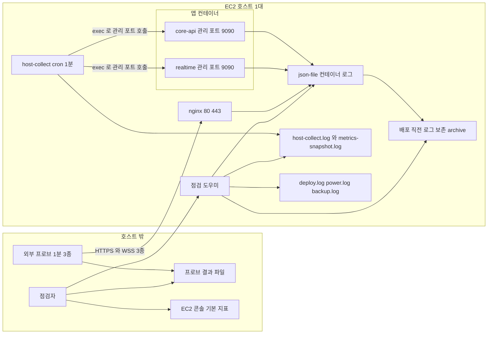

# 모니터링 설계 — U1 u1-walking-skeleton

> 단계: Construction · Infrastructure Design(3.4) · U1 u1-walking-skeleton · 깊이 Standard · 문서 monitoring-design.md (설계 ID 접두사 MO) · 담당 역할: aidlc-operations-agent
> 입력: `observability-design.md`(지표 · 사건 · SLO 이름의 정본), `observability-requirements.md`(3.1 SLO · 3.2 경보선), `reliability-design.md`(2.11 가용성 집계 · 배포 중단, 2.12 백업, `## 3` 설정 키), `performance-design.md`(11/2 측정 L1 ~ L7), `scalability-design.md`(2.6 용량 · 측정 정의), `security-design.md`(2.2 Nginx 접근 로그, 2.16 로그 위생), `logical-components.md`(LC-9 · H-12 · H-14 · H-15), `infrastructure-design-questions.md`(Q4 · Q9 · Q11), `components.md`, `functional-spec.md`, `contract-summary.md`(4.2 · 5 · 6 · 7절)
> 날짜: 2026-10-09
> 대리 판단: 질문 파일의 답 Q1 ~ Q12는 팀장(준하)의 대리 판단(가정) J85 ~ J96이다. 이 문서는 J88(로그 한도) · J93(모니터링 · 점검) · J95(운영 시간 정책)를 중심으로 쓴다. 지표 · 사건 · SLO 이름과 수치는 observability-design.md와 observability-requirements.md를 바꾸지 않고 '어디서 어떻게 읽는지'만 정한다. 이 문서가 새로 둔 값은 '제안(3.5 확정)'으로 표시했다.
> 정본 나눔: 서비스별 메모리 한도 · 헬스체크 주기 · 볼륨 경로의 정본은 infrastructure-specification.md이고, 관측 파일 · 점검 기준 · 프로브의 정본은 이 문서다. 이 문서의 `/opt/mujoong/...` 같은 호스트 경로 표기는 infrastructure-specification.md의 볼륨 · 데이터 배치 표에 맞춘 제안이다.

## 1. 관측 구성 한눈에

### 1.1 설계 요소

| 설계 ID | 해결하는 NFRx.y | 패턴 · 결정 | 적용 위치 | 근거 |
|---|---|---|---|---|
| MO-1 | NFR4.14, NFR4.15, NFR5.4, NFR6.5, NFR7.8, NFR9.15 | 읽기 수단은 네 갈래이고 수집기 · 대시보드 · 경보 서버는 없다. ① 앱 지표는 관리 포트 9090을 컨테이너 안에서 호출해 읽는다(호스트에 게시하지 않음) ② 사건은 컨테이너 표준 출력의 JSON 줄(json-file) ③ 호스트 사건은 `/var/log/mujoong/` 파일 ④ 가용성은 호스트 밖 프로브 결과 파일 | 두 앱 · nginx · 호스트 | J93 · OD-5 · OD-14 |
| MO-2 | NFR4.8, NFR4.13 | 외부 프로브 3종(Core health · `/device` · WSS 핸드셰이크)을 호스트 밖에서 1분마다 호출하고 한 분 한 줄을 남긴다. 한 호출도 재시도하지 않는다 | 프로브 실행 위치(사람 결정) · nginx | RD-18 · OD-14 · logical-components.md 열림 6 |
| MO-3 | NFR4.9, NFR4.11, NFR4.13, NFR7.2 | 호스트 수집기 `host-collect`(cron 1분)가 컨테이너 상태 · readiness · 재시작 횟수 · 디스크 · 인증서 · 백업 나이 · 시계 · 지표 스냅샷을 파일에 남긴다. 원인 파악 · 수동 점검용이고 가용성 SLI에는 쓰지 않는다 | EC2 호스트 cron | LC-9 · J93 |
| MO-4 | NFR4.14, NFR5.4, NFR7.8 | 점검 도우미 `check-since-last` · `sli-report` · `turn-metrics` · `probe-daily` · `log-hygiene-check` · `trace-find`가 로그 · 스냅샷 · 프로브 파일을 읽어 판정한다. 계산은 도우미가 하고 사람이 세지 않는다 | `infra/` 스크립트 | OD-15 · OD-17 |
| MO-5 | NFR9.15, NFR9.8 | 로그 보관: json-file 한도를 컨테이너별로 확정(realtime 20m × 5, core-api · nginx 10m × 5, 나머지 10m × 3)하고, 컨테이너를 다시 만들면 로그가 사라지므로 배포 직전에 로그를 호스트 파일로 보존한다 | Compose logging · 배포 스크립트 | J88 · OD-16 · RD-8 |
| MO-6 | NFR4.8, NFR4.10 | 가용성 집계의 제외 구간은 배포 구간(`deploy.log`의 짝 지은 시작 · 끝)과 의도적 정지 · 기동 구간(`power.log`, 제안)이다. 끝이 없는 시작과 비정상 정지는 제외하지 않는다 | 프로브 집계 | RD-18 · J95 |
| MO-7 | NFR4.8, NFR4.9 | 외부 경보가 없다는 사실을 표에 정직하게 적는다. 모든 알림의 'Routes to'는 사람이 여는 파일 · 점검표 · 콘솔이고 자동으로 사람에게 연락하는 경로는 없다 | 2.2 알림 표 | J68 · J93 |
| MO-8 | NFR4.11, NFR4.9, NFR7.2 | 점검 시점은 셋이다. 시작 점검(Start 직후), 정기 점검(하루 2회), 정지 점검(Stop 직전). 서버를 필요할 때만 켜므로 정지 중에는 백업 · 갱신 · 프로브가 돌지 않는다는 사실을 점검에 반영한다 | 2.5 점검표 | J95 · ADR-006 6절 |
| MO-9 | NFR4.15 | 대시보드를 두지 않는다. 읽는 화면은 도우미 출력 · EC2 콘솔 기본 지표 · GitHub Actions 실행 결과다 | 2.4.7 | J93 |
| MO-10 | NFR4.9, NFR4.13 | 프로세스가 살아 있으나 응답하지 않는 상태(hang)는 Compose가 재시작하지 않는다. 별도 오토힐 도구를 두지 않고 readiness 연속 실패 알림과 프로브 실패로 감지하며 수동 `docker compose restart <서비스>`를 런북에 둔다 | host-collect · RUNBOOK | 질문 파일 분석 · 결정 보강 |
| MO-11 | NFR6.1, NFR6.5 | 호스트 시계는 chrony 기본 동기화를 쓰고 시작 점검 항목과 host-collect 한 줄에 상태 · 오프셋을 둔다. 앱 시한은 앱 Clock이 호스트 시계를 따르므로 시계가 틀리면 발동이 이르거나 늦다 | 호스트 · 점검표 | H-15 · reliability 열린 질문 |
| MO-12 | NFR4.14, NFR9.14 | 사건 대응: 심각도 P1 · P2 · P3, 에스컬레이션 3단, P1 · P2 사건의 사후 검토. 알림은 신호이고 영향이 확인되어야 사건이다 | 2.9 | Operation 가드레일 |

### 1.2 구성도

텍스트 대체: 호스트 밖의 프로브가 nginx를 통해 3종을 1분마다 부르고 결과를 프로브 결과 파일에 남긴다. 호스트 안에서는 두 앱과 nginx가 표준 출력으로 JSON 줄을 내고 Docker가 json-file로 받는다. 배포 직전에 이 로그를 보존 폴더로 옮긴다. host-collect가 컨테이너 안에서 관리 포트 9090을 호출해 한 줄씩 파일에 남기고, 배포 · 정지 · 백업 스크립트는 각자 사건 파일을 남긴다. 점검자는 점검 도우미를 통해 로그 · 보존 폴더 · 수집 파일 · 사건 파일을 읽고, 프로브 결과 파일과 EC2 콘솔 지표는 직접 본다. 자동으로 사람에게 연락하는 화살표는 없다.

### 1.3 심각도와 알림·사건 용어

| 심각도 | 뜻 | 조치 시점 | 사후 검토 |
|---|---|---|---|
| P1 | 서비스를 쓸 수 없거나 개인정보가 새어 나갔을 가능성이 있다. 프로브 연속 실패, 핵심 컨테이너 정지 · unhealthy, readiness 지속 실패, 인증서 만료 또는 시연일 이전 만료, 로그 위생 위반, 호스트 상태 검사 실패, 배포 스모크 실패 | 발견 즉시. 시연 중이면 계속 여부부터 정한다 | 사건으로 선언되면 필수 |
| P2 | SLO 위반이 임박했거나 데이터가 밀리거나 복구 목표가 나빠졌다. 경보선 도달(PENDING 나이 · FAILED · 시작 성공률 · WARN 폭주 · 풀 대기), 디스크 · 백업 · 시계 이상, 보안 사건 급증, 배포 실패(스모크 이전 단계) | 같은 날, 다음 정기 점검 전 | 영향이 확인되면 필수 |
| P3 | 추세 · 기록용. 지연 경보선(11/2 측정 전), 자원 사용 추세, 수집기 공백, CPU 크레딧, 최신 SHA 미반영 | 다음 정기 점검 | 선택 |

용어 규칙: 알림(alert)은 점검 도우미나 사람이 기준 초과를 본 신호이고, 사건(incident)은 조사로 실제 영향(사용자 · 데이터 · SLO)이 확인된 것이다. P1 · P2 사건만 사후 검토를 쓴다(Operation 가드레일). 이 시스템에는 호출기 · 이메일 · 메신저로 자동 연락하는 장치가 없으므로 '발견 시점'은 점검 시점이다. 시연 중에 더 빨리 알고 싶으면 프로브 실행 위치에서 실패를 화면에 띄우는 것은 선택이며(5절 사람이 정할 것 2), 연동은 이 설계 범위 밖이다.

## 2. 설계 상세

표기. '관리 포트 호출'은 `docker compose exec <앱 서비스>`로 컨테이너 안에서 `http://localhost:9090/...`를 부르는 것이다. 앱 이미지에 최소 HTTP 클라이언트(curl 등)를 두어야 한다(제안, Compose 헬스체크도 같은 호출을 쓴다. Dockerfile은 3.5). 관리 포트는 인프라 명세 N-1이 컨테이너 루프백(`management.server.address`)에만 묶기로 했다. 이 문서의 모든 호출은 컨테이너 안에서 하므로 루프백으로도 동작한다(5절 사람이 정할 것 7).

### 2.1 Metrics & KPIs

지표 이름은 observability-design.md 2.5절 그대로다. 임계 열의 수치는 observability-requirements.md 3.2 경보선과 observability-design.md 2.13 점검표의 값이다. '기록용'은 판정 기준 없이 추세 · 원인 파악에만 쓴다.

**가용성 · 헬스**

| Metric | Source | Threshold | Why it matters |
|---|---|---|---|
| `mujoong_health_up{group}` (liveness · readiness) | 관리 포트 `/actuator/prometheus` · `/actuator/health/readiness`. host-collect가 분당 호출해 `readyCore` · `readyRealtime`에 기록 | readiness가 200이 아님이 2줄 연속이면 A-5 | 앱마다 헬스 지표 1개 이상(Operation 가드레일). Compose는 unhealthy만으로 재시작하지 않아 hang을 잡는 유일한 내부 신호 |
| 프로브 결과 `result` | 프로브 결과 파일(프로브 실행 위치) | FAIL 3분 연속 A-1, 하루 실패 합 7분 초과 A-2 | 가용성 SLI의 유일한 입력. 호스트가 통째로 죽어도 보인다 |
| `/api/health` 응답(200과 status UP) | nginx 경유 외부 프로브, 배포 스크립트의 1초 샘플러 | 200이 아님 | 외부에 열린 유일한 헬스 경로이고 Core readiness 반영 |
| 컨테이너 상태 · 재시작 횟수 | host-collect: `docker compose ps`, `docker inspect`의 RestartCount | running 아님 · unhealthy, 직전 줄보다 증가 | 자동 복구(NFR4.9)가 일어났다는 유일한 흔적 |
| EC2 `StatusCheckFailed` | EC2 콘솔 모니터링 탭 기본 지표(사람이 봄) | 0이 아님 | 호스트 · 하이퍼바이저 장애. 호스트 안 스크립트는 못 보는 영역 |

**세션 · 시작 성공**

| Metric | Source | Threshold | Why it matters |
|---|---|---|---|
| `mujoong_session_ended_total{status,end_reason,failure_code,phase,origin}` | 관리 포트(현재 값). 정본은 SESSION_TRANSITION 로그와 METRIC_SNAPSHOT | FAILED + ABORTED 비율 10% 이하(SLO). 시작 성공률 하루 98% 미만이면 A-12 | 종료 결과 가시성(NFR4.14). origin으로 이중 집계를 막는다 |
| `mujoong_session_activated_total` | 관리 포트. 정본은 SESSION_TRANSITION(to ACTIVE) | 시작 성공률 95% 이상(SLO) | 시작 성공률의 분자 |
| `mujoong_session_start_to_active_seconds` | 관리 포트(히스토그램). 정본은 SESSION_TRANSITION의 ts 차 | p95 8초 초과 A-13(SLO 10초) | 기기 응답 시한 20초의 절반을 지키는지 |
| `mujoong_timeout_fired_total{type}` | 관리 포트 · TIMEOUT_FIRED(WARN) 줄 | 기준 수치 없음. WARN 5분 창에 합산 | 안전 시한 발동 이력(NFR6.5). 시한이 자주 발동하면 기기 · 공급자 문제의 신호 |
| `mujoong_sessions_active` | 관리 포트 · METRIC_SNAPSHOT `sessionsActive` | 정지 점검에서 0 확인 | 동시 활성 세션(상한 설정이 없어 지표로만 감시, J76) |
| `http_server_requests_seconds`의 5xx 비율 | 관리 포트(경로 템플릿 라벨) | 기록용(오류율 지표, 가드레일) | 앱마다 오류율 지표 1개 이상 |

**지연**

| Metric | Source | Threshold | Why it matters |
|---|---|---|---|
| LATENCY_TURN의 relayInMs · relayOutMs, `mujoong_relay_in_seconds` · `mujoong_relay_out_seconds` | `turn-metrics`(로그), 관리 포트(분포) | 중계 증가분 p95 합 0.4초 초과 A-13(SLO 0.5초) | 음성 경로가 대화 지연에 더하는 몫(NFR5.1) |
| LATENCY_TURN의 말 끝 → 첫 음성(`mujoong_turn_first_audio_seconds`) | `turn-metrics`, 관리 포트 | p95 2.0초 초과 A-13(목표 2.5초, 11/2 측정 뒤 조정) | 아이가 체감하는 응답 지연(NFR5.2) |
| SESSION_ITEMS_SERVED · `mujoong_view_item_ready_seconds{speaker}` | `turn-metrics`, 관리 포트. 표본은 speaker가 CHILD인 행 | 서버 몫 p95 0.4초 초과 A-13(SLO 0.5초) | 보호자 화면 12에 반영 가능해지는 서버 몫(NFR5.3) |
| METRIC_SNAPSHOT `restTotal` · `restLe300Ms` | `sli-report --host` | SLO는 300ms 이내 비율 95% 이상. 경보선 p95 240ms는 `le300` 카운터만으로 정확히 판정할 수 없다(5절 사람이 정할 것 14) | 보호자 · 기기 REST 서버 처리 시간(NFR5.5) |
| METRIC_SNAPSHOT `viewTotal` · `viewLe500Ms` | `sli-report --host` | SLO는 500ms 이내 비율 95% 이상. 경보선 p95 400ms도 `le500` 카운터만으로는 정확히 판정할 수 없다(5절 사람이 정할 것 14) | 12 진행 조회(Realtime 중계 포함) |
| `mujoong_event_delivery_seconds{event_type}` | 관리 포트 · EVENT_DELIVERY(PROCESSED)의 durationMs | p95 1.6초 초과 A-13(SLO 2초) | 앱 사이 이벤트 전달 지연(NFR7.5) |

**내부 호출 · 이벤트**

| Metric | Source | Threshold | Why it matters |
|---|---|---|---|
| `mujoong_internal_http_requests_total{target,outcome}` | 관리 포트 · INTERNAL_HTTP 줄(실패는 WARN) | 실패율은 기록용. 실패 줄은 WARN 5분 창에 합산 | 앱 사이 호출 실패율(NFR4.15). 한 앱 정지의 가장 빠른 신호 |
| `mujoong_internal_http_breaker_state{group}` | 관리 포트 · metrics-snapshot.log | 0이 아닌 값이 지속되면 상대 앱 상태 확인 | 회로 차단기가 열렸다는 것은 시작 요청이 즉시 503이라는 뜻 |
| `mujoong_session_view_fallback_total` | 관리 포트 · METRIC_SNAPSHOT `viewFallback` | 기록용 | 12 조회가 사본으로 답한 횟수(Realtime 장애 흔적) |
| `mujoong_outbox_pending` · `mujoong_outbox_oldest_pending_seconds` | 관리 포트 · METRIC_SNAPSHOT `outboxPending` · `outboxOldestPendingSec` | 마지막 점검 이후 최댓값 60초 초과 A-9 | 이벤트 최종 실패보다 약 7분 앞선 신호 |
| `mujoong_outbox_failed` · `mujoong_inbox_dead` | 관리 포트 · METRIC_SNAPSHOT `outboxFailed` · `inboxDead` · EVENT_DELIVERY | 1 이상 A-10 | 이벤트 최종 실패 0건 SLO와 같은 선 |

**용량 · 자원**

| Metric | Source | Threshold | Why it matters |
|---|---|---|---|
| `jvm_memory_used_bytes{area="heap"}` · `jvm_gc_pause_seconds` · `jvm_threads_live_threads` | 관리 포트 · METRIC_SNAPSHOT `heapUsedPct` | 기록용(힙 한도 1GiB 대비 추세) | 컨테이너 OOM이 한 컨테이너에 갇히는지 보는 선행 신호 |
| `mujoong_device_connections_open` · `mujoong_device_connection_state{state}` | 관리 포트 · METRIC_SNAPSHOT `openConnections` | 기록용 | 열린 WSS 수(NFR4.15 · NFR7.8)와 기기 상태 분포 |
| `hikaricp_connections_active` · `hikaricp_connections_pending` · `hikaricp_connections_acquire_seconds` | 관리 포트 · METRIC_SNAPSHOT `poolActive` | 풀 사용 8/10 이상이 5분 지속 A-14 | 풀 대기보다 앞선 포화 신호(NFR7.6) |
| `mujoong_db_pool_wait_exceeded_total` | 관리 포트 · METRIC_SNAPSHOT `poolWaitMaxMs` · `poolWaitExceeded` | `poolWaitMaxMs` 100 초과가 연속 5개 스냅샷 A-11 | DB 연결 풀 대기 100ms SLO |
| `mujoong_queue_depth{queue}` · `mujoong_input_frames_dropped_total` · `mujoong_recorder_rejected_total` | 관리 포트 · QUEUE_PRESSURE 줄 | `recorder_rejected`가 0이 아니면 DB 장기 장애 신호로 조사 | 대기열 넘침. 음성 경로에서 버린 프레임 · 거절한 기록 |
| METRIC_SNAPSHOT `sysCpuAvgPct` · `sysMemMaxPct` | `check-since-last` | CPU 평균 50% · 메모리 최댓값 60% A-14 | 컨테이너가 보는 값이라 추세용. 11/2 판정은 `host-sample` 값이 정본 |
| 호스트 CPU · 메모리 (`cpuPct` · `memPct`) | host-collect(`/proc`) | 기록용. 11/2 판정은 CPU 평균 60% 이하 · 메모리 최댓값 70% 이하 | 호스트 전체 판정선(NFR7.2). 컨테이너 한도 합계는 70% 이내 |

**보안 · 로그 위생**

| Metric | Source | Threshold | Why it matters |
|---|---|---|---|
| `mujoong_security_event_total{type}` | 관리 포트 · SECURITY_* 줄 | WARN 5분 창에 합산. 프로브 몫(분당 1)은 기준선에서 뺀다 | 보안 사건 5종(NFR9.14) |
| Nginx 접근 로그의 429 · 403 · 5xx 건수 | `check-since-last`(경로 템플릿별) | 첫 점검 값을 기준선으로 적고 급증하면 A-8. 5xx(502 · 503 · 504 포함)는 기록용 | nginx의 오류율 지표이자 한도 · Origin · 내부 경로 접근 시도 |
| `mujoong_gate_discard_total{reason,category}` · `mujoong_rate_limiter_evictions_total` · `mujoong_rate_limiter_errors_total` | 관리 포트 | 기록용(11/2 리허설에서 과잉 폐기 비율 확인) | 게이트 과잉 폐기와 한도기 이상 |
| `mujoong_log_invalid_attr_total{event}` | 관리 포트 | 0이 아니면 조사 | 로그 허용 표 밖 키가 들어왔다는 뜻(NFR9.15) |

**호스트 · 플랫폼**

| Metric | Source | Threshold | Why it matters |
|---|---|---|---|
| 디스크 사용률 `diskRoot` · `diskData` | host-collect(`df`) | 80% 이상 A-15 | 로그 · 이미지 · DB가 같은 호스트. 가득 차면 DB 쓰기 중단 |
| 인증서 남은 일수 `certDays`(파일) · `certServedDays`(서빙 중) | host-collect(파일 만료일, 443 접속의 서빙 인증서) | 20일 미만 A-16 | 갱신 실패 신호. 두 값이 다르면 갱신됐으나 nginx가 재적재하지 않은 것 |
| 마지막 성공 백업 나이 `backupAgeH` | host-collect(`backup.log`) | 26시간 초과 A-17 | RPO 24시간. 서버가 꺼져 있던 날은 03:00 백업이 돌지 않는다 |
| 시계 `clockSync` · `clockOffsetMs` | host-collect(`chronyc tracking`) | 동기 상태 Normal 아님 또는 오프셋 절댓값 1초 초과 A-22 (제안) | 앱 시한 · 인증서 판단의 전제(H-15) |
| EC2 `CPUCreditBalance` · `CPUSurplusCreditBalance` · `CPUUtilization` | EC2 콘솔 기본 지표 | 잔액이 0에 가까워지거나 초과 크레딧이 늘면 A-21 | t3 계열은 평균 60% CPU 요구가 기준선을 넘을 수 있다(scalability 열림 3) |
| 메모리 · 디스크(호스트) | 기본 EC2 지표에 없음 | CloudWatch 에이전트는 설치하지 않는다(제안) | host-collect가 대신한다. 에이전트는 비용 · 권한 · 수집기 추가라 이번 범위 밖 |

**가드레일 충족표.** 컴포넌트마다 헬스 지표 1개 이상과 오류율 지표 1개 이상을 둔다(Operation 가드레일).

| Metric | Source | Threshold | Why it matters |
|---|---|---|---|
| core-api · realtime: 헬스 `mujoong_health_up`, 오류율 `http_server_requests_seconds`(5xx) | 관리 포트 | readiness 2분 연속 실패 · 오류율 기록용 | 두 앱 |
| nginx: 헬스 프로브 3종과 컨테이너 상태, 오류율 접근 로그 5xx · 429 · 403 | 프로브 파일 · host-collect · 접근 로그 | A-1 · A-4 · A-8 | 진입점 |
| web: 헬스 `/device` 프로브와 컨테이너 헬스체크, 오류율 접근 로그의 web 경로 5xx | 프로브 파일 · 접근 로그 | A-1 · A-4 | 화면 껍데기 |
| postgres: 헬스 컨테이너 헬스체크 `pg_isready`와 두 앱 readiness의 DB 구성, 오류율 로그의 ERROR · FATAL 줄 수와 `mujoong_db_pool_wait_exceeded_total` | host-collect · 점검표 3번(postgres 로그 포함, 제안) · 관리 포트 | A-4 · A-5 · A-11 | 데이터 저장소 |
| certbot · backup · migrate: 헬스 마지막 성공 시각(`certDays` · `backupAgeH` · migrate 종료 코드), 오류율 실패 줄 수(`backup.log` · 갱신 로그 · `deploy.log`) | host-collect · 사건 파일 | A-16 · A-17 · A-18 | 주기 작업 |

### 2.2 Alerts

자동 외부 경보는 없다(J68 · J93). 'Routes to'는 알림이 실제로 닿는 곳이며, 사람이 그 파일 · 화면을 열기 전에는 아무도 모른다. '점검표 n번'은 2.5절 정기 점검표의 순서다. 심각도 정의는 1.3절이다.

| Alert | Condition | Severity | Routes to |
|---|---|---|---|
| A-1 외부 프로브 연속 실패 | 프로브 `result=FAIL`이 3분 연속(제안). 배포 · 의도적 정지 구간과 `net=FAIL` 미관측 분은 뺀다 | P1 | 프로브 결과 파일 → 점검표 7번. 자동 연락 없음 |
| A-2 하루 누적 가용성 | 하루 누적 프로브 실패 합 7분 초과(SLO 하루 몫 14.4분의 절반) | P2 | `probe-daily` 출력 → 점검표 7번 |
| A-3 프로브 관측률 저하 | 관측한 분 ÷ 전체 분 90% 미만(가용성 판정 보류) | P3 | `probe-daily` 출력. 프로브 실행 위치가 켜져 있는지 확인 |
| A-4 핵심 컨테이너 정지 · unhealthy | host-collect의 `ctr`가 7보다 적거나 `ctrBad`에 nginx · web · core-api · realtime · postgres 중 하나가 있음(certbot · backup은 P2) | P1 | `host-collect.log` → 점검표 2번 |
| A-5 readiness 지속 실패 | `readyCore` 또는 `readyRealtime`이 200이 아님이 2줄(2분) 연속(제안). hang은 자동 복구가 없다 | P1 | `host-collect.log` → 점검표 2번. 조치는 RUNBOOK 서비스 재시작 |
| A-6 컨테이너 재시작 | `restarts` 값이 직전 줄보다 증가 | P2 | `host-collect.log` → 점검표 2번. 원인은 STARTUP_RECOVERY · APP_ERROR 줄 |
| A-7 WARN 이상 로그 폭주 | 마지막 점검 이후 5분 창 중 가장 많은 창이 10건 초과(줄 수는 1 + repeat) | P2 | `check-since-last` → 점검표 3번 |
| A-8 Nginx 429 · 403 급증 | 이전 점검보다 급증(기준선은 첫 점검 값) | P2 | `check-since-last` → 점검표 3-2번 |
| A-9 이벤트 PENDING 나이 | 스냅샷 `outboxOldestPendingSec` 최댓값이 60초 초과 | P2 | `check-since-last` → 점검표 4번 |
| A-10 이벤트 FAILED · DEAD | EVENT_DELIVERY FAILED · DEAD 1건 이상 또는 `outboxFailed` · `inboxDead` 최댓값 1 이상 | P2 | `check-since-last` → 점검표 5번 |
| A-11 DB 풀 대기 | `poolWaitMaxMs` 100 초과가 연속 5개 스냅샷(5분) | P2 | `check-since-last` → 점검표 6번 |
| A-12 시작 성공률 | 하루 98% 미만(표본 10건 이상) 또는 연속 2건 실패 | P2 | `sli-report --host` → 점검표 8번 |
| A-13 지연 경보선 | 시작 → ACTIVE 8초 · 중계 증가분 0.4초 · 말 끝 → 첫 음성 2.0초 · 서버 몫 0.4초 · REST 240ms · 12 조회 400ms · 이벤트 전달 1.6초 초과(표본 규칙 적용). REST · 12 조회 두 줄은 히스토그램 버킷 경계가 맞아야 정확하다(5절 사람이 정할 것 14) | P3 (11/2 측정 뒤 P2) | `sli-report` · `turn-metrics` → 점검표 9번 |
| A-14 자원 · 풀 사용률 | CPU 평균 50% · 메모리 최댓값 60% · 풀 사용 8/10 이상이 5분 지속 | P3 | `check-since-last` → 점검표 10번 |
| A-15 디스크 | `diskRoot` 또는 `diskData` 80% 이상 | P2 | `host-collect.log` → 점검표 11번 |
| A-16 인증서 | `certDays` 또는 `certServedDays` 20일 미만. 만료일이 시연일 이전이면 P1 | P2 (P1) | `host-collect.log` → 점검표 11번 |
| A-17 백업 나이 | `backupAgeH` 26 초과 | P2 | `host-collect.log` → 점검표 11번. 정지 중이었다면 시작 점검 7번 |
| A-18 배포 실패 | `deploy.log`의 DEPLOY_END `result=FAIL` 또는 짝이 없는 DEPLOY_START. 스모크 단계 실패는 P1, 그 이전 단계(백업 · 이미지 · 마이그레이션)는 P2 | P1 또는 P2 | GitHub Actions 실행 결과와 `deploy.log`. 실패 시 GitHub 기본 알림은 각자 계정 설정에 따라 보장하지 않음. 롤백은 수동 |
| A-19 배포 중단 시간 초과 | DEPLOY_END `budget=OVER`(`downtimeSec` 60 초과) | P2 | `deploy.log`, 배포 리허설 기록 |
| A-20 EC2 상태 검사 실패 | 콘솔 `StatusCheckFailed`가 0이 아님 | P1 | EC2 콘솔(시작 점검 1번 · 정기 점검). 자동 연락 없음 |
| A-21 CPU 크레딧 | `CPUCreditBalance`가 0에 가깝거나 `CPUSurplusCreditBalance` 증가 | P3 | EC2 콘솔. 11/2 측정 중에는 측정 기록에 함께 적음 |
| A-22 시계 이상 | `clockSync`가 Normal 아님 또는 `clockOffsetMs` 절댓값 1초 초과(제안) | P2 | `host-collect.log` → 시작 점검 2번 |
| A-23 로그 위생 위반 | `log-hygiene-check`가 금지 패턴 · 형식 위반 · 비밀 값 일치를 1건 이상 보고 | P1 | `check-since-last` → 점검표 3-3번 |
| A-24 수집기 공백 | 서버가 켜져 있는데 `host-collect.log` 마지막 줄이 5분 이상 전 | P3 | `check-since-last`가 마지막 기록 시각을 출력 → 점검표 2번 |
| A-25 최신 SHA 미반영 | main 최신 SHA와 `deploy.log` 마지막 `result=OK`의 sha가 다름(서버 정지 중 병합) | P3 | 시작 점검 8번. 수동 배포(cicd-pipeline.md 2.11) |

### 2.3 SLIs / SLOs

수치는 observability-requirements.md 3.1과 같다(바꾸지 않음). 표본 규칙(재점검 결정 RD-13): 표본 100 이상이면 p95, 10 ~ 99면 목표 이내 비율 90% 이상, 10 미만이면 판정하지 않고 값과 건수만 적는다.

| SLI | SLO target | Measurement window |
|---|---|---|
| 가용성 프로브 성공률 = 성공한 분 / 전체 분(3종 중 하나라도 실패하면 실패한 분, 계획된 배포 구간 제외) | 99.0% 이상(허용 중단 하루 14.4분, 7일 약 100.8분) | 프로브 1분 간격(제안, 11/2 확정). 11/2 시점은 확보한 일수(최소 4일) 누적이고 7일 롤링은 동결 뒤 |
| 컨테이너 복구 시간 = 프로세스 종료 → 헬스체크 통과 | 5분 이내(목표 1분) | 사건마다 |
| 계획된 배포의 서비스 중단 시간 | 60초 이내 | 배포마다 |
| 시작 성공률 = ACTIVE 도달 / (검사를 통과해 REQUESTED가 된 시작) | 95% 이상, 표본 20건 미만이면 건수로 판정(제안, 11/2 확정) | 7일 롤링 |
| 시작 → ACTIVE 지연 = Realtime 접수(PREPARING) → ACTIVE | p95 10초 이하(시한 20초의 절반, 제안, 11/2 확정) | 7일 롤링 |
| FAILED + ABORTED 비율(CORE_ABANDONED 중복 제외) | 10% 이하(제안, 11/2 확정) | 7일 롤링 |
| 종료 확인률 = ENDED / (ENDED + ENDED_UNCONFIRMED) | 95% 이상(제안, 11/2 확정) | 7일 롤링 |
| 중계 증가분 = relayIn p95 + relayOut p95 | 합 0.5초 이하(공급자 응답 길이와 구간 확정 조용 시간 800ms는 넣지 않음) | 11/2 측정 창(자체 WSS 부하 + 시연 리허설) |
| 말 끝 → 기기 첫 음성 재생(t0 ~ t3) | p95 2.5초 이하(목표). U1 구조의 하한은 응답 생성 시간 + 0.8초 + 중계라 U3 정식 구간 분할 전에는 미달이 예상되며 11/2 측정 뒤 조정 | 11/2 측정 창 |
| 전사 확정 → 그 행이 12 응답에 포함 가능해진 시각(서버 몫, speaker CHILD) | p95 0.5초 이하(목표). 화면 도달은 폴링(2초) 때문에 말 끝 뒤 p95 약 2.5초가 예상되며 1.5초는 12 한정 폴링 단축이 필요해 사람 결정 | 11/2 측정 창 |
| 보호자 · 기기 REST 서버 처리 시간 | p95 300ms 이하 | 7일 롤링과 부하 시험 |
| 12 진행 조회 처리 시간(Realtime 중계 포함) | p95 500ms 이하 | 7일 롤링과 부하 시험 |
| 이벤트 전달 지연 = 생성(occurredAt) → 상대 앱 PROCESSED | p95 2초 이하 | 7일 롤링 |
| 이벤트 최종 실패 건수 = Outbox FAILED + Inbox DEAD | 0건(상대 앱 중단이 재시도 상한(약 8분)을 넘어 생긴 FAILED는 프로브 실패 구간 · 배포 구간과 겹치면 '장애 중 발생'으로 따로 집계하고 위반으로 세지 않음. 제어 이벤트 FAILED는 재기동 때 PENDING으로 돌아가 전달됨) | 7일 롤링 |
| 호스트 CPU · 메모리 사용률 | CPU 평균 60% 이하 · 메모리 최댓값 70% 이하 | 부하 시나리오 중과 시연 중 |
| DB 연결 풀 대기 시간 | 100ms 이하(넘으면 경고 지표) | 5분 |

**플랫폼에서 읽는 곳.** 각 SLI의 입력 · 계산 도구 · 경보선이다.

| SLI | 입력 (플랫폼) | 계산 도구 | 경보 |
|---|---|---|---|
| 가용성 | 프로브 결과 파일 + `deploy.log` + `power.log`(제외 구간, 프로브 위치로 가져옴) | `probe-daily` | A-1 · A-2 · A-3 |
| 컨테이너 복구 시간 | 복구 시험 기록, 프로브 결과 파일의 첫 성공 분, STARTUP_RECOVERY | 수동 기록 | A-6 |
| 배포 중단 시간 | `deploy.log` DEPLOY_END의 `downtimeSec`(1초 샘플러) | `probe-daily`의 배포 요약 | A-19 |
| 시작 성공률 · 시작 → ACTIVE · FAILED + ABORTED · 종료 확인률 | SESSION_TRANSITION(컨테이너 로그 + 보존 폴더) | `sli-report --host` | A-12 · A-13 |
| 중계 증가분 · 말 끝 → 첫 음성 · 서버 몫 | LATENCY_TURN · SESSION_ITEMS_SERVED | `turn-metrics` | A-13 |
| REST · 12 조회 | METRIC_SNAPSHOT(`restLe300Ms` ÷ `restTotal`, `viewLe500Ms` ÷ `viewTotal`) | `sli-report --host` | A-13 |
| 이벤트 전달 지연 · 최종 실패 | EVENT_DELIVERY · METRIC_SNAPSHOT · STARTUP_RECOVERY | `sli-report --host` | A-9 · A-10 · A-13 |
| 호스트 자원 · 풀 대기 | METRIC_SNAPSHOT + `host-sample`(11/2 시험) + `host-collect.log` | `sli-report --host` | A-11 · A-14 |

**측정 대상 시간.** 가용성은 서버가 의도적으로 켜져 있는 시간에 대해서만 센다. NFR4.8은 배포 구간만 제외한다고 적었지만 서버를 필요할 때만 켜는 정책(J95) 때문에 정지 중에는 프로브가 계속 실패한다. 그래서 의도적 정지 · 기동 구간(`power.log`의 `POWER_STOP`부터 다음 `POWER_READY`까지, 제안)도 배포 구간과 같은 방식으로 제외한다. 이 해석은 사람이 확인한다(5절 사람이 정할 것 5).

**오류 예산 정책(제안).** 가용성 오류 예산은 하루 14.4분 × 확보한 일수다(4일 57.6분, 7일 100.8분). 자동 경보가 없어 다중 창 소진율 경보는 쓰지 않고 A-2(하루 7분)가 소진 속도의 절반 경보다.

| 예산 사용량 | 상태 | 행동 |
|---|---|---|
| 50% 미만 | 건강 | 평소대로 병합 · 자동 배포 |
| 50% ~ 75% | 주의 | 배포 직후 10분 안에 프로브 결과를 확인하고 정기 점검에서 원인을 적는다 |
| 75% 이상 | 위험 | 자동 배포를 끈다(`AUTO_DEPLOY=false`, cicd-pipeline.md 2.12). 배포는 사람이 승인한다 |
| 100% | 소진 | 시연 · 측정 창 동안 새 배포를 동결하고 원인 제거만 한다 |

### 2.4 Logs & Tracing

#### 2.4.1 로그 경로

| 로그 | 쓰는 곳 | 형식 | 읽는 법 | 보관 |
|---|---|---|---|---|
| 앱 사건 로그(core-api · realtime) | 컨테이너 표준 출력 → Docker json-file | 한 줄 JSON(여섯 필드 + attrs, OD-1) | `docker compose logs --since <시각> <서비스>` 후 `jq`로 사건 코드별 필터 | json-file 한도(2.4.2) + 배포 직전 보존(2.4.3) |
| nginx 접근 로그 | 컨테이너 표준 출력 → json-file | 한 줄 `키=값`(제안): `ts` · `requestId`(= traceId) · `method` · `uri`(쿼리 없음) · `status` · `bytes` · `rt` · `urt` · `upstream` · 클라이언트 주소. 쿠키 · Referer · 본문 · 쿼리는 쓰지 않음(NFR9.8). `/api/device/bootstrap/status` · 12 진행 조회 · `/api/health`의 2xx · 304는 기록하지 않음 | `docker compose logs nginx`, `check-since-last`의 429 · 403 · 5xx 집계 | json-file 한도 |
| nginx 오류 로그 | 컨테이너 표준 오류 → json-file | nginx 기본 형식 | 502 · 504 원인(업스트림 접속 불가 등) | json-file 한도 |
| postgres 로그 | 표준 출력 → json-file | `log_error_verbosity=terse`, `log_statement=none`(SD-15) | ERROR · FATAL 줄 수 | json-file 한도 |
| web · certbot · backup · migrate | 표준 출력 → json-file | 각자 형식 | 갱신 실패 · 백업 실패 · 마이그레이션 오류 | json-file 한도. migrate는 일회성이라 배포 스크립트가 `migrate-<배포 id>.log`로 따로 남긴다 |
| 호스트 사건 파일 | 스크립트 → `/var/log/mujoong/` | 한 줄 `키=값`, UTC | `deploy.log` · `power.log` · `backup.log` · `host-collect.log` · `metrics-snapshot.log` | 2.7.4절 |

#### 2.4.2 보관 (json-file 한도 최종값, J88)

observability-design.md 2.15의 계산을 따르고 최종 값을 이 단계에서 확정한다. 기간 추정 = `max-size × max-file ÷ 하루 로그량`이며 상한은 기간을 보장하지 않는다.

| 컨테이너 | max-size × max-file | 총 상한 | 하루 로그량 추정 | 기간 추정 |
|---|---|---|---|---|
| realtime | 20m × 5 | 100MB | 약 6.4MB | 약 15일 |
| core-api | 10m × 5 | 50MB | 약 2.0MB | 약 25일 |
| nginx | 10m × 5 | 50MB | 약 1 ~ 3MB(폴링 2xx 제외 후) | 약 17일 이상 |
| web | 10m × 3 | 30MB | 낮음 | 7일 이상 |
| postgres | 10m × 3 | 30MB | 낮음 | 7일 이상 |
| migrate · certbot · backup (각각) | 10m × 3 | 30MB | 매우 낮음 | 7일 이상 |
| neo4j (켠 뒤) | 10m × 3 | 30MB | 후속 유닛 | 후속 유닛 |
| 합계 상한(neo4j 꺼짐) | — | 약 350MB | — | 루트 볼륨 30GB 대비 1.2% |

observability-design.md 2.15는 migrate · certbot · backup을 5m × 2로 제안했다. 결정 보강(나머지 10m × 3)에 맞춰 세 컨테이너를 10m × 3으로 통일한다(총 30MB씩, 차이는 사소함). 시연 전에 `docker logs`로 하루 로그량을 확인하고 11/2 측정 기록은 회전 전에 파일로 내려받는다.

#### 2.4.3 배포 직전 로그 보존 (MO-5)

컨테이너를 다시 만들면(`docker compose up`이 이미지 변경으로 재생성) 이전 컨테이너의 json-file 로그가 컨테이너와 함께 지워진다. 그러면 METRIC_SNAPSHOT · SESSION_TRANSITION 같은 SLI 정본 줄이 배포마다 사라진다. 크래시 후 자동 재시작은 같은 컨테이너라 로그가 남지만 배포 재생성은 그렇지 않다.

| 항목 | 설계 |
|---|---|
| 시점 | 배포 단계 D5 직전(마이그레이션 성공 뒤, realtime · core-api 재생성 직전). 롤백도 같다. web · nginx는 재생성하는 경우에만 |
| 방법 | 재생성 대상 컨테이너마다 타임스탬프 포함 로그를 압축해 `/var/log/mujoong/archive/<UTC 시각>-<서비스>-<배포 id>.log.gz`로 저장(제안) |
| 읽는 쪽 | `check-since-last` · `sli-report` · `turn-metrics` · `trace-find`는 현재 컨테이너 로그와 보존 폴더를 시각순으로 이어서 읽는다 |
| 보관 | 7일 또는 최근 40개 중 먼저 닿는 쪽(제안). 루트 볼륨 사용량은 한 번에 압축 후 수십 MB 수준으로 추정 |
| 금지 | 수동으로 `docker compose down` · `docker rm`을 쓰지 않는다. 재시작이 필요하면 `docker compose restart <서비스>`(컨테이너 유지)를 쓴다(RUNBOOK) |
| 대안(채택 안 함) | journald 로깅 드라이버(재생성에도 남지만 결정 보강의 json-file과 다름), 연속 복사 서비스(상시 프로세스 추가). 5절 사람이 정할 것 9 |

#### 2.4.4 접근

| 대상 | 읽는 사람 | 방법 | 기록 |
|---|---|---|---|
| 컨테이너 로그 · 호스트 파일 · 지표 | AWS Systems Manager Session Manager 세션을 시작할 수 있는 IAM 주체(명단은 사람이 정함) | 세션 안에서 root 권한으로 `docker compose logs` · 파일 읽기 · 관리 포트 호출 | 세션 시작은 CloudTrail 기본 이벤트로 남는다. 세션 안 입출력 기록은 켜지 않는다(저장소 · 비용 추가, 제안) |
| 프로브 결과 파일 | 프로브 실행 위치의 계정 | 로컬 파일 | 해당 PC 정책 |
| EC2 기본 지표 | AWS 콘솔 접근 권한자 | 모니터링 탭 | 콘솔 기록 |
| GitHub Actions 실행 결과 | 저장소 접근자 | Actions 화면 | GitHub |

호스트 로그 파일 권한은 root 소유 640(제안)이다. 22번 포트는 열지 않는다(J86). 로그를 저장소 · 채팅에 붙일 때는 값이 아닌 사건 코드 · traceId만 옮긴다.

#### 2.4.5 traceId 따라가기

설정(헤더 `X-Trace-Id`, 32자 소문자 16진수, nginx의 `$request_id`로 덮어씀)은 observability-design.md OD-7이 정본이다. 플랫폼에서 읽는 절차만 정한다.

| 순서 | 할 일 | 읽는 곳 |
|---|---|---|
| 1 | traceId 얻기: 보호자 REST 오류 응답의 `traceId` 필드 또는 응답 헤더 `X-Trace-Id`, 또는 nginx 접근 로그의 `requestId` | 오류 봉투 · 접근 로그 |
| 2 | `trace-find <traceId> --since <시간>` 실행. nginx · core-api · realtime의 현재 로그와 보존 폴더에서 같은 id를 시각순으로 모아 보여 준다 | 점검 도우미 |
| 3 | 이벤트 전달 추적: 같은 id가 Outbox 행의 `trace_id` · 봉투 `traceId` · 상대 앱 Inbox 처리기 줄에도 나타난다 | EVENT_DELIVERY 줄 |
| 4 | 한계: WSS 연결 사건은 연결 traceId, 세션 사건은 세션 traceId를 쓴다. 시작 복구가 닫은 세션의 옛 traceId는 사라져 시작 복구 실행의 id를 쓴다 | OD-7 |

#### 2.4.6 로그 위생 점검

`log-hygiene-check`(제안)를 점검표 3-3번에서 마지막 점검 이후 로그에 돌린다. 값은 출력하지 않고 건수만 센다. 비밀 값 일치 검사는 root가 환경 파일의 값을 메모리에서만 읽어 고정 문자열로 찾는다.

| 점검 | 방법 | 통과 기준 | 걸리면 |
|---|---|---|---|
| 줄 형식 | 앱 로그 각 줄이 JSON으로 파싱되고 최상위 키가 여섯 필드 + attrs뿐인지 | 위반 0줄(JVM 시작 줄 등 비JSON 줄은 형식 대상에서 제외하되 비밀 검사는 받음) | A-23, 로그 설정 확인 |
| attrs 허용 표 | 허용 표(OD-2)에서 만든 스키마 파일(3.5)로 attrs 키 · 값 형식 검사 | 위반 0줄. `mujoong_log_invalid_attr_total`이 0 | A-23 |
| 금지 헤더 · 이름 | `Set-Cookie` · `Cookie` · `Authorization` · `X-Internal-Token` · `X-CSRF-TOKEN` · 세션 쿠키 이름 문자열 | 0건 | A-23 |
| 비밀 값 | 환경 파일의 비밀 값 전체를 고정 문자열로 로그에서 찾음(값 비출력) | 0건 | A-23. 해당 비밀 즉시 회전(RUNBOOK) |
| nginx 접근 로그 | 쿼리 문자열(`?`) · 쿠키 · Referer 필드 | 0건 | A-23, 로그 형식 확인 |
| postgres 로그 | DETAIL · HINT 줄, 문장 로깅 줄 | 0건 | A-23, `log_error_verbosity` 확인 |
| 시험 전용 시드 | Build and Test에서 시드 전사 · 토큰 · 쿠키 · 등록 코드 전체 grep(NFR9.8) | 0건 | 3.5 구현 시험(4절) |

#### 2.4.7 대시보드 명세

| 화면 | 상태 | 대신 읽는 곳 | 도입 조건 |
|---|---|---|---|
| 서비스 상태판 | 두지 않음 | `host-collect.log`의 최근 줄과 `check-since-last` 출력 | 시연 이후 상시 운영이 결정되면 수집기와 함께 검토 |
| SLO 현황판 | 두지 않음 | `sli-report` 터미널 표(행마다 값 · 표본 수 · 판정 · 경보선 대비 여유) | 같음 |
| 인프라 지표 | EC2 콘솔 기본 지표(상태 검사 · CPU · 크레딧 · 네트워크) | 콘솔 모니터링 탭. 경보는 걸지 않음 | 경보 연동(5절 사람이 정할 것 2)이 결정되면 |
| 로그 검색 | 두지 않음 | `docker compose logs` · `jq` · `trace-find` | 수집기 도입 시 |

### 2.5 점검표

모든 기준은 마지막 점검 이후의 최댓값으로 읽는다(지표 게이지는 재시작하면 0이 되기 때문, 재점검 결정 RD-14). 점검 시각은 서버를 켠 날 하루 2회다. 제안: 1회차는 시연 시작 30분 전(시작 점검과 합칠 수 있음), 2회차는 시연 종료 직후 정지 전. 24시간 켜 둔 측정일(11/2 측정 창)은 오전 · 저녁 2회로 한다.

#### 2.5.1 정기 점검표 (하루 2회)

점검 도우미 `check-since-last`가 `last-check` 파일(제안: `/var/lib/mujoong/last-check`, 데이터 볼륨이라 Stop/Start 뒤에도 남음)의 시각 이후를 한 번에 계산한다. 순서와 기준은 observability-design.md 2.13과 같고, 2번의 수집기 공백, 3번의 postgres 로그 줄, 3-2번의 5xx, 3-3번(로그 위생)만 더했다(제안).

| 순서 | 점검 | 읽는 곳 (플랫폼) | 기준 | 걸리면 |
|---|---|---|---|---|
| 1 | 마지막 점검 시각 | `last-check` 파일(없으면 24시간 전) | — | — |
| 2 | 컨테이너 · readiness · 재시작 · 수집기 공백 | `host-collect.log` 최근 줄 | 7개 모두 running · healthy, readiness 200 둘, 재시작 횟수 증가 없음, 마지막 기록이 5분 안 | A-4 · A-5 · A-6 · A-24 |
| 3 | WARN 이상 로그 | 두 앱 로그(현재 + 보존 폴더)의 WARN · ERROR 줄을 1분 간격으로 미는 5분 창으로 셈. 프로브의 쿠키 없는 WSS 업그레이드는 INFO라 들지 않음. postgres 로그 ERROR · FATAL 줄도 함께 센다(제안) | 5분 창 10건 초과 | A-7 |
| 3-2 | nginx 429 · 403 · 5xx | nginx 접근 로그(경로 템플릿별) | 기준 수치 없음. 첫 점검 값을 기준선으로 적고 급증하면 조사. 5xx는 기록용 | A-8 |
| 3-3 | 로그 위생 | `log-hygiene-check` (2.4.6) | 위반 0건 | A-23 |
| 4 | 이벤트 PENDING 최장 나이 | METRIC_SNAPSHOT `outboxOldestPendingSec` 최댓값(양 앱) | 60초 초과 | A-9 |
| 5 | FAILED 이벤트 | EVENT_DELIVERY FAILED · DEAD 줄 수, `outboxFailed` · `inboxDead` 최댓값 | 1건 이상 | A-10 |
| 6 | DB 풀 대기 | `poolWaitMaxMs`가 100 초과인 연속 스냅샷 | 연속 5개(5분) | A-11 |
| 7 | 가용성 | 프로브 위치에서 `probe-daily`(오늘 실패 분 합, 배포 · 의도적 정지 구간 제외, 관측률) | 7분 초과 · 관측률 90% 미만 | A-1 · A-2 · A-3 |
| 8 | 시작 성공률 | `sli-report --host`(SESSION_TRANSITION 하루 집계) | 표본 10건 이상이면 98% 미만, 또는 연속 2건 실패 | A-12 |
| 9 | 지연 p95 | `sli-report` · `turn-metrics` 현재 값 | SLO 수치의 80%(11/2 측정 전에는 참고) | A-13 |
| 10 | 자원 | METRIC_SNAPSHOT `sysCpuAvgPct` · `sysMemMaxPct` · `poolActive` | CPU 평균 50% · 메모리 최댓값 60% · 풀 사용 8/10 이상이 5분 지속 | A-14 |
| 11 | 백업 · 디스크 · 인증서 | `host-collect.log` | 백업 26시간 이하, 디스크 80% 미만, 인증서 20일 이상 | A-15 · A-16 · A-17 |
| 12 | 점검 기록 | 점검 시각을 `last-check`에 쓰고 한 줄 메모(결과 · 조치) | — | — |

#### 2.5.2 시작 점검 (Start 직후, 제안)

서버를 필요할 때만 켜므로(J95) 정지 중에는 03:00 백업 · 인증서 갱신 · 프로브가 돌지 않았다. 켠 직후 한 번 확인한다.

| 순서 | 점검 | 읽는 곳 | 통과 기준 | 걸리면 |
|---|---|---|---|---|
| S1 | EC2 상태 | 콘솔 인스턴스 상태 검사 | running, 상태 검사 2/2 통과 | 잠시 뒤 재확인, 지속되면 A-20 |
| S2 | 시계 동기 | `chronyc tracking`(세션 안), `host-collect.log`의 `clockSync` · `clockOffsetMs` | 동기 상태 Normal, 오프셋 절댓값 1초 이내 | 동기화를 기다리고 지속되면 RUNBOOK 시계 동기. 시계가 틀린 채 시연하지 않는다(H-15) |
| S3 | 컨테이너 | `host-collect.log` 첫 줄들 | 7개 running · healthy, readiness 200 둘 | A-4 · A-5 |
| S4 | 마이그레이션 · 이력 버전 | 두 앱 readiness(이력 버전 확인 포함) | UP | RUNBOOK 마이그레이션 실패 |
| S5 | 인증서 | `certDays` · `certServedDays` | 20일 이상(A-16 기준). 30일 미만이면 갱신 시도 로그를 확인하고 정지 중에는 갱신 확인이 돌지 않았으므로 필요하면 수동 갱신 1회. 시연 하루 전에는 만료일이 시연일 이후인지 직접 확인(ADR-006 3.3) | A-16 |
| S6 | 디스크 · 로그 보관 | `diskRoot` · `diskData`, 가장 오래된 로그 줄의 시각 | 80% 미만. 시연 전 하루 로그량을 확인해 2.4.2 추정과 비교 | A-15 |
| S7 | 백업 나이 | `backupAgeH`, `backup.log` | 26시간 이하. 정지 중에는 03:00 백업이 없었으므로 기동 직후 보충 백업이 24시간 초과 때 자동으로 돈다(인프라 명세 4.4). 성공 줄이 없으면 수동 1회 | A-17 |
| S8 | 최신 SHA 반영 | `deploy.log` 마지막 `result=OK`의 sha와 main 최신 | 같음. 다르면 수동 배포 | A-25 |
| S9 | 프로브 | 프로브 결과 파일의 최근 분 | 3종 OK. 프로브 실행 위치가 켜져 있는지 포함 | A-1 · A-3 |
| S10 | 기동 기록 | `power.log`의 새 `POWER_READY` 줄 | 있음 | 없으면 가용성 제외 구간이 닫히지 않으므로 RUNBOOK |

#### 2.5.3 정지 점검 (Stop 직전, 제안)

| 순서 | 점검 | 읽는 곳 | 통과 기준 | 걸리면 |
|---|---|---|---|---|
| E1 | 진행 중 세션 없음 | `mujoong_sessions_active` · METRIC_SNAPSHOT `sessionsActive` | 0 | 있으면 종료를 안내한다(정지하면 세션이 FAILED(SERVER_RESTART)로 끝남) |
| E2 | 마지막 정기 점검 | 2.5.1 | 수행하고 메모 | — |
| E3 | 정지 직전 백업 | `mujoong-compose` 단위가 정지 단계에서 최근 1시간 안에 성공이 없으면 1회 자동 실행한다(인프라 명세 4.4). 점검자는 `backup.log`의 최근 성공 줄을 확인 | 최근 성공이 있음(정지 중 RPO 확보) | 없거나 실패면 수동 백업 1회를 하고 원인을 확인한 뒤 정지 |
| E4 | 표별 행 수 | 표마다 `select count(*)`(scalability-design.md 2.7) | 어느 표든 5만 행 미만. 값을 기록 | 5만 행 이상이면 수동 점검 항목으로 올림 |
| E5 | 로그 위생 | `log-hygiene-check` | 위반 0건 | A-23 |
| E6 | Stop | 콘솔에서 Stop(Terminate 아님, ADR-006 6.1) | 상태 stopped, 탄력적 IP 유지 | `power.log`의 `POWER_STOP`은 종료 훅이 남김 |

### 2.6 프로브 설계

#### 2.6.1 3종 호출 경로와 판정

호출은 observability-design.md OD-14가 정한 그대로이고 경로 · 판정 기준을 이 단계에서 확정한다. 각 호출은 5초 제한(제안), 재시도 없음이다. `<서비스 호스트>`는 서비스 도메인(5절 사람이 정할 것 1)이다.

| 호출 | 요청 | 성공 판정 | 걸리는 경로 | 실패하면 의심할 곳 |
|---|---|---|---|---|
| health | `GET https://<서비스 호스트>/api/health` | 200이고 본문 `status`가 UP | nginx → core-api 앱 포트 8080 (관리 포트 아님, Actuator 아님) | Core · DB · migrate 이력 · readiness |
| device | `GET https://<서비스 호스트>/device` | 200 | nginx → web 3000 | web · nginx |
| wss | HTTP/1.1 업그레이드 요청 `GET https://<서비스 호스트>/ws/device`(`Connection: Upgrade`, `Upgrade: websocket`, `Sec-WebSocket-Version: 13`, 임의 키, 허용 `Origin`, 쿠키 없음) | 상태 줄 `101 Switching Protocols`. 프레임은 읽지 않고 끊는다. 소요 시간은 101 수신까지 | nginx → realtime 8081, 읽기 제한 75초 | realtime · nginx 업그레이드 설정 |

`result` 판정: 세 호출이 모두 성공이면 OK, 하나라도 실패하면 FAIL(`net=OK`일 때), `net=FAIL`이면 UNOBSERVED. 한 호출 실패는 곧 실패한 분이다(NFR4.8). 프로브 쪽에서 재시도로 가리지 않는다.

| 실패 패턴 | 먼저 의심 | 확인 |
|---|---|---|
| health만 실패 | 응답이 앱의 직접 503(SERVICE_NOT_READY)이면 앱은 떠 있고 준비 전(DB 이력 버전 · postgres), nginx의 502이면 core-api에 접속할 수 없음(정지 · 기동 중) | `host-collect.log`의 `readyCore`, postgres 컨테이너 |
| device만 실패 | web 정지 또는 nginx 라우팅 | `ctrBad`, nginx 접근 로그 5xx |
| wss만 실패 | realtime 정지(nginx 502) 또는 업그레이드 설정 | `readyRealtime`, nginx 오류 로그 |
| 세 호출 모두 실패이고 `net=OK` | nginx · 인증서 만료 · 도메인/IP · 보안 그룹 · 호스트 | `certServedDays`, EC2 콘솔 상태 검사 |
| 세 호출 모두 `ERR`이고 `net=FAIL` | 프로브 쪽 네트워크 | 그 분은 미관측으로 분모에서 뺀다 |
| 세 호출 모두 `ERR`이고 `net=OK`이며 서버를 일부러 껐음 | 의도적 정지 | `power.log` 구간이면 제외 |

점검 페이지 주의: nginx가 502 · 503에 보여 주는 정적 점검 페이지는 원래 상태 코드를 그대로 유지해야 한다. 200으로 바꾸면 device와 health 호출이 성공으로 오판된다(infrastructure-specification.md와 맞출 것 2). 프로브는 상태 코드와 health 본문의 `status`만 보고 페이지 내용은 보지 않는다.

한계: wss의 101은 realtime 프로세스와 nginx 경로가 살아 있다는 뜻이다. 업그레이드 뒤 서버는 4401(또는 준비 전이면 1013)로 닫으므로 101만으로 realtime의 readiness는 알 수 없다. DB가 막히면 Core health가 먼저 실패하므로 가용성 판정에는 영향이 작다. 닫기 코드를 읽는 선택 필드는 5절 사람이 정할 것 8이다. 프로브의 쿠키 없는 업그레이드는 분당 1건의 INFO 줄과 보안 사건 카운터 +1을 만든다(J75(m)).

#### 2.6.2 기록 형식

한 분 한 줄, 공백 구분 `키=값`, UTC 분 시작 시각(OD-14 그대로).

| 필드 | 값 | 설명 |
|---|---|---|
| ts | ISO 8601 UTC 분 | 그 분의 시작 시각 |
| health · device · wss | HTTP 상태 코드(wss는 101) 또는 `ERR` | 각 호출 결과 |
| healthMs · deviceMs · wssMs | 정수 | 소요 시간(밀리초) |
| mode | `FULL` 또는 `HTTP_ONLY` | wss 호출 방식 |
| net | `OK` 또는 `FAIL` | 서비스와 무관한 제3 대상에 TCP 443 접속을 한 번 시험한 결과(대상 선정은 사람) |
| result | `OK` · `FAIL` · `UNOBSERVED` | 위 판정 |

파일은 프로브 실행 위치에 하루 한 파일(제안: `probe-<UTC 날짜>.log`)로 쌓고 14일 보관한다(제안). HTTP 전용 모드(외부 pinger가 WSS를 못 할 때)는 wss 호출을 업그레이드 헤더 없는 `GET /ws/device`로 바꿔 realtime이 400 · 426을 답하면 성공, 502 · 접속 불가면 실패로 보며 모드를 결과 줄에 남긴다.

#### 2.6.3 제외 구간

| 구간 | 근거 파일 | 짝 규칙 | 처리 |
|---|---|---|---|
| 계획된 배포 | `/var/log/mujoong/deploy.log` | 같은 배포 id의 `DEPLOY_START`와 `DEPLOY_END` | 제외(NFR4.8) |
| 끝이 없는 배포 시작 | `deploy.log` | 짝 없는 `DEPLOY_START`(스크립트 비정상 종료) | 제외하지 않음 |
| 의도적 정지 · 기동 | `/var/log/mujoong/power.log`(제안) | `POWER_STOP`부터 다음 `POWER_READY`까지 | 제외(제안, 5절 사람이 정할 것 5) |
| 비정상 정지 | `power.log` | `POWER_STOP` 없음(강제 종료 · 호스트 상실) | 실패로 센다 |
| 기동이 끝나지 않음 | `power.log` | `POWER_STOP`만 있고 `POWER_READY` 없음 | 제외하지 않음(실패로 센다) |
| 프로브 쪽 장애 | 프로브 결과 파일 | 줄 없음 또는 `net=FAIL` | 미관측으로 분모에서 뺌, 관측률에 반영 |

`power.log`는 한 줄 `키=값`(`ts` · `event` · `boot`)이며 호스트의 systemd 단위 `mujoong-power-mark`(인프라 명세 N-9)가 기동 완료 때 `POWER_READY`, 정지 시작 때 `POWER_STOP`을 쓴다. 11/2 측정 창은 호스트를 켜 둔 채 demo 스택만 멈추므로(인프라 명세 1.3) 이 단위가 호스트 정지뿐 아니라 `mujoong-compose` 단위의 정지 · 기동 완료에도 묶여야 같은 방식으로 제외된다(5절 다른 문서와 맞출 것 5). 프로브 파일은 프로브 위치에 있고 제외 구간 파일 둘은 호스트에 있으므로, 점검자가 점검 때 세션으로 두 파일을 읽어 프로브 위치의 `probe-daily`에 입력한다(양이 작아 한 번에 가능, 5절 사람이 정할 것 3).

#### 2.6.4 프로브 실행 위치 선택지 (사람이 정함)

| 선택지 | 장점 | 단점 | 3종 지원 | 결과 파일 |
|---|---|---|---|---|
| 팀 PC의 스케줄 작업 | WSS 포함 3종 가능, 파일 형식을 우리가 정함, 무료 | PC가 꺼지면 공백(관측률 저하), 시연 장소 네트워크 문제를 함께 겪을 수 있음 | FULL | 로컬 파일 |
| 무료 외부 pinger | PC 불필요, 진짜 외부 관점 | WSS를 못 할 수 있어 HTTP_ONLY, 무료 간격이 1분이 아닐 수 있음(확인 필요), 결과 형식 변환 필요 | HTTP_ONLY 또는 일부 | 서비스 내보내기 |
| 둘 다 | 한쪽 공백을 다른 쪽으로 구별 | 정본이 둘이면 판정이 흔들리므로 SLI 정본은 한 곳으로 정해야 함 | FULL + 보조 | 두 곳 |
| AWS 안의 헬스 체크 서비스 | PC 불필요 | HTTP(S) 두 종만 가능하고 WSS 101 판정 불가, 비용 | 2종 | 콘솔 |

제안: 팀 PC 스케줄 작업을 정본(FULL)으로 하고 외부 pinger는 PC가 꺼졌을 때의 보조 확인으로 둔다. 결정은 사람이 한다.

#### 2.6.5 배포 중 1초 샘플러

배포 스크립트가 같은 실행기(`probe-three`)를 `--interval 1`로 호스트 안에서 돌린다(loopback으로 nginx에 접속, SNI는 서비스 호스트). 외부 프로브가 아니므로 가용성 SLI에 들어가지 않는다. 결과는 `deploy.log`의 DEPLOY_END에 `downtimeSec`(health 또는 wss가 실패한 초가 이어진 최장 구간)과 `deviceDownSec`(device 실패 최장 구간)으로 남는다. 샘플러의 쿠키 없는 WSS 호출은 배포 동안 초당 1건의 INFO 줄과 보안 사건 카운터를 더하므로 점검표 3-2번의 기준선을 읽을 때 배포 구간의 몫을 뺀다.

### 2.7 호스트 cron 점검 항목

#### 2.7.1 실행 구성

| 항목 | 값 | 비고 |
|---|---|---|
| 실행 주체 | 호스트 cron(컨테이너 아님), root | `/etc/cron.d`에 1분 주기(제안) |
| 겹침 방지 | `flock` 비차단 + 전체 20초 제한(인프라 명세 1.4) | 한 번이 길어져도 다음 분과 겹치지 않음 |
| 호출 제한 | 관리 포트 호출 · 인증서 서빙 확인 각 3초(제안), 실행 전체는 인프라 명세 1.4의 `timeout 20` | 한 항목 실패가 나머지를 막지 않는다. 최악이 20초 안에 들도록 호출마다 제한을 둔다 |
| 출력 | `/var/log/mujoong/host-collect.log`(분당 1줄), `/var/log/mujoong/metrics-snapshot.log`(앱당 분당 1줄) | 2.7.4 |
| 정지 중 | 서버가 꺼져 있으면 돌지 않는다. 측정 창처럼 호스트는 켜진 채 스택만 멈춘 구간에는 `ctr` · readiness 경고가 뜬다 | 기록 공백과 경고는 정지 구간(`power.log`)과 대조하고, 구간 안의 경고는 알림으로 세지 않는다 |
| 오토힐 | 하지 않음 | 관찰만 하고 컨테이너를 건드리지 않는다(결정 보강). 재시작은 사람이 한다 |

#### 2.7.2 host-collect 한 줄 필드

| 키 | 값 | 방법 | 경고 기준 (제안) |
|---|---|---|---|
| ts | ISO 8601 UTC | 호스트 시계 | — |
| ctr | `<running 수>/7` | `docker compose ps` | 7보다 적음 |
| ctrBad | 문제 컨테이너 이름 목록 또는 `none` | running 아님 · unhealthy | none이 아님 |
| readyCore · readyRealtime | HTTP 상태 코드 또는 `ERR` | 각 앱 컨테이너 안에서 `/actuator/health/readiness` | 200이 아님 |
| restarts | `<서비스>:<RestartCount>` 목록 | `docker inspect` | 직전 줄보다 증가(컨테이너가 다시 만들어지면 0부터이므로 컨테이너 id가 같을 때만 비교) |
| diskRoot · diskData | 사용률 % | 루트 볼륨 · 데이터 볼륨 `df` | 80 이상 |
| certDays | 정수 | 현재 인증서 파일의 만료일까지 | 20 미만 |
| certServedDays | 정수 | 443 접속으로 실제 서빙되는 인증서의 만료일까지(제안) | 20 미만 또는 `certDays`와 다름 |
| backupAgeH | 정수(시간) | `backup.log`의 마지막 성공 줄 | 26 초과 |
| cpuPct · memPct | 사용률 % | 호스트 `/proc`(메모리는 MemTotal − MemAvailable) | 기록용 |
| clockSync · clockOffsetMs | `OK` 또는 `NOK` · 정수 | `chronyc tracking` | NOK 또는 절댓값 1000 초과 |
| warn | 경고 기준을 넘은 키 목록 또는 `none` | 위 기준 평가 | none이 아님 |

#### 2.7.3 지표 스냅샷 (metrics-snapshot.log)

host-collect가 각 앱의 관리 포트 `/actuator/prometheus`를 컨테이너 안에서 읽어 허용 목록의 지표만 값 그대로 앱당 분당 1줄(`ts` · `app` + `키=값`)로 남긴다. 키는 지표 이름에 라벨 값을 밑줄로 이은 것이다(예: `mujoong_outbox_pending_core_to_realtime`). 라벨 값은 열거값뿐이고 id · 전사 · 토큰이 없다(NFR9.8). 이 파일은 앱 컨테이너를 다시 만들어도 남는 두 번째 사본이고, 앱 자신의 METRIC_SNAPSHOT 줄(60초)과 다른 점은 앱이 계산하지 않는 지표(차단기 상태 · 연결 상태 분포 · 대기열 깊이)를 포함한다는 것이다.

| 앱 | 허용 목록 (제안) |
|---|---|
| core-api | `mujoong_health_up`(liveness · readiness) · `mujoong_internal_http_breaker_state` · `mujoong_outbox_pending` · `mujoong_outbox_oldest_pending_seconds` · `mujoong_outbox_failed` · `mujoong_inbox_dead` · `hikaricp_connections_active` · `hikaricp_connections_pending` · `mujoong_db_pool_wait_exceeded_total` · `jvm_memory_used_bytes`(heap) · `jvm_memory_max_bytes`(heap) |
| realtime | 위와 같음 + `mujoong_device_connections_open` · `mujoong_device_connection_state` · `mujoong_sessions_active` · `mujoong_queue_depth` · `mujoong_input_frames_dropped_total` · `mujoong_recorder_rejected_total` |

#### 2.7.4 파일 · 보관

| 파일 | 쓰는 주체 | 형식 | 보관 | 읽는 곳 |
|---|---|---|---|---|
| `/var/log/mujoong/host-collect.log` | host-collect | 한 줄 `키=값` | 7일, 매일 회전 · 압축(제안) | `check-since-last` · 사람 |
| `/var/log/mujoong/metrics-snapshot.log` | host-collect | 한 줄 `키=값`, 앱당 | 7일(제안) | `check-since-last` |
| `/var/log/mujoong/deploy.log` | 배포 스크립트 | 한 줄 `키=값`(cicd-pipeline.md 2.10) | 30일(제안) | `probe-daily` · 사람 |
| `/var/log/mujoong/power.log` | 호스트 systemd 단위 | 한 줄 `키=값` | 30일(제안) | `probe-daily` · 사람 |
| `/var/log/mujoong/backup.log` | backup 컨테이너 | 시각 · 결과 · 파일 · 크기 · 소요 시간 한 줄 | 30일(제안) | host-collect(`backupAgeH`) |
| `/var/log/mujoong/archive/*.log.gz` | 배포 스크립트 | JSON 줄(압축) | 7일 또는 40개 | 점검 도우미 |
| `/var/log/mujoong/deploy-<배포 id>.log` | 배포 스크립트 | 단계별 상세(값 없음) | 30일(제안) | 사람 |
| `/var/log/mujoong/migrate-<배포 id>.log` | 배포 스크립트 | 마이그레이션 표준 출력 | 30일(제안) | 사람(마이그레이션 실패 절차) |
| `/var/lib/mujoong/last-check` | `check-since-last` | 마지막 점검 시각 + 메모 | 계속 | `check-since-last` |
| 프로브 결과 파일 | 프로브 | 한 줄 `키=값` | 14일(제안), 프로브 위치 | `probe-daily` |

observability-design.md는 로그 파일 보관을 일괄 7일로 적었다. 이 문서는 용량이 큰 두 수집 파일만 7일로 두고, 사건 단위로 작은 `deploy.log` · `power.log` · `backup.log`는 30일로 늘렸다(가용성 판정에 쓰이는 제외 구간이 11/2 보고 창보다 먼저 지워지지 않게 하려는 제안, 5절 다르게 푼 곳 3).

### 2.8 점검 도우미

| 도우미 | 실행 위치 | 입력 | 출력 | 쓰는 곳 |
|---|---|---|---|---|
| `host-collect` | 호스트 cron | docker · `/proc` · 관리 포트 · 인증서 | 호스트 수집 파일 | 2.7 |
| `check-since-last` | 호스트(세션 안) | 로그 · 보존 폴더 · 수집 파일 · `last-check` | 점검표 1 ~ 6 · 8 ~ 11번의 값과 경고 | 2.5.1 |
| `sli-report` | 호스트(`--host`), 프로브 위치(`--probe`) | SLO 표의 계산 출처 | 행마다 값 · 표본 수 · 판정 · 경보선 대비 여유 | 2.3 |
| `turn-metrics` | 호스트 | LATENCY_TURN · SESSION_ITEMS_SERVED | NFR5.1 · 5.2 · 5.3 판정과 미관측 사유 | 2.3 |
| `probe-three` | 프로브 위치, 호스트(배포 샘플러) | 서비스 호스트 · 간격 | 결과 줄 | 2.6 |
| `probe-daily` | 프로브 위치 | 프로브 파일 + `deploy.log` + `power.log` | 일 단위 누적 가용성 · 관측률 · 배포 요약 | 2.6.3 |
| `log-hygiene-check` | 호스트 | 로그 · 환경 파일(값 비출력) | 위반 건수 | 2.4.6 |
| `trace-find` | 호스트 | traceId · 시간 범위 | 시각순 줄 | 2.4.5 |
| `host-sample` | 호스트, 11/2 시험 중에만 | `/proc` · `docker stats` | 5초 표본 기록 파일 | NFR7.2 판정 |
| `power-mark` | 호스트 systemd 단위 | 기동 · 종료 이벤트 | `power.log` | 2.6.3 |

도우미 소스는 저장소 `infra/`에 두고(제안) 배포 번들과 함께 호스트의 `/opt/mujoong/current/bin/`(= `/opt/mujoong/bin`)에서 쓴다(인프라 명세 4.2, cicd-pipeline.md 2.3). 도구 이름 · 위치는 3.5가 확정한다.

### 2.9 사건 대응과 에스컬레이션

#### 2.9.1 알림 → 첫 확인 → RUNBOOK 절

RUNBOOK 절 이름은 제안이며 `RUNBOOK.md` 본문은 3.5 이후다(J96).

| 알림 | 먼저 볼 것 | RUNBOOK 절 (제안) |
|---|---|---|
| A-1 · A-3 | 어느 호출이 실패인지(2.6.1 실패 패턴), `ctrBad`, 인증서 | 서비스 재시작 · 인증서 · 호스트 상실 복구 |
| A-4 · A-5 · A-6 | `host-collect.log`, 컨테이너 로그, STARTUP_RECOVERY | 서비스 재시작(수동 `docker compose restart <서비스>`) |
| A-7 · A-8 · A-23 | 사건 코드별 묶음, 보안 사건 | 로그 위생 위반 대응 · 보안 사건 조사 |
| A-9 · A-10 · A-11 | 상대 앱 상태, 회로 차단기, 풀 사용률 | 서비스 재시작 · 이벤트 재무장 |
| A-15 · A-17 | 디스크 사용처, 백업 로그 | 디스크 정리 · 백업 실패와 복원 |
| A-16 | 갱신 로그, 서빙 인증서 | 인증서 갱신 실패 |
| A-18 · A-19 | 배포 로그, 마이그레이션 로그 | 배포 롤백 · 마이그레이션 실패 |
| A-20 · A-22 | 콘솔 상태 검사, 시계 | 호스트 상실 복구 · 시계 동기 |
| A-12 · A-13 · A-14 · A-21 · A-24 · A-25 | 도우미 출력 | 해당 없음(기록 · 11/2 측정) |

#### 2.9.2 에스컬레이션과 사후 검토

| 단계 | 대상(역할) | 언제 | 연락 수단 |
|---|---|---|---|
| 1차 | 인프라 담당(점검자) | 알림을 발견한 즉시 | 점검자 본인 |
| 2차 | 팀장(준하) | P1을 15분 안에 해결하지 못하거나 시연 중단 여부 결정이 필요할 때(제안) | 팀 연락처(문서에 쓰지 않음) |
| 3차 | 클라우드 담당 · 멘토 | 호스트 상실 · 데이터 손상 · 개인정보 유출 가능성 | 팀 연락처(문서에 쓰지 않음) |

연락처와 연락 수단은 이 문서 · 저장소에 쓰지 않는다. 저장소 밖 팀 연락 목록의 위치만 RUNBOOK이 가리킨다(5절 사람이 정할 것 10).

사후 검토(P1 · P2 사건, 책임 추궁 없는 방식): 타임라인(UTC) · 영향(사용자 · 데이터 · SLO) · 근본 원인 · 감지 경로(어느 점검이 잡았나, 얼마나 늦었나) · 재발 방지 · 관측 공백(더해야 할 지표 · 사건). 작성 위치는 저장소 `docs/`의 사건 기록(제안)이고 비밀 값 · 전사 · 토큰은 쓰지 않는다.

## 3. 수치와 설정 값

수치는 observability-design.md 3절과 observability-requirements.md 3절이 정본이다. 아래는 이 문서의 설계가 쓰는 항목이고 '제안'이 붙은 값만 이 단계에서 새로 정했다.

| 항목 | 값 | 단위 | 위치 | 근거 |
|---|---|---|---|---|
| 관리 포트 | 9090 | 포트 | 두 앱(컨테이너 네트워크 안, 호스트 비게시) | 결정 보강 |
| 서비스 포트 | core-api 8080, realtime 8081, web 3000 | 포트 | 각 컨테이너 | 계약 5절 · 결정 보강 |
| 외부 프로브 주기 · 호출 제한 | 1분 · 5초 | — | 프로브 실행 위치 | OD-14 |
| 호스트 수집기 주기 | 1분 | — | 호스트 cron | OD-14 |
| 앱 지표 스냅샷 주기 | 60 | 초 | 두 앱 | `mujoong.observability.metric-snapshot-interval` |
| 점검 시점 | 시작 점검 · 정기 2회 · 정지 점검 | — | 점검자 | J93 · J95 |
| 가용성 판정 | 3종 중 하나라도 실패하면 실패한 분. 관측률 90% 미만이면 판정 보류 | — | `probe-daily` | RD-18 |
| 알림 A-1 연속 실패 | 3분 연속 (제안) | 분 | 점검 도우미 | 이 문서 |
| 알림 A-5 readiness 연속 실패 | 2줄(2분) (제안) | 줄 | `check-since-last` | 이 문서 |
| 호스트 경고 기준 | 디스크 80% · 인증서 20일 · 백업 나이 26시간 | — | host-collect | OD-14 |
| 시계 경고 기준 | 오프셋 절댓값 1초 초과 또는 동기 상태 비정상 (제안) | — | host-collect | 이 문서 · H-15 |
| 수동 점검 4기준 | WARN 5분 창 10건 초과 · PENDING 나이 60초 초과 · FAILED 1건 이상 · 풀 대기 100ms 초과 5분 연속 | — | 점검표 | OD-15 |
| 경보선 비율 | SLO 수치의 80%. 가용성은 하루 실패 7분(소진 속도의 절반) | — | 점검표 | 요구 3.2 |
| 자원 경보선 | CPU 평균 50% · 메모리 최댓값 60% · 풀 사용 8/10 이상 5분 | — | 점검표 | 요구 3.2 |
| 로그 json-file 한도 | realtime 20m × 5, core-api · nginx 10m × 5, 나머지 10m × 3 | — | Compose logging | J88 · 결정 보강 |
| 컨테이너 로그 총 상한 | 약 350MB (neo4j 꺼짐) | MB | 호스트 | 2.4.2 |
| 배포 직전 로그 보존 | 7일 또는 40개 (제안) | — | `/var/log/mujoong/archive/` | 이 문서 |
| 호스트 수집 파일 보관 | 7일 | 일 | logrotate | OD-16 |
| 사건 파일 보관 | 30일 (`deploy.log` · `power.log` · `backup.log`, 제안) | 일 | logrotate | 이 문서 |
| 프로브 결과 파일 보관 | 14일 (제안) | 일 | 프로브 위치 | 이 문서 |
| 오류 예산 단계 | 50% · 75% · 100% (제안) | % | 2.3절 | slo-sli 가이드 |
| 상시 컨테이너 수 | 7 (nginx · web · core-api · realtime · postgres · certbot · backup) | 개 | host-collect | 구성 |
| `stop_grace_period` | 40 (앱 정상 종료 유예 30초보다 김) | 초 | Compose | 불변식 I-9 |
| 배포 서비스 중단 | 60 이하 | 초 | 배포 | NFR4.10 |
| 백업 | 매일 03:00 KST, 7일 보관 | — | backup | NFR4.11 |

## 4. 시험 · 검증 설계

| 설계 ID | 시험 | 단계 |
|---|---|---|
| MO-1 | 포트 스캔과 `docker compose config`로 호스트 게시 포트가 80 · 443뿐인지, 관리 포트 9090이 게시되지 않는지 확인한다. nginx 경유 외부 요청에서 `/actuator/...`가 403이고 `/api/health`만 200이다 | Build and Test |
| MO-1 | 컨테이너 안에서 관리 포트를 불러 2.1절 지표 이름 · 라벨이 모두 있고 라벨 값이 열거 집합 안인지 확인한다(observability-design.md OD-5와 같은 시험의 플랫폼 확인) | Build and Test |
| MO-2 | 프로브 스크립트를 가짜 서버에 돌려 세 호출의 성공 · 실패 · 시간 초과가 OK · FAIL · UNOBSERVED로 남는지, realtime만 정지해도 wss가 FAIL인지 확인한다. HTTP 전용 모드 판정도 확인한다 | Build and Test |
| MO-2 | 프로브가 만드는 쿠키 없는 업그레이드가 INFO 줄로만 남고 점검표 3번의 WARN 5분 창에 들지 않는지 확인한다. 업스트림(web · core-api · realtime)을 각각 정지했을 때 점검 페이지가 502 · 503 상태로 나가 해당 호출이 실패로 기록되는지 확인한다 | Build and Test |
| MO-3 | host-collect가 2.7.2의 모든 키를 한 줄에 남기는지, 컨테이너 하나를 정지 · 앱 readiness를 실패시키면 `ctrBad` · `readyCore` · `warn`이 바뀌는지, 한 항목이 실패해도 나머지가 기록되는지 확인한다. 20초 안에 끝나는지 | Build and Test |
| MO-3 | 인증서 갱신 뒤 nginx 재적재를 일부러 건너뛰면 `certDays`와 `certServedDays`가 달라져 경고가 켜지는지 확인한다 | Build and Test |
| MO-4 | `check-since-last`가 합성 로그(네 기준을 일부러 넘긴 값, 재시작을 끼운 값, 보존 폴더에 나뉜 값)에서 기준을 모두 잡고 재시작 사이의 최댓값을 구하는지 확인한다 | 3.5 구현 |
| MO-4 | `sli-report`가 SLO 표의 모든 행을 채우고 표본 규칙(100 이상 p95, 10 ~ 99는 90% 규칙, 10 미만 보류)과 경보선 비교를 적용하는지 확인한다 | 11/2 측정 |
| MO-5 | 배포 리허설에서 realtime · core-api 재생성 전에 로그 보존 파일이 생기고 재생성 뒤에도 `check-since-last`가 이전 METRIC_SNAPSHOT을 읽는지 확인한다. `docker inspect`로 컨테이너별 LogConfig(드라이버 json-file, max-size, max-file)가 2.4.2와 같은지 | Build and Test |
| MO-5 | 시연 규모 부하로 하루 로그량을 재어 2.4.2 추정과 비교하고 nginx 접근 로그에서 폴링 2xx가 빠졌는지 확인한다 | 11/2 측정 |
| MO-6 | 합성 `deploy.log` · `power.log`로 `probe-daily`를 돌려 짝 지은 구간만 제외하고, 끝 없는 시작 · `POWER_STOP` 없는 정지 · `POWER_READY` 없는 기동은 제외하지 않는지, 관측률 90% 미만이면 판정을 보류하는지 확인한다 | 11/2 측정 |
| MO-6 | 서버를 Stop → Start해 `power.log`에 `POWER_STOP` · `POWER_READY`가 한 쌍 남고 그 사이 프로브 실패가 제외되는지 확인한다 | Build and Test |
| MO-7 | 2.2절의 모든 알림에 'Routes to'가 있고 자동 연락 경로를 주장하는 행이 없는지 문서를 점검한다 | Build and Test |
| MO-8 | 시작 점검 · 정지 점검을 서버 Stop/Start 리허설에서 실제로 따라 하고 소요 시간 · 막힌 곳을 기록한다 | Build and Test |
| MO-10 | 앱 컨테이너 하나를 일시정지(hang)시켜 readiness 실패가 2분 연속이면 A-5가 보이고, Compose가 재시작하지 않음을 확인한 뒤 수동 재시작 절차로 복구한다 | Build and Test |
| MO-11 | Start 직후 `chronyc tracking`이 정상이고 시계를 일부러 틀어 놓으면 `clockSync` 경고가 켜지는지 확인한다 | Build and Test |
| MO-12 | 알림 1건으로 모의 사건을 선언하고 2.9의 사후 검토 항목을 채워 본다 | Build and Test |
| MO-3 · MO-4 | 로그 위생: 시드 전사 · 토큰 · 쿠키 · 등록 코드 전체를 흘린 뒤 앱 로그 · nginx 접근 로그 · postgres 로그에서 `log-hygiene-check`와 grep이 0건이다. 일부러 넣은 금지 값은 건수로 잡히고 값은 출력되지 않는다 | 3.5 구현 |

## 5. 열린 질문과 가정

**대리 판단 (J 번호)**

| 번호 | 내용 | 정할 곳 |
|---|---|---|
| J88 | json-file 한도를 컨테이너별로 확정(realtime 20m × 5, core-api · nginx 10m × 5, 나머지 10m × 3), 호스트 게시 포트 80 · 443 | 11/2 측정 뒤 조정 |
| J93 | 호스트 밖 프로브 3종 + 호스트 cron 점검 + 콘솔 기본 지표 + 하루 2회 수동 점검. 경보 연동 · 대시보드 없음 | 사람(연동) |
| J95 | 서버는 필요할 때만 켠다. 정지 중에는 프로브 · 백업 · 갱신이 돌지 않으므로 시작 · 정지 점검을 둔다 | 사람(예산) |
| 가정 | 점검 시각(시연 30분 전 · 종료 직후), 알림 A-1 연속 3분, A-5 연속 2분, 에스컬레이션 15분은 시작값이다 | 11/2 측정 뒤 팀 |
| 가정 | 모든 수치는 합성 데이터 · 시연 규모의 시작값이며 11/2 측정 뒤 해당 행만 고친다 | 11/2 측정 |

**사람이 정할 것 · 열림**

| 번호 | 내용 | 정할 곳 |
|---|---|---|
| 1 | 서비스 도메인 · 허용 origin 값. 프로브 호출 주소와 인증서 점검의 전제 | 사람 · 클라우드 담당 |
| 2 | 외부 프로브 실행 위치(팀 PC 스케줄 작업 · 무료 pinger · 둘 다), 도달성 보조 확인 대상, 경보 연동(이메일 · 메신저)과 프로브 위치의 실패 화면 표시 여부. 계정 · 수신자 정보가 필요해 이번 범위 밖 | 사람 |
| 3 | 프로브 결과 파일과 호스트 제외 구간 파일을 한자리에 모으는 방법. 제안은 점검자가 세션으로 두 파일을 읽어 프로브 위치로 가져오는 것이고, 자동화(저장소 · 버킷 경유)는 비용 · 권한 추가라 보류 | 사람 · 3.5 |
| 4 | 점검을 누가 하는지(명단), 점검 시각, 24시간 켜 두는 측정일의 점검 방식 | 팀장 |
| 5 | 가용성 제외 구간에 의도적 정지 · 기동(`power.log`)을 포함하는 해석. NFR4.8은 배포 구간만 제외한다고 적었다 | 사람(요구 확인) |
| 6 | 한 바퀴 스모크(시작 → ACTIVE → 끝내기)의 인증 수단. demo에는 시험 로그인이 없고(NFR9.11) 구글 로그인은 U2다. 측정 창의 dev 프로필(공개 진입 닫음, SD-14 행 13) 또는 U2 로그인 이후로 미룸 중 선택 | 사람 · 3.5 |
| 7 | 앱 관리 포트의 컨테이너 루프백 바인딩(`management.server.address`)은 인프라 명세 N-1이 정했다. 나중에 컨테이너 수집기를 붙이면 바꿔야 한다. Boot 4.1에서 루프백일 때 readiness 그룹이 관리 포트에서 동작하는지는 3.5가 확인한다(인프라 명세 V-7) | 3.5 |
| 8 | wss 프로브가 업그레이드 뒤 첫 닫기 코드(4401 정상, 1013은 준비 전)를 읽어 `wssClose` 필드로 남길지. 101만으로는 realtime readiness를 알 수 없다 | 3.5 |
| 9 | 컨테이너 재생성에도 로그가 남게 하는 방법: 배포 직전 보존(제안), journald 드라이버, 연속 복사 서비스 | 사람 · 3.5 |
| 10 | 에스컬레이션 대상 · 연락 수단 · 연락 목록의 저장 위치(저장소 밖) | 팀장 |
| 11 | nginx 접근 로그에 클라이언트 주소를 남길지(남용 분석에는 필요하나 개인정보일 수 있음). 시연이 합성 데이터에 한하므로 포함을 제안하며 실제 데이터 전에 재검토 | 사람 · 보안 설계와 맞춤 |
| 12 | 오프호스트 백업(NFR12.4와 충돌, security-design.md 5.2의 H-1)과 예산 한도. 백업이 같은 호스트에만 있어 호스트 상실 시 A-20 · A-17은 복구 수단이 아니다 | 사람 |
| 13 | 11/2 측정에서 해당 행의 SLO 수치 조정(특히 말 끝 → 첫 음성 2.5초, 서버 몫 0.5초 · 화면 도달 1.5초) | 사람 · 11/2 측정 |
| 14 | REST 240ms · 12 조회 400ms 경보선은 `http.server.requests` 히스토그램 버킷(100 · 300 · 500 · 1000ms)과 METRIC_SNAPSHOT의 `restLe300Ms` · `viewLe500Ms` 카운터로는 정확히 판정할 수 없다. 버킷에 250ms · 400ms를 더하고 스냅샷 키를 늘리거나, 경보선을 SLO 경계(300 · 500ms)의 이웃 버킷으로 읽을지 정한다. observability-design.md의 이름 · 키를 바꾸는 일이라 이 문서는 바꾸지 않고 올린다 | 사람 · 3.5 |
| 15 | 인증서 방식(Let's Encrypt HTTP-01 가정). 방식이 바뀌면 `certDays` · `certServedDays` 기준(20일)과 갱신 주기 가정(만료 30일 전부터 하루 2회 확인)을 다시 본다 | 사람 · 클라우드 담당 |
| 16 | Neo4j를 켜는 유닛과 시점. 켜면 상시 컨테이너 기대 수가 7에서 8이 되고(`ctr`), 컨테이너 한도 합계가 6.875GiB로 70% 판정선을 넘어 인스턴스 상향과 메모리 경보선 재측정이 함께 필요하다. json-file 한도에 neo4j(10m × 3)와 헬스 · 오류율 지표 1개씩이 더해진다 | 해당 유닛 3.4 |
| 17 | 예산 한도와 알림. 비용 알림(AWS Budgets 등)도 경보 연동과 같이 계정 · 수신자 정보가 필요해 이번 범위 밖이다. 무제한 크레딧 모드 과금은 A-21로 콘솔에서 사람이 본다 | 사람 |
| 18 | Construction Verification Command 선택은 cicd-pipeline.md 5절 사람이 정할 것 1에 있다. 이 문서의 점검 도우미(`turn-metrics` · `sli-report`)는 그 명령의 판정 근거가 될 수 있다 | 사람 · 3.5 시작 |

**요구·설계 문서와 다르게 푼 곳**

| 번호 | 내용 | 이유 |
|---|---|---|
| 1 | migrate · certbot · backup의 json-file 한도를 observability-design.md 2.15의 5m × 2에서 10m × 3으로 통일했다 | 결정 보강이 '나머지 10m × 3'을 정했고 차이는 사소하다 |
| 2 | 컨테이너를 다시 만들면 json-file 로그가 사라지는 문제를 배포 직전 로그 보존으로 풀었다. observability-design.md OD-6 시험은 '앱을 재시작해도 이전 줄이 남는다'고 적었지만 배포 재생성은 다루지 않았다 | SLI 정본이 로그이기 때문 |
| 3 | 호스트 로그 파일 보관을 일괄 7일(OD 3절)이 아니라 수집 파일 7일 · 사건 파일 30일로 나눴다 | 제외 구간 파일이 보고 창보다 먼저 지워지지 않게 하려는 제안 |
| 4 | NFR4.8의 배포 구간 제외에 의도적 정지 · 기동 구간을 더했다(J95와 맞추려는 제안) | 정지 중 프로브 실패가 가용성에 섞이지 않게 |
| 5 | 점검표에 3-3(로그 위생)과 postgres 로그 ERROR · FATAL 줄, nginx 5xx를 더했다. 기존 번호 · 기준은 바꾸지 않았다 | 가드레일의 컴포넌트별 오류율 지표 |
| 6 | host-collect에 `certServedDays` · `clockSync` · `clockOffsetMs`를 더했다 | 재적재 누락과 시계 이상을 잡기 위해 |
| 7 | security-design.md SD-3와 5.4의 I-9가 정적 승인 음성 경로를 `/audio/approved/`(제안)로 적었으나 결정 보강이 `/media/approved/`로 정했다. 이 문서의 스모크 · 접근 로그 설명은 후자를 따른다 | 결정 보강이 우선 |
| 8 | 질문 파일의 Q8은 배포를 병합 때 자동 실행으로 하지만 정지 중 서버에는 배포할 수 없어 시작 점검 8번(최신 SHA 확인)을 더했다 | J95 |

**다른 문서와 맞출 것**

| 번호 | 대상 | 내용 |
|---|---|---|
| 1 | infrastructure-specification.md | 컨테이너 이름(nginx · web · core-api · realtime · postgres · neo4j · migrate · certbot · backup), 네트워크 edge · backend, 포트, 로그 한도 표, 호스트 경로(`/var/log/mujoong` · `/var/lib/mujoong`, 이 문서가 더한 `deploy-<배포 id>.log`도 포함), 앱 이미지의 HTTP 클라이언트, Compose 헬스체크가 이 문서의 readiness 호출과 같은 것을 쓰는지 |
| 2 | infrastructure-specification.md | Nginx 접근 로그 형식(2.4.1)과 폴링 2xx 제외, `/api/health` 정확 일치 허용, `/actuator/` 403이 같은지(인프라 명세 3.3이 같은 값). 502 · 504에 보여 주는 정적 점검 페이지가 원래 상태 코드를 유지하는지(200으로 바꾸면 프로브가 성공으로 오판) |
| 3 | infrastructure-specification.md | 호스트 cron 단위, logrotate 설정(수집 파일 7일 · 사건 파일 30일, 인프라 명세 1.4와 같음), 호스트 시계(chrony) 확인 항목(같음), 점검 도우미가 쓰는 호스트 도구. 인프라 명세 1.4의 설치 도구에 `flock`(util-linux 기본)과 `chronyc`(chrony 포함)가 이미 들어 있는지 |
| 4 | cicd-pipeline.md | `deploy.log` 형식(2.10), 배포 직전 로그 보존 단계(D5 ①), 1초 샘플러, `AUTO_DEPLOY` 동결, 정지 중 배포 처리 |
| 5 | infrastructure-specification.md | `mujoong-power-mark`가 호스트 정지뿐 아니라 `mujoong-compose` 단위의 정지 · 기동 완료에도 묶여(예: 종속 관계) 측정 창의 스택 정지도 `POWER_STOP` · `POWER_READY`로 표시되는지. 아니면 측정 창 절차(인프라 명세 1.3 단계 1)에서 수동으로 표시 |

## 6. 자체 점검

| 점검 | 결과 |
|---|---|
| (a) 필수 표 존재 | Metrics & KPIs(2.1) · Alerts(2.2) · SLIs / SLOs(2.3) · Logs & Tracing(2.4, 대시보드 명세 2.4.7 포함) · 점검표(2.5) · 프로브 설계(2.6) · 호스트 cron 점검 항목(2.7) · `## 5. 열린 질문과 가정`이 모두 있다 |
| (b) 인용 BR · NFR 존재 | 인용한 NFRx.y는 nfr-requirements에 있는 번호만 썼고 BRx.y는 인용하지 않았다(검사 스크립트로 확인함) |
| (c) 표 열 수 | 모든 표의 머리 · 구분선 · 행의 열 수를 스크립트로 확인했다. 셀 안에 파이프 문자를 쓰지 않았다 |
| (d) 수치 충돌 | SLO 16행은 observability-requirements.md 3.1과, 경보선은 3.2와, 점검 기준은 observability-design.md 2.13 · 3절과, 설정 키 값(`stop_grace_period` 40초, 정상 종료 유예 30초, WSS 75초)은 reliability-design.md `## 3`과, 컨테이너 7개 · 로그 한도 표 · 로그 보관 기간 · 관리 포트 9090 루프백 · host-collect 20초 제한은 infrastructure-specification.md(1.4 · 2.1 · 2.4)와 같다. 다르게 푼 곳은 5절 표에 모두 적었다(json-file 한도 통일, 보관 기간 분리, 제외 구간 추가) |
