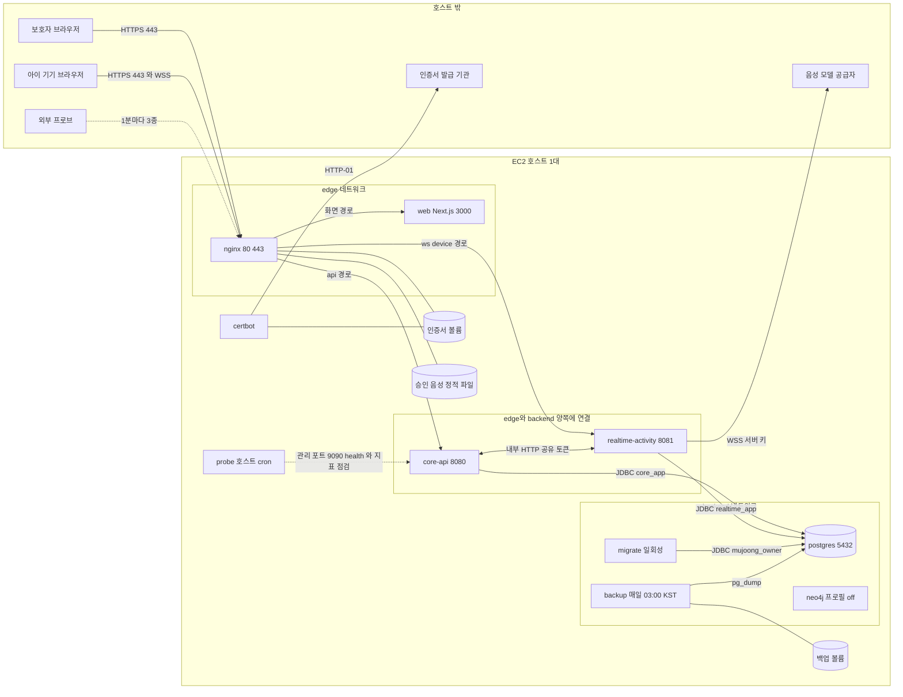

# 논리 컴포넌트 — U1 u1-walking-skeleton

> 단계: NFR Design (3.3) · 문서: logical-components (LC) · 깊이 Standard · 날짜 2026-10-09 (클라우드 세션)
> 입력: `nfr-design-questions.md`(Q7 · Q3 · Q4 · Q5 · Q12 및 3절 답 분석), `nfr-requirements/*.md`(NFRx.y 67개와 3.2 재점검 결정), `functional-design/rules.md`(BR1.1 ~ BR9.7), `contract-summary.md`(4 · 5 · 6 · 7절), `components.md`(앱 안 컴포넌트 이름), ADR-002 · ADR-006 · ADR-010 · ADR-019. 초판은 같은 폴더의 다른 설계 문서(보안 · 신뢰성 · 관측)가 동시에 쓰이는 중이라 읽지 않고 요구 문서와 질문 파일의 결정에서 표를 만들었다. 3.3 재점검(2026-10-09)에서는 다른 설계 문서의 설계 ID 목록과 `## 4` 시험 표를 읽어 5절의 B1 절단선 표를 더했고, 다른 문서의 `## 4` 표는 바꾸지 않았다.
> 대리 판단: J73 ~ J84는 사람 지시와 `docs/cloud_handoff.md` 2절에 따라 팀장(준하)의 대리가 정한 가정이다. 이 문서는 J79(Q7 논리 컴포넌트 · 장애 도메인)를 구체 설계로 풀고 J75 · J76 · J77 · J78 · J84를 컴포넌트 경계에 반영한다. 수치는 시작값이며 새로 둔 값은 '제안(3.5 확정)'으로 표시한다.
> 표기: 이 문서의 `## 1` 표 '해결하는 NFRx.y'는 그 컴포넌트가 책임지는 NFR이다(담당 NFR이 따로 없는 문서). 요구 문서(nfr-requirements)의 재점검 결정은 항상 '재점검 RD-n'으로, 설계 쪽은 LC · PD · SD · SCD · OD 접두 또는 'reliability-design.md RD-n'으로 적는다(맨 `RD-n`은 쓰지 않는다). 3.3 재점검(2026-10-09)의 결정은 5절 대리 판단 표에 '3.3 재점검 결정 R3-n'으로 기록했다. 3.4 초안 질문 파일(J85 ~ J96)은 참고로만 인용하고 확정은 3.4가 한다.

## 1. 설계 요소

논리 컴포넌트는 9개다: 컨테이너 8개(nginx, web, core-api, realtime-activity, postgres, migrate, certbot, backup)와 컨테이너가 아닌 호스트 cron 프로브 1개(probe). 후속 유닛이 켜는 neo4j(프로필 꺼짐)는 아홉에 세지 않고 LC-10으로 자리만 정한다.

| 설계 ID | 해결하는 NFRx.y | 패턴 · 결정 | 적용 위치(BR · 컴포넌트) | 근거 |
|---|---|---|---|---|
| LC-1 | NFR9.1, NFR9.6, NFR9.8, NFR9.9, NFR9.12, NFR4.8, NFR4.13, NFR4.15, NFR1.1, NFR5.6, NFR10.4 | nginx(컨테이너): 바깥에 닿는 유일한 문. TLS 1.2+ 종료, HTTP → HTTPS 301, HSTS · 보안 헤더, 경로 분기(/parent · /device → web, /api → core-api, /ws/device → realtime-activity 업그레이드), /internal 403, 본문 64KB 상한, `X-Forwarded-For`를 `$remote_addr`로 덮어쓰기, bootstrap 발급 `limit_req`, 접근 로그에서 쿼리 문자열 · 쿠키 제외, 외부 프로브용 공개 `GET /api/health` 한 경로(J59 확장 (t), reliability-design.md `## 5`) 외 /actuator 403, 승인 음성 정적 읽기 전용 서빙, 압축 · 캐시 | BR8.9 · BR1.6 · BR3.9 · BR8.7 · nginx | J75 · J79 |
| LC-2 | NFR10.1, NFR10.2, NFR10.3, NFR10.4, NFR11.1, NFR5.6, NFR1.3, NFR2.1, NFR9.3, NFR4.16, NFR6.1 | web(Next.js 컨테이너): /parent · /device 화면을 서빙하는 상태 없는 컨테이너. 어느 앱도 서버에서 부르지 않고 브라우저가 Nginx 경유로 API · WSS를 직접 쓴다. 시간 설정은 서버 컴포넌트가 기동 환경 변수에서 읽어 첫 응답에 실어 보낸다 | BR9.1 ~ BR9.7 · BR2.8 · BR4.5 · BR4.6 · BR6.9 · BR6.15 · BR8.8 · ParentWeb · DeviceWeb | J82 · J79 |
| LC-3 | NFR9.2, NFR9.4, NFR9.5, NFR9.7, NFR9.9, NFR9.11, NFR12.1, NFR12.3, NFR3.1, NFR4.3, NFR4.5, NFR4.6, NFR4.7, NFR4.12, NFR5.5, NFR5.7, NFR6.2, NFR6.3, NFR7.5, NFR7.6, NFR7.7 | core-api(컨테이너): 보호자 REST · 기기 REST · 내부 API와 Core 쪽 Outbox/Inbox를 맡는 Spring 앱 하나. 상태는 core 스키마(core_app 역할)와 메모리의 속도 제한 카운터 · observedAt · 캐시다. Realtime을 못 불러도 04 · 05 · 12 조회는 사본으로 답한다 | BR1.1 ~ BR1.7 · BR2.1 ~ BR2.10 · BR3.1 ~ BR3.5 · BR4.1 ~ BR4.7 · BR5.1 ~ BR5.14 · BR6.1 ~ BR6.7 · BR6.9 · BR6.14 ~ BR6.17 · BR8.3 ~ BR8.8 · DeviceRegistry · CoreMessaging · ActivityCoordinator | J79 · J76 |
| LC-4 | NFR1.1, NFR1.2, NFR3.1, NFR3.2, NFR4.1, NFR4.2, NFR4.4, NFR4.6, NFR4.7, NFR4.12, NFR5.1, NFR5.2, NFR5.3, NFR5.4, NFR5.8, NFR6.2, NFR6.3, NFR6.4, NFR6.5, NFR7.1, NFR7.2, NFR7.3, NFR7.4, NFR7.8, NFR9.4, NFR9.6, NFR9.9, NFR12.2, NFR4.14 | realtime-activity(컨테이너): 기기 WSS · 세션 상태 기계 · 공급자 음성 중계 · 출력 게이트 · 전사 기록 · Realtime 쪽 Outbox/Inbox를 맡는 Spring 앱 하나. 상태는 realtime 스키마(realtime_app 역할)와 메모리의 레지스트리 · 안전 시한 · 버퍼 · 묘비다. 단일 인스턴스를 전제한다 | BR3.6 ~ BR3.8 · BR4.8 · BR5.1 ~ BR5.14 · BR6.6 ~ BR6.13 · BR7.1 ~ BR7.6 · BR8.1 · SessionLifecycle · DeviceGateway · VoiceRelay · ConversationLog · OutputGate · RealtimeMessaging | J79 · J73 · J76 |
| LC-5 | NFR9.7, NFR4.11, NFR4.13, NFR7.6, NFR7.7, NFR12.3, NFR12.4 | postgres(컨테이너): 물리 인스턴스 하나에 스키마 core · realtime. 역할은 mujoong_owner(DDL 전용) · core_app · realtime_app이고 공유 읽기는 없다. 최초 기동 때 초기화 SQL이 스키마 · 역할을 만들고 비밀번호는 환경 변수다. 데이터 볼륨에 영속 | BR8.1 · BR8.2 · BR6.3 · BR2.3 | J84 · J79 |
| LC-6 | NFR4.13, NFR9.7, NFR4.10 | migrate(일회성 컨테이너): 소유자 역할로 Flyway V1을 적용하고 끝나면 종료한다. 두 앱은 validate만 한다. 성공해야 앱이 뜨고 실패하면 배포가 멈춘다. 후속 마이그레이션은 더하기 먼저 → 코드 → 정리 순서 | BR8.1 · BR8.2 | J77 · J84 |
| LC-7 | NFR9.1 | certbot(컨테이너): 인증서 발급 · 갱신(HTTP-01, 공유 볼륨의 webroot)을 맡고 갱신되면 Nginx가 다시 읽는다. Nginx 80 경로의 챌린지만 쓰고 다른 서비스와 통신하지 않는다 | BR8.9 · nginx | J75 · J79 |
| LC-8 | NFR4.11, NFR12.4 | backup(컨테이너): 매일 03:00(KST) 논리 백업(스키마 둘 + 역할 정의)을 같은 호스트의 별도 볼륨에 7일 보관한다. 합성 데이터에 한하며 오프호스트 복사는 이번 범위에 없다 | BR2.10 · BR5.14 · postgres | J79 · 재점검 RD-8 |
| LC-9 | NFR4.8, NFR4.9, NFR4.10, NFR4.15, NFR7.8 | probe(호스트 cron 스크립트, 컨테이너 아님): 1분마다 앱 health · 디스크 · 인증서 남은 일수 · 마지막 백업 나이 · 지표 스냅샷(관리 포트)을 로그 파일에 남긴다. 가용성 프로브 3종(health · /device 정적 · WSS 핸드셰이크)은 호스트 밖에서 도는 별도 주체이고 이 시스템의 경계 밖이다 | BR4.8 · BR8.9 · nginx · core-api · realtime-activity | J78 · J79 · 재점검 RD-8 |
| LC-10 | — | neo4j(프로필 꺼짐): 후속 유닛이 켜는 자리만 정한다. U1의 컨테이너 · 의존성 · 스키마 · 시험에 넣지 않는다. 켜면 별도 장애 도메인이고 호스트 메모리 판정선(70%)을 다시 잰다 | 후속 유닛 PragmaticsKnowledge | tech-stack-decisions · J79 |
| LC-11 | NFR4.14, NFR5.7, NFR6.1, NFR6.4, NFR6.5, NFR9.3, NFR9.10, NFR9.13, NFR9.14, NFR9.15 | 두 앱의 공통 규약: `mujoong.*` 설정 트리, 주입 가능한 Clock, 구조화 JSON 로그와 traceId 전파, 지표는 내부 엔드포인트, 내부 토큰 · 프로필 가드, 비밀은 환경 변수. 공유 라이브러리는 계약 · 오류 · 시간 · 타입만 공유하고 Entity · Repository · 도메인 Service · Boot 설정은 공유하지 않는다 | BR8.3 ~ BR8.8 · BR8.10 · BR8.11 · BR5.13 · core-api · realtime-activity | J80 · ADR-019 |
| LC-12 | NFR4.9, NFR4.12, NFR4.13, NFR4.16 | 장애 도메인 정책: 한 컨테이너의 장애가 다른 컨테이너의 기본 기능을 막지 않도록 네트워크 분리, 앱별 DB 역할 · 풀 · 스레드, 컨테이너 메모리 한도, 앱 사이 호출의 제한 시간 · 회로 차단기(Core → Realtime `session_start` 한 호출에만)로 폭발 반경을 자른다(2.5) | BR4.3 · BR6.7 · BR6.9 · BR6.15 · BR5.3 · 전체 | J79 · J74 · 3.3 재점검 결정 R3-2 |
| LC-13 | NFR9.1, NFR9.4, NFR9.6, NFR9.7 | 통신 · 신뢰 경계: 인터넷에 닿는 것은 nginx의 80 · 443뿐이고 앱 · DB · 관리 포트는 내부망에만 있다. 앱 사이는 공유 비밀 헤더, 앱과 DB는 앱별 역할, 앱과 공급자는 서버 키다(2.6) | BR3.9 · BR8.1 · BR8.9 · nginx · core-api · realtime-activity | J75 · J79 |
| LC-14 | NFR4.9, NFR4.10, NFR4.13 | 기동 · 종료 의존 순서: postgres → migrate(성공 종료) → realtime-activity · core-api(readiness) → web → nginx, certbot · backup은 그 뒤. 정상 종료는 SIGTERM 직후 readiness를 내려 새 REST 요청에 503 SERVICE_NOT_READY + Retry-After(J59 확장 (n))를 답하고(서버 커넥터는 유예까지 열어 둔다) 새 WSS는 1013 → 열린 WSS 1001 → 폴러 정지 → 30초 유예 | BR5.12 · BR6.13 · BR8.1 | J77 · 3.3 재점검 결정 R3-13 |

## 2. 설계 상세

### 2.1 컴포넌트 목록과 책임 (LC-1 ~ LC-10)

배치는 ADR-006의 Compose 토폴로지와 같다. 아래 이름은 논리 컴포넌트 이름이며 Compose 서비스 이름은 3.4가 확정한다(realtime-activity의 서비스 이름은 계약이 `realtime`으로 쓴다).

**텍스트 대체 (배치도).**

1. 브라우저(보호자 · 아이 기기)는 호스트 밖에서 nginx의 80 · 443으로만 들어온다. HTTPS와 WSS가 같은 문을 쓴다.
2. nginx는 경로로 갈라 화면은 web, `/api`는 core-api, `/ws/device`는 realtime-activity로 보낸다. `/internal`은 바깥에서 403이다.
3. core-api와 realtime-activity는 edge와 backend 두 네트워크에 모두 붙고, 서로 내부 HTTP(공유 비밀 헤더)로 부르며 Outbox/Inbox 이벤트도 그 길로 오간다.
4. postgres는 backend에만 있다. core-api는 core_app, realtime-activity는 realtime_app, migrate는 mujoong_owner, backup은 읽기 계정으로 접속한다.
5. realtime-activity만 호스트 밖 음성 모델 공급자에 세션마다 WSS를 연다(서버 키).
6. certbot은 인증서 발급 기관과 HTTP-01로 통신하고 nginx와는 인증서 볼륨과 webroot를 공유한다. nginx는 승인 음성 정적 파일 볼륨을 읽기 전용으로 서빙한다. backup은 백업 볼륨에 쓴다.
7. probe는 호스트의 cron 스크립트로 앱 관리 포트(9090, 호스트에 게시하지 않음)의 health · 지표를 본다. 외부 프로브는 호스트 밖에서 nginx의 공개 경로 3종을 1분마다 부른다.
8. neo4j는 backend에 둘 자리만 있고 U1에서는 꺼져 있다.

**표 2.1-A. 컴포넌트 목록**

| 번호 | 컴포넌트 | 종류 | 책임 | 영속 상태 | 메모리 상태 | 앱 안 컴포넌트(components.md) |
|---|---|---|---|---|---|---|
| LC-1 | nginx | 컨테이너 | 진입 · TLS · 경로 분기 · 바깥 방어선 · 정적 승인 음성 | 설정 파일, 인증서 볼륨(읽기), 승인 음성 볼륨(읽기) | 없음 | — |
| LC-2 | web | 컨테이너 | /parent · /device 화면 서빙 | 없음 | 없음(상태 없음) | ParentWeb · DeviceWeb |
| LC-3 | core-api | 컨테이너 | 보호자 · 기기 REST, 내부 API, Core 메시징 | core 스키마 | 속도 제한 카운터 · observedAt · 승인 문구 / 정책 버전 캐시 | DeviceRegistry · CoreMessaging · ActivityCoordinator · ApprovedContentCatalog · ConsentPolicy · ChildProfile · GuardianIdentity |
| LC-4 | realtime-activity | 컨테이너 | 기기 WSS, 세션 상태 기계, 음성 중계, 출력 게이트, 전사, Realtime 메시징 | realtime 스키마 | 소켓 · 세션 레지스트리, 안전 시한, 구간 버퍼, 기록기 칸, 묘비 | SessionLifecycle · DeviceGateway · VoiceRelay · ConversationLog · OutputGate · RealtimeMessaging |
| LC-5 | postgres | 컨테이너 | 영속 저장 | 데이터 볼륨 | — | — |
| LC-6 | migrate | 일회성 컨테이너 | 스키마 변경 적용 | Flyway 이력 | 없음 | — |
| LC-7 | certbot | 컨테이너 | 인증서 갱신 | 인증서 볼륨 | 없음 | — |
| LC-8 | backup | 컨테이너 | 논리 백업 · 보관 | 백업 볼륨 | 없음 | — |
| LC-9 | probe | 호스트 cron(컨테이너 아님) | 로컬 점검 · 지표 스냅샷 · 가용성 프로브 대상 경로 정의 | 로그 파일 | 없음 | — |
| LC-10 | neo4j | 컨테이너(프로필 꺼짐) | 후속 유닛의 공용 지식 | 후속 | 후속 | PragmaticsKnowledge(후속) |

### 2.2 컴포넌트 ↔ NFR 매핑

각 NFR이 어느 설계 문서에서 풀리고 어느 컴포넌트가 책임지는지 보이는 표다. 개별 NFR의 컴포넌트 책임은 1절 표가 정본이다.

| NFR 묶음 | 풀이 문서 | 주 책임 컴포넌트 | 함께 걸리는 컴포넌트 |
|---|---|---|---|
| NFR1.x · NFR2.1 · NFR3.x (게이트 · 문구 · 최소 문맥) | 보안 설계 | realtime-activity, web | core-api(패키지), nginx(승인 음성) |
| NFR4.1 ~ NFR4.7 · NFR4.16 · NFR6.1 ~ NFR6.4 (중단 시나리오 · 시한) | 신뢰성 설계 | realtime-activity, core-api | web(요청 오류), postgres |
| NFR4.8 ~ NFR4.13 (가용성 · 복구 · 배포 · 백업 · 격리 · 헬스) | 신뢰성 설계 | nginx, 두 앱, postgres, backup, probe | migrate, certbot |
| NFR4.14 · NFR4.15 · NFR5.4 · NFR5.7 · NFR6.5 · NFR7.8 · NFR9.14 · NFR9.15 (관측) | 관측 설계 | 두 앱 | probe, nginx |
| NFR5.1 ~ NFR5.3 · NFR5.8 (음성 경로 성능) | 성능 설계 | realtime-activity | nginx(WSS 통과), web(기기 측정) |
| NFR5.5 · NFR5.6 · NFR7.5 · NFR7.6 · NFR10.x · NFR11.1 | 성능 설계 | core-api, web | postgres, nginx |
| NFR7.1 ~ NFR7.4 · NFR7.7 (확장 · 용량 · 증가) | 확장성 설계 | realtime-activity, core-api | postgres, probe |
| NFR9.1 ~ NFR9.13 · NFR12.x (보안 · 데이터) | 보안 설계 | nginx, 두 앱, postgres | certbot, migrate, backup, web |

### 2.3 컴포넌트 ↔ BR 매핑

| 컴포넌트 | 규칙 |
|---|---|
| nginx | BR8.9(바깥 문 하나 · /internal 차단 · WSS 통과) · BR1.6(`X-Forwarded-For` 덮어쓰기) · BR8.7(접근 로그 위생) · BR3.9 |
| web | BR9.1 ~ BR9.7(기기 웹) · BR2.8 · BR4.5 · BR4.6 · BR6.4 · BR6.9 · BR6.15(보호자 화면과 12 폴링) · BR8.8(CSRF 헤더) · BR1.7(D0 폴링) |
| core-api | BR1.1 ~ BR1.7 · BR2.1 ~ BR2.10 · BR3.1 ~ BR3.5 · BR3.9 · BR4.1 ~ BR4.7 · BR5.1 ~ BR5.14(Core 쪽) · BR6.1 ~ BR6.7 · BR6.9 · BR6.12 ① · BR6.14 ~ BR6.17 · BR8.3 ~ BR8.8 · BR8.10 · BR8.11 |
| realtime-activity | BR3.6 ~ BR3.8 · BR4.8 · BR5.1 ~ BR5.14(Realtime 쪽) · BR6.6 ~ BR6.13 · BR7.1 ~ BR7.6 · BR8.1 |
| postgres | BR8.1(스키마 · 역할 분리) · BR8.2(V1) · BR6.3 · BR2.3 ~ BR2.5(부분 유일 색인 · 조건부 UPDATE의 DB 근거) |
| migrate | BR8.1 · BR8.2 |
| certbot | BR8.9(HTTPS 종료의 인증서 공급) |
| backup | BR2.10 · BR5.14(삭제와 보관의 충돌, NFR12.4) |
| probe | BR4.8(지표 점검 대상) · BR8.9(health 경로 노출) |
| neo4j | 없음(후속) |

### 2.4 불변식 (값 사이의 관계)

시험이 키를 줄여 주입해도 지켜져야 하는 관계다. 설정 시험이 이 표를 단언한다.

| 번호 | 불변식 | 까닭 |
|---|---|---|
| I-1 | nginx WSS `proxy_read_timeout` 75초 > `mujoong.timing.device.disconnect` 40초 + HEARTBEAT 5초 | Nginx가 앱의 40초 끊김 판정보다 먼저 연결을 끊지 않는다(J75) |
| I-2 | `mujoong.timing.device.hello-timeout` 5초 < nginx WSS 읽기 제한 | HELLO 4408 판정은 앱이 한다 |
| I-3 | `mujoong.internal-http.verify-token-timeout` 1초 < `mujoong.timing.device.hello-timeout` 5초 | 토큰 확인이 HELLO 창을 먹지 않는다 |
| I-4 | 시작 호출 3초 × (1 + 재시도 1회) + 처리 < nginx REST 읽기 제한 15초(제안) | 사용자 요청이 Nginx 504로 끊기기 전에 앱이 503으로 답한다 |
| I-5 | 정상 종료 유예 30초 + 기동 약 20초 ≤ 배포 중단 60초 | NFR4.10 |
| I-6 | `mujoong.timing.core.device-status-stale` 30초 ≥ `mujoong.timing.device.status-report-interval` 10초 × 3 | 보고 두 번 유실로는 '확인 불가'가 되지 않는다 |
| I-7 | 풀 합계 20 + 풀 밖 연결 ≤ 4 < `max_connections` 100 | NFR7.6 |
| I-8 | 컨테이너 메모리 한도 합계 ≤ 호스트 메모리의 70% | NFR7.2 |
| I-9 | Compose `stop_grace_period` > 앱 정상 종료 유예 30초 | 컨테이너 런타임이 유예 안에 앱을 강제 종료하지 않는다(신뢰성 설계가 제안한 40초가 이 관계를 만족) |
| I-10 | `mujoong.provider.connect-timeout` 10초 ≤ `mujoong.timing.session.device-ack-timeout` 20초 (시험 값 1초 ≤ 2초, 넘으면 기동 실패) | 공급자 연결 시한이 기기 응답 20초 시한보다 길어 시한 판정의 원인(PROVIDER_UNAVAILABLE 대 DEVICE_NO_ACK)이 흐려지는 일이 없다(3.3 재점검 결정 R3-1) |

### 2.5 장애 도메인 · 폭발 반경 (LC-12)

한 컴포넌트가 멈췄을 때 무엇이 멈추고 무엇이 계속되는지의 표다. J79의 표를 3.2 재점검 결정과 맞춰 풀었다(준비 전 응답은 앱이 직접 503, Nginx 502는 앱에 접속할 수 없을 때만 — NFR4.13).

| 장애 | 반경 | 멈추는 것 | 계속되는 것 | 감지 | 복구 · 비고 |
|---|---|---|---|---|---|
| postgres 정지 · 무응답 | 전체 쓰기 중단 | 로그인 · 등록 · 시작 · 조회, 두 앱 readiness 실패로 앱이 직접 503, 새 WSS 연결(토큰 확인 불가로 1013), 상태 전이 · 기록 | 진행 중 세션의 음성 중계는 메모리 경로라 즉시 끊기지 않는다(기록기 칸이 쌓이다 상한 200행에서 AI 구간 통과 중지). web 화면 껍데기 | readiness 503, 외부 프로브 health 실패 | Compose 재시작 후 앱이 풀을 다시 연다. 복구 절차는 신뢰성 설계 |
| realtime-activity 정지 | 음성 세션만 | 모든 음성 세션(기기는 5초 간격으로 재접속, 재시작 뒤 비종료 세션은 FAILED), 시작 요청(정지 30초 이내 503, 이후 423 DEVICE_NOT_STABLE), 끝내기 503, WSS 프로브 | 보호자 로그인 · 화면 · 기기 등록(Core), 04 · 05는 30초 뒤 '확인 불가', 12 조회는 사본으로 답 | WSS 프로브 실패, Core의 내부 호출 오류 지표 | Core Outbox가 쌓이고 8분 넘으면 FAILED가 되며 제어 이벤트는 재기동 때 재무장(A1) |
| core-api 정지 | 보호자 화면 | 보호자 REST 전부, 기기 부트스트랩 · 등록, 새 WSS 연결(토큰 확인 불가로 1013), 연결 상태 보고(유실 허용) | 진행 중 음성 세션과 이미 붙은 기기 WSS, web 정적 화면 | health 프로브 실패, Realtime의 내부 호출 오류 | Realtime Outbox가 쌓이고 재시도. 진행 중 세션은 DB 쓰기가 Realtime에 있어 유지 |
| web 정지 | 화면 껍데기만 | /parent · /device 화면 새로 열기 · 새로고침 | API 전부, WSS, 진행 중 음성 세션(이미 열린 기기 페이지 포함), 이벤트 전달 | /device 정적 프로브 실패 | API는 정상. web은 서버에서 다른 서비스를 부르지 않으므로 다른 곳으로 번지지 않는다 |
| nginx 정지 | 외부 접근 전부 | HTTPS · WSS 전부(기기 연결이 끊겨 40초 뒤 DISCONNECTED · 진행 세션 ABORTED(DISCONNECT)), 모든 프로브 | 앱 사이 내부 호출, Outbox/Inbox 전달, DB, 정리 작업 | 외부 프로브 3종 모두 실패 | Compose 재시작. 기기는 5초 간격으로 재접속 |
| migrate 실패 | 배포 단계만 | 새 버전 기동(배포 순서상 migrate가 먼저) | 이미 도는 구버전 서비스 전부 | 배포 스크립트의 종료 코드 | 파괴적 마이그레이션을 금지하므로 앱만 이전 태그로 되돌린다 |
| certbot 실패 | 만료 시점부터 전체 | 만료되면 모든 HTTPS · WSS(브라우저가 거부) | 만료 전까지 모두 | 인증서 남은 일수 점검(probe), 갱신 로그 | 갱신 시도는 하루 2회(3.4 초안)라 만료 30일 전부터 여유가 있다 |
| backup 실패 | 없음(복구 목표만) | 백업 파일 생성 | 런타임 전부 | 마지막 백업 나이 점검(probe) | RPO 24시간이 악화. 백업 실행 중 postgres에 CPU · 입출력 부하(03:00 KST, 시연 시간 밖 가정) |
| probe 중단 | 측정 공백 | 로컬 점검 로그 | 런타임 전부 | 로그 파일에 점검 기록이 끊긴 것(수동 점검 때 마지막 기록 시각) | 호스트 밖 프로브는 별개 주체라 가용성 판정은 계속된다 |
| neo4j(켜진 뒤) | 해당 유닛 기능 | 화용 지식 조회 | U1 기능 전부 | 후속 유닛 | 메모리 한도로 OOM을 컨테이너에 가둔다 |
| 호스트(EC2) 정지 · 상실 | 전체 | 전부 | 정지면 볼륨 데이터는 유지, 상실이면 같은 호스트 백업도 함께 잃을 수 있다 | 외부 프로브 | NFR4.11의 '호스트 상실 제외' 단서, 오프호스트 복사는 사람 결정 |
| 음성 모델 공급자 장애 | 새 시작 | 시작 구간이면 FAILED(PROVIDER_UNAVAILABLE), 가짜 공급자로 시험 | 보호자 화면 · 기기 등록 · 기존 연결 | 시작 실패 지표 | ACTIVE 뒤 끊김 감지는 U3 · U4(NFR4.2) |

**폭발 반경을 자르는 장치.**

| 장치 | 내용 | 효과 |
|---|---|---|
| 네트워크 둘 | edge(nginx · web · core-api · realtime-activity)와 backend(core-api · realtime-activity · postgres · migrate · backup · neo4j). nginx · web은 backend에 없다 | 바깥 방어선이 뚫려도 DB에 직접 닿지 않는다 |
| 앱별 DB 역할 | core_app은 core만, realtime_app은 realtime만 쓴다. 소유자 역할은 migrate만 쓴다 | 한 앱의 결함이 다른 앱의 데이터를 쓰지 못한다 |
| 풀 · 스레드 분리 | 앱마다 풀 10, Outbox 발송 · Inbox 재호출 폴러가 전용 스레드 | 한 앱의 지연이 다른 앱의 풀 · 스레드를 먹지 않는다 |
| 제한 시간 · 회로 차단기 | 내부 HTTP 6종 제한(J26). 회로 차단기(연속 3회 실패 시 5초 열림, J74)는 Core → Realtime `session_start` 호출 하나에만 적용한다(3.3 재점검 결정 R3-2). `session_end`와 취소(CORE_ABANDONED)는 차단기를 거치지 않고 항상 2초 제한으로 시도하며 실패하면 예외로 올려 Inbox 재호출(BR5.8)이 이어받는다(시작 경로의 첫 취소 실패는 로그만 남기고 BR6.14의 재취소가 보완한다, reliability-design.md 2.9). `session_view`(12 조회)는 별도 차단기 없이 실패하면 Core 사본으로 답한다. Realtime → Core 상태 보고 루프에는 차단기 상태 기계가 없고 '라운드 건너뛰기' 규칙(`mujoong.internal-http.status-round-skip-threshold` 3)만 둔다 | Realtime이 죽어도 시작 클릭이 3초씩 기다리지 않고 즉시 503이다. 읽기(12) 지연만으로 차단기가 열려 보호자의 끝내기가 호출 없이 503이 되거나 취소가 건너뛰어지는 일이 없다(BR6.9의 '503은 Realtime에 닿지 않을 때', BR6.7의 '취소를 보낸다') |
| 컨테이너 메모리 한도 | 컨테이너마다 한도(3.4) | OOM이 한 컨테이너에 갇힌다 |
| web의 독립 | web은 서버에서 어느 앱도 부르지 않는다 | web 장애가 API · WSS로 번지지 않는다 |
| 재시작 정책 | `restart: unless-stopped` | 프로세스 장애를 5분 이내(목표 1분) 되살린다 |

### 2.6 컴포넌트 간 통신 (LC-13)

| 번호 | 보내는 쪽 → 받는 쪽 | 프로토콜 · 망 | 인증 | 시간 제한 | 실패 시 | 근거 |
|---|---|---|---|---|---|---|
| C-1 | 브라우저 → nginx | HTTPS 443(TLS 1.2+), HTTP 80은 301, WSS | 없음(앱이 쿠키로 인증) | WSS `proxy_read_timeout` 75초 | 연결 오류 | NFR9.1 · J75 |
| C-2 | nginx → web | HTTP · edge · 3000 | 없음(내부망) | 연결 · 읽기 제한(3.4) | 502 | BR8.9 |
| C-3 | nginx → core-api | HTTP · edge · 8080, /api/** | 앱 인증(세션 쿠키 · 기기 쿠키). /internal/**은 외부 403 | 읽기 제한 15초(제안, 3.4) | 502(접속 불가) 또는 앱이 직접 503(SERVICE_NOT_READY + Retry-After, J59 확장 (n)) | BR8.9 · NFR4.13 |
| C-4 | nginx → realtime-activity | HTTP 업그레이드 → WSS · edge · 8081, /ws/device | Origin 허용 목록 + 기기 쿠키(앱이 Core에 확인) | 75초, HELLO 5초 | 닫기 코드(1013 · 4401 · 4408 등) | BR3.6 · J75 |
| C-5 | nginx → 승인 음성 파일 | 볼륨 읽기 | 없음(개인정보 없는 정적 파일) | — | 404 | BR8.9 · NFR1.1 |
| C-6 | core-api → realtime-activity | 내부 HTTP · 내부망 · 8081 | `X-Internal-Token` | 시작 3초(시간 초과만 같은 sessionId로 1회 재시도) · 끝내기 2초 · 진행 조회 1초 · 이벤트 전달 3초 | 시작 503(회로 차단기는 시작 호출에만), 끝내기는 차단기 없이 2초 제한으로 시도하고 Realtime에 닿지 못하면 503, 취소(CORE_ABANDONED)도 차단기 없이 2초 제한으로 시도하며 실패하면 예외로 올려 Inbox 재호출(BR5.8)이 이어받음, 조회는 Core 사본, 이벤트는 Outbox 재시도 | BR6.5 ~ BR6.9 · BR6.15 · BR5.2 · J26 · J74 · 3.3 재점검 결정 R3-2 |
| C-7 | realtime-activity → core-api | 내부 HTTP · 내부망 · 8080 | `X-Internal-Token` | 토큰 확인 1초 · 상태 보고 1초 · 이벤트 전달 3초 | 토큰 확인 실패는 1013, 보고는 유실 허용(차단기 없이 '라운드 건너뛰기' 규칙만), 이벤트는 Outbox 재시도 | BR3.4 · BR4.8 · BR5.2 · J26 |
| C-8 | core-api → postgres | JDBC · backend | core_app 역할 | 질의 · 락 제한은 신뢰성 설계 | readiness 실패 → 503 | BR8.1 · NFR9.7 |
| C-9 | realtime-activity → postgres | JDBC · backend | realtime_app 역할 | 같음 | 같음 | BR8.1 · NFR9.7 |
| C-10 | migrate → postgres | JDBC · backend | mujoong_owner 역할 | 일회성 | 배포 중단 | BR8.2 · J84 |
| C-11 | backup → postgres | pg_dump · backend | 읽기 권한 계정(열림 5) | 일회성 | 마지막 백업 나이 점검 | NFR4.11 |
| C-12 | realtime-activity → 음성 모델 공급자 | 외부 WSS(443), 세션마다 별도 연결 | 서버 키(환경 변수) | 연결 열기 `mujoong.provider.connect-timeout` 10초(별도 가상 스레드, 실행기를 막지 않음), session.started는 기기 응답 20초 시한 안 | 시작 구간 FAILED(PROVIDER_UNAVAILABLE) | BR7.2 · BR6.12 ② · 3.3 재점검 결정 R3-1 |
| C-13 | certbot → 인증서 발급 기관 | 외부 HTTPS, HTTP-01(nginx 80 경로의 webroot) | 계정 키(볼륨) | 하루 2회 확인(3.4 초안) | 만료 전까지 영향 없음 | NFR9.1 |
| C-14 | certbot ↔ nginx | 공유 볼륨 + 재적재 신호 | — | — | — | J79 |
| C-15 | probe → 앱 · nginx | 호스트에서 로컬 호출(health · 관리 포트 지표) | 내부 접근 | 1분 주기 | 로그에 실패 기록 | J78 |
| C-16 | 외부 프로브 → nginx | HTTPS · WSS 핸드셰이크 3종(호스트 밖) | 공개 경로만 | 1분 주기 | 그 분을 실패로 센다 | NFR4.8 |
| C-17 | web → (없음) | 서버에서 부르는 곳이 없다 | — | — | — | LC-2 |

앱 사이 호출의 시간 제한 키는 `mujoong.internal-http.*`(reliability-design.md 기준 표)다. 관리 포트(지표 · health)는 3.4가 9090으로 정했고(두 앱 모두, 각 컨테이너 네트워크 안에서만) 호스트에 게시하지 않는다.

### 2.7 상태 소유 경계 요약

| 상태 | 소유 컴포넌트 | 위치 | 다른 컴포넌트가 보는 방법 |
|---|---|---|---|
| 기기 등록 · 토큰 해시 · 연결 상태 사본 | core-api | core 스키마 | Realtime은 토큰 확인 내부 API만 쓴다 |
| 세션 원장 · 전사 · 연결 원장 | realtime-activity | realtime 스키마 | Core는 이벤트 사본과 진행 조회만 쓴다 |
| 소켓 · 세션 레지스트리, 안전 시한, 구간 버퍼, 묘비 | realtime-activity | 메모리 | 없음(내부) |
| 속도 제한 카운터, observedAt, 캐시 | core-api | 메모리 | 없음(내부) |
| 인증서 | certbot이 쓰고 nginx가 읽음 | 볼륨 | 파일 |
| 승인 음성 파일 | 배포가 쓰고 nginx가 읽음 | 볼륨 | 정적 경로 |
| 백업 | backup | 볼륨 | 복원 절차 |
| 비밀(DB 비밀번호 · 내부 토큰 · 공급자 키) | 호스트의 환경 파일(권한 600) | 호스트 | Compose `env_file`로 각 컨테이너에 필요한 것만 주입 |

web과 nginx는 영속 상태가 없고, 두 앱의 메모리 상태는 모두 재시작하면 사라지는 사본 또는 시계다(영속 진실은 DB).

## 3. 수치와 설정 키

기준 표는 reliability-design.md `## 3`이다. 이 문서는 새 키를 만들지 않고 아래 이름을 쓴다. '제안'은 3.4 / 3.5에서 확정할 값이다.

| 키 또는 항목 | 값 | 단위 | 소유 앱 | 시험이 줄이는 값 |
|---|---|---|---|---|
| 논리 컴포넌트 수 | 9 (컨테이너 8 + 호스트 cron 프로브 1) | 개 | — | 코드가 읽지 않음 |
| 호스트 게시 포트 | 80 · 443 | 포트 | nginx | 코드가 읽지 않음 |
| 앱 포트 | core-api 8080, realtime-activity 8081(계약 4 · 5절), web 3000(제안) | 포트 | 각 컨테이너 | 코드가 읽지 않음 |
| `management.server.port`(표준 키, 3.4 확정) | 9090 (두 앱 모두, 각 컨테이너 네트워크 안에서만, 호스트 비게시. 서비스 포트 8080 · 8081과 다름) | 포트 | 양 앱 | 코드가 읽지 않음 |
| `management.endpoints.web.exposure.include`(표준 키, 3.4 확정) | health,prometheus | — | 양 앱 | 코드가 읽지 않음 |
| nginx WSS `proxy_read_timeout` | 75 | 초 | nginx | 코드가 읽지 않음(불변식 I-1) |
| nginx REST 읽기 제한 | 15(제안) | 초 | nginx | 코드가 읽지 않음(불변식 I-4) |
| nginx `client_max_body_size` | 64k (`mujoong.limits.rest-body-max` 64KB와 같은 값) | KB | nginx | 코드가 읽지 않음 |
| `mujoong.security.hsts-max-age` | 15552000 (180일) | 초 | nginx(배포 템플릿 변수, 앱은 읽지 않음) | 해당 없음 |
| `mujoong.timing.device.hello-timeout` | 5 | 초 | realtime | 500ms |
| `mujoong.timing.device.disconnect` | 40 | 초 | realtime | 4초 |
| `mujoong.timing.device.heartbeat-interval` | 5 | 초 | realtime(HELLO_OK로 기기에 내려줌) · web | 500ms |
| `mujoong.timing.device.status-report-interval` | 10 | 초 | realtime | 1초 |
| `mujoong.timing.core.device-status-stale` | 30 | 초 | core-api | 3초 |
| `mujoong.internal-http.session-start-timeout` | 3 | 초 | core-api | 300ms |
| `mujoong.internal-http.session-start-retries` | 1 (시간 초과에 한함) | 회 | core-api | 1 |
| `mujoong.internal-http.session-end-timeout` | 2 | 초 | core-api | 200ms |
| `mujoong.internal-http.session-view-timeout` | 1 | 초 | core-api | 100ms |
| `mujoong.internal-http.verify-token-timeout` | 1 | 초 | realtime | 100ms |
| `mujoong.internal-http.device-status-timeout` | 1 | 초 | realtime | 100ms |
| `mujoong.internal-http.event-publish-timeout` | 3 | 초 | 양 앱 | 300ms |
| `mujoong.internal-http.breaker-failure-threshold` | 3 (J74, `session_start` 호출에만 적용) | 회 연속 | core-api | 2 |
| `mujoong.internal-http.breaker-open-duration` | 5 (J74, `session_start` 호출에만 적용) | 초 | core-api | 500ms |
| `mujoong.internal-http.status-round-skip-threshold` | 3 (Realtime → Core 상태 보고 루프의 '라운드 건너뛰기', 차단기 상태 기계 없음) | 회 연속 | realtime | 2 |
| `mujoong.provider.connect-timeout` | 10 (`mujoong.timing.session.device-ack-timeout` 20초 이하, 불변식 I-10) | 초 | realtime | 1초 |
| `spring.datasource.hikari.maximum-pool-size`(표준 키) | 10 (두 앱 각각) | 개 | 양 앱 | 2 (두 앱 합계 20 이하 설정 시험 포함) |
| PostgreSQL `max_connections` | 100 | 개 | postgres | 코드가 읽지 않음 |
| `spring.lifecycle.timeout-per-shutdown-phase`(표준 키, 정상 종료 유예) | 30 | 초 | 양 앱 | 2초 |
| Compose `stop_grace_period` | 유예보다 길게(신뢰성 설계 제안 40) | 초 | compose | 코드가 읽지 않음 |
| 배포 서비스 중단 | 60 이하 | 초 | 배포 절차 | 코드가 읽지 않음 |
| 컨테이너 메모리 한도(3.4 초안 J88) | postgres 1.5 · core-api 1.5 · realtime-activity 1.5 · web 0.5 · nginx · certbot · backup 각 0.125, 합계 5.375 | GiB | 각 컨테이너 | 코드가 읽지 않음 |
| 백업 | 매일 03:00 KST, 7일 보관, 같은 호스트 별도 볼륨 | — | backup | 코드가 읽지 않음 |
| 인증서 갱신 확인 | 하루 2회(3.4 초안 J87) | 회 | certbot | 코드가 읽지 않음 |
| 호스트 프로브 주기 | 1분 | 분 | probe | 코드가 읽지 않음 |

## 4. 시험 · 검증 설계

| 설계 ID | 시험 | 단계 |
|---|---|---|
| LC-1 | 외부 포트 스캔: 80은 301만, 443은 TLS 1.2 이상, 다른 포트는 닫힘. /internal/** 403, 64KB 초과 본문 거부, 보안 헤더, 접근 로그에 쿼리 · 쿠키 없음, 외부 /actuator 403과 health 한 경로만 허용, `nginx -t` | Build and Test |
| LC-1 | WSS를 75초 넘게 유지해도 Nginx가 먼저 끊지 않는다(HEARTBEAT 정상). 프로브 3종이 외부에서 동작한다 | Build and Test |
| LC-2 | web을 정지해도 API · WSS · 진행 중 세션이 정상이다. web 컨테이너가 core-api · realtime-activity로 가는 연결이 0건이다. 이미지 하나로 환경 변수만 바꿔 시간 설정이 반영된다 | Build and Test |
| LC-3 | core-api 정지 시 진행 중 세션이 유지되고 새 WSS가 1013이며 Realtime Outbox가 쌓이고 재시도한다. Realtime 정지 시 12 조회는 사본으로 답한다 | Build and Test |
| LC-4 | realtime-activity 정지 시점별(정지 직후 30초 이내 · 이후): 시작 503 → 423 DEVICE_NOT_STABLE, 끝내기 503, 04 · 05 30초 뒤 '확인 불가'. 재시작 뒤 비종료 세션 FAILED(SERVER_RESTART) | 3.5 구현 |
| LC-5 | 도달성 시험: nginx · web에서 postgres 접속 불가, 앱 역할의 교차 스키마 쓰기가 DB에서 거부(NFR9.7), 소유자 역할은 앱 컨테이너에 주입되지 않는다. postgres 정지 시 두 앱이 직접 503을 답한다 | Build and Test |
| LC-6 | migrate가 실패하면 앱이 뜨지 않고 이미 도는 서비스는 계속된다. 앱 두 개가 같은 마이그레이션을 경쟁 적용하지 않는다 | Build and Test |
| LC-7 | 인증서 갱신 모의 실행(드라이런)과 만료일 점검 스크립트, 갱신 뒤 Nginx 재적재 | Build and Test |
| LC-8 | 백업 파일 7일치 생성 로그 확인, 빈 DB로의 복원 리허설 1회(소요 시간을 RTO 60분과 비교) | Build and Test |
| LC-9 | 호스트 점검 스크립트가 5종 항목(health · 디스크 · 인증서 · 백업 나이 · 지표 스냅샷)을 로그 파일에 남기고 프로브 일일 집계 스크립트가 도는지 확인. Realtime만 정지해도 WSS 프로브가 실패한 분으로 잡힌다 | 11/2 측정 |
| LC-10 | 프로필이 꺼진 채 Compose 구성이 유효하고 U1 시험이 neo4j 없이 통과한다. 켜면 메모리를 다시 잰다 | Build and Test |
| LC-11 | 공통 규약 구조 시험: 공유 라이브러리가 Entity · Repository · Service · Boot 설정을 담지 않는다(ArchUnit), 시간 직접 호출 0건, 로그 필드 · 설정 트리 규칙(세부는 관측 · 신뢰성 설계의 시험) | 3.5 구현 |
| LC-12 | 2.5의 반경 표 각 행에 대한 컨테이너 정지 주입 시험(postgres · realtime-activity · core-api · web · nginx), 표의 '계속되는 것'이 실제로 계속되는지 확인 | Build and Test |
| LC-12 | 차단기 범위 단언(3.3 재점검 결정 R3-2, reliability-design.md RD-14 시험과 공유): 조회(12) 지연 주입으로는 차단기가 열리지 않고 끝내기가 Realtime을 호출한다. `session_start`가 연속 실패해 열린 동안에도 끝내기 · 취소(CORE_ABANDONED)는 호출을 시도한다. 취소 실패는 예외로 올라 Inbox 재호출이 이어받는다. 상태 보고 루프에는 차단기 게이지가 없다 | 3.5 구현 |
| LC-13 | 2.6의 시간 제한 초과 주입(내부 HTTP 6종), 토큰 없는 내부 호출 401, 외부에서 내부 경로 403, 불변식 I-1 ~ I-10을 설정 값으로 단언하는 시험(I-10은 시험 값 1초 ≤ 2초 포함) | 3.5 구현 |
| LC-14 | 기동 순서 시험(postgres → migrate → 앱 → web → nginx, 앞 단계 실패 시 뒤가 뜨지 않음), SIGTERM 정상 종료(readiness 내림 → 유예 중 새 REST 요청 503 SERVICE_NOT_READY · `/internal/events` 503 → 새 WSS 1013 → 열린 WSS 1001 → 정상 종료 유예 `spring.lifecycle.timeout-per-shutdown-phase`, 시험 값 2초), 배포 리허설 중단 60초 이내 | Build and Test |

## 5. 열린 질문과 가정

**대리 판단 (J 번호)**

| 번호 | 내용 | 정할 곳 |
|---|---|---|
| J79 | 컨테이너 단위 논리 컴포넌트 9개와 장애 도메인 표. 이 문서가 폭발 반경 표 · 통신 표 · 불변식을 구체화했다 | 3.4 |
| 가정 | 포트(web 3000), nginx REST 읽기 제한 15초, 회로 차단기 수치는 시작값이다 | 3.4 · 3.5 |
| 가정 | 컨테이너 메모리 한도와 호스트 사양은 3.4 초안(J85 · J88)을 따른다 | 3.4 |
| 3.3 재점검 결정 R3-2 | 회로 차단기 범위: Core → Realtime 차단기는 `session_start` 호출 하나에만 적용한다. `session_end`와 취소(CORE_ABANDONED)는 차단기 없이 항상 2초 제한으로 시도하고 실패하면 예외로 올려 Inbox 재호출(BR5.8)이 이어받는다. `session_view`(12 조회)는 별도 차단기 없이 실패하면 Core 사본으로 답한다. Realtime → Core 상태 보고 루프에는 차단기 상태 기계가 없고 '라운드 건너뛰기' 규칙(`mujoong.internal-http.status-round-skip-threshold` 3, 소유 realtime)만 둔다. `breaker-*` 키의 소유 앱은 core-api뿐이다(2.5 · C-6 · C-7 · 3절) | 3.5 |
| 3.3 재점검 결정 R3-10 | 관리 포트: J75 · J78(질문 파일 최신본)은 번호를 3.4에 넘겼고 3.4에서 9090으로 확정(서비스 포트 8080 · 8081과 다름). 열림 2는 '3.4에서 닫힘'. 3절 · H-4에 `management.server.port` = 9090, `management.endpoints.web.exposure.include` = health,prometheus를 올렸다 | 3.4 |
| 3.3 재점검 결정 R3-13 | 정상 종료 중 새 REST 요청은 앱이 503 SERVICE_NOT_READY + Retry-After(J59 확장 (n))로 답하고 `/internal/events`도 503이다. 서버 커넥터는 유예(`stop_grace_period` 40초)까지 열어 둔다. LC-14 · 시험에 반영 | 3.5 |
| 3.3 재점검 결정 R3-18 | 수치 정합: 정상 종료 유예 `spring.lifecycle.timeout-per-shutdown-phase`의 시험 값은 reliability-design.md 기준 2초, hikari 풀 크기 시험 값 2(합계 20 이하 설정 시험 포함). `mujoong.provider.connect-timeout`을 불변식 I-10(20초 시한 이하)으로 묶었다 | 3.5 |
| 3.3 재점검 결정 R3-20 | 설계 ID 표기: 요구 문서 쪽은 항상 '재점검 RD-n', 설계 쪽은 LC · PD · SD · SCD · OD 접두 또는 'reliability-design.md RD-n' | — |
| 3.3 재점검 결정 R3-21 | B1 절단선: 설계 요소(PD · SD · SCD · RD · OD · LC)의 시험을 B1(워킹 스켈레톤 볼트, 10/14 ~ 10/16) 필수 · B1 이후 ~ 11/2 전 · 보류로 나눈 아래 표를 더했다. 각 설계 문서의 `## 4` 표는 바꾸지 않았다. 이 구분은 대리 판단이라 사람이 확인한다 | 사람 · 3.5 첫 볼트 |

**사람이 정할 것 · 열림**

| 번호 | 내용 | 정할 곳 |
|---|---|---|
| 열림 1 | 컴포넌트 수의 읽기: 논리 컴포넌트 9개 = 컨테이너 8개 + 호스트 프로브 1개(J79). 'neo4j(프로필 꺼짐)'는 아홉에 세지 않는다 | 확인 |
| 열림 2 | 3.4에서 닫힘: 관리 포트 번호. J75 · J78(질문 파일 최신본)은 번호를 3.4에 넘겼고 3.4에서 9090으로 확정했다(`management.server.port`, 두 앱 모두, 각 컨테이너 네트워크 안에서만, 호스트 비게시. 서비스 포트 8080 · 8081과 다름). 이 문서의 3절 · H-4가 9090을 쓴다 | 3.4 |
| 열림 3 | J79 문구의 'postgres 장애 = 앱 readiness 실패 → 502'를 NFR4.13(앱이 떠 있으면 직접 503, Nginx 502는 접속 불가일 때만)에 맞춰 503으로 읽었다 | 확인 |
| 열림 4 | Compose 서비스 이름: 논리 이름 realtime-activity와 계약의 호스트 이름 `realtime` | 3.4 |
| 열림 5 | backup이 pg_dump에 쓰는 DB 계정: J84의 역할은 소유자 · core_app · realtime_app 셋이다. 소유자 역할을 쓰면 백업 컨테이너의 권한이 커진다. 읽기 전용 백업 역할을 더할지 정한다 | 3.4 · 보안 설계 |
| 열림 6 | 외부 가용성 프로브 실행 위치(팀 PC 스케줄 또는 외부 무료 서비스)와 WSS 핸드셰이크 프로브 방식 | 사람 · 3.4 |
| 열림 7 | Neo4j를 켜는 유닛과 시점. 켜면 컨테이너 한도 합계 6.875GiB(86%)가 되어 메모리 판정선을 넘는다 | 해당 유닛 3.2 · 3.4 |
| 열림 8 | 닫힘(확인): 보안 설계의 프로필 가드 표에 load-test 부가 프로필 조합 행이 있다(demo · prod + load-test는 기동 거부). 부하 시험 시드는 앱 밖 SQL 도구로 넣는다(성능 설계 2.10) | 확인 |
| 열림 9 | 승인 음성 정적 파일 볼륨을 쓰는 주체(배포가 복사)와 U2 문구 편집 화면이 생길 때의 쓰기 주체 | U2 · 3.4 |

**FD 보강 후보 → 설계 반영 위치**

| 후보 | 설계 반영 위치 | 걸리는 컴포넌트 |
|---|---|---|
| A1 FAILED 제어 이벤트 재무장 | reliability-design.md | core-api · realtime-activity(앱 시작 때 자기 Outbox) |
| A2 BR8.3 demo + dev 거부 | security-design.md | core-api · realtime-activity(프로필 가드) |
| A3 Outbox/Inbox trace_id 열 | observability-design.md(열 정의 포함) | postgres(V1 열), 두 앱 |
| A4 guardian_id 채움 규칙 | security-design.md(삭제 참가자), reliability-design.md(이벤트 저장 시) | core-api · realtime-activity |
| A5 시드 사전 범주 7 | security-design.md | realtime-activity(OutputGate) |
| A6 부하 시험 전용 시드 · load-test 프로필 | performance-design.md 2.10 | postgres(시드 도구가 core 스키마에 직접 입력), core-api(발급 한도 상향은 dev + load-test만) |

**B1 절단선 (3.3 재점검 결정 R3-21)**

구현 7일 창에서 워킹 스켈레톤 볼트 B1(U1, 10/14 ~ 10/16)이 모든 설계 시험을 담을 수 없으므로 어느 설계 요소의 시험을 B1에서 하고 어느 것을 뒤로 미루는지 한 표로 정한다. 기준은 B1 완료 조건(bolt-plan.md B1)이다: ① 승인된 검증 명령 하나가 D0 코드 → 05a 등록 → 04 안정 → 08 시작 → 음성 1턴(게이트 경유) → P1 → ENDED(기기 멈춤 확인)를 통과 ② core_app · realtime_app 교차 스키마 쓰기 거부 ③ 서버 · Nginx 로그에 전사 원문 · 기기 토큰 없음 ④ 사람의 스켈레톤 확인 승인. 여기에 안전 경로(3.3 재점검의 공급자 연결 순서 R3-1 · `session_start` 한정 차단기 R3-2 · DeviceStatusChanged guardianId R3-3)를 더한다.

읽는 법: B1 필수 요소의 시험 중 B1에서 하는 것은 각 설계 문서 `## 4` 표의 단계가 '3.5 구현'인 시험과, 완료 조건 ② ③에 직접 걸리는 Build and Test 시험(security-design.md SD-13의 교차 스키마 쓰기 거부, SD-15의 Nginx · PostgreSQL 로그 grep)이다. 같은 요소의 나머지 Build and Test · 11/2 측정 시험은 B1 이후다. 'B1 이후' 구분에 올린 요소는 3.5 구현 단계 시험도 B1에서 하지 않는다. 각 문서의 `## 4` 표는 이 표에 맞춰 바꾸지 않는다 — 이 표가 구분의 유일한 기준이다. 표 안의 설계 ID는 PD · SD · SCD · OD · LC와 reliability-design.md의 RD-n이며, 이 표의 `RD-n`은 모두 reliability-design.md의 설계 ID다(요구 문서의 '재점검 RD-n'이 아니다).

| 구분 | 설계 요소 (문서 ID) | B1에서 하는 범위 | 이 구분인 이유 |
|---|---|---|---|
| B1 필수 | PD-1 · PD-2 · PD-3 · PD-4(입력 대기열 · 출력 레인 · 기록기 상한만) · PD-5 · PD-6(LATENCY_TURN · SESSION_ITEMS_SERVED 키만) · PD-8 · PD-9(색인 · 질의는 구현만, EXPLAIN · 질의 수 단언은 B1 이후) · PD-10(Outbox → Inbox 전달 경로) · PD-11(풀 설정) · PD-12 · PD-13 · SCD-1 · SCD-2 · SCD-3(문서 표) | 각 요소의 3.5 구현 단계 시험. PD-1은 연결 무응답 중 Core 취소가 2초 안에 처리되는 시험 · 묘비 0단계 · 실행기 예외 시험을, SCD-2는 실패 주입 시 옛 소켓이 닫히지 않는 시험을 포함 | 완료 조건 ①(음성 1턴 · 게이트 경유 · 04 안정과 12의 사본)과 B1의 확인할 가설(구간별 지연을 잴 수 있다, Outbox → Inbox가 12의 2초 폴링 안에 맞는다) |
| B1 필수 | reliability-design.md RD-1 ~ RD-9 · RD-11 · RD-12 · RD-14 · RD-16 · RD-22 · RD-23(Clock · 가짜 공급자 · 기기 시뮬레이터) · RD-24(타입 있는 설정 트리와 기동 검증만) | 3.5 구현 단계 시험. RD-14는 `session_start`에만 걸린 차단기와 끝내기 · 취소의 무차단 시도, RD-5는 공급자 연결 실패 시 즉시 FAILED, RD-12는 기동 순서 S1 ~ S6와 프로필 가드 | 완료 조건 ①의 ENDED와 안전 경로: 네 시한(BR6.12), 취소(BR6.7), R3-1 · R3-2 · R3-3. 이것이 없으면 FAILED로 닫히지 않는 세션이 생겨 계정이 잠긴다 |
| B1 필수 | SD-1 · SD-3(/internal 403 · 본문 64KB · 클라이언트 IP 덮어쓰기만) · SD-4 · SD-5 · SD-6 · SD-7 · SD-8 · SD-9 · SD-10(bootstrap IP 한도기만) · SD-11 · SD-12 · SD-13 · SD-14 · SD-15 · SD-17 · SD-18(사전 최소 항목과 누락 시 기동 거부) · SD-20 · SD-22(메모리 안 큐 설계) · SD-23 | 3.5 구현 단계 시험, 그리고 SD-13의 교차 스키마 쓰기 거부(Testcontainers)와 SD-15의 로그 grep 2건 | 완료 조건 ②와 ③, 기기 인증 · 게이트(fail-closed) 없이는 ①이 통과해도 안전하지 않다 |
| B1 필수 | OD-1 · OD-2 · OD-3 · OD-4 · OD-7(Outbox/Inbox trace_id 열 정의만) · OD-8(로그 키만) · OD-11 · LC-1 ~ LC-6 · LC-7(최초 인증서 발급만) · LC-11 · LC-14 | 로그 스키마 · 위생(OD-1 ~ OD-4) 형식 시험, readiness(OD-11), Compose 기동 순서 시험, V1 마이그레이션에 trace_id 열 포함 | 완료 조건 ③과, ① 검증 명령이 올리는 환경(Compose · Nginx · Flyway · 두 스키마 · 역할). V1에서 빠진 열은 뒤에 더하기 비싸다 |
| B1 이후 ~ 11/2 전 | RD-18 · RD-20 · LC-8 · LC-9 · OD-14 · OD-15 · OD-16 · OD-17 | 가용성 집계, 백업 · 복원 리허설, 프로브 · 점검 · SLI 계산 스크립트와 그 시험 | 완료 조건과 무관하다. NFR4.8 · NFR4.11 · NFR7.8의 측정 기준을 만드는 도구라 11/2 측정 전에만 있으면 된다 |
| B1 이후 ~ 11/2 전 | PD-7 · PD-14 ~ PD-17 · PD-18 · PD-20 · SCD-6 · SCD-7 · SCD-8 · SCD-9 · PD-8 · PD-9의 EXPLAIN · 질의 수 시험 | 번들 크기 CI 검사 · Lighthouse · 브라우저 대응 · 표본 판정 스크립트, 부하 시드 도구와 L1 ~ L7, 동시 세션 판정, 용량 계산 비교, 행 수 점검 | 측정과 성능 마감용이다. B1은 지연을 잴 수 있는 로그까지만 요구한다(캐시 PD-7은 B1에서 DB 직접 읽기로 대신해도 된다) |
| B1 이후 ~ 11/2 전 | SD-2 · SD-3(Nginx 전체 시험) · SD-10(전체 시험) · SD-16 · SD-19 · SD-24 | CSP nonce · 브라우저 콘솔 시험, Nginx 설정 전체 시험, 한도기 전체 시험, 의존성 · 비밀 스캔 CI 관문, 화면 문구 검수 체크리스트, 백업 · 삭제 충돌 표지 시험 | 방어 층이지만 B1 완료 조건에 직접 걸리지 않는다. 시연 전 Build and Test에서 확인한다 |
| B1 이후 ~ 11/2 전 | 전체 ArchUnit · 구조 시험 묶음: PD-1 · PD-11의 ArchUnit 규칙, RD-2의 시간 직접 호출 금지, RD-23의 시험 클래스 비포함 · 의존 방향 규칙, RD-24의 키 대조, SD-9 · SD-22 · SD-25, SCD-4의 표식 구조 시험, LC-11 | CI 규칙 묶음으로 한 번에 도입한다. B1에서는 같은 규칙을 코드 리뷰 점검표로 지킨다 | 위반 방지 장치이고 B1 완료 조건에 직접 필요하지 않다. 흩어 넣으면 B1 일정을 먹는다 |
| B1 이후 ~ 11/2 전 | RD-13 · RD-15 · RD-17 · RD-19 · RD-21 · LC-12 · LC-13 · SCD-5 · SCD-10 · OD-5(전체 이름 표 시험) · OD-6 · OD-9 · OD-10 · OD-12 · OD-13 | SIGTERM · 컨테이너 정지 · 시간 제한 초과 주입 리허설, 배포 중단 60초, 앱만 오프라인, 두 세션 격리 통합 시험, 정리 작업, 지표 이름 표 · 스냅샷 · 시한 지표 · 보안 사건 시험 | 구현의 기본 동작은 B1에 있지만 주입 · 리허설은 10/23 2차 사전 배포(B1 ~ B4 한 배포) 전에 한다 |
| B1 이후 ~ 11/2 전 | SD-21 · RD-10(옵션 A, FAILED 제어 이벤트 재무장) · PD-19(STOPPED 마크 로그 경로) | 삭제 참가자 호출 계약, 시작 복구의 제어 이벤트 되돌리기, 끼어들기 마크 로그 | U2 삭제 참가자(B2)와 U3 음성(B3)이 붙기 전에 필요하다. B1은 해당 컬럼 · 열만 마련한다 |
| 보류 | SCD-4의 어드바이저리 잠금 기동 가드(선택) · RD-10 옵션 B(`RETRY_FOREVER`) · SD-24의 B ~ D안 구현 · RD-17의 hang 보조 재시작 · LC-10 | 사람 결정 전에는 만들지 않는다 | 사람 결정이 먼저이거나 후속 유닛이 켜는 항목이다 |
| 보류 | SCD-10의 전달이 끝난 행 삭제 정책 · ACTIVE 뒤 공급자 끊김 감지 · PD-19의 0.5초 끼어들기 판정 | 설계에 자리만 있다 | U3 · U4 · 후속 몫(NFR7.7 · NFR4.2 · TS-N04) |

**3.4 인프라 설계로 넘기는 것**

| 번호 | 항목 | 이 문서가 정한 것 | 3.4가 정할 것 |
|---|---|---|---|
| H-1 | Compose 서비스 | 논리 컴포넌트 9개와 neo4j 자리, migrate · neo4j는 프로필 | 서비스 이름, 프로필 이름, 환경별 파일(`restart: unless-stopped`) |
| H-2 | 네트워크 | edge와 backend 둘, 호스트 게시는 80 · 443만, nginx · web은 backend에 없음 | 네트워크 이름, 서비스별 소속 |
| H-3 | 기동 순서 | postgres → migrate → 앱 → web → nginx | `depends_on` 조건(healthy · 성공 종료), healthcheck 주기 · 재시도 · 시작 유예 |
| H-4 | 포트 | 앱 8080 · 8081(계약), 관리 포트 9090(`management.server.port`, 두 앱 모두, 각 컨테이너 네트워크 안에서만, 호스트 비게시), `management.endpoints.web.exposure.include` = health,prometheus | web 포트, healthcheck · 호스트 수집기가 관리 포트의 readiness를 부르는 방식(열림 2는 닫힘) |
| H-5 | Nginx 설정 | 2.1 LC-1의 목록, WSS 75초, 본문 64KB | REST 읽기 제한(제안 15초), 압축 한 곳, 캐시 헤더, health 외부 경로 하나, 승인 음성 경로, 로그 형식 |
| H-6 | 볼륨 | 데이터 · 백업 · 인증서와 webroot · 승인 음성 · 로그 | 경로, 권한, 소유 |
| H-7 | 자원 한도 | 합계 ≤ 호스트 70%(I-8) | 메모리 · CPU 한도, JVM 힙 · 가상 스레드 · 진단 플래그, 인스턴스 종류와 크레딧 모드 |
| H-8 | 비밀 | 환경 변수 주입, 권한 600 환경 파일, 컨테이너별 필요한 것만 | 비밀 저장소와 배포 때 렌더링 |
| H-9 | PostgreSQL | 스키마 둘, 역할 셋, 소유자는 migrate만, `max_connections` 100 | 초기화 SQL 위치, Flyway 이력 스키마, 백업 계정(열림 5), 튜닝 |
| H-10 | 백업 | 03:00 KST, 7일, 같은 호스트 별도 볼륨 | 스크립트, 시간대, 복원 리허설 절차 |
| H-11 | 인증서 | 자동 갱신, 갱신 뒤 재적재 | 도메인, 갱신 주기, 재적재 방식 |
| H-12 | probe | 호스트 cron 1분, 5종 점검 | 스크립트, 로그 파일 위치, 외부 프로브 위치(열림 6) |
| H-13 | 배포 | 재생성 방식, 정상 종료 유예 30초, 중단 60초 이내, 시작 · 끝 시각 파일 | 스크립트 순서, 롤백, 스모크 점검, `stop_grace_period`(유예보다 길게, 불변식 I-9) |
| H-14 | 로그 | 컨테이너 로그 크기 상한으로 7일분 | 드라이버 옵션 값 |
| H-15 | 시계 | 호스트 시계 동기화가 시한 · 기기 시계 환산 · 인증서 판단의 전제 | 시간 동기화 서비스 확인 |
| H-16 | neo4j | 프로필 꺼짐, U1은 의존 없음 | 이미지, 메모리 한도, 켜는 유닛 |
