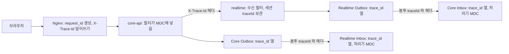
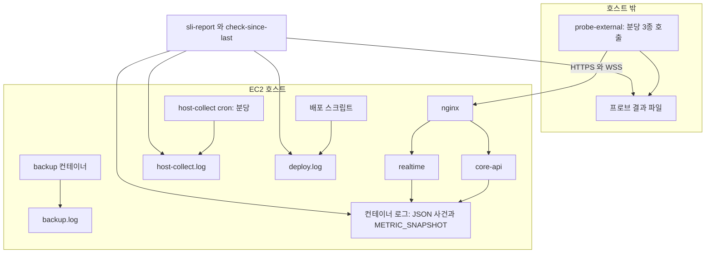

# 관측성 설계 — U1 u1-walking-skeleton

> 단계: Construction · NFR Design(3.3) · U1 u1-walking-skeleton · 깊이 Standard · 문서 observability-design.md (설계 ID 접두사 OD)
> 입력: `nfr-requirements/observability-requirements.md`(NFR4.14 · 4.15 · 5.4 · 6.5 · 9.15, 3.1 SLO · 3.2 경보 · 3.3 지표 · 3.4 로그 필드) · `performance-requirements.md`(NFR5.7) · `scalability-requirements.md`(NFR7.8) · `security-requirements.md`(NFR9.14) · `reliability-requirements.md`(5절 A1 ~ A6), `functional-design/{rules,entities}.md`, `nfr-design-questions.md`(Q6 · Q8 · Q9 · Q11), `contract-summary.md`(4.2 · 6절), `reliability-design.md`(키 표 · 시한 · 알고리즘)
> 날짜: 2026-10-09
> 대리 판단: 질문 파일의 답 Q1 ~ Q12는 팀장(준하)의 대리 판단(가정) J73 ~ J84다. 이 문서는 J78(Q6 관측)을 중심으로 J80(Q8 설정 키) · J81(Q9 시험 지원) · J83(Q11, 시각은 앱 Clock)을 쓴다. 요구 문서가 정한 필드 · 사건 코드 · 지표 이름은 바꾸지 않고, 더한 것은 '제안(3.5 확정)'으로 표시했다. 설정 키는 reliability-design.md `## 3`과 같은 이름 · 같은 값이다. 3.3 재점검 결정 R3-n 중 이 문서에 해당하는 것은 `## 5`의 '3.3 재점검 결정 R3-n' 행에 있다.
> 표기: 이 문서의 설계 ID는 OD-n이다. 요구 문서의 3.2 재점검 결정은 항상 '재점검 RD-n'으로 쓰고, reliability-design.md의 설계 요소는 `reliability-design.md RD-n`으로 쓴다(맨 RD-n을 쓰지 않는다). 3.3 재점검 결정은 'R3-n'으로 쓴다.

## 1. 설계 요소

| 설계 ID | 해결하는 NFRx.y | 패턴 · 결정 | 적용 위치(BR · 컴포넌트) | 근거 |
|---|---|---|---|---|
| OD-1 | NFR9.15, NFR9.14 | 로그 한 줄은 JSON 객체 하나이고 최상위는 여섯 필드(ts · level · traceId · component · event · ownerHash)와 attrs뿐이다. 키 순서 고정, message · 예외 · 스레드 같은 다른 최상위 키는 없다. attrs 값은 숫자 · 열거값(불리언 포함) · UTC 시각만이고 UUID는 EVENT_DELIVERY의 eventId 하나만 예외다 | BR8.7 · BR5.13 · BR8.10 · 공통 로깅 모듈 | NFR9.15 · 재점검 RD-6 |
| OD-2 | NFR9.15, NFR5.4, NFR4.14, NFR6.5, NFR9.14, NFR7.8 | 사건 코드 15종(요구 문서) + 2종(APP_ERROR · QUEUE_PRESSURE, 제안)마다 수준 · 발행 앱 · ownerHash 원천 · 허용 attrs 키를 표로 정한다. 표에 없는 키는 쓸 수 없다 | BR5.13 · BR6.1 · BR6.8 · BR4.8 · BR5.2 | 요구 문서 3.4 |
| OD-3 | NFR9.15 | 로그 위생 5겹: 코드별 열거형 키 API, 값 형식 검사, 제3자 로그를 APP_ERROR로 변환(메시지 · 스택 버림), 반복 병합, 금지 필드가 코드에 아예 없음. 위반은 형식 시험과 grep 시험이 막는다 | BR8.7 · BR5.13 | NFR9.8 · J78 |
| OD-4 | NFR9.15, NFR9.14 | ownerHash = HMAC-SHA-256(환경 변수 비밀, 소유 id)의 앞 12자 16진수. 사건별로 어느 id가 소유 id인지 표로 고정한다 | BR8.7 · SessionLifecycle · DeviceGateway | NFR9.10 · 요구 문서 3.4 |
| OD-5 | NFR4.14, NFR4.15, NFR6.5, NFR7.8, NFR9.14 | 지표 이름: Micrometer → Prometheus 형식 `mujoong_` 접두, 종류 · 라벨 값 목록을 표로 정한다. 라벨은 열거값만(id · 전사 · 토큰 · 코드 금지). 프레임워크 기본 지표는 이름을 그대로 쓴다 | NFR9.8 · 공통 지표 모듈 | J78 · 요구 문서 3.3 |
| OD-6 | NFR7.8, NFR4.15 | METRIC_SNAPSHOT 60초: 재시작하면 0이 되는 지표 값을 로그로 옮긴다. 게이지는 시점 값, 카운터는 직전 스냅샷 이후 증가분, 최댓값은 구간 최댓값으로 정의한다 | maintenance 스케줄러 · SLI 계산 | 재점검 RD-14 |
| OD-7 | NFR5.7 | traceId 전파: 헤더 `X-Trace-Id`, 32자 소문자 16진수, Nginx의 `$request_id`를 덮어써 받고 내부 호출 · Outbox 열 · 이벤트 봉투 선택 필드 · Inbox 열 · 처리기 MDC까지 같은 id를 잇는다. Outbox/Inbox 네 표에 `trace_id` 열을 더한다(A3) | BR8.6 · BR5.4 · BR5.13 · BR6.5 ~ BR6.7 · CoreMessaging · RealtimeMessaging | J78 · A3 |
| OD-8 | NFR5.4 | 지연 측정 로그: 턴 맥락이 시각을 모아 턴 끝에 LATENCY_TURN 한 줄, 12 응답에 처음 실린 행마다 SESSION_ITEMS_SERVED 한 줄. 미관측은 키를 비우고 사유를 남기며 시각을 만들지 않는다. 한 턴 로그만으로 NFR5.1 · 5.2 · 5.3을 계산하는 스크립트를 설계한다 | BR7.1 ~ BR7.5 · BR6.15 · VoiceRelay · OutputGate · SessionLifecycle | 재점검 RD-3 · 재점검 RD-4 · 재점검 RD-5 |
| OD-9 | NFR4.14 | 종료 결과 가시성: 전이를 이긴 쪽만 `mujoong_session_ended_total`과 SESSION_TRANSITION을 남기고 origin 라벨(REALTIME · CORE_LOCAL · CORE_ABANDONED)로 이중 집계를 막는다 | BR6.7 · BR6.8 · BR6.12 · BR6.14 · BR6.17 | NFR4.14 |
| OD-10 | NFR6.5 | 시한 발동 지표: 전이를 이긴 시한만 `mujoong_timeout_fired_total{type}`과 TIMEOUT_FIRED를 남긴다. stale은 '신선 → 확인 불가'로 바뀌는 첫 판정만 센다(Core 메모리 래치) | BR6.12 · BR4.3 · BR6.15 | NFR6.5 · reliability-design.md RD-3 · reliability-design.md RD-6 |
| OD-11 | NFR4.15 | 헬스 그룹: liveness(프로세스) · readiness(DB + 이력 버전 확인 + JPA validate + 시작 복구) · 상세(운영 점검용). 관리 포트의 Actuator는 외부에 없고, 프로브용 `/api/health` 한 경로만 Nginx가 외부에 연다 | BR8.9 · BR8.1 | 재점검 RD-8 |
| OD-12 | NFR7.8 | 용량 지표 7종을 지표 이름에 매핑한다(JVM 힙 · GC · 스레드 · 열린 WSS · 풀 활성 · 대기 · Outbox 미전달 · 가장 오래된 PENDING 나이) | BR5.2 · BR5.13 | NFR7.8 |
| OD-13 | NFR9.14 | 보안 사건 5종: 발생 지점마다 사건 코드 한 줄 + `mujoong_security_event_total{type}` 증가. 개인정보 없음, 같은 사건 반복은 병합 | BR8.5 · BR1.6 · BR2.6 · BR3.6 · BR3.9 · BR8.3 | NFR9.14 |
| OD-14 | NFR4.15, NFR4.8 | 외부 프로브(호스트 밖, 분당 3종)와 호스트 수집기(호스트 안, 분당)의 역할을 가른다. 가용성 SLI는 외부 프로브 결과만으로 계산하고 호스트 수집기는 원인 파악 · 수동 점검용이다 | BR8.9 · Nginx · 프로브 스크립트 | J78 · 재점검 RD-8 |
| OD-15 | NFR7.8, NFR4.14 | 수동 점검표: 하루 2회, 마지막 점검 이후 최댓값으로 4기준(WARN 5분 창 · PENDING 나이 · FAILED · 풀 대기)과 보조 기준을 읽는다. 읽기 스크립트 알고리즘을 정한다 | J68 | J68 · 재점검 RD-14 |
| OD-16 | NFR9.15 | 로그 보관: Compose json-file `max-size` × `max-file`을 컨테이너별 일일 로그량 추정으로 계산하고 Nginx 접근 로그의 폴링 2xx를 제외한다 | BR8.7 · Compose | 재점검 RD-8 |
| OD-17 | NFR5.4, NFR4.14 | SLI 계산 스크립트: SLO 표의 '계산 출처' 열을 입력으로 모든 SLI를 채우고 표본 규칙(100 이상 p95, 10 ~ 99는 90% 규칙, 10 미만은 보류)을 적용해 경보선과 비교한다 | 요구 문서 3.1 | 재점검 RD-13 |

## 2. 설계 상세

### 2.1 로그 JSON 스키마 (OD-1)

한 줄 = JSON 객체 하나(줄바꿈 없음, UTF-8). 키 순서는 아래 순서로 고정한다.

| 필드 | 형식 | 규칙 | 원천 |
|---|---|---|---|
| ts | ISO 8601 UTC, 밀리초, 끝 `Z` (예 `2026-10-09T01:02:03.456Z`) | 사건이 일어난 시각. BR8.10 | 주입된 Clock(시험에서 고정 가능). 제3자 로그는 로깅 이벤트 시각 |
| level | `ERROR` · `WARN` · `INFO` · `DEBUG` | demo는 INFO 이상만 출력. WARN 이상이 수동 점검의 첫 입력 | 사건 코드별 수준(2.2절) |
| traceId | 32자 소문자 16진수 | 항상 값이 있다. 요청 안에서는 요청 traceId, 작업(주기 · 시작 복구 · 타이머)은 실행마다 새로 만들고, 세션 사건은 세션 traceId(2.7절) | MDC |
| component | `<앱>/<컴포넌트>` 열거 | 앱은 `core-api` 또는 `realtime`. 컴포넌트는 U1 목록: Core = DeviceRegistry · CoreMessaging · ActivityCoordinator · Security · Health · Maintenance, Realtime = SessionLifecycle · DeviceGateway · VoiceRelay · OutputGate · RealtimeMessaging · Maintenance. 후속 유닛이 목록에 더한다 | 발행 지점 |
| event | 사건 코드 열거 | 2.2절의 코드. 이 값으로 attrs 허용 키가 정해진다 | 발행 지점 |
| ownerHash | 16진 12자 또는 `null` | 소유 id의 HMAC(2.4절). 소유 id가 없으면 `null` | 로깅 모듈 |
| attrs | 객체 | 사건 코드별 허용 키 표(2.2절)의 키만. 값이 없는 키는 아예 쓰지 않는다 | 발행 지점 |

attrs 값 형식은 네 가지뿐이다.

| 형식 | 예 | 규칙 |
|---|---|---|
| 숫자 | `3`, `-120`, `412` | 정수(건수 · 밀리초 · 코드 · 퍼센트). 소수는 쓰지 않는다 |
| 열거값 | `"ACTIVE"`, `true` | 대문자 영문 · 숫자 · 밑줄로 등록된 집합의 값. 불리언은 열거값의 하나로 본다. 등록되지 않은 값은 `UNKNOWN`으로 바꿔 쓴다 |
| UTC 시각 | `"2026-10-09T01:02:03.456Z"` | ts와 같은 형식. 기기 시계 값(tDeviceObserved 등)도 같은 형식 |
| UUID | `"3f2a..."` | `EVENT_DELIVERY`의 `eventId` 하나만 허용한다(BR5.13이 남기라고 한 값) |

없는 것: 전사 원문 · 원음 · 토큰 · 쿠키 값 · 등록 코드 · 보호자 입력 원문 · 비밀 · 이메일 · 자유 문자열 필드. 이것들은 허용 표에 키 자체가 없다(NFR9.8의 '앞 4자만'은 `codePrefix` 키가 허용 표에 더해질 때만 가능하고 U1 표에는 없다).

### 2.2 사건 코드 표와 attrs 허용 키 (OD-2)

수준 열의 괄호는 예외 규칙이다. `†`는 이 설계가 요구 문서에 더한 것이다(더하기만 하며 기존 이름 · 키는 그대로).

| 사건 코드 | 수준 | 발행 앱 | ownerHash 원천 | 허용 attrs 키 | 요구 |
|---|---|---|---|---|---|
| SESSION_TRANSITION | INFO (FAILED · ABORTED · ENDED_UNCONFIRMED로 가는 전이는 WARN) | realtime, Core 로컬 FAILED는 core-api | sessionId | from · to · statusVersion · endReason · failureCode · confirmed · phase · origin | NFR4.14 |
| TIMEOUT_FIRED | WARN | realtime(device_ack · closing_confirm · disconnect), core-api(preparing · device_status_stale) | sessionId (device_status_stale은 deviceId) | type · thresholdMs · elapsedMs | NFR6.5 |
| LATENCY_TURN | INFO | realtime | sessionId | turnSeq · tSpeechEnd · tSpeechEndSource · tProviderFirstOut · tSegmentConfirmed · tGatePass · tFirstFrameSent · tDevicePlayStart · tDevicePlayStartRecv · clockOffsetMs · rttMs · tTranscriptFinal · relayInMs · relayOutMs · providerResponseMs · quietWaitMs · unobservedReason† | NFR5.4 |
| SESSION_ITEMS_SERVED | INFO | realtime | sessionId | seq · speaker · tTranscriptFinal · tViewItemReady · tViewItemFirstServed | NFR5.4 · NFR5.3 |
| PLAYBACK_MARK_STOPPED | INFO | realtime | sessionId | stopCause · tDeviceObserved · tServerRecv · clockOffsetMs · rttMs | NFR5.8 |
| DEVICE_CONNECTION | INFO (DISCONNECTED · UNRESPONSIVE로 가는 전이는 WARN) | realtime | deviceId | from · to · closeCode | NFR4.15 |
| INTERNAL_HTTP | INFO (실패 · 회로 차단기 거절은 WARN) | 양 앱(호출하는 쪽) | 호출이 세션 · 기기 하나에 묶이면 그 id, 아니면 null | target · outcome · statusCode · durationMs · attempt · repeat† | NFR4.15 |
| EVENT_DELIVERY | INFO (FAILED · DEAD · EVENT_CONFLICT는 WARN) | 양 앱 | aggregate_id | eventId · eventType · status · retryCount · durationMs | NFR7.8 · BR5.13 |
| STARTUP_RECOVERY | INFO | 양 앱 | null | recoveredSessions · reopenedInboxRows · resetConnections · rearmedControlEvents | NFR4.7 |
| METRIC_SNAPSHOT | INFO | 양 앱 | null | outboxPending · outboxOldestPendingSec · outboxFailed · inboxDead · poolActive · poolWaitMaxMs · poolWaitExceeded · openConnections · restTotal · restLe300Ms · viewTotal · viewLe500Ms · viewFallback · sysCpuAvgPct · sysMemMaxPct · heapUsedPct · sessionsActive† · breakerOpenSec† | NFR7.8 |
| SECURITY_AUTH_FAILED | WARN. 쿠키가 아예 없는 WSS 업그레이드만 INFO(카운터는 올린다) | 양 앱 | 알면 guardianId 또는 deviceId, 모르면 null | kind · statusCode · repeat† | NFR9.14 |
| SECURITY_RATE_LIMITED | WARN | core-api | null | limiter · statusCode · repeat† | NFR9.14 |
| SECURITY_ORIGIN_DENIED | WARN | realtime(WSS), core-api(REST) | null | channel · statusCode · closeCode · repeat† | NFR9.14 |
| SECURITY_DEV_LOGIN_BLOCKED | WARN | core-api | null | profile · statusCode · repeat† | NFR9.14 |
| SECURITY_INTERNAL_TOKEN_FAILED | WARN | 양 앱 | null | direction · statusCode · repeat† | NFR9.14 |
| APP_ERROR† | ERROR (제3자 WARN은 WARN) | 양 앱 | null | errorKind · repeat | NFR9.15 |
| QUEUE_PRESSURE† | WARN (기록기 거절은 ERROR) | realtime | sessionId | queue · dropped · repeat | NFR7.8 |

APP_ERROR(열여섯째)와 QUEUE_PRESSURE(열일곱째)는 요구 문서의 사건 코드 15종에 더하는 제안이다. APP_ERROR의 이유는 2.3절 3번이고, QUEUE_PRESSURE는 성능 설계 PD가 정한 대기열 넘침(입력 프레임 버림 · 일반 편지함 · 출력 레인 · 기록기 거절)을 세션당 초당 1회 이하 WARN 한 줄로 남기는 자리다(기록기 거절은 ERROR). 형식 시험은 17종을 모두 주입한다. APP_ERROR의 허용 키는 errorKind(와 repeat)뿐이다. SQLState 같은 DB 오류 코드는 남기지 않는다(R3-11: 예외는 errorKind만, 보안 설계와 같은 해석).

attrs 키의 형식과 열거(열거 집합은 사건 코드별이며 같은 키 이름이라도 사건마다 다를 수 있다):

| attrs 키 | 형식 | 값 범위 | 쓰는 사건 |
|---|---|---|---|
| from · to (세션) | 열거 | NONE(from만, Core의 REQUESTED 생성) · REQUESTED · PREPARING · DEVICE_ACK · ACTIVE · CLOSING · ENDED · ENDED_UNCONFIRMED · ABORTED · FAILED (U4가 WAITING_CHILD · DECLINED를 더함) | SESSION_TRANSITION |
| from · to (연결) | 열거 | OFFLINE · CONNECTED · UNSTABLE · DISCONNECTED · UNRESPONSIVE | DEVICE_CONNECTION |
| statusVersion | 숫자 | 0 이상 | SESSION_TRANSITION |
| endReason | 열거 | GUARDIAN_STOP · CHILD_STOP · SILENCE · DISCONNECT · CONSENT_WITHDRAWN · UNCONFIRMED · DECLINED · FAILED | SESSION_TRANSITION |
| failureCode | 열거 | DEVICE_NO_ACK · SCENARIO_GEN_FAILED · PROVIDER_UNAVAILABLE · SERVER_RESTART (없으면 키 생략) | SESSION_TRANSITION |
| confirmed | 불리언 | true · false | SESSION_TRANSITION |
| phase | 열거 | START(ACTIVE 전에 끝난 세션) · RUNNING | SESSION_TRANSITION |
| origin | 열거 | REALTIME · CORE_LOCAL · CORE_ABANDONED | SESSION_TRANSITION |
| type | 열거 | PREPARING · DEVICE_ACK · CLOSING_CONFIRM · DISCONNECT · DEVICE_STATUS_STALE | TIMEOUT_FIRED |
| thresholdMs · elapsedMs | 숫자 | 설정한 시한 · 실제 경과(밀리초) | TIMEOUT_FIRED |
| turnSeq · seq | 숫자 | 1 이상 (세션 안 턴 번호 · 전사 행 번호) | LATENCY_TURN · SESSION_ITEMS_SERVED |
| tSpeechEnd · tProviderFirstOut · tSegmentConfirmed · tGatePass · tFirstFrameSent · tDevicePlayStartRecv · tTranscriptFinal · tViewItemReady · tViewItemFirstServed · tServerRecv | UTC 시각 | 서버 시계 | LATENCY_TURN · SESSION_ITEMS_SERVED · PLAYBACK_MARK_STOPPED |
| tDevicePlayStart · tDeviceObserved | UTC 시각 | 기기 시계(서버 시계로 환산하지 않은 원값) | LATENCY_TURN · PLAYBACK_MARK_STOPPED |
| tSpeechEndSource | 열거 | PROVIDER_EVENT · INPUT_TRANSCRIPT_FINAL · LAST_INPUT_FRAME | LATENCY_TURN |
| clockOffsetMs | 숫자 | 기기 시계 − 서버 시계(음수 가능) | LATENCY_TURN · PLAYBACK_MARK_STOPPED |
| rttMs | 숫자 | 0 이상 | LATENCY_TURN · PLAYBACK_MARK_STOPPED |
| relayInMs · relayOutMs · providerResponseMs · quietWaitMs | 숫자 | 0 이상(밀리초) | LATENCY_TURN |
| unobservedReason† | 열거 | NO_OUTPUT · GATE_DISCARD · NO_PLAYBACK_MARK · SESSION_ENDED_EARLY · CLOCK_OFFSET_MISSING (미관측이 있을 때만) | LATENCY_TURN |
| speaker | 열거 | CHILD · AI | SESSION_ITEMS_SERVED |
| stopCause | 열거 | 계약 4.2의 stopCause 값(U1은 LOCAL_VOICE_ACTIVITY) | PLAYBACK_MARK_STOPPED |
| closeCode | 숫자 | WSS 닫기 코드(1000 · 1001 · 1006 · 1011 · 1013 · 4001 · 4400 · 4401 · 4408) | DEVICE_CONNECTION · SECURITY_ORIGIN_DENIED |
| target | 열거 | SESSION_START · SESSION_END · SESSION_VIEW · VERIFY_TOKEN · DEVICE_STATUS · EVENT_PUBLISH | INTERNAL_HTTP |
| outcome | 열거 | OK · TIMEOUT · CONN_ERROR · HTTP_4XX · HTTP_5XX · BREAKER_OPEN†(target SESSION_START에서만) | INTERNAL_HTTP |
| statusCode | 숫자 | HTTP 상태 코드(없으면 키 생략) | INTERNAL_HTTP · SECURITY_* |
| durationMs | 숫자 | 0 이상 | INTERNAL_HTTP · EVENT_DELIVERY |
| attempt | 숫자 | 1 이상(시작 호출의 재시도는 2) | INTERNAL_HTTP |
| repeat† | 숫자 | 1 이상. 병합 창 안에 같은 사건이 더 있었던 건수(첫 줄에 붙임) | INTERNAL_HTTP · SECURITY_* · APP_ERROR |
| eventId | UUID | 이벤트 id | EVENT_DELIVERY |
| eventType | 열거 | DeviceReleased · DeletionRequested · SessionStateChanged · SessionRecordCaptured · DeviceStatusChanged · DeletionCompleted | EVENT_DELIVERY |
| status | 열거 | PUBLISHED · RETRY · FAILED · REARMED · PROCESSED · HANDLER_RETRY · DEAD · IGNORED · DUPLICATE · EVENT_CONFLICT | EVENT_DELIVERY |
| retryCount | 숫자 | 0 ~ 20 | EVENT_DELIVERY |
| recoveredSessions · reopenedInboxRows · resetConnections · rearmedControlEvents | 숫자 | 0 이상 | STARTUP_RECOVERY |
| METRIC_SNAPSHOT 키 전부 | 숫자 | 정의는 2.6절 | METRIC_SNAPSHOT |
| kind | 열거 | GUARDIAN_SESSION · DEVICE_TOKEN · REGISTER_CODE(400 · 404 · 409로 끝난 등록 요청 모두) | SECURITY_AUTH_FAILED |
| limiter | 열거 | BOOTSTRAP_IP · REGISTER_FAILURE | SECURITY_RATE_LIMITED |
| channel | 열거 | WSS · REST | SECURITY_ORIGIN_DENIED |
| profile | 열거 | DEV · DEMO · PROD | SECURITY_DEV_LOGIN_BLOCKED |
| direction | 열거 | CORE_TO_REALTIME · REALTIME_TO_CORE | SECURITY_INTERNAL_TOKEN_FAILED |
| errorKind† | 식별자 형식 | 예외 클래스 단순 이름 패턴 `[A-Za-z][A-Za-z0-9_.$]{0,99}`. 예외 메시지 · 스택은 버린다 | APP_ERROR |
| queue† | 열거 | INPUT_FRAMES · GENERAL_MAILBOX · OUTPUT_AUDIO · OUTPUT_CONTROL · RECORDER | QUEUE_PRESSURE |
| dropped† | 숫자 | 구간 동안 버리거나 거절한 건수 | QUEUE_PRESSURE |

EVENT_DELIVERY 수준 규칙: PUBLISHED · RETRY · PROCESSED · IGNORED는 INFO, FAILED · DEAD · EVENT_CONFLICT는 WARN, 수신 중복(DUPLICATE)과 처리기 재호출(HANDLER_RETRY)은 DEBUG라 demo에서는 나오지 않고 지표로만 본다. 재시도 폭주가 수동 점검의 WARN 기준을 흔들지 않게 RETRY를 INFO로 둔다(PENDING 나이 경보가 이 상황을 잡는다).

INTERNAL_HTTP 기록 규칙(로그 폭주 방지): 성공은 session_start · session_end · verify_token만 INFO로 남긴다. session_view(2초 폴링)와 device_status(10초 보고)와 event_publish의 성공은 지표만 올리고 줄을 남기지 않는다(event_publish 성공은 EVENT_DELIVERY가 대신한다). 실패는 모두 WARN 한 줄이다.

### 2.3 로그 위생 장치 (OD-3)

| 번호 | 장치 | 내용 | 막는 것 |
|---|---|---|---|
| 1 | 열거형 키 API | 로그는 `사건 코드별 키 집합`을 가진 타입 있는 호출로만 남긴다. 자유 문자열 매개변수가 없다. 허용 표에 없는 키는 컴파일되지 않거나 시험 프로필에서 예외다. 운영에서는 키를 버리고 `mujoong_log_invalid_attr_total{event}`를 올리고 APP_ERROR를 한 줄 남긴다 | 허용 표 밖 키 |
| 2 | 값 형식 검사 | 열거 필드는 등록 집합 검사(미등록은 UNKNOWN), 숫자는 정수, 시각은 ISO 형식, 줄바꿈 · 따옴표 이스케이프는 인코더가 처리 | 형식 이탈, 자유 문자열 |
| 3 | 제3자 로그 변환 | 프레임워크 · 라이브러리 로그(Spring · Hibernate · Tomcat · 공급자 클라이언트)는 루트 로거 WARN 이상만 받아 APP_ERROR로 바꾼다. 로그 메시지 · 예외 메시지 · 스택은 버리고 `errorKind`(예외 클래스 이름)만 남긴다. 사건 전용 로거(이름 `MUJOONG_EVENT`)만 INFO | 라이브러리가 찍는 SQL 매개변수 · 요청 본문 · 전사 |
| 4 | 반복 병합 | 병합 대상(INTERNAL_HTTP 실패, SECURITY_* 5종, APP_ERROR)은 같은 사건 · 같은 식별 attrs가 `mujoong.observability.log-merge-window`(10초) 안에 반복되면 첫 줄만 쓰고 창이 끝날 때 `repeat`를 붙인 한 줄로 합친다. 보안 사건 5종은 병합 뒤에도 type · 앱당 분당 `mujoong.security.event-log-rate-cap`(60줄)을 넘으면 더 쓰지 않고 지표만 센다(보안 설계 SD, 서로 다른 식별 attrs의 폭주 방지). 지표는 실제 건수를 센다 | 장애 중 로그 폭주 |
| 5 | 금지 필드 부재 | 전사 · 원음 · 토큰 · 쿠키 · 등록 코드 · 보호자 입력 · 비밀 · 이메일을 담을 수 있는 키가 어느 사건에도 없다. 요청 본문을 찍는 디버그 로그는 만들지 않고 DEBUG는 운영에서 끈다 | NFR9.8 |

참고: 컨테이너 표준 출력의 JVM 시작 줄(`JAVA_TOOL_OPTIONS` 알림 등)은 앱 로거가 아니므로 형식 시험 대상이 아니다. 값에 비밀이 없는지만 grep 시험이 본다. 병합 창 안의 줄 수는 `1 + repeat`로 센다(수동 점검 스크립트의 계산 규칙, 2.10절).

### 2.4 ownerHash (OD-4)

| 항목 | 규칙 |
|---|---|
| 계산 | `HMAC-SHA-256(mujoong.observability.owner-hash-secret, 소유 id의 UTF-8)`의 16진 앞 12자(48비트). 되돌릴 수 없고 두 앱이 같은 비밀을 쓰므로 같은 소유자는 두 앱에서 같은 값이다 |
| 비밀 | 환경 변수. demo · prod에서 비어 있으면 기동 실패(S1). dev는 프로세스마다 임시 무작위 값. 값은 문서 · 저장소 · 로그에 없다 |
| 소유 id 원천 | 2.2절 표의 열. 세션 사건 = sessionId, 연결 · 기기 사건 = deviceId, 메시징 사건 = aggregate_id, 인증된 보안 사건 = guardianId 또는 deviceId, 소유자가 없는 사건 = null |
| 지표 라벨 | ownerHash는 지표 라벨이 될 수 없다(무한 카디널리티) |
| 충돌 | 시연 규모(수천 id)에서 48비트 충돌 확률은 무시할 수 있다 |

### 2.5 지표 이름 표 (OD-5)

규칙: Micrometer의 점 표기 이름(세션 종료 카운터는 session.ended 앞에 mujoong 접두)은 Prometheus 형식에서 `mujoong_session_ended_total`(카운터), `mujoong_..._seconds`(타이머 · 히스토그램)가 된다. 수집기는 두지 않고 관리 포트(3.4 확정 9090)의 `/actuator/prometheus`를 스크립트가 긁는다. 라벨 값은 아래 열거 목록 안의 소문자 밑줄 표기다(로그의 대문자 열거와 같은 집합). 라벨 위생: id · 전사 · 토큰 · 코드 · ownerHash는 라벨이 될 수 없다(NFR9.8).

| 이름 | 종류 | 라벨(값) | 발행 앱 | 요구 | 비고 |
|---|---|---|---|---|---|
| `mujoong_session_ended_total` | 카운터 | status(ended · ended_unconfirmed · aborted · failed) · end_reason(guardian_stop · unconfirmed · disconnect · failed) · failure_code(device_no_ack · provider_unavailable · server_restart · none) · phase(start · running) · origin(realtime · core_local · core_abandoned) | realtime, Core 로컬 FAILED는 core-api | NFR4.14 | 전이를 이긴 쪽만 센다(2.9절) |
| `mujoong_session_activated_total` | 카운터 | 없음 | realtime | NFR4.14 | 시작 성공률 분자 |
| `mujoong_session_start_to_active_seconds` | 히스토그램 | 없음 | realtime | NFR4.14 | 버킷 1 · 2 · 4 · 6 · 8 · 10 · 15 · 20초 (제안) |
| `mujoong_timeout_fired_total` | 카운터 | type(preparing · device_ack · closing_confirm · disconnect · device_status_stale) | preparing · device_status_stale = core-api, 나머지 = realtime | NFR6.5 | 전이를 이긴 시한만 센다 |
| `mujoong_internal_http_requests_total` | 카운터 | target(session_start · session_end · session_view · verify_token · device_status · event_publish) · outcome(ok · timeout · conn_error · http_4xx · http_5xx · breaker_open†) | 호출하는 쪽 양 앱 | NFR4.15 | 4xx 업무 응답도 http_4xx로 센다(차단기는 성공으로 봄). breaker_open은 target session_start에서만 나온다(차단기는 그 호출 하나에만 있다, R3-2) |
| `mujoong_internal_http_seconds` | 타이머 | target | 호출하는 쪽 양 앱 | NFR4.15 | |
| `mujoong_internal_http_breaker_state`† | 게이지 | group(core_to_realtime) | core-api | NFR4.15 | 0 닫힘 · 1 반열림 · 2 열림. Core → Realtime session_start 호출 하나에 있는 차단기의 상태다. Realtime → Core 보고 루프는 차단기가 아니라 라운드 건너뛰기 규칙이라 상태 게이지가 없고 실패는 target device_status의 outcome으로 센다(R3-2) |
| `mujoong_device_connections_open` | 게이지 | 없음 | realtime | NFR4.15 · NFR7.8 | 열린 WSS 연결 수(소켓 레지스트리 크기) |
| `mujoong_device_connection_state` | 게이지 | state(offline · connected · disconnected · unresponsive) | realtime | NFR4.15 | 기기 수 분포. UNSTABLE은 U3가 값을 더함 |
| `mujoong_outbox_pending` | 게이지 | direction(core_to_realtime · realtime_to_core) | 양 앱(자기 Outbox) | NFR7.8 | PENDING 건수 |
| `mujoong_outbox_oldest_pending_seconds` | 게이지 | direction | 양 앱 | NFR7.8 | 가장 오래된 PENDING의 now − created_at, 없으면 0 (선점으로 밀린 available_at과 무관) |
| `mujoong_outbox_failed` | 게이지 | direction | 양 앱 | NFR4.14 | 현재 FAILED 행 수 |
| `mujoong_inbox_dead` | 게이지 | direction(들어오는 방향) | 양 앱(자기 Inbox) | NFR4.14 | 현재 DEAD 행 수 |
| `mujoong_event_delivery_seconds` | 히스토그램 | event_type | 받는 앱 | NFR7.8 | occurredAt → PROCESSED. 버킷 0.1 · 0.25 · 0.5 · 1 · 2 · 5 · 10 · 30 · 60 · 300초 (제안) |
| `mujoong_relay_in_seconds` | 히스토그램 | 없음 | realtime | NFR5.4 | 프레임별 분포. 버킷 0.01 · 0.025 · 0.05 · 0.1 · 0.2 · 0.3 · 0.5 · 1초 (제안) |
| `mujoong_relay_out_seconds` | 히스토그램 | 없음 | realtime | NFR5.4 | 턴별 값(구간 확정 → 기기 첫 프레임 송신), 같은 버킷 |
| `mujoong_turn_first_audio_seconds` | 히스토그램 | 없음 | realtime | NFR5.4 | t0 → t3(서버 시계 환산). 버킷 0.5 · 1 · 1.5 · 2 · 2.5 · 3 · 4 · 6 · 10초 (제안) |
| `mujoong_view_item_ready_seconds` | 히스토그램 | speaker(child · ai) | realtime | NFR5.4 | tTranscriptFinal → tViewItemReady |
| `mujoong_session_view_fallback_total` | 카운터 | 없음 | core-api | NFR4.15 | 12 조회가 Realtime 호출 실패(연결 거부 · 시간 초과 · 5xx)로 사본으로 답한 횟수. session_view에는 차단기가 없다 |
| `mujoong_db_pool_wait_exceeded_total` | 카운터 | 없음 | 양 앱 | NFR7.8 | 풀 연결 획득이 `mujoong.metrics.db-pool-wait-warn`(100ms)을 넘은 횟수(연결 획득 시간을 재는 DataSource 감싸개, 3.5) |
| `mujoong_security_event_total` | 카운터 | type(auth_failed · rate_limited · origin_denied · dev_login_blocked · internal_token_failed) | 양 앱 | NFR9.14 | 보안 사건 코드와 1:1 |
| `mujoong_health_up`† | 게이지 | group(liveness · readiness) | 양 앱 | NFR4.15 | 1 정상 · 0 아님. 가드레일의 '앱마다 헬스 지표 1개' |
| `mujoong_sessions_active`† | 게이지 | 없음 | realtime | NFR7.8 | 동시 활성 세션 수(상한 설정은 두지 않고 지표로만 본다, J76) |
| `mujoong_input_frames_dropped_total`† | 카운터 | 없음 | realtime | NFR7.8 | 입력 대기열(50프레임)이 넘쳐 오래된 프레임을 버린 수(성능 설계 PD) |
| `mujoong_gate_discard_total`† | 카운터 | reason(gate_empty · gate_pattern · not_active · segment_oversize · outbound_full · recorder_degraded) · category(diagnosis · treatment · score · cause · generalization · emotion_claim · pressure · none) | realtime | NFR9.14 | 게이트가 구간을 폐기한 수. 전사 · 일치 문구는 라벨이 아니다(보안 설계 SD 요청). not_active는 보안 설계 출력 게이트 순서의 단계 6에서만 판정한다 |
| `mujoong_recorder_rejected_total`† | 카운터 | 없음 | realtime | NFR7.8 | 기록기 칸 목록 200행이 가득 차 새 행을 거절한 수. 0이 아니면 DB 장기 장애 신호 |
| `mujoong_queue_depth`† | 게이지 | queue(session_mailbox · output_audio · output_control · recorder) | realtime | NFR7.8 | 대기열 깊이 |
| `mujoong_rate_limiter_evictions_total`† | 카운터 | limiter(bootstrap_ip · register_failure) | core-api | NFR9.14 | 키 수 상한(10,000)으로 한도기 카운터를 밀어낸 수(보안 설계 SD 요청) |
| `mujoong_rate_limiter_errors_total`† | 카운터 | limiter | core-api | NFR9.14 | 한도기 내부 오류로 요청을 통과시킨 수. 사건은 APP_ERROR(WARN)로도 남는다 |
| `mujoong_log_invalid_attr_total`† | 카운터 | event(사건 코드 17종) | 양 앱 | NFR9.15 | 허용 표 밖 키를 버린 횟수 |
| `http_server_requests_seconds` | 히스토그램 | method · uri(경로 템플릿) · status · outcome | 양 앱 | NFR4.15 | 프레임워크 기본. 원시 경로 · id 금지. SLO 버킷 100 · 300 · 500 · 1000ms(성능 요구 문서의 제안). 오류율 = 5xx 비율 |
| `jvm_*` · `hikaricp_*` · `system_*` · `process_*` | 프레임워크 기본 | — | 양 앱 | NFR7.8 | 아래 매핑 표 |

NFR7.8 용량 지표 7종 매핑(OD-12):

| 용량 지표 | 지표 이름 | 앱 |
|---|---|---|
| JVM 힙 | `jvm_memory_used_bytes{area="heap"}` · `jvm_memory_max_bytes` | 양 앱 |
| GC 정지 | `jvm_gc_pause_seconds` | 양 앱 |
| 스레드 수 | `jvm_threads_live_threads` | 양 앱 |
| 열린 WSS 연결 수 | `mujoong_device_connections_open` | realtime |
| 풀 활성 · 대기 | `hikaricp_connections_active` · `hikaricp_connections_pending` · `hikaricp_connections_acquire_seconds` | 양 앱 |
| Outbox 미전달 건수 | `mujoong_outbox_pending` | 양 앱 |
| 가장 오래된 PENDING 나이 | `mujoong_outbox_oldest_pending_seconds` | 양 앱 |

NFR4.15 매핑: 앱 헬스 = `mujoong_health_up`, DB 연결 = `hikaricp_connections_*`와 readiness의 db 구성, 열린 기기 연결 수 = `mujoong_device_connections_open`, 기기별 연결 상태 분포 = `mujoong_device_connection_state`, 내부 HTTP 실패율 = `mujoong_internal_http_requests_total{outcome != ok}` 비율.

### 2.6 METRIC_SNAPSHOT 설계 (OD-6)

지표 값은 프로세스 메모리 값이라 재시작하면 0이 된다. 앱의 maintenance 스케줄러가 `mujoong.observability.metric-snapshot-interval`(60초)마다 값 열여덟 개를 INFO 한 줄로 남기고, 이 줄이 SLI 계산의 정본이다. 정상 종료 때(reliability-design.md 2.8절 T5 직후) 마지막 한 줄을 더 남긴다.

| 키 | 의미 | 값 규칙(구간 = 직전 스냅샷 이후) | 앱 |
|---|---|---|---|
| outboxPending | PENDING 건수 | 시점 값 | 양 앱 |
| outboxOldestPendingSec | 가장 오래된 PENDING의 나이(초) | 시점 값, 없으면 0 | 양 앱 |
| outboxFailed · inboxDead | 현재 FAILED · DEAD 행 수 | 시점 값 | 양 앱 |
| poolActive | 풀 사용 연결 수 | 구간 최댓값 | 양 앱 |
| poolWaitMaxMs | 풀 연결 획득 대기 최댓값 | 구간 최댓값 | 양 앱 |
| poolWaitExceeded | 대기 100ms 초과 횟수 | 구간 증가분 | 양 앱 |
| openConnections | 열린 WSS 연결 수 | 시점 값 | realtime |
| restTotal · restLe300Ms | 보호자 · 기기 REST 요청 수 · 서버 처리 300ms 이내 수 | 구간 증가분. 정적 파일 · 헬스 · 지표 · WSS · 내부 호출 제외 | core-api |
| viewTotal · viewLe500Ms | 12 진행 조회 요청 수 · 500ms 이내 수 | 구간 증가분 | core-api |
| viewFallback | 12 조회가 사본으로 답한 횟수 | 구간 증가분 | core-api |
| sysCpuAvgPct · sysMemMaxPct | 컨테이너가 보는 CPU 평균 · 메모리 최댓값 퍼센트 | 앱 안 5초 표본의 구간 평균 · 최댓값 | 양 앱 |
| heapUsedPct | 힙 사용 비율 | 시점 값 | 양 앱 |
| sessionsActive† | 동시 활성 세션 수 | 시점 값 | realtime |
| breakerOpenSec† | 회로 차단기가 열려 있던 초 | 구간 합 | core-api |

판정 규칙: REST p95 300ms 이하 ⇔ `restLe300Ms ÷ restTotal ≥ 95%`, 12 조회 p95 500ms 이하 ⇔ `viewLe500Ms ÷ viewTotal ≥ 95%`. 재시작 직후 첫 줄은 부분 구간이다. 값에 개인정보가 없고 모두 숫자다. Core에서 의미 없는 키(openConnections · sessionsActive 등)는 쓰지 않는다. 컨테이너 안에서 본 CPU · 메모리는 호스트 전체와 다를 수 있어 11/2 측정은 호스트 수집 스크립트 값을 정본으로 하고 스냅샷은 추세용이다(요구 문서 해석).

### 2.7 traceId 전파 설계 (OD-7)

결정:

| 항목 | 결정 | 이유 |
|---|---|---|
| 내부 HTTP 헤더 이름 | `X-Trace-Id` | 수집기가 없어 id 문자열 하나면 된다. W3C `traceparent`는 span id · 샘플링 플래그가 필요 없다 |
| 형식 | 32자 소문자 16진수(`^[0-9a-f]{32}$`) | W3C trace-id와 같은 길이라 나중에 수집기를 붙일 때 `traceparent`를 더해도(더하기만) 그대로 변환된다. Nginx `$request_id`와 같은 형식 |
| 생성 | Nginx가 `proxy_set_header X-Trace-Id $request_id`로 덮어써 넘긴다(클라이언트가 보낸 값은 버림). Nginx를 안 거치는 호출(dev, 내부 호출, 주기 작업, 시작 복구)은 앱이 UUID v4에서 하이픈을 뺀 값을 만든다 | 바깥 값을 믿지 않는다(NFR5.7). Nginx 접근 로그에도 같은 id가 남아 Nginx · Core · Realtime을 한 id로 찾는다 |
| 검증 | 수신 쪽이 정규식을 검사하고 틀리면 새로 만든다 | 위조 · 형식 오류 방어 |
| 응답 | 보호자 REST는 응답 헤더 `X-Trace-Id`와 오류 봉투 `traceId`에 같은 값을 돌려준다 | BR8.6 |
| 이벤트 봉투 | 선택 필드 `traceId`(문자열, 위 형식)를 계약 6절 Envelope에 더한다. 모르는 필드는 받는 쪽이 무시하므로 schemaVersion을 올리지 않는다 | 계약 10절 더하기만 안전. J59 확장 (p)로 올린다(reliability-design.md `## 5`의 단일 표) |

전파 경로:

| 단계 | 어디서 | 어떻게 | 저장 · 기록 |
|---|---|---|---|
| 1 | 브라우저 → Nginx | Nginx가 `$request_id` 생성 | Nginx 접근 로그 |
| 2 | Nginx → 앱 REST | 헤더 `X-Trace-Id` | 앱 맨 앞 필터가 검증해 MDC에 넣는다(준비 상태 게이트보다 앞, 보안 설계 SD의 필터 체인 첫 칸) |
| 3 | Core 서비스 → Outbox | 기록기가 MDC의 traceId를 행의 `trace_id` 열에 채운다 | `trace_id` 열 |
| 4 | Core → Realtime 내부 HTTP | 호출 클라이언트가 헤더 `X-Trace-Id`에 MDC 값을 싣는다 | INTERNAL_HTTP 로그의 traceId |
| 5 | Realtime 수신 필터 | 검증 후 MDC. `POST /internal/sessions`면 이 id를 그 세션의 traceId로 세션 실행 단위 메모리에 보관한다 | 세션 사건 로그의 traceId |
| 6 | WSS | 업그레이드 때 연결 traceId를 새로 만든다. 연결 사건(HELLO · 닫기 · DeviceStatusChanged)은 연결 traceId, 세션 사건(전이 · 시한 · 턴 지연)은 세션 traceId | DEVICE_CONNECTION · LATENCY_TURN 등 |
| 7 | Realtime 세션 전이 → Outbox | 세션 traceId를 `trace_id` 열에 채운다(타이머가 일으킨 전이도 세션 traceId) | `trace_id` 열 |
| 8 | Outbox 발송 | 행에서 봉투를 다시 만들 때 `traceId` 필드와 헤더 `X-Trace-Id`에 행의 `trace_id`를 싣는다. payload를 비운 뒤에도 열이 남아 재전송에 쓸 수 있다 | 봉투 · 헤더 |
| 9 | Inbox 수신 | `trace_id` 열 = 봉투 `traceId`(검증) → 없거나 틀리면 헤더 → 없으면 새로 만든다 | `trace_id` 열 |
| 10 | Inbox 처리기 | MDC traceId = 행의 `trace_id`. 처리기가 새 Outbox를 쓰거나 상대 앱을 부르면 같은 id를 잇는다(인과 사슬) | EVENT_DELIVERY 등 |

텍스트 대체: 위 전파 경로 표의 1 ~ 10단계가 같은 내용이다. 브라우저 요청은 Nginx가 id를 만들고, Core가 MDC에 넣어 Outbox 열과 Realtime 내부 호출 헤더로 잇고, Realtime은 같은 id를 세션 traceId로 쓰며, 양쪽 Outbox는 행의 열에서 봉투와 헤더를 만들어 상대 Inbox 열과 처리기 MDC로 잇는다.

시작 복구에서 FAILED(SERVER_RESTART)로 닫는 세션의 원래 traceId는 메모리와 함께 사라졌으므로(세션 표에 traceId 열을 더하지 않는다) 그 전이는 시작 복구 실행의 traceId를 쓴다.

A3 열 정의(FD 보강 후보, 승인된 functional-design은 고치지 않고 3.5가 엔터티 네 표와 ERD v0.2 E4에 반영한다):

| 표 | 열 | 형식 | 필수 | 제약 | 채움 | 비움 |
|---|---|---|---|---|---|---|
| core_outbox_event · realtime_outbox_event | trace_id | string(32) | 아니오 | 값이 있으면 `^[0-9a-f]{32}$`, 색인 없음 | 기록기가 MDC 값을 채움 | BR5.11의 payload 비움 대상이 아님(식별자 열). 행 삭제 때 함께 지워짐 |
| core_inbox_event · realtime_inbox_event | trace_id | string(32) | 아니오 | 같음 | 수신 때 봉투 → 헤더 → 새로 생성 순서 | 같음 |

열이 필요한 이유: 이벤트 봉투는 전달 때 행에서 다시 만들고(BR5.2의 재시도 포함) 재시도는 원래 요청이 끝난 한참 뒤에 일어나므로 traceId를 어딘가 저장해야 한다.

### 2.8 지연 측정 기록 설계 (OD-8)

턴 맥락(턴마다 세션 실행 단위 안에 하나)이 시각을 모아 턴이 닫힐 때 LATENCY_TURN 한 줄을 쓴다. 닫는 때: 그 턴의 출력 묶음에 대한 PLAYBACK_MARK(STARTED)가 도착했을 때(정상), 게이트가 구간을 폐기했을 때, 다음 턴이 시작될 때까지 재생 시작이 없을 때, 세션이 끝날 때(사유 포함). 시각은 모두 주입된 Clock(서버)이며 기기 시각만 기기 시계 원값이다. 구간 길이(…Ms)는 같은 지점에서 잰 단조 읽기(시간 모듈에서 Clock과 같은 추상화로 제공)의 차이로 계산한다.

| 키 | 기록 지점 | 정의 | 미관측 규칙 |
|---|---|---|---|
| turnSeq | 턴 맥락 생성 | 세션 안 1부터 증가 | 항상 있음 |
| tSpeechEnd · tSpeechEndSource | VoiceRelay | 우선순위: ① 공급자 입력 종료 이벤트 수신 시각(PROVIDER_EVENT) ② 아이 입력 전사 FINAL 시각(INPUT_TRANSCRIPT_FINAL) ③ 마지막 음성 활동 입력 프레임 수신 시각(LAST_INPUT_FRAME, 프레임 에너지로 가린 마지막 음성 프레임. 마이크가 계속 보내는 무음 프레임은 쓰지 않는다). 항상 기록하고 출처를 남긴다 | t0는 미관측으로 두지 않는다. 입력이 전혀 없었으면 턴을 만들지 않는다 |
| tProviderFirstOut | VoiceRelay | 이 응답의 첫 출력 이벤트(음성 또는 전사 조각) 수신 시각 | 출력이 없으면 생략, unobservedReason NO_OUTPUT |
| providerResponseMs | VoiceRelay | 첫 출력 수신 → 구간 확정 직전 마지막 출력 수신 | 같음 |
| quietWaitMs | OutputGate | 마지막 출력 수신 → 구간 확정(조용 시간 `mujoong.gate.segment-quiet` 800ms, 아이 입력이 다시 시작돼 확정되면 더 짧다) | 같음 |
| tSegmentConfirmed | OutputGate | 구간 확정 시각 | 같음 |
| tGatePass | OutputGate | 게이트의 송신 직전 재확인까지 통과한 시각(검사 통과만으로 찍지 않는다) | 폐기면 생략, GATE_DISCARD. RECORDER_DEGRADED · OUTBOUND_FULL 폐기 구간은 tGatePass가 없다 |
| tFirstFrameSent | DeviceGateway | 첫 0x02 음성 프레임을 소켓에 쓴 직후의 시각(성능 설계 PD 2.3-A) | 폐기면 생략 |
| relayOutMs | 계산 | `tFirstFrameSent − tSegmentConfirmed` | 폐기면 생략 |
| relayInMs | VoiceRelay | 그 턴 입력 프레임들의 (공급자 전송 호출이 돌아온 직후 − 프레임 수신 직후)의 p95. 프레임별 값은 세션별 고정 크기 링(3,000개 = 60초 분량, 성능 설계 PD)에 모아 턴이 닫힐 때 계산하고 비운다. 프레임마다 로그를 남기지 않는다 | 입력 프레임이 없으면 생략 |
| tDevicePlayStart | DeviceGateway | PLAYBACK_MARK(STARTED)의 observedAt(기기 시계 원값) | 도착 안 하면 생략, NO_PLAYBACK_MARK |
| tDevicePlayStartRecv | DeviceGateway | 그 PLAYBACK_MARK 수신 시각(서버 시계) | 같음 |
| clockOffsetMs · rttMs | DeviceGateway | 연결별 최신 값(연결 객체에 원자적 참조 교체로 보관, 성능 설계 PD). rttMs는 HEARTBEAT의 lastRttMs. clockOffsetMs = 기기 시계 − 서버 시계는 서버가 계산한다: HEARTBEAT 제어 봉투의 `sentAt`(기기가 송신 직전에 채운 기기 시계 값. 계약 4.2 제어 봉투에 이미 있어 계약 변경이 없다)과 서버 수신 시각, 직전 rttMs로 `sentAt − (서버 수신 시각 − rttMs ÷ 2)`. 오차는 ± rttMs ÷ 2(R3-4) | 봉투 `sentAt`이 없거나 형식이 틀리면 생략, CLOCK_OFFSET_MISSING. 계산 스크립트는 `tDevicePlayStartRecv − rttMs ÷ 2`로 대신 추정하고 그렇다고 표시한다 |
| tTranscriptFinal | 세션 실행 단위 | 공급자의 이 턴 아이 입력 전사 확정(done) 이벤트를 세션 실행 단위가 처리한 시각(DB 커밋 전. NFR5.3 서버 몫의 시작) | 전사가 없으면 생략 |

SESSION_ITEMS_SERVED(12 응답에 처음 실린 행마다 한 줄. 세션 안 메모리에 `servedSeq 상한`을 두어 이미 실린 행은 다시 쓰지 않는다):

| 키 | 기록 지점 | 정의 |
|---|---|---|
| seq · speaker | Realtime view 처리기 | 전사 행 번호 · 화자(CHILD 또는 AI) |
| tTranscriptFinal | 세션 실행 단위 | 그 행의 확정(done) 이벤트 처리 시각(커밋 전) |
| tViewItemReady | 기록기 플러시 | FINAL 전환과 approved_for_display true를 함께 커밋한 직후의 시각(BR7.5). 이 시각 이후에 12 응답에 포함될 수 있다 |
| tViewItemFirstServed | Realtime view 처리기 | 그 행이 12 응답 items에 처음 실린 시각. 폴링 몫 = tViewItemFirstServed − tViewItemReady |

시각 키 정리(R3-19, 지연 측정 로그의 정본은 이 문서다). LATENCY_TURN의 시각 키는 8종(tSpeechEnd · tProviderFirstOut · tSegmentConfirmed · tGatePass · tFirstFrameSent · tDevicePlayStart · tDevicePlayStartRecv · tTranscriptFinal)이고, SESSION_ITEMS_SERVED가 더하는 고유 시각 키는 2종(tViewItemReady · tViewItemFirstServed)이다. tSpeechEnd(t0)의 출처는 3종(PROVIDER_EVENT · LAST_INPUT_FRAME · INPUT_TRANSCRIPT_FINAL)이다.

계산 스크립트(`turn-metrics`)의 입력과 식:

| 판정 | 식 | 비고 |
|---|---|---|
| NFR5.1 중계 증가분 | `p95(relayInMs) + p95(relayOutMs)` ≤ 0.5초 | relayInMs는 턴 p95라 NFR5.1의 relayIn p95는 그 분포의 p95로 근사(재점검 RD-3). 프레임 전체 분포는 `mujoong_relay_in_seconds` |
| NFR5.2 말 끝 → 첫 음성 | `t3 = tDevicePlayStart − clockOffsetMs`, `합계 = t3 − tSpeechEnd`. 구간: `tProviderFirstOut − tSpeechEnd`, `providerResponseMs`, `quietWaitMs`, `tGatePass − tSegmentConfirmed`, `tFirstFrameSent − tGatePass`, `t3 − tGatePass` | 오차는 ± rttMs ÷ 2를 같이 적는다 |
| NFR5.3 서버 몫 | `tViewItemReady − tTranscriptFinal` (speaker가 CHILD인 행) | 폴링 몫은 `tViewItemFirstServed − tViewItemReady`로 따로. 측정 전용 빠른 폴러(요청 간격 100ms, 부하 스크립트 인자)로 폴링 대기를 줄여 잰다 |
| 미관측 | 키가 없는 턴의 비율과 `unobservedReason`별 건수 | 0%가 아니면 사유를 표시한다 |

로그 기록 비율은 `mujoong.observability.latency-log-sample-rate`(100%)이며 동시 세션이 늘면 낮출 수 있다. 목표를 조정해도 측정 로그는 유지한다(NFR5.4).

### 2.9 종료 사유와 시한 발동 지표 (OD-9 · OD-10)

| 규칙 | 내용 |
|---|---|
| 세는 시점 | 세션 전이를 이긴 쪽(조건부 UPDATE 행 수 1)이 같은 처리 안에서 `mujoong_session_ended_total`(종료 상태로 가는 전이일 때)과 SESSION_TRANSITION을 남긴다. 진 쪽과 사본 갱신(Core 처리기)은 세지 않는다 |
| 이중 집계 방지 | Realtime이 CORE_ABANDONED로 닫은 FAILED는 origin = core_abandoned, Core가 직접 닫은 로컬 FAILED는 origin = core_local, 일반 전이는 realtime. SLI의 FAILED + ABORTED 비율은 core_abandoned를 분모 · 분자에서 뺀다(Core 로컬 FAILED가 이미 같은 세션을 센다) |
| phase | ACTIVE 전에 끝나면 start, ACTIVE 뒤면 running. 시작 성공률 · 시작 실패 구분에 쓴다 |
| 시한 발동 | 시한 전이를 이긴 경우에만 `mujoong_timeout_fired_total{type}`와 TIMEOUT_FIRED(thresholdMs = 설정 시한, elapsedMs = 실제 경과)를 남긴다. 늦은 ACK에 진 시한은 세지 않는다(SessionEvent 기록만) |
| stale | 읽을 때 계산하므로 Core가 기기별 '직전 판정이 신선이었는가' 래치를 메모리에 둔다. 신선 → 확인 불가로 바뀌는 첫 판정에만 센다. 재시작하면 래치가 비어 한 번 더 셀 수 있다 |
| 고아 세션 점검 | reliability-design.md 2.1절의 고아 세션 점검이 비종료 세션을 FAILED(SERVER_RESTART)로 닫으면 전이를 이긴 쪽이므로 `session_ended_total`(status failed, failure_code server_restart, origin realtime)과 SESSION_TRANSITION(WARN)을 남기고, 별도로 APP_ERROR(ERROR, errorKind `OrphanSessionDetected`) 한 줄을 남긴다. 시한 발동이 아니므로 `timeout_fired`와 TIMEOUT_FIRED는 올리지 않는다(R3-6) |
| 개인정보 | TIMEOUT_FIRED 어디에도 전사 · 입력 원문이 없다. ownerHash는 sessionId(stale은 deviceId) |

### 2.10 헬스 그룹과 엔드포인트 노출 (OD-11)

| 그룹 | 구성 | 용도 | 실패 시 |
|---|---|---|---|
| liveness | 프로세스 상태만(DB 미포함) | 프로세스가 망가졌는지. Compose는 unhealthy만으로 재시작하지 않으므로 참고용 | 지표 `mujoong_health_up{group="liveness"}` 0 |
| readiness | readiness 상태 + DB 연결 + 자기 Flyway 이력 표의 버전 확인 + JPA validate 통과 + 시작 복구 완료 | Compose 기동 순서(`depends_on` 조건)와 앱의 직접 503 응답(reliability-design.md RD-16) | 0, 새 요청은 앱이 503으로 거절 |
| 상세(내부 전용) | Outbox/Inbox 적체 · 차단기 상태 · 풀 · 디스크 이외 요약 | 수동 점검과 문제 분석. 준비 판정에 넣지 않는다 | 판정에 영향 없음 |

노출 규칙:

| 항목 | 규칙 |
|---|---|
| 관리 포트 | `management.server.port`로 앱 포트와 분리하고 호스트에 게시하지 않는다. 포트 번호는 3.4가 9090으로 정했다(두 앱 모두, 각 컨테이너 네트워크 안에서만, 호스트 비게시). J75 · J78(질문 파일 최신본)은 번호를 3.4에 넘겼고 3.4에서 9090으로 확정(서비스 포트 8080 · 8081과 다름) |
| 노출 엔드포인트 | `management.endpoints.web.exposure.include=health,prometheus`. 그 밖의 Actuator는 켜지 않는다 |
| 상세 | 관리 포트에서만 상태 상세를 보인다(`show-details`). 값에 비밀이 없고 건수 · 상태뿐이다 |
| 외부 | Nginx는 `/actuator/**`를 외부에서 403, 프로브용으로는 정확 일치 경로 `/api/health` 하나만 Core로 연다 |
| `/api/health` | Core 앱 포트의 일반 경로(Actuator가 아님). 공개 경로로 J59 확장 (t)에 올린다. readiness 상태 값 하나를 읽어 200 `{"status":"UP"}` 또는 503을 돌려준다. 상세·버전·연결 수를 내지 않고 DB를 요청마다 부르지 않는다. 인증 · CSRF 면제(보안 설계 SD가 면제 목록에 반영) |
| Realtime의 외부 신호 | Realtime은 별도 health 경로를 외부에 열지 않고 WSS 핸드셰이크 프로브가 Realtime 도달성을 본다 |

### 2.11 보안 사건 관측 (OD-13)

| 사건 코드 | 발생 지점 | 카운터 type | attrs | 비고 |
|---|---|---|---|---|
| SECURITY_AUTH_FAILED | 보호자 세션 없음 · 만료(401), 기기 토큰 거부(WSS 4401, verify-token 401), 등록 요청 실패: REGISTER_CODE는 400 · 404 · 409로 끝난 등록 요청 모두를 센다 | auth_failed | kind · statusCode | CSRF 토큰 불일치(403)는 새 kind를 만들지 않고 kind GUARDIAN_SESSION의 statusCode 403으로 센다(보안 설계 SD와 같은 해석). 4401은 kind DEVICE_TOKEN, statusCode · closeCode로 구분. 쿠키가 아예 없는 WSS 업그레이드는 INFO로 남기고 카운터는 올린다(SD J75(m)). 무효 · 해제 · 회전된 토큰은 WARN |
| SECURITY_RATE_LIMITED | bootstrap IP 한도(429), 등록 실패 한도(429) | rate_limited | limiter · statusCode | |
| SECURITY_ORIGIN_DENIED | WSS Origin 403, REST Origin 거부 | origin_denied | channel · statusCode · closeCode | |
| SECURITY_DEV_LOGIN_BLOCKED | dev 밖에서 `/api/dev/login` 요청(404) | dev_login_blocked | profile · statusCode | |
| SECURITY_INTERNAL_TOKEN_FAILED | `/internal/**` 토큰 없음 · 불일치(401) | internal_token_failed | direction · statusCode | |

다섯 사건 모두 개인정보(토큰 · 쿠키 · 코드 전체 · IP)를 담지 않는다. 지표는 실제 건수를, 로그는 2.3절 4번 병합 규칙을 따른다. 외부 경보는 없고 수동 점검의 WARN 기준에 함께 센다(J68).

### 2.12 외부 프로브와 호스트 수집 스크립트 (OD-14)

두 장치의 역할이 다르다. 가용성 SLI는 외부 프로브 결과 파일만으로 계산한다(호스트가 통째로 죽으면 호스트 안 스크립트는 못 본다). 호스트 수집기는 원인 파악과 수동 점검의 보조다.

텍스트 대체: 호스트 밖의 프로브가 Nginx를 통해 세 호출을 하고 결과 파일을 남긴다. 호스트 안에서는 두 앱이 JSON 사건과 METRIC_SNAPSHOT을 컨테이너 로그에 쓰고, 호스트 수집기 · 배포 스크립트 · 백업 컨테이너가 각자 로그 파일을 남긴다. 점검 도우미(`sli-report` · `check-since-last`)는 이 로그와 프로브 결과 파일 · 배포 시각 파일 · 호스트 수집 파일을 읽어 판정한다.

| 장치 | 실행 위치 | 주기 | 하는 일 | 출력 |
|---|---|---|---|---|
| 외부 프로브 `probe-external` | 호스트 밖: 팀 PC의 스케줄 작업 또는 무료 외부 pinger(사람 결정) | 1분 | 3종 호출 + 보조 도달성 확인 | 프로브 결과 파일 한 줄 |
| 호스트 수집기 `host-collect` | EC2 호스트 cron(컨테이너 아님) | 1분 | 컨테이너 · readiness · 디스크 · 인증서 · 백업 나이 · 재시작 횟수 · 호스트 CPU · 메모리 | `/var/log/mujoong/host-collect.log` 한 줄 |
| 부하 시험 수집기 `host-sample` | EC2 호스트, 11/2 시험 중에만 | 5초 | 호스트 CPU · 메모리 · 컨테이너별 사용량 | 시험 기록 파일 |
| 배포 스크립트 | EC2 호스트 | 배포마다 | 시작 · 끝 줄 기록(reliability-design.md 2.11절) | `/var/log/mujoong/deploy.log` |

외부 프로브의 세 호출(각 5초 제한, 제안):

| 호출 | 요청 | 성공 기준 | 비고 |
|---|---|---|---|
| health | `GET https://<서비스>/api/health` | 200이고 본문의 status가 UP | Core의 readiness 반영 |
| device | `GET https://<서비스>/device` | 200 | 정적 페이지가 Nginx · Next.js를 지남 |
| wss | HTTP/1.1 Upgrade 요청 `GET /ws/device`(허용 Origin 헤더, 쿠키 없음) | 상태 줄 `101 Switching Protocols`. 프레임은 읽지 않고 끊는다 | 업그레이드 뒤 서버는 4401로 닫는다. Realtime이 멈추면 Nginx 502라 실패 |

보조 규칙:

| 규칙 | 내용 |
|---|---|
| HTTP 전용 모드 | 외부 pinger가 WSS를 못 하면 wss 호출을 `GET /ws/device`(업그레이드 헤더 없음)로 바꿔 Realtime이 400 · 426을 답하면 성공, 502 · 접속 불가면 실패로 본다. 모드는 결과 줄에 남긴다 |
| 도달성 보조 확인 | 프로브 쪽 네트워크 문제와 서버 장애를 구별하려고 서비스와 무관한 제3 대상에 TCP 443 접속을 한 번 시험한다. 실패하면 그 분의 `net=FAIL`로 기록하고 집계가 '미관측'으로 뺀다(reliability-design.md 2.11절). 대상 선정은 사람 |
| 재시도 없음 | 한 호출 실패는 곧 실패한 분이다(NFR4.8). 프로브 쪽에서 재시도로 가리지 않는다 |

프로브 결과 한 줄(공백으로 구분한 `키=값`, UTC 분 시작 시각):

| 필드 | 값 | 설명 |
|---|---|---|
| ts | ISO 8601 UTC 분 | 그 분의 시작 시각 |
| health · device · wss | HTTP 상태 코드(wss는 101) 또는 `ERR` | 각 호출 결과 |
| healthMs · deviceMs · wssMs | 정수 | 소요 시간 |
| mode | `FULL` 또는 `HTTP_ONLY` | wss 호출 방식 |
| net | `OK` 또는 `FAIL` | 도달성 보조 확인 |
| result | `OK` · `FAIL` · `UNOBSERVED` | 세 호출이 모두 성공이면 OK, 하나라도 실패하면 FAIL(net=OK일 때), net=FAIL이면 UNOBSERVED |

WSS 프로브는 쿠키 없는 업그레이드를 분당 한 번 만들어 SECURITY_AUTH_FAILED(kind DEVICE_TOKEN) 한 줄을 남기지만, 쿠키가 아예 없는 업그레이드는 INFO로 기록되므로(보안 설계 SD의 J75(m)) 수동 점검의 WARN 기준(5분에 10건 초과)을 잠식하지 않는다. 카운터 `mujoong_security_event_total{type=auth_failed}`에는 프로브 몫(분당 1)이 들어가므로 이 지표로 경보를 걸 때는 같은 몫을 기준선에서 뺀다.

호스트 수집기의 한 줄(공백 구분 `키=값`):

| 항목 | 방법 | 경고 기준(수동 점검, 제안) |
|---|---|---|
| 컨테이너 상태 | `docker compose ps`의 실행 · health | 하나라도 running이 아니거나 unhealthy |
| 앱 readiness | `docker compose exec`로 각 앱 컨테이너 안에서 관리 포트의 readiness 호출 | 200이 아님 |
| 재시작 횟수 | `docker inspect`의 RestartCount | 직전 줄보다 증가 |
| 디스크 사용률 | 루트 · 데이터 볼륨 `df` | 80% 이상 |
| 인증서 남은 일수 | 현재 인증서 파일의 만료일 | 20일 미만(갱신은 30일 전에 시도되므로 갱신 실패 신호) |
| 마지막 성공 백업 나이 | `backup.log` | 26시간 초과 |
| 호스트 CPU · 메모리 | 호스트 `/proc` | 기록용(11/2 측정은 `host-sample` 값을 정본으로) |

파일과 보관: 위 로그 파일은 logrotate로 7일 보관(제안). 외부 프로브 결과 파일은 프로브 실행 위치에 두고 집계 때 EC2로 가져온다.

### 2.13 수동 점검표 (OD-15)

하루 2회. 모든 기준은 마지막 점검 이후의 최댓값으로 읽는다(지표 게이지는 재시작하면 0이 되기 때문). 점검 도우미 `check-since-last`가 마지막 점검 시각 파일을 읽고 아래 값을 한 번에 계산한다.

| 순서 | 점검 | 읽는 방법 | 기준 | 걸리면 |
|---|---|---|---|---|
| 1 | 마지막 점검 시각 | `last-check` 파일 | 없으면 24시간 전 | — |
| 2 | 컨테이너 · readiness | 호스트 수집기의 최근 줄 | 모두 running · healthy, 재시작 횟수 증가 없음 | 로그에서 STARTUP_RECOVERY와 APP_ERROR 확인 |
| 3 | WARN 이상 로그 | 두 앱 로그에서 WARN · ERROR 줄을 5분 창(1분 간격으로 밀며)으로 세어 가장 많은 창을 본다. 줄 수는 `1 + repeat`. 프로브의 쿠키 없는 WSS 업그레이드는 INFO라 이 줄 수에 들지 않는다 | 10건 초과 | 사건 코드별로 묶어 원인 확인 |
| 3-2 | Nginx 429 · 403 | Nginx 접근 로그에서 마지막 점검 이후 상태 429와 403의 건수(경로 템플릿별) | 기준 수치는 정하지 않는다. 첫 점검 값을 기준선으로 적고 이전 점검보다 급증하면 조사(보안 설계 SD 요청) | 한도 · Origin · 내부 경로 접근 시도 확인 |
| 4 | 이벤트 PENDING 최장 나이 | METRIC_SNAPSHOT `outboxOldestPendingSec`의 최댓값(양 앱) | 60초 초과 | 상대 앱 상태 · 차단기 확인. FAILED(약 481초)보다 약 7분 앞선 신호 |
| 5 | FAILED 이벤트 | EVENT_DELIVERY FAILED · DEAD 줄 수, `outboxFailed` · `inboxDead` 최댓값 | 1건 이상 | 이벤트 종류 확인. 제어 이벤트 FAILED는 재기동 때 PENDING으로 돌아옴(A1) |
| 6 | DB 풀 대기 | `poolWaitMaxMs`가 100 초과인 연속 스냅샷 | 연속 5개(5분) | 풀 사용률 · 느린 질의 확인 |
| 7 | 가용성 | 프로브 결과 파일의 오늘 실패 분 합(배포 구간 제외) | 7분 초과(제안) | 3종 중 무엇이 실패했는지 확인 |
| 8 | 시작 성공률 | SESSION_TRANSITION에서 하루 집계 | 표본 10건 이상이면 98% 미만, 또는 연속 2건 실패(제안) | 실패 사유(failureCode)별 확인 |
| 9 | 지연 p95 | `sli-report`의 현재 값 | SLO 수치의 80%(요구 문서 3.2) | 11/2 측정 전에는 참고 |
| 10 | 자원 | `sysCpuAvgPct` · `sysMemMaxPct` · `poolActive` | CPU 평균 50% · 메모리 최댓값 60% · 풀 사용 8 / 10 이상이 5분 지속(제안) | 용량 확인 |
| 11 | 백업 · 디스크 · 인증서 | 호스트 수집기 | 백업 26시간 이하, 디스크 80% 미만, 인증서 20일 이상 | RUNBOOK |
| 12 | 점검 기록 | 점검 시각을 `last-check`에 쓰고 한 줄 메모(결과 · 조치) | — | — |

### 2.14 SLI 계산 스크립트 (OD-17)

`sli-report`는 아래 입력으로 요구 문서 3.1의 모든 행을 채우고 경보선과 비교한다. 출력은 행마다 값 · 표본 수 · 판정 · 경보선 대비 여유다.

| SLI | 입력 | 계산 |
|---|---|---|
| 가용성 | 프로브 결과 파일 + 배포 시각 파일 | reliability-design.md 2.11절 집계 규칙 |
| 시작 성공률 | SESSION_TRANSITION | `to=ACTIVE` 건수 ÷ `to=REQUESTED` 건수 |
| 시작 → ACTIVE 지연 | SESSION_TRANSITION | 같은 세션의 `to=PREPARING`과 `to=ACTIVE`의 ts 차 p95 |
| FAILED + ABORTED 비율 | SESSION_TRANSITION | `origin=CORE_ABANDONED`인 FAILED를 뺀 (FAILED + ABORTED) ÷ 종료 상태 세션 |
| 종료 확인률 | SESSION_TRANSITION | `to=ENDED` ÷ (`ENDED` + `ENDED_UNCONFIRMED`) |
| 중계 증가분 · 말 끝 → 첫 음성 · 전사 → 12 서버 몫 | LATENCY_TURN · SESSION_ITEMS_SERVED | 2.8절 식 |
| REST · 12 조회 | METRIC_SNAPSHOT | `restLe300Ms ÷ restTotal`, `viewLe500Ms ÷ viewTotal` |
| 이벤트 전달 지연 | EVENT_DELIVERY | `status=PROCESSED` 줄의 durationMs p95 |
| 이벤트 최종 실패 | EVENT_DELIVERY + METRIC_SNAPSHOT + STARTUP_RECOVERY | FAILED · DEAD 건수. 상대 앱 중단 구간(프로브 실패 분 · 배포 구간)과 겹치면 '장애 중 발생'으로 따로 센다 |
| 호스트 자원 · 풀 대기 | METRIC_SNAPSHOT + `host-sample` | CPU 평균 · 메모리 최댓값 · `poolWaitMaxMs` |

표본 규칙(재점검 RD-13): 표본 100 이상이면 p95, 10 ~ 99면 '목표 이내 비율 90% 이상', 10 미만이면 판정하지 않고 값과 건수만 적는다.

### 2.15 로그 보관 (OD-16)

추정 입력은 시연 규모의 가정이다(동시 세션 2, 하루 세션 100건 × 평균 20턴, 기기 30대 하루 상태 변경 20회). 줄 크기는 제안이며 11/2 측정 뒤 조정한다.

| 앱 | 사건(하루 줄 수 × 줄 크기) | 하루 합계 | 7일 합계 |
|---|---|---|---|
| realtime | METRIC_SNAPSHOT 1,440 × 0.9KB ≈ 1.3MB · LATENCY_TURN 2,000 × 1.1KB ≈ 2.2MB · SESSION_ITEMS_SERVED 4,000 × 0.45KB ≈ 1.8MB · SESSION_TRANSITION 600 × 0.35KB ≈ 0.2MB · EVENT_DELIVERY 1,200 × 0.32KB ≈ 0.4MB · DEVICE_CONNECTION 600 × 0.28KB ≈ 0.2MB · INTERNAL_HTTP(성공은 시작 · 끝내기 · 토큰 확인만) 700 × 0.33KB ≈ 0.2MB · 기타 ≈ 0.1MB | 약 6.4MB | 약 45MB |
| core-api | METRIC_SNAPSHOT 1,440 × 0.9KB ≈ 1.3MB · EVENT_DELIVERY 1,200 × 0.32KB ≈ 0.4MB · INTERNAL_HTTP 200 × 0.33KB ≈ 0.1MB · 보안 · 시한 · 기타 ≈ 0.2MB | 약 2.0MB | 약 14MB |
| nginx | 접근 로그. 폴링 2xx를 제외하면 수 MB | 약 1 ~ 3MB | 약 7 ~ 21MB |

폴링 제외가 필요한 이유: D0 상태 확인이 30기기에서 초당 15번, 12 폴링이 세션 2개에서 초당 1번이다. 모두 접근 로그에 남기면 하루 수백 MB가 된다. Nginx 접근 로그에서 `GET /api/device/bootstrap/status` · 12 진행 조회 · `/api/health`의 2xx 응답은 제외하고 오류 응답과 나머지 요청은 남긴다. 접근 로그 형식에서 쿼리 문자열과 쿠키는 뺀다(NFR9.8).

Compose json-file 한도(제안, 3.4 확정): 보관 기간은 크기 상한으로 보장되지 않는다. 기간 추정 = `max-size × max-file ÷ 하루 로그량`.

| 컨테이너 | max-size × max-file | 총 상한 | 하루 로그량 추정 | 기간 추정 |
|---|---|---|---|---|
| realtime | 20m × 5 | 100MB | 6.4MB | 약 15일 |
| core-api | 10m × 5 | 50MB | 2.0MB | 약 25일 |
| nginx | 10m × 5 | 50MB | 1 ~ 3MB | 약 17일 이상 |
| web | 10m × 3 | 30MB | 낮음 | 7일 이상 |
| postgres | 10m × 3 | 30MB | 낮음 | 7일 이상 |
| migrate · certbot · backup | 5m × 2 | 10MB | 매우 낮음 | 7일 이상 |

컨테이너 공통 값(10m × 5 한 가지)으로 정하면 realtime의 여유가 약 1.5배뿐이므로 realtime만 20m × 5로 올릴 것을 3.4에 넘긴다. 실제 일일 로그량이 추정을 넘으면 기간이 짧아지므로 시연 전 `docker logs`로 하루 로그량을 확인하고, 11/2 측정 기록은 회전 전에 파일로 내려받는다.

## 3. 수치와 설정 키

설정 키 이름 · 값은 reliability-design.md `## 3`이 기준이다. 아래는 이 문서의 설계가 쓰는 항목이며 같은 이름은 같은 값이다. 키가 아닌 값(점검 기준 · 프로브 · 로그 한도 · 버킷)도 함께 적는다.

| 키 또는 항목 | 값 | 단위 | 소유 앱 | 시험이 줄이는 값 |
|---|---|---|---|---|
| `mujoong.observability.metric-snapshot-interval` | 60 | 초 | 양 앱 | 1초 |
| `mujoong.observability.log-merge-window` | 10 (제안) | 초 | 양 앱 | 500ms |
| `mujoong.security.event-log-rate-cap` | 60 (제안, SD가 정본) | 줄/분/type/앱 | 양 앱 | 3 |
| `mujoong.observability.latency-log-sample-rate` | 100 | % | realtime | 100 |
| `mujoong.observability.owner-hash-secret` | 서버 환경 변수(값 없음) | — | 양 앱 | 시험 고정값 |
| `mujoong.metrics.db-pool-wait-warn` | 100 | ms | 양 앱 | 10ms |
| `mujoong.gate.segment-quiet` | 800 | ms | realtime | 50ms |
| `mujoong.timing.core.device-status-stale` | 30 | 초 | core-api | 3초 |
| `mujoong.timing.device.disconnect` | 40 | 초 | realtime | 4초 |
| `mujoong.timing.parent.poll-interval` | 2 | 초 | web(/parent) | 200ms |
| `mujoong.internal-http.breaker-failure-threshold` | 3 | 회 연속 | core-api(session_start 호출 하나) | 2 |
| `mujoong.internal-http.breaker-open-duration` | 5 | 초 | core-api(session_start 호출 하나) | 500ms |
| `management.endpoints.web.exposure.include` | health,prometheus | — | 양 앱 | 같음 |
| `management.server.port` | 9090 (3.4 확정, 호스트 비게시) | 포트 | 양 앱 | 같음 |
| `management.endpoint.health.probes.enabled` | true | — | 양 앱 | 같음 |
| `management.metrics.distribution.slo.http.server.requests` | 100 · 300 · 500 · 1000 (제안) | ms | 양 앱 | 같음 |
| 로그 수준 | 루트 WARN, 사건 전용 로거(`MUJOONG_EVENT`) INFO | — | 양 앱(로그 설정 파일) | 시험은 DEBUG 허용 |
| 수동 점검 기준 | WARN 5분 창 10건 초과 · PENDING 나이 60초 초과 · FAILED 1건 이상 · 풀 대기 100ms 초과 5분 연속 | — | 운영 점검표 | 해당 없음 |
| 경보선 비율 | SLO 수치의 80%, 가용성은 소진 속도의 절반(하루 실패 7분) | — | 운영 점검표 | 해당 없음 |
| 점검 주기 | 시연 당일 하루 2회 | — | 운영 점검표 | 해당 없음 |
| 외부 프로브 | 1분 · 호출당 5초 제한 (제안) | — | 프로브 실행처 | 해당 없음 |
| 호스트 수집기 | 1분 (제안), 부하 시험 수집기 5초 | — | EC2 호스트 | 해당 없음 |
| 호스트 경고 기준 | 디스크 80% · 인증서 20일 · 백업 나이 26시간 (제안) | — | 운영 점검표 | 해당 없음 |
| 로그 보관 | json-file realtime 20m × 5, core-api · nginx 10m × 5, 나머지 10m × 3 또는 5m × 2 (제안, 3.4 확정) | — | compose | 해당 없음 |
| 로그 파일 보관 | 7일 (제안) | 일 | EC2 호스트 logrotate | 해당 없음 |
| 히스토그램 버킷 | 2.5절 표의 값 (제안) | 초 | 양 앱 | 같음 |

## 4. 시험 · 검증 설계

| 설계 ID | 시험 | 단계 |
|---|---|---|
| OD-1 | 로그 한 줄마다 JSON 파싱과 필드 검증: 최상위는 여섯 필드 + attrs뿐이고 키 순서가 같다, ts는 ISO UTC 밀리초, traceId는 32자 16진수, ownerHash는 12자 또는 null | 3.5 구현 |
| OD-2 | 사건 코드 17종(15종 + APP_ERROR + QUEUE_PRESSURE)을 모두 주입해 attrs 키가 허용 표 안이고 값이 숫자 · 열거값 · UTC 시각(eventId만 UUID)인지 확인한다. 허용 표에서 만든 스키마 파일로 검증. closeCode 1011 닫기 줄(DEVICE_CONNECTION)과 REGISTER_CODE 인증 실패 줄이 허용 표 안이고 APP_ERROR에 SQLState 같은 키가 없다 | 3.5 구현 |
| OD-3 | 허용 표 밖 키를 넣으면 시험 프로필에서 예외, 운영 설정에서 키가 버려지고 `mujoong_log_invalid_attr_total`이 오른다. 제3자 로거가 WARN을 찍으면 APP_ERROR(errorKind만)로 바뀌고 메시지 · 스택이 없다 | 3.5 구현 |
| OD-3 | 시드 전사 · 토큰 · 쿠키 · 등록 코드 전체를 흘려 앱 로그(attrs 포함) · 오류 봉투 · 지표 · Nginx 접근 로그 · 전달 뒤 Outbox에서 grep 0건 | 3.5 구현 |
| OD-3 | 병합: 병합 창 안에서 같은 INTERNAL_HTTP 실패 100건이 `repeat`가 붙은 한 줄이 되고 지표는 100을 센다 | 3.5 구현 |
| OD-4 | 같은 소유 id는 두 앱에서 같은 ownerHash, 다른 비밀은 다른 값, demo · prod에서 비밀이 비면 기동 실패 | 3.5 구현 |
| OD-5 | 지표 엔드포인트에서 2.5절 표의 이름 · 종류 · 라벨이 모두 있고 라벨 값이 열거 집합 안이며 id · 전사 · 토큰 라벨이 없다. `http_server_requests`의 uri가 경로 템플릿이다 | 3.5 구현 |
| OD-5 | 내부망에서 헬스 · 연결 수 · 상태 분포 · internal_http · 사본 폴백 · 풀 대기 초과 · 보안 사건 지표 존재 확인, Nginx 경유 외부 요청은 `/actuator` 403 | Build and Test |
| OD-5 | `mujoong_internal_http_breaker_state`는 core-api에만 있고 group은 core_to_realtime 하나다. Realtime에는 차단기 게이지가 없고 보고 루프 실패는 target device_status의 outcome으로 센다. breaker_open outcome은 target session_start에서만 나온다(R3-2) | 3.5 구현 |
| OD-5 | 대기열 넘침 주입(입력 프레임 100개, 기록기 200행 초과, 게이트 폐기 6사유, 한도기 밀어냄 · 내부 오류)에서 `mujoong_input_frames_dropped_total` · `mujoong_recorder_rejected_total` · `mujoong_gate_discard_total` · `mujoong_rate_limiter_*`가 오르고 QUEUE_PRESSURE · APP_ERROR 줄이 허용 표 안의 키로 남는다 | 3.5 구현 |
| OD-6 | 60초(시험은 1초)마다 한 줄이 남고 숫자 키만 있다. 앱을 재시작해도 이전 줄이 로그에 남아 `check-since-last`가 마지막 점검 이후 최댓값을 구한다. 정상 종료 때 마지막 줄이 남는다 | 3.5 구현 |
| OD-7 | 시작 요청 1건의 traceId가 Nginx 접근 로그 · Core 로그 · 내부 HTTP 헤더 · Realtime 로그 · Outbox `trace_id` · 이벤트 봉투 · Inbox `trace_id` · 처리기 로그에서 같다. 바깥에서 온 이상한 값(길이 · 대문자 · 비16진)은 새로 만든다 | Build and Test |
| OD-7 | Outbox 행의 trace_id가 전달(재시도 포함) 때 봉투로 복원되고 payload를 비운 뒤에도 남는다. 봉투에 traceId가 없는 오래된 이벤트도 Inbox가 새 id를 만들어 처리한다 | 3.5 구현 |
| OD-8 | 가짜 공급자와 기기 시뮬레이터로 한 턴을 돌려 LATENCY_TURN 한 줄과 SESSION_ITEMS_SERVED 줄에 새 키(tSegmentConfirmed · tSpeechEndSource · tFirstFrameSent · clockOffsetMs · rttMs · providerResponseMs · quietWaitMs · tViewItemReady · tViewItemFirstServed)가 모두 있는지 확인한다. 공급자가 입력 종료 이벤트를 주지 않을 때 tSpeechEndSource가 INPUT_TRANSCRIPT_FINAL 또는 LAST_INPUT_FRAME으로 남고, 출력이 없는 턴은 unobservedReason NO_OUTPUT | 3.5 구현 |
| OD-8 | `turn-metrics` 스크립트가 한 턴 로그만으로 NFR5.1 · 5.2 · 5.3 서버 몫을 계산하고 미관측 비율이 0%가 아니면 사유를 표시한다. 가변 Clock 단위 시험으로 relayIn · relayOut이 시각 차를 맞게 계산하고 공급자 응답 길이 · 조용 시간이 relayOut에 섞이지 않는다 | Build and Test |
| OD-8 | PLAYBACK_MARK(STOPPED, LOCAL_VOICE_ACTIVITY)를 보내면 PLAYBACK_MARK_STOPPED 한 줄에 stopCause · tDeviceObserved · tServerRecv가 남는다 | 3.5 구현 |
| OD-8 | contracts 시험(R3-4): 기기 시뮬레이터 · 기기 웹이 HEARTBEAT 송신 직전에 제어 봉투 `sentAt`을 채운다. 주입한 시계 오프셋과 서버가 계산한 clockOffsetMs가 ± rttMs ÷ 2 안에서 같고, 봉투 sentAt이 없으면 CLOCK_OFFSET_MISSING이 남는다. 계약 변경은 없다 | 3.5 구현 |
| OD-9 | 종료 상태 4개와 Core 로컬 FAILED를 각각 만든 뒤 `mujoong_session_ended_total` 라벨과 SESSION_TRANSITION 로그를 확인. CORE_ABANDONED 닫기는 core_abandoned로만 한 번 센다 | 3.5 구현 |
| OD-9 | 고아 세션 점검(reliability-design.md 2.1절)이 FAILED(SERVER_RESTART)로 닫으면 `session_ended_total`(failure_code server_restart, origin realtime) 1회, SESSION_TRANSITION(WARN) 1줄, APP_ERROR(ERROR, errorKind `OrphanSessionDetected`) 1줄이 남고 `timeout_fired`는 오르지 않는다(R3-6) | 3.5 구현 |
| OD-10 | 시한 5종을 Clock 주입으로 발동시켜 `mujoong_timeout_fired_total{type}` 증가와 TIMEOUT_FIRED(개인정보 없음)를 확인. 늦은 ACK에 진 시한은 세지 않는다. stale은 첫 판정만 증가 | 3.5 구현 |
| OD-11 | 앱별 liveness · readiness 응답(DB 끊김 · 마이그레이션 미완료), `/api/health` 200 · 503과 본문에 상세가 없음, 관리 포트가 호스트에 게시되지 않음, Nginx 경유 `/actuator` 403 | Build and Test |
| OD-12 | 지표 7종 이름이 있고 외부 접근 403 | Build and Test |
| OD-13 | 보안 사건 5종(잘못된 토큰 · 한도 초과 · 허용 밖 Origin · `/api/dev/login` 요청 · 내부 토큰 불일치)을 주입하면 사건 코드 한 줄 + `mujoong_security_event_total{type}` 증가, 토큰 · 코드 전체 없음, attrs 키가 허용 표 안. 등록 요청이 400 · 404 · 409로 끝난 경우를 각각 주입하면 REGISTER_CODE 한 줄과 auth_failed 증가가 모두 남는다(R3-11) | 3.5 구현 |
| OD-14 | 프로브 스크립트를 가짜 서버에 돌려 세 호출이 성공 · 실패 · 시간 초과일 때 결과 줄이 OK · FAIL · UNOBSERVED로 남는다. Realtime만 정지해도 wss 호출이 FAIL. HTTP 전용 모드의 판정. 외부 요청이 health 한 경로만 200이고 나머지 `/actuator`는 403 | Build and Test |
| OD-14 | 호스트 수집기가 컨테이너 상태 · readiness · 디스크 · 인증서 · 백업 나이를 한 줄에 남기고 경고 기준을 표시한다 | Build and Test |
| OD-15 | `check-since-last`가 합성 로그(4기준을 일부러 넘긴 값)에서 네 기준을 모두 잡고 재시작 사이에서도 최댓값을 구한다. 병합 줄의 `repeat`를 합산한다 | 3.5 구현 |
| OD-16 | 시연 규모 부하(가짜 공급자 · 시뮬레이터)로 하루치 로그량을 추정해 2.15절 표의 입력과 비교하고 Nginx 접근 로그에서 폴링 2xx가 빠졌는지 확인한다 | 11/2 측정 |
| OD-17 | `sli-report`가 계산 출처 열의 사건 코드 · 스냅샷 · 프로브 파일로 모든 행의 값을 채우고 표본 규칙(100 이상 p95, 10 ~ 99 비율, 10 미만 보류)과 경보선 비교를 적용한다 | 11/2 측정 |

## 5. 열린 질문과 가정

| 구분 | 내용 | 확정 단계 |
|---|---|---|
| 가정 J78 | 로그 필드는 ts · level · traceId · component · event · ownerHash + 사건별 허용 필드 표, 지표는 `mujoong_` 접두 Prometheus 형식을 관리 포트로만, 외부 프로브 · 호스트 cron은 로그 파일에 남기고 대시보드는 두지 않는다. 이 설계는 J78의 '호스트 cron이 /api/health를 부른다'를 가용성 SLI는 호스트 밖 프로브, 호스트 cron은 원인 파악용으로 갈랐다(재점검 RD-8) | 3.5 |
| 가정 J80 · J81 · J83 | 설정 키는 reliability-design.md `## 3`, 시험 지원은 같은 문서 2.15절, 시각은 앱 Clock | 3.5 |
| 요구 문서에 더한 것 | ① 사건 코드 `APP_ERROR` · `QUEUE_PRESSURE`(제3자 로그를 형식에 맞추려고, 성능 설계 PD의 대기열 넘침을 남기려고) ② attrs 키 `repeat` · `unobservedReason` · `queue` · `dropped` ③ INTERNAL_HTTP outcome `BREAKER_OPEN`(target SESSION_START에서만) ④ METRIC_SNAPSHOT 키 `sessionsActive` · `breakerOpenSec` ⑤ 지표 `mujoong_internal_http_breaker_state` · `mujoong_health_up` · `mujoong_sessions_active` · `mujoong_log_invalid_attr_total` · `mujoong_input_frames_dropped_total` · `mujoong_gate_discard_total` · `mujoong_recorder_rejected_total` · `mujoong_queue_depth` · `mujoong_rate_limiter_*`. 모두 더하기만이며 기존 이름 · 키는 바꾸지 않았다 | 사람 확인 |
| 다른 설계 문서의 요청 처리 | 보안 설계 SD R-2: ① CSRF 토큰 불일치는 새 kind 없이 SECURITY_AUTH_FAILED의 statusCode 403으로 센다(SD와 같은 해석) ② 게이트 폐기 카운터 수용(`mujoong_gate_discard_total`) ③ 한도기 밀어냄 카운터 수용 ④ 한도기 내부 오류는 APP_ERROR(WARN)와 `mujoong_rate_limiter_errors_total`로 ⑤ 점검표 3-2 ⑥ `event-log-rate-cap`을 2.3절 4번에 반영 ⑦ 쿠키 없는 WSS 업그레이드는 INFO(J75(m))로 받아 점검표 3번의 프로브 기준선을 뺐다. 성능 설계 PD: 카운터 `input_frames_dropped` · `recorder_rejected` · 대기열 깊이 · 게이트 폐기를 지표 표에, 환산 입력 `sentAt`을 2.8절에, 단조 읽기를 reliability-design.md Clock 정의에 반영. 확장성 설계 SCD 열림 5: `mujoong_sessions_active` 등재 | 3.5 |
| 요구 문서에 정하지 않았던 것 | EVENT_DELIVERY `status` 열거(PUBLISHED · RETRY · FAILED · REARMED · PROCESSED · HANDLER_RETRY · DEAD · IGNORED · DUPLICATE · EVENT_CONFLICT)와 수준 매핑, INTERNAL_HTTP 성공 기록 범위(시작 · 끝내기 · 토큰 확인만), ownerHash의 소유 id 원천 | 3.5 |
| 해소된 질문 | 서버의 `clockOffsetMs` 계산 입력은 HEARTBEAT 제어 봉투의 `sentAt`(기기 시계)이다. 계약 4.2 제어 봉투에 sentAt이 이미 있어 계약 변경이 없고(예전의 'HEARTBEAT 선택 필드 sentAt 15번째 후보'는 삭제) payload에 같은 값을 이중으로 정의하지 않는다. 가정: 기기가 HEARTBEAT 송신 직전에 sentAt을 채운다. 이 가정은 contracts 시험 항목(OD-8)으로 확인하고, 없으면 `tDevicePlayStartRecv − rttMs ÷ 2` 추정을 쓰고 표시한다 | 3.5 contracts 시험 |
| 열린 질문 | 공급자가 입력 종료 이벤트를 주는지는 3.5 공급자 연결에서 확인한다. 안 주면 t0는 INPUT_TRANSCRIPT_FINAL 또는 LAST_INPUT_FRAME(음성 활동 프레임)이고 후자의 에너지 임계값은 3.5가 정한다 | 3.5 |
| 해소된 질문 | WSS 프로브의 쿠키 없는 업그레이드가 만드는 SECURITY_AUTH_FAILED(분당 1건)가 WARN 기준을 잠식하는 문제는 보안 설계 SD의 J75(m)(쿠키 없는 업그레이드는 INFO, 카운터는 올림)로 풀렸다. 프로브가 쿠키 있는 무효 토큰을 보내도록 바뀌면 이 결정을 다시 본다 | 3.5 |
| 열린 질문 | 외부 프로브 실행 위치(팀 PC 스케줄 작업 또는 무료 외부 pinger)와 도달성 보조 확인 대상. pinger는 WSS를 못 할 수 있어 HTTP 전용 모드를 설계했다. 팀 PC가 꺼지면 프로브 공백이 생기고 집계는 그 분을 미관측으로 뺀다 | 사람 결정 · 3.4 |
| 열린 질문 | 관리 포트 번호: J75 · J78(질문 파일 최신본)은 번호를 3.4에 넘겼고 3.4에서 9090으로 확정(서비스 포트 8080 · 8081과 다름). 3.4에서 닫힘 | 3.4에서 닫힘 |
| 열린 질문 | Nginx 접근 로그 형식과 폴링 2xx 제외 규칙, `/api/health` 정확 일치 허용, `X-Trace-Id` 덮어쓰기 | 3.4 · 보안 설계 SD |
| 열린 질문 | json-file 한도 컨테이너별 값(realtime 20m × 5 제안)과 실제 일일 로그량 확인 | 3.4 · 11/2 측정 |
| 열린 질문 | 외부 알림(Slack 등) 연동 여부. 계정 · 비밀이 이번 범위에 없다 | 후속 단계 |
| 열린 질문 | 12 한정 폴링 단축(재점검 RD-4, 계약 7절 변경 안건)과 NFR5.3 1.5초 적용 몫은 사람이 정한다. 이 설계의 SESSION_ITEMS_SERVED는 어느 쪽이 되어도 폴링 몫과 서버 몫을 따로 잰다 | 사람 결정 |
| 해석 | NFR5.3 판정 표본은 speaker가 CHILD인 행이다(AI 행은 구간 확정 대기와 게이트를 거쳐 승인되므로 섞지 않는다). `view_item_ready` 지표의 speaker 라벨이 이를 가른다 | 사람 확인 |
| 3.3 재점검 결정 R3-2 | `mujoong_internal_http_breaker_state`의 group 열거에서 `realtime_to_core_status`를 뺐다. 회로 차단기는 Core → Realtime의 session_start 하나에만 있고 `breaker-*` 키의 소유 앱은 core-api뿐이다. Realtime → Core 보고 루프는 라운드 건너뛰기 규칙(`mujoong.internal-http.status-round-skip-threshold`)이라 상태 게이지가 없다. 12 조회 폴백 카운터에서 '차단기 열림 포함'을 뺐다(session_view에는 차단기가 없다) | 3.5 |
| 3.3 재점검 결정 R3-4 | clockOffsetMs 입력은 HEARTBEAT 제어 봉투의 `sentAt`(기기 시계)이다. HEARTBEAT `sentAt` 후보는 삭제했고 계약 변경은 없다. 이벤트 봉투 `traceId`는 J59 확장 (p)로 올렸다 | 3.5 |
| 3.3 재점검 결정 R3-6 | 고아 세션 점검이 FAILED(SERVER_RESTART)로 닫는 세션은 `session_ended_total`과 SESSION_TRANSITION으로 보이고 별도 APP_ERROR(ERROR) 한 줄을 남긴다. 시한 발동이 아니므로 `timeout_fired`는 올리지 않는다 | 3.5 |
| 3.3 재점검 결정 R3-10 | 관리 포트는 3.4가 9090으로 정했다(두 앱 모두, 각 컨테이너 네트워크 안에서만, 호스트 비게시). 열린 질문은 3.4에서 닫혔다 | 3.4에서 닫힘 |
| 3.3 재점검 결정 R3-11 | closeCode 열거에 1011을 더했다. SQLState는 쓰지 않는다: 예외는 errorKind만 남긴다. REGISTER_CODE는 400 · 404 · 409로 끝난 등록 요청 모두를 센다(security-design.md 2.16과 같은 문구) | 3.5 |
| 3.3 재점검 결정 R3-16 | J78이 든 지표 이름 예와 이 설계의 이름은 아래 대응표로 이어진다 | 3.5 |
| 3.3 재점검 결정 R3-19 | 지연 측정 로그는 이 문서가 정본이다: LATENCY_TURN 시각 키 8종 + SESSION_ITEMS_SERVED 고유 시각 키 2종, t0 출처 3종, tGatePass = 송신 직전 재확인까지 통과한 시각(RECORDER_DEGRADED · OUTBOUND_FULL 폐기는 없음), not_active 판정은 보안 설계 출력 게이트 순서의 단계 6 한 곳 | 3.5 |
| 3.3 재점검 결정 R3-20 | 설계 ID 표기: 요구 문서의 3.2 재점검 결정은 '재점검 RD-n', 다른 문서의 설계 요소는 `reliability-design.md RD-n` 또는 PD/SD/SCD/OD/LC 접두 | — |

J78 지표 이름 대응표(R3-16). 질문 파일 J78이 든 이름 예와 이 설계의 이름이 다른 곳이다.

| J78의 예 | 이 설계의 이름 | 이유 |
|---|---|---|
| `mujoong_session_ended_total{reason}` | `mujoong_session_ended_total{status, end_reason, failure_code, phase, origin}` | reason 하나로는 종료 상태 · 종료 사유 · 실패 코드를 가를 수 없고 이중 집계 방지에 origin이 필요하다(NFR4.14) |
| `mujoong_timeout_fired_total{type}` | 같음 | — |
| `mujoong_relay_added_seconds` | `mujoong_relay_in_seconds` + `mujoong_relay_out_seconds` | NFR5.1의 중계 증가분은 입력 쪽과 출력 쪽 p95의 합이라 둘을 따로 재야 판정식이 나온다 |
| `mujoong_event_delivery_seconds` | 같음 | — |
| `mujoong_devices_connected` | `mujoong_device_connections_open` | 열린 WSS 연결 수라는 뜻을 이름에 드러냈다. 기기 상태 분포는 `mujoong_device_connection_state{state}`가 맡는다 |
| `mujoong_outbox_oldest_pending_seconds` | 같음 | — |

FD 보강 후보 → 설계 반영 위치:

| 후보 | 내용 요약 | 이 문서의 설계 | 다른 문서 | 3.5 반영 |
|---|---|---|---|---|
| A1 | FAILED 제어 이벤트 재무장 | STARTUP_RECOVERY `rearmedControlEvents`, EVENT_DELIVERY `REARMED`, 수동 점검 기준 5번의 해석(2.2 · 2.13절) | reliability-design.md RD-10이 알고리즘 정본 | BR5.3 · BR5.12 · BR5.14 (a) |
| A2 | BR8.3 거부 조건을 demo · prod로 확대 | SECURITY_DEV_LOGIN_BLOCKED의 `profile` 열거(2.11절). 기동 거부 자체는 로그가 아니라 프로세스 종료 | security-design.md가 정본 | BR8.3 |
| A3 | Outbox/Inbox 네 표에 trace_id 열 | OD-7 열 정의 표(2.7절), 전파 경로 8 ~ 10단계, 봉투 선택 필드 `traceId` | reliability-design.md RD-8이 봉투 재구성 위치 | 엔터티 네 표 · ERD v0.2 E4(16열 → 17열) · 계약 6절 · J59 확장 (p) |
| A4 | 모든 Outbox/Inbox 행의 guardian_id 채움 | 직접 영향 없음. EVENT_DELIVERY의 ownerHash는 aggregate_id | reliability-design.md RD-11 · security-design.md | BR5.14 |
| A5 | 시드 사전 category 7개 | 해당 없음 | security-design.md | BR7.4 |
| A6 | 부하 시험 전용 시드 · load-test 프로필 | 부하 시험 기록 비율 `latency-log-sample-rate` 100% 유지, 시뮬레이터 N개 부하 중 로그량 추정(2.15절) | performance-design.md · reliability-design.md RD-23 | BR8.3 · BR8.4 |

3.4 인프라 설계로 넘기는 것:

| 항목 | 내용 |
|---|---|
| Compose logging | 컨테이너별 json-file 한도(2.15절) |
| Nginx | `X-Trace-Id` 덮어쓰기, 접근 로그 형식(쿼리 · 쿠키 제외)과 폴링 2xx 제외, `/api/health` 정확 일치 외부 허용, `/actuator/**` 외부 403 |
| 호스트 | cron 호스트 수집기 · logrotate 7일 · 디스크 경고, 프로브 실행 위치와 결과 파일 가져오기. 관리 포트는 3.4가 9090으로 확정했고 호스트 수집기의 readiness 호출이 이 포트를 쓴다 |
| 점검 스크립트 | `check-since-last` · `sli-report` · `turn-metrics` 배치 위치(`infra/`)와 `last-check` 파일 위치 |
