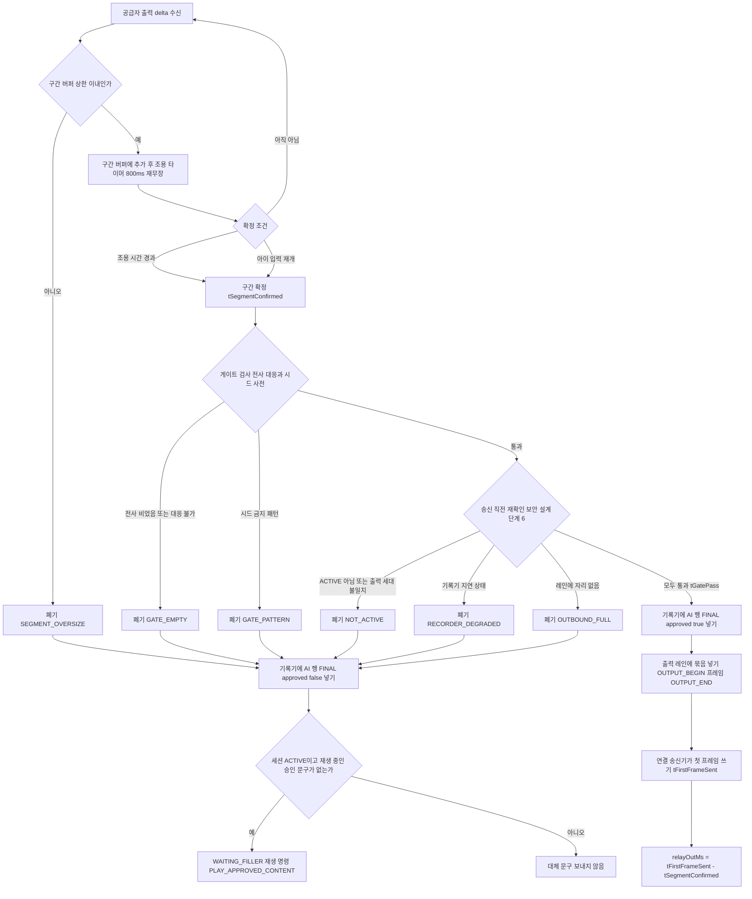
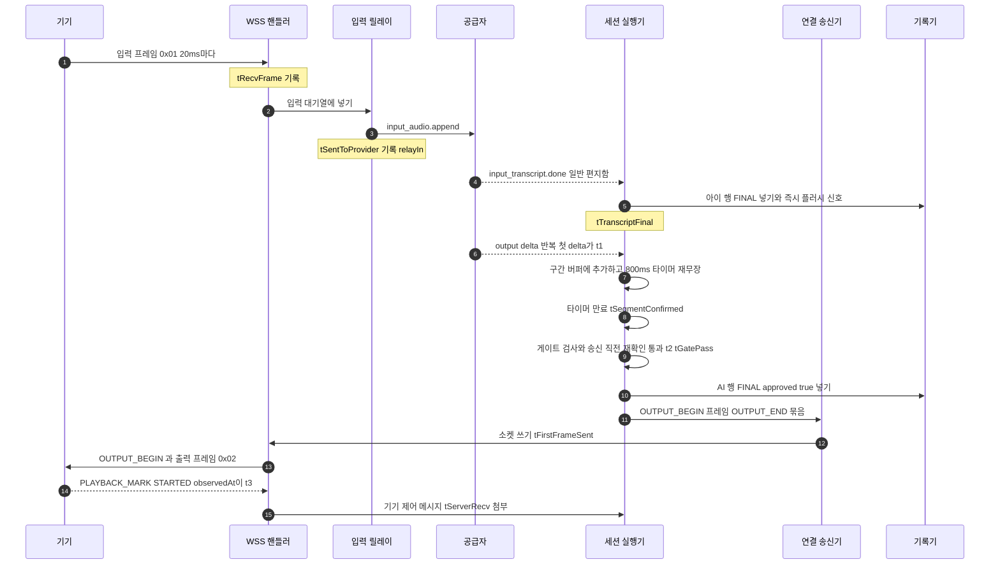
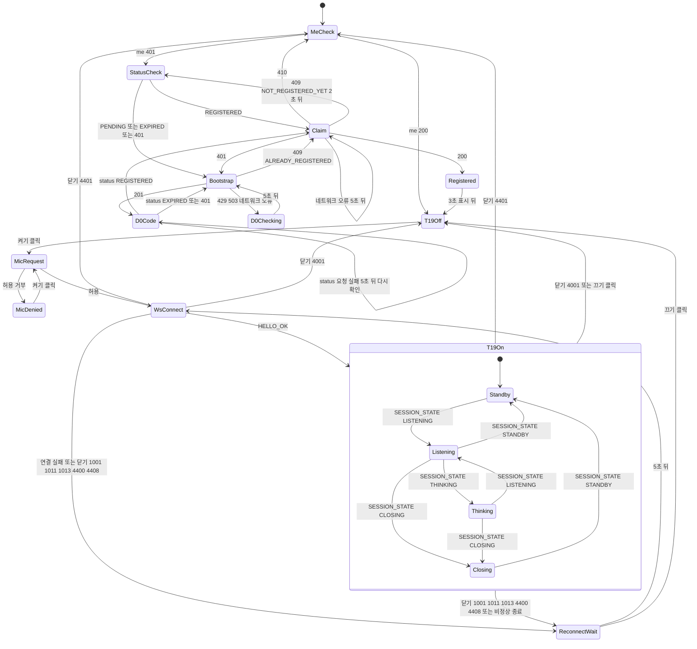

# 성능 설계 — U1 u1-walking-skeleton

> 단계: NFR Design (3.3) · 문서: performance-design (PD) · 깊이 Standard · 날짜 2026-10-09 (클라우드 세션)
> 입력: `nfr-design-questions.md`(Q1 · Q4 · Q10 · Q11), `nfr-requirements/{performance,scalability,reliability,observability}-requirements.md` · `tech-stack-decisions.md`, `functional-design/{rules,entities,functional-spec}.md`, `contract-summary.md`(4 · 5 · 6 · 7절), ADR-004 · ADR-005 · ADR-010.
> 대리 판단: J73 ~ J84는 사람 지시와 `docs/cloud_handoff.md` 2절에 따라 팀장(준하)의 대리가 정한 가정이다. 이 문서는 J73(Q1 음성 경로) · J82(Q10 프런트) · J83(Q11 데이터 접근 중 성능 부분)을 구체 설계로 풀고 J76 · J80 · J81은 참조한다. 수치는 시연 규모의 시작값이고 새로 둔 값은 '제안(3.5 확정)'으로 표시한다. 설정 키 이름의 기준 표는 reliability-design.md `## 3`이며 이 문서가 제안하는 새 키는 그 표에 등재를 요청한다(5절).
> 표기: 요구 문서(nfr-requirements)의 재점검 결정은 항상 '재점검 RD-n'(예: 재점검 RD-13)으로, 이 단계의 설계 ID는 PD-n으로 적는다. 신뢰성 설계 문서의 설계 ID는 항상 'reliability-design.md RD-n'으로 쓴다(맨 `RD-n`은 쓰지 않는다). FD 보강 후보 A1 ~ A6은 nfr-requirements 문서 5절의 번호다. 3.3 재점검(2026-10-09)에서 정한 결정은 5절 대리 판단 표에 '3.3 재점검 결정 R3-n'으로 기록했다.

## 1. 설계 요소

| 설계 ID | 해결하는 NFRx.y | 패턴 · 결정 | 적용 위치(BR · 컴포넌트) | 근거 |
|---|---|---|---|---|
| PD-1 | NFR5.1, NFR5.2 | 세션 직렬 실행 단위(2.1): 세션마다 가상 스레드 하나(세션 실행기)가 안전 편지함(시한 · 명령)과 일반 편지함(기기 제어 · 공급자 이벤트)을 순서대로 처리한다. 세션 상태 · 시계 · 구간 버퍼 · 게이트 판정은 이 스레드만 바꾼다(락 없음). DB 조건부 UPDATE가 마지막 중재자이고, 시작 응답(202)은 START_SESSION 송신 · 공급자 연결을 기다리지 않는다. 시작 절차는 0단계 묘비 확인으로 시작하고, 커밋 뒤 START_SESSION을 먼저 보내 그 송신 시도 시각에 20초 시한을 무장하며, 공급자 연결은 실행기가 아닌 별도 가상 스레드가 열어 결과를 편지함에 넣는다(2.1 생명주기). 실행기 최상위 예외는 FAILED 전이를 시도한 뒤 정리한다 | BR6.6 · BR6.8 · BR6.12 · BR6.13 · BR7.1 · SessionLifecycle · DeviceGateway · VoiceRelay · OutputGate | J73 · ADR-005 2.3 · 3.3 재점검 결정 R3-1 · R3-6 · R3-9 |
| PD-2 | NFR5.1, NFR5.2 | 입력 중계 경로(2.1 · 2.2): WSS 핸들러는 프레임을 받으면 입력 대기열(50프레임)에 넣고 바로 돌아온다. 입력 릴레이 스레드가 꺼내 공급자에 보낸다. 가득 차면 가장 오래된 프레임을 버린다. ACTIVE 전 · 종료 상태 · FAILED 뒤 프레임은 버리고 버퍼링하지 않으며, CLOSING 중 프레임은 CLOSE_TRANSPORT 송신까지 공급자로 중계한다(BR7.1) | BR7.1 · VoiceRelay · DeviceGateway | J73 · 3.3 재점검 결정 R3-8 |
| PD-3 | NFR5.1, NFR5.2 | 출력 구간 확정 · 게이트 · 기기 송신 경로(2.3): 출력 delta는 서버 구간 버퍼에만 쌓고 800ms 조용 타이머나 아이 입력 재개로 구간을 확정한다. 게이트 판정은 메모리에서만 하고 통과한 묶음은 연결 송신기의 출력 레인에 한 번에 넣는다. 폐기한 구간은 AI 행을 approved false로 확정하고 대체 문구를 재생한다 | BR7.3 · BR7.4 · BR7.5 · BR6.10 · OutputGate · DeviceGateway · ConversationLog | J73 · ADR-004 2.5 |
| PD-4 | NFR5.1, NFR5.2, NFR7.6 | 대기열 상한과 넘칠 때의 동작(2.2): 입력 50프레임(오래된 것 버림), 일반 편지함 1,000(기기는 연결 닫기, 공급자는 대기), 구간 버퍼와 출력 레인은 `device.output-queue-max` 20초 분량(묶음 통째 폐기), 기록기 200행. 어느 대기열도 앞 단계를 막지 않는다. 공급자 읽기만 의도적으로 대기해 공급자 쪽 TCP 배압이 된다 | BR7.1 · BR7.3 · BR7.4 · BR7.5 · VoiceRelay · DeviceGateway | J73 · 계약 4.2절 대기열 상한 |
| PD-5 | NFR5.3, NFR7.6 | 비동기 기록기(2.4): 전사 행은 세션별 순서 보존 칸 목록에 넣고(행 하나 = 칸 하나, 갱신은 제자리 덮어쓰기) 아이 전사 확정 · AI 행 확정은 즉시 플러시 신호, 확정 전 조각은 200ms 배치로 한 트랜잭션에 쓴다. 음성 경로는 이 쓰기를 기다리지 않는다. 상한 200행에서 AI 구간을 통과시키지 않는다(fail-closed) | BR7.5 · BR6.15 · BR4.8 · ConversationLog · DeviceGateway | J73 |
| PD-6 | NFR5.1, NFR5.2, NFR5.3, NFR5.8 | 지연 계측 지점(2.3 · 2.8): t0 ~ t3 · tRecvFrame · tSentToProvider · tSegmentConfirmed · tFirstFrameSent · tTranscriptFinal · tViewItemReady · tViewItemFirstServed를 정해진 스레드에서 주입 가능한 Clock으로 찍는다. 로그에 남는 시각 키는 관측 스키마가 정본이다 — LATENCY_TURN 8종과 SESSION_ITEMS_SERVED 2종이고, 2.3-A 표의 '로그 위치' 열이 시각마다 위치를 정한다. tGatePass는 송신 직전 재확인까지 통과한 시각이다. 프레임 지연은 세션별 고정 크기 표본 링에 모아 턴 로그에 요약하고 프레임 단위 로그는 쓰지 않는다. 로그 출력은 비차단 | BR7.1 · BR7.3 · BR7.5 · BR6.15 · VoiceRelay · OutputGate · DeviceGateway | J73 · 재점검 RD-3 · 재점검 RD-5 · 3.3 재점검 결정 R3-19 |
| PD-7 | NFR5.5, NFR7.6 | 프로세스 캐시(2.5): 승인 문구 버전(TTL 10분)과 현재 정책 버전(TTL 1분)만 캐시한다. 기기 상태 · 세션 상태 · 동의 상태 · 토큰 확인 결과는 캐시하지 않는다. 같은 키 동시 미스는 하나만 DB로 가고 적재 실패는 그대로 오류다 | BR3.4 · BR6.1 · BR6.5 · ApprovedContentCatalog · ConsentPolicy | J73 |
| PD-8 | NFR5.3, NFR5.5, NFR7.5, NFR7.6 | 인덱스 · 쿼리 계획(2.6): FD가 정한 색인만으로 모든 뜨거운 쿼리가 색인 접근이거나 수십 행 이하의 순차 스캔이다. 조건부 UPDATE · 폴링 · 기록기는 명시 SQL(JDBC 클라이언트)로 쓰고 단순 CRUD만 JPA를 쓴다. 쿼리가 부분 색인의 술어를 그대로 포함해야 색인을 쓴다. EXPLAIN 시험과 질의 수 단언으로 지킨다 | BR1.2 · BR1.4 · BR2.3 · BR4.1 · BR5.2 · BR5.7 · BR5.10 · BR6.8 · DeviceRegistry · CoreMessaging · RealtimeMessaging | J83 |
| PD-9 | NFR5.3, NFR5.5 | 폴링 쿼리와 질의 수 예산(2.6): D0 상태 확인 1질의, 12 진행 조회는 Core 1 + Realtime 2질의, 엔드포인트마다 질의 수 상한을 두고 N+1을 시험이 막는다. 12는 세션 실행기를 거치지 않고 DB를 직접 읽는다 | BR1.7 · BR6.15 · BR8.5 · DeviceRegistry · ActivityCoordinator | J83 · J82 |
| PD-10 | NFR7.5 | 이벤트 전달 지연 예산(2.7): 폴 지연 ≤ 500ms + 전송 · 수신 커밋 + 비동기 처리기로 정상 상태 약 0.6초, 30건 버스트는 약 1.3초다. 가득 찬 배치 뒤에는 대기 없이 다음 배치를 집고, 전송 중에는 DB 연결을 쥐지 않는다. 처리 스레드는 Outbox 발송 · Inbox 재호출로 나눈다 | BR5.2 · BR5.3 · BR5.6 · BR5.7 · BR4.8 · CoreMessaging · RealtimeMessaging | J73 · J77 · 재점검 RD-3 |
| PD-11 | NFR7.6 | DB 연결 풀 · 트랜잭션 경계(2.6): 앱당 최대 10, 서비스 계층 한 곳이 트랜잭션 경계이고 HTTP · 공급자 호출을 트랜잭션 안에서 하지 않는다. 배경 작업 동시 점유를 제한하고 풀 대기 100ms 초과는 카운터로 센다. 요청 범위 영속성 컨텍스트는 끈다 | BR5.1 · BR5.7 · BR8.1 · CoreMessaging · RealtimeMessaging | J83 · 재점검 RD-14 |
| PD-12 | NFR5.5, NFR10.2, NFR10.3 | /parent 폴링 · 오류(2.9): TanStack Query로 12만 2초 `refetchInterval`(탭이 숨겨지면 멈추고 보이면 즉시 1회, 종료 상태에서 정지), 나머지 화면은 진입 때 1회. 오류는 토스트 + 재시도 단추이고 폴링은 계속한다. 시작 · 끝내기 재시도의 키 재사용은 실패 종류별 표(2.9-C)를 따른다 | BR6.15 · BR6.2 · BR6.9 · BR4.5 · BR2.8 · ParentWeb | J82 · 3.3 재점검 결정 R3-14 |
| PD-13 | NFR5.6, NFR10.1, NFR10.4 | /device 상태 기계(2.9): React 상태 기계(`useReducer`)가 me → status → bootstrap → D0 → 등록 → T19를 단일 비행으로 진행한다. 실패는 마지막 화면을 두고 5초 뒤 다시 한다. 마이크는 「켜기」 클릭 핸들러에서만 요청한다 | BR9.1 ~ BR9.7 · BR3.5 · BR3.6 · DeviceWeb | J82 |
| PD-14 | NFR5.6, NFR10.1, NFR10.2, NFR10.3 | 번들 · 첫 화면 예산(2.9): /device 초기 JS 150KB(gzip) 이하, /parent 첫 로드 JS 200KB(gzip) 이하(제안). WSS 클라이언트 · 오디오 코드는 「켜기」 이후 지연 적재(꺼짐 화면에서 미리 받기만). 웹폰트 없음, 04의 뼈대를 데이터 없이 먼저 그린다 | BR9.1 ~ BR9.5 · BR4.5 · DeviceWeb · ParentWeb | J82 |
| PD-15 | NFR11.1 | /parent ↔ /device 코드 경계(2.9): 디렉터리를 분리하고 ESLint import 제한으로 /parent → /device import 0건(반대 방향도 막음)을 CI에서 강제한다. 공용 코드는 어느 쪽도 import하지 않는 공용 영역에만 둔다 | BR4.6 · BR4.3 · ParentWeb · DeviceWeb | J82 · NFR11.1 |
| PD-16 | NFR10.1, NFR10.2, NFR10.3, NFR10.4 | 브라우저 대응 장치(2.9): 빌드 대상 하한을 NFR10.3의 iOS Safari 16.4로 맞추고, 마이크 요청 코드는 한 모듈에만 두어 클릭 핸들러 밖 호출을 막으며, 서비스 워커 · PWA 매니페스트를 두지 않는다 | BR9.5 · BR9.1 · DeviceWeb · ParentWeb | J82 · 재점검 RD-14 |
| PD-17 | NFR5.6 | NFR5.6 표본 판정 방식(2.9): 표본 100 이상이면 p95(nearest-rank), 10 ~ 99면 목표 이내 비율 90% 이상(10회면 9회), 10 미만이면 판정하지 않고 값과 건수를 기록한다. 항목마다 조건(캐시 · 쿠키 · 네트워크)을 고정한다 | BR9.1 · BR9.5 · DeviceWeb · ParentWeb | 재점검 RD-13 |
| PD-18 | NFR5.5, NFR7.5 | 부하 시험 전용 시드 · load-test 프로필(2.10, FD 보강 A6): 시드는 앱 바깥의 시험 도구가 SQL로 DB에 직접 넣는다(앱에 시드 빈이 없다). 기기 토큰 · bootstrap 비밀은 도구가 실행 때 만들어 해시만 저장하고 원문은 600 권한 파일에 둔다. D0 폴링은 SQL로 넣은 bootstrap 쿠키로 하므로 발급 한도를 올리지 않는다. 발급 한도 상향(600 · 1)은 dev + load-test 프로필에서만 하고 load-test 단독과 demo · prod + load-test는 기동 거부다. 시나리오 L1 ~ L7로 30쌍 · 세션 2 · 40 RPS를 잰다 | BR8.3 · BR8.4 · BR1.6 · BR1.7 · BR2.4 · BR2.10 · DeviceRegistry · GuardianIdentity | 재점검 RD-12 · J81 · 3.3 재점검 결정 R3-18 |
| PD-19 | NFR5.8 | PLAYBACK_MARK(STOPPED, LOCAL_VOICE_ACTIVITY) 기록 경로(2.11): 수신 핸들러가 서버 수신 시각을 먼저 찍고 편지함으로 넘기며, 세션 실행기는 observedAt · 원인 · 환산 입력만 로그에 남기고 상태를 바꾸지 않는다. 0.5초 판정은 U3 | BR6.10 · BR6.11 · DeviceGateway · SessionLifecycle | 재점검 RD-7 |
| PD-20 | NFR5.1, NFR5.2 | 지연 예산 분배(2.8): 중계 증가분 0.5초 안에서 relayIn p95 0.15초 · relayOut p95 0.25초(합 0.40초 = 관측 경보선)를 설계 목표로 나누고, 구간 확정 조용 시간(800ms)은 중계가 아니라 NFR5.2의 구조상 대기로 따로 기록한다 | BR7.3 · BR7.4 · VoiceRelay · OutputGate | 재점검 RD-3 |

## 2. 설계 상세

### 2.1 세션 직렬 실행 단위 (PD-1, PD-2)

세션 한 건의 상태 · 시계 · 구간 버퍼 · 게이트 판정은 세션 실행기 하나만 바꾼다. 다른 실행 단위는 편지함에 넣거나 꺼내기만 한다. 그래서 세션 안에는 락이 없고 세션 사이에는 공유 락이 없다(NFR7.3). DB 조건부 UPDATE(BR6.8)는 여전히 마지막 중재자다 — 실행기가 하나여도 Core 취소 · 시한 · 기기 메시지가 같은 전이를 거의 동시에 시도할 수 있고, 재시작 복구(BR6.13)는 실행기 밖에서 같은 행을 바꾼다. 아래 이름은 역할 이름이며 클래스 이름이 아니다.

**표 2.1-A. 실행 단위 구성** (세션 하나 기준, 기기 연결 하나 기준)

| 실행 단위 | 스레드 | 개수 | 맡은 상태 | 하는 일 | 하지 않는 일 |
|---|---|---|---|---|---|
| 세션 실행기 | 가상 | 세션당 1 | 세션 상태 · 안전 시한 예약 · 구간 버퍼 · 게이트 판정 | 두 편지함 메시지를 순서대로 처리, 전이는 짧은 DB 트랜잭션, 기록기에 칸 넣기, 출력 레인에 묶음 넣기 | 소켓 쓰기 대기, 공급자 연결 열기(연결 스레드의 일), 공급자 읽기, 프레임 단위 로그 |
| 입력 릴레이 | 가상 | 세션당 1 | 입력 대기열 소비 위치 | 프레임을 꺼내 공급자 `input_audio.append`로 보낸다, relayIn 표본 기록 | 상태 전이, DB 접근 |
| 공급자 연결 스레드 | 가상 | 세션당 1(연결을 연 뒤 끝남) | 공급자 연결 열기 한 번 | `mujoong.provider.connect-timeout`(10초) 안에 공급자 연결을 열고 `session.start`를 보낸 뒤 연결을 리더에 넘겨 ProviderConnected를, 실패하면 ProviderFailed를 일반 편지함에 넣는다 | 상태 전이, DB 접근, 게이트 판정 |
| 공급자 리더 | 공급자 연결 콜백 | 세션당 1 연결 | 공급자 이벤트 읽기 | 이벤트를 해석해 일반 편지함에 넣는다(가득 차면 대기) | 게이트 판정, DB 접근 |
| 연결 송신기 | 가상 | 기기 연결당 1 | 출력 레인(음성 · 제어) | 제어 레인 먼저, 그다음 음성 레인에서 꺼내 소켓에 쓴다 | 판정, DB 접근 |
| WSS 수신 핸들러 | 컨테이너 가상 스레드 | 메시지마다 | 연결의 마지막 메시지 시각(휘발) | 프레임 종류를 가르고 즉시 대기열 · 편지함에 넣는다. HEARTBEAT는 ACK를 먼저 보낸다 | 판정, 동기 DB 접근, 무거운 계산 |
| 시계 스케줄러 | 플랫폼 | Realtime 2(안전 시한 시계 · 구간 조용 시간 시계), Core 0 | 예약된 시한 | 만기 때 TimerFired를 안전 편지함에 넣기만 한다 | DB · 공급자 호출, 판정 |
| 기록기 틱 · 플러시 | 플랫폼 1 + 가상 | Realtime 전용(틱 1 + 플러시 가상 스레드) | 기록기 칸 목록 | 틱(200ms)마다 플러시를 제출, 플러시는 한 트랜잭션 | 음성 경로 대기 |
| 메시징 폴러 | 플랫폼 | 앱당 Outbox 발송 1(outbox-sender) · Inbox 재호출 1(inbox-repoll). 점검 · 정리 · 보고 · 고아 세션 점검은 앱당 maintenance 1이 맡는다 | PENDING · RECEIVED 행 | 선점은 짧은 트랜잭션, 전송은 트랜잭션 밖(2.7) | Realtime 시계 · 전이(무관) |

플랫폼 스케줄러 스레드는 Realtime 총 6개(시계 2 · 기록기 틱 1 · outbox-sender 1 · inbox-repoll 1 · maintenance 1), Core 총 3개(outbox-sender 1 · inbox-repoll 1 · maintenance 1)다. 정본은 reliability-design.md 2.2의 스레드 수 표이고 이 문서와 scalability-design.md 2.6-D는 그 수를 인용한다(3.3 재점검 결정 R3-18). 세션 실행기 · 연결 송신기 · 공급자 연결 스레드는 가상 스레드라 표에 넣지 않고, 처리기 풀은 `mujoong.inbox.handler-threads` 2다.

**표 2.1-B. 편지함 종류**

| 편지함 | 용량 | 넣는 쪽 | 가득 찼을 때 | 꺼내는 쪽 | 비고 |
|---|---|---|---|---|---|
| 안전 편지함(L0H) | 제한 없음(구조상 동시 항목 10개 이하) | 시계 스케줄러, 내부 HTTP 명령 핸들러, 생명주기 | 해당 없음 | 세션 실행기(항상 먼저) | 시한 종류마다 살아 있는 예약은 하나이고 세대 번호로 낡은 만기를 무시한다 |
| 일반 편지함(L0N) | 1,000 `mujoong.limits.session-control-queue` | WSS 핸들러(넣기 실패 가능), 공급자 리더와 공급자 연결 스레드(자리가 날 때까지 대기) | 기기 쪽 생산자는 연결을 1011로 닫고 WARN, 공급자 리더는 대기 | 세션 실행기 | 선입선출 |
| 입력 대기열(L1) | 50프레임 `mujoong.limits.session-input-queue-frames` | WSS 핸들러 | 가장 오래된 프레임을 버린다 | 입력 릴레이 | 20ms 프레임 50개 = 1초 |
| 출력 레인 음성(L2A) | 20초 분량(960,000B) `mujoong.timing.device.output-queue-max` | 세션 실행기(묶음 단위 원자 허용) | 묶음 통째 거절 → 폐기 사유 OUTBOUND_FULL | 연결 송신기 | 48,000B/s(PCM16 · 24kHz · 모노) × 20초 |
| 출력 레인 제어(L2C) | 100 `mujoong.limits.device-control-queue` | 세션 실행기, WSS 핸들러 | 연결을 1011로 닫고 WARN | 연결 송신기(음성보다 먼저) | STOP_OUTPUT은 음성 레인을 비운다 |
| 기록기 칸 목록 | 200행 `mujoong.limits.recorder-queue` | 세션 실행기 | 2.4 | 플러시 | 세션별 하나 |

**표 2.1-C. 메시지 종류와 처리**

| 메시지 | 편지함 | 만드는 쪽 | 세션 실행기가 하는 일 | 동기 DB 접근 |
|---|---|---|---|---|
| ACK · DEVICE_READY | L0N | 기기 | PREPARING → DEVICE_ACK, DEVICE_READY와 공급자 started가 둘 다면 ACTIVE(BR6.8) | 전이 트랜잭션(제어 경로) |
| PLAYBACK_MARK | L0N | 기기 | 마무리 인사의 playbackId와 같을 때만 CLOSE_TRANSPORT(BR6.10 ③), STOPPED는 로그(2.11) | 없음 |
| VOICE_SESSION_CLOSED | L0N | 기기 | CLOSING → ENDED(BR6.10 ④) | 전이 트랜잭션 |
| DEVICE_STATE | L0N | 기기 | 메모리에 최신값 보관(U3가 판정에 사용) | 없음 |
| ProviderConnected · ProviderFailed | L0N | 공급자 연결 스레드 | Connected: 세션이 아직 비종료이면 공급자 리더를 붙이고 session.started를 기다린다(이미 종료·취소됐으면 연결을 바로 닫는다). Failed: 시작 구간이면 즉시 FAILED(PROVIDER_UNAVAILABLE) | Failed일 때 전이 트랜잭션 |
| 공급자 started · error · closed | L0N | 공급자 리더 | 시작 구간이면 ACTIVE 조건 또는 FAILED(PROVIDER_UNAVAILABLE), ACTIVE 뒤 끊김은 WARN 로그만(U1 범위 밖) | 전이 트랜잭션 |
| 입력 전사 delta · done | L0N | 공급자 리더 | 아이 행 칸 갱신(done이면 FINAL), 기록기 신호 | 없음(기록기가 쓴다) |
| 출력 음성 · 전사 delta | L0N | 공급자 리더 | 구간 버퍼에 추가, 조용 타이머 재무장. 응답의 첫 delta면 t1을 기록하고 AI 행 번호를 정해 확정 전 칸(approved false)을 기록기에 넣는다(2.4) | 없음 |
| TimerFired{종류, 세대} | L0H | 시계 스케줄러 | 종류별 시한 판정(기기 응답 20초 · 종료 확인 30초 · 끊김 40초 확인 · 구간 조용 800ms). 세대가 다르면 버림 | 전이가 일어날 때만 |
| EndRequested{requestId, reason} | L0H | 내부 HTTP 핸들러(결과 약속을 같이 넘김) | BR6.9 · BR6.7의 응답표대로 전이하고 결과를 약속에 채운다 | 전이 트랜잭션 |
| ServerShutdown | L0H | 생명주기 | 1001 닫기 요청, 기록기 마지막 플러시 | 없음 |

12 진행 조회 핸들러가 쓰는 '이미 내보낸 행 번호' 집합(tViewItemFirstServed를 행마다 한 번만 찍기 위한 것)은 세션별 동시성 집합이며 세션 상태 전이와 무관하다 — 세션 실행기를 거치지 않는 유일한 세션별 쓰기다. HEARTBEAT는 세션 편지함에 넣지 않는다. 수신 핸들러가 연결 객체의 마지막 메시지 시각(휘발)을 갱신하고 ACK를 먼저 보낸 뒤 last_seen_at 쓰기를 기록기 쪽 기기 칸(기기당 마지막 값만 남김)에 넘긴다. 세션의 40초 시한(BR6.12 ④)은 만기 때 이 연결 객체의 마지막 메시지 시각을 읽어 40초가 안 됐으면 남은 시간으로 다시 예약한다 — 메시지마다 시한을 다시 걸지 않는다. Realtime의 세 시한(기기 응답 · 종료 확인 · 끊김)을 세션 안 타이머로 돌리는 것은 reliability-design.md의 결정이고, 이 문서의 시계 스케줄러가 그 타이머의 실행 장치다. 이 문서는 '스케줄러 스레드는 편지함에 넣기만 한다'는 제약만 요구한다.

**표 2.1-D. 순서 보장**

| 대상 | 보장 | 근거 · 장치 |
|---|---|---|
| 한 세션 안의 상태 변경 | 모두 세션 실행기에서 직렬. 반복마다 안전 편지함을 먼저 비우고 일반 편지함에서 하나를 꺼낸다 | 시한 · 명령이 공급자 이벤트 폭주 뒤에 밀리지 않게 한다 |
| 일반 편지함 | 도착 순서(선입선출). 공급자 이벤트는 읽은 순서 그대로(리더가 하나) | 공급자 delta 순서를 바꾸지 않는다 |
| 시한 대 신호 경합 | 도착 순서로 처리하되 최종 승자는 DB 조건부 UPDATE | 시한 vs ACK 경합 시험(NFR6.3), 낡은 만기는 세대 번호로 무시 |
| 입력 프레임 | 연결 안에서 FIFO, 순번(uint32)이 올라가는지 확인, 버려진 순번은 카운터 | 오래된 소리를 늦게 보내지 않는다 |
| 전사 행 커밋 | 세션별 칸 순서 = 행 번호(sequence_no) 순서로 한 트랜잭션에 커밋 | 2.4. 앞선 번호 행이 뒤늦게 나타나는 일을 막는다(BR7.5 · BR6.15) |
| Core 명령(끝내기 · 취소) | 편지함 순서로 처리하고 호출자는 약속(2초 제한)을 기다린다. 늦게 끝난 결과는 버리고 requestId로 멱등 | BR6.9 · BR6.7 |
| 세션 사이 | 순서 없음, 공유 락 없음 | NFR7.3 |
| Outbox 발송 | 앱 안에서 만든 순서(created_at)로 직렬. 받는 쪽은 순서를 가정하지 않는다 | BR5.2 · BR5.10 |

**생명주기.**

0. 시작 명령 처리의 0단계(3.3 재점검 결정 R3-9): 세션 레지스트리를 만지기 전에 묘비 맵(`mujoong.session.tombstone-ttl` 10분)에 sessionId가 있으면 곧바로 409 SESSION_NOT_ACTIVE로 거절한다(BR6.6의 마지막 문장). Core가 보낸 취소(CORE_ABANDONED)가 INIT 등록보다 먼저 도착하면 세션이 없으므로 묘비만 남기고 202로 답하고(BR6.7 가), 뒤늦게 도착한 시작은 이 0단계에서 거절된다. 묘비 확인 시험은 reliability-design.md RD-14의 '시간 초과로 취소된 sessionId의 늦은 시작이 409'다.
1. 시작 명령(내부 HTTP): 세션 레지스트리에 INIT으로 먼저 등록한다(같은 sessionId 중복은 여기서 합류, BR6.6 ①) → 한 트랜잭션으로 세션 행 · 기본 종료 표현 · SessionStateChanged(PREPARING)를 쓴다(BR6.6 ④) → 커밋되면 실행기와 보조 스레드를 띄우고 202를 돌려준다. 롤백이면 등록을 지운다. INIT 동안 도착한 명령은 편지함에 쌓였다가 시작 뒤 순서대로 처리된다.
2. 202 뒤 실행기가 처음 하는 일(3.3 재점검 결정 R3-1): (가) 커밋 직후 START_SESSION을 먼저 보낸다. 소켓 없음 · 전송 예외로 송신이 실패하면 같은 처리 안에서 PREPARING → FAILED(DEVICE_NO_ACK)다(BR6.6 ⑤). (나) 그 송신 시도 시각에 BR6.12 ② 20초 시한(`mujoong.timing.session.device-ack-timeout`)을 무장한다 — BR6.6 ⑤ · BR6.12 ②와 같은 순서다. (다) 공급자 연결은 실행기가 아니라 별도 가상 스레드(공급자 연결 스레드)가 `mujoong.provider.connect-timeout`(10초, 20초 시한 이하) 안에 열고 `session.start`까지 보낸 뒤 결과(ProviderConnected · ProviderFailed)를 일반 편지함에 넣는다. 연결이 걸려 있는 동안에도 실행기는 Core 취소(CORE_ABANDONED)와 안전 타이머를 계속 처리하므로 연결 때문에 취소가 밀리지 않고, 연결에 든 시간은 (나)에서 이미 시작된 20초 시계 안에 들어간다. ProviderFailed는 20초를 기다리지 않고 FAILED(PROVIDER_UNAVAILABLE)다(reliability-design.md 2.3 NFR4.2 행). 이 일들은 응답 시간(NFR5.5)에 들어가지 않는다.
3. 종료 상태 전이 직후: 입력 수락을 끝내고 입력 대기열을 비운다(BR7.1), 공급자 연결 스레드가 아직 연결 중이면 중단하고 이미 열린 연결은 닫고 구간 버퍼를 버리고 기록기를 마지막으로 플러시한 뒤 스레드를 정리하고 레지스트리에서 지운다. 지운 뒤 도착한 기기 · 공급자 메시지(늦은 ProviderConnected 포함)는 세션이 없어서 기록 없이 버려진다(BR6.11).
4. 실행기 최상위 예외 처리(3.3 재점검 결정 R3-6): 실행기 반복의 최상위가 예외를 잡으면 ERROR 로그(APP_ERROR, errorKind만)를 남기고 세션 행을 `WHERE status = 읽은 상태`로 FAILED(SERVER_RESTART)로 바꾸는 전이를 시도한 뒤(FD가 허용한 failure_code 중 서버 쪽 사유는 이것뿐이다) 3번의 정리를 한다. 전이가 DB 장애로 실패하면 행은 비종료로 남고, reliability-design.md 2.1 시한 표의 '고아 세션 점검'(`mujoong.session.orphan-check-interval` 30초)이 같은 전이로 닫는다. 시험은 reliability-design.md RD-3의 '실행기 강제 예외 주입'이다.
5. 앱 재시작: 실행기를 되살리지 않는다. 비종료 세션은 FAILED(SERVER_RESTART)로 닫힌다(BR6.13).

**가상 스레드 유의.** 캐리어 스레드는 vCPU 수(2)다. 블로킹 JDBC와 소켓 쓰기는 가상 스레드에서 괜찮지만 `synchronized` 안에서 블로킹 호출을 하면 캐리어를 붙잡을 수 있다. 앱 코드는 `synchronized` 안에서 블로킹 호출을 하지 않고, 시험과 11/2 측정은 핀 고정 진단(JDK 진단 플래그)을 켜서 확인한다.

### 2.2 대기열 상한과 넘칠 때의 동작 (PD-2, PD-4)

**표 2.2-A. 대기열별 넘침 동작**

| 대기열 | 상한 | 넘칠 때 | 까닭 | 보이는 신호 |
|---|---|---|---|---|
| 입력 대기열(L1) | 50프레임(1초) | 가장 오래된 프레임을 버리고 새 프레임을 받는다 | 대화는 최신 소리가 중요하다. 늦게 보낸 옛 소리는 지연만 키운다 | `input_frames_dropped` 카운터, 세션당 초당 1회 이하 WARN |
| 입력 수락 조건(L1 앞, 3.3 재점검 결정 R3-8) | 해당 없음 | ACTIVE 전 · 종료 상태(ENDED · ENDED_UNCONFIRMED · ABORTED) · FAILED 뒤 프레임은 대기열에 넣지 않고 버린다. CLOSING 중 프레임은 CLOSE_TRANSPORT 송신까지 넣어 공급자로 중계한다 | BR7.1: 중계 구간은 ACTIVE 뒤부터 CLOSE_TRANSPORT(또는 종료 · FAILED 전이) 전까지다. 마무리 인사 동안의 아이 발화도 공급자 전사에서 빠지지 않는다 | `input_frames_dropped` 카운터(WARN은 남기지 않는다. 정상 상태에서도 ACTIVE 전 프레임이 생긴다) |
| 일반 편지함(L0N) | 1,000 | 기기 쪽: 넣기 실패 → 연결 1011 닫기(기기는 5초 뒤 재접속, 세션은 40초 경로). 공급자 쪽: 자리가 날 때까지 대기 | 정상 상태의 깊이는 한 자리 수다. 1,000은 버그 · 폭주 감지용이다 | 큐 깊이 게이지, WARN |
| 구간 버퍼(게이트 전) | 20초 분량 960,000B | 상한을 넘기려는 delta를 만나면 그 구간을 폐기(SEGMENT_OVERSIZE)하고 같은 응답의 남은 delta는 응답 끝까지 버린다 | 기기 재생 대기열이 20초를 넘는 묶음은 어차피 QUEUE_OVERFLOW로 버려진다(계약 4.2절) — 서버가 먼저 막는다 | `gate_discard{reason}` 카운터 |
| 출력 레인 음성(L2A) | 20초 분량 960,000B | 새 묶음이 남은 자리보다 크면 통째 거절(OUTBOUND_FULL) → 폐기 처리 | 일부만 보내면 말이 잘린다 | 같은 카운터 |
| 출력 레인 제어(L2C) | 100 | 연결 1011 닫기 | 제어는 작고 드물다. 넘치면 소켓이 막힌 것이다 | WARN |
| 기록기 칸 목록 | 200행 | 2.4 | 메모리 상한 | `recorder_rejected` 카운터 |

**배압 흐름.** 기기 → (입력 대기열, 오래된 것 버림) → 공급자 / 공급자 → (일반 편지함, 가득 차면 읽기 대기) → 세션 실행기 / 세션 실행기 → (출력 레인, 묶음 단위 원자 허용) → 기기 / 세션 실행기 → (기록기 칸, 비동기) → DB. 세션 실행기는 제어 경로의 짧은 DB 트랜잭션 말고는 어디서도 기다리지 않는다. 공급자 리더가 일반 편지함에서 기다리는 것만 의도된 배압이며 공급자 쪽 TCP로 전해진다.

**세션 하나의 메모리 상한.** 구간 버퍼 960,000B + 출력 레인 960,000B + 입력 대기열 50 × 965B + 기록기 200행 × 약 1KB + 기타 약 100KB ≈ 2.3MB. 동시 세션 2개는 약 5MB, 30개여도 약 70MB라 JVM 힙(1GB)에 비해 작다(scalability-design.md).

### 2.3 구간 확정 · 게이트 · 기기 송신 순서 (PD-3, PD-6)

세션 실행기가 공급자 출력 delta를 받아 한 응답을 구간으로 묶고(BR7.3), 게이트로 판정하고(BR7.4), 통과한 묶음만 기기로 보낸다. 판정에 DB 접근이 없다. 아래 두 그림은 같은 흐름을 판정 중심(순서도)과 시각 중심(순서 그림)으로 보인다.

**텍스트 대체 (순서도).**

1. 공급자의 출력 음성 · 전사 delta가 오면 구간 버퍼 상한(20초 분량)을 먼저 본다. 넘기려 하면 그 구간을 SEGMENT_OVERSIZE로 폐기하고 8단계로 간다.
2. 상한 안이면 delta를 버퍼에 더하고 800ms 조용 타이머를 다시 건다(`mujoong.gate.segment-quiet`).
3. 구간은 조용 타이머가 만기되거나 아이 입력이 다시 시작될 때 확정된다. 이 시각이 tSegmentConfirmed다. 아직이면 다음 delta를 기다린다.
4. 게이트 검사(보안 설계 출력 게이트 단계 3 · 4): 구간 전사가 비었거나 출력 음성과 대응이 안 되면 GATE_EMPTY, 시드 금지 패턴에 걸리면 GATE_PATTERN으로 폐기하고 8단계로 간다. 이 단계에서는 세션 상태를 보지 않는다.
5. 송신 직전 재확인(보안 설계 출력 게이트 단계 6, 3.3 재점검 결정 R3-19): 한 곳에서 다음 순서로 따져 처음 걸린 조건을 폐기 사유로 삼고 8단계로 간다 — 세션이 ACTIVE가 아니거나 구간의 출력 세대가 현재 세대와 다르면 NOT_ACTIVE(BR6.10 ① · BR7.4), 기록기가 지연 상태(2.4)이면 RECORDER_DEGRADED, 출력 레인에 묶음이 들어갈 자리가 없으면 OUTBOUND_FULL. NOT_ACTIVE 판정은 이 단계가 유일한 자리이고 이 문서의 다른 단계에는 세션 상태 판정이 없다(우선순위는 표 2.3-C). 셋 모두 통과한 직후의 시각이 tGatePass(t2)다 — 폐기된 구간(RECORDER_DEGRADED · OUTBOUND_FULL 포함)에는 tGatePass가 없다.
6. 통과하면 AI 행을 FINAL · approved true로 기록기에 넣고(즉시 플러시 신호) 묶음을 출력 레인에 한 번에 넣는다.
7. 연결 송신기가 OUTPUT_BEGIN → 0x02 프레임 → OUTPUT_END를 쓰고 첫 프레임을 쓴 시각이 tFirstFrameSent다. relayOutMs는 tFirstFrameSent − tSegmentConfirmed다.
8. 폐기한 구간은 AI 행을 FINAL · approved false로 기록기에 넣는다. 행을 확정하지 않고 남기면 확정 전 행이 12의 nextSeq를 계속 붙잡기 때문이다(BR6.15). 그다음 대체 문구 재생을 판정한다(폐기 사유를 바꾸지 않는 별도 판정이다). 세션이 ACTIVE가 아니면(CLOSING 등) 보내지 않는다. **겹침 규칙(3.3 재점검 결정 R3-19):** 세션 실행기가 '재생 중인 승인 문구' 값을 가지고 있으면(마무리 인사 · 이전 WAITING_FILLER 등 PLAY_APPROVED_CONTENT를 보냈고 아직 끝나지 않은 것) 이번 WAITING_FILLER는 건너뛴다 — 기다렸다 다시 보내지 않고 버린다. 그렇지 않으면 WAITING_FILLER를 새 playbackId의 PLAY_APPROVED_CONTENT로 보내고(승인 음성은 기기가 미리 받았으므로 서버 바이트가 없다) 그 playbackId를 '재생 중인 승인 문구'로 기록한다. 이 값은 같은 playbackId의 PLAYBACK_MARK(COMPLETED · STOPPED · FAILED) 수신, STOP_OUTPUT 송신, 기기 연결 교체 · 끊김, 세션 종료 상태 전이로 지우고, 종료 표식이 오지 않을 때를 위해 송신 후 `mujoong.timing.device.output-queue-max`(20초, 기기 재생 대기열 한도와 같은 값을 재사용. 제안(3.5 확정)) 지나면 지운다. 건너뛰어도 폐기 카운터는 이미 센 뒤이므로 별도 지표를 두지 않는다.

**텍스트 대체 (순서 그림).** ① 기기가 20ms마다 입력 프레임을 보내면 수신 핸들러가 수신 시각(tRecvFrame)을 찍고 입력 대기열에 넣는다. ② 입력 릴레이가 꺼내 공급자에 보내고 전송 완료 시각(tSentToProvider)과의 차이를 relayIn 표본으로 남긴다. ③ 공급자의 입력 전사 확정이 일반 편지함으로 오면 세션 실행기가 tTranscriptFinal을 찍고 아이 행을 기록기에 넣는다. ④ 출력 delta가 이어지고 첫 delta가 t1이다. ⑤ 800ms 조용 만기로 tSegmentConfirmed가 찍히고, 게이트 검사와 송신 직전 재확인을 모두 통과한 직후 tGatePass(t2)가 찍힌다. ⑥ AI 행 확정은 기록기로, 묶음은 연결 송신기로 간다. ⑦ 송신기가 첫 프레임을 쓴 시각이 tFirstFrameSent다. ⑧ 기기가 재생을 시작하고 PLAYBACK_MARK(STARTED)를 보내면 그 observedAt이 t3(기기 시계)이고 서버는 수신 시각(tServerRecv)을 수신 핸들러에서 찍어 환산 교차 확인에 쓴다.

**표 2.3-A. 시각을 찍는 곳 (NFR5.4 로그 필드의 입력)**

| 시각 | 찍는 곳 | 찍는 스레드 | 쓰는 판정 | 로그 위치 |
|---|---|---|---|---|
| tRecvFrame | 프레임 수신 직후 | WSS 수신 핸들러 | relayIn의 시작 | 로그 없음. 표본 링에 모아 LATENCY_TURN의 relayInMs(p95)로 요약 |
| tSentToProvider | 공급자 전송 호출이 돌아온 직후 | 입력 릴레이 | relayIn의 끝 | 로그 없음(위와 같음) |
| tSpeechEnd(t0) · tSpeechEndSource | 출처 3종을 우선순위 순으로: ① PROVIDER_EVENT(공급자 입력 종료 이벤트 수신) ② INPUT_TRANSCRIPT_FINAL(입력 전사 확정 처리) ③ LAST_INPUT_FRAME(프레임 에너지로 가린 마지막 음성 프레임의 수신 시각. 무음 프레임은 쓰지 않는다) | 세션 실행기(③은 입력 릴레이가 갱신하는 메모리 값) | NFR5.2 t0. 출처는 항상 함께 기록 | LATENCY_TURN |
| t1(tProviderFirstOut) | 응답의 첫 출력 delta 처리 시작 | 세션 실행기 | NFR5.2 | LATENCY_TURN |
| tSegmentConfirmed | 조용 만기 · 입력 재개를 처리하는 순간 | 세션 실행기 | relayOut의 시작. 타이머 지각은 quietWaitMs에서 800ms를 뺀 값으로 보인다 | LATENCY_TURN |
| tGatePass(t2) | 게이트 검사와 송신 직전 재확인(보안 설계 단계 6)까지 모두 통과한 직후. RECORDER_DEGRADED · OUTBOUND_FULL로 폐기된 구간은 tGatePass가 없다 | 세션 실행기 | NFR5.2 | LATENCY_TURN(폐기면 생략하고 unobservedReason GATE_DISCARD) |
| tFirstFrameSent | 소켓에 첫 음성 프레임을 쓴 직후 | 연결 송신기 | relayOut의 끝 | LATENCY_TURN(폐기면 생략) |
| tDevicePlayStart(t3 원값) | PLAYBACK_MARK(STARTED)의 observedAt. 기기 시계 값이라 서버 시계로 환산하지 않은 채 기록 | 기기가 만들고 WSS 수신 핸들러가 읽는다 | t3 = tDevicePlayStart − clockOffsetMs | LATENCY_TURN(마크가 안 오면 생략하고 NO_PLAYBACK_MARK) |
| tTranscriptFinal | 입력 전사 done 처리 | 세션 실행기 | NFR5.3 시작 | LATENCY_TURN · SESSION_ITEMS_SERVED |
| tViewItemReady | 기록기 플러시 커밋 직후 | 기록기 플러시 | NFR5.3 끝(서버 몫) | SESSION_ITEMS_SERVED |
| tViewItemFirstServed | 12 응답에 행이 처음 실린 순간 | 진행 조회 핸들러 | 폴링 몫 | SESSION_ITEMS_SERVED |
| tServerRecv | PLAYBACK_MARK 수신 직후 | WSS 수신 핸들러 | t3 환산 교차 확인(편지함 대기 시간이 섞이지 않게) | STARTED 마크는 LATENCY_TURN의 tDevicePlayStartRecv, STOPPED 마크는 PLAYBACK_MARK_STOPPED의 tServerRecv |

로그 위치 열의 정본은 observability-design.md의 지연 측정 기록 설계(OD-8)다. 한 턴 로그에 남는 시각 키는 LATENCY_TURN 8종(tSpeechEnd · tProviderFirstOut · tSegmentConfirmed · tGatePass · tFirstFrameSent · tDevicePlayStart · tDevicePlayStartRecv · tTranscriptFinal)이고 SESSION_ITEMS_SERVED에 2종(tViewItemReady · tViewItemFirstServed)이 있다. 이 문서의 약칭 t0 ~ t3은 각각 tSpeechEnd · tProviderFirstOut · tGatePass · (tDevicePlayStart − clockOffsetMs)이며 t3은 로그에 값으로 남지 않고 계산 스크립트가 만든다.

모든 시각은 주입 가능한 Clock에서 읽는다(NFR6.4: 시간 직접 호출 0건). 단조 틱이 필요한 지연 계산은 같은 추상화의 단조 읽기를 쓴다(메서드 구성은 reliability-design.md의 Clock 정의를 따름). 프레임 지연 표본은 세션별 고정 크기 링(3,000개 = 60초 분량, 코드 상수)에 넣고 LATENCY_TURN 기록 때 p95를 계산해 비운다. 초당 50개 프레임마다 로그를 남기지 않는다(NFR5.1 측정 계획). 로그 출력은 비차단 appender로 하고 가득 차면 버린다(음성 경로가 로그를 기다리지 않는다). 입력 프레임은 DEVICE_READY 뒤 무음일 때도 계속 흐르므로 '마지막 입력 프레임'을 그대로 말 끝으로 쓰지 않는다 — LAST_INPUT_FRAME은 에너지로 가린 음성 활동 프레임만 뜻하고(임계값은 3.5), t0는 출처 3종 중 가장 앞선 우선순위로 정한다 — 5절 열림 3.

**표 2.3-B. 구간 폐기 사유**

| 사유 | 근거 | 아이에게 | 보호자 기록 |
|---|---|---|---|
| GATE_EMPTY | BR7.4 (가) | WAITING_FILLER | AI 행 approved false |
| GATE_PATTERN | BR7.4 (나) | WAITING_FILLER | 같음 |
| NOT_ACTIVE | BR6.10 ① · BR7.4 송신 직전 확인(판정은 송신 직전 재확인 한 곳에서만) | 없음(종료 중) | 같음 |
| SEGMENT_OVERSIZE | 성능 보호(PD-4). BR7.4 (가) '대응 불가'의 연장으로 본다 | WAITING_FILLER | 같음 |
| OUTBOUND_FULL | 성능 보호(PD-4) | WAITING_FILLER | 같음 |
| RECORDER_DEGRADED | 보호자 기록에 없는 말을 아이에게 들려주지 않는다(BR7.5의 뜻) | WAITING_FILLER | 같음 |

마지막 세 사유는 BR7.4가 적지 않은 폐기 원인이다. 동작은 BR7.4 (가)와 같고 사유 이름만 더하는 성능 보호 장치이므로 FD 규칙 변경 후보로 5절 열림 4에 올린다.

**표 2.3-C. 폐기 사유 판정 순서와 tGatePass (3.3 재점검 결정 R3-19)** — 한 구간이 둘 이상에 해당하면 처음 걸린 것이 사유다. 사유 이름은 보안 설계 출력 게이트(SD-17)의 단계 번호와 같은 자리를 가리킨다.

| 순서 | 판정 자리 | 사유 | tGatePass | 비고 |
|---|---|---|---|---|
| 1 | 적재(보안 설계 단계 1) | SEGMENT_OVERSIZE | 없음 | 같은 응답의 남은 delta는 응답 끝까지 버린다 |
| 2 | 전사 대응(단계 3) | GATE_EMPTY | 없음 | 세션 상태를 보지 않는다 |
| 3 | 시드 사전 검사(단계 4) | GATE_PATTERN | 없음 | 같음 |
| 4 | 송신 직전 재확인(단계 6) ① 상태 · 세대 | NOT_ACTIVE | 없음 | NOT_ACTIVE를 판정하는 유일한 자리. 종료 · 취소 뒤 늦은 승인은 여기서 버려진다 |
| 5 | 송신 직전 재확인 ② 기록기 | RECORDER_DEGRADED | 없음 | 기록기 지연 상태(2.4) |
| 6 | 송신 직전 재확인 ③ 출력 레인 | OUTBOUND_FULL | 없음 | 묶음 통째 거절(2.2) |
| — | 위 셋을 모두 통과 | 통과 | 찍는다(t2) | 이후 기록기에 approved true를 넣고 레인에 넣는다 |

### 2.4 비동기 기록기 (PD-5)

기록기는 전사 행을 DB에 쓰는 일을 음성 경로에서 떼어 낸 장치다. 세션별 칸 목록 하나와 기기별 마지막 값 칸이 있다.

**표 2.4-A. 칸의 종류**

| 칸 | 키 | 덮어쓰기 규칙 | 플러시 시점 |
|---|---|---|---|
| 전사 행(아이 · AI) | sequence_no | 같은 번호의 갱신은 제자리에서 덮어쓴다(확정 전 조각 → FINAL). 칸 순서는 처음 넣은 순서 = 번호 순서 | 확정 전 조각은 200ms 배치, FINAL은 즉시 신호 |
| 세션 이벤트 기록 행 | 없음(추가만) | 덮어쓰기 없음 | 다음 플러시에 함께 |
| 기기 last_seen_at | device_id | 기기당 마지막 값만 남긴다 | 200ms 배치 |

**동작 순서.**

1. 세션 실행기가 칸을 넣거나 덮어쓰고 플러시 신호를 보낸다. FINAL이면 즉시 신호이고, 확정 전 조각이면 틱을 기다린다.
2. 틱 스레드는 `mujoong.timing.recorder.flush-interval`(200ms)마다 비어 있지 않은 목록의 플러시를 제출한다. 세션마다 진행 중 플러시는 하나이고(순서 보존), 진행 중이면 끝난 직후 한 번 더 돈다. 전체 동시 플러시는 `mujoong.limits.recorder-flush-concurrency`(2, 제안)를 넘지 않는다.
3. 플러시는 한 트랜잭션에서 칸을 번호 순으로 `insert ... on conflict (session_id, sequence_no) do update`를 JDBC 배치로 쓴다. 한 행의 FINAL 전환과 approved 판정은 한 문장이라 BR7.5의 '같은 트랜잭션'이 지켜진다.
4. 커밋 직후 각 FINAL 행의 tViewItemReady를 찍는다. 커밋이 실패하면 칸을 되돌려 놓고 다음 신호에 재시도한다(멱등: 같은 번호의 덮어쓰기). 실패가 이어지면 기록기 칸이 쌓여 상한(아래)에 닿는다.
5. 종료 상태 전이와 앱 종료(ServerShutdown) 때는 마지막 플러시를 한 번 시도한다.

**순서가 중요한 이유.** AI 행 번호 N은 첫 delta에서 정해지고 그때 확정 전 행으로 칸에 들어간다(approved false). 아이의 다음 발화가 N+1을 쓰기 전에 N의 칸이 이미 목록에 있고, 칸 순서가 번호 순서라 N이 먼저 커밋된다. 12는 확정 전 행이 있으면 nextSeq를 그 번호 − 1 아래로 둔다(BR6.15)이므로 승인이 늦은 N이 뒤늦게 나타나 놓치는 일이 없다. 그래서 폐기 경로도 반드시 행을 FINAL · false로 확정한다(2.3 8단계).

**지연 한도.** 아이 전사 FINAL의 tTranscriptFinal → tViewItemReady는 즉시 신호이므로 칸 넣기(마이크로초) + 플러시 트랜잭션(수 ms ~ 수십 ms)이다. 진행 중 플러시가 있으면 그 끝난 직후라 최악도 플러시 두 번 분량이다. NFR5.3의 서버 몫 p95 0.5초에 대해 예상 0.1초 안팎이다(11/2 측정 대상).

**상한 200행에 닿았을 때.**

| 칸 종류 | 동작 |
|---|---|
| 확정 전 조각 | 제자리 덮어쓰기라 칸 수를 늘리지 않는다. 상한과 무관 |
| 새 행(칸 추가) | 받지 않는다. `recorder_rejected` 카운터와 ERROR 로그를 남기고 세션을 기록기 지연 상태로 표시한다 |
| 기록기 지연 상태 | 칸이 100행 아래로 줄 때까지 새 AI 구간을 통과시키지 않고 RECORDER_DEGRADED로 폐기한다(fail-closed). 아이 입력 중계는 멈추지 않는다 |

200행에 닿으려면 DB가 오래 막혀 있어야 한다(2행씩 100턴). 이 상한은 DB 장애 때 메모리를 지키는 장치이고, DB 장애 자체의 대응(readiness 503 등)은 reliability-design.md가 정한다. 유실된 행 수는 지표로 남고 보호자 기록의 완전성은 이 경우 보장하지 않는다(5절 열림 5).

### 2.5 프로세스 캐시 (PD-7)

**표 2.5-A. 캐시 대상**

| 대상 | 읽는 곳 | 키 | TTL | 크기 상한 | 무효화 |
|---|---|---|---|---|---|
| 승인 문구 버전(contentCode → versionId · text · audioUrl, 상태 APPROVED) | Core ApprovedContentCatalog의 pin → 시작 패키지 | contentCode | 10분 `mujoong.timing.cache.approved-content-ttl` | 20항목(제안) | TTL. 후속 유닛의 문구 편집 화면이 생기면 저장 직후 명시 무효화 |
| 현재 정책 버전 | Core ConsentPolicy의 check → consentSnapshot.policyVersion | 단일 | 1분 `mujoong.timing.cache.policy-version-ttl` | 1항목 | TTL |
| 금지 표현 시드 사전 | Realtime OutputGate | — | TTL 없음(기동 때 적재, 변경은 배포) | 1항목 | 재시작. TTL 캐시가 아니라 정적 자원 |

**캐시하지 않는 것.** 기기 연결 상태 사본과 판정(BR4.3), 세션 상태 · 사본, 보호자별 동의 상태(BR6.1 ①은 매번 읽는다), 토큰 확인 결과(BR3.4: 연결마다 Core 확인), 보호자 세션(Spring Session JDBC가 원천), 12 응답. 속도 제한 카운터와 묘비는 캐시가 아니라 단일 인스턴스 상태이며 scalability-design.md가 다룬다.

**규칙.** 같은 키의 동시 미스는 하나만 DB로 간다(single-flight). 적재가 실패하면 낡은 값을 쓰지 않고 오류를 그대로 올린다(DB 장애 때 시작은 어차피 실패). 세션은 시작 때 문구 버전을 고정하므로(A5) 캐시가 바뀌어도 진행 중 세션은 영향이 없다. 구현 라이브러리는 3.5가 고른다. 시험은 Clock 주입으로 TTL 경계를 확인한다.

### 2.6 인덱스 · 쿼리 계획 (PD-8, PD-9, PD-11)

**접근 방식.** 한 문장 조건부 UPDATE(BR4.1 · BR5.10 · BR6.8), 폴링 조회, 폴러, 기록기는 명시 SQL(JDBC 클라이언트)로 쓰고 행 수를 확인한다. 문장 하나가 규칙 하나와 1:1로 맞고 JPA 더티 체킹이 끼어 문장을 바꾸지 않는다. 단순 CRUD는 JPA를 쓰며 `ddl-auto=validate`, 읽기는 필요한 열만 가져오는 투영이다(J83). 시각 조건은 앱 Clock에서 읽은 값을 인자로 넘기고 DB `now()`를 쓰지 않는다(NFR6.4). 격리 수준은 READ COMMITTED이고 `FOR UPDATE`는 BR2.5 · BR3.7 · BR6.8이 명시한 곳에만 쓴다.

**표 2.6-A. 뜨거운 쿼리와 계획**

| 번호 | 경로(앱) | 빈도 | 쿼리 모양 | 쓰는 색인 | 계획 · 예상 행 |
|---|---|---|---|---|---|
| SQ-1 | D0 상태 확인(Core) | 최대 15/s | `select registration_status, code_expires_at from core_device where bootstrap_secret_hash = ?` | bootstrap_secret_hash 유일 색인 | 색인 단건. 만료를 발견했을 때만 `update ... where id = ? and registration_status = UNREGISTERED`(BR1.4) |
| SQ-2 | 코드 발급(Core) | IP당 20/h | `insert` 후 유일 위반이면 재추첨(최대 5회, BR1.2) | UNREGISTERED 부분 유일 색인(registration_code) | 삽입 |
| SQ-3 | 보호자 코드 등록(Core) | 드묾 | `select ... where registration_code = ? and registration_status = UNREGISTERED and code_expires_at > ?` | 같은 부분 유일 색인 | 단건(최대 1행). 이어서 BR2.3 · BR2.5 조건부 UPDATE |
| SQ-4 | 토큰 확인(Core) | 연결마다(동시 30 최악) | `select ... where device_token_hash = ? and registration_status = REGISTERED` | device_token_hash 유일 색인 | 단건. first_connected_at이 비었을 때만 `update` 1회 |
| SQ-5 | 연결 상태 사본 갱신(Core) | 3/s + 이벤트 | `update core_device set ... where id = ? and registration_status = REGISTERED and (reported_at is null or reported_at < ?)` | PK | 단건. 색인 열을 바꾸지 않아 HOT 갱신 |
| SQ-6 | 04 · 05 읽기(Core) | 화면 진입 | `select ... where guardian_id = ? and registration_status = REGISTERED` | guardian_id 부분 유일 색인 | 단건. 술어 `registration_status = REGISTERED`를 그대로 포함해야 색인을 쓴다 |
| SQ-7 | 시작 검사(Core) | 시작마다 | 멱등 `... where guardian_id = ? and start_idempotency_key = ?`, 진행 중 `... where guardian_id = ? and status in (여섯 상태)` | (guardian_id, key) 유일 색인, guardian_id 부분 유일 색인 | 단건. 진행 중 검사는 색인 술어의 상태 목록과 같은 목록을 쓴다 |
| SQ-8 | 12 소유 확인(Core) | 세션당 0.5/s | `select ... where session_id = ? and guardian_id = ?` | session_id 유일 색인 | 단건 |
| SQ-9 | 사본 반영(Core 처리기) | 전이마다 | `update core_activity set ... where session_id = ? and status_version < ? and not (status = FAILED and local_failed)` | session_id 유일 색인 | 단건 |
| SQ-10 | 12 진행 조회(Realtime) | 세션당 0.5/s | 세션 행 `where id = ?`, 전사 `select ... from realtime_transcript where session_id = ? and sequence_no > ? order by sequence_no` | PK, (session_id, sequence_no) 유일 색인 | 범위 스캔. 세션당 수십 ~ 수백 행, 승인 여부는 색인 뒤 필터 |
| SQ-11 | 기록기 플러시(Realtime) | 최대 5/s | `insert ... on conflict (session_id, sequence_no) do update` 배치 | 같은 유일 색인 | 배치 ≤ 200행 한 트랜잭션. `reWriteBatchedInserts` |
| SQ-12 | HELLO_OK 교체(Realtime) | 연결마다 | `select ... where device_id = ? for update`, 첫 접속은 upsert | device_id 유일 색인 | 단건 락(BR3.7) |
| SQ-13 | last_seen_at 갱신(Realtime) | 최대 6/s(배치) | `update ... set last_seen_at = ? where device_id = ? and connection_id = ?` | device_id 유일 색인 | 단건 HOT(비색인 열) |
| SQ-14 | 연결 끊김 점검(Realtime) | 5초마다 | `select ... where connection_state = CONNECTED and last_seen_at <= ?` | 색인 없음 | 행이 기기 수(≤ 30)라 순차 스캔이 더 싸다 |
| SQ-15 | Outbox 선점(양 앱) | 2/s(비어 있어도) | `select ... where status = PENDING and available_at <= ? order by created_at, event_id limit :N for update skip locked` (N = `mujoong.outbox.batch-size` 20) | (status, available_at, created_at) | PENDING 범위 스캔 + 수십 행 정렬. 선점 표시 뒤 커밋하고 전송은 트랜잭션 밖(2.7) |
| SQ-16 | Inbox 재호출(양 앱) | 2/s | `select ... where status = RECEIVED and next_attempt_at <= ? order by next_attempt_at, received_at limit :N` (N = `mujoong.inbox.batch-size` 20) | (status, next_attempt_at) | 범위 스캔(next_attempt_at 순서는 색인, 같은 값끼리 received_at 정렬). Outbox/Inbox에는 id 열이 없고 event_id(UUID)가 기본 키라 J77의 'id 순'을 위 기준으로 바꿨다(3.3 재점검 결정 R3-15) |
| SQ-17 | Inbox 수신 · 선점(양 앱) | 이벤트마다 | `select ... where event_id = ?`, `update ... where event_id = ? and status = RECEIVED and next_attempt_at <= ?` | PK(event_id) | 단건 |
| SQ-18 | 정리(양 앱) | 10분 · 하루 1회 | 만료 표시 `update ... where registration_status = UNREGISTERED and code_expires_at < ?`, 삭제 `delete ... where registration_status = EXPIRED and ...`, 페이로드 비우기 `update ... where status = FAILED and created_at < ? and purged_at is null` | 앞 둘은 순차 스캔 허용(행 < 1만), 셋째는 (status, ...) 선행 열 | 배치 1,000행씩 반복 |
| SQ-19 | 승인 문구 적재(Core) | 캐시 미스 | `select ... where content_id = ? and status = APPROVED order by version desc limit 1` | (content_id, version) 유일 색인 | 단건 |

**색인 보강.** FD가 정한 색인만으로 위 쿼리는 모두 색인 접근이거나 수십 행 이하의 순차 스캔이다. 필수 추가는 없다. 측정 조건부 후보는 SQ-18의 만료 표시용 `core_device (code_expires_at) where registration_status = UNREGISTERED` 부분 색인이다 — 행이 1만을 넘거나 정리 쿼리가 오래 걸릴 때(제안, 3.5 확정) 열만 더하는 마이그레이션으로 넣는다. `core_device`와 `realtime_device_connection`은 갱신이 잦아 `fillfactor` 90(제안)을 V1에서 정한다. 시드 색인 규칙: 새 색인은 BR8.2대로 더하기만 한다.

**표 2.6-B. 엔드포인트별 질의 수 예산** (시험이 단언하는 상한, 제안)

| 엔드포인트 | DB 질의 상한 | 내부 HTTP | 근거 |
|---|---|---|---|
| GET /api/device/bootstrap/status | 1(만료 발견 시 2) | 0 | SQ-1 |
| POST /api/device/bootstrap | 6(재추첨 최대 5회 삽입 + 조회) | 0 | SQ-2 · BR1.2 |
| POST /api/device/bootstrap/claim | 3 | 0 | BR3.1 |
| GET /api/device/me | 1 | 0 | BR3.5 |
| POST /api/device/register | 8 | 0 | BR2.2 ~ BR2.5 한 트랜잭션 |
| GET /api/home · GET /api/device | 2 | 0 | SQ-6 |
| POST /api/activities/free | 8(문구 캐시 미스 +2) | 1(시간 초과 시 +1 재시도) | BR6.1 ~ BR6.7 |
| GET /api/sessions/{id} | Core 1 | 1(Realtime 2질의) | SQ-8 · SQ-10 |
| POST /api/sessions/{id}/end | Core 1 | 1 | BR6.9 |
| POST /internal/devices/verify-token | 1(첫 연결 +1) | 0 | SQ-4 |
| PUT /internal/devices/{id}/connection | 1 | 0 | SQ-5 |
| POST /internal/events | 2 | 0 | BR5.5 · BR5.6 |
| WSS HELLO_OK | 3문장 한 트랜잭션 | 0 | BR3.7 |

**풀과 트랜잭션 규칙 (PD-11).**

| 규칙 | 근거 | 강제 방법 |
|---|---|---|
| 앱당 풀 최대 10(`spring.datasource.hikari.maximum-pool-size`), 두 앱 합계 20 이하 | NFR7.6 | 설정 시험 |
| 트랜잭션 경계는 서비스 계층 한 곳. HTTP · 공급자 · 소켓 호출을 트랜잭션 안에서 하지 않는다 | NFR7.6 | 시험 프로필의 내부 HTTP 클라이언트가 활성 트랜잭션이면 예외, ArchUnit |
| 요청 범위 영속성 컨텍스트 끔(`spring.jpa.open-in-view=false`) | ADR-006 7.1 | 설정 시험 |
| 배경 작업(Inbox 처리기 · 정리 · 상태 보고 쓰기)의 동시 DB 점유 ≤ 3 `mujoong.limits.background-db-concurrency`, 기록기 플러시 ≤ 2 | 요청 · 전이용 5개를 남긴다(10 = 3 + 2 + 5) | 세마포어, 부하 시험 |
| 풀 대기 100ms 초과는 `db_pool_wait_exceeded_total`로 센다 | NFR7.6 · 재점검 RD-14 | 풀 지표 추적기가 대기 시간을 `mujoong.metrics.db-pool-wait-warn`과 비교 |
| 직렬화 실패 · 교착은 멱등한 곳에서만 짧게 재시도(`mujoong.limits.db-retry-attempts` 2) | J83 | 재시도 지원 유틸 + 시험 |
| 질의 제한 시간(`mujoong.limits.db-statement-timeout` 10초)과 락 대기 시간(`mujoong.limits.db-lock-timeout` 2초)은 reliability-design.md 기준 표의 값을 쓴다 | 값을 여기서 만들지 않는다 | 연결 설정 시험 |

### 2.7 이벤트 전달 지연 예산 (PD-10)

**표 2.7-A. 정상 상태 예산** (NFR7.5 p95 2초)

| 단계 | 예상 | 근거 |
|---|---|---|
| 업무 커밋 → 폴러가 집음 | 0 ~ 500ms(평균 250ms) | `mujoong.outbox.poll-interval` |
| 선점 쿼리 + 선점 표시 커밋 | ≤ 10ms | SQ-15 |
| 전송 + 수신 Inbox 커밋 + 200 | 10 ~ 40ms | 내부 HTTP, 제한 3초는 이상 시 |
| 처리기 비동기 호출 | 즉시(처리기 풀 2개 중 하나) | `mujoong.inbox.handler-threads` |
| 처리기 트랜잭션 + PROCESSED | 10 ~ 40ms | SQ-5 · SQ-9 |
| 합계 | 약 0.6초 이내 | 목표 2초에 1.4초 여유 |

**버스트 (기기 30대 동시 접속, DeviceStatusChanged 30건).** 전송이 건당 약 25ms면 30건 직렬 전송은 0.75초이고 첫 폴 지연이 최대 0.5초라 마지막 건이 약 1.3초에 PROCESSED가 된다. 배치(20건)가 가득 찼을 때 다음 틱을 기다리면 두 번째 배치가 0.5초 늦어져 약 1.8초로 2초 목표에 얇게 닿는다. 그래서 다음을 요구한다.

1. 배치가 가득 찼으면 대기 없이 다음 배치를 집는다(배치가 덜 찰 때까지).
2. 전송 중에는 DB 연결과 트랜잭션을 쥐지 않는다 — 선점은 `for update skip locked`로 집은 뒤 `available_at`을 선점 시간(`mujoong.outbox.claim-lease` 30초)만큼 밀고 커밋하며, 결과 반영은 행마다 짧은 트랜잭션이다(NFR7.6). J77의 '집어 직렬 발송' 문구가 발송 내내 잠금을 쥐는 뜻으로 읽히지 않게 하며 알고리즘 상세는 reliability-design.md의 Outbox 발송 알고리즘이 정한다(5절 열림 6).
3. 발송 폴러와 Inbox 재호출 폴러는 별도 스레드다. 느린 상대(건당 3초)가 재호출을 막지 않는다.
4. 건당 전송을 병렬 2 ~ 4로 줄일지는 11/2 측정에서 직렬의 지연이 목표를 넘을 때만 정한다(순서는 BR5.10이 가정하지 않으므로 허용되는 변경).

수신 쪽 처리기는 별도 풀(`mujoong.inbox.handler-threads` 2)에서 돌아 요청 처리 스레드와 섞이지 않고, 이 풀의 동시 DB 점유는 배경 작업 상한(2.6) 안이다. 30건 버스트에서도 건당 약 25ms면 두 스레드가 도착 간격을 따라간다.

### 2.8 지연 예산 분배 (PD-20)

**표 2.8-A. 중계 증가분과 종단 지연의 분해**

| 구간 | 서버가 더하는가 | 설계 목표(p95) | 근거 |
|---|---|---|---|
| relayIn(tRecvFrame → tSentToProvider) | 예 | 0.15초 | 대기열 대기 + 전송. 정상 상태 예상 수십 ms |
| relayOut(tSegmentConfirmed → tFirstFrameSent) | 예 | 0.25초 | 게이트(메모리 판정) + 레인 허용 + 송신기 깨움 + 소켓 쓰기. 예상 수십 ms |
| 중계 증가분 합 | — | 0.40초(요구 0.5초, 관측 경보선 0.4초와 같음) | 여유 0.1초는 GC · 동시 세션 2개의 간섭 몫 |
| quiet_wait(마지막 출력 → 구간 확정) | 아니오(구조상 대기) | 800ms + 타이머 지각 | `mujoong.gate.segment-quiet`. 입력 재개로 확정되면 더 짧다 |
| provider_response_duration(첫 출력 → 마지막 출력) | 아니오(공급자) | 측정만 | NFR5.2 별도 구간 |
| t3 − t2(게이트 통과 → 기기 재생 시작) | 일부(네트워크 + 기기) | 측정만. NFR7.1의 1차 판정 입력 | 서버는 묶음을 한 번에 레인에 넣으므로 첫 프레임이 곧 나간다 |

**종단 계산.** 말 끝(t0) → 첫 소리(t3) = (t0 → 마지막 출력) + quiet_wait(0.8) + relayOut + (t3 − t2). 중계를 0.5초 전량 쓰면 마지막 출력까지 1.2초 안이어야 2.5초이고(요구 문서와 같음), 중계가 수십 ms인 정상 경우에도 약 1.5초다. 그래서 2.5초는 짧은 응답 기준이며 U3의 정식 구간 분할 전에는 긴 응답에서 미달이 예상된다. 미달은 실패가 아니라 조정 대상이다(NFR5.2).

### 2.9 Next.js 폴링 · 번들 · 상태 기계 (PD-12 ~ PD-17)

**표 2.9-A. /parent 폴링 규칙 (PD-12)**

| 화면 | 요청 | 시점 · 주기 | 탭이 숨겨지면 | 보이게 되면 | 실패 시 | 멈추는 조건 |
|---|---|---|---|---|---|---|
| 12 진행 | GET /api/sessions/{id}?sinceSeq=n | `mujoong.timing.parent.poll-interval` 2초 | 폴링을 멈춘다 | 즉시 1회 후 재개 | 마지막 데이터를 유지하고 연속 3회 실패하면 토스트 + 재시도 단추, 폴링은 계속 | 종료 상태 수신(17로 이동) · 화면 이탈 |
| 04 홈 · 05 기기 | GET /api/home · GET /api/device | 진입 때 1회 | — | 다시 부르지 않음 | 토스트 + 재시도 단추 | — |
| 05a 등록 | POST /api/device/register | 사용자 동작 | — | — | 빨간 카드(404 · 409 · 429) 또는 토스트(네트워크 · 5xx), 입력 유지 | — |
| 08 시작 | POST /api/activities/free | 사용자 동작 | — | — | 표 2.9-C의 키 규칙 | — |
| P1 끝내기 | POST /api/sessions/{id}/end | 사용자 동작 | — | — | '끝내기 요청을 보내지 못했어요'(BR6.9), 종료 요청됨 표시 없음. 재시도 키는 표 2.9-C | — |
| 17 종료 | GET /api/sessions/{id} | 진입 때 1회(12의 마지막 응답 재사용 가능) | — | — | 토스트 + 재시도 단추 | — |

12의 행은 `seq`를 키로 덮어쓰며 합친다(확정 전 조각은 같은 seq로 다시 온다, J23). 요청이 진행 중이면 다음 간격 요청은 합류해 같은 시각에 둘 이상 날리지 않는다(TanStack Query의 중복 제거). 12가 아닌 화면은 포커스 복귀 재조회를 끈다(진입 때 1회 규칙). 보호자 폰 요청의 제한 시간은 `mujoong.timing.parent.request-timeout`(10초, 제안)이며 reliability-design.md의 시간 제한 표가 이름을 정하면 따른다. 시작 · 끝내기의 재시도 단추가 같은 idempotencyKey · requestId를 쓸지 새 키를 만들지는 아래 표 2.9-C가 정한다(3.3 재점검 결정 R3-14). CSRF 토큰 취득과 403 재시도의 세부는 security-design.md SD-6을 따른다.

**표 2.9-C. 재시도 키 재사용 (PD-12 · reliability-design.md RD-21 · security-design.md SD-6이 이 표를 인용한다)**

| 실패 종류 | 재시도 때 쓰는 키 | 까닭 | 근거 |
|---|---|---|---|
| 응답 없음 · 시간 초과(네트워크 오류) | 같은 키(시작은 같은 idempotencyKey, 끝내기는 같은 requestId) | 서버가 요청을 처리했는지 모른다. 같은 키라서 서버가 첫 응답을 재생하거나 멱등으로 받는다 | BR6.2 · BR6.9 |
| 403 CSRF_TOKEN_INVALID(상태 변경 전 거절) | 같은 키 | 서버 상태를 바꾸기 전에 거절됐다. 토큰만 한 번 다시 받아 같은 요청을 한 번 재시도한다 | security-design.md SD-6 |
| 끝내기가 401 · 503 | 같은 requestId | 서버가 requestId로 멱등이다. 같은 P1 안의 재탭은 같은 요청이다 | BR6.9 · reliability-design.md RD-21 |
| 시작이 로컬 FAILED(저장된 start_result_code 재생)로 끝난 뒤 | 새 idempotencyKey | 같은 키는 저장된 실패 응답을 그대로 재생해 시작이 되지 않는다. 새 시작은 새 키로만 한다 | BR6.2 |

표에 없는 응답(BR6.1 ① ~ ③ 거절처럼 행이 남지 않는 4xx)은 사용자의 새 시도로 보고 새 키를 만든다. 행이 없어서 같은 키를 써도 처음부터 다시 검사되므로 어느 쪽이든 안전하다(BR6.2).

**/device 상태 기계 (PD-13).** 단일 비행: 한 번에 하나의 요청(me · status · bootstrap · claim)만 보내고 응답이 오기 전에 같은 요청을 다시 보내지 않는다. 실패는 마지막 화면을 두고 5초 뒤(`mujoong.device-web.retry-interval`) 같은 단계를 다시 한다. 코드를 아직 받지 못한 동안만 '연결을 확인하는 중'을 보인다(BR9.4).

**텍스트 대체 (상태 기계).**

| 상태 | 하는 일 | 다음 상태(조건) |
|---|---|---|
| MeCheck | GET /api/device/me | T19Off(200), StatusCheck(401) |
| StatusCheck | GET /api/device/bootstrap/status | Claim(REGISTERED), Bootstrap(PENDING · EXPIRED · 401) |
| Bootstrap | POST /api/device/bootstrap | D0Code(201), Claim(409 ALREADY_REGISTERED), D0Checking(429 · 503 · 네트워크 오류) |
| D0Checking | '연결을 확인하는 중' 표시 | Bootstrap(5초 뒤) |
| D0Code | 코드 표시, 2초마다 status 확인(실패하면 5초 뒤 다시) | D0Code(PENDING), Claim(REGISTERED), Bootstrap(EXPIRED · 401) |
| Claim | POST /api/device/bootstrap/claim | Registered(200), Bootstrap(401), MeCheck(410), StatusCheck(409 NOT_REGISTERED_YET, 2초 뒤), Claim(네트워크 오류, 5초 뒤) |
| Registered | 「등록되었어요」 3초(`mujoong.device-web.registered-display`) | T19Off |
| T19Off | 「켜기」만 보임 | MicRequest(켜기 클릭) |
| MicRequest | 클릭 핸들러에서 마이크 · 소리 허용 요청 | WsConnect(허용), MicDenied(거부) |
| MicDenied | '마이크를 허용해 주세요'(BR9.5), 연결하지 않음 | MicRequest(켜기 클릭) |
| WsConnect | WSS 접속, 업그레이드 뒤 HELLO | T19On(HELLO_OK), ReconnectWait(실패 · 1001 · 1011 · 1013 · 4400 · 4408), MeCheck(4401), T19Off(4001) |
| T19On | 대기 · 듣는 중 · 생각 중 · 마무리는 SESSION_STATE.view, 말하는 중은 실제 재생 중에만 | ReconnectWait(위 닫기 코드 · 비정상 종료), MeCheck(4401), T19Off(4001 · 끄기) |
| ReconnectWait | 마지막 화면 유지, 5초 대기(켜짐 상태에서만) | WsConnect(5초 뒤), T19Off(끄기) |

닫기 코드 1000(자기가 보낸 「끄기」)은 T19Off다. WSS 접속도 단일 비행이라 접속 시도가 끝나기 전에 새 시도를 만들지 않는다. 1 · 2 · 4초 백오프와 '다시 연결하고 있어요' 표시는 U3다(BR9.7). HELLO_OK 전에 닫히는 연결은 같은 기기의 옛 연결을 건드리지 않는다(BR3.7).

**일제 재접속 부하 계산.** 서버 재시작 직후 기기 30대가 같은 5초 간격으로 다시 붙어도 토큰 확인 30건 + HELLO_OK 트랜잭션 30건이다. 풀 10개 · 건당 약 15ms면 3바퀴 약 45ms 대기라 풀 대기 경고(100ms) 안이다. 그래서 재접속 간격에 무작위 지연을 더하지 않는다(BR9.7의 5초 간격 유지).

**표 2.9-B. 번들 · 첫 화면 예산 (PD-14, 제안)**

| 항목 | 예산 | 방법 | 점검 |
|---|---|---|---|
| /device 초기 JS | 150KB(gzip) 이하(J82) | 프레임워크 공통 청크 + /device 라우트 + 공용 코드. TanStack Query 등 서버 상태 라이브러리를 쓰지 않고 `useReducer`와 `fetch`만 쓴다 | CI의 번들 크기 검사(빌드 산출물 기준, 초과하면 실패) |
| /device 지연 적재 청크 | 80KB(gzip) 이하(제안) | WSS 클라이언트 · 오디오 코드는 동적 import. 오디오 처리 스크립트는 「켜기」 뒤 별도 파일로 받는다 | 같은 검사 |
| /parent 첫 로드 JS | 200KB(gzip) 이하(제안) | 라우트별 분할, TanStack Query는 /parent 쪽에서만 | 같은 검사 |
| 미리 받기 | 꺼짐 화면이 보이면 유휴 시간에 지연 청크를 받기만 한다(실행은 클릭 뒤) | 「켜기」 → HELLO_OK의 청크 요청 한 번을 없앤다. AudioContext는 클릭 핸들러 안에서 만든다 | `?debug=1` 시각 로그 |
| 글꼴 | 웹폰트 없음(시스템 글꼴). 디자인이 웹폰트를 요구하면 자체 호스팅 서브셋 + `font-display: swap`을 예산에 포함 | LCP 지연 방지 | Lighthouse |
| 04 첫 화면 | 데이터 없이 그려지는 뼈대(머리글 · 탭 · 스켈레톤)를 먼저 그리고 데이터 카드는 뒤에 채운다. 레이아웃 이동을 막으려 카드 높이를 고정한다 | FCP를 앞당긴다. LCP는 데이터 도착을 포함해 정직하게 잰다 | Lighthouse + 실기기 |
| 설정 주입 | 서버 컴포넌트가 기동 환경 변수에서 시간 설정을 읽어 첫 응답에 실어 보낸다(추가 요청 0). 이미지는 환경 사이에서 같다 | 빌드 때 값을 굽지 않는다 | Vitest(같은 키를 줄여 주입) |
| 압축 · 캐시 | `_next/static` 불변 캐시, 압축은 Nginx 한 곳(앱 압축 끔), 승인 음성은 경로에 문구 버전이 있으면 불변 캐시 | 3.4가 Nginx 설정으로 확정 | 3.4 |

프레임워크 공통 청크가 /device 예산의 큰 몫을 차지할 수 있다. 3.5 첫 볼트의 빌드 결과로 예산을 확인하고 150KB가 불가능하면 목표를 조정한다(5절 열림 7). Next.js 기본 지원 하한이 NFR10.3(Safari 16.4)과 같은지도 그때 확인한다.

**경계 규칙 (PD-15).** 디렉터리는 /parent 전용, /device 전용, 공용 세 영역으로 나눈다(실제 경로는 3.5 첫 볼트가 정함). ESLint import 제한으로 /parent 영역 → /device 영역, 반대 방향, 공용 영역 → 두 영역 import를 모두 금지한다. /parent는 Core REST의 DeviceView와 세션 응답 타입만 쓴다(BR4.6 · BR4.3). CI에서 실행하고 위반 샘플이 실제로 lint 실패하는지 규칙 시험을 둔다.

**브라우저 대응 장치 (PD-16).**

| 요구 | 장치 | 확인 |
|---|---|---|
| NFR10.1 /device 데스크톱 Chrome 최신 2개 | 지원 하한을 빌드 대상 목록에 명시. 시험 기록에 실제 버전 번호 | D0 → 등록 → T19 켜기 → 한 턴 → 끝내기 |
| NFR10.2 /parent Android Chrome 최신 2개 | 같은 대상 목록 | 04 · 05a · 08 · 12 · 17 통합시험 |
| NFR10.3 iOS Safari 16.4 이상 렌더 | 빌드 대상 하한을 iOS 16.4로 둔다 | U1 보호자 화면 렌더 확인(푸시 · 공유 제외) |
| NFR10.4 마이크는 「켜기」 뒤에만, 서비스 워커 없음 | 마이크 요청 코드를 한 모듈에만 두고 그 모듈은 클릭 핸들러가 동적 import로만 부른다(ESLint 제한). 서비스 워커 등록 코드 · PWA 매니페스트를 두지 않는다 | Vitest: 클릭 전 `getUserMedia` 호출 0건(착지 · 새로고침 · 재접속 포함), 거부 모킹 시 BR9.5 화면 · WSS 0건. 빌드 산출물에서 서비스 워커 등록 문자열 검색 |

**NFR5.6 측정 · 표본 판정 (PD-17).**

| 표본 수 N | 판정 | 기록 |
|---|---|---|
| 100 이상 | p95(nearest-rank: 오름차순 정렬 뒤 ceil(0.95 × N)번째 값) ≤ 목표 | p50 · p95 · 최댓값 |
| 10 ~ 99 | 목표 이내 비율 ≥ 90%(N = 10이면 9회 이상, 20이면 18회, 50이면 45회) | 모든 값 · 최댓값 |
| 10 미만 | 판정하지 않고 값과 건수만 기록 | 전부 |

| 항목 | 시작 → 끝 | 조건(고정) | 표본 | 기록 방법 |
|---|---|---|---|---|
| D0 코드 표시 3초 | /device 열기 → 코드가 보임(BR9.1 끝) | 와이파이, 쿠키 · 캐시 비운 새 프로필, 실기기 또는 시연 기기 | 10회 이상 | `?debug=1` 상태 로그의 성능 표시(전송 없음) |
| 04 LCP 2.5초 | 04 열기 → LCP | Android Chrome 중급기 · 4G 실기기가 판정, Lighthouse 모바일 프로필은 사전 점검 참고 | 10회 이상 | LCP 값 + FCP |
| 켜기 → HELLO_OK 2초 | 마이크 허용 완료 → HELLO_OK(허용창에서 사람이 고르는 시간 제외) | Nginx 경유 HTTPS · WSS, 시연과 같은 서버 | 10회 이상 | `?debug=1` 시각 로그 |

실기 확보가 늦어 N이 10 미만이면 판정을 보류하고 값만 적는다(열림은 Android 중급기 확보, 팀).

### 2.10 부하 시험 전용 시드와 load-test 프로필 (PD-18, FD 보강 A6)

30쌍 부하는 계정당 기기 1대(BR2.4)와 IP당 코드 발급 20회/시간(BR1.6) 때문에 일반 등록 경로로 만들 수 없다. dev 시드(BR8.4)는 보호자 한 명이다. 그래서 시드를 DB에 직접 넣어야 한다. 시험은 시연과 같은 EC2에서 하므로(performance-requirements 4.2) 공개 서버의 앱에 시험용 코드 경로가 켜지지 않아야 한다. 이 설계는 **시드를 앱 바깥의 시험 도구가 SQL로 넣는 방식**으로 푼다. 앱에 시드 빈이 없고 앱 프로필도 바뀌지 않으며, 이는 security-design.md의 권고와 같다. 발급 한도를 올릴 필요도 없게 시나리오를 짠다: D0 폴링 클라이언트는 SQL로 넣은 UNREGISTERED 행의 bootstrap 비밀 쿠키로 상태 확인(BR1.7)만 부르고 POST bootstrap을 부르지 않으므로 BR1.6 한도에 걸리지 않는다. A6의 '시드는 dev 또는 load-test 프로필 한정' 문구는 시드를 앱 안에 둘 때의 조건이며, 앱 안에 두지 않으면 그 조건이 필요 없다(5절 열림 13).

**표 2.10-A. 시드 방식과 프로필 (기동 가드의 기준은 security-design.md 2.12의 표)**

| 상황 | 앱 프로필 | 시드 | 발급 한도(`bootstrap.rate-limit`) | 기동 |
|---|---|---|---|---|
| 11/2 측정 L1 ~ L7 (기본) | demo 그대로 | 시험 도구가 SQL로 입력 | 20회/시간 그대로 | 허용 |
| POST bootstrap을 시간당 20회 넘게 부르는 시험 | dev + load-test, 공개 진입을 닫은 측정 창(보안 그룹 80 · 443) | 같음 | 600회/시간(제안), 이 프로필의 설정 파일에만 존재 | 허용(보안 설계 표 13) |
| demo 또는 prod + load-test | — | — | — | 기동 거부(보안 설계 표 9) |
| load-test 단독(dev 없이) | — | — | — | 기동 거부(보안 설계 표 12) |
| 로컬 · CI 리허설 | dev (+ load-test) | 같음 | 필요하면 상향 | 허용 |

`mujoong.load-test.enabled`는 기본 false이고 dev + load-test에서만 의미가 있다. demo 값 20회/시간이 어느 프로필에서도 바뀌지 않고 앱 이미지에 시드 빈이 없다는 것은 설정 시험으로 확인한다(performance-requirements 4.1).

**표 2.10-B. 시드 내용**

| 대상 | 내용 | 비고 |
|---|---|---|
| 식별자 | 고정 이름공간에서 결정적으로 만든 UUID | 정리 때 목록 없이 지울 수 있다. 시험 전용 표지로 아이 표시 이름 접두 `LT-`도 둔다 |
| WSS용 세트 30 | 보호자(ACTIVE) · 아이 · 현재 정책 버전의 동의 4항목 GIVEN · 기기(REGISTERED, 토큰의 SHA-256 해시 저장, first_connected_at 채움) | BR8.4의 시드 보호자와 겹치지 않는다. 동의는 시작 검사(BR6.1 ①) 통과용 |
| D0 폴링용 30행 | 기기 행 UNREGISTERED, bootstrap 비밀의 SHA-256 해시, 알파벳 · 유일 조건(BR1.1 · BR1.2)을 지킨 코드, 만료 24시간 | 보호자 없음. 쿠키 원문은 파일에만 있다 |
| 사전 조건 | 정책 버전과 승인 문구 2종(CLOSING · WAITING_FILLER)이 없으면 DevSeedRunner와 같은 임시 값으로 채운다(멱등). 음성 경로는 배포가 정적 경로에 복사한 임시 WAV를 가리킨다 | demo에는 dev 시드가 없다 — 5절 열림 8 |
| 세트 1 ~ 2 | NFR7.1 · NFR7.3의 동시 세션 두 개에 쓴다 | 보호자 2명 · 기기 2대 |

**도구와 토큰.** 시드 도구는 호스트(또는 backend 망의 일회성 컨테이너)에서 도는 스크립트이며 DB에는 core_app 역할로 접속해 core 스키마에만 쓴다. realtime 스키마의 연결 행은 HELLO_OK 때 생기므로 넣지 않는다. 도구는 실행 때 256비트 기기 토큰과 128비트 이상 bootstrap 비밀을 만들어 해시만 DB에 넣고, 원문은 소유자 전용 권한(600)의 로컬 파일에 한 줄 JSON씩 쓴다. 파일은 저장소와 CI 산출물 밖에 두고 시험이 끝나면 지우며 로그에 쓰지 않는다. 부하 스크립트(기기 시뮬레이터 N개, J81)가 이 파일을 읽어 쿠키로 보낸다. 세트 수 30은 도구 인자다. 도구는 저장소의 시험 도구 영역에 두고 앱 이미지에는 넣지 않는다(위치는 3.4 · 3.5).

**정리.** 같은 도구의 정리 모드가 결정적 UUID로 외래 키 순서(활동 → 기기 → 동의 · 아이 → 보호자)대로 지우고 Outbox/Inbox의 guardian_id가 같은 행도 지운다. 다시 실행해도 멱등이다. 시험 뒤 정리는 필수다.

**표 2.10-C. 부하 시나리오 (시드 도구 · 기기 시뮬레이터 · 부하 스크립트로 구성)**

| ID | 구성 | 목적 | 판정 |
|---|---|---|---|
| L1 | 30 WSS 연결 대기(HEARTBEAT만) 10분 | 유휴 기준선: CPU · 메모리 · 하트비트 쓰기율 | NFR7.2 기준선 |
| L2 | D0 상태 확인 30 클라이언트(SQL로 넣은 bootstrap 쿠키, 2초) + 12 폴링 보호자 2명 → 약 16 RPS, 이어서 40 RPS까지 올림(간격 인자) | REST 처리 시간 | NFR5.5: REST p95 ≤ 300ms, 12 조회 p95 ≤ 500ms |
| L3 | 세션 1개(실공급자, 합성 · 성인 음성) 20턴 × 3회, 나머지 29대 유휴 연결 | 단독 기준 | NFR7.1 기준값(NFR5.1 · t3−t2) |
| L4 | 세션 2개 동시(실공급자) 20턴 × 3회, 나머지 28대 유휴 연결 | 동시 비교 | NFR7.1: scalability-design.md 판정 규칙 |
| L5 | 30 연결 동시 끊고 동시 재접속 | 일제 재접속 · 이벤트 버스트 | NFR7.5: DeviceStatusChanged 전달 p95 ≤ 2초, 풀 대기 경고 |
| L6 | L2 + L4를 함께 | 최대 부하 | NFR7.2: CPU 시나리오 평균 ≤ 60%, 메모리 최댓값 ≤ 70% |
| L7 | L1 + L2를 30분 | 누수 · 메모리 최댓값 | NFR7.2 |

공급자 요금과 결과 혼합을 막으려고 L3 · L4 · L6의 활성 세션 2개만 실공급자를 쓰고 나머지는 가짜 공급자로 둔다. 실공급자 결과와 가짜 공급자 결과를 섞지 않고 기록에 구분한다. 부하 스크립트는 외부 폴링 합계를 40 RPS로 제한한다. 호스트 지표는 5초 간격으로 수집한다(scalability-design.md의 측정 정의).

### 2.11 PLAYBACK_MARK(STOPPED, LOCAL_VOICE_ACTIVITY) 기록 경로 (PD-19)

U1은 끼어들기 0.5초(TS-N04)를 완성하지 않고 기기가 보낸 마크의 시각을 남기는 자리만 둔다.

1. WSS 수신 핸들러가 메시지를 받으면 서버 수신 시각(tServerRecv)을 먼저 찍는다. 편지함 대기 시간이 섞이지 않게 하려는 것이다.
2. 일반 편지함으로 넘기고, 세션 실행기는 playbackId가 마무리 인사의 것이면 BR6.10 ③을 처리하고 그렇지 않으면 상태를 바꾸지 않는다.
3. status가 STOPPED이고 stopCause가 LOCAL_VOICE_ACTIVITY이면 사건 로그에 tDeviceObserved(기기 시계) · tServerRecv · clockOffsetMs · rttMs를 남긴다. 기기 시계 값은 순서 판단에 쓰지 않는다. 로그 사건 코드와 허용 키는 observability-design.md가 정한다.
4. 종료 상태 세션의 마크는 기록 없이 버린다(BR6.11). DB 쓰기는 없다.

환산 입력(HEARTBEAT 제어 봉투의 `sentAt`(기기 시계) · 서버 수신 시각 · 마지막 rttMs)은 연결 객체에 최신값으로 보관한다(원자적 참조 교체, 락 없음). 계약 4.2절 제어 봉투에 `sentAt`이 이미 필수 필드이므로 HEARTBEAT에 새 선택 필드를 더하지 않는다 — 계약 변경 없음(3.3 재점검 결정 R3-4). 기기가 HEARTBEAT 송신 직전에 `sentAt`을 채운다는 가정은 contracts 시험 항목(3.5)에 적는다. 환산식은 observability-design.md가 한 곳에서 정한다.

## 3. 수치와 설정 키

기준 표는 reliability-design.md `## 3`이다(이 문서와 대조한 시점의 이름을 따랐다). '(제안)'이 붙은 값은 이 문서가 새로 제안한 것으로 그 표에도 같은 이름으로 올라 있어야 한다(5절). 값이 없는 칸은 코드가 읽지 않는 항목이다.

| 키 또는 항목 | 값 | 단위 | 소유 앱 | 시험이 줄이는 값 |
|---|---|---|---|---|
| `mujoong.timing.parent.poll-interval` | 2 | 초 | web(/parent) | 200ms |
| `mujoong.timing.bootstrap.status-poll` | 2 | 초 | web(/device) | 200ms |
| `mujoong.timing.device.heartbeat-interval` | 5 | 초 | realtime(HELLO_OK로 기기에 내려줌) · web | 500ms |
| `mujoong.timing.device.output-queue-max` | 20 | 초 분량 | realtime · web(J73: 서버 출력 한도에도 쓴다) | 1초 분량 |
| `mujoong.timing.device.status-report-interval` | 10 | 초 | realtime | 1초 |
| `mujoong.gate.segment-quiet` | 800 | ms | realtime | 50ms |
| `mujoong.device-web.retry-interval` | 5 | 초 | web(/device) | 200ms |
| `mujoong.device-web.registered-display` | 3 | 초 | web(/device) | 100ms |
| `mujoong.outbox.poll-interval` | 500 | ms | 양 앱 | 20ms |
| `mujoong.outbox.batch-size` | 20 | 건 | 양 앱 | 2 |
| `mujoong.outbox.claim-lease` | 30 | 초 | 양 앱 | 1초 |
| `mujoong.inbox.poll-interval` | 500 | ms | 양 앱 | 20ms |
| `mujoong.inbox.batch-size` | 20 | 건 | 양 앱(core-api · realtime) | 2 |
| `mujoong.inbox.handler-threads` | 2 | 개 | 양 앱 | 1 |
| `mujoong.provider.connect-timeout` | 10 (`mujoong.timing.session.device-ack-timeout` 20초 이하여야 한다) | 초 | realtime | 1초 |
| `mujoong.session.tombstone-ttl` | 10 | 분 | realtime | 2초 |
| `mujoong.session.orphan-check-interval` | 30 | 초 | realtime | 1초 |
| `mujoong.internal-http.session-start-timeout` | 3 | 초 | core-api | 300ms |
| `mujoong.internal-http.session-end-timeout` | 2 | 초 | core-api | 200ms |
| `mujoong.internal-http.session-view-timeout` | 1 | 초 | core-api | 100ms |
| `mujoong.internal-http.verify-token-timeout` | 1 | 초 | realtime | 100ms |
| `mujoong.internal-http.device-status-timeout` | 1 | 초 | realtime | 100ms |
| `mujoong.internal-http.event-publish-timeout` | 3 | 초 | 양 앱 | 300ms |
| `mujoong.metrics.db-pool-wait-warn` | 100 | ms | 양 앱 | 10ms |
| `mujoong.timing.bootstrap.rate-limit` (max · window) | 20 · 1 (demo · prod). dev + load-test 프로필에서만 600 · 1 (load-test 단독은 기동 거부, 3.3 재점검 결정 R3-18) | 회 · 시간 | core-api | max 3 · window 10초 |
| `mujoong.load-test.enabled` | false | 불리언 | core-api | true(dev · load-test 프로필만) |
| 부하 시험 세트 수 | 30 | 쌍 | 시드 도구 | 도구 인자(키 아님) |
| `mujoong.limits.session-input-queue-frames` | 50 | 프레임(1초) | realtime | 3 |
| `mujoong.limits.session-control-queue`(제안) | 1000 | 건 | realtime | 8 |
| `mujoong.limits.device-control-queue`(제안) | 100 | 건 | realtime | 4 |
| `mujoong.limits.recorder-queue` | 200 | 행 | realtime | 4 |
| `mujoong.timing.recorder.flush-interval` | 200 | ms | realtime | 20ms |
| `mujoong.limits.recorder-flush-concurrency`(제안) | 2 | 개 | realtime | 1 |
| `mujoong.limits.background-db-concurrency`(제안) | 3 | 개 | 양 앱 | 1 |
| `mujoong.timing.cache.approved-content-ttl` | 10 | 분 | core-api | 1초 |
| `mujoong.timing.cache.policy-version-ttl` | 1 | 분 | core-api | 1초 |
| `mujoong.timing.parent.request-timeout`(제안) | 10 | 초 | web(/parent) | 200ms |
| `mujoong.limits.db-statement-timeout`(제안) | 10 | 초 | 양 앱 | 1초 |
| `mujoong.limits.db-lock-timeout`(제안) | 2 | 초 | 양 앱 | 200ms |
| `mujoong.limits.db-retry-attempts` | 2 | 회 | 양 앱 | 2 |
| `spring.datasource.hikari.maximum-pool-size`(표준 키) | 10 | 개 | 양 앱 각각 | 2 (두 앱 합계 20 이하 설정 시험 포함) |
| `spring.jpa.open-in-view`(표준 키) | false | 불리언 | 양 앱 | 코드가 읽지 않음 |
| `spring.threads.virtual.enabled`(표준 키) | true | 불리언 | 양 앱 | 코드가 읽지 않음 |
| `management.metrics.distribution.slo.http.server.requests`(표준 키) | 100 · 300 · 500 · 1000 | ms 경계 | 양 앱 | 코드가 읽지 않음 |
| 중계 지연 설계 목표 | relayIn 0.15 · relayOut 0.25 · 합 0.40 | 초(p95) | realtime | 코드가 읽지 않음 |
| 입력 프레임 | 20ms · 960B(머리 포함 965B) · 48,000B/s | — | realtime | 코드가 읽지 않음(계약 값) |
| 프레임 지연 표본 링 | 3,000 | 개 | realtime | 코드 상수(시간 아님) |
| 플랫폼 스케줄러 스레드 (reliability-design.md 2.2 표 인용) | Realtime 6 (시계 2 · 기록기 틱 1 · outbox-sender 1 · inbox-repoll 1 · maintenance 1), Core 3 (outbox-sender 1 · inbox-repoll 1 · maintenance 1) | 개 | 앱별 | 코드가 읽지 않음 |
| /device 초기 JS | 150 | KB(gzip) | web(/device) | 코드가 읽지 않음(CI 검사 설정) |
| /device 지연 청크 | 80(제안) | KB(gzip) | web(/device) | 같음 |
| /parent 첫 로드 JS | 200(제안) | KB(gzip) | web(/parent) | 같음 |
| 표본 판정 규칙 | 100 이상 p95, 10 ~ 99는 90% 이상, 10 미만 보류 | — | 측정 도구 | 코드가 읽지 않음 |
| 12 연속 실패 토스트 | 3 | 회 | web(/parent) | 코드 상수(횟수) |
| 부하 시나리오 | 30쌍 · 세션 2 · 외부 폴링 40 RPS 이하 | — | 부하 스크립트 | 러너 인자 |

## 4. 시험 · 검증 설계

| 설계 ID | 시험 | 단계 |
|---|---|---|
| PD-1 | 한 세션에 여러 생산자(가짜 기기 · 가짜 공급자 · Clock · Core 명령)가 동시에 메시지를 넣어도 전이 순서가 편지함 순서와 같고 전이는 1회뿐이다. 시한과 ACK 경합에서 낡은 만기(세대 번호)는 무시된다. 세션 상태를 바꾸는 코드가 실행기 패키지 밖에 없다(ArchUnit) | 3.5 구현 |
| PD-1 | 공급자 연결에 5초 지연을 주입해도 시작 응답(202)이 지연되지 않는다. 실행기 안 `synchronized` 블로킹이 없고 핀 고정 진단에 걸리지 않는다 | Build and Test |
| PD-1 | 순서(3.3 재점검 결정 R3-1): 시작 커밋 직후 START_SESSION이 공급자 연결보다 먼저 나가고 20초 시한은 그 송신 시도 시각에 무장된다(가변 Clock으로 시한 기준 시각 단언). 공급자 연결 무응답을 주입한 동안 Core 취소(CORE_ABANDONED)가 2초 안에 처리되고 안전 타이머가 계속 발동한다. 연결 시한 `mujoong.provider.connect-timeout`(시험 값 1초)을 넘기면 ProviderFailed → FAILED(PROVIDER_UNAVAILABLE). 세션이 종료된 뒤 도착한 ProviderConnected의 연결은 즉시 닫힌다 | 3.5 구현 |
| PD-1 | 시작 절차 0단계(3.3 재점검 결정 R3-9): 묘비 맵에 있는 sessionId의 시작은 409 SESSION_NOT_ACTIVE이고 세션 행 · 등록이 생기지 않는다. 취소가 INIT 등록보다 먼저 도착하면 묘비만 남고 이후 시작이 거절된다(reliability-design.md RD-14 시험과 공유). 실행기 최상위 예외 주입(R3-6)은 FAILED(SERVER_RESTART) 전이를 시도한 뒤 정리하고, 전이도 실패하게 만들면 고아 세션 점검이 닫는다(reliability-design.md RD-3 시험과 공유) | 3.5 구현 |
| PD-2 | 공급자 전송을 막고 프레임 100개를 주입하면 대기열이 50에서 멈추고 가장 오래된 것부터 버려지며 카운터가 오른다. ACTIVE 전 · 종료 상태 · FAILED 뒤 프레임은 버려지고 버퍼링되지 않는다. CLOSING 중 프레임은 CLOSE_TRANSPORT 송신 전까지 공급자에 전달되고 송신 뒤 프레임은 버려진다(BR7.1, 3.3 재점검 결정 R3-8) | 3.5 구현 |
| PD-3 | 가짜 Clock으로 조용 시간 799 · 801ms 경계, 입력 재개 조기 확정, 폐기 사유 여섯 가지(GATE_EMPTY · GATE_PATTERN · NOT_ACTIVE · SEGMENT_OVERSIZE · OUTBOUND_FULL · RECORDER_DEGRADED) 각각에서 행이 FINAL · approved false가 되고 12의 nextSeq가 풀린다. 통과 때 OUTPUT_BEGIN → 프레임 → OUTPUT_END 순서와 송신 직전 상태 재확인. NOT_ACTIVE는 송신 직전 재확인 한 곳에서만 나오고(게이트 검사 단계에서는 CLOSING 중 구간도 GATE_EMPTY · GATE_PATTERN으로만 폐기), 표 2.3-C의 우선순위(NOT_ACTIVE → RECORDER_DEGRADED → OUTBOUND_FULL)대로 사유가 정해진다. RECORDER_DEGRADED · OUTBOUND_FULL · NOT_ACTIVE 폐기에는 tGatePass가 없다 | 3.5 구현 |
| PD-3 | 대체 문구 겹침(3.3 재점검 결정 R3-19): 마무리 인사 또는 이전 WAITING_FILLER가 재생 중일 때 폐기가 나면 새 WAITING_FILLER를 보내지 않는다(PLAY_APPROVED_CONTENT 송신 0건). 같은 playbackId의 PLAYBACK_MARK(COMPLETED · STOPPED · FAILED), STOP_OUTPUT, 연결 교체, 종료 전이, `mujoong.timing.device.output-queue-max` 경과(키를 줄여) 뒤에는 다시 보낸다 | 3.5 구현 |
| PD-4 | 대기열마다 상한 도달 시험: 입력(오래된 것 버림), 일반 편지함(기기 생산자 1011 닫기, 공급자 리더 대기), 구간 버퍼 상한 초과, 출력 레인 가득 참, 제어 레인 가득 참, 기록기 200행. 모두 키를 줄여 작은 값으로 실행한다 | 3.5 구현 |
| PD-5 | 기록기 순서: AI 행 N이 아이 행 N+1보다 먼저 커밋되고 12가 N을 놓치지 않는다. FINAL 즉시 플러시, 확정 전 조각 덮어쓰기(칸 수 불변), 커밋 실패 뒤 재시도, 종료 때 마지막 플러시. 기록기 DB 쓰기에 지연을 주입해도 relayIn · relayOut이 변하지 않는다 | Build and Test |
| PD-5 | 기록기 지연 상태: 칸이 가득 차면 새 AI 구간이 RECORDER_DEGRADED로 폐기되고 100행 아래로 내려가면 풀린다 | 3.5 구현 |
| PD-6 | 한 턴에 LATENCY_TURN 시각 키 8종(tSpeechEnd · tProviderFirstOut · tSegmentConfirmed · tGatePass · tFirstFrameSent · tDevicePlayStart · tDevicePlayStartRecv · tTranscriptFinal)과 SESSION_ITEMS_SERVED 시각 키 2종(tViewItemReady · tViewItemFirstServed)이 남는다(tRecvFrame · tSentToProvider는 로그에 없고 relayInMs로 요약). tSpeechEndSource는 3종(PROVIDER_EVENT · INPUT_TRANSCRIPT_FINAL · LAST_INPUT_FRAME) 중 우선순위가 가장 앞선 가용 출처다. 입력 프레임 단위 로그가 0줄이며, 로그 싱크를 막아도 음성 경로 지연이 변하지 않는다. Clock 직접 호출 0건 검사(NFR6.4와 공유) | 3.5 구현 |
| PD-6 | 실공급자 세션의 한 턴 로그만으로 relayIn · relayOut · t0 ~ t3 · 서버 몫을 계산하는 스크립트(observability 문서)가 돈다 | 11/2 측정 |
| PD-7 | Clock 주입으로 TTL 10분 · 1분 경계, 같은 키 동시 미스는 DB 질의 1회, 적재 실패는 오류로 전파. 기기 · 세션 · 동의 상태가 캐시에 없다(캐시 대상 목록 고정 검사) | 3.5 구현 |
| PD-8 | Testcontainers에서 10만 행 Outbox/Inbox와 PENDING 200행으로 SQ-15 · SQ-16의 EXPLAIN이 색인 접근이고, 부분 색인 술어를 포함한 SQ-6 · SQ-7이 색인을 쓴다. 후보 선택 정렬이 Outbox `created_at, event_id` 순, Inbox `next_attempt_at, received_at` 순이고 상한이 `mujoong.outbox.batch-size` · `mujoong.inbox.batch-size`(시험 값 2)를 따른다. 한 문장 조건부 UPDATE가 행 수를 확인한다 | Build and Test |
| PD-9 | 엔드포인트별 질의 수 상한 단언(표 2.6-B, 시험용 DataSource 래퍼). 같은 요청을 여러 항목으로 늘려도 질의 수가 늘지 않는다(N+1 없음) | 3.5 구현 |
| PD-10 | Testcontainers + 두 앱: 이벤트 N건 PROCESSED, 폴러 주기 · 배치 키 반영, 가득 찬 배치 뒤 즉시 재집음, 전송 중 풀 연결 미보유 | Build and Test |
| PD-10 | L5 일제 재접속과 세션 시작 중 전달 지연 p95 | 11/2 측정 |
| PD-11 | 풀 크기 합 ≤ 20 설정 시험, open-in-view 끔 설정 시험, 활성 트랜잭션 안 내부 HTTP 호출 시 시험 프로필 예외, 연결 점유로 풀 대기를 주입하면 카운터 증가, 배경 작업 동시성 상한 | Build and Test |
| PD-12 | Vitest 가짜 타이머: 2초 폴링, 탭 숨김 정지, 보임 즉시 1회, 종료 상태 정지, 연속 3회 실패 토스트, 요청 합류. 재시도 키는 표 2.9-C의 네 행을 그대로 단언한다 — 응답 없음 · 시간 초과 → 같은 키, 403 CSRF_TOKEN_INVALID → 같은 키, 끝내기 401 · 503 → 같은 requestId, 시작이 로컬 FAILED로 끝난 뒤 → 새 idempotencyKey | 3.5 구현 |
| PD-13 | 상태 기계 전이 표 전 행 시험(단일 비행, 5초 재시도, 2초 확인, 3초 표시, 닫기 코드별 다음 상태) | 3.5 구현 |
| PD-14 | 번들 크기 예산 CI 검사, Lighthouse 모바일 프로필 사전 점검 | 3.5 구현 |
| PD-14 | 실기기에서 D0 · 04 · 켜기 시각 측정(PD-17 표) | 11/2 측정 |
| PD-15 | ESLint import 제한: /parent → /device 의존 0, 위반 샘플이 lint 실패 | 3.5 구현 |
| PD-16 | 클릭 전 `getUserMedia` 0건, 거부 시 BR9.5 화면 · WSS 0건, 서비스 워커 문자열 검색, 빌드 대상 하한 설정 확인 | 3.5 구현 |
| PD-16 | Chrome 최신 2개 버전의 D0 → 한 턴 → 끝내기, Android Chrome 04 · 05a · 08 · 12 · 17, iOS Safari 16.4 이상 렌더 | Build and Test |
| PD-17 | 판정 스크립트 단위 시험(N = 9 · 10 · 99 · 100 경계, nearest-rank 계산) | 3.5 구현 |
| PD-17 | 항목마다 10회 이상 측정해 판정 | 11/2 측정 |
| PD-18 | 시드 도구 시험: 멱등 입력 · 정리, 생성한 코드가 알파벳 · 유일 조건을 지킴, 토큰 파일 권한 600과 저장소 · 산출물 비포함, realtime 스키마에 쓰지 않음 | 3.5 구현 |
| PD-18 | 설정 시험: 앱 이미지에 시드 빈이 없다, demo · prod의 발급 한도가 20회/시간 그대로다, demo 또는 prod + load-test와 load-test 단독은 기동을 거부한다(보안 설계와 공유) | 3.5 구현 |
| PD-18 | L1 ~ L7 실행과 NFR5.5 · NFR7.2 · NFR7.5 판정. 시드 정리 뒤 U1 표에 LT- 행이 0건이다 | 11/2 측정 |
| PD-19 | 가짜 기기가 PLAYBACK_MARK(STOPPED, LOCAL_VOICE_ACTIVITY)를 보내면 observedAt · 원인 · 서버 수신 시각이 로그에 남고 상태 변화가 없다. clockOffsetMs는 HEARTBEAT 봉투의 `sentAt`으로 계산된다(가짜 기기가 HEARTBEAT 송신 직전에 채움). 종료 세션의 마크는 버려진다 | 3.5 구현 |
| PD-20 | 짧은 · 보통 · 긴 응답으로 relayIn · relayOut p95와 합이 0.5초 이내인지 계산하고 설계 목표(0.15 · 0.25)와 비교한다 | 11/2 측정 |

## 5. 열린 질문과 가정

**대리 판단 (J 번호)**

| 번호 | 내용 | 정할 곳 |
|---|---|---|
| J73 | 세션 직렬 실행 단위(가상 스레드 + 편지함), 입력 50프레임 · 출력 20초 분량, 비동기 기록기(200행 · 200ms), 정적 참조 데이터만 캐시(10분 · 1분). 이 문서가 편지함 종류 · 넘침 동작 · 기록기 규칙을 구체화했다 | 11/2 측정 뒤 팀 |
| J82 | /parent 12만 2초 폴링(탭이 숨겨지면 정지), /device 상태 기계, /device 초기 JS 150KB. 이 문서가 /parent 첫 로드 200KB와 /device 지연 청크 80KB를 제안으로 더했다 | 3.5 첫 볼트 |
| J83 | 성능 부분: 명시 SQL과 JPA 분담, 부분 색인 술어 규칙, 질의 수 단언 | 3.5 |
| 가정 | 중계 예산 분배(0.15 + 0.25), 전달 건당 약 25ms, 풀 점유 5ms는 설계 가정이며 11/2 측정으로 바꾼다 | 11/2 측정 |
| 3.3 재점검 결정 R3-1 | 공급자 연결 순서: 커밋 직후 START_SESSION을 먼저 보내고 그 송신 시도 시각에 20초 시한(BR6.12 ②)을 무장한다(BR6.6 ⑤와 일치). 공급자 연결은 실행기가 아닌 별도 가상 스레드가 열어 ProviderConnected · ProviderFailed를 일반 편지함에 넣는다. 새 키 `mujoong.provider.connect-timeout` 10초(소유 realtime, 20초 시한 이하, 시험 값 1초). 2.1 생명주기 2번, 표 2.1-A · 2.1-B · 2.1-C, PD-1 시험 | 3.5 |
| 3.3 재점검 결정 R3-4 | HEARTBEAT `sentAt` 후보 삭제: clockOffsetMs 계산은 계약 4.2절 제어 봉투의 `sentAt`(기기 시계)을 쓴다. 계약 변경 없음. 기기가 HEARTBEAT 송신 직전에 `sentAt`을 채운다는 가정만 contracts 시험 항목에 둔다(2.11) | 3.5 |
| 3.3 재점검 결정 R3-6 | 실행기 최상위 예외 처리: 잡으면 FAILED(SERVER_RESTART) 전이를 시도한 뒤 정리한다. 전이가 안 되면 reliability-design.md 2.1 시한 표의 고아 세션 점검(`mujoong.session.orphan-check-interval` 30초)이 닫는다(2.1 생명주기 4번, PD-1 시험) | 3.5 |
| 3.3 재점검 결정 R3-8 | 입력 프레임 중계 범위를 BR7.1에 맞췄다: ACTIVE 전 · 종료 상태 · FAILED 뒤 프레임은 버리고 CLOSING은 CLOSE_TRANSPORT 송신까지 중계한다(PD-2 · 표 2.2-A). 이전 판은 ACTIVE가 아니면 CLOSING도 버렸으나 FD 규칙 변경 없이 BR7.1을 따르도록 고쳤다 | 3.5 |
| 3.3 재점검 결정 R3-9 | 묘비 확인 위치: 시작 명령 처리 0단계에서 묘비 맵에 sessionId가 있으면 409 SESSION_NOT_ACTIVE. 취소가 INIT 등록보다 먼저 도착하면 묘비만 남기고 이후 시작이 거절된다(2.1 생명주기 0번). 시험은 reliability-design.md RD-14의 '시간 초과로 취소된 sessionId의 늦은 시작이 409' | 3.5 |
| 3.3 재점검 결정 R3-10 | 관리 포트: J75 · J78(질문 파일 최신본)은 번호를 3.4에 넘겼고 3.4에서 9090으로 확정(서비스 포트 8080 · 8081과 다름). 열림 10은 '3.4에서 닫힘' | 3.4 |
| 3.3 재점검 결정 R3-14 | 재시도 키 재사용 표(2.9-C): 응답 없음 · 시간 초과 → 같은 키, 403 CSRF_TOKEN_INVALID(상태 변경 전 거절) → 같은 키, 끝내기 401 · 503 → 같은 requestId, 시작이 로컬 FAILED(저장된 start_result_code 재생) 뒤 → 새 idempotencyKey(BR6.2). PD-12 · reliability-design.md RD-21 시험과 security-design.md 문구가 이 표를 인용한다 | 3.5 |
| 3.3 재점검 결정 R3-15 | 후보 정렬 기준: Outbox `created_at, event_id` 순, Inbox 재호출 `next_attempt_at, received_at` 순 상한 N건. N은 새 키 `mujoong.inbox.batch-size` 20(소유 core-api · realtime, 시험 값 2). Outbox/Inbox에는 id 열이 없고 event_id(UUID)가 기본 키라 J77의 'id 순'을 이렇게 바꿨다(SQ-15 · SQ-16) | 3.5 |
| 3.3 재점검 결정 R3-18 | 수치 정합: hikari 풀 크기 시험 값 2(두 앱 합계 20 이하 설정 시험 포함), 발급 한도 상향은 dev + load-test 프로필에서만 600 · 1(load-test 단독은 기동 거부). 스케줄러 스레드 수는 reliability-design.md 2.2 스레드 표의 총 개수(Realtime 6 · Core 3)를 인용한다(표 2.1-A · 3절) | 3.5 |
| 3.3 재점검 결정 R3-19 | 게이트 · 지연 로그: 관측 스키마가 정본(LATENCY_TURN 시각 키 8종 + SESSION_ITEMS_SERVED 2종, 표 2.3-A '로그 위치' 열). tGatePass는 송신 직전 재확인까지 통과한 시각이고 RECORDER_DEGRADED · OUTBOUND_FULL 폐기는 tGatePass가 없다. NOT_ACTIVE 판정은 보안 설계 단계 6 한 곳에만 둔다(순서도에서 별도 ACTIVE 판정 삭제, 표 2.3-C). t0 출처는 PROVIDER_EVENT · INPUT_TRANSCRIPT_FINAL · LAST_INPUT_FRAME 3종. 승인 문구가 재생 중이면 WAITING_FILLER는 건너뛴다(2.3 8단계) | 3.5 |
| 3.3 재점검 결정 R3-20 | 설계 ID 표기: 요구 문서 쪽은 항상 '재점검 RD-n', 설계 쪽은 PD · SD · SCD · OD · LC 접두 또는 'reliability-design.md RD-n' | — |

**사람이 정할 것 · 열림**

| 번호 | 내용 | 정할 곳 |
|---|---|---|
| 열림 1 | 구간 확정 800ms를 U3에서 줄일지, NFR5.2 2.5초를 짧은 응답 기준으로 둘지(performance-requirements 열림 1) | 사람, 11/2 측정 뒤 |
| 열림 2 | 12 한정 1초 폴링으로 화면 도달 1.5초를 지킬지(performance-requirements 열림 2). 이 설계의 폴링 간격은 키라서 변경은 값 하나다 | 사람, 11/2 측정 뒤 |
| 열림 3 | t0 출처는 3종이다(PROVIDER_EVENT · INPUT_TRANSCRIPT_FINAL · LAST_INPUT_FRAME, 우선순위 순). 입력 프레임이 DEVICE_READY 뒤 무음일 때도 계속 흘러 LAST_INPUT_FRAME은 에너지로 가린 음성 활동 프레임만 뜻한다(임계값은 3.5). 공급자가 입력 종료 이벤트를 주지 않으면 INPUT_TRANSCRIPT_FINAL이 t0가 되어 실제 말 끝보다 늦어 NFR5.2를 낙관적으로 잰다. 측정 기록에 t0 출처를 병기하고 3.5 공급자 연결에서 이벤트 제공을 확인 | 3.5 · 11/2 |
| 열림 4 | FD 보강 제안: 폐기 사유 SEGMENT_OVERSIZE · OUTBOUND_FULL · RECORDER_DEGRADED를 BR7.4에 '대응 불가' 계열로 더할지(동작은 BR7.4 (가)와 같음). 아니면 설계 안에서만 쓰는 사유로 둔다 | 3.5 FD 규칙 반영 시 |
| 열림 5 | 기록기 200행 도달은 DB 장기 장애를 뜻한다. 이때 보호자 기록 유실을 허용하고 AI 구간만 막는 것으로 충분한지, 아니면 세션을 FAILED로 닫을지 | 사람 · reliability-design.md |
| 열림 6 | 닫힘(확인): J77의 'FOR UPDATE SKIP LOCKED로 집어 직렬 발송'과 NFR7.6(전송 중 DB 연결 미보유)의 정합은 reliability-design.md의 Outbox 발송 알고리즘이 선점 표시 + 커밋(`mujoong.outbox.claim-lease`) + 트랜잭션 밖 직렬 전송 + 가득 찬 배치 뒤 즉시 재선점으로 풀어 이 문서 2.7의 요구와 같다 | 확인 |
| 열림 7 | 프레임워크 공통 청크가 커서 /device 150KB가 어려우면 목표를 조정한다. Next.js 버전 확정은 3.5 첫 볼트 | 3.5 첫 볼트 |
| 열림 8 | demo 환경에 정책 버전 · 승인 문구 2종을 누가 넣는가. dev 시드는 dev 한정이라 demo에는 없다. 시드 도구의 멱등 사전 조건 채움은 임시 방편이다 | U2 · 3.4 |
| 열림 9 | 닫힘(확인): reliability-requirements 3.1은 `device.output-queue-max`를 U1이 읽지 않는 키로 분류했으나 reliability-design.md 기준 표가 J73에 따라 realtime 소유로 등재했다 | 확인 |
| 열림 10 | 3.4에서 닫힘: 관리 포트 번호. J75 · J78(질문 파일 최신본)은 번호를 3.4에 넘겼고 3.4에서 9090으로 확정했다(`management.server.port`, 두 앱 모두, 각 컨테이너 네트워크 안에서만, 호스트 비게시. 서비스 포트 8080 · 8081과 다름) | 3.4 |
| 열림 11 | 이 문서가 쓰는 키가 reliability-design.md `## 3`에 같은 이름 · 같은 값으로 올라 있는지 확인: `mujoong.limits.session-control-queue` · `device-control-queue` · `recorder-flush-concurrency` · `background-db-concurrency`, 값(폰 요청 제한 시간 10초, load-test 발급 한도 600 · 1은 dev + load-test만), 3.3 재점검에서 더한 `mujoong.provider.connect-timeout` 10초 · `mujoong.inbox.batch-size` 20. 시드 세트 수 30은 키가 아니라 러너 인자로 둔다 | reliability-design.md `## 3` |
| 열림 12 | NFR5.1의 상대 기준이 수 ms 수준의 잡음에 지배될 수 있다는 지적은 scalability-design.md 열림에 있다 | 사람 |
| 열림 13 | A6의 '시드는 dev 또는 load-test 프로필 한정'과 '발급 한도는 설정으로만 상향'은 시드를 앱 안에 둘 때의 조건이다. 이 설계는 시드를 앱 밖 SQL 도구로 두고 한도 상향을 필요한 시험에만 dev + load-test로 좁혔으므로 A6을 이렇게 읽어도 되는지 확인한다. 앱 안 시드 빈(load-test 프로필 한정)으로 두는 안은 보안 설계도 허용 범위로 남겨 두었다 | 사람 · 3.5 |

**FD 보강 후보 → 설계 반영 위치**

| 후보 | 설계 반영 위치 | 비고 |
|---|---|---|
| A1 FAILED 제어 이벤트 재무장 | reliability-design.md | 이 문서는 2.7의 전송 중 DB 미보유 요구만 둔다 |
| A2 BR8.3 demo + dev 거부 | security-design.md | 2.10 표 2.10-A의 load-test 조합은 보안 설계 2.12 표의 행 9 · 12 · 13과 같다 |
| A3 Outbox/Inbox trace_id 열 | observability-design.md | 열 정의 포함. 이 문서의 SQ-15 ~ SQ-17에 영향 없음(선택 열) |
| A4 guardian_id 채움 규칙 | security-design.md(삭제 참가자), reliability-design.md(이벤트 저장 시) | |
| A5 시드 사전 범주 7 | security-design.md | 2.3의 GATE_PATTERN 판정 입력 |
| A6 부하 시험 전용 시드 · load-test 프로필 | 이 문서 2.10 | SQL 시드 도구 · 토큰 · 정리 · 시나리오 L1 ~ L7, 프로필 가드는 보안 설계 |

**3.4 인프라 설계로 넘기는 것**

| 항목 | 이 문서가 요구하는 것 |
|---|---|
| Nginx | 압축은 Nginx 한 곳, `_next/static` 불변 캐시, 승인 음성 경로 캐시 헤더(문구 버전이 경로에 있으면 불변), WSS 쓰기 버퍼링 끔과 `proxy_read_timeout` 75초 |
| JVM | 힙 1GB, 가상 스레드 사용, 핀 고정 진단 플래그를 측정 환경에서 켤 수 있게 |
| 호스트 지표 | CPU · 메모리(MemTotal − MemAvailable) 5초 간격 수집 스크립트(L1 ~ L7용) |
| 부하 시험 환경 | 시드 도구를 호스트(또는 backend 망 일회성 컨테이너)에서 돌리는 절차와 DB 접속 방법, 토큰 파일 위치와 삭제. 한도 상향 시험은 보안 그룹을 닫은 측정 창에서 dev + load-test로 띄우는 절차 |
| 관리 포트 | 9090으로 확정됨(열림 10). Compose healthcheck와 호스트 수집기가 이 포트의 readiness를 호출하도록 구성하고 호스트에는 게시하지 않는다 |
| 배포 | 번들 크기 검사 · EXPLAIN 시험이 CI에서 도는 위치 |
