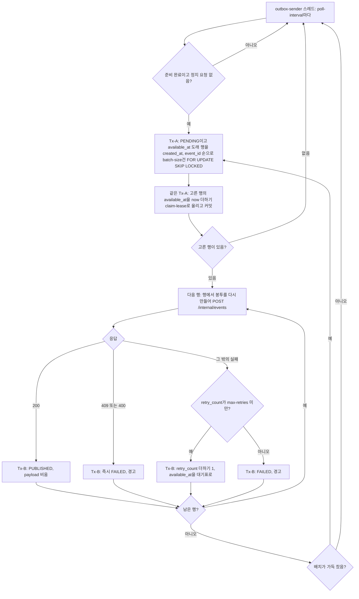
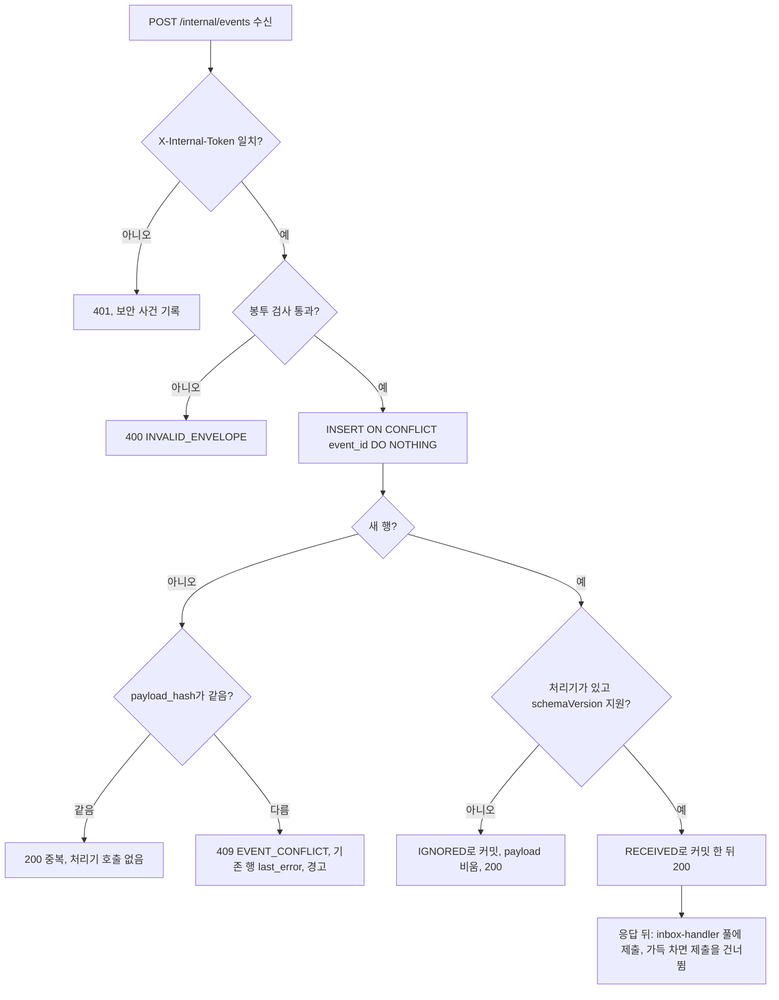
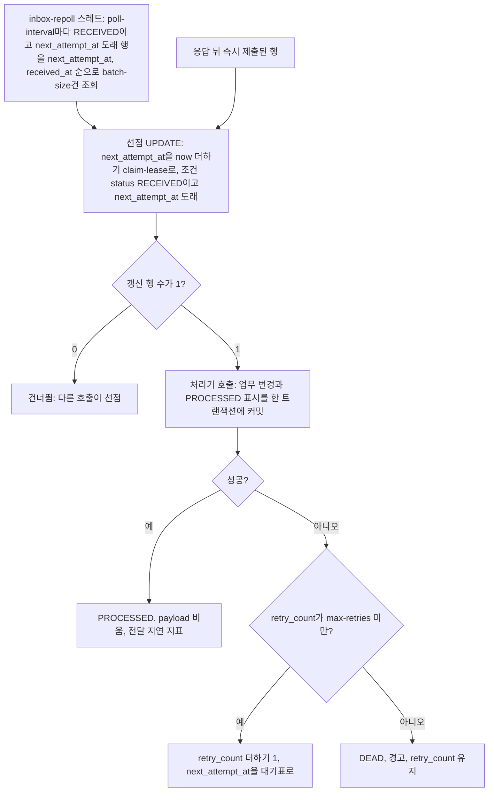
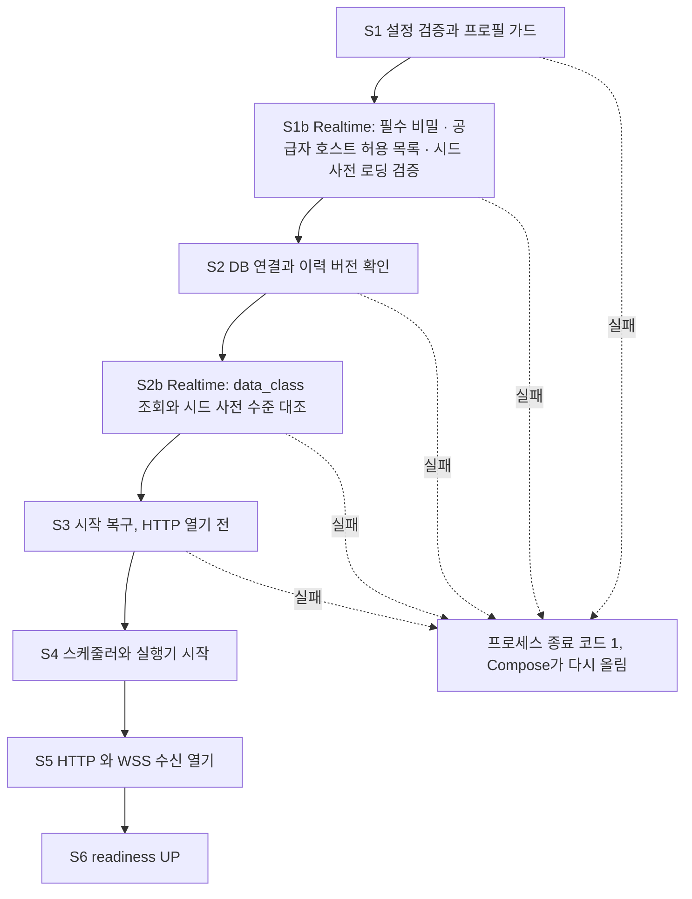
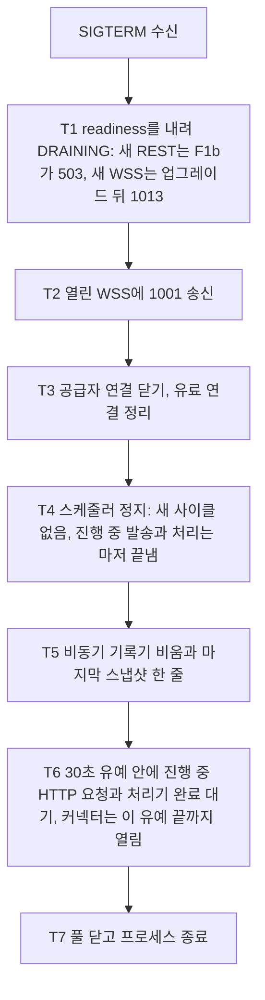
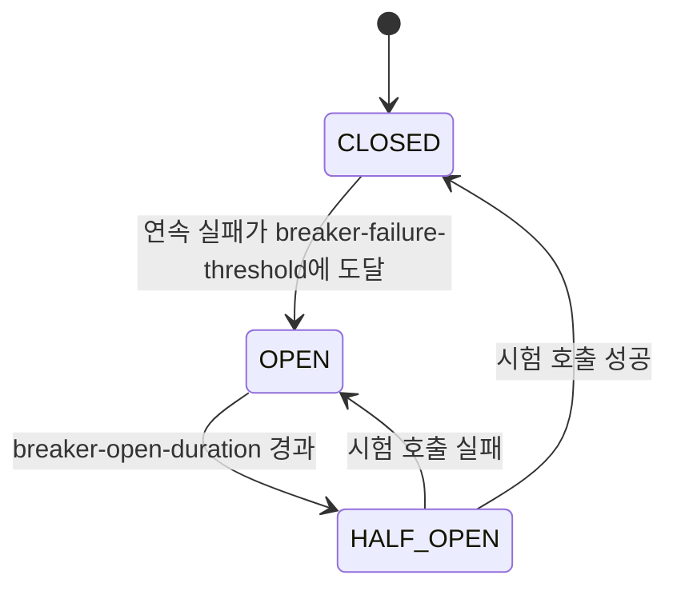

# 신뢰성 설계 — U1 u1-walking-skeleton

> 단계: Construction · NFR Design(3.3) · U1 u1-walking-skeleton · 깊이 Standard · 문서 reliability-design.md (설계 ID 접두사 RD)
> 입력: `nfr-requirements/reliability-requirements.md`(NFR4.1 ~ 4.13 · 4.16 · NFR6.1 ~ 6.4, 3.2 레지스트리) · `observability-requirements.md` · `performance-requirements.md` · `scalability-requirements.md` · `security-requirements.md` · `tech-stack-decisions.md`, `functional-design/{rules,functional-spec,entities}.md`, `nfr-design-questions.md`(Q1 ~ Q12), `contract-summary.md`(5 · 6 · 7절), ADR-006 · ADR-010
> 날짜: 2026-10-09
> 대리 판단: 질문 파일의 답 Q1 ~ Q12는 팀장(준하)의 대리 판단(가정) J73 ~ J84다. 이 문서는 J74(Q2 복원력) · J77(Q5 Outbox/Inbox · 기동 · 종료) · J80(Q8 설정 키) · J81(Q9 시험 지원) · J83(Q11 데이터 접근 패턴 중 신뢰성 부분)을 쓴다. 수치는 요구 문서나 J73 ~ J84에서 가져왔고 새로 둔 수치는 '제안(3.5 확정)'으로 표시했다. 3.3 재점검 결정 R3-n 중 이 문서에 해당하는 것을 반영했고 그 내용은 `## 5`의 '3.3 재점검 결정 R3-n' 행에 있다. 시험의 B1 절단선(R3-21)은 logical-components.md `## 5`가 맡는다.
> 표기: 이 문서의 설계 ID RD-n(맨 RD-n)은 요구 문서 5절의 3.2 재점검 RD-n과 번호가 겹친다. 요구 문서 쪽은 항상 '재점검 RD-n'으로 쓰고 이 문서의 설계 ID는 맨 RD-n(다른 문서에서는 `reliability-design.md RD-n`)으로 쓴다. 3.3 재점검 결정은 'R3-n'으로 쓴다. 이 문서의 `## 3`은 `mujoong.*` 설정 키 전체의 최종 기준 표이며, 다른 설계 문서는 새 키를 만들지 않고 이 표의 이름을 쓴다.

## 1. 설계 요소

| 설계 ID | 해결하는 NFRx.y | 패턴 · 결정 | 적용 위치(BR · 컴포넌트) | 근거 |
|---|---|---|---|---|
| RD-1 | NFR6.1, NFR6.2, NFR6.3, NFR4.1, NFR4.3, NFR4.4 | 시한 시계를 네 갈래로 나눈다: 세션 실행 단위 안 지연 타이머(②③④ · HELLO), DB 주기 점검(Core ① · 기기 연결 DISCONNECTED), 읽을 때 계산(stale · 코드 만료 · 묘비 · 속도 제한 창), 주기 작업(보고 · 정리 · 스냅샷 · 고아 세션 점검). 어느 시한이 어느 갈래인지는 2.1절 표가 정본이다 | BR6.12 · BR4.3 · BR4.8 · BR6.15 · SessionLifecycle · DeviceGateway · ActivityCoordinator | BR6.12 ④는 메모리 값, BR4.8은 영속 last_seen_at 값으로 이미 갈랐다. Core ①은 재시작 뒤에도 닫혀야 한다(NFR4.7) |
| RD-2 | NFR6.4, NFR6.2, NFR6.1 | `Clock` 빈 하나가 모든 시각의 원천이고(관측용 단조 읽기도 같은 모듈이 제공) 타이머 구동기가 그 Clock으로 마감을 계산한다. 운영은 시스템 UTC, 시험은 가변 Clock과 수동 구동기라 실제 시간을 기다리지 않는다. 시스템 시각 직접 호출 · SQL now() 금지를 ArchUnit으로 막는다 | BR4.8 · BR8.10 · BR8.11 · 공통 시간 모듈 | J81 · J83 · NFR6.4 |
| RD-3 | NFR6.3, NFR4.4, NFR4.6 | 시한 발동 규약: 타이머 스레드는 편지함에 메시지만 넣고, 세션 실행 단위가 세대 확인 → (지연 재무장) → 조건부 UPDATE 승자 하나 → 승리한 쪽만 부수 효과를 낸다. 출발 상태가 둘 이상이면 FOR UPDATE로 읽은 상태를 조건으로 쓴다. 늦은 반대 신호는 종료 상태 확인에서 버린다. 세션 실행기가 죽어 시한이 함께 사라진 비종료 세션은 maintenance의 고아 세션 점검(2.1절)이 FAILED(SERVER_RESTART)로 닫는다 | BR6.8 · BR6.11 · BR6.12 · BR6.13 · SessionLifecycle | J73 세션 직렬 실행 · BR6.8 승자 하나 |
| RD-4 | NFR4.1 | 기기 연결 끊김: 마지막 메시지 시각은 연결별 메모리에 갱신하고 영속 last_seen_at은 HEARTBEAT를 받을 때 기록기의 기기 칸(기기당 마지막 값만, `mujoong.timing.recorder.flush-interval` 200ms 배치)으로 쓴다. 5초 주기 점검이 40초 지난 연결을 조건부 UPDATE로 DISCONNECTED로 바꾸고 이벤트를 같은 트랜잭션에 쓴다. 닫힌 소켓은 레지스트리에서 즉시 빼 시작 명령이 423을 받게 한다 | BR4.8 · BR3.7 · BR6.6 · DeviceGateway | BR4.8 · 성능 설계 PD의 기록기 기기 칸 · 오디오 프레임마다 DB를 쓰지 않는다 |
| RD-5 | NFR4.2 | 공급자 장애는 시작 구간만 닫는다. 커밋 직후 START_SESSION을 먼저 보내고 그 송신 시도 시각에 20초 타이머를 무장한 뒤, 공급자 연결은 세션 실행기가 아닌 별도 가상 스레드가 열어 결과(ProviderConnected · ProviderFailed)를 일반 편지함에 넣는다(연결 시한 `mujoong.provider.connect-timeout` 10초, 20초 이하). 연결 실패는 즉시, session.started 미수신은 20초 타이머가 PROVIDER_UNAVAILABLE로, ACK · DEVICE_READY 빠짐은 DEVICE_NO_ACK와 UNRESPONSIVE로 FAILED 전이한다. 연결이 걸려 있는 동안에도 실행기는 Core 취소와 안전 타이머를 계속 처리한다. ACTIVE 뒤 공급자 끊김은 감지하지 않는다(U3 · U4) | BR6.6 · BR6.7 · BR6.8 · BR6.12 · BR7.2 · VoiceRelay | 재점검 RD-7 |
| RD-6 | NFR4.3 | stale 판정은 읽을 때 계산한다(Core 30초). 전이를 만들지 않고 '신선 → 확인 불가'로 바뀌는 첫 판정만 시한 발동으로 센다. 12의 observedAt이 메모리에 없으면 사본 열 observed_at을 쓴다 | BR4.3 · BR6.15 · DeviceRegistry · ActivityCoordinator | 읽을 때 계산, 조회 한 번 실패는 stale 아님 |
| RD-7 | NFR4.5, NFR4.6 | 멱등 · 순서 역전 방어는 DB가 한다: (guardian_id, idempotency_key) 유일 + request_hash, event_id 기본 키 + payload_hash, 사본 갱신은 한 문장 조건부 UPDATE(statusVersion · reported_at). 0행이면 다시 읽어 갈래를 정한다 | BR6.2 · BR5.5 · BR5.10 · BR4.1 · BR6.14 | J83 · BR5.10 |
| RD-8 | NFR4.7, NFR4.5, NFR4.12 | Outbox 발송 알고리즘: 앱당 전용 스케줄러 스레드 하나, `FOR UPDATE SKIP LOCKED`로 PENDING 20건을 만든 순서대로 집어 available_at을 선점 시간만큼 밀고 커밋한 뒤 트랜잭션 밖에서 직렬 발송한다. 결과는 행마다 짧은 트랜잭션으로 쓴다. 재시도 표는 2.4절 | BR5.1 ~ BR5.4 · CoreMessaging · RealtimeMessaging | J77 · ADR-010 (HTTP 대기 동안 DB 트랜잭션을 쥐지 않는다) |
| RD-9 | NFR4.5, NFR4.6, NFR4.7 | Inbox 수신 · 처리: 영속 커밋 뒤 ACK, 처리는 응답 뒤 비동기 + 재호출 폴러가 같은 선점 UPDATE로 하나의 행을 한 호출만 처리한다. 처리기 변경과 PROCESSED 표시는 한 트랜잭션, 실패는 1 · 2 · 4 · 8 · 16초 5회 뒤 DEAD | BR5.4 ~ BR5.9 · BR5.12 | J77 · BR5.7 · BR5.8 |
| RD-10 | NFR4.7 | FD 보강 A1 설계: 앱 시작 때 자기 Outbox의 FAILED 제어 이벤트 4종을 조건(오류 종류 · payload 보존)을 걸어 PENDING으로 되돌린다(같은 함수를 삭제 참가자도 부른다). 사람 결정 4를 위해 '주기적 재무장' 대안을 설정 키로 함께 설계하고 기본은 끈다 | BR5.3 · BR5.12 · BR5.14 · 시작 복구 단계 | 재점검 RD-1 · A1 |
| RD-11 | NFR4.7, NFR12.1 | FD 보강 A4 설계: guardian_id를 이벤트 저장 지점 한 곳(Outbox/Inbox 기록기)에서 채운다. 기록기 인자가 보호자 근거를 필수로 받고 이벤트 종류별 출처는 2.6절 표를 따른다. DeviceStatusChanged는 payload 선택 필드 `guardianId`(Realtime이 연결 행의 guardian_id를 실음, `## 5`의 J59 확장 (q))를 Core 수신 기록기가 먼저 쓰고 없을 때만 core_device를 조회하므로 삭제 뒤 도착하는 행도 채워진다(늦은 채움 설계는 폐기, R3-3) | BR5.14 · BR2.10 · CoreMessaging · RealtimeMessaging | A4 · 재점검 RD-11 |
| RD-12 | NFR4.7, NFR4.9, NFR4.10, NFR4.13 | 기동 순서: 컨테이너는 PostgreSQL → migrate(일회성) → Realtime → Core → Next.js → Nginx, 앱 안은 설정 · 프로필 가드 → (Realtime) 필수 비밀 · 공급자 호스트 허용 목록 · 시드 사전 로딩 검증(S1b) → DB 연결 · 이력 버전 확인 + JPA validate(앱은 Flyway를 실행하지 않음) → (Realtime) `data_class` 조회와 시드 사전 수준 대조(S2b) → 시작 복구(HTTP 열기 전, 크래시 뒤 Outbox 선점 해제 S3f 포함) → 스케줄러 → 수신 열기 → readiness UP(사전 로딩 완료 포함) | BR5.12 · BR6.13 · BR8.1 · BR8.2 · BR8.3 | J77 · ADR-002 (경쟁 마이그레이션 금지) |
| RD-13 | NFR4.10, NFR4.7, NFR4.9 | 정상 종료 순서(SIGTERM): readiness 내림(DRAINING 시작: 필터 F1b가 새 REST 요청에 503 SERVICE_NOT_READY + Retry-After를 답하고 /internal/events도 503) → 새 연결 1013 → 열린 WSS 1001 → 공급자 연결 닫기 → 폴러 정지 → 30초 유예(서버 커넥터는 유예 끝까지 열어 둠) → 종료. 진행 중 세션은 닫지 않고 다음 기동의 BR6.13에 맡긴다 | BR6.13 · BR4.8 · DeviceGateway · VoiceRelay | J77 (세션 끝까지 기다리기는 배포 중단 60초를 넘는다) |
| RD-14 | NFR4.12, NFR4.2, NFR4.16 | 내부 HTTP 복원력: 모든 호출에 연결 0.5초 + 호출별 응답 제한(J26), 재시도는 멱등 호출에만(시작은 시간 초과 때 같은 sessionId로 1회). 회로 차단기(연속 3회 실패 → 5초 열림)는 Core → Realtime의 session_start 호출 하나에만 둔다. session_end · 취소(CORE_ABANDONED)는 차단기 없이 항상 2초 제한으로 시도하고 실패하면 예외로 올려 Inbox 재호출(BR5.8)이 이어받는다. session_view 실패는 별도 차단기 없이 Core 사본으로 답한다. Realtime → Core 상태 보고 루프에는 차단기 상태 기계 없이 '라운드 건너뛰기' 규칙만 둔다 | BR5.8 · BR6.5 ~ BR6.9 · BR6.14 · BR6.15 · ActivityCoordinator · DeviceGateway | J74 · J26 |
| RD-15 | NFR4.12, NFR4.3 | 장애 도메인 격리: 두 앱의 DB 풀 · 스레드 · HTTP 클라이언트 · 스케줄러를 분리하고 한 앱이 멈췄을 때 다른 앱의 동작을 시점별 표(2.10절)로 못박는다 | BR4.3 · BR6.7 · BR6.9 · BR6.15 · BR3.4 · BR5.3 | J74 · NFR4.13 · J79(502→503 해석, R3-16) |
| RD-16 | NFR4.13, NFR4.9 | 준비 상태 게이트: 앱이 DB 점검자(5초 주기, 연속 3회 실패)로 readiness를 내리고, 내려간 동안 REST는 앱이 직접 503 오류 봉투(`SERVICE_NOT_READY`, J59 확장 (n))를 답한다(Nginx 502는 업스트림 접속 불가일 때만). /internal/events도 503이라 보내는 쪽 Outbox가 재시도한다 | BR8.1 · BR8.6 · BR8.9 · 공통 필터 | 재점검 RD-8 · 재점검 RD-14 |
| RD-17 | NFR4.9 | 자동 복구: `restart: unless-stopped`, 치명 오류(OOM · 시작 실패)는 프로세스를 끝내 Compose가 올리게 한다. unhealthy만으로는 재시작되지 않는 한계를 문서화하고 3.4로 넘긴다 | BR5.12 · BR6.13 · Compose | ADR-006 6.2 · 재점검 RD-8 |
| RD-18 | NFR4.8 | 가용성 집계: 프로브 3종 결과 파일과 배포 시각 파일로 분 단위 판정 · 배포 구간 제외 · 미관측 분 분리 · 누적 가용성 계산 규칙을 정한다. 프로브 스크립트 자체는 observability-design.md가 정한다 | NFR4.15 · 배포 스크립트 · 집계 스크립트 | 재점검 RD-8 |
| RD-19 | NFR4.10 | 배포 중단 60초 예산: migrate를 구 앱이 도는 중에 먼저 실행(expand 먼저), 두 앱 재생성은 병렬을 권고한다. 정지 30초 + 기동 20초 안에서 끝나는 예산표를 둔다 | BR8.2 · BR9.7 · Compose | J77 · NFR4.10 |
| RD-20 | NFR4.11 | 백업 · 복원: 매일 03:00 KST `pg_dump`(두 스키마) + 역할 정의, 임시 파일 → 검증 → 이름 변경, 7일 보관. 복원 리허설은 별도 Compose 프로젝트에서 8단계로 하고 소요 시간을 RTO 60분과 비교한다 | BR1.4 · BR5.11 · NFR12.4 · backup 컨테이너 | J62 · 재점검 RD-8 |
| RD-21 | NFR4.16 | 앱만 오프라인: 끝내기 요청은 탭 시점에 만든 requestId를 재탭에도 그대로 쓰고, 네트워크 오류 · 시간 초과는 '종료 요청됨'으로 표시하지 않으며 서버 변화는 없다. 재시도 때 키 재사용 조건은 performance-design.md 2.9의 재시도 키 재사용 표를 인용한다(R3-14). 요청이 닿은 뒤 응답만 잃은 경우는 다음 12 폴링이 CLOSING을 반영한다 | BR6.9 · BR6.15 · 12 · P1 | 재점검 RD-7 |
| RD-22 | NFR4.5, NFR4.6, NFR6.3, NFR6.4 | 데이터 접근 패턴(신뢰성): 트랜잭션 경계는 서비스 계층 한 곳, READ COMMITTED, 조건부 UPDATE와 부분 유일 색인이 기본, FOR UPDATE는 규칙이 정한 곳만, 락 순서 보호자 → 코드 → 옛 기기, 교착 · 직렬화 실패는 멱등한 곳에서만 2회 재시도, 시각은 앱 Clock | BR2.2 ~ BR2.5 · BR3.7 · BR6.8 | J83 |
| RD-23 | NFR6.2, NFR4.1, NFR4.2, NFR4.12, NFR4.13, NFR6.4 | 시험 지원: 가변 Clock · 수동 타이머 구동기, 내부 HTTP 장애 주입 감싸개, 가짜 공급자, 기기 시뮬레이터, 수신기 대역, 계약 스펙에서 생성한 앱 간 호출 대역. 장애 주입 훅은 시험 소스 집합과 외부 도구에만 있어 운영 이미지에 훅 코드가 없고(보안 설계 SD-25와 같다), 원격 제어면을 두지 않으며, demo · prod와 dev · load-test · test(CI 프로필)가 함께 켜지면 기동을 거부한다(조합 표 정본은 보안 설계 SD-14) | BR8.3 · BR8.11 · 시험 모듈 | J81 · 3.4의 같은 이미지 이동 방침 |
| RD-24 | NFR6.1 | 설정 키 거버넌스: `mujoong.*` 한 트리를 타입 있는 설정 객체로 바인딩하고 기동 때 검증한다. 코드가 읽는 키 목록을 대조하는 시험 · 시간 숫자 상수 검색을 ArchUnit으로 둔다. 일치 기준은 하나다: `contracts/timing.md` = 계약 7절 키, 같은 파일의 별도 절 = U1 추가 키(7절 밖 `mujoong.timing.*` 4종), 나머지 비 timing 키는 이 문서 `## 3`에만 둔다 | BR8.11 · 공통 설정 모듈 | J80 · 재점검 RD-2 |

## 2. 설계 상세

### 2.1 시한별 시계 설계 (RD-1 · RD-3 · RD-6)

세션 안전 시한은 두 앱에 나뉘어 있어 한 가지 방식으로 통일하지 않는다. 아래 표가 '어떤 시한이 어느 메커니즘인가'의 정본이다.

| 시한 | 설정 키 | 값 | 앱 | 시계 시작점 | 메커니즘 | 재시작 때 | 승자 판정 |
|---|---|---|---|---|---|---|---|
| ① 준비 | `mujoong.timing.session.preparing-timeout` | 10초 | core-api | core_activity.requested_at | DB 주기 점검: `mujoong.session.timer-tick`마다 REQUESTED이고 status_version 0이고 local_failed false이고 requested_at이 10초 지난 행을 찾는다 | 살아남는다. Core 재시작 뒤 REQUESTED 행도 다음 점검이 닫는다 | `UPDATE ... WHERE status = REQUESTED AND status_version = 0`이 1행일 때만 로컬 FAILED(start_result_code 202)와 CORE_ABANDONED 취소. 0행이면 Realtime 이벤트가 앞선 것이라 아무것도 하지 않는다 |
| ② 기기 응답 | `mujoong.timing.session.device-ack-timeout` | 20초 | realtime | START_SESSION 송신을 시도한 시각. 커밋 직후 START_SESSION을 먼저 보내고 그 시각에 무장한다(공급자 연결은 그 뒤 별도 가상 스레드가 열며 연결 시간은 이 20초 안에 들어간다, R3-1) | 세션 실행 단위 안 지연 타이머(메모리) | 사라진다. BR6.13이 비종료 세션을 FAILED(SERVER_RESTART)로 닫는다 | 세션 행 FOR UPDATE 읽기로 failure_code를 정하고 `WHERE status = 읽은 상태`로 쓴다(BR6.8) |
| ③ 종료 확인 | `mujoong.timing.session.closing-confirm` | 30초 | realtime | CLOSING 전이를 이긴 커밋 시각 | 세션 안 지연 타이머 | 사라진다(BR6.13이 CLOSING도 FAILED로 닫음) | `WHERE status = CLOSING`. ④보다 우선한다: CLOSING에서는 ④가 발동해도 출발 상태가 ACTIVE가 아니라 0행이다 |
| ④ 끊김 | `mujoong.timing.device.disconnect` | 40초 | realtime | ACTIVE 전이 시각, 이후 그 세션의 START_SESSION을 받은 소켓의 마지막 기기 메시지 수신 시각 | 세션 안 지연 타이머 + 지연 재무장(아래 규약 3) | 사라진다 | `WHERE status = ACTIVE` |
| 기기 연결 DISCONNECTED | `mujoong.timing.device.disconnect` + `mujoong.device.disconnect-check-interval` | 40초 + 점검 5초 | realtime | 영속 last_seen_at | DB 주기 점검 | 살아남는다. 시작 복구가 CONNECTED 행을 먼저 DISCONNECTED로 바꾼다(BR6.13) | `WHERE device_id AND connection_id AND last_seen_at <= 점검시각 − 40초`(BR4.8) |
| HELLO 대기 | `mujoong.timing.device.hello-timeout` | 5초 | realtime | WSS 업그레이드 시각 | 연결 실행 단위 안 지연 타이머 | 연결과 함께 사라진다 | HELLO 수신 때 취소, 발동하면 4408로 닫기 |
| 기기 보고 stale | `mujoong.timing.core.device-status-stale` | 30초 | core-api | core_device.reported_at | 읽을 때 계산 | 영향 없음 | 전이 없음. 판정만 바꾼다(BR4.3 ③) |
| 12 stale | 같은 키 | 30초 | core-api | observedAt(메모리, 없으면 core_activity.observed_at) | 읽을 때 계산 | 메모리 값이 비어도 DB 열로 판정 | 전이 없음 |
| 연결 상태 보고 | `mujoong.timing.device.status-report-interval` | 10초 | realtime | 앞 보고 | 주기 작업(고정 지연) | 시작 직후 첫 보고 | 보고는 유실돼도 된다(BR4.8) |
| Core 취소 묘비 | `mujoong.session.tombstone-ttl` | 10분 | realtime | 취소 접수 시각 | 읽을 때 계산 + 청소 주기 | 사라진다(BR6.14 재취소가 보완) | 시작 명령 처리 0단계에서 확인한다: 묘비 맵에 sessionId가 있으면 409 SESSION_NOT_ACTIVE(BR6.6). 취소가 INIT 등록보다 먼저 도착하면 묘비만 남기고 이후 시작이 거절된다(R3-9) |
| 고아 세션 점검 | `mujoong.session.orphan-check-interval` | 30초 | realtime | 점검 시각 | maintenance 주기 작업 | 점검마다 돈다. 재시작 때는 S3a가 비종료 세션을 이미 모두 닫는다 | 세션 레지스트리에 없거나 실행기가 죽은 비종료 행을 FOR UPDATE로 읽어 FAILED(SERVER_RESTART)로 전이(`WHERE status = 읽은 상태`)하고 ERROR 로그와 SessionStateChanged를 쓴다(R3-6, 아래 표) |
| 속도 제한 창 | `mujoong.timing.bootstrap.rate-limit` · `mujoong.timing.device.register-failure-limit` | 1시간 · 10분 | core-api | 요청 시각 | 읽을 때 계산(슬라이딩 창), 청소 때 오래된 키 제거 | 초기화된다(NFR7.4 전제) | 해당 없음 |
| 등록 코드 수명 | `mujoong.timing.bootstrap.code-ttl` | 24시간 | core-api | code_issued_at | 읽을 때 계산 + `mujoong.cleanup.device-expiry-interval` 정리 작업 | 영속 | 조건부 UPDATE로 EXPIRED(BR1.4) |
| Outbox 폴 · 재시도 | `mujoong.outbox.*` | 500ms · 대기표 | 양 앱 | available_at | DB 주기 폴러(전용 스레드) | 영속 | 2.4절 |
| Inbox 재호출 | `mujoong.inbox.*` | 500ms · 대기표 | 양 앱 | next_attempt_at | 응답 뒤 즉시 비동기 + DB 주기 폴러 | 영속 | 선점 UPDATE(2.5절) |
| 정리 작업 | `mujoong.cleanup.messaging-interval` · `mujoong.retention.failed-payload` | 하루 · 7일 | 양 앱 | created_at 또는 received_at | 주기 작업 | 영속 | 멱등 UPDATE |
| 보호자 세션 유휴 | `mujoong.timing.login.session-idle` | 30일 | core-api | 마지막 요청 | 프레임워크(Spring Session JDBC)의 유휴 만료 | 영속 | 프레임워크 정리 주기(표준 키) |

네 갈래의 선택 근거는 다음과 같다.

| 갈래 | 쓰는 시한 | 이점 | 한계 | 고른 이유 |
|---|---|---|---|---|
| 세션 실행 단위 안 지연 타이머 | ② ③ ④ · HELLO | 발동 지연이 점검 주기에 묶이지 않는다. DB 부하가 없다. 세션 편지함으로만 들어와 프레임 · 공급자 이벤트와 직렬이다(락 없음). 한 세션의 지연이 다른 세션 시계를 밀지 않는다(NFR7.3) | 메모리라 재시작하면 사라지고 단일 인스턴스를 전제한다(scalability 전제 목록) | BR6.12 ④가 메모리 값이라고 못박았고 재시작은 BR6.13이 모두 닫는다 |
| DB 주기 점검 | Core ① · 기기 연결 DISCONNECTED | 프로세스가 바뀌어도 같은 행으로 판정한다 | 점검 주기만큼 늦게 발동한다(1초 · 5초) | Core ①은 Core 재시작 뒤에도 닫혀야 하고(NFR4.7) BR4.8이 영속 값 기준을 정했다 |
| 읽을 때 계산 | stale · 코드 만료 · 묘비 · 속도 제한 창 | 타이머도 되돌릴 상태도 없다 | 전이를 일으킬 수 없다 | 표시와 거절만 바꾸는 시한 |
| 주기 작업 | 보고 · 정리 · 폴러 · 스냅샷 · 고아 세션 점검 | 단순하다 | 겹침 방지가 필요하다 | 고정 지연(앞 실행이 끝난 뒤 간격)이라 겹치지 않는다 |

발동 처리 규약(모든 세션 실행 단위 안 타이머가 같다):

| 순서 | 규약 | 이유 |
|---|---|---|
| 1 | 타이머 스레드는 `TimerFired(sessionId, 종류, 세대)` 메시지를 세션 편지함에 넣고 끝낸다. DB · 공급자 호출을 하지 않는다 | 시계 스레드가 막혀 다른 세션 시한이 밀리는 것을 막는다(NFR7.3) |
| 2 | 세션 실행 단위가 메시지를 꺼내 세대가 현재 세대와 같은지 본다. 취소 뒤 늦게 도착한 타이머는 버린다 | 취소와 발동의 경주를 메시지 수준에서 끊는다 |
| 3 | 발동 때 Clock으로 경과를 다시 확인한다. ④는 `now − 마지막 기기 메시지 시각`이 40초 미만이면, ② ③은 `now − 시작점`이 한도 미만이면(조기 발동) 남은 시간만큼 다시 무장하고 끝낸다(지연 재무장). ④는 프레임마다 타이머를 다시 걸지 않는다 | 오디오 프레임 초당 50개마다 타이머를 갈아끼우는 비용을 없앤다. 마지막 메시지 시각은 메모리 값 하나만 갱신한다. 지연 큐가 일찍 깨어나도 시한이 이르게 발동하지 않는다 |
| 4 | 전이를 시도한다. 출발 상태가 하나면 단일 조건부 UPDATE, 둘 이상(②)이면 세션 행 FOR UPDATE 읽기 → failure_code 결정 → `WHERE status = 읽은 상태`. 0행이면 한 번 다시 읽어 아직 출발 집합 안이면 다시 시도하고, ACTIVE · 종료 상태는 이미 충족된 것으로 본다 | BR6.8 |
| 5 | 행 수가 1일 때만 SessionStateChanged를 같은 트랜잭션에 쓰고, 커밋 뒤에 CLOSE_TRANSPORT · STOP_OUTPUT · 공급자 닫기 · UNRESPONSIVE 기록을 한다 | 승자 하나, 부수 효과는 승자만 |
| 6 | 행 수가 0이면 SessionEvent에 기록만 한다. `timeout_fired` 카운터와 TIMEOUT_FIRED 로그는 전이를 이긴 쪽에서만 올린다 | 발동 = 전이 승리(observability-design.md) |
| 7 | 늦은 반대 신호(ACK · DEVICE_READY · session.started · VOICE_SESSION_CLOSED)는 종료 상태 세션에서는 기록 없이 버리고(BR6.11), 전이에 진 경우 SessionEvent에 기록만 한다 | 전이를 되돌리지 못한다(NFR6.3) |
| 8 | 전이 중 DB 예외가 나면 `mujoong.session.timer-tick`(1초) 뒤 같은 메시지를 다시 넣는다. DB가 돌아오면 첫 시도가 승자다 | DB 장애는 전체 쓰기 중단 도메인이다(J79). 오래 이어지면 readiness가 내려가고 다음 기동의 BR6.13이 정리한다 |

고아 세션 점검(R3-6). 세션 시한 ② ③ ④는 세션 실행기의 메모리에만 있어 실행기가 예외로 죽으면 시한도 함께 사라진다. 실행기 최상위 예외 처리(performance-design.md 2.1: 예외를 잡으면 FAILED 전이를 시도한 뒤 정리)가 첫 방어이고, 아래 점검이 그 처리마저 실패한 경우의 마지막 안전망이다. 그렇지 않으면 보호자 계정이 BR6.3의 부분 유일 색인에 갇힐 수 있다.

| 순서 | 동작 | 이유 |
|---|---|---|
| 1 | maintenance 스레드가 `mujoong.session.orphan-check-interval`(30초)마다 비종료(PREPARING · DEVICE_ACK · ACTIVE · CLOSING) 세션 id를 읽는다 | 재시작 사이에도 같은 점검이 돈다 |
| 2 | 세션 레지스트리에 항목이 없거나 항목의 실행기 스레드가 이미 끝난 id만 남긴다. 레지스트리 등록(INIT)은 DB 커밋보다 먼저라 시작 중인 정상 세션은 걸리지 않는다 | 정상 세션을 닫지 않는다 |
| 3 | 남은 세션마다 행을 FOR UPDATE로 다시 읽어 아직 비종료이면 `WHERE status = 읽은 상태`로 FAILED(failure_code SERVER_RESTART)로 전이한다. 그 사이 정상 종료됐으면 읽은 상태가 종료 상태라 건너뛴다 | BR6.8의 다중 출발 전이, 승자 하나 |
| 4 | 행 수가 1일 때만 ERROR 로그(APP_ERROR, errorKind `OrphanSessionDetected`)와 SessionStateChanged를 같은 트랜잭션에 쓰고, 커밋 뒤 연결이 살아 있고 START_SESSION이 나갔으면 CLOSE_TRANSPORT(FAILED)와 STANDBY, 공급자 닫기, 레지스트리 항목 정리를 한다 | 부수 효과는 승자만 |
| 5 | 한계: 실행기가 살아 있으나 멈춘 경우는 대상이 아니다(실행기는 블로킹 호출을 하지 않는 설계, performance-design.md 2.1). 시한 발동이 아니므로 `timeout_fired`는 올리지 않고 `session_ended_total`(failure_code server_restart)만 센다 | 지표 의미를 섞지 않는다 |

### 2.2 Clock과 타이머 구동기 (RD-2 · RD-24)

| 구성 | 역할 | 운영 | 시험 |
|---|---|---|---|
| `Clock` 빈 | 모든 시각 읽기의 유일한 원천. 생성자 주입으로만 받는다 | 시스템 UTC | 가변 Clock(설정 · 앞당기기) |
| 단조 읽기 | 관측용 지연 길이를 재는 읽기(프레임 지연 · 구간 길이). Clock과 같은 시간 모듈의 같은 추상화가 제공한다(성능 설계 PD 요청) | 시스템 단조 시계를 시간 모듈의 어댑터 한 곳이 감싼다 | Clock을 앞당길 때 같은 양만큼 앞서는 가짜 |
| 타이머 구동기 | 지연 작업 예약. 마감 시각은 Clock으로 계산하고 발동 시 세션 편지함에 메시지를 넣는다 | 데몬 지연 큐 스레드(Realtime 2개: 안전 시한 시계 · 구간 조용 시간 시계, Core 0개. 아래 스레드 수 표) | 수동 구동기: `advance(d)`가 Clock을 앞당기고 도래한 타이머를 마감 순서대로 즉시 실행한 뒤 편지함을 비운다 |
| 주기 작업 구동기 | 고정 지연 작업(폴러 · 점검 · 보고 · 정리 · 스냅샷)을 예약한다 | 앱당 스케줄러 스레드(outbox-sender · inbox-repoll · maintenance, Realtime은 기록기 틱 추가. 아래 스레드 수 표) | 수동 구동기 |
| 점검 함수 | 주기 작업의 본체를 `runOnce(now)` 순수 함수로 분리한다 | 스케줄러가 부른다 | 시험이 직접 불러 점검 주기 지연을 배제한다(요구 문서 열린 질문) |

| 규칙 | 내용 | 확인 |
|---|---|---|
| R1 | `System.currentTimeMillis` · `System.nanoTime` · `Instant.now()` · `LocalDateTime.now()` · `new Date()` 직접 호출 금지(허용 목록: 시간 모듈의 어댑터 한 곳이 시스템 단조 시계를 감싸는 것, 프레임워크 어댑터 계층) | ArchUnit(3.5 구현) |
| R2 | 비교 · 정렬 · 시한 판정에 쓰는 시각은 앱 Clock이 채운 값이다. SQL의 `now()` · `clock_timestamp()` · `CURRENT_TIMESTAMP`를 질의 문자열과 마이그레이션 기본값에 쓰지 않는다. 비교 시각은 `:now` 바인딩 | 질의 문자열 정적 검사 + 마이그레이션 검색 |
| R3 | 관측용 지연 길이는 같은 추상화의 단조 읽기 차이로 재고, 시각 키는 Clock 값으로 남긴다. 프레임워크가 내부에서 재는 값(HTTP 서버 지표)은 예외 | 성능 설계 PD · observability-design.md OD-8 |
| R4 | 타이머가 마감보다 일찍 깨어나도 발동 때 Clock으로 경과를 다시 확인한다(2.1절 규약 3). 호스트 시계 자체가 뛰는 문제(앞으로 뛰면 이르게, 뒤로 가면 늦게 발동)는 호스트 시간 동기(3.4)에 맡긴다 | 5절 열린 질문 |
| R5 | 같은 Clock을 회로 차단기 열림 시간 · 속도 제한 창 · 묘비 만료 · 재시도 available_at 계산에도 쓴다 | 시험이 한 가변 Clock으로 모두 제어 |

스케줄러 스레드 수(R3-18). performance-design.md 2.1-A · 3절과 scalability-design.md 2.6-D는 이 표의 수를 인용한다. 세션 실행기 · 연결 송신기 · 공급자 연결 스레드는 가상 스레드이고 inbox-handler는 풀(`mujoong.inbox.handler-threads` 2)이라 이 표에 넣지 않는다.

| 플랫폼 스레드 | Realtime | Core | 하는 일 |
|---|---|---|---|
| 시계 1: 안전 시한 시계 | 1 | 0 | ② ③ ④ · HELLO 5초 · 타이머 전이 실패 재시도의 만기를 세션 편지함에 넣기만 한다 |
| 시계 2: 구간 조용 시간 시계 | 1 | 0 | 턴마다 다시 거는 구간 조용 시간(800ms) 만기. 잦은 재무장이 안전 시한 큐를 흔들지 않게 분리한다(NFR7.3) |
| 기록기 틱 | 1 | 0 | `mujoong.timing.recorder.flush-interval`마다 기록기 플러시를 제출(Realtime 전용) |
| outbox-sender | 1 | 1 | Outbox 발송 사이클(2.4절) |
| inbox-repoll | 1 | 1 | Inbox 재호출 조회(2.5절) |
| maintenance | 1 | 1 | Core ① 점검 · 기기 연결 DISCONNECTED 점검 · 상태 보고 · 고아 세션 점검 · DB 점검자 · 정리 · 스냅샷 |
| 합계 | 6 | 3 | Realtime = 시계 2 + 기록기 틱 1 + outbox-sender 1 + inbox-repoll 1 + maintenance 1, Core = outbox-sender 1 + inbox-repoll 1 + maintenance 1 |

시험이 시간을 다루는 두 방식은 둘 다 쓴다(NFR6.2).

| 방식 | 하는 일 | 주로 쓰는 시험 |
|---|---|---|
| 키 값 줄이기 | `mujoong.timing.*` 값을 `## 3`의 '시험이 줄이는 값'으로 바꿔 실제 짧은 시간으로 돌린다 | 통합 시험(Testcontainers + 두 앱), 기동 시험 |
| Clock 앞당기기 | 가변 Clock과 수동 구동기로 직전(한도 − 1틱)과 직후(한도)를 확인한다 | 단위 · 슬라이스 시험, 시한 vs ACK 경합 시험 |

### 2.3 장애 대응 설계표 (NFR4.1 ~ 4.7 · 4.16)

| NFR | 장애 | 감지 | 처리 | 복구 | 근거 |
|---|---|---|---|---|---|
| NFR4.1 | 소켓이 닫기 프레임 없이 끊김(1006 등) | 닫힘 이벤트는 소켓 레지스트리에서 연결을 빼고 DEVICE_CONNECTION 로그만 남긴다(상태는 바꾸지 않음). 판정은 연결 행의 5초 점검(`last_seen_at` 40초)과 ACTIVE 세션의 타이머 ④ | 연결 행은 조건부 UPDATE로 DISCONNECTED + DeviceStatusChanged를 한 트랜잭션에. ACTIVE 세션은 ④가 ABORTED(DISCONNECT) 조건부 1회, 출력 · 공급자 정리. 레지스트리에서 빠졌으므로 그 사이 시작 명령은 423 | 기기 웹이 켜짐 상태에서 5초 간격 재접속 → HELLO_OK 시점 FOR UPDATE 교체로 CONNECTED. 끊긴 세션은 이어 붙이지 않고 보호자가 새 키로 시작 | BR4.8 · BR6.12 ④ · BR3.7 · BR9.7 |
| NFR4.1 | 소켓은 열려 있지만 40초 무음 | 같은 두 시계. 메모리 마지막 메시지 시각이 오디오 프레임 · HEARTBEAT 모두로 갱신되고 DB last_seen_at은 HEARTBEAT를 받을 때 기록기 기기 칸으로 병합 기록(200ms 배치) | 위와 같다. 단 다음 HEARTBEAT가 오면 같은 connection_id로 CONNECTED 복귀(`WHERE connection_id`), 이미 ABORTED가 된 세션은 되돌리지 않는다 | HEARTBEAT 재개 | BR4.8 ③ · BR6.11 |
| NFR4.1 | 「끄기」(1000) 또는 페이지 이탈(1001) | 닫기 프레임 수신 | 즉시 OFFLINE(`WHERE device_id AND connection_id`) + 이벤트. 서버가 보내는 1001은 해당하지 않는다. 진행 중 세션은 같은 40초 경로를 탄다 | 보호자가 04 · 05에서 기기 상태를 확인하고 아이가 「켜기」 | BR4.8 ② · BR9.5 |
| NFR4.2 | 공급자 연결 거부 · 무응답 · session.started 없음 | 연결은 세션 실행기가 아닌 별도 가상 스레드가 열고(연결 시한 `mujoong.provider.connect-timeout` 10초, 20초 이하) 연결 실패 · 시한 초과는 ProviderFailed가 일반 편지함에 들어오는 즉시 드러난다. 미수신은 타이머 ②(START_SESSION 송신 시도 시각부터 20초, 연결 시간 포함) | 공급자 연결 실패는 20초를 기다리지 않고 즉시 PROVIDER_UNAVAILABLE(기기 판정은 UNRESPONSIVE로 쓰지 않음). 20초 타이머가 발동하면 ACK · DEVICE_READY가 빠졌으면 DEVICE_NO_ACK + 기기 UNRESPONSIVE, 둘은 왔는데 session.started가 없으면 PROVIDER_UNAVAILABLE로 PREPARING · DEVICE_ACK → FAILED 조건부 1회. START_SESSION이 나갔고 연결이 살아 있으면 CLOSE_TRANSPORT(FAILED)와 STANDBY, 공급자 세션 정리. 연결이 걸려 있는 동안에도 세션 실행기는 Core 취소(CORE_ABANDONED)와 안전 타이머를 계속 처리한다 | FAILED는 종료 상태라 계정이 잠기지 않는다. 자동 재시도 없음, 보호자가 새 키로 다시 시작. ACTIVE 뒤 끊김은 감지하지 않는다(U3 · U4) | BR6.6 ⑤ · BR6.8 · BR6.12 ② · BR7.2 |
| NFR4.3 | Realtime 보고가 30초 넘게 없음 | 읽을 때 계산: now − reported_at이 30초 초과. 12는 now − observedAt이 30초 초과(조회 한 번 실패만으로는 아님) | DeviceView UNKNOWN(canStart false)이라 새 시작은 423 DEVICE_NOT_STABLE. 세션 전이는 일으키지 않는다. `timeout_fired{device_status_stale}`는 기기별 '신선 → 확인 불가' 첫 판정에만 센다(Core 메모리 래치) | 다음 보고(10초 주기) 또는 조회 성공이 오면 자동으로 풀린다 | BR4.3 ③ · BR6.15 · BR6.1 |
| NFR4.4 | 끝내기 뒤 기기 멈춤 확인이 없음 | 타이머 ③ (CLOSING 진입 30초) | CLOSING → ENDED_UNCONFIRMED 조건부 1회, 기기 UNRESPONSIVE 기록, 연결이 살아 있으면 STANDBY. 늦은 VOICE_SESSION_CLOSED는 SessionEvent 기록만 | 같은 연결의 다음 HEARTBEAT 또는 새 HELLO_OK가 UNRESPONSIVE를 푼다 | BR6.12 ③ · BR6.11 |
| NFR4.5 | 같은 시작 요청 · 같은 이벤트가 반복 | (guardian_id, idempotency_key) 유일 위반 · request_hash 대조, event_id 기본 키 충돌 · payload_hash 대조 | 같은 키 · 본문은 첫 응답 재생(로컬 FAILED이면 저장된 start_result_code 재생), 다른 본문은 409 IDEMPOTENCY_CONFLICT. 같은 event_id · 해시는 200(처리기 호출 없음), 다른 해시는 409 EVENT_CONFLICT + 경고 로그 + 기존 행 last_error | 호출자 재시도가 같은 결과를 받는다 | BR6.2 · BR5.5 |
| NFR4.6 | 사본 갱신 이벤트가 뒤바뀌어 옴, 늦은 신호 | 조건부 UPDATE 0행 | 낡은 것(statusVersion이 크지 않음 · reported_at 이하)은 PROCESSED로 버린다. 0행이면 행을 다시 읽어 로컬 FAILED 사본에 종료 아닌 이벤트가 온 경우만 CORE_ABANDONED 취소를 다시 보내고, 호출 실패는 예외로 Inbox 재호출에 맡긴다. 종료 상태는 되돌아가지 않는다 | 처리 순서와 무관하게 최종 값이 같다 | BR5.10 · BR4.1 · BR6.14 · BR6.8 |
| NFR4.7 | 앱 재시작 또는 상대 앱이 약 8분보다 오래 멈춤 | 앱 시작 때 시작 복구 단계(2.7절 S3) | Realtime: 비종료 세션 FAILED(SERVER_RESTART) + 이벤트, CONNECTED · UNSTABLE 연결 행 DISCONNECTED(connection_id 비움) + 이벤트. 양 앱: Inbox RECEIVED의 next_attempt_at을 now로 당김, Outbox PENDING은 S3f가 선점 시간을 걷어 첫 사이클에 집음(2.7절), FAILED 제어 이벤트 4종은 PENDING으로 되돌림(A1, 2.6절). Core의 REQUESTED는 ① 점검이 닫음 | 기기 웹 5초 재접속 → HELLO_OK. 세션은 이어 붙이지 않는다. 되돌린 제어 이벤트는 이어서 전달 | BR5.12 · BR6.13 · BR5.3 · A1 |
| NFR4.16 | 보호자 폰만 오프라인: 끝내기 요청이 서버에 닿지 못함 | 폰 요청의 네트워크 오류 · 시간 초과(`mujoong.timing.parent.request-timeout`) | 서버 변화 없음: 세션 ACTIVE 유지, 기기 대화 계속, 끝내기 명령 0회. 화면은 mockups 9-18 문구를 보이고 '종료 요청됨'으로 표시하지 않는다(2.13절) | 네트워크가 돌아오면 보호자가 다시 누른다(requestId 같음, 멱등). 요청이 서버에 닿은 뒤 응답만 잃었다면 다음 12 폴링이 CLOSING을 반영 | BR6.9 · BR6.15 |

### 2.4 Outbox 발송 알고리즘 (RD-8)

앱마다 `outbox-sender` 전용 스케줄러 스레드가 하나다. 스레드는 고정 지연(`mujoong.outbox.poll-interval`)으로 돈다. 아래는 한 번의 사이클이다.

텍스트 대체:

1. 스레드가 poll-interval(500ms)마다 깨어 앱이 준비 완료이고 정지 요청이 없을 때만 일한다.
2. Tx-A(짧은 트랜잭션): `PENDING`이고 `available_at <= now`인 행을 `created_at, event_id` 순으로 batch-size(20)건 `FOR UPDATE SKIP LOCKED`로 읽고(Outbox 표에는 id 열이 없고 event_id(UUID)가 기본 키라 같은 시각 행의 순서를 정하는 데 쓴다), 같은 트랜잭션에서 그 행들의 `available_at`을 `now + claim-lease`로 올린 뒤 커밋한다. 이 시점부터 다른 폴러(재시작 겹침)는 그 행을 보지 못한다.
3. 고른 행을 한 건씩 직렬로 보낸다. 봉투는 행의 열에서 다시 만들고(traceId 포함, observability-design.md OD-7) 제한 시간은 연결 0.5초 + 응답 3초다. DB 트랜잭션은 쥐지 않는다.
4. 결과마다 행 하나짜리 짧은 트랜잭션(Tx-B)으로 쓴다. 조건은 `WHERE event_id = :id AND status = 'PENDING'`이라 삭제 참가자가 끼어들어 행이 사라져도 0행으로 끝난다.
5. 200이면 PUBLISHED로 바꾸고 payload를 `{}`로 비운다. 409 · 400은 즉시 FAILED다. 401을 포함한 나머지 실패는 재시도 표에 따라 다시 PENDING으로 두되 `available_at`을 대기 시간 뒤로 정한다. retry_count가 이미 max-retries(20)인 행이 또 실패하면 FAILED다.
6. 배치를 다 보내면 쉬지 않고 한 번 더 고르고(가득 찬 배치일 때만), 아니면 다음 사이클을 기다린다. 정지 요청이 오면 아직 보내지 않은 행의 `available_at`을 now로 되돌려 놓고 멈춘다(선점 해제).

선점 방식의 이유는 다음과 같다.

| 선택 | 이유 | 대안과 비교 |
|---|---|---|
| `SKIP LOCKED` 선택 + available_at 선점 후 커밋 | 보내는 동안 행 잠금 · 연결을 쥐지 않는다(ADR-010: HTTP 대기 동안 DB 트랜잭션을 유지하지 않는다, NFR7.6 풀 보호). 재시작이 겹친 순간 두 폴러가 같은 행을 집지 않는다 | 보내는 내내 잠금을 쥐면 최악 20건 × 3초 = 60초 동안 풀 연결 1개와 잠금을 점유한다 |
| 선점 시간 `mujoong.outbox.claim-lease`(30초) | 프로세스가 선점 뒤 죽어도 30초 뒤 행이 다시 대상이 되고, 재기동하면 S3f(2.7절)가 30초를 기다리지 않게 선점을 걷는다. 겹침이 생겨도 수신 쪽 멱등(eventId · payload_hash)이 흡수한다 | 선점 열을 새로 만들면 FD 엔터티 변경이 늘어난다. available_at은 '이 시각 이후에 발송 대상'이라는 원래 뜻과 같다 |
| 앱당 직렬 1스레드 | 순서는 받는 쪽이 statusVersion · 시각으로 가린다(BR5.10). 느린 상대는 3초 제한으로 한 건씩만 지연시키고 재시도 대기 행은 available_at이 미래라 뒤 행을 막지 않는다 | 병렬 발송은 순서 역전과 풀 점유를 늘린다 |

발송 결과 처리 표(BR5.3):

| 응답 | 상태 변화 | retry_count | available_at | 로그(OD) |
|---|---|---|---|---|
| 200 | PUBLISHED, published_at, payload `{}`, purged_at | 그대로 | 해당 없음 | EVENT_DELIVERY PUBLISHED |
| 409 EVENT_CONFLICT · 400 INVALID_ENVELOPE | 즉시 FAILED, last_error에 코드 | 그대로 | 해당 없음 | EVENT_DELIVERY FAILED (WARN) |
| 401 · 시간 초과 · 연결 실패 · 그 밖의 4xx · 5xx | PENDING 유지, last_error에 상태 코드 또는 예외 종류만 | +1 | now + 재시도 표 | EVENT_DELIVERY RETRY |
| 위 실패인데 retry_count가 이미 20 | FAILED, last_error | 20으로 남음 | 해당 없음 | EVENT_DELIVERY FAILED (WARN) |

재시도 표(Outbox, `mujoong.outbox.retry-backoff` = 1 · 2 · 4 · 8 · 16 · 30초, 마지막 값 반복, 일반 이벤트 기준):

| 실패 순번 | 실패 직후 retry_count | 다음 시도까지 대기 | 첫 실패부터 누적 대기 |
|---|---|---|---|
| 1 | 1 | 1초 | 1초 |
| 2 | 2 | 2초 | 3초 |
| 3 | 3 | 4초 | 7초 |
| 4 | 4 | 8초 | 15초 |
| 5 | 5 | 16초 | 31초 |
| 6 | 6 | 30초 | 61초 |
| 7 ~ 20 | 7 ~ 20 | 각 30초 | 20번째 실패 뒤 대기까지 481초 |
| 21 (retry_count 20에서 또 실패) | 20 유지 | 없음, FAILED | 약 481초 + 전송 시간 |

Inbox 처리기 재호출 표(`mujoong.inbox.retry-backoff` = 1 · 2 · 4 · 8 · 16초, 5회):

| 처리기 실패 순번 | 실패 직후 | 다음 호출까지 대기 |
|---|---|---|
| 1 | retry_count 1 | 1초 |
| 2 | retry_count 2 | 2초 |
| 3 | retry_count 3 | 4초 |
| 4 | retry_count 4 | 8초 |
| 5 | retry_count 5 | 16초 |
| 6 | DEAD, retry_count 5 유지 | 없음, 경고 |

정상 상태 전달 지연 점검: 이벤트는 평균 250ms(폴 주기의 절반) + 전송 수십 ms + 비동기 처리로 PROCESSED가 되므로 p95 2초(NFR7.5) 안에 든다. 30기기가 동시에 붙어 DeviceStatusChanged 30건이 쌓여도 배치 20건 + 즉시 재조회로 1초 안에 비워진다. 상대 앱이 멈춘 구간은 정상 상태가 아니다.

### 2.5 Inbox 수신 · 처리 알고리즘 (RD-9)

수신:

처리와 재호출:

텍스트 대체:

1. 수신 쪽은 내부 토큰(상수 시간 비교) → 봉투 검사(2MB 이하, 필수 필드 일곱) → `INSERT ... ON CONFLICT (event_id) DO NOTHING` 순서로 본다. 새 행이면 처리기 등록 여부와 schemaVersion을 보고 `IGNORED`(payload 비움) 또는 `RECEIVED`(next_attempt_at = 수신 시각)로 커밋하고 200을 돌려준다. ACK는 커밋 뒤에만 나간다(BR5.6).
2. 이미 있는 event_id는 payload_hash가 같으면 200(처리기 호출 없음), 다르면 기존 행을 그대로 두고 last_error에 EVENT_CONFLICT를 남기며 409다(BR5.5).
3. 처리는 두 입구가 같은 문으로 들어간다: 응답 뒤 `inbox-handler` 풀에 즉시 제출하는 길과 `inbox-repoll` 스레드가 `RECEIVED`이고 `next_attempt_at`이 도래한 행을 `next_attempt_at, received_at` 순으로 상한 `mujoong.inbox.batch-size`(20)건 조회하는 길(Inbox 표에도 id 열이 없고 event_id가 기본 키다). 풀이 가득 차 제출을 거절해도 재호출 폴러가 500ms 안에 집으므로 호출자 스레드가 대신 처리하지 않는다(CallerRuns 금지, ADR-010).
4. 문은 선점 UPDATE다. 갱신 행 수가 1인 호출만 처리기를 부른다. 선점은 `next_attempt_at`을 `now + claim-lease`(30초)로 올린다. 처리기가 30초 안에 끝나지 못하면 같은 행이 다시 선점될 수 있고 처리기는 멱등이다(BR5.7).
5. 처리기 트랜잭션은 업무 변경과 `PROCESSED`(processed_at, payload 비움)를 함께 커밋한다. 문장 하나의 상한(`mujoong.limits.db-statement-timeout` 10초)이 claim-lease(30초)보다 짧아 처리기는 대개 선점 안에 끝난다. 넘어서 같은 행이 다시 선점돼도 처리기가 멱등이라 중복 호출은 안전하다.
6. 처리기가 상대 앱을 불러야 하면(BR6.14 재취소) 호출은 트랜잭션 밖에서 하고, 실패하면 예외로 재호출 표를 탄다. 성공한 뒤 짧은 트랜잭션으로 PROCESSED를 표시한다.
7. 처리기 예외는 위 재호출 표를 따른다. 6번째 실패는 DEAD이고 retry_count는 5로 남는다.

두 쪽의 선점 방식을 일부러 다르게 둔 이유: Outbox는 발송 주체가 폴러뿐이라 `SKIP LOCKED`로 후보를 고르고 선점 시간을 건다. Inbox는 첫 비동기 호출과 재호출 폴러라는 두 입구가 같은 행을 두고 경쟁하므로 중재자가 후보 선택이 아니라 선점 UPDATE의 행 수다(BR5.7).

### 2.6 FAILED 제어 이벤트 재무장(A1)과 guardian_id 채움(A4) (RD-10 · RD-11)

재무장 조건과 동작(앱 시작 때 자기 Outbox에서만, 상대 표는 건드리지 않는다):

| 항목 | 값 | 이유 |
|---|---|---|
| 대상 상태 | FAILED | 재시도를 다 썼거나 즉시 실패한 행 중 되돌릴 것만 고른다 |
| 대상 event_type | DeviceReleased · DeletionRequested(Core Outbox), DeletionCompleted · SessionRecordCaptured(Realtime Outbox). '제어 이벤트' 표식은 이벤트 종류 등록 표의 속성으로 한 곳에 둔다 | 영구히 사라지면 해제 신호 · 삭제 완료가 영영 오지 않는다 |
| 제외 last_error | EVENT_CONFLICT · INVALID_ENVELOPE(즉시 FAILED, 다시 보내도 같은 결과), ACCOUNT_DELETED(BR5.14 (c)로 닫은 행) | 재전송이 의미 없거나 의도적으로 닫은 행 |
| 제외 purged_at | 값이 있는 행 | 7일이 지나 payload가 비워진 행은 다시 보낼 수 없다. 재무장 가능 기간이 FAILED 뒤 7일인 이유다 |
| 동작 | 한 트랜잭션에서 status PENDING, retry_count 0, available_at 시작 시각(Clock), last_error는 유지 | 일반 이벤트와 같은 20회 상한을 새로 받는다 |
| 일반 이벤트 | 되돌리지 않는다(20회 상한 유지, BR5.3) | A1은 제어 이벤트 한정 |
| Inbox DEAD | 대상 아님 | 처리기 결함 신호라 경보로 본다 |
| 실행 시점 | 시작 복구 단계(2.7절 S3), 스케줄러 시작 전 | 되돌린 행을 첫 사이클부터 집는다 |
| 기록 | STARTUP_RECOVERY의 `rearmedControlEvents` 건수 | 재기동 때마다 몇 건을 되살렸는지 남긴다 |

사람 결정 4(받는 쪽만 죽었다 살아난 경우)를 위한 설계 옵션:

| 옵션 | 설정 `mujoong.outbox.control-event-policy` | 동작 | 비용 |
|---|---|---|---|
| A (기본) | `REARM_ON_START` | 위 표대로 시작 때만 되돌린다. 상대 앱 복구 뒤 양 앱을 재기동하는 운영 절차가 필요하다(RUNBOOK) | FD 보강이 작다 |
| B (사람이 켜면) | `RETRY_FOREVER` | 제어 이벤트 4종은 재시도 상한 없이 30초 고정 간격으로 계속 재시도한다(409 · 400은 여전히 즉시 FAILED). FAILED로 가지 않으므로 재무장이 필요 없다 | FD 보강이 BR5.3까지 넓어지고 상대가 영영 안 살아나면 PENDING이 계속 쌓인다(수동 점검의 PENDING 나이 경보가 잡는다) |

BR5.14 (a)(삭제 참가자가 FAILED Outbox 행을 지움)와 A1이 겹친다. 보안 설계 SD-21과 같은 기준으로 맞춘다: 재무장은 위 조건 표를 하나의 함수(`rearmControlEvents`)로 두고 시작 복구(S3d)와 삭제 참가자가 같은 함수를 부른다. 삭제 참가자는 FAILED 제어 이벤트를 지우지 않고 같은 조건으로 PENDING으로 되돌려 전달되게 한다. 그래서 FAILED 제어 이벤트는 재무장 전에 지워지지 않는다(3.5가 BR5.14 (a)에 반영).

guardian_id 채움 규칙(A4). 기록기(Outbox/Inbox 쓰기 지점) 한 곳이 채우며 보호자 근거 인자가 필수다(보호자와 무관함을 뜻하는 값도 명시해야 하고 U1 이벤트에는 없다).

| 표 | 이벤트 | guardian_id 출처 | 비고 |
|---|---|---|---|
| core_outbox_event | DeviceReleased | 해제하는 core_device 행의 guardian_id(같은 트랜잭션에서 읽은 값) | 계정 삭제 참가자도 같은 값 |
| core_outbox_event | DeletionRequested | 삭제를 접수한 보호자(U2 지휘 인자) | U2 소유 |
| realtime_outbox_event | SessionStateChanged | 세션 행의 guardian_id(세션 패키지의 guardianId) | |
| realtime_outbox_event | DeviceStatusChanged | realtime_device_connection 행의 guardian_id(상태 UPDATE와 같은 트랜잭션에서 읽은 값). 같은 값을 payload 선택 필드 `guardianId`에도 싣는다(J59 확장 (q)) | 연결 행이 verify-token 응답 값을 가진다 |
| realtime_outbox_event | SessionRecordCaptured · DeletionCompleted | payload의 guardianId | U4 소유 |
| core_inbox_event | SessionStateChanged · SessionRecordCaptured · DeletionCompleted | payload의 guardianId(필수 필드) | |
| core_inbox_event | DeviceStatusChanged | payload.guardianId를 먼저 쓰고, 없을 때만(옛 이벤트) aggregate_id(deviceId)로 core_device를 조회한 guardian_id | payload에 값이 있으므로 core_device 행이 이미 지워진 뒤 도착해도 채워진다. 둘 다 없는 경우는 U1 정상 흐름에 없고 시험이 NULL 0건을 단언한다 |
| realtime_inbox_event | DeviceReleased · DeletionRequested | payload의 guardianId(DeviceReleased는 선택 필드지만 Core가 항상 채운다) | 없으면 NULL |

이 표는 보안 설계 SD-21의 채움 표와 같은 기준이다. 이전 설계의 늦은 채움(Device 참가자가 삭제할 deviceId 목록으로 aggregate_id가 같고 guardian_id가 빈 행을 채움)은 폐기했다(R3-3). 늦은 채움은 Device 참가자가 core_device 행을 지우기 전에만 불리므로 삭제 뒤 도착하는 행은 영원히 채워지지 않아 계정 삭제마다 NFR12.1 완료 판정이 실패했다. 지금은 Realtime이 이미 가진 guardian_id를 DeviceStatusChanged payload의 선택 필드 `guardianId`로 실어 보내고(J59 확장 (q), 더하기만 안전) Core 수신 기록기가 그 값을 먼저 쓰므로 도착 순서와 상관없이 행이 채워진다.

### 2.7 기동 순서 (RD-12)

컨테이너 순서(J77): 각 단계의 readiness가 통과해야 다음으로 간다.

앱 안 순서:

텍스트 대체:

1. 컨테이너: postgres(pg_isready) → migrate(일회성 컨테이너, 성공 종료) → realtime(readiness) → core-api(readiness) → web → nginx 순으로 올라온다. Realtime이 먼저인 이유는 Core의 시작 호출이 Realtime을 필요로 하지만 Realtime의 readiness는 Core를 필요로 하지 않아 순환이 없기 때문이다(Realtime의 Outbox는 Core가 뜰 때까지 재시도).
2. 앱 안: S1에서 설정 키를 검증하고(키 누락 · 형식 오류는 기동 실패) 프로필 가드를 건다. Realtime은 S1b에서 필수 비밀 · 공급자 호스트 허용 목록 · 시드 사전 로딩을 검증한다. S2에서 연결, 자기 Flyway 이력 표의 버전 확인, JPA validate를 한다(앱은 Flyway를 실행하지 않는다). Realtime은 S2b에서 DB 연결 직후 `mujoong_db.data_class`를 읽어 시드 사전 수준과 대조한다. S3에서 시작 복구를 한다(S3f가 크래시로 남은 Outbox 선점을 걷는다). S4에서 스케줄러를 시작하고 S5에서 HTTP · WSS 수신을 연다. S6에서 readiness가 UP이 된다(Realtime은 사전 로딩 완료 포함). S1 ~ S3 실패(S1b · S2b 포함)는 프로세스를 끝낸다.

| 단계 | 작업 | 앱 | 실패 시 |
|---|---|---|---|
| S1 | `mujoong.*` 타입 바인딩 · 검증, 프로필 가드: prod와 demo가 활성인데 dev 프로필 · `mujoong.dev-login.enabled=true` · load-test(프로필 또는 `mujoong.load-test.enabled=true`) · test(CI 프로필)가 함께 켜져 있으면 거부(FD 보강 A2 확장, 조합 표 1 ~ 13은 보안 설계 SD-14가 정본) | 양 앱 | 종료 코드 1 |
| S1b | 기동 거부 조건 셋(R3-12): ① 필수 비밀(공급자 키 · 내부 토큰 · ownerHash 비밀) 누락 · 형식 오류 ② demo · prod에서 공급자 접속 주소가 호스트 허용 목록 밖(보안 설계 SD-25) ③ 시드 사전 로딩 검증(파일 없음 · 파싱 실패 · 중복 id · category 7개 중 항목이 빈 것이 하나라도 있음, 보안 설계 SD-18). 오류 문구에 값을 쓰지 않는다. Core는 자기 필수 비밀(내부 토큰 · ownerHash 비밀)을 S1의 설정 검증에서 같은 방식으로 거부한다 | realtime | 종료 코드 1 |
| S2 | 연결 풀 열기. 앱은 Flyway를 실행하지 않고(`spring.flyway.enabled=false`) 자기 이력 표(`flyway.core_schema_history` 또는 `flyway.realtime_schema_history`)를 SELECT해 최신 버전이 앱이 기대하는 버전 이상인지 확인하고 JPA `ddl-auto=validate`를 한다(보안 설계 SD-13과 같다). 미적용 · 불일치면 즉시 실패. 선택: 앱별 DB 어드바이저리 잠금 기동 가드(scalability-design.md SCD-4, 도입은 사람 결정)로 같은 앱의 두 번째 인스턴스는 기동 실패 | 양 앱 | 종료 코드 1. migrate가 끝난 뒤 올라오므로 정상 배포에서는 통과 |
| S2b | DB 연결 직후 `mujoong_db.data_class`를 조회해 시드 사전 수준과 대조한다. `real`이고 시드 사전 수준이 SEED이면 거부한다(보안 설계 SD-24 안전장치 2). 앱 역할은 값을 바꿀 수 없다 | realtime | 종료 코드 1 |
| S3a | 비종료 realtime_activity_session을 FAILED(SERVER_RESTART)로 바꾸고 SessionStateChanged를 Outbox에 쓴다(한 트랜잭션). 세션 레지스트리는 빈 채로 시작 | realtime | 종료 코드 1 |
| S3b | CONNECTED · UNSTABLE 연결 행을 DISCONNECTED로 바꾸고 connection_id를 비우며 DeviceStatusChanged를 같은 트랜잭션에 쓴다 | realtime | 종료 코드 1 |
| S3c | `UPDATE inbox SET next_attempt_at = now WHERE status = RECEIVED`(retry_count 유지)로 모든 RECEIVED 행을 당긴다. 이 행들은 S5 이후 평소 선점 경로로 한 번씩 처리된다 | 양 앱 | 종료 코드 1 |
| S3d | A1: FAILED 제어 이벤트 재무장(2.6절) | 양 앱 | 종료 코드 1 |
| S3f | 크래시 뒤 선점 행 해제(R3-5): `UPDATE outbox SET available_at = :now WHERE status = 'PENDING' AND available_at > :now`(retry_count 유지). 직전에 선점되어 `claim-lease`(30초) 동안 보이지 않던 행과 재시도 대기 중이던 행이 첫 사이클부터 발송 대상이 된다. 단일 인스턴스(SCD-4, 배포가 앱당 컨테이너 1개를 보장)라 다른 폴러가 선점 중인 행을 되돌릴 일이 없어 안전하고, 재시도 횟수가 그대로라 20회 상한은 유지된다. S3e의 한 줄은 이 단계 뒤에 쓴다 | 양 앱 | 종료 코드 1 |
| S3e | STARTUP_RECOVERY 한 줄(recoveredSessions · reopenedInboxRows · resetConnections · rearmedControlEvents) | 양 앱 | 실패해도 기동은 계속 |
| S4 | outbox-sender · inbox-repoll · maintenance 스케줄러와 inbox-handler 풀 시작. S3에서 만든 PENDING이 첫 사이클부터 집힌다 | 양 앱 | 종료 코드 1 |
| S5 | HTTP · WSS 수신 열기. BR5.12가 말한 대로 Inbox 당김은 이보다 먼저 끝나 있다 | 양 앱 | 포트 충돌이면 종료 |
| S6 | readiness UP: DB 연결 + 이력 버전 확인 + JPA validate 통과 + 시작 복구 완료 + 사전 로딩 완료(Realtime, S1b ③) | 양 앱 | 해당 없음 |

S3의 각 문장은 멱등이라 S3 도중에 죽었다 다시 올라와도 같은 결과다. 세션 이어 붙이기 · 공급자 연결 사전 점검은 하지 않는다. 공급자 접속은 세션 시작 때만 한다.

### 2.8 정상 종료 순서 (RD-13)

텍스트 대체: SIGTERM을 받으면 ① readiness를 내려 DRAINING으로 들어가고(필터 F1b가 새 REST 요청에 503 SERVICE_NOT_READY + Retry-After를 답하며 /internal/events도 503이다) 새 WSS는 업그레이드 뒤 1013으로 닫는다 ② 열린 WSS에 1001을 보낸다 ③ 공급자 연결을 닫는다(Realtime) ④ 스케줄러를 멈춘다(진행 중인 발송 1건과 처리기는 끝낸다) ⑤ 전사 비동기 기록기를 비운다(Realtime) ⑥ 30초 유예 동안 진행 중 HTTP 요청과 처리기가 끝나길 기다린다(서버 커넥터는 이 유예가 끝날 때까지 열려 있고 프레임워크 graceful의 접속 거절은 SIGTERM 직후가 아니라 이 대기 뒤에 일어난다) ⑦ 풀을 닫고 종료한다. 유예가 끝나도 남은 일은 SIGKILL이 끊고, 모든 일이 영속 표 위의 멱등 일이라 안전하다.

| 단계 | Realtime | Core | 근거 |
|---|---|---|---|
| T1 | readiness 내림(DRAINING). 새 내부 요청(/internal/**)은 F1b가 503, 새 WSS는 업그레이드 뒤 1013으로 닫는다(기기 웹은 BR9.7대로 5초 뒤 재접속) | readiness 내림(DRAINING). 새 REST 요청은 필터 F1b가 503 SERVICE_NOT_READY + `Retry-After`로 답하고(서버 커넥터는 유예 끝까지 열어 두므로 접속 거절이 아니다) 진행 중 요청은 마친다. /internal/events도 같은 필터로 503이라 보내는 쪽 Outbox가 재시도한다 | J77 새 연결 거절 · R3-13 |
| T2 | 열린 WSS 모두에 1001. 서버가 보내는 1001은 OFFLINE이 아니다(BR4.8 ②). 연결 행 갱신은 하지 않는다 | 해당 없음 | 다음 기동의 S3b가 DISCONNECTED로 정리 |
| T3 | 공급자 WebSocket 닫기 | 해당 없음 | 유료 연결이 남지 않게 한다 |
| T4 | outbox-sender · inbox-repoll · maintenance 정지. 선점한 미발송 행은 available_at을 now로 되돌린다 | 같음 | 선점 시간 30초를 기다리지 않게 한다 |
| 진행 중 세션 | 닫지 않는다. DB 상태는 그대로 두고 다음 기동의 BR6.13이 FAILED(SERVER_RESTART)로 닫는다 | Core 사본은 ACTIVE로 남고 다음 이벤트가 덮는다 | J77. 세션을 끝까지 기다리면 NFR4.10을 넘는다 |
| T5 | 전사 비동기 기록기 비우기(상한 200건, 200ms 배치). 이어서 마지막 METRIC_SNAPSHOT 한 줄 | 마지막 METRIC_SNAPSHOT 한 줄 | 전사 유실 최소화, 재시작 전 지표 값 보존(observability-design.md OD-6) |
| T6 | `spring.lifecycle.timeout-per-shutdown-phase` 30초. 이 대기가 끝난 뒤에 서버 커넥터를 닫는다 | 같음 | J77 · R3-13 |

예산: 유예 30초 + 컨테이너 재기동 약 20초 = 약 50초가 계획 배포의 한 앱당 중단 상한이다(NFR4.10, 2.11절). Compose `stop_grace_period`는 유예보다 길어야 하므로 40초(제안, 3.4 확정)를 쓴다.

### 2.9 내부 HTTP 호출 복원력 (RD-14)

호출별 규칙(J74 + J26):

| 호출(지표 target) | 방향 | 연결 제한 | 응답 제한 키 | 재시도 | 회로 차단기 | 실패 시 동작 |
|---|---|---|---|---|---|---|
| session_start | Core → Realtime | 0.5초 | `session-start-timeout` 3초 | 시간 초과에 한해 같은 sessionId로 1회(`session-start-retries`). 연결 거부 · 503 · 4xx 확정 응답은 재시도 없음 | 적용(차단기는 이 호출 하나에만) | 확정 실패면 로컬 FAILED(start_result_code 503) + 503 REALTIME_UNAVAILABLE, 취소(CORE_ABANDONED) 전송(BR6.7). 열림 중이면 호출 없이 같은 처리(취소는 열림과 무관하게 아래 행대로 시도) |
| session_end · 취소 | Core → Realtime | 0.5초 | `session-end-timeout` 2초 | 자동 재시도 없음(끝내기는 보호자가 다시 누르는 것이 재시도, 취소는 BR6.14 재취소가 보완) | 없음. 항상 2초 제한으로 시도한다(R3-2) | 끝내기: 호출이 닿지 않으면 503(BR6.9). 취소: 시작 경로의 첫 취소가 실패하면 로그만 남기고 BR6.14 재취소가 보완한다. Inbox 처리기 안의 취소(BR6.14)는 실패를 예외로 올려 Inbox 재호출(BR5.8)이 이어받는다 |
| session_view | Core → Realtime | 0.5초 | `session-view-timeout` 1초 | 없음(2초 뒤 다음 폴링) | 없음(별도 차단기도 두지 않는다) | 실패하면 Core 사본으로 답하고 items 비움(nextSeq는 요청 값), 사본 폴백 카운터 +1. 읽기 지연이 끝내기 · 취소를 막지 않는다 |
| verify_token | Realtime → Core | 0.5초 | `verify-token-timeout` 1초 | 없음(기기가 5초 뒤 재접속) | 없음 | WSS를 1013으로 닫는다 |
| device_status | Realtime → Core | 0.5초 | `device-status-timeout` 1초 | 없음(유실 허용, 10초 뒤 다음 보고) | 차단기 상태 기계 없음. 보고 루프에만 '라운드 건너뛰기': 한 라운드에서 연속 `mujoong.internal-http.status-round-skip-threshold`(3)건 실패하면 그 라운드의 나머지를 건너뛴다(제안, 3.5 확정) | 건너뛴 건은 다음 라운드. 호출을 직렬로 하면 Core가 멈췄을 때 30기기 × 1초가 10초 주기를 넘기 때문 |
| event_publish | 양방향 | 0.5초 | `event-publish-timeout` 3초 | Outbox 재시도 표 | 없음(Outbox가 자체 대기표를 가짐) | 2.4절 |

분리 규칙: 호출 대상 그룹(session_*, event_publish, 보고)마다 HTTP 클라이언트 연결 풀을 따로 둬서 느린 조회가 시작 호출을 굶기지 않는다. 두 앱의 DB 풀 · 스레드는 별개 프로세스라 서로를 굶기지 않고, Outbox 발송은 전용 스케줄러 스레드 하나, Inbox 처리는 별도 풀(`mujoong.inbox.handler-threads` 2)로 요청 처리 스레드와 분리한다. 풀 크기는 DB 풀 합계(앱당 10) 안에서 3.5가 정한다.

회로 차단기(Core → Realtime의 session_start 호출 하나에만 적용한다. session_end · 취소 · session_view는 차단기 밖이다, R3-2):

텍스트 대체: session_start 호출에 대해 평소는 CLOSED이고 연속 3번 실패하면 OPEN이 되어 5초 동안 호출 없이 바로 실패를 돌려준다. 5초가 지나면 HALF_OPEN이 되어 시험 호출 1건만 내보내고, 성공하면 CLOSED, 실패하면 다시 5초 OPEN이다.

| 상태 | 진입 조건 | 요청 처리 | 나가는 조건 | 지표 |
|---|---|---|---|---|
| CLOSED | 시작 상태, 또는 시험 호출 성공 | 정상 호출. 성공하면 연속 실패 수를 0으로 | 연속 실패 3회(session_start의 시간 초과 · 연결 오류 · 5xx. 409 · 423 같은 업무 응답은 성공으로 센다) | 상태 게이지 0 |
| OPEN | CLOSED에서 연속 3회 실패, 또는 HALF_OPEN 시험 실패 | session_start를 호출하지 않고 즉시 실패(시작은 로컬 FAILED 503). 끝내기 · 취소 · 12 조회는 열림과 무관하게 매번 호출을 시도한다. 지표 outcome `breaker_open`(target session_start) | 5초 경과(`breaker-open-duration`, 앱 Clock으로 측정) | 상태 게이지 2 |
| HALF_OPEN | OPEN 5초 경과 | session_start 시험 호출 1건만 통과, 나머지 session_start는 OPEN처럼 즉시 실패 | 시험 성공 → CLOSED, 시험 실패 → OPEN(다시 5초) | 상태 게이지 1 |

열림 중에도 Core의 보호자 조회(04 · 05 · 12)와 끝내기 · 취소는 영향이 없다. 읽기 지연(session_view)은 차단기를 열지 못하고, 끝내기가 호출 없이 503이 되지 않으며, BR6.7의 취소도 건너뛰지 않는다(BR6.9의 503은 Realtime에 닿지 않을 때의 뜻이다). 시작 요청은 BR6.1 검사를 통과해 REQUESTED 행을 만든 뒤 호출 지점에서 열림을 만나 로컬 FAILED(503)로 닫는다. 같은 키 재요청은 저장된 start_result_code를 재생한다(BR6.2). 구현은 작은 내부 클래스로 시작하고 라이브러리 채택은 3.5가 확정한다(J74).

상태 보고 루프의 라운드 건너뛰기(R3-2). Realtime → Core device_status 보고에는 회로 차단기가 없다.

| 항목 | 규칙 |
|---|---|
| 대상 | 10초마다 연결 행 전부(OFFLINE 포함)를 직렬로 보내는 보고 라운드 |
| 건너뛰기 | 한 라운드에서 연속 `mujoong.internal-http.status-round-skip-threshold`(3)건 실패하면 그 라운드의 나머지 기기는 호출하지 않는다. 건너뛴 기기는 다음 라운드(10초 뒤)에 보고한다. 중간에 한 건이 성공하면 연속 실패 수를 0으로 되돌린다 |
| 상태 기계 | 없음: 열림 시간 · 반열림 · 상태 게이지가 없다. 다음 라운드는 항상 처음부터 호출을 시도한다 |
| 이유 | 호출을 직렬로 하면 Core가 멈췄을 때 30기기 × 1초가 10초 주기를 넘는다. 보고는 유실돼도 된다(BR4.8) |
| 관측 | 실패는 INTERNAL_HTTP(target DEVICE_STATUS)의 outcome으로 센다. 차단기 지표는 두지 않는다(observability-design.md) |

### 2.10 장애 도메인 격리 (RD-15 · NFR4.12)

| 상황 | Core 동작 | Realtime 동작 | 보호자에게 | 근거 |
|---|---|---|---|---|
| Realtime 정지, 직후 30초 이내 | 시작: BR6.1 검사 통과(사본이 아직 신선) → 호출 실패 → 로컬 FAILED + 503 REALTIME_UNAVAILABLE(차단기 열림 뒤에는 호출 없이 즉시 503). 끝내기: 매번 호출을 시도하고 닿지 않으면 503(차단기 없음). 12 조회: 사본으로 응답(items 비움) | 정지 | 시작 503, 끝내기 오류 문구, 12는 사본 | BR6.7 · BR6.9 · BR6.15 |
| Realtime 정지, 30초 초과 | 시작: 기기 판정이 UNKNOWN(보고 끊김)이라 423 DEVICE_NOT_STABLE(호출 전 거절). 끝내기: 어느 시점이든 503. 04 · 05: '확인 불가' | 정지 | 시작 불가 사유 문구, 끝내기 오류 | BR4.3 ③ |
| Core 정지 | 정지 | 새 WSS는 verify-token 실패로 1013. 진행 중 세션은 계속(전이 · 시한은 Realtime DB와 메모리). Outbox는 쌓이고 재시도(약 8분 안에 Core가 돌아오면 전부 전달, 그보다 길면 일반 이벤트는 FAILED, 제어 이벤트는 재기동 때 A1) | 보호자 화면 전체 중단 | BR3.4 · BR3.6 · BR5.3 |
| PostgreSQL 정지 | readiness 내림 → REST는 앱이 503, 앱 간 내부 호출(/internal)도 503 | readiness 내림 → 새 WSS 1013, 이미 열린 WSS의 음성 중계는 메모리에서 계속되나 전이 · 전사 저장은 막히고 복구 때까지 재시도(2.1절 규약 8) | 전체 쓰기 중단 | NFR4.13 · J79(502→503 해석) |
| Next.js 정지 | 정상 | 정상 | 화면 정적 껍데기만 중단, API 정상 | J79 |
| Nginx 정지 | 앱 간 호출은 내부망이라 정상 | 같음 | 외부 접근 전부 중단 | J79 |
| 공급자 장애(시작 구간) | 영향 없음 | PREPARING · DEVICE_ACK → FAILED(PROVIDER_UNAVAILABLE) | 12가 08로 돌아감 | BR6.8 |

자원 격리 규칙: 앱마다 별도 프로세스 · DB 풀 · 스레드 · HTTP 연결 풀 · 스케줄러. 공유하는 것은 PostgreSQL 한 대뿐이며 스키마별 역할로 쓰기를 가른다(NFR9.7). 한 앱의 메모리 한도 초과(OOM)는 컨테이너 안에 갇힌다(3.4 메모리 한도). 같은 호스트 · 같은 DB의 장애는 격리되지 않는다(ADR-006 단점).

### 2.11 준비 상태 · 자동 복구 · 가용성 · 배포 중단 (RD-16 ~ RD-19)

준비 상태 게이트(RD-16):

| 상태 | 조건 | REST | WSS | /internal/events |
|---|---|---|---|---|
| STARTING | S1 ~ S5 미완료 | 포트가 아직 닫혀 있어 Nginx가 502 | 같음 | 같음(Outbox 재시도) |
| READY | S6 완료이고 DB 점검 통과 | 정상 | 정상 | 정상 |
| NOT_READY | 실행 중 DB 점검자(`mujoong.health.db-check-interval` 5초마다 `SELECT 1`)가 연속 `mujoong.health.db-failure-threshold` 3회 실패 | 앱이 직접 503 오류 봉투(코드 `SERVICE_NOT_READY`, J59 확장 (n)) + `Retry-After` 5초. /api/health(J59 확장 (t))도 503 | 새 WSS는 업그레이드 뒤 1013 | 503(보내는 쪽 Outbox가 재시도) |
| DRAINING | SIGTERM 직후(readiness를 내림) | 필터 F1b가 새 요청에 503 `SERVICE_NOT_READY` + `Retry-After`로 답하고 진행 중 요청은 완료한다. 커넥터는 유예(앱 30초, Compose `stop_grace_period` 40초) 끝까지 열려 있다 | 새 WSS 1013, 열린 WSS 1001 | 503(보내는 쪽 Outbox가 재시도) |

NOT_READY에서 READY로는 점검 1회 성공으로 돌아온다. 게이트는 로깅 · traceId 필터 바로 뒤, 속도 제한 앞에 둔다(보안 설계 SD의 필터 체인과 맞춘다). 점검 통과 여부는 점검자가 갱신하는 상태 값 하나라 요청마다 DB를 부르지 않는다. Nginx의 502는 업스트림 접속이 불가능할 때(컨테이너가 죽었거나 STARTING)뿐이다. DRAINING은 커넥터가 열려 있어 502가 아니라 앱이 답하는 503이다(R3-13).

자동 복구(RD-17):

| 시나리오 | 복구 주체 | 기대 시간 | 비고 |
|---|---|---|---|
| JVM 종료(치명 오류 · OOM) | Docker `restart: unless-stopped` | 목표 1분, 상한 5분 | OOM이면 프로세스가 끝나도록 JVM 옵션 `ExitOnOutOfMemoryError`(제안, 3.4). 자동 힙 덤프는 원음이 들어갈 수 있어 끈다(보안 S-12와 같이 3.4가 확정) |
| 컨테이너 강제 종료 | 같음 | 같음 | 시작 복구(S3)가 정합을 맞춘다 |
| EC2 재부팅 | Docker 서비스 자동 시작 + 재시작 정책 | 기동 순서(2.7절) | 도메인 · 탄력적 IP 유지 |
| 설정 오류로 시작 실패 반복 | Docker가 재시작을 반복 | 해결 전까지 | 프로브 실패 분이 쌓인다. 알림은 없다(J68) |
| 프로세스는 살아 있으나 응답 불능(hang) | 자동 복구 없음 | — | Compose는 unhealthy만으로 재시작하지 않는다. 프로브 3종 실패가 수동 점검에서 보인다. 보조 재시작 장치는 3.4가 정한다 |

가용성 집계(RD-18, NFR4.8). 프로브 호출과 결과 파일 형식은 observability-design.md OD-14가 정하고, 여기서는 집계 규칙을 정한다.

| 규칙 | 내용 |
|---|---|
| 분 판정 | 프로브 결과 한 줄 = 한 분. health · /device · WSS 세 가지가 모두 성공이어야 성공한 분이고 하나라도 실패하면 실패한 분 |
| 미관측 분 | 프로브 줄이 없거나 프로브 쪽 네트워크 보조 확인이 실패한 분은 성공도 실패도 아닌 '미관측'으로 분모에서 뺀다 |
| 관측률 | 관측한 분 ÷ 전체 분. 90% 미만이면 가용성 판정을 보류하고 값만 적는다(제안, 3.5 확정) |
| 배포 구간 제외 | 배포 시각 파일(`/var/log/mujoong/deploy.log`, 한 줄 한 사건: 시각 · 사건 `DEPLOY_START` 또는 `DEPLOY_END` · 커밋 · 결과)에서 시작과 끝이 짝을 이룬 구간만 제외한다. 끝이 없는 시작(스크립트 비정상 종료)은 제외하지 않는다 |
| 누적 가용성 | 성공한 분 ÷ (관측한 분 − 배포 제외 분). 일 단위로 계산하고 11/2에는 확보한 일수(최소 4일)의 누적값을 보고한다. 7일 롤링은 동결 뒤로 이월 |
| 기준 | 99.0% 이상(하루 허용 14.4분, 4일 57.6분, 7일 100.8분) |

배포 중단 60초 예산(RD-19, NFR4.10):

| 단계 | 순서 | 서비스 중단 포함 | 예산 |
|---|---|---|---|
| 1 | 배포 시작 시각 기록, 직전 백업 한 번 | 아니오 | — |
| 2 | `migrate` 일회성 실행(구 앱이 도는 중. 마이그레이션은 expand 먼저라 구 앱과 호환) | 아니오 | — |
| 3 | realtime · core-api 재생성. 정지(최대 30초 유예, 실제로는 대개 수 초) + 기동 약 20초. 병렬 재생성을 권고한다(순차면 앱별 중단이 합쳐져 60초를 넘을 수 있다) | 예 | 병렬 최대 약 50초 |
| 4 | web 재생성, Nginx 설정 적재(재시작 없음) | 아니오(`/device` 정적 페이지는 web 재기동 몇 초만 영향) | 수 초 |
| 5 | 스모크 점검, 종료 시각 기록 | 아니오 | — |

중단 시간은 health를 1초 간격으로 부르는 별도 측정으로 잰다(프로브 1분 간격은 60초 판정에 거칠다). 기기 웹은 BR9.7로 5초 간격 재접속하며 진행 중 세션은 FAILED(SERVER_RESTART)로 끝나도 된다.

### 2.12 백업 · 복원 설계 (RD-20)

백업 스크립트 단계(`backup` 컨테이너, 시각은 Asia/Seoul):

| 단계 | 작업 | 실패 시 |
|---|---|---|
| B1 | 03:00에 시작. 배포 직전 백업(배포 스크립트, 3.4)도 같은 스크립트를 부르므로 `flock`으로 겹침을 막는다 | 이미 실행 중이면 건너뜀 + 로그 |
| B2 | 시작 줄 기록(`backup.log`: 시각 · 결과 · 파일 · 크기 · 소요 시간의 한 줄 형식) | — |
| B3 | `pg_dump` 사용자 DB 전체를 사용자 정의 형식으로 `*.partial`에 쓴다(core · realtime 스키마 모두, 한 스냅샷). 읽기 전용 백업 역할(`mujoong_backup`, 제안, 3.4 · SD 확정)로 접속한다 | 종료 코드 ≠ 0이면 partial 삭제 + 실패 줄 |
| B4 | 역할 정의 덤프(`pg_dumpall --roles-only --no-role-passwords`)를 별도 파일로 쓴다 | 같음 |
| B5 | 검증: `pg_restore --list`가 성공하고 크기가 0이 아님 | 실패 줄 + partial 삭제 |
| B6 | 이름 변경으로 확정: `mujoong-<UTC 시각>.dump`(원자적) | — |
| B7 | 7일(`BACKUP_RETENTION_DAYS=7`, 스크립트 인자) 지난 덤프 삭제. 새 덤프가 검증을 통과한 뒤에만 지운다 | — |
| B8 | 결과 줄 기록. 호스트 수집기가 마지막 성공 백업 나이를 읽는다(26시간 초과면 수동 점검 경고, 제안) | — |

복원 리허설 절차(RTO 60분 예산, 시간은 제안으로 각 단계 목표이며 합 60분):

| 단계 | 작업 | 목표 | 기록할 것 |
|---|---|---|---|
| R1 | 최신 덤프 선택, `pg_restore --list` 무결성 확인 | 5분 | 파일 이름 · 크기 |
| R2 | 리허설 전용 Compose 프로젝트(다른 볼륨 · 다른 포트, 운영에 영향 없음)에서 빈 PostgreSQL 16 기동 | 5분 | 이미지 태그 |
| R3 | 역할 정의 적용, 역할 비밀번호는 환경 변수로 설정(덤프에는 없음) | 5분 | — |
| R4 | `pg_restore --no-owner`로 복원, 소유자는 마이그레이션 역할 | 15분 | 소요 시간 |
| R5 | `migrate`의 Flyway 이력 일치 확인(validate) | 5분 | 적용 버전 |
| R6 | 두 앱 기동, readiness 통과 확인 | 10분 | 시작 복구 줄(STARTUP_RECOVERY) |
| R7 | 스모크: 행 수 점검 쿼리(core_device · outbox/inbox) + 시작 → ACTIVE → 끝내기 한 바퀴 | 10분 | 결과 |
| R8 | 합계를 RTO 60분과 비교해 기록하고 RPO 24시간은 호스트가 살아 있다는 전제에서만 확인한다고 적는다 | 5분 | 합계 · 판정 |

복원 뒤 의미: 복원 시점의 비종료 세션은 앱 기동 때 BR6.13이 FAILED로 닫고 연결 행은 DISCONNECTED가 되며, 복원 시점에 미전달이던 Outbox/Inbox는 이어서 처리된다(수신 멱등). 복원은 삭제된 계정을 되살릴 수 있어 NFR12.4(사람 결정)와 충돌하므로 시연 데이터는 합성 데이터에 한한다. 오프호스트 복사 · 삭제 이력 재적용은 사람 결정이다.

### 2.13 앱만 오프라인 (RD-21 · NFR4.16)

| 규칙 | 내용 |
|---|---|
| 요청 식별 | P1 「네, 끝낼게요」 탭 시점에 requestId(UUID)를 만들고, 같은 P1 안에서 재탭 · 자동 재시도는 같은 requestId를 쓴다(서버 멱등, BR6.9). 키 재사용 조건은 performance-design.md 2.9의 재시도 키 재사용 표를 따른다: 응답 없음 · 시간 초과 → 같은 키, 끝내기 401 · 503 → 같은 requestId(R3-14) |
| 시간 제한 | 폰의 fetch 요청은 `mujoong.timing.parent.request-timeout`(제안 10초)에서 중단한다. Core의 Realtime 호출 2초 + 여유 |
| 오류 분류 | 네트워크 오류 · 시간 초과 · 401 · 503은 'mockups 9-18 문구'로 처리하고 '종료 요청됨'을 표시하지 않는다. 409는 세션 상태를 한 번 다시 읽어 종료 상태일 때만 17로 간다 |
| 서버 상태 | 요청이 서버에 닿지 못했으면 서버는 아무것도 바뀌지 않는다: 세션 ACTIVE 유지, 끝내기 명령 0회, 기기 대화 계속 |
| 응답만 잃은 경우 | 요청이 닿은 뒤 응답이 유실됐다면 세션은 CLOSING이고 다음 12 폴링(2초)이 반영한다. 다시 눌러도 같은 requestId로 202 CLOSING(멱등) |
| 단일 비행 | 끝내기 요청이 진행 중이면 단추를 꺼 두 번 보내지 않는다 |
| 12 재조회 이어붙임 | 오프라인에서 돌아온 뒤 화면을 서버 상태에 맞추는 일은 U4 |

### 2.14 데이터 접근 패턴 중 신뢰성 부분 (RD-22)

| 항목 | 규칙 | 근거 |
|---|---|---|
| 트랜잭션 경계 | 서비스 계층 메서드 한 곳. 컨트롤러 · 리포지토리 · 처리기 어디서도 새로 시작하지 않는다. Outbox/Inbox 기록기는 활성 트랜잭션이 없으면 예외(MANDATORY)라 업무 변경과 같은 트랜잭션에서만 쓰인다 | BR5.1 |
| 격리 수준 | READ COMMITTED(기본) | J83 |
| 동시성 | 조건부 UPDATE(행 수 확인)와 부분 유일 색인이 기본. FOR UPDATE / FOR SHARE는 규칙이 명시한 곳만: BR2.2(보호자 FOR SHARE), BR2.5(코드 → 옛 기기), BR3.7(연결 행), BR6.8(출발 상태가 둘 이상인 FAILED 전이) | BR2.3 · BR5.10 · BR6.8 |
| 락 순서 | 보호자 → 코드 → 옛 기기 | BR2.2 · BR2.5 |
| 재시도 | 교착(40P01) · 직렬화 실패(40001) · 락 대기 초과(55P03)에 한해, 멱등한 곳(키 멱등 시작 · 등록 · 이벤트 처리기 · Outbox/Inbox 상태 갱신)에서만 `mujoong.limits.db-retry-attempts`(2)회 재시도하고 0 ~ 50ms 무작위 대기를 둔다(제안, 3.5 확정). 멱등이 아닌 곳은 위로 올린다 | J83 |
| 대기 시간 상한 | 연결 설정에 `lock_timeout` `mujoong.limits.db-lock-timeout`(2초), `statement_timeout` `mujoong.limits.db-statement-timeout`(10초)을 둔다. 락 대기(2초)는 내부 HTTP 응답 제한(시작 3초)보다 짧고, 문장 상한(10초)은 Inbox claim-lease(30초)보다 짧다 | 제안, 3.5 확정 |
| 트랜잭션 안 외부 호출 | HTTP · 공급자 호출을 트랜잭션 안에서 하지 않는다 | ADR-010 · NFR7.6 |
| 시각 | 앱 Clock이 채우고 `:now` 바인딩. 정렬 기준에 DB `now()`를 쓰지 않는다 | J83 · NFR6.4 |
| 정렬 기준 | Outbox 후보 선택은 `created_at, event_id` 순, Inbox 재호출 조회는 `next_attempt_at, received_at` 순으로 상한 N건(`mujoong.inbox.batch-size`). Outbox/Inbox에는 id 열이 없고 event_id(UUID)가 기본 키다 | J77(id 순에서 바꿈, `## 5`) · R3-15 |
| 스키마 검증 | JPA `ddl-auto=validate`, Flyway는 validate만 | J84 · BR8.1 |

### 2.15 시험 지원 설계 (RD-23)

| 지원물 | 구성 | 쓰는 시험 |
|---|---|---|
| 가변 Clock + 수동 구동기 | 2.2절. 시험 소스 집합이 운영 빈과 같은 인터페이스를 교체 | NFR6.2 · NFR6.3 · NFR4.1 · NFR4.3 · NFR4.4 |
| 공급자 대역(fake provider) | 별도 대역 서버. 스크립트: 연결 거부, session.started 없음(무응답), 지연 d, 정상 응답(전사 · 출력 길이 지정), 입력 종료 이벤트 없음 | NFR4.2 · NFR7.3(한쪽 지연 주입) · NFR5.4 |
| 기기 시뮬레이터 | WSS 클라이언트: HELLO · HEARTBEAT 중단 · 열린 채 무음 · TCP 끊기 · ACK 안 보냄 · 늦은 ACK · 지연된 VOICE_SESSION_CLOSED · 재접속 · 두 연결 경합. N개를 띄우면 부하 스크립트 | NFR4.1 · NFR4.4 · 11/2 측정 |
| 내부 HTTP 장애 주입 감싸개 | 시험 소스 집합. 호출 클라이언트 인터페이스를 감싸 연결 거부 · 무응답 · 지연 d · 상태 코드 N · n회 중 m회 실패를 주입. 컨테이너 시험은 TCP 프록시로 같은 일을 한다 | NFR4.12 · 회로 차단기 · NFR4.2 |
| 수신기 대역 | `/internal/events` 응답 스크립트: 200 · 401 · 503 · 409 · 400 · 지연 | Outbox 재시도 표 · A1 시험 |
| 앱 간 호출 대역 | Core가 보는 Realtime, Realtime이 보는 Core. 계약 스펙(`internal-api.yaml` · `events.yaml`)에서 생성한 스텁과 클라이언트 | 계약 시험 · 슬라이스 시험 |
| 인프라 장애 | Testcontainers의 PostgreSQL 정지 · 일시정지, Compose에서 컨테이너 강제 종료 | NFR4.13 · NFR4.7 · NFR4.9 |
| 폰 네트워크 차단 | 화면 시험의 요청 오류 · 시간 초과 주입, 실기 비행기 모드 1회 | NFR4.16 |

장애 주입 훅은 운영 코드에 시험용 분기를 넣지 않는다. 3.4는 같은 이미지를 환경 사이에 옮기는 것을 전제하므로 '프로필로 끈다'가 아니라 '운영 이미지에 훅 코드가 없다'로 푼다(보안 설계 SD-25와 같은 결론).

| 장치 | 내용 | 확인 |
|---|---|---|
| 시험 소스 집합 | 가변 Clock · 수동 구동기 · 내부 HTTP 장애 주입 감싸개 · 앱 간 호출 대역 · 수신기 대역은 시험 소스 집합에만 있다. 운영 코드는 교체 지점(Clock · 타이머 구동기 · 호출 클라이언트 · 공급자 접속 주소 설정)만 갖고 시험 컨텍스트가 그 빈을 바꿔 끼운다 | ArchUnit: 운영 패키지 → 시험 패키지 의존 0, 앱 jar 목록에 시험 클래스 0개 |
| 외부 도구 | 가짜 공급자는 별도 대역 서버(앱은 공급자 접속 주소 설정만 바꾸고 demo · prod에서는 호스트 허용 목록 안이어야 한다, SD 2.12 기동 가드), 기기 시뮬레이터는 WSS 클라이언트, 네트워크 · 프로세스 장애는 컨테이너 정지 · 강제 종료와 TCP 프록시(지연 · 끊기) | 서버 코드 변경 없음 |
| 원격 제어면 없음 | HTTP · JMX · Actuator로 시간을 바꾸거나 장애를 일으키는 입구를 두지 않는다(시간 조작은 시한 · 세션 만료 · 속도 제한 전체를 우회한다) | 엔드포인트 목록 시험 |
| 기동 가드 | demo 또는 prod가 활성인데 dev · load-test · test(CI 프로필)가 함께 켜져 있으면 기동 거부(S1) | 프로필 조합 기동 시험(보안 설계 SD와 같은 표) |

## 3. 수치와 설정 키

이 절이 `mujoong.*` 설정 키 전체의 기준 표다. 이름의 출발점은 reliability-requirements.md 3.2 레지스트리이고, 계약 7절 키는 `mujoong.timing.<7절 키>`로 읽는다. 열 `소유 앱`은 값을 읽는 컨테이너다(`양 앱`은 core-api와 realtime 둘, `web`은 Next.js의 /parent · /device로 같은 이름을 환경 변수로 받는다). 열 `시험이 줄이는 값`은 NFR6.2의 '키 값 줄이기' 방식에서 쓰는 값이다(Clock 앞당기기 방식은 기본값을 그대로 쓴다). `제안`은 요구 문서나 J73 ~ J84에 없던 값으로 3.5가 확정한다.

### 3.1 계약 7절 시간 계약 키 (U1이 읽는 것)

| 키 또는 항목 | 값 | 단위 | 소유 앱 | 시험이 줄이는 값 |
|---|---|---|---|---|
| `mujoong.timing.session.preparing-timeout` | 10 | 초 | core-api | 1초 |
| `mujoong.timing.session.device-ack-timeout` | 20 | 초 | realtime | 2초 |
| `mujoong.timing.session.closing-confirm` | 30 | 초 | realtime | 3초 |
| `mujoong.timing.device.disconnect` | 40 | 초 | realtime | 4초 |
| `mujoong.timing.device.heartbeat-interval` | 5 | 초 | realtime(HELLO_OK로 기기에 내려줌) · web | 500ms |
| `mujoong.timing.device.hello-timeout` | 5 | 초 | realtime | 500ms |
| `mujoong.timing.device.status-report-interval` | 10 | 초 | realtime | 1초 |
| `mujoong.timing.core.device-status-stale` | 30 | 초 | core-api | 3초 |
| `mujoong.timing.parent.poll-interval` | 2 | 초 | web(/parent) | 200ms |
| `mujoong.timing.bootstrap.code-ttl` | 24 | 시간 | core-api(bootstrap 쿠키 Max-Age도 이 값) | 10초 |
| `mujoong.timing.bootstrap.status-poll` | 2 | 초 | web(/device) | 200ms |
| `mujoong.timing.bootstrap.rate-limit` (max · window) | 20 · 1 (demo · prod). 상향 600 · 1은 dev + load-test 프로필에서만(load-test 단독은 기동 거부, 성능 설계 PD 제안) | 회 · 시간 | core-api | max 3 · window 10초 |
| `mujoong.timing.device.register-failure-limit` (max · window) | 10 · 10 | 회 · 분 | core-api | max 3 · window 10초 |
| `mujoong.timing.device.cookie-max-age` | 400 | 일 | core-api | 5초 |
| `mujoong.timing.login.session-idle` | 30 | 일 | core-api | 5초 |
| `mujoong.timing.device.output-queue-max` | 20 | 초 분량 | realtime · web(J73: 서버 출력 한도에도 쓰므로 U1이 읽는 키로 더함, 성능 설계 PD 열림 9) | 1초 분량 |
| `mujoong.timing.device.reconnect-backoff` | 1 · 2 · 4 후 5 | 초 | U1은 읽지 않음(5초 고정은 `mujoong.device-web.retry-interval`, 백오프는 U3) | — |

7절의 나머지 키(session.join-wait · session.join-wait-after-reprompt · session.silence-warning · session.silence-end · device.playback-mark-interval · device.gap-display · device.unstable-rtt · device.unstable-disconnects · gate.barge-in-stop · gate.local-voice-min · practice.* · result.job-attempts · report.ready-target · goal.restore-window)는 U1이 읽지 않는다. 이름은 같은 규칙(`mujoong.timing.<키>`)으로 예약하고 후속 유닛이 `contracts/timing.md`에 더한다.

### 3.2 메시징 · 정리 · 보존 · 세션 보조 키

| 키 또는 항목 | 값 | 단위 | 소유 앱 | 시험이 줄이는 값 |
|---|---|---|---|---|
| `mujoong.outbox.poll-interval` | 500 | ms | 양 앱 | 20ms |
| `mujoong.outbox.batch-size` | 20 | 건 | 양 앱 | 2 |
| `mujoong.outbox.retry-backoff` | 1 · 2 · 4 · 8 · 16 · 30(마지막 값 반복) | 초 | 양 앱 | 10 · 20 · 40 · 80 · 160 · 300ms |
| `mujoong.outbox.max-retries` | 20 | 회 | 양 앱 | 3 |
| `mujoong.outbox.claim-lease` | 30 (제안) | 초 | 양 앱 | 1초 |
| `mujoong.outbox.control-event-policy` | `REARM_ON_START` (제안, 사람 결정 4) | 열거(`REARM_ON_START` 또는 `RETRY_FOREVER`) | 양 앱 | `RETRY_FOREVER`로 바꿔 옵션 B 시험 |
| `mujoong.inbox.poll-interval` | 500 (레지스트리 제안 확정) | ms | 양 앱 | 20ms |
| `mujoong.inbox.retry-backoff` | 1 · 2 · 4 · 8 · 16 | 초 | 양 앱 | 10 · 20 · 40 · 80 · 160ms |
| `mujoong.inbox.max-retries` | 5 | 회 | 양 앱 | 2 |
| `mujoong.inbox.claim-lease` | 30 | 초 | 양 앱 | 1초 |
| `mujoong.inbox.handler-threads` | 2 (제안) | 개 | 양 앱 | 1 |
| `mujoong.inbox.batch-size` | 20 (R3-15, 제안) | 건 | 양 앱 | 2 |
| `mujoong.retention.failed-payload` | 7 | 일 | 양 앱 | 2초(Clock 앞당기기 병행) |
| `mujoong.cleanup.messaging-interval` | 24 | 시간 | 양 앱 | 1초 |
| `mujoong.cleanup.device-expiry-interval` | 10 | 분 | core-api | 1초 |
| `mujoong.cleanup.expired-device-retention` | 7 | 일 | core-api | 2초 |
| `mujoong.cleanup.batch-size` | 1000 (확장성 설계 SCD 제안) | 행 | 양 앱 | 3 |
| `mujoong.session.tombstone-ttl` | 10 | 분 | realtime | 2초 |
| `mujoong.session.orphan-check-interval` | 30 (R3-6, 제안) | 초 | realtime | 1초 |
| `mujoong.session.timer-tick` | 1 (제안 확정) | 초 | 양 앱(Core ① 점검 주기, Realtime 타이머 전이 실패 재시도 간격) | 50ms |
| `mujoong.device.disconnect-check-interval` | 5 (제안 확정) | 초 | realtime | 200ms |
| `mujoong.bootstrap.code-draw-attempts` | 5 | 회 | core-api | 2 |

### 3.3 내부 HTTP · 복원력 · 헬스 키

| 키 또는 항목 | 값 | 단위 | 소유 앱 | 시험이 줄이는 값 |
|---|---|---|---|---|
| `mujoong.internal-http.connect-timeout` | 500 (J74) | ms | 양 앱 | 50ms |
| `mujoong.internal-http.session-start-timeout` | 3 | 초 | core-api | 300ms |
| `mujoong.internal-http.session-start-retries` | 1 (시간 초과에 한함) | 회 | core-api | 1 |
| `mujoong.internal-http.session-end-timeout` | 2 | 초 | core-api | 200ms |
| `mujoong.internal-http.session-view-timeout` | 1 | 초 | core-api | 100ms |
| `mujoong.internal-http.verify-token-timeout` | 1 | 초 | realtime | 100ms |
| `mujoong.internal-http.device-status-timeout` | 1 | 초 | realtime | 100ms |
| `mujoong.internal-http.event-publish-timeout` | 3 | 초 | 양 앱 | 300ms |
| `mujoong.internal-http.breaker-failure-threshold` | 3 (J74) | 회 연속 | core-api(session_start 호출 하나, R3-2) | 2 |
| `mujoong.internal-http.breaker-open-duration` | 5 (J74) | 초 | core-api(session_start 호출 하나, R3-2) | 500ms |
| `mujoong.internal-http.status-round-skip-threshold` | 3 (R3-2, 제안) | 회 연속 | realtime(상태 보고 루프) | 2 |
| `mujoong.provider.connect-timeout` | 10 (R3-1, 제안) | 초 | realtime(`mujoong.timing.session.device-ack-timeout` 20초 이하여야 하며 넘으면 기동 실패) | 1초 |
| `mujoong.health.db-check-interval` | 5 (제안) | 초 | 양 앱 | 200ms |
| `mujoong.health.db-failure-threshold` | 3 (제안) | 회 연속 | 양 앱 | 2 |
| `mujoong.timing.parent.request-timeout` (7절 밖 새 키, J80) | 10 (제안) | 초 | web(/parent) | 200ms |
| `mujoong.device-web.retry-interval` | 5 | 초 | web(/device) | 200ms |
| `mujoong.device-web.registered-display` | 3 | 초 | web(/device) | 100ms |

### 3.4 제한 · 보안 · 관측 · 시험 지원 키 (다른 문서가 쓰는 이름 포함)

| 키 또는 항목 | 값 | 단위 | 소유 앱 | 시험이 줄이는 값 |
|---|---|---|---|---|
| `mujoong.limits.rate-counter-max-keys` | 10000 | 개 | core-api | 20 |
| `mujoong.limits.rest-body-max` | 64 (65,536바이트) | KB | core-api · nginx(배포 템플릿이 같은 값을 `client_max_body_size`에 렌더링) | 1KB |
| `mujoong.limits.ws-text-frame-max` | 8 (8,192바이트) | KB | realtime | 256B |
| `mujoong.limits.internal-event-body-max` | 2 (2,097,152바이트) | MB | 양 앱 | 8KB |
| `mujoong.limits.session-input-queue-frames` | 50 (J73, 성능 설계 PD 이름) | 프레임(1초) | realtime | 3 |
| `mujoong.limits.session-control-queue` | 1000 (PD 제안) | 건 | realtime | 8 |
| `mujoong.limits.device-control-queue` | 100 (PD 제안) | 건 | realtime | 4 |
| `mujoong.limits.recorder-queue` | 200 (J73, PD 이름) | 행 | realtime | 4 |
| `mujoong.timing.recorder.flush-interval` | 200 (J73, PD 이름, 7절 밖 새 키) | ms | realtime | 20ms |
| `mujoong.limits.recorder-flush-concurrency` | 2 (PD 제안) | 개 | realtime | 1 |
| `mujoong.limits.background-db-concurrency` | 3 (PD 제안) | 개 | 양 앱 | 1 |
| `mujoong.timing.cache.approved-content-ttl` | 10 (J73, PD 이름, 7절 밖 새 키) | 분 | core-api | 1초 |
| `mujoong.timing.cache.policy-version-ttl` | 1 (J73, PD 이름, 7절 밖 새 키) | 분 | core-api | 1초 |
| `mujoong.limits.db-lock-timeout` | 2 (제안) | 초 | 양 앱 | 200ms |
| `mujoong.limits.db-statement-timeout` | 10 (제안) | 초 | 양 앱 | 1초 |
| `mujoong.limits.db-retry-attempts` | 2 (J83) | 회 | 양 앱 | 2 |
| `mujoong.gate.segment-quiet` | 800 | ms | realtime | 50ms |
| `mujoong.security.hsts-max-age` | 15552000 (180일) | 초 | nginx(배포 템플릿 변수, 앱은 읽지 않음) | 해당 없음 |
| `mujoong.security.session-cookie-max-age` | 30 (`mujoong.timing.login.session-idle` 이하여야 하며 넘으면 기동 실패) | 일 | core-api | 2초 |
| `mujoong.security.allowed-origin` | 서비스 origin 1개(환경 변수, 도메인 미정) (제안, 보안 설계 SD가 정본) | URL | 양 앱 · web · nginx | 시험 origin |
| `mujoong.security.event-log-rate-cap` | 60 (제안, SD가 정본) | 줄/분/type/앱 | 양 앱 | 3 |
| `mujoong.dev-login.enabled` | false | 불리언 | core-api | true(dev 프로필 시험만) |
| `mujoong.load-test.enabled` | false (제안, A6) | 불리언 | core-api | true(dev · load-test 프로필만). 30쌍은 시드 러너 인자라 키가 아니다 |
| `mujoong.metrics.db-pool-wait-warn` | 100 | ms | 양 앱 | 10ms |
| `mujoong.observability.owner-hash-secret` | 서버 환경 변수(값 없음) | — | 양 앱 | 시험 고정값 |
| `mujoong.observability.latency-log-sample-rate` | 100 | % | realtime | 100 |
| `mujoong.observability.metric-snapshot-interval` | 60 | 초 | 양 앱 | 1초 |
| `mujoong.observability.log-merge-window` | 10 (제안) | 초 | 양 앱 | 500ms |

비밀(공급자 키 · 내부 토큰 · DB 비밀번호 · OAuth 비밀)은 `mujoong.*` 키가 아니라 환경 변수 이름으로만 받는다. 이름은 보안 설계 SD가 정하고 값은 어느 문서에도 쓰지 않는다.

### 3.5 표준 프레임워크 키와 설정 키가 아닌 값 (참고)

| 키 또는 항목 | 값 | 단위 | 소유 앱 | 시험이 줄이는 값 |
|---|---|---|---|---|
| `server.shutdown` | graceful. 단 웹 서버 정지(접속 거절)는 2.8절 T6의 유예 대기가 끝난 뒤에 일어나게 종료 단계 순서를 잡는다(제안, 3.5 확정) | — | 양 앱 | 같음 |
| `spring.lifecycle.timeout-per-shutdown-phase` | 30 (J77) | 초 | 양 앱 | 2초 |
| `spring.jpa.hibernate.ddl-auto` | validate | — | 양 앱 | 같음 |
| `spring.jpa.open-in-view` | false (성능 설계 PD가 정한 값) | — | 양 앱 | 같음 |
| `spring.threads.virtual.enabled` | true (성능 설계 PD가 정한 값) | — | 양 앱 | 같음 |
| `spring.flyway.enabled` | false (앱은 Flyway를 실행하지 않고 이력 버전만 읽는다) | — | 양 앱 | 같음 |
| `spring.datasource.hikari.maximum-pool-size` | 10 | 개 | 양 앱(합계 20 이하, scalability 문서) | 2 (합계 20 이하 설정 시험 포함) |
| `spring.datasource.hikari.connection-timeout` | 2 (제안) | 초 | 양 앱 | 같음 |
| `spring.datasource.hikari.validation-timeout` | 1 (제안) | 초 | 양 앱 | 같음 |
| `management.endpoint.health.probes.enabled` | true | — | 양 앱 | 같음 |
| `management.server.port` | 9090 (3.4 확정: 두 앱 모두, 각 컨테이너 네트워크 안에서만, 호스트 비게시. 서비스 포트 8080 · 8081과 다름) | 포트 | 양 앱 | 같음 |
| `management.endpoints.web.exposure.include` | health,prometheus (3.4 확정) | — | 양 앱 | 같음 |
| `management.metrics.distribution.slo.http.server.requests` | 100 · 300 · 500 · 1000 (경계, 성능 요구 문서의 제안) | ms | 양 앱 | 같음 |
| Compose `stop_grace_period` | 40 (제안, 3.4 확정) | 초 | compose | — |
| 백업 스케줄 · 보관 | 매일 03:00 KST · 7일 (스크립트 인자) | — | backup | — |
| 외부 프로브 주기 | 1분 (프로브 스크립트 인자, OD-14) | — | 프로브 실행처 | — |
| 어드바이저리 잠금 기동 가드 (선택) | 앱당 풀 밖 연결 1개, 도입은 사람 결정(SCD 열림 2) | 개 | 양 앱 | 시험 프로필에서 끔 |

### 3.6 레지스트리(reliability-requirements.md 3.2)에서 바꾸거나 더한 것

| 항목 | 요구 문서의 모습 | 이 표의 결정 | 이유 |
|---|---|---|---|
| `mujoong.session.timer-tick` | '점검 방식일 때만, 세션별 일회성 타이머면 불필요' 제안 1초 | 두 용도로 확정: Core ① DB 점검 주기, Realtime 타이머 전이 실패 재시도 간격 | Realtime ②③④는 세션 안 타이머, Core ①만 DB 점검 |
| `mujoong.security.session-cookie-max-age` | 레지스트리에 별도 키 30일 | 유지(보안 설계 SD도 이 이름). 값은 `login.session-idle` 이하여야 하고 넘으면 기동 실패 | 서버 유휴 만료가 정본이고 쿠키 수명이 그보다 길면 의미가 없다 |
| `mujoong.security.hsts-max-age` | 레지스트리 키 | 유지하되 소유 앱을 nginx(배포 템플릿 변수)로 못박음 | Nginx가 HSTS를 낸다. 앱은 TLS를 종료하지 않는다 |
| `mujoong.limits.rest-body-max` 외 둘 | 보안 요구 문서가 '레지스트리 미등재'로 적음 | 레지스트리에 이미 있음을 확인(위 표) | 보안 요구 문서 열린 질문 S-14 해소 |
| `mujoong.metrics.db-pool-wait-warn` | scalability 문서가 '레지스트리 미등재'로 적음 | 레지스트리에 이미 있음을 확인(위 표) | scalability 열림 6 해소 |
| 새 키(제안) | — | outbox.claim-lease · outbox.control-event-policy · inbox.handler-threads · internal-http.connect-timeout · breaker 2종 · health 2종 · timing.parent.request-timeout · limits.db-* 3종 · load-test.enabled · observability.log-merge-window. 3.3 재점검에서 inbox.batch-size · session.orphan-check-interval · provider.connect-timeout · internal-http.status-round-skip-threshold 넷을 더했다 | 이 문서 2절 설계가 필요로 하는 값. 3.5 확정 |
| 다른 설계 문서가 제안한 키(이름 채택) | 각 문서 3절의 '제안' 행 | 성능 설계 PD: limits.session-input-queue-frames · session-control-queue · device-control-queue · recorder-queue · recorder-flush-concurrency · background-db-concurrency · timing.recorder.flush-interval · timing.cache 2종 · timing.parent.request-timeout. 확장성 설계 SCD: cleanup.batch-size. 보안 설계 SD: security.allowed-origin · security.event-log-rate-cap | 세 문서가 낸 이름을 그대로 기준 표에 올렸다. 이 문서가 처음 정했던 다른 이름(limits.input-queue-frames · transcript.* · cache.* · parent-web.* · security.allowed-origins · security.trusted-proxies · test-support.enabled · load-test.seed-pairs)은 버렸다 |
| J80의 이름 규칙 | 7절에 없는 값을 `mujoong.timing.<그룹>.<이름>` · limits · retention으로 | 두 갈래를 모두 허용한다: 이미 레지스트리에 있는 이름(outbox · inbox · cleanup · retention · limits · internal-http · gate · device-web · security · dev-login · metrics · observability · session · device · bootstrap)은 그대로 두고, 7절 밖의 새 시간 값은 J80대로 `mujoong.timing.<그룹>.<이름>`(recorder · cache · parent.request-timeout)에 더한다 | 재점검 RD-2가 통일한 이름을 깨지 않고 J80도 지킨다. 7절 키와 7절 밖 키는 이 표의 '7절 밖 새 키' 표시로 구분한다. `timing` 트리 = 계약 7절 키 + J80이 허용한 7절 밖 시간 값 3그룹(recorder · cache · parent.request-timeout)이다. 그 밖의 새 시간 값(provider.connect-timeout · session.orphan-check-interval 등)은 `timing` 트리에 두지 않고 자기 접두사 트리에 둔다(R3-17) |

## 4. 시험 · 검증 설계

| 설계 ID | 시험 | 단계 |
|---|---|---|
| RD-1 | 2.1절 표의 모든 시한이 표가 말한 메커니즘으로 도는지: 세션 안 타이머(② ③ ④ HELLO), DB 점검(Core ① · 연결 40초), 읽을 때 계산(stale) 각각의 경계 직전 · 직후 | 3.5 구현 |
| RD-1 | 앱 재시작 시험: Core ①은 재시작 뒤에도 REQUESTED를 닫고, Realtime ②③④는 재시작이 BR6.13으로 정리 | Build and Test |
| RD-2 | ArchUnit: 시스템 시각 직접 호출 0건, 시간 숫자 상수 0건(허용 목록 제외), 질의 문자열과 마이그레이션에 now() 0건. 고정 Clock에서 DeviceStatusChanged.occurred_at이 고정 값과 같다 | 3.5 구현 |
| RD-2 | 키 줄이기와 Clock 앞당기기 두 방식으로 다섯 시계(10 · 20 · 30 · 40초와 30초 stale) 직전 · 직후, 실제 시간 대기 없음 | 3.5 구현 |
| RD-3 | 시한 vs ACK(DEVICE_READY · session.started · VOICE_SESSION_CLOSED) 동시 경합: 전이 1회, 늦은 신호는 SessionEvent 기록만, timeout_fired는 승자 한 번. 취소된 타이머(세대 불일치)가 발동해도 무동작 | 3.5 구현 |
| RD-3 | ④ 지연 재무장: 오디오 프레임이 계속 오는 동안 40초가 지나도 ABORTED가 되지 않고 마지막 메시지 40초 뒤에만 된다. CLOSING 중 ④는 무동작 | 3.5 구현 |
| RD-3 | 두 세션 동시: 한쪽 공급자 지연을 주입해도 다른 쪽 시한 · 전이 시각이 같다 | Build and Test |
| RD-3 | 실행기 강제 예외 주입(R3-6): 세션 실행기에 예외를 던지면 최상위 예외 처리가 FAILED 전이를 시도하고 정리한다. 그 처리마저 막은 경우 `mujoong.session.orphan-check-interval`(시험 1초) 점검이 FAILED(SERVER_RESTART) 1회, ERROR 로그와 SessionStateChanged 1건으로 닫고 같은 보호자의 새 키 시작이 성공한다. 정상 세션과 시작 중(INIT) 세션은 닫지 않고, 전이를 이긴 쪽만 센다 | 3.5 구현 |
| RD-4 | 닫기 프레임 없는 종료와 열린 채 무음 두 경우의 DISCONNECTED(40초 직전 변화 없음, 직후 1회)와 04 끊김 표시. HEARTBEAT 재개 시 CONNECTED 복귀. 정상 닫기는 즉시 OFFLINE. 닫힌 소켓이 레지스트리에서 빠져 시작이 423 | 3.5 구현 |
| RD-5 | 가짜 공급자 연결 거부와 무응답: FAILED(PROVIDER_UNAVAILABLE) 1회, CLOSE_TRANSPORT(FAILED), 새 키 시작 성공, 기기 연결 판정 UNRESPONSIVE 아님. ACK 안 보냄은 DEVICE_NO_ACK + UNRESPONSIVE | 3.5 구현 |
| RD-5 | 연결 순서(R3-1): 커밋 직후 START_SESSION이 먼저 나가고 20초 타이머가 그 송신 시도 시각에 무장된다(공급자 연결이 걸려 있어도 20초 시점에 발동). 연결이 무응답이면 `mujoong.provider.connect-timeout`(시험 1초) 뒤 ProviderFailed가 일반 편지함에 들어와 PROVIDER_UNAVAILABLE 1회. 연결이 걸려 있는 동안 Core 취소(CORE_ABANDONED)가 2초 안에 처리된다(performance-design.md PD-1 시험과 같은 케이스) | 3.5 구현 |
| RD-6 | 보고 중단 주입: 30초 직전 STABLE, 직후 UNKNOWN과 canStart false, 조회 한 번 실패는 stale 아님, timeout_fired{device_status_stale} 첫 판정만 증가 | 3.5 구현 |
| RD-7 | 같은 키 두 번 · 동시 두 번, 같은 eventId 두 번(같은 해시 · 다른 해시), SessionStateChanged · DeviceStatusChanged 순서 뒤바꿈, 로컬 FAILED 사본에 종료 아닌 이벤트 → 최종 값 동일 · 취소 재전송 | 3.5 구현 |
| RD-8 | Outbox: 수신기 대역이 200 · 409 · 400 · 401 · 503 · 시간 초과를 돌려줄 때 상태 · retry_count · available_at이 2.4절 표와 같다(가변 Clock으로 481초 누적, 21번째 실패 FAILED). 재시도 대기 행이 뒤 행을 막지 않음, 두 폴러 겹침에서 같은 행을 한 폴러만 선점, 후보는 `created_at, event_id` 순으로 `batch-size`(시험 2)건씩 | 3.5 구현 |
| RD-8 | 통합: 이벤트 N건이 모두 PROCESSED가 되고 poll-interval · batch-size를 바꾸면 반영된다 | Build and Test |
| RD-9 | Inbox: 새 행 커밋 뒤에만 200, 선점 UPDATE 경주에서 처리기 호출 1회, 처리기 실패 5번 뒤 6번째 실패 DEAD(retry_count 5), 모르는 eventType · 새 schemaVersion은 IGNORED, 풀이 가득 차도 호출자 스레드가 처리하지 않음, 재호출 조회는 `next_attempt_at, received_at` 순으로 `mujoong.inbox.batch-size`(시험 2)건만 집음 | 3.5 구현 |
| RD-10 | A1: Realtime 정지 상태에서 DeviceReleased를 만들어 20회 재시도 뒤 FAILED가 된 뒤 Realtime을 켜고 Core를 재기동하면 PENDING으로 돌아가 전달되고 옛 소켓이 4401로 닫힌다. 되돌리지 않는 경우: 일반 이벤트 FAILED, 409 · 400 즉시 FAILED, ACCOUNT_DELETED, payload가 비워진 행. 옵션 B(`RETRY_FOREVER`)는 FAILED 없이 계속 재시도 | Build and Test |
| RD-11 | 이벤트 종류별로 Outbox/Inbox 새 행의 guardian_id가 비어 있지 않다(DeviceStatusChanged 포함). 기록기 인자에 보호자 근거가 없으면 컴파일 또는 단위 시험이 실패 | 3.5 구현 |
| RD-11 | DeviceStatusChanged payload 선택 필드 `guardianId`(R3-3): Realtime이 연결 행의 guardian_id를 싣고 Core 수신 기록기가 payload 값을 먼저 쓰며 없을 때만 core_device를 조회한다. 계정 삭제로 core_device 행이 지워진 뒤 도착한 DeviceStatusChanged 행도 guardian_id가 채워져 NFR12.1 완료 판정에 NULL 행이 남지 않는다 | 3.5 구현 |
| RD-12 | Compose 기동 순서 시험(DB → migrate → Realtime → Core → Next.js → Nginx), 미적용 마이그레이션이면 앱이 기동 실패, 시작 복구 단계가 HTTP 수신 전에 끝남(수신 열기 전 RECEIVED 행의 next_attempt_at이 당겨져 있음), 프로필 가드 거부 조합 | Build and Test |
| RD-12 | Realtime 기동 거부(종료 코드 1, R3-12): 시드 사전 category 항목 누락 · 파일 없음 · 파싱 실패(S1b), 필수 비밀 누락(S1b), `data_class=real` + 시드 사전 수준 SEED(S2b), demo · prod에서 허용 목록 밖 공급자 호스트(S1b). 사전 로딩이 끝나기 전에는 readiness가 UP이 되지 않는다(S6) | 3.5 구현 |
| RD-12 | 크래시 뒤 선점 행(R3-5): Outbox 행을 선점(`available_at` = now + claim-lease)한 채 프로세스를 강제 종료하고 재기동하면 S3f가 `available_at`을 앞당겨 선점 행이 첫 사이클에 발송된다. 재시도 대기 중이던 행도 대기 없이 발송되고 `retry_count`는 유지되어 20회 상한은 그대로다 | 3.5 구현 |
| RD-13 | SIGTERM 시험: 새 WSS 1013, 열린 WSS 1001, 공급자 연결 닫힘, 선점 행 해제, 진행 중 처리기 완료, 30초 유예 안에 종료. 재기동 뒤 비종료 세션이 SERVER_RESTART로 닫힘. 종료 + 기동 시간 측정. 유예 중 새 REST 요청의 응답은 503 SERVICE_NOT_READY + `Retry-After`(접속 거절이 아님)이고 `/internal/events`도 503이다(R3-13) | Build and Test |
| RD-14 | 호출별 시간 제한 초과 시험, 시작의 시간 초과 때 같은 sessionId 1회 재시도(RT 멱등), 연결 거부는 재시도 없음. 회로 차단기(session_start에만, R3-2): 연속 3회 실패 → 열림 5초 동안 session_start 호출 0회 · 시작 503 → 5초 뒤 시험 호출 1건 → 성공이면 닫힘, 실패면 다시 열림(가변 Clock) | 3.5 구현 |
| RD-14 | 차단기 범위(R3-2): 열림 중에도 session_end · 취소 · session_view는 매번 호출이 시도된다(호출 수 단언). session_view 연속 실패만으로는 차단기가 열리지 않고 끝내기가 막히지 않는다. 시작 경로의 첫 취소 실패는 로그만 남고, Inbox 처리기 안의 취소(BR6.14) 실패는 예외로 올라 재호출(BR5.8)이 이어받는다. 보고 루프는 한 라운드에서 연속 3건 실패하면 나머지를 건너뛰고 다음 라운드에 보고한다 | 3.5 구현 |
| RD-14 | 묘비 확인(R3-9): 시간 초과로 취소된 sessionId의 늦은 시작이 409 SESSION_NOT_ACTIVE로 거절된다. 취소가 INIT 등록보다 먼저 도착해 묘비만 남은 경우에도 이후 시작이 409 | 3.5 구현 |
| RD-15 | Realtime 컨테이너 정지 시점별: 30초 이내 시작 503, 30초 초과 시작 423, 끝내기 503, 04 · 05 30초 뒤 '확인 불가', 12는 사본. Core 정지: 새 WSS 1013, 진행 중 세션 유지, Outbox 재시도 | Build and Test |
| RD-16 | 앱별 liveness · readiness 응답, 실행 중 DB 정지 시 앱이 직접 503(Nginx 502가 아님)과 /internal/events 503, DB 복귀 뒤 READY, 앱 컨테이너 정지 시 Nginx 502 | Build and Test |
| RD-17 | 컨테이너 강제 종료 뒤 헬스 통과까지 시간 3회 측정(5분 · 1분 기준), 앱만 죽은 동안 502 후 정상 복귀. hang 상황은 자동 복구가 없음을 확인해 기록 | Build and Test |
| RD-18 | 집계 스크립트 시험: 3종 중 하나라도 실패한 분을 실패로, 배포 시각 파일 구간만 제외, 끝 없는 시작은 제외하지 않음, 미관측 분 분리와 관측률 90% 판정 보류. Realtime만 정지해도 WSS 프로브가 실패한 분으로 잡힘 | 11/2 측정 |
| RD-19 | 배포 리허설: health 1초 간격 측정으로 중단 시간 60초 이내(병렬 재생성), 기기 웹 자동 재접속 | Build and Test |
| RD-20 | 백업 파일 7일치 생성 로그, 겹침 방지(flock), 실패 시 partial 삭제, 복원 리허설 1회(R1 ~ R8 소요 시간을 RTO 60분과 비교) | Build and Test |
| RD-21 | 폰 네트워크 차단 주입(화면 시험 + 실기 1회): 문구 표시, '종료 요청됨' 0, 서버 end 호출 0, 세션 ACTIVE 유지, 기기 대화 계속. 응답만 잃은 경우 CLOSING 반영과 재탭 멱등(같은 requestId). 키 재사용은 performance-design.md 2.9의 재시도 키 재사용 표를 인용한다: 응답 없음 · 시간 초과 후 같은 키, 끝내기 401 · 503 후 같은 requestId(R3-14) | 3.5 구현 |
| RD-22 | 교착 주입에서 멱등 연산만 2회 재시도 후 성공, 비멱등은 오류로 올라옴. lock_timeout · statement_timeout이 설정됨. 트랜잭션 없이 기록기를 부르면 예외 | 3.5 구현 |
| RD-23 | 앱 jar 목록에 시험 클래스 0개, 운영 패키지 → 시험 패키지 의존 0(ArchUnit), 장애 · 시간 조작 엔드포인트 0개(엔드포인트 목록 시험), dev · load-test · test(CI 프로필)와 demo · prod 동시 활성 기동 거부(SD-14 조합 표 9 ~ 11) | 3.5 구현 |
| RD-24 | 코드가 읽는 `mujoong.*` 키 목록이 다음 기준으로 일치(없는 키 · 표에만 있는 키 모두 실패): `contracts/timing.md` = 계약 7절 키, 같은 파일의 별도 절 = U1 추가 키(7절 밖 `mujoong.timing.*` 4종), 나머지 비 timing 키는 `## 3`에만 있다. 타입 · 범위 검증 실패(예: `provider.connect-timeout`이 `device-ack-timeout`보다 큼) 시 기동 실패 | 3.5 구현 |

## 5. 열린 질문과 가정

| 구분 | 내용 | 확정 단계 |
|---|---|---|
| 가정 J74 | 내부 HTTP: 연결 0.5초 + 호출별 응답 제한(J26), 재시도는 멱등 호출에만(시작은 시간 초과 때 같은 sessionId 1회), Core → Realtime 회로 차단기(연속 3회 실패 → 5초 열림). 이 설계는 차단기를 session_start 호출 하나에만 적용하는 것으로 해석했다(R3-2). session_end · 취소는 차단기 없이 항상 2초 제한으로 시도하고 session_view는 별도 차단기 없이 Core 사본으로 답한다. 읽기 지연이 끝내기를 막지 않게 하고 BR6.7의 취소를 건너뛰지 않기 위해서다 | 3.5 (라이브러리 vs 자체 확정) |
| 가정 J77 | SKIP LOCKED 후보 선택 + 선점 UPDATE, 기동 순서, 정상 종료(유예 30초), 마이그레이션은 일회성. 이 설계는 SKIP LOCKED로 고른 행을 available_at 선점 후 커밋하고 트랜잭션 밖에서 보내도록 풀었다(J77은 트랜잭션을 쥐는지 적지 않았다) | 3.5 |
| 가정 J80 | `mujoong.*` 한 트리, 프로필이 값만 바꿈. 이름은 레지스트리 접두사 트리를 따르고 `timing` 트리 = 계약 7절 키 + J80이 허용한 7절 밖 시간 값 3그룹(recorder · cache · parent.request-timeout) | 3.5 |
| 가정 J81 | 시험 지원은 Clock · fake provider · 기기 시뮬레이터 · 장애 주입 훅(운영 빈 없음). 'Q9 장애 주입은 시험 프로필에서만 켜지는 훅'을 보안 설계 SD-25와 맞춰 '운영 이미지에 훅 코드가 없다'(시험 소스 집합 + 외부 도구)로 풀었다 | 3.5 |
| 가정 J83 | 신뢰성 부분: 트랜잭션 경계, 조건부 UPDATE, 락 순서, 재시도 2회, 앱 Clock | 3.5 |
| 요구 문서와 다르게 푼 곳 1 | `mujoong.session.timer-tick`을 'Core ① 점검 주기 + Realtime 전이 실패 재시도 간격'으로 확정했다(레지스트리 설명은 '점검 방식일 때만') | 3.5 |
| 요구 문서와 다르게 푼 곳 2 | 이 문서가 처음 정했던 키 이름 여덟 개를 성능 · 확장성 · 보안 설계 문서의 이름으로 바꿨다(3.6절). 보안 요구 문서는 `session-cookie-max-age`를 '별도 키 없음'으로 적었으나 레지스트리 · 보안 설계가 이름을 쓰므로 유지하고 `login.session-idle` 이하 검증을 더했다 | 사람 확인 |
| 요구 문서와 다르게 푼 곳 3 | 질문 파일 Q5는 '앱당 스케줄러 스레드 하나가 SKIP LOCKED로 집어 직렬 발송'으로만 적었다. 이 설계는 트랜잭션을 발송 동안 쥐지 않기 위해 선점 후 커밋(`mujoong.outbox.claim-lease`)을 더했다 | 3.5 |
| 요구 문서와 다르게 푼 곳 4 | J77 기동 순서는 Realtime → Core 순차이나 배포(재생성)에서는 두 앱을 병렬로 올릴 것을 권고했다. 순차는 앱별 중단이 합쳐져 60초를 넘을 수 있다 | 3.4 |
| 요구 문서와 다르게 푼 곳 5 | 재점검 RD-1의 'FD를 고치지 않는다'를 지키되, 이 설계가 필요로 하는 FD 변경(trace_id 열 · BR5.14 (a)의 FAILED 제어 이벤트 제외)을 보강 후보 표에 올렸다 | 3.5 |
| 요구 문서와 다르게 푼 곳 6 | J77의 Outbox 후보 'id 순'을 `created_at, event_id` 순으로, Inbox 재호출 조회를 `next_attempt_at, received_at` 순(상한 N건, N = `mujoong.inbox.batch-size` 20)으로 바꿨다. Outbox/Inbox 네 표에는 id 열이 없고 event_id(UUID)가 기본 키이며, 색인은 Outbox (status, available_at, created_at), Inbox (status, next_attempt_at)이다(R3-15) | 3.5 |
| 요구 문서와 다르게 푼 곳 7 | J79 장애 도메인 표의 postgres 장애 '앱 readiness 실패 → 502'를 NFR4.13에 따라 503으로 읽었다(logical-components.md 열림 3과 같다). 앱이 살아 있는 동안 readiness 실패의 응답은 앱이 직접 답하는 503 `SERVICE_NOT_READY`이고 502는 업스트림 접속 불가일 때만이다(R3-16) | 사람 확인 |
| 3.3 재점검 결정 R3-1 | 공급자 연결 순서: 커밋 직후 ① START_SESSION을 먼저 보내고 그 송신 시도 시각에 BR6.12 ② 20초 타이머를 무장한다(BR6.6 ⑤와 일치). ② 공급자 연결은 세션 실행기가 아닌 별도 가상 스레드가 열고 결과(ProviderConnected/ProviderFailed)를 일반 편지함에 넣는다. 연결이 걸려 있는 동안 실행기는 Core 취소와 안전 타이머를 계속 처리한다. 새 키 `mujoong.provider.connect-timeout` 10초(realtime, 20초 이하, 시험 1초) | 3.5 |
| 3.3 재점검 결정 R3-2 | Core → Realtime 차단기는 session_start 하나에만 적용한다. session_end · 취소(CORE_ABANDONED)는 차단기 없이 항상 2초 제한으로 시도하고 실패하면 예외로 올려 Inbox 재호출(BR5.8)이 이어받는다. session_view는 별도 차단기 없이 Core 사본으로 답한다. Realtime → Core 보고 루프에는 상태 기계 없이 라운드 건너뛰기 규칙만 둔다(새 키 `mujoong.internal-http.status-round-skip-threshold` = 3, realtime). `breaker-*` 키의 소유 앱은 core-api뿐이다 | 3.5 |
| 3.3 재점검 결정 R3-3 | DeviceStatusChanged payload에 선택 필드 `guardianId`를 더한다. Core 수신 기록기는 payload 값을 먼저 쓰고 없을 때만 core_device를 조회한다. 삭제 뒤 도착하는 행도 채워지므로 늦은 채움 설계를 폐기한다(2.6절) | 3.5 |
| 3.3 재점검 결정 R3-4 | 'J59 확장' 단일 표(아래)를 만들었다. HEARTBEAT `sentAt` 후보는 삭제한다: 계약 4.2 제어 봉투에 sentAt이 이미 있어 봉투 sentAt(기기 시계)을 쓰고 계약 변경은 없다. '기기가 HEARTBEAT 송신 직전에 sentAt을 채운다'는 가정만 contracts 시험 항목에 둔다 | 3.5 |
| 3.3 재점검 결정 R3-5 | 기동 표에 S3f를 더했다: 크래시로 선점 시간 동안 보이지 않던 PENDING 행의 `available_at`을 now로 당긴다(retry_count 유지). 단일 인스턴스(SCD-4)에서 안전하다 | 3.5 |
| 3.3 재점검 결정 R3-6 | 시한 표에 고아 세션 점검 행을 더했다(`mujoong.session.orphan-check-interval` 30초, realtime). 실행기 최상위 예외 처리는 performance-design.md 2.1이 맡고 이 점검이 마지막 안전망이다 | 3.5 |
| 3.3 재점검 결정 R3-9 | 묘비 확인은 시작 명령 처리 0단계에서 한다. 취소가 INIT 등록보다 먼저 도착하면 묘비만 남기고 이후 시작이 409 SESSION_NOT_ACTIVE로 거절된다. 시험은 RD-14 | 3.5 |
| 3.3 재점검 결정 R3-10 | 관리 포트는 3.4가 9090으로 정했다(두 앱 모두, 각 컨테이너 네트워크 안에서만, 호스트 비게시). 3.4 인계 표에 관리 포트 행을 올렸다 | 3.4에서 닫힘 |
| 3.3 재점검 결정 R3-12 | 기동 표에 S1b(필수 비밀 · 공급자 호스트 허용 목록 · 시드 사전 로딩 검증)와 S2b(DB 연결 직후 `data_class` 조회와 시드 사전 수준 대조)를 더했다. 둘 다 Realtime이고 실패하면 종료 코드 1이다. S6 readiness에 '사전 로딩 완료'를 넣었다 | 3.5 |
| 3.3 재점검 결정 R3-13 | SIGTERM 직후 readiness를 내리고 필터 F1b가 새 REST 요청에 503 SERVICE_NOT_READY + Retry-After를 답한다. 서버 커넥터는 유예(`stop_grace_period` 40초)까지 열어 두며 `/internal/events`도 503이다 | 3.5 |
| 3.3 재점검 결정 R3-14 | 재시도 키 재사용은 performance-design.md 2.9의 표를 따른다(응답 없음 · 시간 초과 → 같은 키, 403 CSRF_TOKEN_INVALID → 같은 키, 끝내기 401 · 503 → 같은 requestId, 시작이 로컬 FAILED로 끝난 뒤 → 새 idempotencyKey). RD-21 시험이 이 표를 인용한다 | 3.5 |
| 3.3 재점검 결정 R3-15 | 정렬 기준과 Inbox 배치 크기 키(`mujoong.inbox.batch-size` 20, 시험 2)를 정했다. 위 '요구 문서와 다르게 푼 곳 6' 참조 | 3.5 |
| 3.3 재점검 결정 R3-17 | `timing` 트리 = 계약 7절 키 + J80이 허용한 7절 밖 시간 값 3그룹. RD-24의 일치 기준은 하나다: `contracts/timing.md` = 7절 키, 같은 파일의 별도 절 = U1 추가 키, 나머지 비 timing 키는 `## 3`에만 있다 | 3.5 |
| 3.3 재점검 결정 R3-18 | hikari 풀 크기 시험 값 2(합계 20 이하 설정 시험 포함), 정상 종료 유예 시험 값 2초, 발급 한도 상향은 dev + load-test 프로필에서만 600 · 1(load-test 단독은 기동 거부)로 정리했다. 스케줄러 스레드 수는 2.2절 표(Realtime 6 · Core 3)가 정본이다 | 3.5 |
| 3.3 재점검 결정 R3-20 | 설계 ID 표기: 요구 문서의 3.2 재점검 결정은 항상 '재점검 RD-n', 이 문서의 설계 요소는 맨 RD-n(다른 문서에서는 `reliability-design.md RD-n`) | — |
| 해소된 질문 | 새 계약 오류 코드 `SERVICE_NOT_READY`(503): BR8.6 코드 목록에 준비 전 응답용 코드가 없다는 문제는 아래 'J59 확장' 표의 (n)으로 올려 닫았다 | 3.5 contracts 반영 |
| 열린 질문 | 사람이 정할 것 4(A1 한계): 옵션 A(`REARM_ON_START`)가 기본이다. 옵션 B(`RETRY_FOREVER`)는 BR5.3까지 FD를 넓혀야 한다 | 사람 결정 · 3.3 |
| 열린 질문 | 백업 역할 `mujoong_backup`(읽기 전용)을 쓸지 마이그레이션 소유자 역할을 쓸지, 오프호스트 복사와 NFR12.4(삭제된 계정이 백업에서 되살아남), D-14 | 사람 결정 · 3.4 |
| 열린 질문 | 프로세스가 살아 있으나 응답 불능인 상태를 Compose가 재시작하지 않는다. 보조 재시작 장치(호스트 cron 재시작 등) 도입 여부 | 3.4 |
| 열린 질문 | 호스트 시간 동기(chrony 등) 설정과 시계 점프 대응: 앱 시한은 Clock을 쓰므로 호스트 시계가 앞뒤로 뛰면 발동이 이르거나 늦다 | 3.4 |
| 열린 질문 | `last_seen_at` 기록: BR4.8은 '마지막 기기 메시지(HEARTBEAT 포함)'라 적었다. 이 설계는 모든 기기 메시지가 메모리 마지막 메시지 시각을 갱신하고 DB last_seen_at은 HEARTBEAT를 받을 때만 기록기 기기 칸(200ms 배치)에 넘긴다(성능 설계 PD 2.1과 같다). 세션 중 HEARTBEAT만 끊기고 오디오는 오는 상황에서 연결 행은 DISCONNECTED가 될 수 있고 세션은 유지된다. 이 판정을 사람이 확인 | 사람 확인 · 3.5 |
| 열린 질문 | Realtime → Core 보고 루프의 라운드 건너뛰기 규칙(연속 3건 실패 시 나머지 건너뜀, 키 `mujoong.internal-http.status-round-skip-threshold` = 3)은 J74에 없는 제안이다. 차단기 상태 기계는 두지 않는다(R3-2) | 3.5 |
| 열린 질문 | 시한 발동 중 DB 오류가 40초 넘게 이어지면 세션이 ACTIVE로 남을 수 있다(전체 쓰기 중단 도메인). 복귀 뒤 첫 시도가 승자이며 길어지면 다음 기동의 BR6.13이 닫는다 | 허용 |
| 열린 질문 (성능 설계 PD 열림 5에 대한 답) | 기록기 200행에 닿는 것은 DB가 오래 막혔다는 뜻이다. 권고: 기록 유실을 허용하고 AI 구간을 막는 것(성능 설계 안)으로 두고 세션은 이 이유로 닫지 않는다. 세션 전이도 DB가 필요해 닫을 수 없고, DB 복귀 뒤 타이머 재시도(2.1절 규약 8)가 처리한다. 복귀 없이 앱이 재시작하면 BR6.13. 유실 행 수는 지표(`mujoong_recorder_rejected_total`)로 남는다. 사람이 다르게 정하면 FD 규칙을 더해야 한다 | 사람 결정 |
| 열린 질문 (확장성 설계 SCD 열림 2) | 어드바이저리 잠금 기동 가드를 도입할지. 도입하면 S2에서 앱당 풀 밖 연결 1개로 잠금을 잡고, 못 잡으면 기동 실패다. 이 설계는 선택 단계로만 넣었다 | 사람 · 3.5 첫 볼트 |
| 열린 질문 | demo · prod에서 Outbox 선점 시간(30초)과 Inbox 선점 시간(30초)을 같게 둔 것은 제안이다. 처리기 하나가 30초를 넘을 일이 생기면(상대 호출 포함) 선점 시간을 늘린다 | 3.5 |
| 열린 질문 | 관리 포트: J75 · J78(질문 파일 최신본)은 번호를 3.4에 넘겼고 3.4에서 9090으로 확정(서비스 포트 8080 · 8081과 다름). 3.4에서 닫힘 | 3.4에서 닫힘 |
| 열린 질문 | DRAINING 동안 서버 커넥터를 유예 끝까지 열어 두는 구현 방법(R3-13): 프레임워크 graceful 종료는 SIGTERM 직후 새 접속을 거절하므로, 종료 단계 순서(DRAINING 대기가 웹 서버 정지보다 먼저)로 푸는 구현을 3.5가 확정한다 | 3.5 |
| 열린 질문 | ACTIVE 뒤 공급자 연결 끊김 감지는 U1이 하지 않는다(소유 U3 · U4). 기기가 살아 있으면 세션이 보호자 끝내기 전까지 ACTIVE로 남을 수 있다 | U3 · U4 |

J59 확장 — 3.5가 contracts에 옮길 단일 목록이다(FD의 J59 (a) ~ (m) 다음 번호, R3-4). 다른 설계 문서의 '14번째 · 15번째 후보' 문구는 이 표의 번호를 가리킨다(14번째 = (p), 15번째였던 HEARTBEAT `sentAt` 후보는 삭제했다). 모두 더하기만 안전한 추가이거나 기존 코드의 적용 범위 확대다.

| 번호 | 내용 | 출처 문서 | 소비자 |
|---|---|---|---|
| (n) | 503 `SERVICE_NOT_READY` + `Retry-After`: 앱이 NOT_READY 또는 DRAINING일 때 앱이 직접 답하는 오류 코드(F1b) | reliability-design.md RD-16 · security-design.md F1b | 보호자 웹 · 기기 웹 오류 처리, 외부 프로브, 보내는 쪽 Outbox(재시도) |
| (o) | 500 `INTERNAL_ERROR`: 서버 오류의 고정 문구용 오류 코드 | security-design.md X-3 | 보호자 웹 · 기기 웹 오류 문구 사전 |
| (p) | 이벤트 봉투 선택 필드 `traceId`(32자 소문자 16진수, 모르는 필드는 받는 쪽이 무시해 schemaVersion은 그대로) | observability-design.md OD-7 | 양 앱 Outbox/Inbox, 계약 6절 events.yaml |
| (q) | DeviceStatusChanged payload 선택 필드 `guardianId`(Realtime이 연결 행의 guardian_id를 실음) | reliability-design.md RD-11 | Core 수신 기록기(core_inbox_event.guardian_id), Device 참가자의 삭제 완료 판정 |
| (r) | 413 대신 400 `VALIDATION_FAILED`의 적용 범위를 REST 본문 64KB 초과(Nginx와 앱 모두)까지 넓힘 | security-design.md SD-3 · J75(b) | Nginx 템플릿, 앱 본문 크기 필터, 화면 오류 처리 |
| (s) | WSS 규정 외 프레임(텍스트 8KB 초과 · 규정 외 오디오 프레임)은 ERROR 프레임 대신 4400으로 닫는다 | security-design.md SD-10 · J75(c) | Realtime 수신 핸들러, 기기 웹(4400에서 5초 뒤 재접속) |
| (t) | 공개 `GET /api/health`: 인증 · CSRF 면제, 200 `{status UP}` 또는 503, 세부 정보 없음 | observability-design.md OD-11 · security-design.md SD-3 | 외부 프로브, Nginx 정확 일치 경로 |

HEARTBEAT `sentAt`: 서버의 clockOffsetMs 계산은 계약 4.2 제어 봉투의 `sentAt`(기기 시계)을 쓴다. 계약 변경은 없고 '기기가 HEARTBEAT 송신 직전에 sentAt을 채운다'는 가정만 contracts 시험 항목(observability-design.md OD-8)에 둔다.

FD 보강 후보 → 설계 반영 위치:

| 후보 | 내용 요약 | 이 문서의 설계 | 다른 문서 | 3.5 반영 |
|---|---|---|---|---|
| A1 | FAILED 제어 이벤트 4종 앱 시작 때 PENDING으로 재무장 | RD-10 (2.6절 조건 표, 옵션 B 설계, 시작 복구와 삭제 참가자가 같은 함수를 부름), RD-12의 S3d, 시험 RD-10 | observability-design.md: STARTUP_RECOVERY `rearmedControlEvents`, 경보 해석. security-design.md SD-21: 삭제 참가자가 같은 조건으로 PENDING으로 되돌림 | BR5.3 · BR5.12 · BR5.14 (a) 보강 |
| A2 | BR8.3 거부 조건을 demo · prod로 확대 | RD-12의 S1 가드 순서(기동 첫 단계)와 load-test 확장 | security-design.md가 조합 표와 거부 조건 정본 | BR8.3 |
| A3 | Outbox/Inbox 네 표에 trace_id 열 | RD-8 봉투 재구성에서 traceId를 싣는 위치만 | observability-design.md OD-7이 열 정의 · 전파 정본 | 엔터티 네 표 + 계약 6절 선택 필드(J59 확장 (p)) |
| A4 | 모든 Outbox/Inbox 행의 guardian_id 채움 | RD-11 (2.6절 출처 표, SD-21 표와 같음) | security-design.md SD-21: 삭제 참가자가 이 열을 읽는다(늦은 채움은 폐기, R3-3) | BR5.14 보강 + DeviceStatusChanged payload `guardianId`(J59 확장 (q)) |
| A5 | 시드 사전 category 7개 | RD-12의 S1b ③이 기동 때 시드 사전 로딩 검증(category 빈 것이 있으면 기동 거부)을 맡는다 | security-design.md가 정본(SD-18) | BR7.4 |
| A6 | 부하 시험 전용 시드 · load-test 프로필 | 3.4 표의 `mujoong.load-test.*` 키, RD-23 기동 가드에 load-test 포함, `bootstrap.rate-limit` 상향은 dev + load-test에서만(load-test 단독은 기동 거부) | performance-design.md PD가 시드 러너 설계 | BR8.3 · BR8.4 |

3.4 인프라 설계로 넘기는 것:

| 항목 | 내용 |
|---|---|
| Compose | 기동 순서 의존(service_healthy · service_completed_successfully), healthcheck 주기 · 재시도(readiness 대상), `stop_grace_period` 40초, 재시작 정책, 메모리 한도 |
| 배포 스크립트 | 시작 · 끝 시각 기록 형식, 직전 백업, migrate 선행, 두 앱 병렬 재생성, 스모크, 롤백 |
| 백업 컨테이너 | 03:00 KST cron, 읽기 전용 백업 역할, flock, 보관 7일, 복원 리허설 전용 Compose 프로젝트 |
| 호스트 | 시간 동기, Docker 로그 한도, 프로브 실행 위치(사람 결정), hang 보조 재시작 |
| Nginx | `/internal/**` 403, `/api/health` 외부 허용 한 경로, WSS 읽기 제한 75초, 접근 로그 형식 |
| 관리 포트 | `management.server.port` = 9090(3.4 확정: 두 앱 모두, 각 컨테이너 네트워크 안에서만, 호스트 비게시, 서비스 포트 8080 · 8081과 다름), `management.endpoints.web.exposure.include` = health,prometheus. healthcheck와 host-collect가 이 포트의 readiness를 호출한다 |
