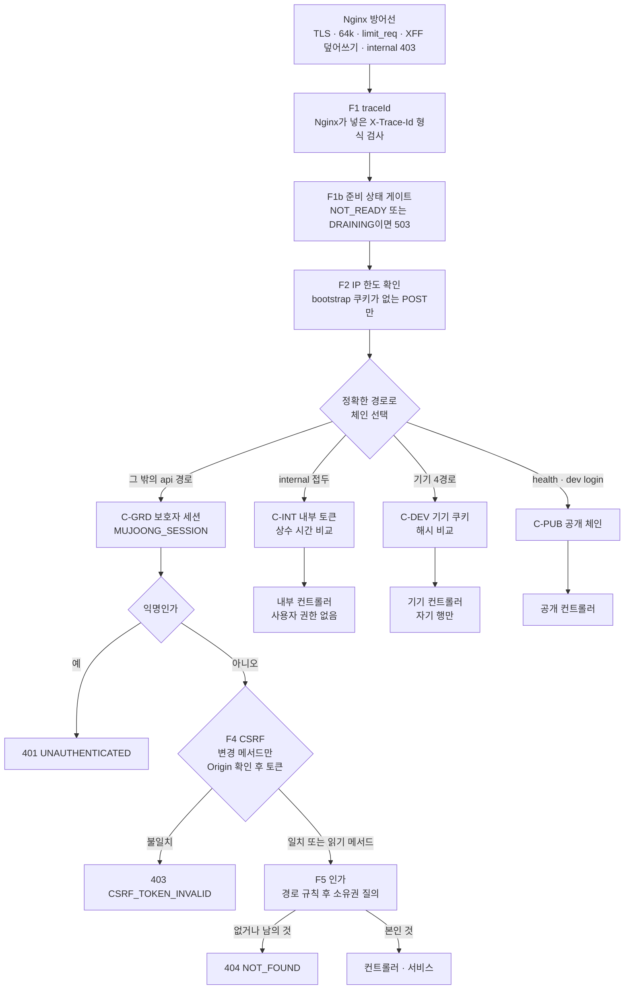
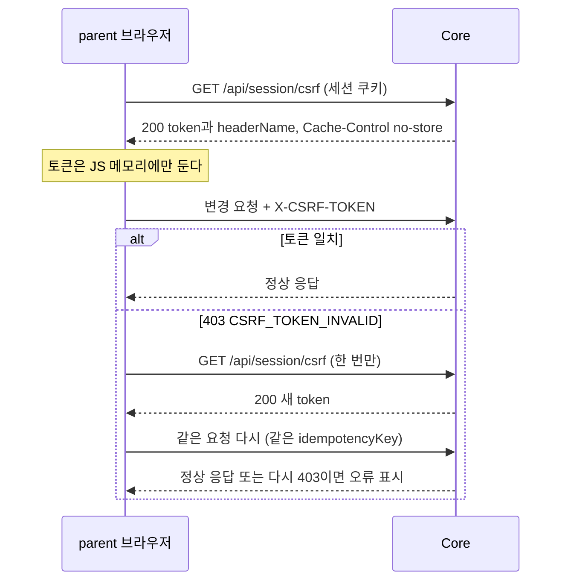
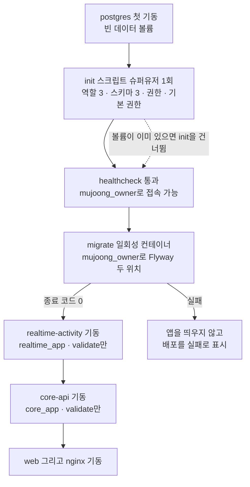
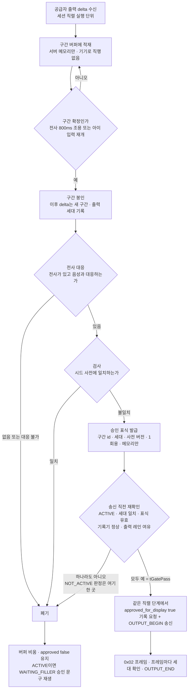

# 보안 설계 (security-design) — U1 u1-walking-skeleton

> 단계: Construction · NFR Design(3.3) · U1 u1-walking-skeleton · 깊이 Standard · 문서 security-design.md
> 입력: `nfr-requirements/` 의 `security-requirements.md`(NFR1 · 2 · 3 · 9 · 12) · `tech-stack-decisions.md` · `reliability-requirements.md`(3.2 키 레지스트리) · `observability-requirements.md`(로그 필드 · 보안 사건) · `performance-requirements.md` · `scalability-requirements.md`, `functional-spec.md` · `rules.md`(BR1.1 ~ BR9.7) · `entities.md`, `contract-summary.md`(4.2 · 5 · 6 · 7 · 8 · 9절), `components.md`, ADR-004 · 006 · 008 · 010(게이트 · 배포 · 인증), 질문 파일 `nfr-design-questions.md`(Q3 · Q9 · Q12)
> 날짜: 2026-10-09
> 대리 판단: J73 ~ J84는 사람 지시(2026-10-09)와 `docs/cloud_handoff.md` 2절에 따라 팀장(준하)의 대리가 정한 가정이며 사람이 확정할 때 쓰는 이름이다. 이 문서는 **J75(Q3 보안 설계) · J84(Q12 DB 역할 · 마이그레이션 부트스트랩)** 와 **J81 중 장애 주입 훅의 보안 조건**을 푼다. 질문 답이 정하지 않은 세부 선택은 `J75(a)`처럼 괄호 문자를 붙여 `## 5.1`에 모았다(FD가 `J59(k)`로 쓴 방식과 같다). 표기: 3.2 요구 문서의 재점검 결정(security-requirements.md 5.5 등)은 항상 '재점검 RD-n'으로 쓰고, 설계 쪽 요소는 이 문서의 SD-n과 'reliability-design.md RD-23'처럼 문서 이름을 함께 쓴 다른 문서의 설계 ID로 구별한다(맨 `RD-n`은 쓰지 않는다). 3.3 재점검(2026-10-09)에서 대리 판단으로 정한 결정은 'R3-n'이라 부르고 `## 5.8`에 모았다. 계약에 없는 오류 코드 · 응답 · 필드 확장은 reliability-design.md `## 5`의 'J59 확장' 단일 표의 번호 (n) ~ (t)로만 인용한다(`## 5.8`에 이 문서가 쓰는 번호를 대응시켰다). 이 문서는 설계 문서이므로 완전한 설정 · 구현 코드를 쓰지 않고 구조 · 순서 · 수치 · 설정 키만 정한다. 비밀값 · 모델 식별자는 어디에도 쓰지 않는다. 새 수치는 '제안(3.5 확정)'으로 표시했다. 설정 키 이름의 기준 표는 `reliability-design.md`의 `## 3`이며 이 문서의 `## 3`은 그와 같은 이름 · 같은 값을 쓰고, 이 문서가 제안한 `mujoong.*` 키는 `mujoong.security.allowed-origin` · `mujoong.security.event-log-rate-cap` 둘이고 기준 표가 그 이름으로 올렸다(`## 5.5`).

## 1. 설계 요소

| 설계 ID | 해결하는 NFRx.y | 패턴 · 결정 | 적용 위치(BR · 컴포넌트) | 근거 |
|---|---|---|---|---|
| SD-1 | NFR9.1 | 에지 TLS 종단. 바깥에 여는 것은 Nginx의 80 · 443뿐이다. TLS 1.2 이상, 80은 ACME 경로 외 모두 301, HSTS 180일, 서버 이름과 다른 Host는 연결 거절. Nginx와 앱 · 앱과 DB 사이는 호스트에 게시하지 않는 Docker 내부망의 평문이다 | Nginx · BR8.9 · 모든 접점 | NFR9.1 · J66 · J75 |
| SD-2 | NFR9.12 | 보안 헤더 두 갈래. Next.js HTML은 요청마다 nonce를 만드는 CSP를 앱이 내고 Nginx는 건드리지 않는다. API · 정적 음성 · 오류 응답은 Nginx가 닫힌 CSP를 낸다. nosniff · Referrer-Policy · frame-ancestors는 모든 응답에 붙는다 | Nginx · web(Next.js 미들웨어) · BR8.9 | NFR9.12 · J66 · J75(e) |
| SD-3 | NFR9.6, NFR9.9 | Nginx 요청 방어선. 본문 64k, 헤더 · 본문 수신 시간 제한, WSS 읽기 75초, `X-Forwarded-For`를 `$remote_addr`로 덮어쓰기, bootstrap `limit_req`, `/internal/**` · `/actuator/**` 403, 원시 URI 검사, 허용 목록 라우팅, 관리 포트 비게시 | Nginx · BR1.6 · BR3.9 · BR8.9 | J75 |
| SD-4 | NFR9.2, NFR9.3, NFR9.4, NFR9.6 | 인증 필터 체인. 정확한 경로로 네 체인(내부 · 기기 · 공개 · 보호자)을 나누고 순서는 traceId → 준비 상태 게이트 → IP 한도 → 인증 → (익명 401) → CSRF → 인가(소유권)다. 보호자 쿠키는 기기 경로에서, 기기 쿠키는 보호자 경로에서 인증 수단이 아니다 | core-api · realtime-activity · BR8.5 · BR8.8 · BR3.9 | J75 · J75(a) |
| SD-5 | NFR9.2 | 보호자 세션과 쿠키. Spring Session JDBC(core 스키마), 로그인 때 세션 ID 교체, 세션에는 보호자 id · 권한 · CSRF 토큰만 둔다. 쿠키 속성 고정(HttpOnly · Secure · SameSite=Lax), 쿠키 수명은 `GET /api/session/csrf` 응답에서 갱신 | core-api GuardianIdentity(U1 최소) · BR8.4 · BR8.5 | NFR9.2 · J75(j) |
| SD-6 | NFR9.3 | CSRF. 서버 세션 토큰을 `GET /api/session/csrf`로 받아 `X-CSRF-TOKEN`으로 보낸다. 403 CSRF_TOKEN_INVALID를 받으면 토큰을 한 번만 다시 받아 같은 요청을 같은 키로 한 번 재시도한다(상태 변경 전 거절, 키 재사용 표는 2.5). 면제는 정확한 경로 5개이고 모두 보호자 체인 밖이다 | core-api · web(/parent) · BR8.8 | J75 · S-8 |
| SD-7 | NFR9.4, NFR9.9 | 기기 인증. bootstrap 비밀 128비트 이상 · 기기 토큰 256비트, SHA-256 해시만 저장, `MessageDigest.isEqual`. WSS는 Origin → 업그레이드 → 토큰 확인(1초) → HELLO(5초) 순서이고 단계마다 닫기 코드와 사건이 정해져 있다. 연결 교체는 트랜잭션 커밋 뒤에 옛 소켓 4001을 요청하고 그다음 HELLO_OK를 보낸다(R3-7) | core-api DeviceRegistry · realtime-activity DeviceGateway · BR1.5 · BR3.1 ~ BR3.8 | J75 |
| SD-8 | NFR9.6 | 내부 호출 인증. 두 앱의 `/internal/**`는 `X-Internal-Token`(상수 시간 비교)을 요구하고 사용자 권한이 생기지 않는다. 호출 쪽은 고정 주소와 단일 인터셉터만 쓴다 | 양 앱 · BR3.9 · BR5.4 · BR8.9 | J75 · J75(d) |
| SD-9 | NFR9.5 | 소유권 인가. 보호자 자원 조회는 (자원 id AND 세션 보호자 id) 한 질의이고 없거나 남의 것은 같은 404다. 저장소가 보호자 id 없이 자원을 돌려주는 메서드를 갖지 못하게 구조와 ArchUnit으로 막는다 | core-api 서비스 계층 · BR8.5 · BR6.9 · BR6.15 | NFR9.5 |
| SD-10 | NFR9.9 | 남용 방지 구현. 메모리 슬라이딩 창 한도기 둘(bootstrap IP · 등록 실패 보호자), 키 수 상한과 LRU, 주입 Clock, WSS 프레임 크기 검사(초과는 4400), HELLO 타이머 | core-api · realtime-activity · BR1.6 · BR2.6 · BR3.6 | J75(b)(c) |
| SD-11 | NFR9.12, NFR9.8 | 입력 검증과 오류 응답 위생. 요청 DTO는 별도 레코드 + Bean Validation, 매개변수화 쿼리만, 오류 message는 code 표에서만 고르고 검증에 실패한 값을 응답 · 로그에 되돌리지 않는다. StrictHttpFirewall 기본값을 유지한다 | core-api · realtime-activity · BR8.6 · BR2.1 · BR6.4 | NFR9.12 · J66 |
| SD-12 | NFR9.10 | 비밀 주입. 서버의 환경 파일(권한 600)에서 Compose `env_file`로 주입하되 컨테이너마다 자기 비밀만 받는다. 이미지 · 빌드 인자 · 프런트 번들 · 로그 · Actuator에 없다. 값은 문서에 쓰지 않는다 | Compose · 모든 컨테이너 · BR8.7 | J75 · J75(h) |
| SD-13 | NFR9.7 | DB 역할 · 스키마 부트스트랩. init(슈퍼유저, 최초 1회) → migrate(`mujoong_owner`, 일회성) → 앱(`core_app` · `realtime_app`, validate만). 앱 역할은 DDL이 없고 상대 스키마 권한이 없으며 새 표에는 기본 권한이 붙는다 | postgres · migrate · 양 앱 · BR8.1 · BR8.2 | J84 · J77 |
| SD-14 | NFR9.11 | dev 로그인 가드. 환경 프로필 배타와 demo · prod에 dev · load-test 프로필 또는 `enabled=true`가 함께 켜지면 기동 거부(A2). 빈은 dev AND enabled일 때만, 요청 때도 이중 확인, 차단 사건 기록 | core-api · realtime-activity · BR8.3 · BR8.4 | J75 · A2 |
| SD-15 | NFR9.8 | 로그 위생. 필드 화이트리스트 + 민감 값 래퍼 + 예외는 errorKind(예외 클래스 단순 이름)만 + 프레임워크 상세 로그 끄기 + Nginx · PostgreSQL 로그 설정. 보안 사건 5종의 발생 지점과 카운터 | 양 앱 · nginx · postgres · BR8.7 · BR5.13 | J75 · J78 |
| SD-16 | NFR9.13, NFR9.10 | CI 공급망 관문. 의존성 취약점 검사(high 이상), 비밀 스캔(이력 포함), 이미지 · 번들 grep, 예외 목록(사유 · 만료일) | CI(GitHub Actions) | J66 |
| SD-17 | NFR1.1 | 출력 게이트 순서. 구간 → 전사 대응 → 검사 → 승인 표식 → 송신 직전 재확인(NOT_ACTIVE 판정은 이 한 곳, 통과 시각이 tGatePass) → (같은 직렬 단계에서) approved_for_display 기록과 송신. 출력 세대 번호로 취소 뒤 늦은 승인을 폐기하고 모든 실패는 폐기(fail-closed)다 | realtime-activity OutputGate · VoiceRelay · BR6.10 · BR6.11 · BR7.3 ~ BR7.6 | J73 · ADR-004 |
| SD-18 | NFR1.2 | 시드 사전. 계약 9절 항목 모양의 파일, category 7개 각 1항목 이상(기동 때 reliability-design.md 2.7 S1b가 확인, 어기면 종료 코드 1 + 시험), 폐기하면 WAITING_FILLER 재생, 명시적 표현 위주 패턴 | OutputGate · BR7.4 | A5 · 재점검 RD-10 |
| SD-19 | NFR1.3, NFR2.1 | 화면 문구 검수 장치. 문구 사전(C.S-xx · mockups 9절)만 쓰는 화면, 서버 message 미표시, 금지 어휘 자동 점검 + 수동 체크리스트(진단 · 점수 · 의도 · 감정 · 재촉 · 만류 · 보상 · 완료율) | web(/device · /parent) · BR2.8 · BR8.6 · BR9.4 · BR9.5 · BR9.7 | NFR1 · NFR2 |
| SD-20 | NFR3.1, NFR3.2 | 공급자 전송 최소화. 요청은 VoiceRelay 어댑터의 한 팩토리에서만 만들고 허용 필드 레코드(지시문 · childContext 3필드 · 음성 프레임)만 담는다. 판정 기준 · 보호자 입력 · 이전 판정은 타입에 필드 자체가 없다 | VoiceRelay · BR6.4 · BR6.5 · BR7.2 | NFR3 · BR6.5 |
| SD-21 | NFR12.1 | 삭제 참가자 호출 계약. Device · Core 메시징 · Realtime 메시징 세 참가자, 앱 내부 포트 호출, 멱등, 순서 제약(마지막 재호출 포함), guardian_id 채움(A4: DeviceStatusChanged는 payload의 선택 필드 `guardianId`로 채워 늦은 채움이 필요 없다, J59 확장 (q)) | DeviceRegistry · CoreMessaging · RealtimeMessaging · BR2.10 · BR5.14 | J72 · J58 · A4 |
| SD-22 | NFR12.2 | 원음 비저장. 메모리 안 대기열만 쓰고 영속 API 의존을 금지(ArchUnit)하며 자동 힙 덤프 끔 · 코어 덤프 0 · OOM 즉시 종료 · 스왑 없음, 로그 · 지표에 프레임 내용 없음 | VoiceRelay · DeviceGateway · BR7.1 | NFR12.2 · S-12 |
| SD-23 | NFR12.3 | 페이로드 수명. U1 이벤트는 식별자 · 열거값만 담고, 전달 직후 같은 트랜잭션에서 비우며, 실패 행은 7일 뒤 하루 한 번 정리하고, 불변식 점검이 남은 페이로드를 찾는다 | CoreMessaging · RealtimeMessaging · BR5.11 · BR5.13 | J50 |
| SD-24 | NFR12.4 | 백업 · 삭제 충돌 안전장치. 현재 A안(합성 데이터 한정)을 기술로 강제하는 장치(데이터 등급 표지 · 사전 수준 확인)와 B ~ D안의 설계 비용 표. 선택은 사람이 한다 | backup · Realtime 기동 가드(reliability-design.md 2.7 S2b) · D-14 | J62 · 재점검 RD-10 |
| SD-25 | NFR9.11, NFR1.1 | 장애 주입 훅의 보안 조건(J81). 훅 코드는 시험 소스 집합과 외부 도구에만 있어 운영 이미지에 없고, 시간 · 세션 · 한도 · 사전 · 게이트를 바꾸는 원격 제어면이 없으며, 공급자 주소는 demo · prod에서 고정되고, 프로필 가드와 결합한다 | 양 앱 · 시험 도구 · BR8.11 | J81 |

## 2. 설계 상세

표기. 앱 이름은 J79의 컨테이너 이름(`nginx` · `web` · `core-api` · `realtime-activity` · `postgres` · `migrate` · `certbot` · `backup`)을 쓴다. Spring 속성 이름은 Boot 3.x 기준이고 Boot 4.1에서 이름이 바뀐 것은 3.5 첫 볼트가 확인한다(tech-stack-decisions.md의 확정 조건).

### 2.1 방어선 한눈에 (SD-1 ~ SD-25)

한 계층이 뚫려도 다음 계층이 막도록 겹쳐 둔다(defense in depth). 아래 표는 어느 계층이 어떤 위협을 막는지의 지도이고 상세는 이어지는 절에 있다.

| 계층 | 막는 것 | 방어 장치 | 설계 ID |
|---|---|---|---|
| L0 인터넷 → EC2 | 열린 포트 | 보안 그룹 80 · 443만(3.4), 앱 · DB · 관리 포트는 호스트에 게시하지 않음 | SD-1 · SD-3 |
| L1 Nginx | 평문 · 큰 본문 · 내부 경로 · 위조 XFF · 가짜 Host · 경로 우회 | TLS · 헤더 · 크기 · 시간 제한 · limit_req · 403 · 원시 URI 검사 · 허용 목록 라우팅 | SD-1 ~ SD-3 |
| L2 앱 필터 | 신원 위조 · CSRF · 남용 · 프로토콜 위반 | 체인 분리 · 세션 · 기기 해시 · 내부 토큰 · CSRF · 한도기 · 프레임 검사 | SD-4 ~ SD-10 |
| L3 서비스 계층 | 남의 자원 · 목적 밖 정보 · 미승인 소리 | 소유권 질의 · 공급자 전송 최소화 · 출력 게이트 · 화면 문구 사전 | SD-9 · SD-17 ~ SD-20 |
| L4 DB | 교차 스키마 접근 · 앱의 DDL | 역할 3개 + 기본 권한 | SD-13 |
| L5 데이터 수명 | 로그 · 백업 · 페이로드 · 원음 잔존 | 로그 위생 · 삭제 참가자 · 페이로드 비움 · 메모리 한정 · 데이터 등급 표지 | SD-15 · SD-21 ~ SD-24 |
| L6 빌드 · 배포 | 비밀 유입 · 취약 의존성 · 시험 훅 운영 유입 | 컨테이너별 비밀 · CI 관문 · 프로필 가드 · 훅은 이미지 밖 | SD-12 · SD-14 · SD-16 · SD-25 |

### 2.2 Nginx 보안 설정 (SD-1, SD-2, SD-3)

Nginx는 바깥에서 닿는 유일한 길이다(BR8.9). 아래는 설정 파일을 쓰지 않고 정할 값 · 동작만 적은 것이며, 실제 파일은 3.5가 `infra/`에 만든다. 명시한 수치 중 요구 문서나 J75에 없는 것은 '제안(3.5 확정)'이다.

| 영역 | 설정 | 값 · 동작 | 근거 |
|---|---|---|---|
| TLS 프로토콜 | `ssl_protocols` · 암호군 | `TLSv1.2 TLSv1.3`만. 암호군은 Mozilla intermediate 프로필을 따르되 시점 값은 3.5가 고정한다. `ssl_session_tickets off`(제안(3.5 확정)), OCSP stapling 켬 | NFR9.1 · J66 |
| 인증서 | certbot 갱신 | Let's Encrypt, 갱신하면 Nginx 재적재, 만료 30일 전 갱신 로그를 남긴다. 인증서 · 개인키 볼륨은 Nginx에 읽기 전용으로 마운트한다. 도메인 · 발급 방식은 3.4 | NFR9.1 |
| HTTP 80 | 리다이렉트 | `/.well-known/acme-challenge/`만 webroot로 응답하고 나머지는 모두 `301 https://<고정 서비스 호스트>$request_uri`. 요청의 `Host`를 되돌려 쓰지 않는다(Host 조작으로 다른 주소로 보내는 것을 막는다) | NFR9.1 · J75 |
| 알 수 없는 Host | 기본 서버 | 서버 이름과 다른 Host · SNI는 연결을 거절한다(443은 `ssl_reject_handshake on`, 80은 444). 앱이 `Host`를 근거로 주소를 만드는 일(U2 OAuth 리다이렉트)을 막는다 | J75 구체화 |
| HSTS | `Strict-Transport-Security` | `max-age=15552000`(`mujoong.security.hsts-max-age`, 180일), `always`. `includeSubDomains` · `preload`는 쓰지 않는다 | NFR9.1 |
| 공통 보안 헤더 | 모든 응답에 `always` | `X-Content-Type-Options: nosniff`, `Referrer-Policy: strict-origin-when-cross-origin`, `Permissions-Policy: microphone=(self), camera=(), geolocation=()`(제안(3.5 확정), 마이크는 NFR10.4의 사용자 제스처 뒤에만 쓰므로 자기 origin으로 한정) | NFR9.12 · J75(i) |
| CSP — Nginx 몫 | `/api/` · 정적 음성 · Nginx 오류 응답 | `default-src 'none'; frame-ancestors 'none'`. JSON · 오디오 응답은 아무것도 불러오지 않는다 | NFR9.12 · J75(e) |
| CSP — Next.js 몫 | `/` · `/parent` · `/device` · `/_next/` | Nginx는 CSP를 더하지 않고 업스트림 값을 통과시킨다(CSP 헤더가 둘이면 교집합이 적용되어 nonce 스크립트가 막힌다). 값은 2.2.1 | NFR9.12 · J75(e) |
| 헤더 중복 방지 | `add_header` · `proxy_hide_header` | `add_header`는 location 안에 하나라도 있으면 상위 선언이 모두 사라지므로 모든 location이 같은 포함 파일을 쓴다. Next.js 위치에서는 업스트림이 같은 이름 헤더를 내면(CSP 제외) 숨기고 Nginx 값으로 통일한다. 응답 헤더 시험은 location마다 돈다 | NFR9.12 |
| 본문 크기 | `client_max_body_size` | `64k`(`mujoong.limits.rest-body-max`). 413은 `error_page 413 =400`으로 400 VALIDATION_FAILED 봉투로 바꿔 보낸다(새 오류 코드 없음, S-2 해소. 413 대신 400을 쓰는 범위는 REST 본문 64KB 초과이고 J59 확장 (r)이다) | NFR9.9 · J75(b) |
| 수신 시간 | `client_header_timeout` · `client_body_timeout` | 각 10초(제안(3.5 확정)). 느리게 보내는 요청이 연결을 붙잡지 못하게 한다 | NFR9.9 |
| WSS 프록시 | `location = /ws/device` | `proxy_http_version 1.1`, `Upgrade` · `Connection` 전달, `proxy_read_timeout 75s` · `proxy_send_timeout 75s`. 75초 = heartbeat 5초 × 15이고 앱의 40초 끊김 판정(`mujoong.timing.device.disconnect`)보다 길어 Nginx가 먼저 연결을 끊지 않는다. `Origin` 헤더는 그대로 앱에 넘기고 Nginx는 Origin을 판정하지 않는다(거부 사건을 앱이 기록하기 위해) | J75 · BR3.6 |
| 클라이언트 IP | `proxy_set_header` | `X-Forwarded-For $remote_addr`(덧붙이지 않고 덮어쓴다), `X-Real-IP`도 같은 값, `X-Forwarded-Proto https`. 클라이언트가 보낸 `X-Forwarded-For`는 버려진다 | BR1.6 · BR8.9 |
| 추적 헤더 | `X-Trace-Id` | `proxy_set_header X-Trace-Id $request_id`로 덮어쓴다(클라이언트가 보낸 값은 버려진다). `/api/`와 `/ws/device` 모두 같다. 형식 · 전파는 observability-design.md(OD-7)를 따른다 | NFR9.8 · OD-7 |
| 속도 제한 | `limit_req` | `location = /api/device/bootstrap`에만. 키 `$binary_remote_addr`, 제안(3.5 확정) `rate=30r/m burst=20 nodelay`, 상태 429이고 `error_page 429`로 RATE_LIMITED 봉투를 돌려준다. 앱 한도(IP당 1시간 20회, 같은 쿠키 반복 제외)의 앞 방어선이며 앱 한도를 대신하지 않는다 | NFR9.9 · J75 |
| 내부 경로 | `location ^~ /internal/` | `return 403`. Core · Realtime 어느 쪽으로도 프록시하지 않는다 | NFR9.6 · BR3.9 |
| 관리 경로 | `location ^~ /actuator/` | `return 403`. 관리 포트가 따로 있으므로 이중 방어다 | NFR4.15 |
| 원시 URI 검사 | 서버 수준 | 원시 요청 URI에 세미콜론 · 역슬래시 · 인코딩된 점 · 슬래시(`%2e` · `%2f` · `%5c`)가 있으면 400. 톰캣이 `..;`를 상위 경로로 해석해 `/api/..;/internal/…`로 Nginx의 403 규칙을 돌아가는 우회를 막는다. 앱의 StrictHttpFirewall이 같은 부류를 거부해 이중이 된다(제안(3.5 확정)) | NFR9.6 |
| 헬스 경로 | `location = /api/health` | Core로 보낸다. 앱 서비스 포트의 일반 경로(Actuator 아님)이고 응답은 200 `{status: UP}` 또는 503뿐이며 세부 정보(DB · 버전 · 연결 수)가 없다. GET이라 CSRF 대상이 아니고 C-PUB에서 인증 없이 처리한다. 외부 프로브가 쓰는 유일한 헬스 경로다(공개 `GET /api/health`는 J59 확장 (t)) | NFR4.8 · OD-14 |
| 정적 음성 | `location ^~ /audio/approved/` | 경로 이름은 3.4 확정. 읽기 전용 볼륨의 `alias`, `GET` · `HEAD`만, 디렉터리 목록 끔, 허용 확장자만 응답하고 상위 경로 이탈 불가. 인증 · 쿠키 불필요(개인정보 없는 승인 문구만). 앱 컨테이너에는 이 디렉터리를 마운트하지 않아 앱이 쓸 수 없다 | BR8.9 · BR8.4 |
| 관리 포트 | Compose `ports` | 호스트에 게시하는 포트는 nginx의 80 · 443뿐이다. 두 앱의 관리 포트(`management.server.port`)는 3.4가 9090으로 확정했다(서비스 포트 8080 · 8081과 다름). 두 앱 모두 각 컨테이너 네트워크 안에서만 열리고 호스트에는 게시하지 않으며 `management.endpoints.web.exposure.include`는 health,prometheus뿐이다(5.7 X-1) | J75 · NFR4.15 |
| 접근 로그 | `log_format` | 쿼리 문자열이 없는 `$uri`와 `$request_id`(앱의 traceId와 같은 값)를 쓰고 쿠키 · Referer · 본문은 기록하지 않는다. 반복 폴링(`GET /api/device/bootstrap/status` · `GET /api/sessions/{id}`)의 2xx · 304는 로그 조건(`map`)으로 제외하고 4xx · 5xx와 그 밖의 모든 요청은 남긴다(폴링 2초 × 30쌍이 로그 용량을 밀어내지 않게 한다. OD의 열린 질문 해소) | NFR9.8 · BR8.7 · OD-7 |
| 노출 최소화 | 서버 정보 | `server_tokens off`, Next.js `poweredByHeader` 끔, Spring `server.server-header` 비움(제안(3.5 확정)) | NFR9.12 |

#### 2.2.1 Next.js CSP 값 (SD-2)

Next.js 미들웨어가 요청마다 nonce를 만들어 CSP 헤더를 내고 같은 nonce를 인라인 스크립트에 붙인다(S-7 중 nonce 방식을 여기서 정한다). 서비스 origin의 실제 값은 `mujoong.security.allowed-origin`(환경 변수)에서 가져온다.

| 지시어 | 값 | 이유 |
|---|---|---|
| `default-src` | `'self'` | 기본은 같은 origin만 |
| `script-src` | `'self' 'nonce-<요청별>' 'strict-dynamic'` | 인라인 부트스트랩 스크립트는 nonce로만 실행. 개발 모드에서만 `'unsafe-eval'`을 더한다 |
| `style-src` | `'self' 'unsafe-inline'` | React의 style 속성 때문에 인라인 스타일을 허용한다(스크립트 주입 방어가 우선, 제안(3.5 확정)) |
| `connect-src` | `'self' wss://<서비스 호스트>` | REST와 기기 WSS. 일부 브라우저가 `'self'`로 wss를 맞추지 않으므로 명시한다 |
| `img-src` · `font-src` | `'self' data:` · `'self'` | 외부 자원 없음 |
| `media-src` | `'self' blob:` | 승인 음성(같은 origin)과 Web Audio 재생 |
| `worker-src` | `'self' blob:` | AudioWorklet · 작업자 |
| `object-src` · `base-uri` · `form-action` | `'none'` · `'self'` · `'self'` | 플러그인 · base 조작 · 폼 전송처 제한 |
| `frame-ancestors` | `'none'` | 클릭재킹 방어(NFR9.12) |

호환 확인 한 건이 남는다. `strict-dynamic`이 있으면 호스트 허용 목록이 무시되므로 AudioWorklet 모듈(`addModule`)의 로딩이 막힐 수 있다. 3.5 첫 볼트가 /device에서 확인하고, 막히면 /device 경로에 한해 `strict-dynamic`을 빼고 `'self' 'nonce-…'`로 낮춘다(5.7).

#### 2.2.2 라우팅 허용 목록 (SD-3)

포괄 `/api` 전달이 내부 엔드포인트를 노출하지 못하게(ADR-006 §2.3) 위에서부터 차례로 맞는 첫 규칙이 적용된다. 일치 규칙은 정확 일치 > `^~` 접두 > 일반 접두다.

| 순서 | location | 목적지 | 비고 |
|---|---|---|---|
| 1 | `^~ /internal/` | 403 | 두 앱의 내부 API |
| 2 | `^~ /actuator/` | 403 | 관리 엔드포인트 |
| 3 | `= /api/health` | core-api | 요약만 응답 |
| 4 | `= /api/device/bootstrap` | core-api | `limit_req` 적용 |
| 5 | `^~ /api/` | core-api | 보호자 · 기기 REST |
| 6 | `= /ws/device` | realtime-activity | WSS 업그레이드 |
| 7 | `^~ /audio/approved/` | 정적 파일 | 읽기 전용 |
| 8 | `^~ /.well-known/acme-challenge/` | 정적 파일(80 포트만) | certbot webroot |
| 9 | `/` | web(Next.js) | `/parent` · `/device` · `/_next/` |

이 표 밖의 경로가 Core나 Realtime에 닿는 길은 없다. springdoc(`/v3/api-docs`)은 demo · prod 프로필에서 앱이 비활성화한다.

### 2.3 인증 필터 체인 (SD-4, SD-8)

요청이 닿는 순서는 J75의 `로깅/traceId → 속도 제한 → 인증 → CSRF → 인가(소유권)`이고, reliability-design.md의 준비 상태 게이트가 traceId 직후 · 속도 제한 앞에 들어간다. 인증 수단이 셋(보호자 세션 · 기기 쿠키 · 내부 토큰)이고 서로 권한을 주지 않으므로(ADR-008 §2.1) **경로가 인증 수단을 정한다**: 면제 5경로(BR8.8)를 접두어가 아니라 정확한 경로로 나눈 SecurityFilterChain 넷에 배정한다.

텍스트 대체 — Core 요청이 지나는 순서:

| 순서 | 필터 · 단계 | 하는 일 | 거절 응답 | 보안 사건(NFR9.14) |
|---|---|---|---|---|
| 0 | Nginx 방어선 | TLS 종단, 64k, 수신 시간, bootstrap `limit_req`, `/internal/**` · `/actuator/**` 403, XFF 덮어쓰기 | 301 · 400 · 403 · 429 | Nginx 접근 로그(앱 사건 아님) |
| 1 | F1 traceId | Nginx가 `X-Trace-Id`에 덮어써 넘긴 값(32자 소문자 16진수)을 형식 검사한 뒤 MDC와 오류 봉투에 쓴다. 없거나 형식이 틀리면 앱이 새로 만든다(로그 주입 방지). 내부 호출의 `X-Trace-Id`도 같은 검사를 거친다(OD-7) | — | — |
| 1b | F1b 준비 상태 게이트 | 앱 상태가 NOT_READY(DB 점검 연속 실패) 또는 DRAINING(SIGTERM 직후 readiness를 내린 뒤)이면 인증 · 한도 판정 없이 앱이 직접 503 오류 봉투(`SERVICE_NOT_READY`, J59 확장 (n))와 `Retry-After`로 답한다. DRAINING 동안에도 서버 커넥터는 유예(`stop_grace_period` 40초) 끝까지 열어 두므로 새 REST 요청은 접속 거절(Nginx 502)이 아니라 이 503을 받는다(R3-13). 상태 값 하나를 읽을 뿐 요청마다 DB를 부르지 않는다. `/api/health`도 같은 상태로 503이고 `/internal/events`도 503이라 보내는 쪽 Outbox가 재시도한다(reliability-design.md) | 503 SERVICE_NOT_READY | — |
| 2 | F2 IP 한도 확인 | `POST /api/device/bootstrap`이고 bootstrap 쿠키가 없을 때만 IP 한도를 소비한다. 쿠키가 있는 요청은 서비스가 새 코드 발급이 필요하다고 판정한 때 같은 한도기를 소비한다(2.8). 그 밖의 경로는 통과 | 429 RATE_LIMITED | SECURITY_RATE_LIMITED |
| 3 | F3 인증(체인별) | 아래 체인 표. C-INT는 내부 토큰, C-DEV는 해당 쿠키 해시, C-GRD는 세션 쿠키로 보호자 컨텍스트를 읽는다 | 401 | SECURITY_AUTH_FAILED · SECURITY_INTERNAL_TOKEN_FAILED |
| 3b | F3b 익명 차단 | C-GRD에서 인증된 보호자가 없으면 CSRF 판정 전에 401. CSRF 403이 항상 '인증은 됐고 토큰이 틀림'을 뜻하게 해 클라이언트의 재시도 규칙(2.5)을 유한하게 만든다 | 401 UNAUTHENTICATED | SECURITY_AUTH_FAILED(GUARDIAN_SESSION) |
| 4 | F4 CSRF | C-GRD의 POST · PUT · PATCH · DELETE만. 요청에 `Origin`이 있으면 허용 origin과 같아야 하고, 그다음 `X-CSRF-TOKEN`이 세션의 토큰과 같아야 한다 | 403 CSRF_TOKEN_INVALID | Origin 거부는 SECURITY_ORIGIN_DENIED(REST), 토큰 불일치는 SECURITY_AUTH_FAILED(kind GUARDIAN_SESSION, statusCode 403) |
| 5 | F5 인가 | 경로 규칙(인증 필요 여부) 뒤 서비스 계층에서 소유권 질의(자원 id AND 세션 보호자). 계정 삭제 접수 보호자는 403 ACCOUNT_DELETION_IN_PROGRESS(BR2.2 · BR6.1) | 403 · 404 | — |

체인 표. 체인은 위에서부터 맞는 첫 것이 적용되고 맞는 체인이 없으면 거부(404)다(기본 거부).

| 체인 | 일치 조건(정확한 경로) | 인증 수단 | 세션 | CSRF | 인가 · 실패 응답 |
|---|---|---|---|---|---|
| C-INT | `/internal/` 접두 전체(Core · Realtime 각자) | `X-Internal-Token` | 만들지 않고 쿠키를 무시한다 | 해당 없음(면제 5번째) | 내부 주체뿐, 사용자 권한 없음. 401 |
| C-DEV | `POST /api/device/bootstrap`(인증 없음, 쿠키는 선택) · `GET /api/device/bootstrap/status` · `POST /api/device/bootstrap/claim`(둘 다 MUJOONG_DEVICE_BOOTSTRAP) · `GET /api/device/me`(MUJOONG_DEVICE) | 해당 쿠키의 SHA-256 해시를 조회한 뒤 상수 시간 비교 | 만들지 않는다 | POST 두 경로는 면제(3 · 4번째), GET은 대상 아님 | 자기 행만. 401 BOOTSTRAP_NOT_FOUND · DEVICE_NOT_REGISTERED |
| C-PUB | `GET /api/health` · `POST /api/dev/login`(dev 한정, 2.12) · (U2) 구글 시작 · 교환 경로 | 없음 | dev 로그인만 세션을 만든다 | `POST /api/dev/login`과 구글 교환은 면제(1 · 2번째) | 공개. dev가 꺼져 있으면 404 |
| C-GRD | 그 밖의 `/api/**`. 예: `POST /api/device/register`, `POST /api/activities/free`, `/api/sessions/**`, `GET /api/session/csrf` | `MUJOONG_SESSION` | Spring Session JDBC | 필수, 예외 없음 | 인증 필요 + 소유권 404. 401 · 403 · 404 |

규칙.

- **접두어 면제 금지**: `/api/device/**` 전체를 면제하지 않는다. `POST /api/device/register`는 이름이 `/api/device/`로 시작해도 보호자 세션 요청이라 C-GRD이고 CSRF가 필수다(BR8.8, NFR9.3). 체인 일치 시험은 경로 목록 5개를 고정한다.
- **인증 수단 비전이**: 보호자 세션 쿠키가 C-DEV에 실려 와도 기기 권한이 아니고, 기기 쿠키가 C-GRD에 와도 401이며, `X-Internal-Token`이 C-GRD에 있어도 보호자 권한이 생기지 않는다(ADR-008 §2.1).
- **CORS 없음**: Nginx 한 origin에서 화면과 API를 모두 내므로 CORS 허용 헤더를 내지 않는다. 다른 origin의 스크립트는 응답을 읽을 수 없다.
- **StrictHttpFirewall 기본값 유지**: 세미콜론 · 인코딩된 슬래시 · 인코딩된 점 · 역슬래시를 거부하는 기본 설정을 느슨하게 바꾸지 않는다(Nginx 원시 URI 검사와 이중).
- **캐시 금지**: 인증이 필요한 응답과 `GET /api/session/csrf`는 `Cache-Control: no-store`다.

Realtime 쪽 체인은 둘이다.

| 체인 | 일치 조건 | 인증 수단 | 비고 |
|---|---|---|---|
| C-INT | `/internal/` 접두(`sessions` · `sessions/{id}/end` · `sessions/{id}/view` · `events`) | `X-Internal-Token` | Core와 같은 필터 구현 규칙(2.7). 공개 HTTP는 없다 |
| WS | `/ws/device` 업그레이드 | Origin + `MUJOONG_DEVICE` 쿠키를 Core에 확인 | 단계 · 닫기 코드는 2.6의 표 |

### 2.4 쿠키 속성 표 (SD-5, SD-7)

세 쿠키의 이름 · 값 의미는 계약 4.1 · 4.2절과 BR1.5 · BR3.1 · BR8.4로 이미 정해져 있고, 이 표는 속성을 한 곳에 고정한다.

| 쿠키 | 발급 · 소멸 | HttpOnly | Secure | SameSite | Path | Domain | Max-Age | 값 · 서버 저장 |
|---|---|---|---|---|---|---|---|---|
| MUJOONG_SESSION | 로그인 성공(U1은 dev 시험 로그인, U2는 구글)에서 발급하며 이때 세션 ID를 교체한다. 로그아웃 · 만료에서 Max-Age=0 | 예 | 예(요청 스킴에서 유추하지 않고 설정으로 고정) | Lax | `/` | 없음(호스트 전용) | 30일 = `mujoong.security.session-cookie-max-age`(서버 유휴 만료 `mujoong.timing.login.session-idle` 이하여야 하며 넘으면 기동 실패). `GET /api/session/csrf` 응답에서 다시 내려 갱신형으로 만든다 | 불투명 세션 ID(난수), 서버는 core 스키마의 Spring Session 행(만료의 정본). 쿠키에는 상태가 없다 |
| MUJOONG_DEVICE | claim 성공에서 발급(첫 연결 전 재호출은 새 토큰으로 교체), `GET /api/device/me` 성공마다 Max-Age를 다시 늘린다. 해제 · 삭제는 서버 해시를 비워 무효화한다 | 예 | 예 | Strict | `/` | 없음 | 400일(34,560,000초), 갱신형(`mujoong.timing.device.cookie-max-age`) | 256비트 난수 base64url. 서버는 SHA-256 해시만 저장(`core_device.device_token_hash`) |
| MUJOONG_DEVICE_BOOTSTRAP | `POST /api/device/bootstrap`에서 발급, claim 성공에서 Max-Age=0으로 지운다 | 예 | 예 | Strict | `/api/device` | 없음 | 24시간(86,400초) = `mujoong.timing.bootstrap.code-ttl` | 128비트 이상 난수 base64url. 서버는 SHA-256 해시만 저장(`core_device.bootstrap_secret_hash`) |

공통 규칙.

- 세 쿠키 모두 `Domain` 속성이 없다(호스트 전용). `__Host-` 접두는 계약이 이름을 고정했고 bootstrap 쿠키의 Path가 `/api/device`라서 쓰지 않는다.
- 지우는 `Set-Cookie`는 발급 때와 같은 Path · 속성에 Max-Age=0이다(Path가 다르면 브라우저가 지우지 않는다).
- 쿠키 값은 URL · 응답 본문 · 로그 · 메트릭 라벨 · 오류 message에 나가지 않는다(NFR9.8). JS는 세 쿠키를 읽지 못한다(HttpOnly). 그래서 기기 웹은 쿠키 유무를 서버(`/device/me` · `status`)에 묻는다(BR9.1).
- SameSite=Lax는 U2 구글 로그인 복귀(최상위 GET 이동)가 세션 쿠키를 가져와야 해서다. Lax만으로 CSRF를 막았다고 보지 않고 2.5의 토큰을 함께 쓴다(ADR-008 §6).
- 보호자 세션에 절대 수명(예: 로그인 후 90일)은 두지 않는다. 유휴 30일 갱신형이 요구다. 훔친 쿠키가 쓰이는 한 살아 있다는 점은 5.2의 확인 항목이다.
- 시험: 세 쿠키의 `Set-Cookie` 속성을 단위 시험이 정확히 비교한다.

### 2.5 CSRF 토큰 취득과 재시도 (SD-6)

BR8.8이 넘긴 '취득 경로 · 재취득 시점'(S-8)을 정한다. 서버 세션에 묶인 토큰을 읽기 전용 GET으로 받고 헤더로 보낸다. 쿠키를 읽는 JS가 필요 없으므로 세션 쿠키는 HttpOnly로 남는다(쿠키 이중 제출 방식은 쓰지 않는다, J75).

텍스트 대체 — 취득과 재시도의 순서:

| 단계 | /parent(클라이언트) | Core(서버) | 비고 |
|---|---|---|---|
| 1 | 앱 시작 때, 로그인 직후, 로그아웃 뒤 로그인 화면에서 돌아올 때 `GET /api/session/csrf` | 인증된 세션이면 `{token, headerName}`을 `Cache-Control: no-store`로 답하고 쿠키 Max-Age를 갱신한다. 익명이면 401 | 취득은 인증 · 권한을 주지 않는다(ADR-008 §6). 변경 요청이 먼저 나가면 같은 호출을 그 앞에서 한 번 한다 |
| 2 | 토큰을 JS 메모리(질의 캐시)에 둔다. localStorage · sessionStorage · 쿠키에는 두지 않는다 | 토큰은 세션 속성으로 저장된다 | ADR-008 §14 |
| 3 | 변경 요청(POST · PUT · PATCH · DELETE)마다 `X-CSRF-TOKEN`을 붙인다 | F4가 `Origin`(있으면)과 토큰을 확인한다 | GET은 토큰을 보내지 않는다 |
| 4 | 403 `CSRF_TOKEN_INVALID`를 받으면 토큰을 한 번만 다시 받는다 | 거절은 상태를 바꾸기 전에 일어나므로 이중 반영이 없다 | 재취득이 401이면 로그인 화면으로 간다 |
| 5 | 같은 요청을 한 번 다시 보낸다. 시작 요청은 같은 `idempotencyKey`, 끝내기는 같은 `requestId`를 그대로 쓴다 | 정상이면 처리 | 두 번째도 403이면 오류 토스트를 보이고 더 재시도하지 않는다. 403은 상태를 바꾸기 전의 거절이라 같은 키가 맞다(키 재사용 표는 아래 규칙) |

규칙.

- 토큰이 바뀌는 때: 로그인 · 로그아웃(세션 ID 교체)과 세션 만료다. 그래서 1단계의 취득 시점이 정해진다. 같은 세션을 쓰는 여러 탭은 같은 토큰을 쓴다.
- 재시도 키 재사용(R3-14): 정본은 performance-design.md 2.9의 '재시도 키 재사용 표'이고 이 절은 그 표와 같은 값만 쓴다.

| 실패 종류 | 다음 시도의 키 | 이 절과의 관계 |
|---|---|---|
| 응답 없음 · 시간 초과 | 같은 키 | 서버가 처리했는지 모르므로 서버 멱등(BR6.2)에 맡긴다 |
| 403 CSRF_TOKEN_INVALID | 같은 키 | 상태 변경 전 거절이라 이중 반영이 없다. 단계 4 · 5의 한 번 재시도 |
| 끝내기의 401 · 503 | 같은 `requestId` | 서버가 멱등으로 받는다 |
| 시작이 로컬 FAILED(저장된 start_result_code 재생)로 끝난 뒤 | 새 `idempotencyKey` | BR6.2: 같은 키는 첫 응답을 재생하므로 새 시도는 새 키다 |
- Spring Security 6의 기본 마스킹(XOR) 토큰을 쓴다면 응답으로 받은 값을 그대로 헤더에 보내고, 호출마다 값이 달라도 모두 유효하다. SPA용 핸들러로 바꿔야 하는지는 3.5 첫 볼트에서 Boot 4.1 기준으로 확인한다.
- 면제는 정확한 경로 5개이고 모두 C-GRD 밖이다.

| 번호 | 면제 경로(BR8.8) | 체인 | 대신 기대는 것 |
|---|---|---|---|
| 1 | `POST /api/dev/login` | C-PUB(dev 한정) | 프로필 가드(SD-14), 시드 보호자만 열린다 |
| 2 | (U2) 구글 로그인 교환 | C-PUB | OAuth state · nonce 검증 |
| 3 | `POST /api/device/bootstrap` | C-DEV | 인증 없는 코드 발급이며 SameSite=Strict 쿠키 + IP 한도 |
| 4 | `POST /api/device/bootstrap/claim` | C-DEV | MUJOONG_DEVICE_BOOTSTRAP(SameSite=Strict) |
| 5 | `/internal/**` | C-INT | `X-Internal-Token` |

### 2.6 기기 인증과 WSS 핸드셰이크 (SD-7, SD-10)

기기는 브라우저 대체 클라이언트이며 물리 기기 소유권을 증명하지 않는다(ADR-008 §9). 이 설계의 목표는 U1 데모 수준의 위장 방지다. 비밀은 짧은 수명의 코드와 높은 엔트로피 비밀로 나뉜다.

| 비밀 | 크기 · 수명 | 생성 | 저장 | 비교 | 무효화 |
|---|---|---|---|---|---|
| 등록 코드 | 8글자(31^8), 24시간 | SecureRandom, 충돌 시 5회까지 재추첨(BR1.2) | 평문(짧은 공개 가능 값, 등록하면 소비) | 정규화(BR1.1) 뒤 일치 | 등록 · 24시간 만료 |
| bootstrap 비밀 | 128비트 이상, 24시간 | SecureRandom base64url | SHA-256 해시만 | 해시로 행을 찾고 상수 시간 비교 | claim 성공 · 만료 · EXPIRED · RELEASED |
| 기기 토큰 | 256비트, 서버 만료 없음(BR3.3) | SecureRandom base64url | SHA-256 해시만 | 해시로 행을 찾고 `MessageDigest.isEqual` | 해제 · 계정 삭제 · 첫 연결 전 claim 회전 |

고엔트로피 비밀이므로 SHA-256 한 번으로 충분하다(느린 해시가 필요한 비밀번호가 아니다). 해시로 조회해도 해시 값이 원문을 알려 주지 않아 타이밍 정보가 새지 않으며, 조회 뒤 상수 시간 비교를 한 번 더 두는 것은 방어 중복이다(J75).

WSS 핸드셰이크 순서. 연결 하나는 AWAIT_VERIFY → AWAIT_HELLO → READY 상태 기계를 따르고 확인이 끝나기 전의 메시지는 처리하지 않는다.

| 순서 | 단계 | 검사 | 실패 | 보안 사건 |
|---|---|---|---|---|
| 1 | Nginx 업그레이드 통과 | `= /ws/device` 정확 일치, 수신 시간 제한 | 연결 거절 | — |
| 2 | Origin 확인(앱) | 허용 origin 한 개와 문자열 정확 일치. 헤더가 없거나 `null`이면 거절(시뮬레이터도 Origin을 보낸다) | HTTP 403, 업그레이드 안 함 | SECURITY_ORIGIN_DENIED(WSS) |
| 3 | 업그레이드 수락 | 상태 AWAIT_VERIFY. HELLO 타이머를 시작한다(`mujoong.timing.device.hello-timeout`, 시작점은 업그레이드 시각, 재점검 RD-14) | — | — |
| 4 | 쿠키 토큰 확인 | MUJOONG_DEVICE가 없으면 즉시 4401. 있으면 Core `verify-token`(내부 토큰, 제한 `verify-token-timeout` 1초, 캐시 없음, 회로 차단기 없음 — `breaker-*`는 Core→Realtime `session_start` 전용이다, R3-2) | 401이면 4401, 시간 초과 · 연결 실패면 1013 | SECURITY_AUTH_FAILED(DEVICE_TOKEN). 쿠키가 아예 없는 업그레이드는 INFO(카운터는 올린다), 무효 · 해제 · 회전된 토큰은 WARN |
| 5 | HELLO 수신 | 텍스트 8KB 이하, 형식 검사. 4단계 결과가 오기 전에 도착한 HELLO는 기다린다 | 5초 안에 없으면 4408, 형식 오류 4400 | — |
| 6 | HELLO_OK와 연결 대체 | 순서는 ① HELLO 수락 ② 한 트랜잭션(연결 행 `FOR UPDATE`, connection_id 교체, 이벤트 기록) 커밋 ③ 레지스트리 교체와 옛 소켓 4001 닫기 요청 ④ 새 연결에 HELLO_OK 송신이다(BR3.7). 4001은 반드시 커밋 뒤에 요청한다 — 기기 웹은 4001에서 자동 재접속하지 않으므로 교체가 실패했는데 옛 소켓만 닫히면 기기가 끊긴 채 남기 때문이다(R3-7) | 트랜잭션 실패: 옛 연결과 레지스트리는 그대로 두고 새 연결을 1011로 닫는다 | — |
| 7 | READY 중 프레임 검사 | 텍스트 8KB, 입력 오디오는 0x01 머리 + 960바이트(965바이트)만. 그 밖은 ERROR 프레임이 아니라 4400 닫기다(S-3 해소, J59 확장 (s)). 종료된 세션 · 옛 연결 메시지는 조용히 버린다(BR6.11) | 4400 | — |
| 8 | 도중 해제 | DeviceReleased 처리기가 열린 연결을 4401로 닫는다(BR3.8) | 4401 | — |

- 닫기 이유 문자열은 코드 이름으로 고정한다(토큰 · 상세 오류를 넣지 않는다).
- 이 설계가 쓰는 닫기 코드는 4001 · 4400 · 4401 · 4408 · 1013에 서버 내부 오류 1011(6단계의 교체 트랜잭션 실패)을 더한 집합이다. 보안 사건 closeCode와 로그의 closeCode 열거(observability-design.md)가 1011을 포함한다(R3-11).
- 해제된 토큰으로 이미 열린 소켓은 DeviceReleased가 닿을 때까지 열려 있다. 정상 전달은 폴러 500ms 안이고 상대 앱이 멈춘 경우의 보강은 FAILED 제어 이벤트 재무장(A1)이다(reliability-design.md). 매 메시지마다 토큰을 다시 확인하지 않는 것은 BR3.4(연결마다 확인)와 성능 예산을 지키기 위한 수용이다(2.22의 위협표).
- 토큰 · 비밀은 URL · HELLO · 로그에 넣지 않는다(BR3.6). 서버는 4401 · 1013의 실패 원인을 닫기 코드로만 구분한다.
- 보호자 쿠키가 기기 접점에 실려도 쓰지 않고, 기기 쿠키로는 어떤 보호자 API도 열 수 없다.

### 2.7 내부 호출 인증 (SD-8)

Core ↔ Realtime의 내부 HTTP와 이벤트 전달(`POST /internal/events`)은 같은 규칙을 쓴다. 내부망이라는 이유로 인증을 생략하지 않는다(NFR9.6, ADR-008 §13.2).

| 항목 | 설계 |
|---|---|
| 토큰 | 두 앱이 같은 값을 갖는 단일 공유 비밀(256비트 이상 난수). 환경 변수로만 주입하고(이름 `INTERNAL_SERVICE_TOKEN`, 제안(3.5 확정)) 값은 어디에도 쓰지 않는다 |
| 수신 검사 | `X-Internal-Token` 헤더가 정확히 하나여야 한다. 받은 값과 기대 값 각각의 SHA-256을 `MessageDigest.isEqual`로 비교해 길이 · 내용 차이가 시간에 드러나지 않게 한다. 헤더가 없거나 틀린 경우 같은 401과 같은 처리 경로다 |
| 체인 격리 | C-INT는 세션을 만들지 않고 쿠키 · CSRF를 보지 않으며 컨트롤러가 사용자 권한을 확인하지 않는다. 이 헤더가 있어도 보호자 · 기기 권한은 생기지 않고 본문의 id는 수신 앱이 자기 DB로 다시 대조한다(BR3.9, ADR-008 §13.2) |
| 실패 기록 | 401과 SECURITY_INTERNAL_TOKEN_FAILED(direction은 수신 앱이 아는 값: CORE_TO_REALTIME 또는 REALTIME_TO_CORE, statusCode) |
| 발신 | 요청 인터셉터 한 곳이 헤더를 붙인다. 대상 주소는 설정으로 고정한 서비스 이름과 포트이고 사용자 입력으로 URL을 만들지 않는다(SSRF 없음). 들어온 요청의 헤더(`X-Guardian-Id` 등 브라우저가 보낸 값)를 내부 호출에 옮기지 않는다 |
| 401의 취급 | 발송 쪽은 배포 중 두 앱의 비밀이 잠시 어긋난 일시 상태로 보고 Outbox 재시도 경로에 둔다(BR5.3) |
| 회로 차단기와의 관계(R3-2) | 인증은 호출 범위와 무관하다. Core→Realtime 회로 차단기(`breaker-*`, 소유 core-api)는 `session_start` 호출 하나에만 적용한다. `session_end`와 취소(CORE_ABANDONED)는 차단기 없이 항상 2초 제한으로 시도하고 실패하면 예외로 올려 Inbox 재호출(BR5.8)이 이어받는다. `session_view`는 실패하면 Core 사본으로 답한다. Realtime→Core 호출(`verify-token` · 상태 보고)에는 차단기 상태 기계가 없다(상태 보고 루프는 라운드 건너뛰기 규칙만, reliability-design.md 2.9) |
| 본문 상한 | `/internal/events` 2MB(`mujoong.limits.internal-event-body-max`, BR5.4). 세션 시작 패키지 등 그 밖의 `/internal` 본문도 같은 상한을 쓴다(제안(3.5 확정), 새 키 없음) |
| 네트워크 | backend 내부망 안에서만 닿고 Nginx는 `/internal/`을 403으로 막는다(SD-3). 앱의 서비스 포트는 호스트에 게시하지 않는다 |
| 방향별 토큰 분리(S-6) | U1은 단일 토큰을 유지한다. 두 앱이 같은 호스트의 같은 환경 파일 계열에 있어 분리의 이득이 작고, 회전 · 배포 순서의 복잡도만 늘기 때문이다(J75(d)). U5가 판정 기준을 내부 API로 옮기는 시점에 다시 본다 |
| 회전 | 수동이다. 새 토큰을 환경 파일에 쓰고 두 앱을 함께 재시작한다. 어긋난 구간은 Outbox 재시도(약 8분)가 흡수한다. 이전 토큰을 잠시 함께 받아들이는 무중단 회전은 Operation에서 정한다 |

### 2.8 남용 방지 한도 구현 (SD-10)

한도기는 앱 메모리의 슬라이딩 창이다(NFR7.4의 단일 인스턴스 전제, 재시작하면 0에서 시작). 모두 주입 가능한 `Clock`(NFR6.4)을 쓰고 키 수에 상한이 있다.

| 한도 | 키 | 창 · 횟수 | 소비 시점 | 초과 응답 | 메모리 · 정리 |
|---|---|---|---|---|---|
| bootstrap 발급 | 클라이언트 IP(IPv6는 앞 64비트로 묶음) | 1시간 20회(`mujoong.timing.bootstrap.rate-limit`) | 새 코드 발급이 필요할 때만. 쿠키가 없으면 F2가, 쿠키가 있으면 서비스가 BR1.3 판정 뒤 새 발급으로 가는 때 같은 한도기를 소비한다. 같은 쿠키의 반복(같은 코드 반환)은 세지 않는다 | 429 RATE_LIMITED | 키 수 ≤ 10,000(`mujoong.limits.rate-counter-max-keys`). 가득 차면 만료된 창부터 지우고 그래도 모자라면 가장 오래전에 갱신된 키를 밀어낸다(LRU) |
| 등록 실패 | 보호자 id | 10분 10회(`mujoong.timing.device.register-failure-limit`) | 요청 처음에 현재 횟수를 확인한다. 400 · 404 · 409로 끝나면 가산하고 성공하면 지운다. 응답 유실 뒤 같은 보호자의 201 재생은 가산하지 않는다(BR2.1) | 429 TOO_MANY_ATTEMPTS | 보호자당 최대 10개 시각, 키 수 상한과 LRU는 위와 같다 |
| REST 본문 | 요청 | 64KB(`mujoong.limits.rest-body-max`) | Nginx `client_max_body_size`가 먼저, 앱의 바이트 계수 필터가 chunked 본문을 한도에서 끊는다 | 400 VALIDATION_FAILED | 상수 |
| WSS 텍스트 프레임 | 연결 | 8KB(`mujoong.limits.ws-text-frame-max`) | 프레임 수신 때 앱이 검사한다. 컨테이너의 최대 메시지 버퍼는 앱 한도보다 크게 두어 컨테이너가 먼저 1009로 닫지 않게 한다(제안(3.5 확정), 16KB) | 닫기 4400 | 상수 |
| WSS 오디오 프레임 | 연결 | 0x01 머리 5바이트 + 본문 960바이트 = 965바이트 | 프레임 수신 때. 종류 · 길이가 다르면 규정 외 | 닫기 4400 | 상수 |
| HELLO 대기 | 연결 | 5초(`mujoong.timing.device.hello-timeout`) | 업그레이드 시각부터. 연결마다 예약 타이머 하나, HELLO_OK에서 취소 | 닫기 4408 | 상수 |

- **클라이언트 IP 해석**: TCP 상대가 edge 내부망의 Nginx일 때만 `X-Forwarded-For`를 읽는다(Spring 표준 키 `server.tomcat.remoteip.internal-proxies`에 edge 대역을 넣는다, 대역은 3.4). Nginx가 덮어쓴 단일 값이어야 하고, 없거나 주소 형식이 아니면 연결의 원격 주소를 쓴다(BR1.6).
- **fail 방향**: 한도기는 남용 억제 장치이고 인증 판정의 일부가 아니다. 한도기 내부 오류(예외)는 요청을 통과시키고 WARN 로그만 남긴다(사건 코드는 observability-design.md가 정한다). 반대로 출력 게이트(SD-17)는 오류를 폐기로 처리한다(fail-closed).
- **한도 값 보호**: prod 값(bootstrap 20회)은 설정 파일 한 곳에 있고 상향(600회 · 1시간)은 dev + load-test 프로필 설정에만 존재한다(load-test 단독은 기동 거부, 표 12). demo · prod 설정에 상향 값이 없음을 시험이 설정 대조로 확인한다(NFR9.9, 재점검 RD-12). 같은 NAT 뒤 기기 21대 이상 운영은 5.2의 운영 주의다.
- **Nginx 429**: Nginx 층에서 걸린 429는 앱을 거치지 않으므로 SECURITY_RATE_LIMITED가 없다. 접근 로그의 429 건수를 수동 점검표에 넣어 달라고 observability-design.md에 요청한다(5.5).

### 2.9 입력 검증과 오류 응답 위생 (SD-11)

| 영역 | 규칙 | 근거 |
|---|---|---|
| 요청 모델 | 요청 DTO는 엔터티와 분리한 레코드이며 엔터티에 직접 바인딩하지 않는다(질량 대입 방지). 알 수 없는 필드는 무시한다(계약 10절 더하기 안전) | NFR9.12 · 계약 10절 |
| 경계 검증 | Bean Validation: 등록 코드(정규화 뒤 영숫자 8글자, BR2.1), 08 서술 칸 200자 이하(BR6.4), UUID 형식 id, 필수값. 본문이 있는 요청은 `application/json`만 받고 그 밖은 400 VALIDATION_FAILED | NFR9.12 · BR2.1 · BR6.4 |
| 쿼리 | 매개변수화(이름 있는 매개변수)만 쓴다. 조건부 UPDATE도 마찬가지다. 동적 정렬 · 열 이름은 허용 목록에서만 고른다. 문자열 연결 SQL은 정적 검사(저장소 grep 규칙 + 리뷰 체크)로 막는다 | NFR9.12 |
| 출력 인코딩 | API는 JSON만 낸다. 화면은 React의 기본 이스케이프를 쓰고 `dangerouslySetInnerHTML`은 U1 코드에서 ESLint 오류로 금지한다 | NFR9.12 |
| 오류 봉투 | `{code, message, traceId}`(BR8.6). message는 code 표의 고정 문구이고 예외 메시지 · 검증 실패 값 · 전사 · 개인정보를 넣지 않는다. 검증 실패 응답에 거부된 값(rejected value)을 되돌리지 않는다 | NFR9.8 · BR8.6 |
| 프레임워크 오류 속성 | `server.error.include-message`, `include-binding-errors`, `include-stacktrace`, `include-exception`을 모두 끈다 | NFR9.8 |
| URL 정규화 | Spring Security `StrictHttpFirewall` 기본값을 유지한다(세미콜론 · 인코딩된 슬래시 · 점 · 역슬래시 거부). 거부는 400으로 답한다 | NFR9.6 |
| 500 응답 | 처리하지 못한 예외는 500 `INTERNAL_ERROR`(J59 확장 (o))의 고정 문구 오류 봉투로만 답하고 내부 정보를 싣지 않는다 | NFR9.8 |

### 2.10 비밀 주입과 암호화 설계 (SD-12)

비밀 분배표. 환경 변수 이름만 적고(제안(3.5 확정)) 값은 쓰지 않는다. 각 컨테이너는 자기 몫만 받는다(ADR-006 §9: 내부 서비스 자격 · DB 쓰기 계정 · 세션 비밀은 소유 앱에 제한).

| 비밀 | 환경 변수 이름(제안) | 받는 컨테이너 | 받지 않는 컨테이너 |
|---|---|---|---|
| DB 슈퍼유저 비밀 | `POSTGRES_PASSWORD` | postgres(init만) | 그 밖 전부 |
| DB 소유자 `mujoong_owner` 비밀 | `DB_OWNER_PASSWORD` | postgres(역할 생성), migrate | core-api · realtime-activity · web · nginx |
| DB `core_app` 비밀 | `DB_CORE_PASSWORD` | postgres(역할 생성), core-api(`SPRING_DATASOURCE_PASSWORD`로 매핑) | realtime-activity · migrate 등 |
| DB `realtime_app` 비밀 | `DB_REALTIME_PASSWORD` | postgres(역할 생성), realtime-activity(`SPRING_DATASOURCE_PASSWORD`로 매핑) | core-api 등 |
| 내부 서비스 토큰 | `INTERNAL_SERVICE_TOKEN` | core-api, realtime-activity | web · nginx · migrate · postgres |
| 공급자 API 키 | `PROVIDER_API_KEY` | realtime-activity만 | core-api를 포함한 나머지 |
| ownerHash 비밀 | `MUJOONG_OBSERVABILITY_OWNER_HASH_SECRET` | core-api, realtime-activity | 그 밖 |
| 구글 OAuth 클라이언트 비밀(U2) | `GOOGLE_OAUTH_CLIENT_SECRET` | core-api만(U2 전에는 비움) | 그 밖 |
| 허용 origin(비밀 아님) | `MUJOONG_SECURITY_ALLOWED_ORIGIN` | core-api, realtime-activity, web, nginx | — |

주입 규칙.

| 규칙 | 설계 |
|---|---|
| 원천 | 서버의 환경 파일(root 소유, 권한 600), 저장소 밖. 파일을 만드는 방법(3.4 J90의 Parameter Store 렌더링 등)은 3.4가 정한다 |
| 컨테이너별 범위 | Compose `env_file`로 주입하되, 한 파일 전체를 모든 서비스에 붙이지 않는다. 서비스별 파일로 나누거나 `environment:`의 변수 보간으로 위 표의 받는 컨테이너에만 넘긴다(J75(h)). 둘 중 어느 쪽이든 요구는 '컨테이너마다 최소 비밀'이다 |
| 이미지 | 비밀을 이미지에 굽지 않는다. 빌드 인자 · `ENV` 금지, 멀티 스테이지 빌드, `.dockerignore`로 환경 파일 제외 |
| 프런트 | `NEXT_PUBLIC_*`에는 비밀이 아닌 값만 둔다. web 컨테이너는 비밀을 받지 않는다. 기기에 공급자 키를 주지 않는다(BR7.6) |
| 로그 · Actuator | `management.endpoints.web.exposure.include`는 health와 prometheus뿐이다. env · configprops · beans · heapdump는 노출하지 않는다 |
| 기동 검사 | 필수 비밀이 없거나 형식이 틀리면(빈 값 · 너무 짧은 내부 토큰) 기동을 거부한다(reliability-design.md 2.7 S1b, 종료 코드 1). 코드에 기본 비밀을 두지 않는다. 오류 문구에 값을 쓰지 않는다 |
| 회전 | 수동이다. 내부 토큰은 두 앱 동시 재시작, DB 비밀은 슈퍼유저로 `ALTER ROLE` 뒤 환경 파일 갱신과 해당 앱 재시작, 공급자 키는 realtime-activity 재시작. 회전 주기 · 절차 문서는 Operation |
| 점검 | 저장소 · 이력 비밀 스캔, 이미지 레이어 · 프런트 번들 grep, 환경 파일 권한 600 확인(SD-16) |

암호화 설계(전송 중 · 저장 시).

| 구간 · 대상 | 방식 | 비고 |
|---|---|---|
| 브라우저 ↔ Nginx | TLS 1.2 이상(HTTPS · WSS), HSTS | 브라우저가 닿는 모든 길(NFR9.1) |
| Nginx ↔ 앱, 앱 ↔ 앱, 앱 ↔ DB | 평문 | 호스트에 게시하지 않는 Docker 내부망 둘(edge · backend)에만 있다. 호스트가 침해되면 도청될 수 있는 위험을 수용한다. 사설 구간 TLS는 EC2 1대 구조에서 이득이 작아 제외한다 |
| 앱(Realtime) ↔ 공급자 | WSS(TLS), 서버 키 | 키는 realtime-activity만 갖는다 |
| DB 볼륨 · 백업 파일 | 볼륨 암호화를 켠다(3.4 권고: EBS 암호화), 백업 파일 권한은 소유자 전용 | 컬럼 단위 암호화는 이번 범위 밖이다. 전사는 DB에 평문이고 볼륨 암호화에 기댄다 |
| 비밀의 저장 | bootstrap 비밀 · 기기 토큰은 SHA-256 해시만, 세션 ID는 난수, 비밀번호는 없음(자체 로그인 없음) | 해시는 응답에도 나가지 않는다(BR8.7) |

### 2.11 DB 역할 · 스키마 부트스트랩 (SD-13)

J84 + J77: 최초 기동의 초기화 SQL이 역할 · 스키마를 만들고, 일회성 `migrate` 컨테이너가 소유자 역할로 Flyway를 적용하고, 앱은 자기 역할로 validate만 한다. 두 앱이 시작하며 마이그레이션을 경쟁 적용하는 방식은 쓰지 않는다(ADR-002).

텍스트 대체 — 부트스트랩 순서:

| 순서 | 단계 | 실행 주체 | 입력 | 결과 | 실패 시 |
|---|---|---|---|---|---|
| 1 | 초기화(init) | postgres 이미지의 초기화 스크립트, 슈퍼유저, 데이터 디렉터리가 비어 있을 때만 한 번 | 환경 변수의 역할 비밀(스크립트가 psql 변수로 넘겨 SQL 파일에 값이 없다) | 역할 `mujoong_owner` · `core_app` · `realtime_app`, 스키마 `core` · `realtime` · `flyway`, 권한 · 기본 권한, `public` 권한 회수, 역할별 `search_path`, 데이터 등급 표지 | 컨테이너가 healthy가 되지 않는다. 볼륨을 비우고 다시 시작(런북) |
| 2 | 준비 확인 | Compose healthcheck | `pg_isready`와 `mujoong_owner` 접속 | healthy | migrate가 시작되지 않는다 |
| 3 | 마이그레이션(migrate) | 일회성 컨테이너, `mujoong_owner` | Flyway 위치 둘(`db/migration/core` · `db/migration/realtime`) | 이력 표 둘에 V1부터 적용. `clean` 비활성, 이미 적용된 파일 변경은 체크섬 검증으로 거부 | 종료 코드가 0이 아니면 앱이 시작되지 않는다(`service_completed_successfully`). 배포를 실패로 표시 |
| 4 | 앱 기동 | realtime-activity, core-api(각자 자기 역할) | `spring.flyway.enabled=false`, JPA `ddl-auto=validate` | 기대하는 표 · 열이 있으면 기동. 자기 이력 표를 읽어 최신 버전이 앱이 기대하는 버전 이상인지 확인 | 불일치면 즉시 기동 실패(종료 코드 1, reliability-design.md의 S2) |
| 5 | readiness | 앱 | DB 접속 + 이력 버전 + validate 통과(Realtime은 시드 사전 로딩 완료 포함, reliability-design.md 2.7 S6) | Nginx가 트래픽을 보낸다 | NFR4.13 |

권한표. 앱 역할은 DDL이 없고 상대 스키마에는 읽기 · 쓰기가 모두 없다(NFR9.7).

| 객체 | `mujoong_owner` | `core_app` | `realtime_app` |
|---|---|---|---|
| 역할 속성 | LOGIN, 슈퍼유저 · DB 생성 · 역할 생성 · 복제 · RLS 우회 없음 | 같음 | 같음 |
| 데이터베이스 CONNECT | 허용 | 허용 | 허용(PUBLIC의 CONNECT는 회수) |
| 스키마 `public` | 사용 안 함(전원에게서 CREATE · USAGE 회수) | 없음 | 없음 |
| 스키마 `core` | 소유 | USAGE | 권한 없음 |
| 스키마 `realtime` | 소유 | 권한 없음 | USAGE |
| core의 표 · 시퀀스(현재와 이후 생성분) | 소유 · DDL | 표 SELECT · INSERT · UPDATE · DELETE, 시퀀스 USAGE · SELECT | 권한 없음 |
| realtime의 표 · 시퀀스(현재와 이후 생성분) | 소유 · DDL | 권한 없음 | 표 SELECT · INSERT · UPDATE · DELETE, 시퀀스 USAGE · SELECT |
| 스키마 `flyway`와 이력 표 | 소유 | USAGE + `core_schema_history` SELECT만 | USAGE + `realtime_schema_history` SELECT만 |
| DDL · TRUNCATE | 자기 소유물에 가능 | 불가(표 비우기는 DELETE) | 불가 |
| 기본 권한 | `ALTER DEFAULT PRIVILEGES FOR ROLE mujoong_owner`로 위 표의 앱 권한이 이후 만드는 표 · 시퀀스에 자동으로 붙는다 | — | — |
| `search_path` | — | `core` | `realtime` |
| 접속 출처 | backend 내부망 | backend 내부망 | backend 내부망(`scram-sha-256`) |

Flyway와 후속 규칙.

| 항목 | 설계 |
|---|---|
| 위치 · 이력 표 | 위치 둘(`db/migration/core` · `db/migration/realtime`)과 이력 표 둘(`flyway.core_schema_history` · `flyway.realtime_schema_history`)을 쓴다. 같은 번호의 `V1__core_base.sql` · `V1__realtime_base.sql`(BR8.2)이 한 이력 표 안에서 충돌하지 않게 하려는 것이다(J84(a), 제안(3.5 확정)) |
| 이력 표 위치 | J84의 '이력 표는 `public`이 아니라 `mujoong_owner` 쪽 `flyway` 스키마'를 '소유자가 소유하는 `flyway` 스키마'로 읽는다. 앱 역할은 자기 이력 표의 SELECT만 받는다(J84(c)). 앱의 readiness가 이력 버전을 확인하기 위해서다 |
| Spring Session 표 | `core_spring_session` · `core_spring_session_attributes`를 Core V1이 만들고 앱은 `spring.session.jdbc.initialize-schema=never`, 표 이름 설정으로 쓴다. 정리 작업은 DML만 필요하다 |
| expand/contract | 더하기(열 · 색인 · 표) → 새 코드 → 정리(삭제 · 이름 변경)를 서로 다른 배포로 나눈다. U1 이후 유닛은 더하기만 한다(BR8.2). 롤백은 앱 이미지만 되돌리고 DB는 되돌리지 않는다(3.4 J92) |
| 스키마 추가 | 새 스키마는 init 스크립트 변경이 필요하고 기존 볼륨에는 다시 실행되지 않는다. 슈퍼유저로 한 번 수동 적용하고 런북에 남긴다(J84(d)) |
| 시험 | Testcontainers가 같은 init 스크립트와 같은 migrate 위치로 DB를 만들어 권한 시험(교차 스키마 접근 · 앱의 DDL 거부)이 실제 구성을 쓴다 |
| 백업 접속 | 백업은 두 스키마를 읽어야 하므로 앱 역할로는 안 된다. 읽기 전용 역할 `mujoong_backup`(전체 읽기)을 따로 두는 안을 권고한다. J84의 세 역할 목록에 없는 추가이므로 3.4가 확정한다(J84(b), 5.4) |
| 연결 | DB는 backend 내부망에만 있고 호스트에 게시하지 않는다. Neo4j는 U1이 쓰지 않는다 |

### 2.12 dev 로그인 가드와 프로필 조합 (SD-14)

BR8.3은 prod에 dev가 함께 켜진 경우만 거부한다. 보안 요구 문서의 S-5 지적(demo에서 dev 프로필 + `enabled=true`로 공개 서버가 시드 세션을 내는 구멍)을 채택해 거부 조건을 demo · prod로 넓힌다(FD 보강 A2, 재점검 RD-9). 3.5는 A2를 반영한 규칙으로 구현하고 BR8.3을 보강 항목으로 올린다(5.3).

| 번호 | 활성 프로필 | `enabled`(해당 키) | 기동 | `POST /api/dev/login` |
|---|---|---|---|---|
| 1 | dev | dev-login false(기본) | 허용 | 404 + 차단 사건(profile DEV) |
| 2 | dev | dev-login true | 허용 | 시드 보호자 세션 발급(BR8.4) |
| 3 | demo 단독 | false | 허용 | 404 + 차단 사건(profile DEMO) |
| 4 | prod 단독 | false | 허용 | 404 + 차단 사건(profile PROD) |
| 5 | demo + dev | 무엇이든 | 거부 | — |
| 6 | prod + dev | 무엇이든 | 거부 | — |
| 7 | demo | dev-login true | 거부 | — |
| 8 | prod | dev-login true | 거부 | — |
| 9 | demo 또는 prod + load-test 프로필 또는 `mujoong.load-test.enabled=true` | 무엇이든 | 거부 | — |
| 10 | demo 또는 prod + test(CI 프로필) | 무엇이든 | 거부 | — |
| 11 | dev, demo, prod 중 둘 이상 | 무엇이든 | 거부 | — |
| 12 | load-test가 dev 없이 단독 | 무엇이든 | 거부 | — |
| 13 | dev + load-test, dev + test(CI 프로필) | 무엇이든 | 허용(로컬 · CI · 공개 진입을 닫은 측정 창) | dev-login이 true일 때만 발급 |

NFR9.11은 부하 시험 프로필을 같은 거부 조합에 넣으라고 했고(행 9) reliability-design.md의 S1과 performance-design.md 2.10의 표도 같다. 공개 서버에서 측정할 때는 시드를 시험 도구가 SQL로 넣고 앱은 demo 그대로 둔다(발급 한도 20회/시간 유지). 한도를 올려야 하는 시험만 측정 창 동안 공개 진입(보안 그룹의 80 · 443)을 닫고 `dev + load-test`(dev-login은 false)로 띄운다(행 13, 절차는 3.4).

가드 구현.

| 항목 | 설계 |
|---|---|
| 평가 시점 | 웹 서버가 뜨기 전, Environment가 준비된 직후(환경 후처리기). 거부하면 프로세스가 비0 종료 코드로 끝난다 |
| 거부 표현 | 한 줄: 충돌한 프로필 이름과 키 이름만 쓴다. 비밀 · 값은 쓰지 않는다. 기동 전이라 지표 · 사건 로그가 없으므로 컨테이너 로그가 증거다 |
| 두 앱 | Core와 Realtime이 각자 같은 규칙의 가드를 둔다(공통 라이브러리에는 규칙 표 상수만 두고 Boot 설정은 공유하지 않는다, tech-stack-decisions.md). 계약 시험이 두 앱이 같은 조합을 거부함을 확인한다 |
| 빈 조건 | `DevLoginController` · `DevSeedRunner`는 프로필 dev AND `mujoong.dev-login.enabled=true`일 때만 등록한다. `enabled` 기본값은 false이고 프로필 파일에는 true를 쓰지 않는다. 로컬에서 켜는 것은 개발자의 환경 변수다 |
| 요청 때 이중 확인 | 컨트롤러가 demo 또는 prod 프로필이 활성이면 404를 내고 세션을 만들지 않는다(가드가 우회된 경우의 마지막 선) |
| 차단 사건 | 차단 기록 필터는 항상 등록하는 작은 필터다(기능 · 비밀 없음). 컨트롤러 빈이 없을 때 `POST /api/dev/login`을 보면 SECURITY_DEV_LOGIN_BLOCKED(profile · statusCode)와 `mujoong_security_event_total{type=dev_login_blocked}`를 남기고 404로 넘긴다 |
| 화면 | 01에는 이 경로로 가는 단추가 없다(BR8.4) |
| 프로필 집합 | 환경 프로필은 dev · demo · prod 셋이고 하나만 켠다(J75(l)). 부가 프로필은 load-test(A6)이고 그 `enabled` 키(`mujoong.load-test.enabled`)와 함께 demo · prod에서 거부 조합이다(표 9). CI 프로필 test도 demo · prod와 함께 켜지면 거부한다(표 10, 훅 코드가 이미지에 없어도 시험 설정이 운영에 새는 것을 막는 방어). reliability-design.md의 S1 단계가 이 표를 기동 첫 단계로 걸고 표 10의 test 거부도 S1이 이미 포함한다 |
| 부하 시험 시드(A6) | 시드는 시험 도구가 SQL로 넣어 앱에 시드 빈이 없게 하는 안을 권고한다(performance-design.md와 맞춤). 시드 빈을 두더라도 load-test 프로필이고 `mujoong.load-test.enabled=true`일 때만 만들어진다 |
| 공급자 호스트 허용 목록 | demo · prod에서 공급자 접속 주소가 허용 호스트 목록(공급자 호스트 하나)에 없으면 기동을 거부한다. 대역 서버로 향한 구성이나 키가 엉뚱한 호스트로 가는 구성을 막는다. reliability-design.md 2.7 S1b가 건다(실패 시 종료 코드 1, Realtime)(제안(3.5 확정), SD-25) |

### 2.13 출력 게이트 설계 (SD-17)

기기로 나가는 모든 소리는 게이트를 통과한 승인 구간 또는 세션에 고정된 승인 문구뿐이다(NFR1.1). 순서는 **구간 → 전사 대응 → 검사 → 승인 → 송신 직전 재확인**이다(ADR-004 §2.5). 게이트는 세션별 직렬 실행 단위(J73) 안에서 돌아 한 세션의 공급자 이벤트 · 취소 · 시계 · 전이가 순서대로 처리되므로 락이 필요 없다.

텍스트 대체 — 단계별 표:

| 순서 | 단계 | 입력 | 판정 | 통과하면 | 실패하면(폐기) |
|---|---|---|---|---|---|
| 1 | 적재 | 공급자 출력 음성 · 전사 delta | 서버 메모리 버퍼에만 쌓는다. 기기로 직행하는 길은 없다(BR7.3) | 2 | 구간 버퍼 상한(20초 분량, performance-design.md) 초과 → 폐기(SEGMENT_OVERSIZE) |
| 2 | 구간 확정 | 마지막 delta 뒤 시간, 아이 입력 재개 신호 | 출력 전사가 `mujoong.gate.segment-quiet`(800ms) 조용하거나 아이 입력이 다시 시작되면 확정 | 구간을 봉인(바이트 불변)하고 현재 출력 세대 번호를 기록. 이후 delta는 새 구간 | — (구간 버퍼 상한이 확정 지연의 한도를 대신한다) |
| 3 | 전사 대응 | 봉인한 구간의 음성과 전사 | 전사가 비어 있지 않고 이 구간의 음성과 1:1로 대응 | 4 | 비었거나 대응 불가 → 폐기(BR7.4 가) |
| 4 | 검사 | 정규화한 전사 | 시드 사전(2.14)에 일치하지 않음 | 5 | 일치 → 폐기(BR7.4 나) |
| 5 | 승인 | 3 · 4의 결과 | 승인 표식 발급: 구간 id · 세대 · 사전 버전. 메모리에만 있고 한 번만 쓰인다. 같은 문장을 다시 생성해도 이전 승인을 재사용하지 않는다(BR7.4) | 6 | — |
| 6 | 송신 직전 재확인 | 세션 실행 단위의 현재 값 | 세션 상태가 ACTIVE이고, 구간의 세대 = 현재 세대이고, 표식이 유효하고, 기기 연결이 살아 있음. 이어 기록기가 지연 상태가 아니고 출력 레인에 자리가 있음. **NOT_ACTIVE 판정은 이 단계 한 곳에만 둔다**(1 ~ 5단계나 다른 문서의 순서도에 같은 사유의 폐기 경로를 두지 않는다). 이 단계의 모든 확인을 통과한 시각이 tGatePass다 | 7 | 하나라도 아니면 폐기. 사유는 위 확인 순서에서 먼저 걸린 하나만 센다: NOT_ACTIVE(상태 · 세대 · 표식 · 연결) → RECORDER_DEGRADED → OUTBOUND_FULL(제안(3.5 확정)). 종료 · 취소 뒤의 늦은 승인은 여기서 버려진다. RECORDER_DEGRADED · OUTBOUND_FULL 폐기는 재확인을 통과하지 못한 구간이므로 tGatePass가 없다(R3-19, performance-design.md) |
| 7 | 확정 | 같은 직렬 단계 | ① AI 전사 FINAL 전환과 approved_for_display true 기록을 기록기에 요청 ② OUTPUT_BEGIN 송신. 둘 사이에 다른 전이가 끼어들 수 없다 | 8 | — |
| 8 | 송신 | 봉인한 구간 | 0x02 프레임을 순서대로 보내되 프레임마다 세대를 확인한다. 끝나면 OUTPUT_END | 완료 | 중간에 세대가 바뀌면(STOP_OUTPUT · 종료) 남은 프레임을 보내지 않는다 |

설계 규칙.

| 규칙 | 설계 |
|---|---|
| fail-closed | 전사 누락 · 대응 불명 · 사전 오류 · 예외 · 시간 초과 · 버퍼 포화는 모두 폐기다. 미검사 음성은 통과하지 않는다(ADR-004 §2.5). 사전을 읽지 못하면 앱이 기동하지 않는다(2.14) |
| 동일 음성 승인 | 승인은 봉인한 구간의 바이트에 묶인다. 봉인 뒤 도착한 delta는 새 구간이므로 승인된 음성에 검사받지 않은 조각이 붙을 수 없다. 검사한 전사와 12에 나가는 전사는 같은 객체다 |
| 출력 세대 번호 | 세션 실행 단위의 메모리 정수다(performance-design.md의 타이머 세대와는 별개). 다음 때 올린다: STOP_OUTPUT 송신(사유 불문), CLOSING 진입, 종료 상태 전이(ENDED · ENDED_UNCONFIRMED · ABORTED · FAILED), CORE_ABANDONED 취소, 기기 연결 교체(4001) 또는 끊김. 서버 재시작은 메모리가 사라지므로 세대가 없는 구간은 존재하지 않는다 |
| 취소 뒤 늦은 승인 | 취소 신호가 세션 실행 단위의 편지함에서 늦은 검사 결과보다 앞서 처리되므로, 결과가 나중에 처리될 때 세대가 달라 6단계에서 폐기된다. 검사가 비동기가 되는 U3 이후에도 같은 규칙을 쓴다(ADR-005 §3.4) |
| approved_for_display 시점 | true 기록은 통과 판정이 아니라 6단계 재확인을 마친 7단계에서 요청한다. 그래야 '12에는 말풍선이 있는데 아이는 듣지 못한' 구간이 생기지 않는다(BR7.5의 '통과한 시점'을 송신 확정 시점으로 읽는다, 5.7). 기록은 순서 보존 비동기 기록기(J73)가 하므로 말풍선은 소리보다 늦게 나타날 수 있다 |
| 폐기한 구간 | 버퍼를 비우고 AI 행을 FINAL · approved false로 확정한다(확정 전 행을 남기면 12의 nextSeq를 붙잡는다, performance-design.md). 폐기한 전사와 일치한 문구는 로그 · 지표에 쓰지 않는다. 기록하는 것은 폐기 사유 열거값뿐이다 |
| 반복 폐기 | 공급자가 금지 표현을 계속 내면 WAITING_FILLER가 반복될 수 있다. 재생성 조건 · 횟수는 ADR-004가 TBD로 둔 U3 몫이고 U1은 폐기 카운터(`gate_discard{reason}`)만 남긴다(5.5) |

폐기에서 대체 문구로 가는 길.

| 폐기 사유(performance-design.md 2.3의 이름) | 대체 | 보호자 기록 | 관측 |
|---|---|---|---|
| GATE_EMPTY(전사 없음 · 대응 불가) | ACTIVE이면 WAITING_FILLER 승인 문구를 새 playbackId의 PLAY_APPROVED_CONTENT로 재생. 다른 승인 문구가 이미 재생 중이면 대체 문구는 건너뛴다(performance-design.md 2.3 8단계, R3-19) | AI 행을 FINAL · approved false로 확정한다(확정 전 행이 12의 nextSeq를 붙잡지 않게) | `gate_discard{reason}` 카운터 |
| GATE_PATTERN(시드 사전 일치) | 같음 | 같음 | 같음. 일치한 문구 · 전사는 쓰지 않고 category는 열거값만 |
| SEGMENT_OVERSIZE · OUTBOUND_FULL · RECORDER_DEGRADED(성능 · 기록 보호) | 같음(ACTIVE일 때) | 같음 | 같음 |
| NOT_ACTIVE(상태가 ACTIVE가 아니거나 출력 세대가 달라짐) | 없음. CLOSING 중이면 CLOSING 승인 문구 경로가 이미 진행 중(BR6.10) | 같음 | 같음 |
| 게이트 내부 예외 | ACTIVE이면 WAITING_FILLER | 같음 | GATE_EMPTY로 세고 ERROR 로그(사건 코드는 OD) |

기기로 나가는 소리의 두 경로(NFR1.1, BR7.6).

| 경로 | 무엇 | 승인 근거 | 기기 쪽 허용 조건 |
|---|---|---|---|
| 게이트 통과 구간 | 공급자가 만든 AI 음성 | 위 파이프라인(SD-17) | OUTPUT_BEGIN으로 시작된 묶음의 0x02 프레임만. OUTPUT_BEGIN 없는 0x02 프레임은 버린다 |
| 승인 문구 | 시작 안내 · CLOSING · WAITING_FILLER 등 | 세션 패키지에 고정한 승인 문구 버전(contentVersionId). 사람이 승인한 고정 음성이라 게이트 검사 대상이 아니다 | PLAY_APPROVED_CONTENT의 contentCode가 세션 패키지에 있는 코드이고 audioUrl이 같은 origin의 승인 음성 경로(`/audio/approved/`)일 때만. 모르는 contentCode는 버린다 |

CLOSING 중에는 일반 출력이 통과하지 못한다(상태가 ACTIVE가 아니므로 6단계에서 막힌다, BR6.10 ①). 개인정보가 들 수 있는 음성(연습 상황 대본 등, U5)은 정적 파일이 아니라 OUTPUT_BEGIN 묶음으로만 보낸다(계약 5절 Scenario).

### 2.14 시드 사전 (SD-18)

U1의 사전은 정식 금지 표현 사전(U3, OQ15)의 대표 패턴 슬라이스다. 계약 9절의 항목 모양 `{id, pattern, category, appliesTo}`를 그대로 쓰고 appliesTo는 OUTPUT_GATE다.

| 항목 | 설계 |
|---|---|
| 위치 · 형식 | 앱 리소스 파일 하나. 헤더에 사전 버전과 수준(SEED)을 둔다. 후속 유닛은 같은 파일에 항목을 더한다 |
| 패턴 문법 | 리터럴과 숫자 자리표시 `#`만 허용한다. 정규식은 쓰지 않아 선형 시간으로 맞고 ReDoS가 없다 |
| 정규화 | 전사를 NFKC로 바꾸고 공백 · 제로폭 문자 · 구두점(`%`는 남긴다)을 지우고 라틴 문자를 소문자로 만든 문자열에서 부분 문자열로 찾는다. 띄어쓰기 변형은 정규화가 흡수하고 조사 결합은 어간 형태의 패턴이 흡수한다 |
| 로딩 검증 | 기동 때 읽어 파일 없음 · 파싱 실패 · 중복 id · **category 7개 중 항목이 없는 것**이 하나라도 있으면 Realtime이 기동을 거부한다(fail-closed, reliability-design.md 2.7 S1b, 종료 코드 1). 사전 로딩 완료는 S6 readiness 조건이다. 로딩 뒤에는 읽기 전용 상수이고 핫 리로드는 없다 |
| 확장 | 항목이 늘면 시험이 자동으로 는다(데이터 구동). 정식 사전 v1 · 27 · PDF 시험은 U3 이후가 같은 시험 틀에 더한다 |
| 오탐 | 일상어에 걸리는 낱말(베어 `정상`)은 쓰지 않고 명시적 표현을 쓴다(S-4). 폐기 비용은 대기 문구 재생이다. 문맥 사전은 U3 |

범주별 대표 패턴(NFR1.2, FD 보강 A5). 표기는 정규화 뒤의 형태이고 범주 배정은 시드용 가정이며 정식 사전(U3)이 확정한다.

| category(계약 9절) | 대표 패턴(정규화 뒤) | 막으려는 말 | 오탐 주의 |
|---|---|---|---|
| DIAGNOSIS | `진단` · `장애예요` · `증이에요` | 진단 단정 | 낮음 |
| TREATMENT | `치료` · `교정이필요` · `치료받아야` | 치료 · 교정 권유 | 병원 놀이 대화에서 `치료`가 나올 수 있다. 감수하고 대기 문구를 재생한다 |
| SCORE | `점수` · `정상이에요` · `정상입니다` · `비정상` · `#등급` · `#%향상` · `#퍼센트향상` · `향상률` | 점수 · 등급 · 향상률 · 정상 여부 | 베어 `정상`은 `정상적으로` 같은 일상어라 쓰지 않는다 |
| CAUSE | `핵심원인` · `원인이에요` · `때문에말이느린` | 핵심 원인 단정 | 베어 `원인`은 쓰지 않는다 |
| GENERALIZATION | `학교에서도그럴` · `어디서나그래` · `항상그런` | 학교 등 다른 장면으로의 일반화 단정 | `항상그런`은 일상어에도 나온다. 문맥 사전은 U3 |
| EMOTION_CLAIM | `화가났군요` · `속상했던거예요` · `일부러` · `하려던거죠` | 아이 의도 · 감정 단정 | `일부러`는 일상어다. U3 문맥 사전 전까지 과잉 폐기를 수용한다 |
| PRESSURE | `꼭해야해요` · `그만두면안돼요` · `얼른말해` | 재촉 · 중단 만류(NFR2.1과 같은 방향) | 낮음 |

### 2.15 화면 문구 검수 장치와 공급자 전송 최소화 (SD-19, SD-20)

SD-19. 문구를 사람의 눈에만 맡기지 않고 자동 점검과 수동 체크리스트를 겹친다.

| 장치 | 설계 | 점검 대상 |
|---|---|---|
| 문구 사전 단일 출처 | U1 화면의 글은 문구 사전 파일(키는 C.S-xx 또는 mockups 9절 번호)에서만 온다. 컴포넌트에 한국어 문자열 리터럴을 직접 쓰지 않는다(ESLint `react/jsx-no-literals`와 사전 외 리터럴 금지 규칙, U1 화면 범위) | NFR1.3 |
| 서버 message 미표시 | 화면 문구는 오류 code로 고른다(BR8.6). 서버 message는 로그 · 개발 도구용이다 | NFR1.3 |
| 금지 어휘 자동 점검 | 문구 사전 값을 금지 어휘 목록(진단 · 점수 · 정상 · 비정상 · 의도 · 감정 단정 어미 · 재촉 · 만류 · 보상 · 완료율 계열)으로 검사하는 단위 시험. 목록은 게이트 시드 사전과 별개의 파일이다 | NFR1.3 · NFR2.1 |
| 수동 체크리스트 | 화면 8곳(D0 · T19 · 04 · 05a · 08 · 12 · P1 · 17) × 열(진단 · 점수 · 의도 · 감정 단정 / 재촉 · 만류 · 보상 · 완료율) + 오류 code별 문구 + 승인 문구 2건(CLOSING · WAITING_FILLER). Build and Test에서 전수 점검 | NFR1.3 · NFR2.1 |
| 아이 기기 화면 | 기술 문구가 없다. 글은 D0에서 코드를 받기 전의 '연결을 확인하는 중'과 마이크 허용 안내뿐이다(BR9.4 · BR9.5). 재접속 · 재시도는 조용히 5초 간격이고 카운트다운 · 재촉 안내가 없다(BR9.7). 시한 FAILED는 기기에 사유를 보이지 않고 STANDBY로 되돌린다(BR6.8) | NFR2.1 |
| 보호자 12의 AI 말 | approved_for_display가 true인 것만 나간다(BR6.15 · BR7.5) | NFR1.1 · NFR1.3 |

SD-20. 공급자(음성 모델)로 보내는 정보는 허용 목록에 있는 것뿐이다.

| 구분 | 필드 | 공급자로 보내는가 | 근거 |
|---|---|---|---|
| 지시문 | 서버 템플릿으로 만든 텍스트 | 예 | BR6.5 · BR7.2 |
| childContext | `displayName` · `age` · `interests` | 예(세 필드만) | NFR3.1 · BR6.5 |
| 음성 | 아이 입력 음성 프레임 | 예(처리 목적 자체라 화이트리스트 밖 필수 입력, S-1) | BR7.1 |
| 보호자 입력 네 칸 | `knownContent` · `situationType` · `sourceType` · `question` | 아니오(검증만 하고 저장 · 전송하지 않는다) | BR6.4 |
| 식별자 · 연락처 | 이메일, 보호자 · 아이 · 기기 · 세션 id | 아니오 | NFR3.1 |
| 동의 · 정책 | 동의 스냅샷, 정책 버전 | 아니오(서버 내부 판단용) | BR6.5 |
| 판정 기준 · 이전 판정 | `practice` 안의 판정 기준, 이전 판정 결과 | 아니오(U1은 practice가 null, U5도 대화 역할 요청에는 넣지 않는다) | NFR3.2 |

구조 규칙.

- 공급자 요청은 VoiceRelay 어댑터 안의 팩토리 한 곳에서만 만들고, 요청 타입은 위 허용 필드만 가진 레코드다. 자유 `Map` · 문자열 이어 붙이기 입구가 없다. 판정 기준 · 보호자 입력 · 이전 판정은 타입에 필드가 없으므로 자유 문자열에 섞어 넣는 우회도 코드 경로가 없다(NFR3.2).
- 공급자 클라이언트에 의존하는 패키지는 어댑터 하나뿐이다(ArchUnit). 판정 기준을 가진 타입은 대화 역할 요청 팩토리에서 접근할 수 없다(U5가 같은 시험에 확장).
- childContext 값은 지시문 템플릿에 '따옴표로 묶은 데이터'로만 넣고 지시 문장으로 쓰지 않는다. 길이 · 문자 검증은 입력 단계(U2)가 하고 여기서는 상한을 한 번 더 본다.
- 공급자로 나가는 요청 본문과 공급자에서 오는 이벤트 본문은 로그에 쓰지 않는다(SD-15).
- 공급자 연결(R3-1)은 세션 실행기가 아니라 별도 가상 스레드가 열고 결과(ProviderConnected · ProviderFailed)를 일반 편지함에 넣는다. 이 스레드도 위의 어댑터 팩토리를 거치는 유일한 경로이고, 연결 시한 `mujoong.provider.connect-timeout`(10초, 20초 시한 이하)이 무응답 연결을 끊는다. 연결이 걸려 있는 동안에도 실행기는 Core 취소와 안전 타이머를 처리하므로 보안 설계의 전제(취소가 늦은 결과보다 앞서 처리됨, 2.13)가 유지된다. 연결 주소는 공급자 호스트 허용 목록(2.12)을 통과해야 한다.

### 2.16 로그 위생과 보안 사건 (SD-15)

한 겹이 새도 다음 겹이 막도록 아홉 겹으로 둔다. 로그 필드 정의(최상위 여섯 필드 + attrs 허용 키 표)는 observability-design.md가 구현 구조로 풀고, 여기서는 위반을 막는 장치를 정한다(NFR9.8).

| 층 | 장치 | 막는 것 | 확인 |
|---|---|---|---|
| 1 필드 구조 | 로그는 사건 코드 API로만 남긴다. 자유 문자열을 이어 붙이는 로그 호출은 도메인 코드에서 쓰지 않는다 | 전사 · 토큰이 문장에 섞임 | 로그 형식 시험, ArchUnit |
| 2 값 타입 | 비밀 · 전사는 `toString`이 마스킹된 값 래퍼 타입으로만 다룬다. 엔터티 · DTO의 해시 · 토큰 필드는 `toString`에서 뺀다 | 객체를 통째로 찍을 때의 유출 | 단위 시험 |
| 3 예외 | 예외는 `errorKind`(예외 클래스 단순 이름)만 기록하고 메시지(`getMessage`)와 원인 사슬은 기록하지 않는다. PostgreSQL 오류의 DETAIL이 키 값(등록 코드 · 해시)을 담기 때문이다. 허용 키는 observability-design.md의 attrs 허용 표(APP_ERROR는 errorKind · repeat)가 정한다 | 유일 위반 등 DB 오류 본문 유출 | grep 시험 |
| 4 프레임워크 | Hibernate SQL · 바인드 값 로그 끔, Spring web DEBUG 끔, 요청 본문을 찍는 필터 없음, Tomcat 접근 로그 끔(Nginx 접근 로그가 대신) | 라이브러리 기본 로그(S-12) | 로그 샘플 grep |
| 5 오류 응답 | message는 code 표의 고정 문구이고 검증 실패 값을 되돌리지 않는다(SD-11) | 응답 경유 유출 | 오류 봉투 점검 |
| 6 Nginx | 접근 로그에 쿼리 · 쿠키 · Referer · 본문 없음(SD-3) | URL · 쿠키 유출 | 접근 로그 grep |
| 7 PostgreSQL | `log_error_verbosity=terse`(DETAIL · HINT 생략), `log_statement=none`, 느린 질의 로그 끔 | DB 로그의 키 값 | DB 로그 grep |
| 8 지표 라벨 | 열거값만. id · 전사 · 토큰 · 코드는 라벨이 될 수 없다 | 지표 경유 유출 | 지표 샘플 점검 |
| 9 전달 뒤 페이로드 | Outbox/Inbox 페이로드를 전달 · 처리 직후 비운다(SD-23) | 테이블 경유 유출 | 정리 시험 |

로그 홍수 방지. 두 겹이다. ① 같은 사건 · 같은 식별 attrs가 `mujoong.observability.log-merge-window`(10초) 안에 반복되면 첫 줄만 쓰고 창이 끝날 때 `repeat`를 붙인 한 줄로 합친다(observability-design.md의 반복 병합). ② 같은 type의 보안 사건이 분당 `mujoong.security.event-log-rate-cap`(제안 60줄)을 넘으면 그 분의 나머지는 로그 줄을 남기지 않고 카운터만 올린다(병합이 줄이지 못하는 다양한 attrs 조합의 폭주 대비). 지표는 두 경우 모두 실제 건수를 센다. 스캐너가 `/api/dev/login`을 두드려 컨테이너 로그(json-file 용량 상한)를 밀어내면 정작 필요한 증거가 사라지기 때문이다.

보안 사건 5종의 발생 지점(NFR9.14). 사건 코드 · 허용 attrs 키는 observability-requirements.md 3.4를 그대로 쓴다.

| 사건 코드 | type 라벨 | 발생 지점 | attrs(허용 키) |
|---|---|---|---|
| SECURITY_AUTH_FAILED | auth_failed | 익명 보호자 요청의 401(F3b)과 CSRF 토큰 불일치 403 = GUARDIAN_SESSION(statusCode로 구분), 기기 토큰 거부로 WSS 4401 또는 C-DEV 401 = DEVICE_TOKEN(쿠키가 아예 없는 WSS 업그레이드는 INFO), REGISTER_CODE는 400 · 404 · 409로 끝난 등록 요청 모두를 센다(SD 2.8 등록 실패 한도기가 가산하는 지점과 같고 statusCode로 구분한다) | kind · statusCode |
| SECURITY_RATE_LIMITED | rate_limited | bootstrap IP 한도 = BOOTSTRAP_IP, 등록 실패 한도 = REGISTER_FAILURE | limiter · statusCode |
| SECURITY_ORIGIN_DENIED | origin_denied | WSS 업그레이드의 Origin 거부 = WSS, 보호자 변경 요청의 Origin 거부 = REST | channel · statusCode · closeCode |
| SECURITY_DEV_LOGIN_BLOCKED | dev_login_blocked | `POST /api/dev/login`이 비활성으로 404 | profile · statusCode |
| SECURITY_INTERNAL_TOKEN_FAILED | internal_token_failed | `/internal/**`의 401 | direction · statusCode |

지표는 `mujoong_security_event_total{type}`(observability-design.md OD-13)이다. CSRF 토큰 불일치와 WSS 4401은 새 kind를 만들지 않고 SECURITY_AUTH_FAILED에 statusCode · 닫기 코드로 구분해 센다(observability-design.md의 해석과 같다). 쿠키 없는 업그레이드를 INFO로 낮추는 것은 외부 WSS 프로브(분당 한 번)가 수동 점검의 WARN 기준을 잠식하지 않게 하려는 SD의 결정이다(J75(m)).

### 2.17 CI 공급망 관문 (SD-16)

| 점검 | 도구(3.5 확정) | 실패 기준 | 예외 |
|---|---|---|---|
| 백엔드 의존성 취약점 | Gradle 의존성 검사 도구(OWASP Dependency-Check류) | high 이상 | 예외 목록 |
| 프런트 의존성 취약점 | `npm audit`(high 이상) | high 이상 | 예외 목록 |
| 비밀 스캔 | gitleaks류, 커밋 이력 포함 | 발견 시 실패 | 시험용 가짜 값만 경로 · 지문으로 허용하고 사유를 적는다 |
| 이미지 · 번들 | 최종 이미지 레이어와 프런트 번들에서 키 형태 문자열 · 비밀 환경 변수 이름을 grep | 0건 | 없음 |
| 환경 파일 | 저장소에 환경 파일이 없고 `.gitignore` · `.dockerignore`가 제외 | 발견 시 실패 | 없음 |
| 재현성 | 잠금 파일(Gradle 의존성 잠금 · `package-lock.json`)을 커밋하고 CI는 `npm ci`를 쓴다. 베이스 이미지 태그를 고정하고 비루트 사용자로 실행한다(3.4) | — | — |

예외 목록은 파일 하나이고 항목마다 취약점 id · 사유 · 만료일을 적는다. 만료일이 지난 예외는 CI를 실패시킨다(NFR9.13). CI 비밀은 CI 비밀 저장소만 쓴다(NFR9.10).

### 2.18 삭제 참가자 호출 계약 (SD-21)

U1이 구현하는 삭제 참가자는 셋이다(BR2.10 · BR5.14 ×2). 계약 8절의 `DeletionParticipant.deleteByGuardian`은 앱 안 포트이므로 호출은 같은 JVM 안의 메서드 호출이고 앱 사이 HTTP가 아니다.

| 참가자 | 앱 · 스키마 | 소유 표 | 호출자 | 호출 시점 · 순서 | 하는 일 |
|---|---|---|---|---|---|
| Device(DeviceRegistry) | core-api · core | `core_device` | U2 삭제 지휘 | U4의 `core_activity` 참가자 뒤, 보호자 행 삭제(U2) 앞. 지휘 단계에서 한 번, 마지막 단계에 재호출 | BR2.10: REGISTERED를 RELEASED(ACCOUNT_DELETED)로 바꾸고 DeviceReleased를 쓴 뒤 guardian_id가 같은 행을 상태 불문 모두 삭제. 다른 표에 보호자 근거를 채우는 호출은 하지 않는다(채움은 이벤트를 저장하는 지점에서 끝난다, 아래 표) |
| Core 메시징(CoreMessaging) | core-api · core | `core_outbox_event` · `core_inbox_event` | U2 삭제 지휘 | Device 참가자 뒤 1회 이상, 마지막(DeletionCompleted 처리 트랜잭션이 커밋돼 그 Inbox 행이 PROCESSED가 된 뒤)에 1회 | BR5.14: PUBLISHED · FAILED(Outbox), PROCESSED · IGNORED · DEAD(Inbox) 중 guardian_id가 같은 행 삭제. PENDING · RECEIVED는 건드리지 않음. SessionRecordCaptured는 페이로드를 비우고 닫는다 |
| Realtime 메시징(RealtimeMessaging) | realtime-activity · realtime | `realtime_outbox_event` · `realtime_inbox_event` | U4가 Realtime의 DeletionRequested 처리기 안에서 | U4의 호출 순서 안에서 1회, DeletionCompleted Outbox가 PUBLISHED가 된 뒤 U4가 1회 더 | Core 메시징과 같은 규칙을 자기 스키마에만 적용 |

공통 계약.

| 항목 | 계약 |
|---|---|
| 시그니처 | `deleteByGuardian(guardianId, deletionRequestId)` → `{deleted: {…}}`(계약 8절). 앱 내부 포트 호출 |
| 트랜잭션 | 참가자마다 자기 스키마에서 한 트랜잭션이다. 부분 성공이 없고 예외면 모두 롤백한다 |
| 쓰기 범위 | 자기 스키마만(BR8.1). 상대 앱의 표 접근 · HTTP 호출이 없다 |
| 멱등 | 언제 몇 번 불러도 최종 상태가 같다. 반환 건수는 첫 호출이 n이고 이후 0일 수 있으므로 지휘는 건수를 판정에 쓰지 않고 마지막에 확인 표를 조회한다(5.7) |
| 실패 | 예외를 던지면 지휘가 재시도한다. 외래 키 위반(순서 위반)도 이 경로다 |
| 제어 이벤트 | PENDING · RECEIVED 상태의 DeviceReleased · DeletionRequested · DeletionCompleted는 지우지 않는다(전달 보장). FAILED 상태가 된 제어 이벤트는 지우지 않고 PENDING으로 되돌려 전달되게 한다. 되돌리는 조건은 앱 시작 복구와 같은 함수(`rearmControlEvents`, reliability-design.md)를 부르는 같은 기준이다. 그래서 BR5.14 (a)의 'FAILED Outbox 행 삭제'는 제어 이벤트를 제외한 것으로 읽는다(A1과 맞추는 3.5 보강) |
| 원문 이벤트 | 대화 원문이 든 SessionRecordCaptured는 상태와 무관하게 페이로드를 비우고 Outbox PENDING은 FAILED(ACCOUNT_DELETED)로, Inbox RECEIVED는 IGNORED로 닫는다(BR5.14 (c)) |
| U1 밖 | `core_spring_session` 행 삭제는 U2(GuardianIdentity), `realtime_device_connection` 행은 U3 · U4(S-9) |

guardian_id 채움(A4). 모든 Outbox/Inbox 행은 만들 때 guardian_id를 채운다.

| 표 | 이벤트 | guardian_id의 출처 | 구하지 못하면 |
|---|---|---|---|
| `core_outbox_event` | DeviceReleased | 이벤트를 쓰는 Device 행의 guardian_id(= payload.guardianId) | 필수 채움(비우면 시험 실패) |
| `core_outbox_event` | DeletionRequested(U2) | payload.guardianId | 필수 채움 |
| `realtime_outbox_event` | SessionStateChanged | 세션 행의 guardian_id | 필수 채움 |
| `realtime_outbox_event` | DeviceStatusChanged | 연결 행(`realtime_device_connection`)의 guardian_id. 같은 값을 이벤트 payload의 선택 필드 `guardianId`에도 실어 보낸다(J59 확장 (q), R3-3) | 필수 채움 |
| `realtime_outbox_event` | DeletionCompleted | payload.guardianId | 필수 채움 |
| `core_inbox_event` | SessionStateChanged · DeletionCompleted · SessionRecordCaptured | payload.guardianId | 필수 채움 |
| `core_inbox_event` | DeviceStatusChanged | payload.guardianId를 먼저 쓴다(Realtime이 항상 채워 보낸다, J59 확장 (q)). payload에 없을 때만 aggregate_id(deviceId)로 `core_device`를 조회한 guardian_id | 둘 다 구하지 못하면 필수 채움 위반이다 — 정상 경로에서는 Realtime이 채우므로 발생하지 않고 시험이 NULL 0건을 확인한다. 삭제 뒤에 도착하는 행도 payload에서 채워지므로 늦은 채움 단계는 없다(R3-3) |
| `realtime_inbox_event` | DeviceReleased · DeletionRequested | payload.guardianId. DeviceReleased는 payload의 보호자 id가 선택 필드이므로 없으면 NULL | NULL이면 aggregate_id 조건으로 지운다 |

늦은 채움(Device 참가자가 삭제 직전에 deviceId 목록으로 빈 guardian_id를 채우는 설계)은 폐기했다(R3-3). 그 설계는 Device 참가자가 행을 지우기 전에만 불리므로, 삭제 뒤에 도착하는 DeviceStatusChanged 행(계정 삭제마다 결정적으로 생긴다)은 영원히 채워지지 않아 NFR12.1 완료 판정이 실패했다. 대신 Realtime이 연결 행의 guardian_id를 DeviceStatusChanged payload의 선택 필드 `guardianId`로 보내고(J59 확장 (q)), Core 수신 기록기는 payload.guardianId를 먼저 쓰고 없을 때만 `core_device`를 조회한다. 이로써 모든 행은 저장되는 순간 guardian_id를 갖고 삭제 참가자 코드는 'guardian_id가 같은 행' 한 가지 조건만 갖는다. Device 참가자가 CoreMessaging을 부르는 방향도 없어져 components.md의 의존(DeviceRegistry → CoreMessaging)을 이 목적으로는 쓰지 않는다.

호출 순서 제약.

| 번호 | 제약 | 어기면 | 근거 |
|---|---|---|---|
| 1 | `core_activity`(U4) → Device → 보호자 행(U2) 순서 | 외래 키 RESTRICT 위반으로 삭제 지휘가 실패하고 재시도 | BR2.10 |
| 2 | Core 메시징의 마지막 재호출은 DeviceReleased가 PUBLISHED가 되고 DeletionCompleted 처리 트랜잭션이 커밋된 뒤 | 그 시점 전의 호출은 PENDING · RECEIVED 행을 남긴다. 같은 트랜잭션 안에서 부르면 처리 중인 Inbox 행 자체가 남는다 | BR5.14 (d) |
| 3 | Realtime 메시징의 마지막 재호출은 DeletionCompleted Outbox가 PUBLISHED가 된 뒤(U4가 지휘) | Outbox 행이 남는다 | BR5.14 (d) |
| 4 | 어느 참가자도 전달 중인 제어 이벤트를 지우지 않는다 | 해제 신호 · 삭제 완료가 영영 오지 않는다 | BR5.14 (b) |
| 5 | 보호자 행 삭제(U2)는 맨 뒤 | 외래 키 위반 | BR2.10 |

완료 판정(NFR12.1, R3-3으로 갱신): 제어 이벤트가 전달되어 PUBLISHED · PROCESSED가 되고 지휘가 마지막에 다시 부른 뒤 다섯 표(`core_device` · `core_outbox_event` · `core_inbox_event` · `realtime_outbox_event` · `realtime_inbox_event`)에서 `guardian_id = :g`인 행이 0건이다. 모든 행이 저장 때 guardian_id를 가지므로 늦은 채움 단계와 'aggregate_id가 삭제된 deviceId' 조건은 주 판정에서 빠졌다. 보조 점검 둘: ① 다섯 표에 `guardian_id IS NULL`인 U1 이벤트 행이 없다(필수 채움 시험) ② `realtime_inbox_event`의 DeviceReleased처럼 payload의 선택 필드 때문에 NULL일 수 있는 행(위 표)이 남아 있지 않다 — 이 행만 aggregate_id 조건(삭제된 deviceId)으로 지운다.

### 2.19 원음 비저장과 페이로드 수명 (SD-22, SD-23)

SD-22. 원음은 메모리에만 있다(BR7.1).

| 장치 | 설계 | 확인 |
|---|---|---|
| 메모리 한정 | 입력 프레임은 ACTIVE 뒤부터 순번 순으로 공급자에 전달하고 쌓지 않는다. 입력 대기열 상한 50개와 출력 구간 버퍼(J73)가 전부다. ACTIVE 전 · 종료 상태 · FAILED 뒤 프레임은 버리고, CLOSING은 CLOSE_TRANSPORT 송신까지 중계한다(BR7.1, R3-8) | 프레임 폐기 시험 |
| 영속 API 의존 금지 | 음성 패키지(VoiceRelay · DeviceGateway의 프레임 경로)는 파일 쓰기 · JDBC · Outbox 쓰기 API에 의존하지 않는다 | ArchUnit |
| 힙 · 코어 덤프 | 자동 힙 덤프를 켜지 않는다(`HeapDumpOnOutOfMemoryError` 미사용). 메모리 부족이면 `ExitOnOutOfMemoryError`로 즉시 종료해 Compose가 재시작한다(제안(3.5 확정)). Compose `ulimits`의 코어 크기는 0이고 `/actuator/heapdump`는 노출하지 않는다. S-12 해소 | 설정 점검 |
| 스왑 | 호스트에 스왑을 두지 않는다(메모리의 원음이 디스크로 나가지 않게, 3.4 전달) | 호스트 점검 |
| 로그 · 지표 | 프레임 내용을 쓰지 않는다. 지표는 프레임 개수 · 지연뿐이다 | 로그 grep |
| 시험 | 시험 기기 시뮬레이터가 알아볼 수 있는 표식 바이트열을 입력 음성에 실어 세션을 돌리고, 종료 뒤 DB 덤프 · 로그 · 데이터 볼륨에서 그 표식이 0건임을 확인한다 | Build and Test |

SD-23. 페이로드는 전달에 필요한 동안만 산다(BR5.11).

| 단계 | 규칙 |
|---|---|
| 쓰기 | U1 이벤트(SessionStateChanged · DeviceStatusChanged · DeviceReleased)의 페이로드는 식별자 · 열거값 · 시각뿐이고 대화 원문이 없다. 자유 문자열을 가진 이벤트는 SessionRecordCaptured(U4)뿐이다 |
| 전달 직후 | PUBLISHED · PROCESSED · IGNORED가 되는 같은 트랜잭션에서 `payload_json`을 `{}`로 바꾸고 `purged_at`을 채운다(식별 · 해시 · 상태는 남는다). 원문 이벤트도 같다 |
| 실패 행 | FAILED · DEAD는 생성(수신) 뒤 7일(`mujoong.retention.failed-payload`) 지나면 같은 방식으로 비운다. 정리 작업은 하루 한 번(`mujoong.cleanup.messaging-interval`) |
| 불변식 점검 | 같은 정리 작업이 '최종 상태인데 페이로드가 비어 있지 않은 행'을 찾아 비우고 WARN 로그를 남긴다. 정상 경로에서는 0건이어야 하는 점검이다 |
| 로그 · 지표 | 페이로드는 로그 · 오류 message · 라벨에 쓰지 않는다. 메시징 로그는 eventId · eventType · 상태 · 재시도 · 소요 시간만(BR5.13) |
| trace_id 열 | A3의 `trace_id`는 페이로드가 아닌 식별자 열이라 비움 대상이 아니고 삭제 시험에서는 같은 행으로 함께 지워진다. 이벤트 봉투의 선택 필드 `traceId`(J59 확장 (p))와 같은 값이다 |

### 2.20 백업과 삭제의 충돌 — 설계 옵션 (SD-24)

NFR12는 '삭제 완료 뒤 복구 수단 없음'을, NFR4.11은 매일 논리 백업의 7일 보관을 요구한다. 삭제 전에 만든 백업에 그 보호자 · 아이 데이터가 최대 7일 남고 복원하면 삭제된 계정이 되살아난다. 해소는 사람이 정한다(5.2). 아래 표는 각 안을 설계로 풀었을 때 무엇이 바뀌고 무엇이 남는지를 보인 것이며 어느 안도 확정하지 않는다.

| 안 | 설계로 풀면 | 바뀌는 곳 | 비용 | 남는 위험 | 선행 조건 |
|---|---|---|---|---|---|
| A(현재) | 합성 데이터만 받는다. 아래 안전장치로 '합성'을 기술로 확인한다 | backup 스크립트의 표지 확인 | 거의 없음 | 실제 사용자로 시연할 수 없다 | 없음 |
| B | 실제 데이터를 받되 백업 7일 보관을 처리방침에 적는다. 삭제 이력(보호자 id와 삭제 시각만)을 백업 대상 DB 밖의 추가 전용 파일에 남기고, 복원 절차가 이력을 읽어 삭제 지휘를 다시 실행한다. 이력이 DB 안에 있으면 복원이 이력도 되돌리므로 DB 밖이어야 한다 | U2 삭제 지휘(이력 기록), 복원 절차 문서 · 스크립트, 처리방침 | 작거나 중간 | NFR12 문구를 '삭제 후 최대 7일 뒤 백업에서 소멸'로 완화해야 하고 이력이 식별자를 남긴다. 호스트를 잃으면 이력도 잃는다 | 약관 · 처리방침 문구(OQ7) 결정 |
| C | 백업을 끄거나 삭제가 끝날 때마다 모든 백업을 삭제 계정이 빠진 새 덤프로 다시 만들고 이전 덤프를 파기한다. 보호자 단위 파기는 덤프 형식상 어려워 전체 재생성이다 | backup 스크립트가 삭제 완료를 받아 재생성 | 중간 이상 | RPO가 사실상 하락하거나(NFR4.11 불충족) 7일 일정을 넘길 수 있다 | 삭제 빈도 가정 |
| D | 백업을 암호화하고 계정별 키를 삭제 때 폐기한다 | 백업 파이프라인. pg_dump로는 행 단위 암호화가 안 되어 앱 수준 컬럼 암호화나 계정별 덤프가 필요하다 | 큼. 키 관리가 새 비밀이 된다 | 일정 밖 | 키 관리 설계 |

권고(결정 아님): 사람이 정할 때까지 A를 유지하고, 실제 데이터가 필요해지면 가장 싼 B를 처리방침 문구와 함께 택한다. 이 권고는 security-requirements.md 5.1과 같다.

A를 유지하는 동안의 안전장치. 사람의 결정과 별개로 '합성 한정'과 '정식 사전 전 실제 아동 데이터 금지'(NFR12.4, D-14)가 실수로 깨지지 않게 하는 장치이며 도입 여부는 3.4 · 3.5가 확인한다(제안).

| 번호 | 장치 | 동작 | 풀어 주는 사람 |
|---|---|---|---|
| 1 | 데이터 등급 표지 | DB 설정값 `mujoong_db.data_class`를 init에서 `synthetic`으로 둔다(앱 설정 트리 밖의 DB 수준 설정). backup 스크립트가 값이 `synthetic`이 아니면 실행을 거부하고 D-14 승인을 요구한다. 앱 역할은 값을 바꿀 수 없다 | 슈퍼유저를 가진 운영자가 D-14 승인 뒤 |
| 2 | 사전 수준 확인 | Realtime이 DB에 연결한 직후(reliability-design.md 2.7 S2b) `mujoong_db.data_class`를 조회해 `real`이고 시드 사전 헤더의 수준이 SEED이면 기동을 거부한다(종료 코드 1). 정식 사전(U3)이 들어와 수준이 바뀐 뒤에만 실제 데이터로 켤 수 있다 | U3 완료 + D-14 승인 |
| 3 | 승인 항목 점검 | D-14에 ① 백업 충돌 해소 ② 정식 사전 전 실제 아동 데이터 시연 금지가 들어 있는지 문서로 확인한다(NFR12.4 시험) | 팀장 · 약관 담당 |

### 2.21 장애 주입 훅의 보안 조건 (SD-25)

J81은 장애 주입을 시험 프로필에서만 켜지는 훅으로 정했다. 3.4는 같은 이미지를 환경 사이에 옮기는 것을 전제(J94)하므로, 보안 조건은 '프로필로 끈다'가 아니라 **운영 이미지에 훅 코드가 없다**여야 한다. reliability-design.md RD-23도 같은 결론이다(시험 소스 집합 + 외부 도구, 원격 제어면 없음).

| 번호 | 보안 조건 | 확인 |
|---|---|---|
| 1 | 훅 코드는 시험 소스 집합과 외부 도구에만 있고 운영 이미지(앱 jar)에 시험 클래스가 없다 | 앱 jar · 이미지 목록 검사 |
| 2 | 운영 코드는 시험 패키지에 의존하지 않는다 | ArchUnit |
| 3 | 원격 제어면이 없다. 시간(Clock) · 세션 · 기기 토큰 · 속도 제한 상태 · 승인 사전 · 게이트 판정 · 설정 · 비밀을 바꾸거나 장애를 일으키는 엔드포인트를 앱에 두지 않는다. 시간 조작은 세션 만료 · 속도 제한 · 시한 전체를 우회하는 수단이기 때문이다. 장애는 외부 도구(컨테이너 정지 · TCP 프록시)로 일으킨다 | 엔드포인트 목록 시험 |
| 4 | 운영 `Clock`은 시스템 UTC 고정이고 교체는 시험 코드(같은 JVM, 시험 소스 집합)에서만 한다 | 컨텍스트 시험 |
| 5 | demo · prod에서 공급자 접속 주소는 공급자 호스트 허용 목록 안이어야 기동한다(2.12). 대역 서버로 향한 구성이 운영에 새는 것을 막는다 | 가드 시험 |
| 6 | load-test와 demo · prod가 함께 켜지면 기동을 거부한다(2.12의 표 9) | 프로필 조합 기동 시험 |

훅 · 도구별 배치.

| 훅 · 도구 | 존재 위치 | 활성 조건 | 금지 · 조건 | 확인 |
|---|---|---|---|---|
| 가짜 `Clock` | 시험 소스 집합. 앱 이미지에 없다 | 시험이 빈을 교체한다 | 원격으로 시간을 바꾸는 입구가 없다(조건 3 · 4) | ArchUnit, 앱 jar 목록 검사 |
| 공급자 대역(연결 거부 · 무응답 · 지연) | 시험 소스 집합 또는 앱 이미지 밖의 대역 서버 | 시험 환경에서만 대역 서버를 띄우고 앱은 공급자 접속 주소 설정만 바꾼다. 연결 무응답 대역은 `mujoong.provider.connect-timeout`(시험 값 1초)이 끊고, 그 동안 Core 취소가 2초 안에 처리되는지 확인한다(R3-1, performance-design.md PD-1) | demo · prod에서는 접속 주소 허용 목록(조건 5) | 가드 시험 |
| 기기 시뮬레이터 | 시험 도구(클라이언트) | N개의 WSS 클라이언트가 허용 Origin 헤더와 시험 전용 토큰으로 접속 | 서버 코드를 바꾸지 않는다. 시험 전용 토큰은 실행마다 새로 만들고 해시만 DB에 넣는다(A6) | 부하 시험 설계(PD) |
| 앱 사이 호출 대역 · 내부 HTTP 장애 주입 감싸개 | 시험 소스 집합 | 계약 스펙에서 생성 | 운영 코드에 시험 분기를 넣지 않는다 | ArchUnit |
| 네트워크 · 프로세스 장애(Realtime 정지, 지연) | 외부 도구(컨테이너 정지, TCP 프록시) | 시험 환경 | 앱에 장애를 일으키는 엔드포인트를 두지 않는다 | 엔드포인트 목록 시험 |
| 부하 시험 시드(A6) | 시험 도구의 SQL 권고. 시드 빈을 두더라도 load-test 프로필 | `mujoong.load-test.enabled=true` | load-test는 demo · prod와 함께 켜지면 기동 거부(2.12의 표 9). 상향된 bootstrap 한도(600 · 1)는 dev + load-test 프로필 설정에만 있다(load-test 단독은 기동 거부) | 프로필 조합 시험 |

### 2.22 위협 → 설계 요소

STRIDE 요약(security-requirements.md 2.8)의 13건과 이 설계가 새로 찾은 10건을 설계 요소에 매핑한다.

| 위협(공격 경로) | 분류 | 설계 요소 | 이 설계가 더한 것 | 남는 위험 |
|---|---|---|---|---|
| 기기 코드 맞히기 | S · E | SD-7 · SD-10 | 등록 실패 한도기, 등록 즉시 소비, 24시간 | 낮음 |
| 쿠키 탈취(XSS · 도청) | S · I | SD-1 · SD-2 · SD-5 · SD-7 | nonce CSP, HSTS, 세션 ID 교체, 해시 저장, 속성 고정 | 중간. 기기 토큰은 서버 만료가 없고(S-13) 세션 절대 수명도 없다(5.2) |
| CSRF | T | SD-4 · SD-6 | 익명 401을 앞에 두어 403 재시도 규칙을 유한하게 함, REST Origin 확인, 정확 경로 면제 | 낮음 |
| 내부 API 노출 | S · E · I | SD-3 · SD-4 · SD-8 | `/internal/` 403, 원시 URI 검사, StrictHttpFirewall, 토큰, 포트 미게시 | 낮음. 호스트 침해 시 토큰 노출 |
| 로그 유출 | I | SD-11 · SD-15 · SD-23 | 예외 메시지 금지, PostgreSQL terse, 값 래퍼, 지표 라벨 제한 | 중간. 라이브러리 기본 로그(grep 시험) |
| dev 로그인 노출 | S · E | SD-14 | 프로필 배타, 요청 때 이중 확인, 차단 사건 | 낮음. A2가 규칙에 반영되는 3.5 전제 |
| 위조 Origin | S | SD-7 | Origin + 토큰 + SameSite=Strict | 낮음. 비브라우저는 Origin을 위조할 수 있어 토큰이 실제 인증 |
| 공급자 키 유출 | I · E | SD-12 · SD-16 | 컨테이너별 비밀 범위, Actuator 제한, 번들 · 이미지 grep | 중간. 호스트 침해 시 노출 |
| 게이트 우회 | T · E | SD-17 · SD-18 · SD-24 · SD-25 | fail-closed, 출력 세대 번호, 봉인 구간, 시드 사전 기동 검사, 사전 수준 확인 | 중간. 시드 사전은 대표 패턴뿐이라 정식 사전 전 실제 아동 데이터 금지 |
| 목적 밖 정보의 공급자 전송 | I | SD-20 | 허용 필드 레코드 하나, 타입에 필드 없음 | 낮음(U1) |
| 남의 자원 접근 | I · E | SD-9 | 소유권 질의 구조 + ArchUnit | 낮음 |
| 서비스 거부 | D | SD-3 · SD-10 | Nginx 수신 시간 · 크기 · limit_req, 키 수 상한, HELLO 5초 | 중간. WAF 없음, WSS 업그레이드 폭주는 연결 수 한도를 두지 않는다(NAT 뒤 다수 기기와 충돌) |
| 행위 부인 | R | SD-15 | 보안 사건 5종과 eventId · requestId | 낮음 |
| 세션 고정 | S | SD-5 | 로그인 때 세션 ID 교체 | 낮음 |
| Host 헤더 조작 | T | SD-1 · SD-3 | 알 수 없는 Host 거절, 고정 호스트로 301, 앱이 Host로 주소를 만들지 않음 | 낮음 |
| 경로 정규화 차이로 Nginx 403 우회(`..;`) | E | SD-3 · SD-4 · SD-8 | 원시 URI 검사, StrictHttpFirewall, 앱의 내부 토큰 | 낮음 |
| 컨테이너 환경 변수 과다 노출 | I · E | SD-12 | 컨테이너마다 자기 비밀만 | 중간. 호스트에서 `docker inspect`는 root에게 보인다 |
| 로그 홍수로 증거 소실 | R · D | SD-3 · SD-15 | 사건 로그 반복 병합(OD) + 분당 상한 + 접근 로그의 폴링 2xx 제외 + 카운터는 실제 건수 | 낮음 |
| 시험 훅 · 시간 조작의 운영 유입 | T · E | SD-14 · SD-25 | 훅은 이미지 밖, 원격 제어면 없음, 프로필 가드 | 낮음 |
| 백업 복원으로 삭제 계정 부활 | I | SD-21 · SD-24 | 합성 한정 표지, 옵션 표 | 높음(사람 결정 전까지 합성 데이터에만 의존) |
| 해제된 토큰으로 열린 소켓 잔존 | S · E | SD-7 | DeviceReleased 4401, A1 재무장 | 낮음. 전달 지연 동안만 |
| 취소된 음성의 늦은 승인 재생 | T | SD-17 | 출력 세대 번호, 직렬 실행, 프레임마다 확인 | 낮음 |
| DB 교차 스키마 접근 · 앱의 DDL | E · I | SD-13 | 역할 3개, 기본 권한, validate만 | 낮음 |

## 3. 수치와 설정 키

키 이름과 값은 reliability-design.md `## 3`(기준 표)과 같고, `소유 앱` 열도 그 표기(`양 앱` = core-api와 realtime)를 따른다. 계약 7절 키는 `mujoong.timing.<키>`로 읽는다(J80). 이 문서가 처음 제안하는 수치에는 '제안(3.5 확정)'을 붙였다. 이 문서가 제안해 기준 표가 이름을 채택한 키는 `mujoong.security.allowed-origin` · `mujoong.security.event-log-rate-cap` 둘이고, 나머지는 기준 표에 이미 있는 이름이다(5.5). 3.3 재점검에서 기준 표에 오른 `mujoong.provider.connect-timeout`(R3-1)과 관리 포트 값(R3-10)도 같은 이름 · 값으로 적었다. 프레임워크 표준 키와 Nginx · PostgreSQL 설정은 `mujoong.*` 키가 아니므로 항목 이름으로 적는다. 비밀은 키가 아니라 환경 변수 이름이며 값은 쓰지 않는다(2.10).

| 키 또는 항목 | 값 | 단위 | 소유 앱 | 시험이 줄이는 값 |
|---|---|---|---|---|
| `mujoong.timing.login.session-idle` | 30 | 일 | core-api | 5초 |
| `mujoong.security.session-cookie-max-age` | 30 (`mujoong.timing.login.session-idle` 이하여야 하며 넘으면 기동 실패) | 일 | core-api | 2초 |
| `mujoong.timing.device.cookie-max-age` | 400 | 일 | core-api | 5초 |
| `mujoong.timing.bootstrap.code-ttl` | 24 (bootstrap 쿠키 Max-Age도 이 값) | 시간 | core-api | 10초 |
| `mujoong.timing.bootstrap.rate-limit` (max · window) | 20 · 1 | 회 · 시간 | core-api | max 3 · window 10초. dev + load-test 프로필에서만 600 · 1로 상향(load-test 단독은 기동 거부)하고 demo · prod 값은 20 · 1 그대로 |
| `mujoong.timing.device.register-failure-limit` (max · window) | 10 · 10 | 회 · 분 | core-api | max 3 · window 10초 |
| `mujoong.limits.rate-counter-max-keys` | 10000 | 개(한도기마다) | core-api | 20 |
| `mujoong.limits.rest-body-max` | 64 (65,536바이트) | KB | core-api · nginx(`client_max_body_size`와 같은 값) | 1KB |
| `mujoong.limits.ws-text-frame-max` | 8 (8,192바이트) | KB | realtime | 256B |
| WSS 컨테이너 최대 메시지 버퍼 | 16 (앱 한도보다 커야 한다). 제안(3.5 확정) | KB | realtime | — |
| WSS 입력 오디오 프레임 | 965 (머리 5 + 본문 960), 코드 상수(프로토콜) | 바이트 | web · realtime | — |
| `mujoong.limits.internal-event-body-max` | 2 | MB | 양 앱 | 8KB |
| `mujoong.timing.device.hello-timeout` | 5 | 초 | realtime | 500ms |
| `mujoong.timing.device.heartbeat-interval` | 5 (Nginx 75초의 근거) | 초 | realtime · web | 500ms |
| `mujoong.timing.device.disconnect` | 40 (Nginx 75초보다 짧아야 한다) | 초 | realtime | 4초 |
| `mujoong.internal-http.verify-token-timeout` | 1 | 초 | realtime | 100ms |
| `mujoong.provider.connect-timeout` | 10 (20초 시한 이하여야 한다, R3-1) | 초 | realtime | 1초 |
| Nginx `proxy_read_timeout` · `proxy_send_timeout` (`/ws/device`) | 75 (= heartbeat 5초 × 15) | 초 | nginx | — |
| Nginx `client_max_body_size` | 64k | — | nginx | — |
| Nginx `client_header_timeout` · `client_body_timeout` | 10, 제안(3.5 확정) | 초 | nginx | — |
| Nginx `limit_req` (bootstrap) | rate 30r/m · burst 20, 제안(3.5 확정) | 회/분 | nginx | — |
| `mujoong.security.hsts-max-age` | 15552000 (180일) | 초 | nginx(배포 템플릿 변수, 앱은 읽지 않음) | — |
| Nginx TLS 최소 버전 | 1.2 | 버전 | nginx | — |
| `mujoong.security.allowed-origin` | 서비스 origin 1개(환경 변수, 도메인 미정). 제안, 이 문서가 정본 | URL | 양 앱 · web · nginx(CSP · Origin 확인에 같은 값) | 시험 origin |
| `mujoong.security.event-log-rate-cap` | 60. 제안, 이 문서가 정본 | 줄/분/type/앱 | 양 앱 | 3 |
| `server.tomcat.remoteip.internal-proxies` | edge 내부망 대역(3.4) | 정규식 | 양 앱 | 시험 대역 |
| `mujoong.dev-login.enabled` | false | 불리언 | core-api | true(dev 프로필 시험만) |
| `mujoong.load-test.enabled` | false | 불리언 | core-api | true(dev · load-test 프로필만) |
| `mujoong.gate.segment-quiet` | 800 | ms | realtime | 50ms |
| `mujoong.retention.failed-payload` | 7 | 일 | 양 앱 | 2초(Clock 앞당기기 병행) |
| `mujoong.cleanup.messaging-interval` | 24 | 시간 | 양 앱 | 1초 |
| `mujoong.device-web.retry-interval` | 5 | 초 | web(/device) | 200ms |
| `mujoong.observability.log-merge-window` | 10 (제안, observability-design.md) | 초 | 양 앱 | 500ms |
| `mujoong.observability.owner-hash-secret` | 서버 환경 변수(값 없음) | — | 양 앱 | 시험 고정값 |
| 비밀 크기 | bootstrap 비밀 128 이상 · 기기 토큰 256 · 내부 토큰 256 이상(제안(3.5 확정)), 코드 상수 | 비트 | core-api · realtime | — |
| CSRF 재취득 후 재시도 | 1, 코드 상수 | 회 | web(/parent) | — |
| `management.server.port` | 9090 (3.4 확정. 서비스 포트 8080 · 8081과 다름, 각 컨테이너 네트워크 안에서만, 호스트 비게시, 5.7 X-1) | 포트 | 양 앱 | — |
| `management.endpoints.web.exposure.include` | health,prometheus | 설정 | 양 앱 | — |
| Flyway 이력 표 | `flyway.core_schema_history` · `flyway.realtime_schema_history`, 제안(3.5 확정) | 이름 | migrate | — |
| PostgreSQL `log_error_verbosity` | terse | 설정 | postgres | — |
| JVM 메모리 부족 시 동작 | `ExitOnOutOfMemoryError` 켬, 자동 힙 덤프 끔. 제안(3.5 확정) | 옵션 | 양 앱 | — |
| Compose `ulimits` 코어 크기 | 0 | 설정 | 양 앱 | — |
| DB 설정 `mujoong_db.data_class` | synthetic. 제안(3.5 확정) | 열거 | postgres | real(안전장치 2 시험) |
| 시드 사전 수준(파일 헤더) | SEED | 열거 | realtime | FULL(안전장치 2 시험) |
| 공급자 호스트 허용 목록 | 공급자 호스트 하나(값은 3.5). 제안(3.5 확정) | 호스트 | realtime | 대역 서버 주소(test 프로필만) |

## 4. 시험 · 검증 설계

단계는 3.5 구현(단위 · 통합 시험, CI) · Build and Test(통합 환경 · 체크리스트) · 11/2 측정 중 하나다. 한 설계 요소에 단계가 둘 이상이면 행을 나눴다.

| 설계 ID | 시험 | 단계 |
|---|---|---|
| SD-1 | 외부 포트 스캔(80은 301만 응답, 443은 TLS 1.2 이상이고 1.1 이하 거부), HSTS 헤더 값 `max-age=15552000`, 서버 이름과 다른 Host · SNI 거절, 인증서 갱신 드라이런 로그 | Build and Test |
| SD-2 | location별 응답 헤더 시험: API · 정적 음성 · Next.js HTML에 CSP가 정확히 하나, nosniff · Referrer-Policy · frame-ancestors 존재, Next.js HTML의 nonce가 요청마다 다름 | 3.5 구현 |
| SD-2 | 시연 기준 브라우저 두 종에서 /device · /parent를 실제로 열어 콘솔 CSP 위반 0건, /device AudioWorklet 로딩과 CSP 호환 확인 | Build and Test |
| SD-3 | Nginx 설정 시험: `nginx -t`, `/internal/` · `/actuator/` 403, `..;` · `%2f` · 역슬래시 변형 거절, 64KB 초과가 400 봉투, 위조 `X-Forwarded-For` · `X-Trace-Id`가 앱에 닿지 않음(앱이 본 IP = `$remote_addr`, traceId = `$request_id`), bootstrap `limit_req` 429 봉투, 접근 로그에 쿼리 · 쿠키가 없고 폴링 2xx가 없음, 호스트 게시 포트가 80 · 443뿐(`docker compose config`) | 3.5 구현 |
| SD-3 | 실제 프록시 경유 WSS가 60초 이상 무음이어도 Nginx에 의해 끊기지 않고 앱의 40초 판정이 먼저 일어남(75초 > 40초) | Build and Test |
| SD-4 | 체인 일치 시험(면제 5경로 고정, `/api/device/**` 통째 면제 없음), 인증 수단 비전이 시험(보호자 쿠키 → 기기 경로, 기기 쿠키 → 보호자 경로 401, 내부 토큰 → 보호자 경로), 익명 변경 요청은 403이 아니라 401, 필터 순서 시험(traceId → 준비 상태 게이트 → IP 한도 → 인증 → CSRF → 인가, NOT_READY면 인증 · 한도 판정 전에 503), DRAINING 유예 중 새 REST 요청이 502가 아니라 503 SERVICE_NOT_READY + Retry-After이고 `/internal/events`도 503(reliability-design.md RD-13 시험과 같은 단언, R3-13) | 3.5 구현 |
| SD-5 | 세 쿠키의 `Set-Cookie` 속성 단위 시험, 로그인 뒤 세션 ID 교체와 옛 ID 무효, 로그아웃 · 만료 뒤 옛 쿠키 401과 서버 행 삭제, 유휴 만료(키를 줄여 주입), 쿠키 Max-Age가 서버 유휴 만료 이하 | 3.5 구현 |
| SD-6 | 토큰 없음 · 틀림 → 403 CSRF_TOKEN_INVALID(register 포함), 면제 5경로 통과, `GET /api/session/csrf` 익명 401, 로그인 · 로그아웃 뒤 토큰 변경, 클라이언트 재취득 규칙(403 → 한 번 재취득 → 재시도, 두 번째 403이면 중단), 허용 밖 Origin 403 | 3.5 구현 |
| SD-7 | 미등록 · 만료 · 해제 · 회전된 토큰 WSS → 4401, 허용 밖 Origin(헤더 없음 포함) → 403, Core 무응답 → 1013, HELLO 5초 경계(Clock), 8KB 초과 · 규정 외 오디오 프레임 → 4400(ERROR 프레임 없이 닫기), DB에 해시만 있고 원문 없음, 비밀 길이, 연결 교체 순서(교체 트랜잭션 커밋 전에는 옛 소켓에 4001 요청이 없음, 실패 주입 시 옛 소켓이 닫히지 않고 새 연결이 1011로 닫힘, R3-7) | 3.5 구현 |
| SD-8 | 토큰 없음 · 틀림 · 복수 헤더 → 401(두 앱 양방향), 올바른 토큰으로도 보호자 API 호출 불가, Nginx 경유 `/internal` 403, 호출 인터셉터가 들어온 헤더를 옮기지 않음 | 3.5 구현 |
| SD-9 | 다른 계정 id로 기기 · 세션 · 끝내기 · 12 조회 → 404(없는 id와 본문 · 헤더가 같음), 세션 없음 401, ArchUnit(보호자 소유 자원 조회 메서드가 보호자 id 인자를 요구) | 3.5 구현 |
| SD-10 | bootstrap 21번째 429(같은 쿠키 반복 미집계, 쿠키 있는 경로도 같은 한도기), 등록 실패 11번째 429와 성공 시 초기화, 위조 키 폭주에서 메모리 상한과 LRU, 64KB · 8KB · 규정 외 프레임, HELLO 직전 통과와 직후 4408, IPv6 /64 묶음, prod 설정에서 한도 20회 대조 | 3.5 구현 |
| SD-11 | 잘못된 입력 400 VALIDATION_FAILED(응답에 입력값이 없음), 이어 붙인 SQL 정적 검사 0건, 500 응답에 스택 · 예외 문구 없음, 변형 URL 400, `dangerouslySetInnerHTML` 0건 | 3.5 구현 |
| SD-12 | 서비스별 환경 변수 목록이 비밀 분배표와 일치(`docker compose config`), 환경 파일 권한 600, 이미지 레이어 · 프런트 번들 grep 0건, Actuator env · heapdump 응답 없음 | Build and Test |
| SD-13 | Testcontainers에서 같은 init 스크립트와 migrate 위치로 구성: core_app의 realtime 접근 · realtime_app의 core 접근 · 앱 역할의 DDL과 TRUNCATE가 모두 권한 오류, 시험용 후속 마이그레이션이 만든 새 표에 기본 권한이 자동으로 붙음, 앱 역할이 자기 이력 표만 읽음 | 3.5 구현 |
| SD-13 | Compose 환경에서 migrate 실패 시 앱이 기동하지 않음, 최초 기동 → migrate → 앱 순서와 init 건너뛰기(기존 볼륨) 확인 | Build and Test |
| SD-14 | 프로필 조합 표 1 ~ 13 기동 시험(거부 조합은 프로세스가 뜨지 않음, 허용 조합은 404 또는 발급, 키 `mujoong.load-test.enabled` 단독 조합 포함), 요청 때 이중 확인, 차단 사건과 카운터, 두 앱이 같은 조합을 거부(계약 시험), 공급자 호스트 허용 목록 위반 · 필수 비밀 누락 기동 거부(reliability-design.md 2.7 S1b, 종료 코드 1) | 3.5 구현 |
| SD-15 | 시드 전사 · 토큰 · 쿠키 · 등록 코드 전체를 흘린 뒤 앱 로그(attrs 포함) · 오류 봉투 · 지표 · 전달 뒤 Outbox에서 grep 0건, 유일 위반을 일부러 일으켜도 키 값이 로그에 없고 예외 attrs는 errorKind뿐(메시지 · 원인 사슬 없음), 등록이 400 · 404 · 409로 끝나면 모두 SECURITY_AUTH_FAILED(kind REGISTER_CODE)로 세고 성공(201)은 세지 않음, 교체 실패 닫기 1011이 closeCode 허용 표를 통과, 보안 사건 5종 주입 시 사건 줄과 카운터, 병합 창 안의 반복은 첫 줄과 `repeat` 한 줄이고 카운터는 실제 건수, 쿠키 없는 WSS 업그레이드는 INFO · 무효 토큰은 WARN | 3.5 구현 |
| SD-15 | 통합 환경에서 Nginx 접근 로그와 PostgreSQL 로그에서 같은 시드 문자열 grep 0건 | Build and Test |
| SD-16 | CI의 의존성 검사 · `npm audit` 결과와 예외 목록(만료 지난 예외는 실패), 비밀 스캔이 심어 둔 가짜 비밀을 찾는지(양성 대조), 번들 · 이미지 grep | Build and Test |
| SD-17 | 게이트 우회 주입(미승인 구간 · 빈 전사 · CLOSING 뒤 늦은 출력 · 취소 뒤 늦은 검사 결과): 기기 재생 0, approved_for_display false, 12 응답에 없음. 검사 전 송신 0, 재확인 실패 시 송신 0, 프레임 중간 세대 변경 시 남은 프레임 0, 게이트 예외 시 폐기. 재생기 단위 시험(OUTPUT_BEGIN 없는 0x02 폐기). NOT_ACTIVE는 6단계 한 곳에서만 판정됨(1 ~ 5단계에서는 상태 불문 진행), tGatePass는 6단계 통과 시각에만 찍히고 RECORDER_DEGRADED · OUTBOUND_FULL 폐기에는 없음, 승인 문구 재생 중이면 WAITING_FILLER 대체 문구를 건너뜀(R3-19) | 3.5 구현 |
| SD-18 | ① 시드 사전에 category 7개 각각 항목 1개 이상(범주가 비면 실패) ② 항목 × (원형 · 조사 결합 · 띄어쓰기 변형) 매개변수화 시험이 항목별 폐기와 WAITING_FILLER 재생 확인 ③ 금지어 없는 일상 문장 통과 ④ 사전 파일 누락 · 범주 비움이면 Realtime 기동 거부(종료 코드 1, reliability-design.md 2.7 S1b)이고 사전 로딩이 끝나기 전에는 readiness가 올라가지 않음(S6) | 3.5 구현 |
| SD-18 | 시연 리허설에서 폐기 카운터(사유별)로 과잉 폐기 비율을 읽고 오탐이 큰 패턴을 조정한다 | 11/2 측정 |
| SD-19 | 문구 사전 금지 어휘 단위 시험, 문자열 리터럴 금지 ESLint 규칙이 CI에서 실패를 내는지 위반 샘플 확인 | 3.5 구현 |
| SD-19 | 화면 8곳 × 열(진단 · 점수 · 의도 · 감정 단정 / 재촉 · 만류 · 보상 · 완료율) + 오류 code별 문구 + 승인 문구 2건 체크리스트 전수, 아이 기기에 실패 주입(429 · 503 · 닫기 코드 · 시한 FAILED) 뒤 화면 유지 확인 | Build and Test |
| SD-20 | 공급자 대역이 받은 모든 요청의 키가 허용 필드 안(스키마 비교), 세션 패키지에 08 원문 · 이메일 · id · 표식 문자열을 넣어도 요청에 0건, 요청 타입 필드 구조 시험(ArchUnit · 리플렉션), 어댑터 밖 공급자 클라이언트 의존 0, 연결을 여는 가상 스레드도 같은 팩토리만 쓰고 연결 주소가 공급자 호스트 허용 목록 밖이면 연결하지 않음 | 3.5 구현 |
| SD-21 | 이벤트 종류별 새 행의 guardian_id 채움(DeviceStatusChanged 포함: Realtime이 payload.guardianId를 보내고 Core 기록기가 그 값을 먼저 씀), 삭제 뒤 도착한 DeviceStatusChanged 행(core_device가 이미 없어도 guardian_id가 채워져 있고 보호자 단위 삭제로 지워짐, R3-3), payload에 guardianId가 없을 때만 core_device 조회, 참가자 멱등(두 번 호출해도 최종 상태 같음), 전달 중 제어 이벤트 유지 · FAILED 제어 이벤트를 지우지 않고 PENDING으로 되돌림(재무장과 같은 조건), 다른 보호자 행 보존, 순서 위반 시 롤백과 재시도 | 3.5 구현 |
| SD-21 | 삭제 지휘 시험(U2 통합): 완료 뒤 다섯 표에서 `guardian_id = :g`인 행 0건과 U1 이벤트 행의 `guardian_id IS NULL` 0건(보조 점검), 지휘의 마지막 재호출 | Build and Test |
| SD-22 | ACTIVE 전 · 종료 · FAILED 뒤 프레임 폐기, ArchUnit(프레임 경로 패키지가 영속 API에 의존하지 않음), 설정 점검(힙 덤프 옵션 없음 · ulimit 코어 0 · heapdump 비노출) | 3.5 구현 |
| SD-22 | 세션 한 번 뒤 DB 덤프 · 로그 · 데이터 볼륨에서 시험 기기가 실은 표식 바이트열 0건 | Build and Test |
| SD-23 | 정리 시험: 끝난 행 payload `{}`와 purged_at, FAILED · DEAD는 7일 뒤(Clock 주입) 비움, 불변식 점검이 일부러 남긴 행을 찾음, 원문 시험 이벤트(대역)가 전달 직후 비워짐 | 3.5 구현 |
| SD-24 | 표지 시험: `data_class`가 synthetic이 아니면 백업 스크립트가 거부, `real` + SEED이면 Realtime 기동 거부(DB 연결 직후 S2b, 종료 코드 1. reliability-design.md RD-12 시험과 같은 케이스), 앱 역할이 값을 바꾸지 못함. D-14 항목에 두 조건이 있는지 문서 점검, 백업 대상 DB가 합성 데이터인지 출처 점검 | Build and Test |
| SD-25 | 앱 jar · 이미지에 시험 클래스 0(목록 검사), ArchUnit(운영 코드 → 시험 패키지 의존 0), 시간 · 세션 · 기기 토큰 · 한도 · 사전 · 게이트 · 설정 · 비밀을 바꾸거나 장애를 일으키는 엔드포인트 0(엔드포인트 목록 시험), demo · prod에서 대역 서버 주소로 기동하면 거부, load-test와 demo · prod 동시 활성 기동 거부, 공급자 대역의 연결 무응답이 `mujoong.provider.connect-timeout`(시험 1초)으로 끊기고 그 동안 Core 취소가 2초 안에 처리됨(R3-1) | 3.5 구현 |

## 5. 열린 질문과 가정

### 5.1 대리 판단 (J73 ~ J84 중 이 문서의 몫과 세부 선택)

J 번호는 팀장(준하) 대리의 가정이고 사람이 나중에 확정한다. 아래 앞 표는 질문 파일의 답이고, 뒤 표는 그 답이 정하지 않아 이 문서가 고른 세부 선택이다(FD가 `J59(k)`처럼 쓴 방식으로 `J75(a)`라 부른다).

| 번호 | 내용 | 이 문서의 반영 | 확정 |
|---|---|---|---|
| J75 (Q3) | CSRF는 서버 세션 토큰을 `GET /api/session/csrf`로 받아 `X-CSRF-TOKEN`으로 보낸다(403이면 한 번 재취득 · 재시도). 필터 순서 traceId → 속도 제한 → 인증 → CSRF → 인가. Nginx는 TLS 종단 · 301 · 보안 헤더 · `/internal/**` 403 · 64k · WSS 75초 · XFF 덮어쓰기 · bootstrap `limit_req`. 비밀은 권한 600 환경 파일에서 `env_file`로. 관리 포트 비게시. 기기 토큰 256비트 + SHA-256 + `MessageDigest.isEqual` | SD-1 ~ SD-8, SD-12 | 사람 확정 |
| J84 (Q12) | init SQL이 스키마 `core` · `realtime`, 역할 `mujoong_owner` · `core_app` · `realtime_app`을 만들고, 일회성 migrate가 소유자 역할로 Flyway V1을 적용하며, 앱은 validate만 한다. 비밀번호는 환경 변수, Flyway 이력 표는 `public`이 아니다. 후속은 expand/contract | SD-13 | 사람 확정 |
| J81 (Q9) 중 보안 조건 | 장애 주입은 시험 프로필에서만 켜지는 훅이고 운영 빌드에 빈이 없다 | SD-25 | 사람 확정 |
| J73 · J77 · J78 · J80 · J83 (연관) | 세션 직렬 실행(게이트의 락 없는 직렬화), 기동 순서 · migrate 단일 단계, 로그 · 지표 이름, 설정 키 트리 · 비밀은 표준 환경 변수, 시각은 앱 Clock | SD-17 · SD-13 · SD-15 · `## 3` · SD-10 | 사람 확정 |
| J62 · J66 · J72 (3.2 연관) | 백업은 합성 데이터에만, 보안 수치는 시연 규모 시작값, 삭제 참가자 셋을 U1이 구현 | SD-24 · `## 3` · SD-21 | 사람 확정 |

| 번호 | 세부 선택 | 영향 · 근거 |
|---|---|---|
| J75(a) | 보호자 체인에서 익명 요청은 CSRF 판정 전에 401로 답한다 | 403 CSRF_TOKEN_INVALID가 항상 '인증은 됐고 토큰이 틀림'을 뜻해 클라이언트의 한 번 재시도 규칙이 유한해진다. J75의 필터 순서(인증 → CSRF → 인가)는 그대로다 |
| J75(b) | REST 본문 64KB 초과는 Nginx와 앱 모두 400 VALIDATION_FAILED 봉투로 답한다(S-2) | 새 오류 코드가 없다. 413 대신 400을 쓰는 적용 범위(REST 본문 64KB 초과)는 J59 확장 (r)이다. 대안은 413 + 새 code(계약 10절의 더하기)이고 5.7 X-10에 남긴다 |
| J75(c) | WSS 텍스트 8KB 초과 · 규정 외 오디오 프레임은 닫기 4400(S-3) | 계약 4.2 닫기 코드 표에 이미 있는 값이다. 규정 외 프레임을 ERROR 프레임 대신 4400 닫기로 처리하는 것은 J59 확장 (s)이다. 기기 웹은 4400에서 5초 뒤 재접속한다 |
| J75(d) | 내부 토큰은 단일 공유 비밀을 유지한다(S-6) | 방향별 분리의 이득이 작다. U5가 판정 기준을 내부 API로 옮길 때 다시 본다 |
| J75(e) | CSP는 Next.js HTML은 앱의 요청별 nonce, 나머지는 Nginx의 닫힌 CSP로 이원화한다(S-7 중 nonce 방식) | CSP 헤더가 둘이면 교집합이 적용되어 nonce가 막힌다. AudioWorklet 호환은 5.7 |
| J75(f) | 자동 힙 덤프를 끄고 코어 덤프를 0으로 하며 OOM이면 즉시 종료, 스왑을 두지 않는다(S-12) | NFR12.2: 덤프에 원음이 들어갈 수 있다 |
| J75(g) | 보호자 변경 요청은 `Origin`이 있으면 허용 origin과 같아야 한다 | CSRF 토큰에 더한 방어 중복. SECURITY_ORIGIN_DENIED의 channel REST가 쓰인다 |
| J75(h) | 비밀은 컨테이너마다 자기 몫만 받는다 | 3.4의 단일 환경 파일(J90)이라도 `environment:` 보간이나 서비스별 파일로 나눈다 |
| J75(i) | `Permissions-Policy`(마이크는 자기 origin만)를 더한다 | NFR9.12에 없는 추가이며 제안이다 |
| J75(j) | 세션 쿠키의 갱신형 수명은 `GET /api/session/csrf` 응답에서 쿠키를 다시 내려 구현한다. Max-Age는 `mujoong.security.session-cookie-max-age`(기본 30일, `login.session-idle` 이하, 넘으면 기동 실패)가 정한다 | 기기 쿠키가 `/device/me`에서 갱신되는 방식과 같다. 새 수치가 없다 |
| J75(k) | 한도기 내부 오류는 요청을 통과시키고 WARN 로그만 남긴다 | 한도기는 인증 판정이 아니다. 게이트는 반대로 fail-closed다 |
| J75(l) | 환경 프로필 dev · demo · prod는 하나만 켤 수 있다. 부가 프로필 load-test와 그 `enabled` 키는 demo · prod에서 거부 조합이다 | A2(demo + dev 거부)를 포함하는 더 단순한 규칙이다. NFR9.11이 부하 시험 프로필을 같은 거부 조합에 넣으라고 했다 |
| J75(m) | 쿠키가 아예 없는 WSS 업그레이드는 SECURITY_AUTH_FAILED를 INFO로 남기고 카운터는 올린다. 무효 · 해제 · 회전된 토큰은 WARN이다 | 분당 한 번의 외부 WSS 프로브가 수동 점검의 WARN 기준(5분에 10건)을 잠식하지 않게 한다(observability-design.md의 열린 질문 해소) |
| J75(n) | Nginx는 `X-Trace-Id`를 `$request_id`로 덮어쓰고, `/api/health`를 정확 일치로만 외부에 열며, 접근 로그에서 반복 폴링의 2xx를 뺀다 | observability-design.md가 3.4 · SD에 남긴 열린 질문 해소 |
| J84(a) | Flyway 위치 · 이력 표를 앱 스키마마다 하나씩 둔다(`flyway.core_schema_history` · `flyway.realtime_schema_history`) | 같은 번호 V1 파일 둘이 한 이력 표에서 충돌하지 않는다. 제안(3.5 확정) |
| J84(b) | 백업은 읽기 전용 역할 `mujoong_backup`을 쓰는 안을 권고한다 | J84의 세 역할 목록에 없는 추가라 3.4가 확정한다 |
| J84(c) | 앱 역할은 자기 이력 표의 SELECT만 받는다 | readiness가 이력 버전을 확인하기 위해서다. 상대 스키마 권한 없음(NFR9.7)과 충돌하지 않는다 |
| J84(d) | init 뒤 새 스키마 추가는 슈퍼유저의 수동 적용이다 | 초기화 스크립트는 빈 볼륨에서 한 번만 돈다 |
| J81(a) | 훅은 운영 이미지 밖(시험 소스 집합 · 외부 도구)에 둔다. 원격 제어면은 두지 않는다 | 3.4가 환경 사이에 같은 이미지를 옮기므로 프로필만으로는 부족하다. reliability-design.md RD-23도 같은 결론이다 |
| J81(b) | demo · prod는 공급자 접속 주소가 허용 호스트일 때만 기동한다 | 대역 서버 구성이 운영에 새는 것을 막는다 |

### 5.2 사람이 정할 것

| 번호 | 항목 | 결정자 · 시점 | 현재 가정 |
|---|---|---|---|
| H-1 | NFR12.4: 백업 보관과 '삭제 완료 뒤 복구 수단 없음'의 충돌을 A ~ D 중 어느 안으로 풀지(설계 비용은 2.20의 표) | 팀장(준하)과 약관 · 처리방침 문구 담당(A, OQ7). 실제 보호자 · 아이 데이터를 받기 전 | A 유지(합성 데이터만). 실제 데이터가 필요해지면 가장 싼 B를 처리방침 문구와 함께 권고 |
| H-2 | D-14 승인 항목에 ① 백업 충돌 해소 ② 정식 금지 표현 사전(U3) 전 실제 아동 데이터 시연 금지가 들어 있는지 | 같음 | 두 항목을 넣는다 |
| H-3 | S-13: 기기 토큰이 서버 만료 없이 쿠키 400일에만 기대는 점. 운영용 기기 인증(ADR-008 TBD) 재검토 | 사람. 실제 기기 운영 전 | 해제 · 계정 삭제 · 회전으로만 무효화 |
| H-4 | S-11: 공급자 쪽 음성 · 전사의 보존 · 학습 이용 조건 확인 | 사람. 실제 아동 데이터 전 | 통제 밖으로 둔다 |
| H-5 | 보호자 세션에 절대 수명이 없는 점(유휴 30일 갱신형만 요구) 수용 여부 | 사람 | 수용(시연 서버). 훔친 쿠키가 쓰이는 한 살아 있다 |
| H-6 | 같은 NAT 뒤 기기 21대 이상 동시 등록은 IP당 1시간 20회에 걸린다(재점검 RD-12). 시연 장소 기기 수를 20대 이하로 하거나 한도를 올리고 변경으로 기록 | 팀장. 시연 장소 확정 때 | prod 값 20회 유지, 429를 받은 기기는 5초 뒤 재시도 |
| H-7 | 서비스 도메인 · 허용 origin 값 · 인증서 방식 | 클라우드 담당 · 3.4 | 미정 |
| H-8 | 법적 적합성(약관 · 개인정보 처리방침 문구)은 이 설계 범위 밖이다(K5) | 사람. 실제 데이터 전 | 범위 밖 |

### 5.3 FD 보강 후보 → 설계 반영 위치

승인 완료된 functional-design은 고치지 않는다(재점검 RD-1). 아래는 3.2 `## 5`의 A1 ~ A6을 이 문서가 구체 설계로 푼 곳이다. 3.5가 FD 규칙에 반영할 항목은 마지막 칸이다.

| 번호 | 보강 내용 | 이 문서의 설계 반영 위치 | 다른 문서의 반영 위치 | 3.5가 FD에 반영할 규칙 |
|---|---|---|---|---|
| A1 | FAILED 제어 이벤트(DeviceReleased · DeletionRequested · DeletionCompleted · SessionRecordCaptured) 재무장 | 2.18의 공통 계약 '제어 이벤트' 행(삭제 참가자는 FAILED 제어 이벤트를 지우지 않고 같은 조건으로 PENDING으로 되돌린다), 2.6의 해제 지연 설명 | reliability-design.md(재무장 알고리즘 · 앱 시작 순서) | BR5.3 · BR5.12 · BR5.14 (a) |
| A2 | BR8.3 거부 조건을 prod에서 demo · prod로 확대 | 2.12 전체(조합 표 13행, 가드 구현, 빈 조건, 요청 때 이중 확인, 차단 사건) = SD-14 | observability-design.md(SECURITY_DEV_LOGIN_BLOCKED) | BR8.3 |
| A3 | Outbox/Inbox 네 표에 trace_id 열(선택) | 2.19 SD-23의 'trace_id 열' 행(페이로드가 아니라 비움 대상 아님, 삭제 시 같은 행으로 지워짐) | observability-design.md(열 정의 · 봉투 선택 필드) | entities의 Outbox/Inbox 네 표 |
| A4 | 모든 Outbox/Inbox 행에 guardian_id 채움 | 2.18의 채움 표(DeviceStatusChanged는 payload.guardianId, J59 확장 (q)) · 순서 제약 · 완료 판정 = SD-21. 늦은 채움은 폐기(R3-3) | reliability-design.md(이벤트 저장 때 채움) | entities의 guardian_id 열 · BR5.14 · 계약 5절 DeviceStatusChanged 선택 필드 |
| A5 | BR7.4 (나) 시드 사전을 category 7개마다 최소 1항목으로 확대 | 2.14(범주 표 · 로딩 검증 · 기동 거부) = SD-18 | — | BR7.4 (나) |
| A6 | 부하 시험 전용 시드 · load-test 프로필 | 2.12의 표 9 · 12 · 13과 '프로필 집합' · '부하 시험 시드' 행, 2.8의 '한도 값 보호', 2.21의 마지막 행 | performance-design.md 2.10(시드는 앱 밖 SQL 도구, 프로필 조합은 이 문서의 표 9 · 12 · 13과 같다) | BR1.6 · BR8.3 · BR8.4 |

### 5.4 3.4 인프라 설계에 넘기는 것

| 번호 | 항목 | 이 문서의 요구 | 관련 설계 |
|---|---|---|---|
| I-1 | 서비스 도메인 · 인증서 방식 · 허용 origin 값 | CSP `connect-src`와 Origin 확인이 이 값을 쓴다. 80 포트는 ACME와 301을 위해 열어 둔다 | SD-1 · SD-2 |
| I-2 | Nginx 설정 파일 구성과 값 확정(TLS 암호군의 시점 값, `limit_req`, 수신 시간) | 2.2의 표 전부 | SD-1 ~ SD-3 |
| I-3 | 관리 포트 번호(3.4에서 닫힘) | 3.4가 `management.server.port` = 9090으로 확정했다(두 앱 모두, 각 컨테이너 네트워크 안에서만, 호스트 비게시, 서비스 포트 Core 8080 · Realtime 8081과 다름). `management.endpoints.web.exposure.include`는 health,prometheus. healthcheck와 host-collect가 이 포트의 readiness를 부른다(5.7 X-1) | SD-3 |
| I-4 | 컨테이너별 비밀 범위 | 서비스별 환경 파일 또는 `environment:` 보간. 환경 파일 권한 600. J90의 Parameter Store 렌더링과 합치 | SD-12 |
| I-5 | 네트워크 둘(edge · backend) | Nginx가 DB에 닿지 못하게 한다. edge 대역을 `server.tomcat.remoteip.internal-proxies`에 넣는다 | SD-10 |
| I-6 | postgres 설정 | init 스크립트 마운트, healthcheck, `log_error_verbosity=terse`, `log_statement=none`, `scram-sha-256`, 볼륨 암호화(EBS) | SD-13 · SD-15 |
| I-7 | migrate 컨테이너 | 프로필, `depends_on`의 `service_completed_successfully`, Flyway 위치 둘, 실패 시 배포 중단 | SD-13 |
| I-8 | backup의 접속 역할과 점검 | `mujoong_backup` 권고, `data_class` 표지 확인, 백업 파일 권한 | SD-24 |
| I-9 | 정적 승인 음성 | 디렉터리 이름(`/audio/approved/` 제안), 캐시 헤더, 읽기 전용 마운트, 앱 컨테이너에는 마운트하지 않음 | SD-3 |
| I-10 | JVM 옵션 · `ulimits` 코어 0 · 호스트 스왑 없음 | 원음이 디스크로 나가지 않게 한다 | SD-22 |
| I-11 | CI 단계 | `nginx -t`와 설정 시험, 의존성 · 비밀 스캔, 이미지 grep | SD-16 |
| I-12 | certbot 갱신 주기와 Nginx 재적재 | 만료 30일 전 갱신 로그 | SD-1 |
| I-13 | 컨테이너 비루트 사용자 · 베이스 이미지 태그 고정 | 공급망 재현성 | SD-16 |

### 5.5 다른 설계 문서에 요청하는 것 · 맞춘 것

| 번호 | 대상 | 내용 |
|---|---|---|
| R-1 | reliability-design.md `## 3` | 기준 표가 이 문서의 제안 둘(`mujoong.security.allowed-origin` · `mujoong.security.event-log-rate-cap`)과 `mujoong.security.session-cookie-max-age`(≤ `login.session-idle`)를 그 이름으로 올린 것에 맞췄다. 용도 · 값 형식은 2.2.1 · 2.4 · 2.16과 `## 3`이 정본이고, 비밀 환경 변수 이름은 2.10의 표가 정한다. 프록시 신뢰는 `mujoong.*` 키 없이 Spring 표준 키(`server.tomcat.remoteip.internal-proxies`)를 쓴다 |
| R-2 | observability-design.md | ① 게이트 폐기 카운터는 performance-design.md가 `gate_discard{reason}`로 정의했으므로 지표 표에 같은 이름이 있는지 맞춘다 ② 한도기 LRU 밀어냄 카운터(선택) ③ 한도기 내부 오류 WARN의 사건 코드 ④ 수동 점검표에 Nginx 접근 로그의 429 · 403 건수 ⑤ 쿠키 없는 WSS 업그레이드는 INFO(J75(m))이므로 WARN 기준선에서 프로브 몫을 뺀다 ⑥ Nginx 접근 로그의 폴링 2xx 제외와 `$request_id` 포함(J75(n)), CSRF 불일치는 SECURITY_AUTH_FAILED의 statusCode 403으로 센다는 해석에 동의한다 |
| R-3 | performance-design.md | ① 게이트 폐기 사유 이름(GATE_EMPTY · GATE_PATTERN · NOT_ACTIVE · SEGMENT_OVERSIZE · OUTBOUND_FULL · RECORDER_DEGRADED)을 2.13이 그대로 쓴다 ② 프로필 조합 표(demo 또는 prod + load-test 거부, load-test 단독 거부, dev + load-test 허용)가 2.12의 표 9 · 12 · 13과 같다 ③ WAITING_FILLER 재생이 이미 재생 중인 승인 문구와 겹치지 않게 하는 규칙(재생 중이면 대체 문구는 건너뜀)은 performance-design.md 2.3 8단계가 갖는다 ④ NOT_ACTIVE 판정은 2.13의 6단계 한 곳에만 있고 tGatePass는 6단계를 통과한 시각이다(RECORDER_DEGRADED · OUTBOUND_FULL 폐기는 tGatePass가 없다). 순서도에 앞선 NOT_ACTIVE 판정이 있으면 지운다(R3-19) |
| R-4 | reliability-design.md | ① A1: 삭제 참가자가 FAILED 제어 이벤트를 지우지 않고 `rearmControlEvents`와 같은 조건으로 PENDING으로 되돌린다(시작 복구와 같은 함수) ② A4: 이벤트 저장 때 guardian_id 채움은 2.18의 표와 맞춘다. DeviceStatusChanged는 Realtime이 payload.guardianId를 채워 보내고 Core 기록기가 그 값을 먼저 쓴다(늦은 채움 폐기, J59 확장 (q)) ③ 기동 순서의 migrate 단계와 readiness(이력 버전 확인)는 2.11과 같다 ④ S1 프로필 가드는 2.12의 표 5 ~ 13이 정본이다(표 10의 CI 프로필 test 거부는 reliability S1이 이미 포함한다). S1b(필수 비밀 · 공급자 호스트 허용 목록 · 시드 사전 로딩 검증)와 S2b(`data_class` 조회와 SEED 사전 대조)는 2.10 · 2.12 · 2.14 · 2.20이 요구하는 기동 거부 조건이며 실패하면 종료 코드 1이고 S6 readiness에 '사전 로딩 완료'가 들어간다 ⑤ 준비 상태 게이트(`SERVICE_NOT_READY`, J59 확장 (n))는 2.3의 F1b로 필터 체인에 넣었고 DRAINING 중에도 커넥터를 열어 두어 503으로 답한다(R3-13) ⑥ 재시도 키 재사용은 performance-design.md 2.9의 표와 같다(2.5, R3-14) |
| R-5 | scalability-design.md | 단일 인스턴스 전제 표에 한도기 카운터 · 출력 세대 번호 · HELLO 타이머(메모리)를 더한다. 보호자 세션과 CSRF 토큰은 DB의 세션에 있어 수평 확장에도 공유된다 |
| R-6 | logical-components.md | 컨테이너별 비밀 범위(2.10), 네트워크 경계, 정적 음성 디렉터리는 앱 쓰기 불가, 관리 포트 비게시 |

### 5.6 요구 문서의 열린 질문 처리 결과

| 번호 | 열린 질문(security-requirements.md 5.2) | 이 문서의 처리 |
|---|---|---|
| S-2 | REST 본문 64KB 초과 응답 코드 | 해소: 400 VALIDATION_FAILED(J75(b)) |
| S-3 | WSS 8KB 초과 · 규정 외 오디오 프레임 닫기 코드 | 해소: 4400(J75(c)) |
| S-4 | 시드 사전 '정상' 등 일상어 오탐 | 부분 해소: 명시적 표현 위주(2.14), 문맥 사전은 U3, 11/2 측정에서 폐기 비율 확인 |
| S-6 | 내부 토큰 방향별 분리 | 해소: 단일 유지(J75(d)) |
| S-7 | 허용 Origin 값 · 인증서 방식 · CSP connect 값 · Next.js nonce | nonce 방식은 해소(2.2.1). 값(`mujoong.security.allowed-origin`) · 인증서 방식은 3.4(5.4의 I-1) |
| S-8 | CSRF 토큰 취득 경로 · 재취득 시점 | 해소: `GET /api/session/csrf`, 앱 시작 · 로그인 직후 취득, 403이면 한 번 재취득(2.5) |
| S-9 | `realtime_device_connection`의 삭제 참가자 부재 | 열림: U3 · U4가 정한다(2.18의 U1 밖 행) |
| S-10 | FAILED 원문 이벤트의 7일 보관 | 열림: U4. A1과 함께 정한다 |
| S-11 | 공급자 보존 조건 | 사람이 정함(H-4) |
| S-12 | 자동 힙 덤프 · 요청 본문 디버그 로그 기본값 | 해소: 끔(J75(f), 2.16 층 4) |
| S-13 | 기기 토큰 서버 만료 없음 | 사람이 정함(H-3) |
| S-14 | 보안 전용 값 셋과 HSTS 키 | 해소: reliability 레지스트리에 이름이 있어 그것을 쓴다(`## 3`) |

### 5.7 해석 · 확인이 필요한 곳

| 번호 | 내용 | 영향 · 확인 |
|---|---|---|
| X-1 | 관리 포트 번호. J75 · J78(질문 파일 최신본)은 번호를 3.4에 넘겼고 3.4에서 9090으로 확정(서비스 포트 8080 · 8081과 다름). 계약 4.2 · 5절은 Realtime 앱의 서비스 포트를 8081(Core는 8080)로 쓴다 | 3.4에서 닫힘(R3-10). 관리 포트가 서비스 포트와 달라 관리 엔드포인트가 서비스 포트에 섞이지 않으므로 `/actuator` 차단은 Nginx 403과 포트 분리의 두 겹이다. 두 앱 모두 각 컨테이너 네트워크 안에서만 열고 호스트에는 게시하지 않는다 |
| X-2 | approved_for_display true 기록 시점. BR7.5는 '통과한 시점', BR7.4는 '송신 직전 ACTIVE 재확인' | 이 설계는 true 기록을 재확인 뒤(송신 확정과 같은 직렬 단계)로 읽는다. 재확인 실패 구간이 12에 나가지 않게 하려는 해석이며 FD 변경은 아니다. 사람 · 3.5 확인 |
| X-3 | BR8.6 오류 code 목록에 준비 전 · 종료 중 503용 code와 서버 오류(500)용 code가 없다 | reliability-design.md `## 5`의 J59 확장 (n) 503 `SERVICE_NOT_READY` + Retry-After와 (o) 500 `INTERNAL_ERROR`(고정 문구)로 확정된 번호를 가진다. 계약 10절의 '더하기만 안전'이며 3.5가 contracts에 두 code를 더한다 |
| X-4 | 쿠키 Max-Age 키. security-requirements.md 3절은 쿠키 Max-Age에 '별도 키 없음'이라 했고 reliability 레지스트리에는 `mujoong.security.session-cookie-max-age`가 있다 | reliability-design.md 기준 표가 그 키를 유지하고(기본 30일, `login.session-idle` 이하, 넘으면 기동 실패) 이 문서도 같은 이름을 쓴다. 요구 문서의 '별도 키 없음'과는 다르게 푼 곳이다 |
| X-5 | 삭제 참가자의 '두 번 불러도 같은 결과'(BR2.10 · BR5.14) | 최종 상태가 같다는 뜻으로 읽는다. 반환 건수는 첫 호출 이후 0일 수 있어 판정에 쓰지 않는다 |
| X-6 | `strict-dynamic` CSP와 AudioWorklet 모듈 로딩 호환 | 3.5 첫 볼트가 /device에서 확인한다. 막히면 /device 경로에 한해 `'self' 'nonce-…'`로 낮춘다 |
| X-7 | Spring Boot 4.1(Spring Security 7) 기준 속성 · 핸들러 이름 | CSRF 토큰 핸들러(마스킹 방식), `StrictHttpFirewall`, 쿠키 직렬화, 오류 속성 이름을 3.5 첫 볼트가 확인한다 |
| X-8 | 세션 속성 직렬화 방식(JDK 직렬화 대 JSON) | 재배포 뒤 로그인 유지와 역직렬화 안전성을 3.5 첫 볼트가 정한다(ADR-008 미검증 항목). 세션에는 보호자 id · 권한 · CSRF 토큰만 넣는다 |
| X-9 | DeviceReleased의 `guardianId`는 계약 payload에서 선택 필드다(필수는 deviceId · reason). DeviceStatusChanged에는 `guardianId`가 아예 없다 | DeviceReleased는 필수화가 깨는 변경이므로 하지 않고, Core가 항상 guardianId를 채워 보내도록 구현한다(BR2.5가 이미 포함하라고 한다). 못 채운 행은 aggregate_id 조건으로 지운다. DeviceStatusChanged에는 선택 필드 `guardianId`를 더하고 Realtime이 항상 채운다(J59 확장 (q), R3-3). 선택 필드 추가는 계약 10절의 더하기라 깨지 않는다 |
| X-10 | 413 + 새 code(PAYLOAD_TOO_LARGE 등)로 푸는 대안 | 화면은 code로 문구를 고르므로 새 code는 문구 추가를 요구한다. U1에는 400이 더 작다(J59 확장 (r), 적용 범위는 REST 본문 64KB 초과). 사람이 원하면 계약에 더한다 |

### 5.8 3.3 재점검 결정 (R3-n)

3.3 NFR Design 재점검의 지적에 대해 팀장(준하) 대리가 정한 결정 중 이 문서에 닿는 것이다. 'R3-n'은 사람이 확정할 때 쓰는 이름이고, 요구 문서의 재점검 결정('재점검 RD-n')과 번호 체계가 다르다. 결정이 지적의 제안과 다르면 결정이 맞다.

| 번호 | 결정 | 이 문서의 반영 위치 |
|---|---|---|
| R3-1 | 커밋 직후 START_SESSION을 먼저 보내고 그 송신 시도 시각에 20초 타이머를 무장한다. 공급자 연결은 세션 실행기가 아닌 별도 가상 스레드가 열고 결과를 일반 편지함에 넣는다. 연결 시한은 `mujoong.provider.connect-timeout` 10초(시험 1초) | 2.15 구조 규칙(연결 스레드도 같은 팩토리 · 허용 목록), 2.21 공급자 대역 행, 3절 키 행, SD-20 · SD-25 시험 |
| R3-2 | Core→Realtime 회로 차단기는 `session_start` 한 곳에만 적용한다. `session_end` · 취소는 미적용(항상 2초 제한, 실패하면 예외로 올려 Inbox 재호출), `session_view`는 Core 사본으로 답한다. Realtime→Core 호출에는 차단기 상태 기계가 없고 `breaker-*` 키의 소유 앱은 core-api뿐이다 | 2.7 '회로 차단기와의 관계' 행, 2.6 단계 4 |
| R3-3 | DeviceStatusChanged payload에 선택 필드 `guardianId`를 더한다. Core 수신 기록기는 payload.guardianId를 먼저 쓰고 없을 때만 `core_device`를 조회한다. 삭제 뒤 도착하는 행도 채워지므로 늦은 채움 설계를 폐기하고 완료 판정을 갱신한다 | SD-21, 2.18의 Device 참가자 행 · 채움 표 · 완료 판정, 5.3 A4, 5.5 R-4 ②, 5.7 X-9, SD-21 시험 |
| R3-4 | 계약 밖 확장은 reliability-design.md `## 5`의 'J59 확장' 단일 표 (n) ~ (t)의 번호로만 인용한다 | 아래 대응표 |
| R3-7 | HELLO_OK 교체 순서는 HELLO 수락 → 트랜잭션 커밋 → 레지스트리 교체와 옛 소켓 4001 요청 → HELLO_OK 송신이다. 트랜잭션이 실패하면 옛 연결은 그대로이고 새 연결을 1011로 닫는다 | 2.6 표 6행, 닫기 코드 집합 bullet, SD-7 시험 |
| R3-8 | 입력 프레임은 ACTIVE 전 · 종료 상태 · FAILED 뒤에 버리고 CLOSING은 CLOSE_TRANSPORT 송신까지 중계한다(BR7.1) | 2.19 SD-22 행 |
| R3-10 | 관리 포트는 3.4가 9090으로 확정했다(두 앱 모두, 각 컨테이너 네트워크 안에서만, 호스트 비게시). 열린 질문은 3.4에서 닫힘 | 2.2 관리 포트 행, 3절, 5.4 I-3, 5.7 X-1 |
| R3-11 | closeCode 열거에 1011을 더한다. 예외는 `errorKind`(예외 클래스 단순 이름)만 남기고 DB 오류 분류 코드는 로그에 쓰지 않는다. REGISTER_CODE는 400 · 404 · 409로 끝난 등록 요청 모두를 센다(observability-design.md 2.11과 같은 문구) | 2.6 닫기 코드 bullet, 2.16 층 3 · 사건 표, SD-15 행과 시험 |
| R3-12 | 기동 거부 조건을 reliability-design.md 2.7의 S1b(필수 비밀 · 공급자 호스트 허용 목록 · 시드 사전 로딩 검증)와 S2b(`data_class` 조회와 SEED 사전 대조)로 올리고 S6 readiness에 '사전 로딩 완료'를 쓴다. 표 10의 test 거부는 S1이 이미 포함한다 | 2.10 기동 검사, 2.11 단계 5, 2.12 표 아래 · 공급자 호스트 행, 2.14 로딩 검증, 2.20 안전장치 2, 5.5 R-4 ④ |
| R3-13 | SIGTERM 직후 readiness를 내리고 F1b가 새 REST 요청에 503 SERVICE_NOT_READY + Retry-After를 답한다. 커넥터는 유예(`stop_grace_period` 40초)까지 열어 두고 `/internal/events`도 503이다 | 2.3 단계 1b, SD-4 시험, 5.5 R-4 ⑤ |
| R3-14 | 재시도 키 재사용은 performance-design.md 2.9의 표가 정본이다: 응답 없음 · 시간 초과와 403 CSRF_TOKEN_INVALID는 같은 키, 끝내기 401 · 503은 같은 requestId, 시작이 로컬 FAILED로 끝난 뒤는 새 idempotencyKey | 2.5 규칙 표, 5.5 R-4 ⑥ |
| R3-18 | 발급 한도 상향은 dev + load-test 프로필에서만 600 · 1이고 load-test 단독은 기동 거부이다 | 2.8 한도 값 보호, 2.21 마지막 행, 3절 `bootstrap.rate-limit` 행 |
| R3-19 | NOT_ACTIVE 판정은 2.13의 6단계 한 곳이다. tGatePass는 송신 직전 재확인까지 통과한 시각이고 RECORDER_DEGRADED · OUTBOUND_FULL 폐기는 tGatePass가 없다. 승인 문구가 재생 중이면 WAITING_FILLER 대체 문구는 건너뛴다 | 2.13 순서도 · 6단계 · 폐기 표, SD-17 시험, 5.5 R-3 ③ ④ |
| R3-20 | 요구 문서의 재점검 결정은 항상 '재점검 RD-n'으로 쓰고 설계 쪽은 SD-n 또는 'reliability-design.md RD-n'처럼 문서 이름을 붙인다 | 머리말의 표기 문장, SD-18 · SD-24 · 2.12 · 2.21 · 5.1 · 5.2 · 5.3의 인용 |

2.13 6단계의 사유 우선순위(NOT_ACTIVE → RECORDER_DEGRADED → OUTBOUND_FULL)는 R3-19가 '순서도 한 곳 또는 우선순위 표'로 열어 둔 부분을 이 문서가 채운 제안(3.5 확정)이다. performance-design.md 2.3의 폐기 사유 표와 같은 순서인지 3.5가 맞춘다.

J59 확장 번호 대응. 번호와 내용의 정본은 reliability-design.md `## 5`의 단일 표이고, 아래는 이 문서가 그 번호를 쓰는 곳이다.

| 번호 | 내용(요약) | 이 문서의 위치 |
|---|---|---|
| (n) | 503 `SERVICE_NOT_READY` + Retry-After | 2.3 단계 1b(F1b), 5.5 R-4 ⑤, 5.7 X-3 |
| (o) | 500 `INTERNAL_ERROR` | 2.9 500 응답 행, 5.7 X-3 |
| (p) | 이벤트 봉투 선택 필드 `traceId` | 2.19 SD-23 trace_id 열 행 |
| (q) | DeviceStatusChanged 선택 필드 `guardianId` | 2.18 채움 표 · 늦은 채움 폐기 문단, 5.3 A4, 5.5 R-4 ②, 5.7 X-9 |
| (r) | 413 대신 400 VALIDATION_FAILED(REST 본문 64KB 초과) | 2.2 본문 크기 행, 5.1 J75(b), 5.7 X-10 |
| (s) | WSS 규정 외 프레임은 ERROR 대신 4400 닫기 | 2.6 표 7행, 5.1 J75(c) |
| (t) | 공개 `GET /api/health` | 2.2 헬스 경로 행 |
