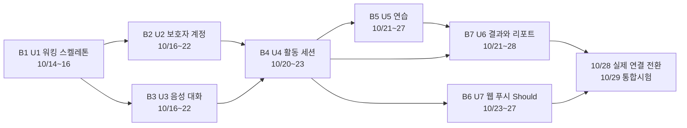

# 무중 볼트 계획 (Delivery Planning 2.9)

> Delivery Planning(2.9) 산출물 · 깊이 Standard · 2026-10-09 (클라우드 세션, 팀장 대리 판단)
> 입력: `unit-of-work.md` · `unit-of-work-dependency.md` · `unit-of-work-story-map.md`(유닛 7개 · DAG · 스토리 30개), `contract-summary.md`(계약 14개 · 시간 계약), `components.md`(컴포넌트 26개), `requirements.md`(FR · NFR), `stories.md`(수용 기준), `mockups.md`(화면 문구), 70_WBS_v0.5(인력 · 일정), 스코프 `mujoong-mvp`(skeleton: on). practices-discovery가 돌지 않아 `team-practices` 산출물이 없으므로 org.md 기본값(트렁크 기반 · squash-merge · test-after)을 쓴다. 질문과 대리 답은 `delivery-planning-questions.md`(Q1 ~ Q10).
>
> **볼트(Bolt)** 는 한 번의 만들기 묶음이다 — 유닛 하나 이상을 Construction 단계(3.1 Functional Design ~ 3.5 Code Generation)로 통과시켜 실제로 돌아가는 것으로 끝낸다. **워킹 스켈레톤**은 모든 연결 지점을 한 번씩 실제로 지나가는 가장 얇은 끝에서 끝까지의 조각이다. 이 계획에서는 유닛 하나가 볼트 하나다(J34).

## 1. 한눈에

| 순서 | 볼트 | 유닛 | 크기 | 스켈레톤 | 사람 주 담당 | 사람 일정(가안) | 엔진 순서 |
|---|---|---|---|---|---|---|---|
| 1 | B1 워킹 스켈레톤 | U1 u1-walking-skeleton | L | ✅ | 전원(B 운전 · E 실행 골격) | 10/14 ~ 10/16 | 1 |
| 2 | B2 보호자 계정 | U2 u2-guardian-account | M | — | A | 10/16 ~ 10/22 | 2 |
| 2 | B3 음성 대화 | U3 u3-voice-conversation | L | — | B | 10/16 ~ 10/22 | 3 |
| 3 | B4 활동 세션 | U4 u4-activity-session | XL | — | B · C | 10/20 ~ 10/23 | 4 |
| 4 | B5 연습 | U5 u5-practice | L | — | C · D | 10/21 ~ 10/27 | 5 |
| 4 | B6 웹 푸시(Should) | U7 u7-web-push | S | — | A | 10/23 ~ 10/27 | 6 |
| 5 | B7 결과와 리포트 | U6 u6-results-report | L | — | E · D | 10/21 ~ 10/28 | 7 |

- **사람 일정**은 WBS v0.5의 배치 가안을 유닛 기준으로 다시 놓은 것이다. WBS가 적어 둔 대로 10/13 재배치 회의에서 사람이 확정한다. 같은 순서 번호의 볼트는 동시에 만든다(J35).
- **엔진 순서**는 AI-DLC 엔진이 이 세션에서 유닛을 설계 · 생성하는 순서다. 엔진은 DAG를 층으로 나누고(U1 / U2 · U3 / U4 / U5 · U7 / U6) 층 안은 이름순으로 돈다. 기록된 설정은 unit-major · serial이다(유닛마다 3.1 ~ 3.5 뒤 다음 유닛, J38).
- 볼트 뒤 일정(WBS 그대로): 10/28 실제 연결 전환 · 구현 완료본 배포, 10/29 통합시험, 10/30 결함 수정, 11/2 재시험 · 성능 측정 · 동결, 11/3 문서, 11/5 제출.

## 2. 순서 그림

<!-- Text fallback: B1(U1 워킹 스켈레톤, 10/14~16)이 맨 먼저다. 그 뒤 B2(U2 보호자 계정)와 B3(U3 음성 대화)를 10/16~22에 나란히 만든다. 둘이 끝나면 B4(U4 활동 세션, 10/20~23). B4 뒤에 B5(U5 연습, 10/21~27)와 B6(U7 웹 푸시, Should, 10/23~27)를 나란히, B7(U6 결과와 리포트, 10/21~28)은 B4 · B5 뒤에 통합한다. 일정이 겹치는 것은 계약(2.8)을 기준으로 대역을 두고 먼저 만들기 때문이며 통합 순서는 화살표를 따른다. 모두 10/28 실제 연결 전환과 10/29 통합시험으로 모인다. -->

## 3. 볼트별 정의

### B1 · U1 워킹 스켈레톤 ✅

- **묶는 유닛:** U1 u1-walking-skeleton. 완성하는 컴포넌트: DeviceRegistry · CoreMessaging · RealtimeMessaging · DeviceWeb D0 · 실행 골격(Compose · Nginx · Flyway · 두 스키마 · 역할). 최소 경로만 갖는 것: 시험 로그인(`/api/dev/login`) · 시드 동의 · 아이 · 04 · 08 · 12 최소 · SessionLifecycle 최소 상태 · VoiceRelay 1턴 · OutputGate 최소 규칙 · 마무리 인사 시드 · T19 최소.
- **실제로 지나가는 연결 지점:** Nginx HTTPS · WSS → Next.js 한 앱의 두 접점(/parent · /device) → Core ↔ Realtime 내부 HTTP(C8 시작 · 끝내기 · 진행 조회, C9 토큰 확인 · 상태 보고) → Outbox → Inbox(SessionStateChanged · SessionRecordCaptured · DeviceStatusChanged) → 기기 WSS(C7: HELLO · START_SESSION · ACK · DEVICE_READY · OUTPUT_BEGIN · 0x01/0x02 음성 · PLAYBACK_MARK · STOP_OUTPUT · CLOSE_TRANSPORT · VOICE_SESSION_CLOSED) → GPT-Live 중계(B안)와 출력 게이트 → 기기 쿠키 인증(J29) → PostgreSQL 두 스키마의 쓰기 권한 분리.
- **완료 조건:** ① 사람이 승인한 검증 명령 하나가 "D0 코드 → 05a 등록 → 04 안정 → 08 시작 → 음성 1턴(게이트 경유) → P1 → ENDED(기기 멈춤 확인)"를 끝까지 통과한다. ② core_app 역할이 realtime 스키마에 쓰지 못하고 그 반대도 막힌다. ③ 서버 로그 · Nginx 접근 로그에 전사 원문 · 기기 토큰이 없다. ④ 사람이 스켈레톤 확인을 승인한다.
- **확인할 가설:** 기기 → Realtime → GPT-Live → 게이트 → 기기 중계가 J27 형식(PCM16 · 24kHz)으로 변환 없이 돌고, 아이 말 끝 → 기기 첫 음성 지연을 구간별로 잴 수 있다(목표 p95 2.5초 · 중계 증가분 0.5초는 11/2 측정, TS-N01). Outbox → Inbox가 Core 상태 사본을 12의 2초 폴링 안에 맞춘다.
- **기대 시연:** 데스크톱 크롬(아이 기기)과 안드로이드 크롬(보호자) 두 대로 코드 등록 → 시작 → 한 마디 주고받기 → 끝내기 → 17.
- **선행:** GPT-Live 접근 · 형식 POC(B, 10/13), EC2 · 도메인 · HTTPS(클라우드 담당), 저장소 골격(E, 10/14), DB 개발 환경(D, 10/14) — `external-dependency-map.md`.

### B2 · U2 보호자 계정

- **묶는 유닛:** U2 u2-guardian-account(GuardianIdentity · ConsentPolicy · ChildProfile · ApprovedContentCatalog · AccountDeletion 지휘 틀). 스토리 US1.1 ~ US1.6 · US2.1 · US2.3.
- **완료 조건:** 01 구글 로그인이 시험 로그인을 대체하고(운영 빌드에서 `/api/dev/login` 404), 02 · 02-1 동의 4항목 · 03 아이 등록 · 수정 · 04 세 구역 · 05 판정 카드 · SET-01 · 설정 시트 · 로그아웃 · P7 계정 삭제 접수가 각 수용 기준을 통과한다. C1 계약 시험(남의 자원 404 · CSRF · 노출 금지 필드 없음) 통과. 삭제 참가자 계약(DeletionParticipant)이 공개되어 뒤 볼트가 붙일 수 있다.
- **확인할 가설:** Spring Session JDBC 쿠키 + `X-CSRF-TOKEN` 조합이 안드로이드 크롬의 Next.js /parent에서 끊김 없이 돌고(J21), 승인 문구 버전 고정(ApprovedContentPin)이 세션 패키지에 그대로 실린다.
- **기대 시연:** 새 구글 계정으로 01 → 02 → 03 → 04, 05에서 기기 두 줄 · 판정 카드, SET-01 저장, P7 삭제 접수 → 즉시 로그아웃.

### B3 · U3 음성 대화

- **묶는 유닛:** U3 u3-voice-conversation(DeviceGateway · VoiceRelay · OutputGate · ConversationLog · DialogPolicy · DeviceWeb T19). 스토리 US6.2 · US6.4.
- **완료 조건:** T19 상태 전부(꺼짐 · 대기 · 듣는 중 · 생각 중 · 말하는 중 · 마무리 · 다시 연결 중 · 마이크 허용 안 됨 · 화면 켜짐 유지), 연결 5단계 판정과 Core 보고, HELLO resume 재연결, 끊김 때 재생 버림(FR-E11), 게이트의 구간 검사 · 차단 · 대체, 종료 표현 → 확인 질문 → 마무리 인사 1회, 끼어들기 0.5초 안 멈춤(TS-N04) 시험 통과.
- **확인할 가설:** 기기 로컬 끼어들기 감지가 자기 재생음(에코)에 속지 않는다(J31 — 속으면 서버 감지로 바꾸고 다시 잰다). 게이트를 거쳐도 중계 증가분이 0.5초 안이다(NFR5).
- **기대 시연:** 대화 중 아이가 끼어들어 AI 말이 멈춤, "무중아 그만할래" → 확인 질문 → 마무리 인사 → 대기, 네트워크를 10초 끊었다 살리면 "다시 연결 중" → 대기.

### B4 · U4 활동 세션 (XL — 안에서 두 번 확인)

- **묶는 유닛:** U4 u4-activity-session(ActivityCoordinator · SessionLifecycle · ActivityRecord). 스토리 US3.1 ~ US3.6 · US6.3 · US6.6.
- **확인 ①(정상 경로):** 08 시작 검사와 거절 5종 · 멱등 시작 · 세션 상태 11개 · 12 진행(2초 폴링 · `sinceSeq`) · P1 끝내기 · 17 · 활동 기록(SessionRecordCaptured → core_activity_record) · 26 · 27용 조회 API.
- **확인 ②(장애 경로):** 참여 대기 20 + 20초 → DECLINED · P3, 공백 4분 경고 · 6분 SILENCE, 끊김 10초 점선 · 40초 ABORTED → P2, 마무리 확인 30초 → ENDED_UNCONFIRMED, 기술적 일시 정지, "기기 상태 확인 불가"(30초).
- **완료 조건:** 두 확인의 수용 기준 통과. 시간값은 `contract-summary.md` 7절 키를 줄여 주입해 경계(19초/21초)를 시험한다(NFR6).
- **확인할 가설:** Realtime이 세션 주인이고 Core는 사본만 가져도 04 · 12 · 17이 2초 폴링에서 어긋나지 않는다(J5 · J10). 7절 시간 표 하나로 모든 경계 시험을 돌릴 수 있다.
- **기대 시연:** 시작 → 참여 무응답 → 재안내 → 참여 → 대화 → 아이 종료 표현 → 17 정리 상태. 별도로 기기 전원을 끊어 40초 뒤 P2.

### B5 · U5 연습

- **묶는 유닛:** U5 u5-practice(PracticeGoal · PracticeProtocol · ResponseEvaluator · PragmaticsKnowledge · TextAiGateway, U4 시작 · 진행의 연습 확장). 스토리 US4.1 · US4.2 · US6.5.
- **완료 조건:** 18 목록(★ 묶음 · 담은 순 · × 뒤 5초 되돌리기), 연습 시작(첫 상황 두 번 실패 → SCENARIO_GEN_FAILED), D-05 흐름(상황 안내 → 첫 반응(Cue 금지) → 판정 5초 + 1회 → 도움 동의 → Cue 5초 예산 → 도움 후 반응 1회 → 새 상황), 12 연습 머리 n/N, 보호자 응답 · PDF에 판정값 없음 — 수용 기준 통과.
- **확인할 가설:** 판정 5초 + 재시도 1회와 Cue 5초 예산이 실제 대화에서 지켜지고, 다음 목표 상황 생성이 15초(J26) 안에 끝나 대기 문구가 길어지지 않는다.
- **기대 시연:** 목표 2개 연습 → 첫 반응 partial → "같이 살펴볼까?" 동의 → Cue → 도움 후 반응 → 새 상황 → 다음 목표 → 마무리 인사.
- **선행:** D 담당 AI 입출력 계약 문서(판정 기준 · 프롬프트 · 금지 표현 사전 v1)와 정량 POC(WBS 2.5.2).

### B6 · U7 웹 푸시 (Should)

- **묶는 유닛:** U7 u7-web-push(Notification). 스토리 US1.7.
- **완료 조건:** 구독 저장 · 해제, 알림 3종(VOICE_PROBLEM · DEVICE_STATUS_UNKNOWN · ENDED_BY_CONNECTION)이 화면 문구로 뜨고, 누르면 04가 `/api/sessions/current`로 다시 물어 12 · 17 · 04로 간다. 알림 본문에 대화 내용이 없다(FR7.10). 삭제 참가자(구독 삭제) 연결.
- **확인할 가설:** 안드로이드 크롬에서 앱 설치(PWA) 없이 화면이 꺼져 있어도 알림이 온다.
- **기대 시연:** 보호자 폰 화면을 끈 채 아이 기기를 끊으면 알림 → 누르면 04.
- **미루기 규칙:** 10/27까지 확인을 못 하면 떼어 낸다. 시연 네 경로와 Must 스토리에 영향이 없다(`unit-of-work-story-map.md` 확인 절).

### B7 · U6 결과와 리포트

- **묶는 유닛:** U6 u6-results-report(ResultPipeline · Report). 스토리 US5.1 ~ US5.5 · US4.3.
- **완료 조건:** 결과 작업 하나(REQUESTED → RUNNING → DONE/FAILED, 자동 3회, 재시작 → FAILED) · 17 정리 상태 · 26 달력 · 27 상세(생활 팁 · 목표 후보 · 담기) · 28 범위 · 30 확인 · PDF(대화 원문 그대로, "이 문서는 진단 결과가 아닙니다", 생활 팁 없음, 판정값 없음) · 리포트 60초 안 READY — 수용 기준 통과.
- **확인할 가설:** 텍스트 AI 결과 작업이 60초 안에 끝나고(NFR8) 실패해도 「다시 시도」로 복구된다. 서버에서 그린 PDF가 한글 글꼴로 안드로이드 크롬에서 저장 · 공유된다(J8).
- **기대 시연:** 대화 끝 → 17 정리 끝 → 27 팁 · 후보 → 담기 → 18에 나타남. 28에서 기간 선택 → 30 → PDF 저장.

## 4. 공통 완료 조건 (모든 볼트)

- `unit-of-work.md` 공통 완료 조건: 자기 데이터의 계정 삭제 참가자 연결, 로그에 전사 원문 없음, 판정값 비노출.
- 계약 시험: 제공 쪽은 `contract-summary.md` 스펙대로 응답, 소비 쪽은 스펙 예시로 동작(10절). 노출 금지 필드는 응답 스키마 시험으로 막는다.
- 시험: org.md 기본값(test-after — 층마다 구현한 뒤 그 층 시험) + Test Strategy Standard. 정상 경로와 오류 · 경계 2개 이상(construction 지침).
- 머지: 짧은 기능 브랜치 → `main` squash-merge(볼트 하나 = `main` 커밋 하나, org.md).
- 문서: 바뀐 계약 · 시간값은 `contracts/` 파일을 먼저 고친다.

## 5. 엔진 진행과 사람 일정의 관계

- **AI-DLC 엔진(이 세션):** 유닛을 하나씩 3.1 → 3.2 → 3.3 → 3.4 → 3.5로 돈 뒤 유닛 체크포인트를 연다(unit-major · serial). 순서는 U1 → U2 → U3 → U4 → U5 → U7 → U6. skeleton: on이라 U1의 3.5와 스켈레톤 확인(사람 승인)이 끝나야 U2가 시작된다.
- **사람 팀:** 계약이 고정되어 있으므로 담당자는 자기 유닛 설계 문서가 나오는 대로 대역을 두고 병행 구현한다. 통합 시험은 DAG 방향(U1 → U2 · U3 → U4 → U5 · U7 → U6)으로 한다. 10/23 2차 사전 배포(WBS 2.4.4)에서 B1 ~ B4가 한 배포에 함께 서야 한다.
- **Construction 검증 명령:** 아직 실행할 코드가 없어 정하지 않았다(J39). 후보는 `bash scripts/verify.sh`(Compose 기동 → 시드 → Playwright 두 브라우저 E2E로 B1 완료 조건 ① 확인 → 앱별 단위 · 계약 시험). 엔진이 첫 유닛 체크포인트 전에 사람에게 묻는다.
- **인력 구성:** 이 세션 하나로 진행(solo, J40). 다섯 명이 각자 세션에서 자기 유닛을 소유 · 승인하는 team 모드로 바꾸려면 3.5 전에 사람이 정한다.

## 6. 사람 지시와 스켈레톤 설정이 부딪치는 곳

사람 지시(2026-10-09): "내가 '계속'이라고 하면 3.1 Functional Design → 3.2 NFR Requirements → 3.3 NFR Design → 3.4 Infrastructure Design을 유닛 7개 전부 진행하고, 3.5 Code Generation은 시작하지 말고 멈춰."

스코프 `mujoong-mvp`(2026-10-08 사람 승인)는 skeleton: on이다: "가장 얇은 끝-끝 조각을 사람이 승인한 실제 검증 명령으로 먼저 통과시킨 뒤 5인 담당 유닛을 병렬로 흩는다." 엔진은 이 설정에서 반복 순서와 관계없이 U1의 3.1 ~ 3.5와 스켈레톤 확인을 다른 유닛보다 먼저 끝낸다. 그래서 두 지시를 함께 지킬 수 없다. 대리가 풀 수 없는 설정(스코프 · 3.5 금지)이라 사람이 고른다:

| 선택 | 하는 일 | 얻는 것 | 잃는 것 |
|---|---|---|---|
| (가) 기본 — 지금 지시 그대로 | "계속"을 받으면 U1의 3.1 ~ 3.4까지만 하고 3.5 앞에서 멈춘다 | 3.5 금지를 지킨다 | U2 ~ U7 설계가 U1 코드 생성 · 스켈레톤 확인 뒤로 밀린다 |
| (나) 권장 — U1만 코드까지 | 사람이 U1의 3.5(계획 승인 포함)와 검증 명령을 승인 → 스켈레톤 확인 → 반복 순서를 stage-major로 바꿔 U2 ~ U7의 3.1 → 3.4를 단계별로 돌고 3.5 앞에서 멈춘다 | 스코프의 "스켈레톤 먼저"를 지키면서 나머지 여섯 유닛 설계를 코드보다 먼저 받는다 | U1 코드 생성에 사람 확인 시간이 든다 |
| (다) 스켈레톤 끄기 | 사람이 스코프의 skeleton을 off로 바꾸고 stage-major로 돌린다 → 일곱 유닛 모두 3.1 → 3.4, 3.5 앞에서 멈춤 | 지시를 글자 그대로 지킨다 | 사람이 승인한 "검증된 스켈레톤 먼저" 약속이 사라진다 |

(나)와 (다)의 반복 순서 변경은 사람 승인 뒤에만 기록한다(단계 파일: 기록된 선택은 보존, 바꿀 때는 사람 승인). 이 세션은 어느 쪽도 스스로 바꾸지 않는다.

## 7. 준하 제안(가정)

사람 지시(2026-10-09)에 따라 팀장(준하)의 대리가 `docs/cloud_handoff.md` 2절 규칙으로 정했다. 질문 · 선택지 · 까닭은 `delivery-planning-questions.md`.

| 번호 | 준하 제안(가정) | 근거 | 확정 단계 |
|---|---|---|---|
| J32 | 순서 = 워킹 스켈레톤(U1) 먼저 → 위험 큰 음성(U3)과 기반인 계정(U2) 나란히 → 활동 세션(U4) → 연습(U5) · 웹 푸시(U7) → 결과와 리포트(U6) | Q1 · 구현 창 7일 · DAG | 10/13 재배치 회의 |
| J33 | WSJF를 가볍게 써서 병행 가능한 유닛 사이 순서 · 사람 배치에만 쓴다(세 항목 1 · 2 · 3 · 5 · 8, 크기 S1 · M2 · L3 · XL5) | Q2 · Reinertsen · SAFe | 10/13 재배치 회의 |
| J34 | 유닛 하나 = 볼트 하나(7개). U4는 안에서 정상 · 장애 경로를 두 번 확인 | Q3 · 엔진의 유닛 단위 진행 | Construction |
| J35 | 사람 팀은 계약 기준 대역으로 병행, 통합은 DAG 순서. 엔진은 unit-major · serial 유지 | Q4 · K4 · K5 | Construction |
| J36 | 외부 의존 10가지를 주인 · 걸리는 시간 · 막는 볼트 · 대안으로 관리. 클라우드 담당 확정이 첫째 | Q5 · WBS 2.4.1 | 3.4 Infrastructure Design 전 |
| J37 | 걱정 다섯(중계 지연 · 형식 · 에코 / 7일 창 / 판정 · 상황 품질 / 삭제 참가자 / 클라우드 담당)을 스켈레톤 · 대역 병행 · 판정 POC · 공통 완료 조건 · 사람 결정으로 막는다 | Q6 | Construction |
| J38 | 반복 순서는 기록된 unit-major · serial 유지. "3.1 ~ 3.4 유닛 7개 · 3.5 금지" 지시와 skeleton: on의 충돌은 6절 선택지로 사람에게 넘긴다 | Q7 · 스코프 · 단계 파일 | "계속" 지시 때 사람 |
| J39 | Construction 검증 명령은 그린필드라 비워 두고 후보(`bash scripts/verify.sh`)만 적는다. 첫 체크포인트 전에 사람이 승인 | Q8 · 단계 파일(임시 명령 금지) | 3.5 전 사람 |
| J40 | 인력 구성은 이 세션 하나(solo). team 모드 전환은 사람 결정 | Q9 | 3.5 전 사람 |
| J41 | 클라우드 담당(EC2 · Nginx · 도메인 · HTTPS · 배포 절차 · 1차 뼈대 배포)은 A가 맡는다 | Q10 · WBS 2.4.x · 짐 점검(`team-allocation.md` 3절) | 10/13 재배치 회의 전 사람 |
