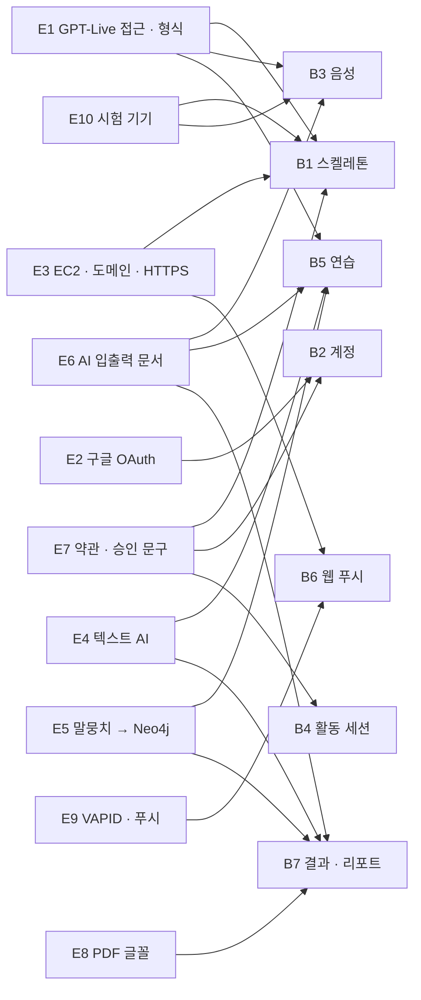

# 무중 외부 의존 지도 (Delivery Planning 2.9)

> Delivery Planning(2.9) 산출물 · 2026-10-09 (클라우드 세션, 팀장 대리 판단)
> 입력: `components.md` 외부 의존 절(GPT-Live · 텍스트 AI · 구글 · PostgreSQL · Neo4j · 웹 푸시 · 파일 저장소), `contract-summary.md` 11절 열린 질문, `requirements.md`(A1 · NFR5 · NFR7 · NFR10), 70_WBS_v0.5(2.2 · 2.4 · 2.5 · 1.7).
>
> **볼트(Bolt)** 는 한 번의 만들기 묶음이다 — 유닛 하나를 설계부터 코드까지 통과시켜 실제로 돌아가는 것으로 끝낸다(B1 ~ B7은 `bolt-plan.md`). 이 문서는 팀 밖(또는 팀 안이지만 여러 볼트를 막는 문서 · 결정)에서 와야 하는 것과 그것이 막는 볼트를 적는다. 비밀값(키 · 비밀번호)은 이 문서에 적지 않는다. 모두 환경 변수로 받는다.

## 1. 지도

| # | 의존 | 주인 | 걸리는 시간 | 막는 볼트 | 필요한 날 | 늦을 때 대안 |
|---|---|---|---|---|---|---|
| E1 | GPT-Live 접근(`gpt-live-1`, 서버 키, 사용량 한도)과 실제 오디오 입출력 형식 | 외부: OpenAI / 팀: B | 키는 즉시, 형식 확인은 중계 POC(WBS 2.5.1) | B1 · B3 · B5 | 10/13 | 형식이 다르면 VoiceRelay가 변환(계약 11절). 접근이 막히면 팀장이 같은 날 ADR-004(B안) 재검토 — 시연 경로 전체가 걸린다 |
| E2 | 구글 OAuth 클라이언트(동의 화면 · 리디렉션 URI · 시험 사용자 등록) | 외부: Google / 팀: A | 1 ~ 2일(WBS 2.2.3) | B2 | 10/13 | U1 시험 로그인(dev 프로필)으로 개발을 계속하고 시연 전까지 등록 |
| E3 | EC2 · Docker · 도메인 · HTTPS 인증서 · Nginx WSS | 외부: AWS · 도메인 등록처 · 인증 기관 / 팀: 클라우드 담당(J41 제안 A) | 1 ~ 2일 + DNS 전파(WBS 2.4.1 ~ 2.4.3) | B1 시연(원격 마이크와 WSS는 HTTPS 보안 컨텍스트 필요) · B6(웹 푸시는 HTTPS 필수) | 10/14 | localhost(보안 컨텍스트 예외)로 개발, 원격 시연만 늦춤 |
| E4 | 텍스트 AI API 키 · 예산(상황 생성 · 판정 · 경험 구조화 · 목표 후보) | 외부: AI 공급자 / 팀: D · 팀장 | 즉시(예산 승인은 팀장) | B5 · B7 | 10/20 | 고정 응답 대역으로 개발하고 10/28 실제 연결 전환(WBS 3.5.1 · 3.5.2) |
| E5 | 국립국어원 말뭉치 → Neo4j 초기 적재(이용 조건 확인 포함) | 외부: 국립국어원 / 팀: D | WBS 3.4.2.1(10/8 ~ 13 자료 정리) | B5 · B7(화용 지식 · 생활 팁 매칭) | 10/21 | 손으로 만든 최소 화용 지식 시드로 개발 |
| E6 | AI 입출력 계약 문서(판정 기준 본문 · 프롬프트 · 금지 표현 사전 v1 · 대기 문구) | 팀 안: D(WBS 1.7.3 · 1.7.7) | 10/8 ~ 10/13 | B3(게이트 규칙) · B5 · B7 | 10/13 | 계약 9절 형식만으로 대역을 만들고 본문은 10/20까지 |
| E7 | 약관 본문 · 정책 버전 1.0 문장(OQ7)과 승인 문구 · 승인 음성 파일 | 팀 안: A(약관) · 팀장(문구 승인) | 2 ~ 3일 | B1(마무리 인사 시드) · B2(02 · 02-1) · B4(시작 안내 · 재안내) | 10/16 | 시드 문구 · 시드 음성으로 개발하고 문장이 확정되면 버전을 올린다(세션은 시작 때 버전 고정) |
| E8 | PDF 한글 글꼴(재배포 가능한 라이선스)과 서버 렌더 라이브러리 | 팀: E | 1일(3.3에서 확정) | B7 | 10/22 | 리포트 화면(30) 먼저, PDF는 한 장짜리부터 |
| E9 | 웹 푸시 VAPID 키(환경 변수) · 안드로이드 크롬 푸시 서비스 | 외부: 브라우저 푸시 서비스 / 팀: A | 1일 | B6 | 10/23 | Should라 떼어 낸다. 12 화면 폴링이 기본 경로 |
| E10 | 시험 기기: 안드로이드 폰(크롬) · 데스크톱 크롬(마이크 · 스피커) | 팀 | 즉시 | B1 · B3 · 10/29 통합시험 | 10/14 | 노트북 두 대로 대신하고 안드로이드 확인은 10/23 2차 사전 배포에서 |
| E11 | 11/2 성능 측정 환경(EC2에서 아이 말 끝 → 기기 첫 음성 p50 · p95, 동시 세션 2개) | 팀: B · 팀장 | 반나절 | 측정(NFR5 · NFR7 · TS-N01 · TS-N07) | 11/2 | 측정 로그 · 시점 기록을 B1부터 넣어 둔다(WBS 3.5.3 "성능 측정용 로그 · 시점 기록") |

## 2. 그림

<!-- Text fallback: E1 GPT-Live 접근 · 형식은 B1 스켈레톤 · B3 음성 · B5 연습을 막는다. E2 구글 OAuth는 B2 계정을, E3 EC2 · 도메인 · HTTPS는 B1과 B6 웹 푸시를 막는다. E4 텍스트 AI와 E5 말뭉치 → Neo4j는 B5와 B7 결과 · 리포트를, E6 AI 입출력 문서는 B3 · B5 · B7을, E7 약관 · 승인 문구는 B1 · B2 · B4 활동 세션을 막는다. E8 PDF 글꼴은 B7을, E9 VAPID · 푸시는 B6을, E10 시험 기기는 B1 · B3을 막는다. E11 성능 측정 환경은 볼트가 아니라 11/2 측정을 막는다. -->

## 3. 팀 안 넘겨주기

- 볼트 계획 → Jira 백로그(볼트 1개 = 이슈 1개, WBS 2.1.4, 팀장, 10/14).
- 계약 파일 고정(`contracts/` — `contract-summary.md` 10절, 10/13): 대역 병행의 전제다.
- 10/13 재배치 회의: 볼트 일정 · 클라우드 담당(J41) · `bolt-plan.md` 6절 선택지 확정.
