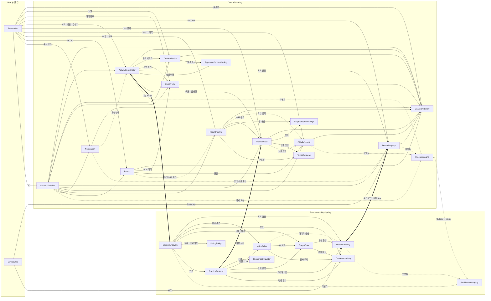

# 무중 컴포넌트 카탈로그 (Domain Design 2.6)

> Domain Design(2.6) 산출물 · 깊이 Standard · 2026-10-09 (클라우드 세션, 팀장 대리 판단)
> 입력: `requirements.md`(FR1~FR7 · NFR1~NFR12 · A1~A10), `stories.md`(US1.1~US6.6 · B1~B26 · OQ11~OQ16), refined-mockups 산출물(`mockups.md` · `interaction-spec.md`), 질문 파일 `domain-design-questions.md`(K1~K11 · Q1~Q9). 참고 문서: 50_ADR_2S(ADR-002 · 007 · 009 · 010, architecture/*), 60_ERD_v0.1 데이터 사전, 20_개발명세_1008(API · 상태 기계 · 화면↔테이블), 80_점검표_1008, 초안 `docs/aidlc_drafts/inception/domain-design/`.
> 그린필드라 브라운필드 입력(`architecture` · `component-inventory`)은 없다. practices-discovery를 건너뛰어 `team-practices`도 없으며 org.md 기본값(트렁크 기반 · squash-merge · test-after)을 따른다.
> 기준: 문서끼리 다르면 화면 설계 v1.5j > 승인된 requirements · stories · mockups > 요구사항 v1.1 > ERD v0.1 · ADR_2S > WBS (규칙 1). 이 단계는 배포 단위를 정하지 않는다(유닛은 2.7).

## 카탈로그 (machine-readable)

컴포넌트 26개 = 화면 접점 2 + Core API Spring 안 15 + Realtime Activity Spring 안 9. 컴포넌트는 "우리가 짜는 코드"이고 PostgreSQL · Neo4j · GPT-Live · 파일 저장소 · 웹 푸시는 외부 의존이다. 엔터티는 소유 · 모양 수준만 적는다(타입 · 제약은 Functional Design). 엔터티 이름 옆 물리 테이블은 ERD v0.1 이름이며 새로 생기는 것은 `(신설)`로 적었다.

```yaml
components:
  # ───────────── 화면 접점 (Next.js 한 앱) ─────────────
  - name: ParentWeb
    summary: 보호자 웹 /parent — 화면 01~30 · SET · 팝업(P1 · P2 · P3 · P5 · P7)과 Android Chrome 기준 조작
    behaviour: >
      화면 설계 v1.5j 카드대로만 그린다(새 화면 없음). 12는 진행 조회를 2초 간격으로 폴링하고(A2) 다른 화면은 진입 때 1회 조회한다.
      서버 수락과 기기 실행 확인을 구분해 표시하고, 조회 실패는 마지막 확인 시각과 함께 미확인으로 남긴다(FR1.5 · FR3.2).
      판정값 · 점수 · 진단 표현을 화면에 만들지 않는다(NFR1). 보호자 폰 오프라인은 공통 오류 토스트로만 알린다(FR2.2).
      30은 10개 항목 리포트를 보여 주고, PDF는 서버가 만든 파일을 받아 저장 · Web Share로 공유하며 「나중에」 · 「←」면 버린다(FR6.5 · A4).
    responsibilities:
      - 화면 01~30 · SET0 · SET-01 · 팝업의 표시 · 분기 · 입력 검증(이름 · 나이 6~12 · 08 200자 · 종료 표현 2~20자)
      - 진행 화면 폴링 · 하단 탭 잠금(기기 안정 아님 · 마무리 중) · 중복 시작 방지
      - 웹 푸시 구독 등록과 알림 진입 시 최신 세션 재조회
    depends_on:
      - component: GuardianIdentity
        interaction: 구글 로그인 · 로그아웃 · 로그인 상태 확인
        style: sync
      - component: ConsentPolicy
        interaction: 02 · 02-1 약관 조회와 4항목 동의 저장
        style: sync
      - component: ChildProfile
        interaction: 03 아이 정보 · SET-01 종료 표현
        style: sync
      - component: DeviceRegistry
        interaction: 05 두 줄 · 판정 카드, 05a 코드 등록
        style: sync
      - component: ActivityCoordinator
        interaction: 08 · 18 시작, 12 진행 폴링, P1 끝내기, 04 지금 활동
        style: sync
      - component: PracticeGoal
        interaction: 18 목록 · 즐겨찾기 · 삭제/되돌리기, 27 담기/취소
        style: sync
      - component: ActivityRecord
        interaction: 26 달력 · 그날 목록, 27 대화 기록 칸
        style: sync
      - component: ResultPipeline
        interaction: 17 · 27 정리 상태, 27 끝난 이유 · 장면 결과 · 결과 문장 · 생활 팁 · 목표 후보 칸, 「다시 시도」
        style: sync
      - component: Report
        interaction: 28 미리보기 · 생성 · 취소, 30 리포트 확인(10개 항목) · PDF 받기 · 저장/버림 표시
        style: sync
      - component: Notification
        interaction: 웹 푸시 구독 등록
        style: sync
      - component: AccountDeletion
        interaction: P7 계정 삭제 요청 · 삭제 처리 중 확인
        style: sync
    dependents: []
    external_dependencies:
      - name: 브라우저 Web Share · Push · Service Worker API
        kind: other
        purpose: 30 PDF 공유, 웹 푸시 수신(Android Chrome 기준, iOS 보장 없음)
    entities: []

  - name: DeviceWeb
    summary: 아이 기기 웹 /device — D0 처음 켜기(코드) · T19 상태 화면(켜기 · 끄기)
    behaviour: >
      클릭 요소는 「켜기」(마이크 · 소리 허용 → 연결 → 대기, Wake Lock) · 「끄기」뿐이다(FR5.1). 마이크 거부 시 연결하지 않는다.
      D0은 서버가 발급한 8자리 코드를 보여 주고 등록을 기다린 뒤 「등록되었어요」(3초) → T19로 간다. 기기 토큰만 저장하고 모델 키는 받지 않는다.
      AI 음성은 서버가 승인해 보낸 것만 재생하고, 아이가 끼어들면 0.5초 안에 재생을 멈추고 재생 위치(playbackMark)를 보고한다(FR7.8).
      탭이 숨거나 화면이 꺼지면 연결 유지를 시도하고 끊기면 다시 연결 중으로 간다. ?debug=1이면 상태 로그를 보인다.
    responsibilities:
      - 마이크 캡처 · 승인 음성 재생 · 끼어들기 로컬 정지 · 재생 위치 보고
      - 기기 상태 표시(꺼짐 · 대기 · 듣는 중 · 생각 중 · 말하는 중 · 마무리 · 다시 연결 중 · 마이크 허용 안 됨)
      - 기기 비밀 · 토큰 보관, 브라우저 데이터가 지워지면 D0 재등록
    depends_on:
      - component: DeviceRegistry
        interaction: bootstrap 코드 발급 · 등록 상태 확인 · 토큰 수령
        style: sync
      - component: DeviceGateway
        interaction: 기기 토큰으로 WSS 접속, 음성 · 제어 · heartbeat · 재생 보고
        style: sync
    dependents: []
    external_dependencies:
      - name: 브라우저 마이크 · 오디오 · Wake Lock API
        kind: other
        purpose: 아이 음성 캡처 · 재생 · 화면 켜짐 유지(데스크톱 Chrome 기준)
    entities: []

  # ───────────── Core API Spring ─────────────
  - name: GuardianIdentity
    summary: 구글 로그인 · 보호자 계정 · 로그인 세션 · 보호자 데이터 접근 범위 (ADR_2S auth + guardian)
    behaviour: >
      구글 OAuth만 받는다(FR1.1). 로그인 세션은 Spring Session JDBC로 유지하고 만료되면 401 → 01 재로그인 → 04(A1: 30일 갱신형 출발점).
      모든 보호자 API의 주체를 확정하고 다른 보호자의 데이터는 404/403으로 막는다(NFR9). 계정 삭제가 접수된 보호자는 즉시 차단 상태가 되어
      어떤 API도 데이터를 돌려주지 않고 "삭제 처리 중"만 보인다(FR1.6). 로그아웃은 세션 종료 요청이 아니다(B2).
    responsibilities:
      - 구글 식별자 ↔ 내부 보호자 연결, 첫 로그인 계정 생성
      - 로그인 세션 · CSRF · 만료 처리
      - 보호자 상태(ACTIVE · DELETION_REQUESTED) 관리와 접근 차단
    depends_on: []
    dependents:
      - component: ParentWeb
        interaction: 로그인 · 로그아웃 · 세션 확인
      - component: ConsentPolicy
        interaction: 현재 보호자 확인
      - component: ChildProfile
        interaction: 현재 보호자 확인
      - component: DeviceRegistry
        interaction: 05a 등록 주체 확인
      - component: ActivityCoordinator
        interaction: 시작 · 조회 · 끝내기 주체 확인
      - component: PracticeGoal
        interaction: 18 · 27 담기 주체 확인
      - component: ActivityRecord
        interaction: 26 · 27 조회 주체 확인
      - component: ResultPipeline
        interaction: 27 결과 조회 · 다시 시도 주체 확인
      - component: Report
        interaction: 28 · 30 주체 확인
      - component: Notification
        interaction: 푸시 구독 주체 확인
      - component: AccountDeletion
        interaction: 삭제 접수 즉시 차단 · 로그아웃 · 최종 계정 삭제
    external_dependencies:
      - name: Google OAuth 2.0
        kind: third-party-api
        purpose: 보호자 로그인
      - name: PostgreSQL (core 스키마)
        kind: database
        purpose: 보호자 · 소셜 계정 · 로그인 세션 저장
    entities:
      - name: Guardian
        identifier: id
        attributes: [status, createdAt, updatedAt]
      - name: GuardianSocialAccount
        identifier: id
        attributes: [guardianId, provider, providerUserId, providerEmail, createdAt]
      - name: LoginSession
        identifier: primaryId
        attributes: [sessionId, principalName, creationTime, lastAccessTime, maxInactiveInterval, expiryTime, attributes]

  - name: ConsentPolicy
    summary: 약관 버전 · 필수 동의 4항목 · 동의 게이트 (ADR_2S consent)
    behaviour: >
      처음 한 번 네 항목(음성 수집 · 글 저장 / 보호자 열람 / 리포트 생성 · 외부 전달 / 원음 보관)에 전부 동의해야 한다(FR1.2).
      항목별 동의 상태와 약관 버전을 남기고, 변경 · 철회 API는 없다(철회 = 계정 삭제). 약관 버전이 바뀌면 다음 실행에 02 재동의(OUTDATED).
      02-1 본문의 생성형 AI 고지는 승인 문구로 관리한다(FR1.3). 활동 시작 요청은 이 게이트를 통과해야 한다(FR2.3).
    responsibilities:
      - 현재 약관 본문 · 버전 제공
      - 4항목 동의 저장 · 동의 상태(NOT_GIVEN · GIVEN · OUTDATED) 판정
      - 시작 전 필수 동의 확인 응답
    depends_on:
      - component: GuardianIdentity
        interaction: 현재 보호자 확인
        style: sync
      - component: ApprovedContentCatalog
        interaction: 02-1 약관 본문 · 버전 조회
        style: sync
    dependents:
      - component: ParentWeb
        interaction: 02 동의 화면
      - component: ActivityCoordinator
        interaction: 시작 전 동의 게이트
      - component: AccountDeletion
        interaction: 동의 행 삭제
    external_dependencies:
      - name: PostgreSQL (core 스키마)
        kind: database
        purpose: 동의 이력 저장
    entities:
      - name: Consent
        identifier: id
        attributes: [actorGuardianId, childId, consentType, consentStatus, consentVersion, policyVersion, effectiveFrom, effectiveTo, createdAt]
        references:
          - entity: Guardian
            owned_by: GuardianIdentity
            relationship: 각 동의 행은 그것을 준 보호자 한 명에 속한다
          - entity: Child
            owned_by: ChildProfile
            relationship: 아이 등록 전에 동의하므로 비어 있을 수 있다(점검표 13 · nullable)
          - entity: ApprovedContentVersion
            owned_by: ApprovedContentCatalog
            relationship: 동의 당시 약관 본문 버전 하나를 가리킨다

  - name: ChildProfile
    summary: 아이 정보(계정당 하나) · 아이별 종료 표현 (ADR_2S child)
    behaviour: >
      계정당 아이 하나(guardian 1:1, UNIQUE). 03은 처음 등록 · 보기 · 수정 한 화면이고 아이 선택 · 추가 · 삭제는 없다(FR1.4).
      이름 필수, 나이 6~12. 수정해도 기존 활동 · 기록의 대상 아이는 바뀌지 않는다. 종료 표현은 기본 "무중아 그만할래" 고정 + 추가 최대 5개,
      문장 전체 2~20자, 빈 값 · 중복 금지(FR2.4). 저장한 표현은 다음 활동부터 세션 스냅숏으로 쓰인다.
    responsibilities:
      - 아이 정보 등록 · 조회 · 수정과 검증
      - 종료 표현 목록 저장 · 정규화
      - 세션 시작용 최소 아이 문맥(이름 · 나이 · 관심사) 제공
    depends_on:
      - component: GuardianIdentity
        interaction: 현재 보호자 확인
        style: sync
    dependents:
      - component: ParentWeb
        interaction: 03 · SET-01
      - component: ActivityCoordinator
        interaction: 세션 패키지용 아이 문맥 · 종료 표현 스냅숏
      - component: Report
        interaction: PDF 머리(이름 · 연령 · 관심사)
      - component: AccountDeletion
        interaction: 아이 · 종료 표현 삭제
    external_dependencies:
      - name: PostgreSQL (core 스키마)
        kind: database
        purpose: 아이 · 종료 표현 저장
    entities:
      - name: Child
        identifier: id
        attributes: [guardianId, displayName, age, interests, status, createdAt, updatedAt]
        references:
          - entity: Guardian
            owned_by: GuardianIdentity
            relationship: 아이 하나는 보호자 한 명에 속하고 보호자도 아이를 하나만 가진다(1:1)
      - name: StopExpression
        identifier: id
        attributes: [childId, expressionText, normalizedText, sortOrder, createdAt, updatedAt]

  - name: DeviceRegistry
    summary: 기기 코드 발급 · 등록 · 기기 토큰 · 해제와 05용 연결 상태 사본 (신설, ADR_2S의 '운영자 시드'를 대체)
    behaviour: >
      D0이 bootstrap을 부르면 혼동 글자를 뺀 8자리 코드와 기기 비밀을 발급한다(UNREGISTERED). 보호자가 05a에 코드를 넣으면 계정에 묶고
      기기 토큰을 발급한다(REGISTERED, 계정당 하나). 없는 코드 · 이미 등록된 코드는 거절한다(FR2.1). 계정에 이미 기기가 있으면 기본은 거절이고(AC2.2.7),
      그 기기가 지금 연결돼 있지 않을 때(꺼짐 · 끊김 · 응답 없음)만 새 코드 등록을 받아 같은 트랜잭션에서 옛 기기를 RELEASED로 바꾸고
      옛 토큰을 무효로 한다(D0 "옛 Device 행 해제" · AC6.1.3, J13). 토큰 만료는 두지 않는다(B4).
      Realtime이 보고한 연결 상태를 사본으로 보관해 05 두 줄(등록 · 네트워크)과 판정 카드를 합산하고, 30초 넘게 보고가 없으면
      "기기 상태 확인 불가"로 본다(B6). 연결 상태 판정 자체는 하지 않는다(원장은 DeviceGateway).
    responsibilities:
      - 코드 발급 · 등록 · 재등록(RELEASED) · 토큰 발급과 Realtime의 토큰 확인 응답
      - 05 등록 줄 · 네트워크 줄 · 판정 카드 합산, 04 대화 기기 구역
      - 시작 조건 중 '기기 안정' 응답
    depends_on:
      - component: GuardianIdentity
        interaction: 05a 등록 주체 확인
        style: sync
      - component: CoreMessaging
        interaction: DeviceReleased 발행, DeviceStatusChanged 수신
        style: event
    dependents:
      - component: ParentWeb
        interaction: 05 · 05a · 04 기기 구역
      - component: DeviceWeb
        interaction: bootstrap · 등록 상태 확인
      - component: ActivityCoordinator
        interaction: 기기 안정 여부 · 기기 ID
      - component: DeviceGateway
        interaction: WSS 토큰 확인 · 연결 상태 주기 보고(내부 HTTP)
      - component: Notification
        interaction: 기기 상태 수신 중단 감지 구독
      - component: AccountDeletion
        interaction: 기기 해제 · 토큰 무효
    external_dependencies:
      - name: PostgreSQL (core 스키마)
        kind: database
        purpose: 기기 등록 · 상태 사본 저장
    entities:
      - name: Device
        identifier: id
        attributes: [guardianId, registrationCode, codeIssuedAt, deviceSecretHash, deviceTokenHash, registrationStatus, registeredAt, releasedAt, reportedConnectionState, reportedAt, lastSeenAt, rttMs, recentDisconnectCount]
        references:
          - entity: Guardian
            owned_by: GuardianIdentity
            relationship: 등록된 기기는 보호자 한 명에게 묶이고 보호자당 활성 기기는 하나다

  - name: ActivityCoordinator
    summary: 활동 시작 검사 · 08 배경 · 세션 패키지 · 끝내기 전달 · 진행 조회 중계 · Core 쪽 세션 사본 (신설, ADR-009의 Core→Realtime 명령 창구)
    behaviour: >
      새 활동은 기기 안정 · 필수 동의 완료 · 진행 세션 없음일 때만 시작한다(FR2.3). sessionId를 Core가 발급하고 시작 멱등 키로 중복을 막는다.
      세션 패키지(활동 종류 · 최소 아이 문맥 · 종료 표현 스냅숏 · 승인 문구 버전 · 연습이면 선택 목표 · 첫 상황 · 판정 정의 버전 · 동의 스냅숏)를
      Realtime에 내부 HTTP로 넘긴다. 08 네 칸은 Core에만 저장하고 대화 모델로 보내지 않는다(FR3.1 · NFR3).
      12 폴링은 보호자 · 세션 소유를 확인한 뒤 Realtime 진행 조회로 중계한다(J5). 끝내기(P1)는 내부 HTTP로 즉시 전달하고, 앱이 오프라인이면
      "전송하지 못함"으로 구분한다(FR3.3). SessionStateChanged로 세션 상태 사본을 유지해 04 지금 활동과 시작 검사에 쓴다.
    responsibilities:
      - 시작 조건 검사와 거절 사유(SESSION_IN_PROGRESS · DEVICE_NOT_STABLE · CONSENT_MISSING · DEVICE_NO_ACK · SCENARIO_GEN_FAILED)
      - 08 배경 저장 · 세션 패키지 조립 · 시작 · 끝내기 명령 전달
      - 12 진행 조회 중계, 04 지금 활동 · 17 세션 상태 응답
    depends_on:
      - component: GuardianIdentity
        interaction: 요청 주체 · 소유 확인
        style: sync
      - component: ConsentPolicy
        interaction: 필수 동의 게이트
        style: sync
      - component: ChildProfile
        interaction: 최소 아이 문맥 · 종료 표현 스냅숏
        style: sync
      - component: DeviceRegistry
        interaction: 기기 안정 여부 · 기기 ID
        style: sync
      - component: ApprovedContentCatalog
        interaction: 시작 안내 · 재안내 · 공백 경고 · 마무리 인사 승인 버전 고정
        style: sync
      - component: PracticeGoal
        interaction: 선택 목표 · 첫 목표 상황 · 판정 정의 버전
        style: sync
      - component: SessionLifecycle
        interaction: 시작 · 끝내기 명령, 진행 조회(내부 HTTP)
        style: sync
      - component: CoreMessaging
        interaction: SessionStateChanged 수신
        style: event
    dependents:
      - component: ParentWeb
        interaction: 시작 · 진행 · 끝내기 · 지금 활동
      - component: Notification
        interaction: 기술 문제 종료 · 음성 연결 문제 상태 변화 구독
      - component: AccountDeletion
        interaction: 진행 세션을 CONSENT_WITHDRAWN으로 종료 요청
    external_dependencies:
      - name: PostgreSQL (core 스키마)
        kind: database
        purpose: 세션 사본 · 08 배경 저장
    entities:
      - name: Activity
        identifier: sessionId
        attributes: [guardianId, childId, deviceId, activityType, startIdempotencyKey, status, endReason, confirmed, requestedAt, startedAt, endedAt, lastStateAt, stateVersion]
        references:
          - entity: Guardian
            owned_by: GuardianIdentity
            relationship: 활동은 보호자 한 명의 것이고 보호자당 진행 활동은 하나다
          - entity: Child
            owned_by: ChildProfile
            relationship: 활동 대상 아이 하나(시작 때 고정)
          - entity: Device
            owned_by: DeviceRegistry
            relationship: 활동을 수행한 기기 하나
          - entity: ActivitySession
            owned_by: SessionLifecycle
            relationship: 같은 sessionId의 Core 쪽 사본이다. 상태 원장은 Realtime이다
      - name: ActivityContext
        identifier: id
        attributes: [sessionId, guardianId, childId, knownContent, situationType, sourceType, question, status, createdAt]
        references:
          - entity: Child
            owned_by: ChildProfile
            relationship: 자유대화 한 번의 배경 입력은 아이 하나에 대한 것이다

  - name: ApprovedContentCatalog
    summary: 승인 문구 · 승인 음성의 원본과 버전 — 시작 안내 · 참여 재안내 · 공백 경고 · 기회 트리거 대본 · 마무리 인사 · 약관 본문 (ADR_2S content)
    behaviour: >
      해당 상태에서는 생성형 발화 대신 승인 문구만 출력한다(FR7.2). 버전은 바꾸지 않고 새 버전을 만든다. 세션은 시작 때 쓴 버전을 끝까지 쓴다(A5).
      자유대화와 연습의 시작 안내 문구는 다르다(FR5.2). 모든 문구는 NFR1 · NFR2 금지 표현 검사를 통과한 것만 ACTIVE가 된다.
    responsibilities:
      - 승인 문구 · 음성 파일 경로 · 버전 관리
      - 세션 패키지와 02-1에 버전 고정 조회 제공
    depends_on: []
    dependents:
      - component: ConsentPolicy
        interaction: 02-1 약관 본문
      - component: ActivityCoordinator
        interaction: 세션 패키지의 승인 문구 버전
    external_dependencies:
      - name: PostgreSQL (core 스키마)
        kind: database
        purpose: 승인 문구 · 버전 저장
      - name: 파일 저장소 (EC2 볼륨)
        kind: other
        purpose: 승인 음성 파일 보관(위치는 3.4)
    entities:
      - name: ApprovedContent
        identifier: id
        attributes: [contentCode, contentType, createdAt]
      - name: ApprovedContentVersion
        identifier: id
        attributes: [contentId, version, contentText, audioPath, status, createdAt]

  - name: PragmaticsKnowledge
    summary: 화용 행동 정의 카탈로그(버전) · 생활 팁 목록 · Neo4j 화용 지식 조회 (ADR_2S knowledge)
    behaviour: >
      목표 정의는 4요소(행동 정의 · 기회 조건 · 상황 생성 조건 · 판정 기준)를 갖춘 것만 ACTIVE이며 버전은 덮어쓰지 않는다(J2).
      판정 기준이 없는 행동은 연습 대상으로 내보내지 않는다(FR7.6). 생활 팁은 승인된 지원 목록에서 행동 · 적용 조건으로 고르며
      적용 조건 · 한계를 함께 준다(FR6.3). Neo4j는 공용 화용 지식(행동 · 상황 · 관계 · 단서 · 지원)이며 아이별 기록을 넣지 않는다.
      Neo4j 조회는 Core만 하고 Realtime은 세션 패키지로 받은 정의 스냅숏만 쓴다.
    responsibilities:
      - 행동 정의 · 버전 조회(4요소)
      - 생활 팁 매칭 후보 조회
      - Neo4j 화용 지식 조회 계약
    depends_on: []
    dependents:
      - component: PracticeGoal
        interaction: 정의 버전 · 상황 생성 조건
      - component: ResultPipeline
        interaction: 후보 생성용 화용 지식 · 생활 팁 매칭
    external_dependencies:
      - name: Neo4j
        kind: database
        purpose: 공용 화용 지식 그래프 조회
      - name: PostgreSQL (core 스키마)
        kind: database
        purpose: 행동 정의 · 생활 팁 참조 테이블
    entities:
      - name: BehaviorDefinition
        identifier: id
        attributes: [behaviorKey, version, displayName, behaviorDefinitionText, opportunityCondition, scenarioCondition, judgmentCriteria, status, createdAt]
      - name: SupportItem
        identifier: id
        attributes: [behaviorKey, conditionText, contentText, limitationText, status, createdAt, updatedAt]

  - name: TextAiGateway
    summary: 사후 · 준비용 텍스트 AI 호출의 단일 출입구 (ADR_2S Core ai)
    behaviour: >
      경험 구조화 · 목표 후보 · 상황 생성 · 의미 검토 · 기록용 재판정 · 결과 문장 · 리포트 항목 · 금지 표현 2차 분류 호출을 한 곳에서 보낸다. 처리에 필요한 최소 필드만 보내고(NFR3) 금지 표현 사전으로
      출력을 검사한다(NFR1). 모델 · 프롬프트 버전을 응답과 함께 돌려 호출한 쪽 엔터티에 남긴다. 기술 재시도와 시간 제한을 여기서 적용한다.
      공급자 SDK는 이 컴포넌트 밖에서 쓰지 않는다.
    responsibilities:
      - 텍스트 LLM 호출 · 시간 제한 · 기술 재시도
      - 요청 최소화 · 출력 금지 표현 검사
      - 모델 · 프롬프트 버전 반환
    depends_on: []
    dependents:
      - component: PracticeGoal
        interaction: 상황 생성 · 자동 확인
      - component: ResultPipeline
        interaction: 경험 구조화 · 후보 생성 · 의미 검토 · 기록용 재판정 · 결과 문장
      - component: Report
        interaction: 리포트 10개 항목 문장 생성 · 금지 표현 2차 분류
    external_dependencies:
      - name: LLM 텍스트 API
        kind: third-party-api
        purpose: 텍스트 생성 · 구조화(공급자는 계약에서)
    entities: []

  - name: PracticeGoal
    summary: 연습 목표 후보 · 근거 · 담은 목표(18) · 연습 상황 생성과 노출 이력 (J1로 Core 소유, ADR_2S practice의 목표 부분)
    behaviour: >
      목표 후보는 4요소를 갖춘 정의 버전만 가리키고 실제 기록 근거에 연결된다(FR4.4 · FR7.4). 후보 등록은 자동이고 「담기」는 보호자가 한다.
      담은 목표는 ★ 즐겨찾기 · 담은 순서를 저장하고 「×」 삭제는 되돌리기(3초 이상) 동안 복구할 수 있는 소프트 삭제다(FR4.1 · B25).
      상황은 목표 · 기회 트리거 · 상대 역할 · 언어 부담을 지키며 소재를 바꿔 만들고, 자동 확인에 실패하면 1회 다시 만들며 두 번 실패하면
      시작하지 않는다(FR7.5). 아이에게 이미 노출된 상황은 다시 쓰지 않는다(노출 이력은 활동 기록에서 반영). 목표당 상황은 원 상황 + 새 상황(A9).
    responsibilities:
      - 후보 · 근거 저장, 27 담기 상태
      - 18 목록 · 즐겨찾기 · 순서 · 삭제/복구, 연습 시작용 선택 목록
      - 상황 생성 · 자동 확인 · 재생성 1회 · 노출 이력 반영
    depends_on:
      - component: GuardianIdentity
        interaction: 18 · 27 요청 주체 확인
        style: sync
      - component: PragmaticsKnowledge
        interaction: 정의 버전 · 상황 생성 조건
        style: sync
      - component: TextAiGateway
        interaction: 상황 생성 · 자동 확인
        style: sync
      - component: ActivityRecord
        interaction: ActivityRecorded 구독 — 실제 노출된 상황을 EXPOSED로 반영
        style: event
    dependents:
      - component: ParentWeb
        interaction: 18 · 27 담기
      - component: ActivityCoordinator
        interaction: 선택 목표 · 첫 상황 · 판정 정의 버전
      - component: PracticeProtocol
        interaction: 다음 목표 상황 요청(내부 HTTP)
      - component: ResultPipeline
        interaction: 후보 · 근거 등록, 27 후보 담김 상태
      - component: AccountDeletion
        interaction: 후보 · 선택 · 상황 삭제
    external_dependencies:
      - name: PostgreSQL (core 스키마)
        kind: database
        purpose: 후보 · 선택 · 상황 저장
    entities:
      - name: GoalRecommendation
        identifier: id
        attributes: [childId, sourceSessionId, structuredExperienceId, behaviorKey, behaviorVersion, reasonText, status, createdAt, invalidatedAt]
        references:
          - entity: Child
            owned_by: ChildProfile
            relationship: 후보는 아이 하나에 대한 것이다
          - entity: StructuredExperience
            owned_by: ResultPipeline
            relationship: 후보는 경험 구조화 결과 하나에서 나온다
          - entity: BehaviorDefinition
            owned_by: PragmaticsKnowledge
            relationship: 후보는 4요소를 갖춘 정의 버전 하나를 가리킨다
          - entity: ActivityRecord
            owned_by: ActivityRecord
            relationship: 후보가 나온 근거 활동 하나
      - name: RecommendationEvidence
        identifier: id
        attributes: [recommendationId, sessionId, utteranceSequenceNo, evidenceType, createdAt]
        references:
          - entity: ActivityRecord
            owned_by: ActivityRecord
            relationship: 근거는 실제 활동 기록의 발화 구간을 가리킨다
      - name: PracticeGoalSelection
        identifier: id
        attributes: [guardianId, childId, recommendationId, behaviorKey, behaviorVersion, displayName, isFavorite, sortOrder, status, selectedAt, deletedAt]
        references:
          - entity: Guardian
            owned_by: GuardianIdentity
            relationship: 담은 보호자 한 명
          - entity: Child
            owned_by: ChildProfile
            relationship: 담은 목표는 아이 하나의 18 목록에 속한다
      - name: Scenario
        identifier: id
        attributes: [childId, goalSelectionId, behaviorKey, behaviorVersion, scenarioKind, relationType, opportunityCondition, scenarioText, partnerRoleText, triggerScript, validationStatus, status, exposedSessionId, modelVersion, promptVersion, createdAt]
        references:
          - entity: Child
            owned_by: ChildProfile
            relationship: 상황은 아이 하나를 위해 만들어지고 그 아이에게 한 번만 노출된다

  - name: ResultPipeline
    summary: 결과 작업 실행기(ResultJob) · 경험 구조화 · 기록용 재판정 · 목표 후보 · 생활 팁 · 결과 문장 · 결과 수준 · 17/27 정리 상태 (ADR_2S result)
    behaviour: >
      작업 모델은 Core 하나다: REQUESTED → RUNNING → DONE / FAILED, 시도는 최대 3회, 서버 재시작 때 RUNNING이던 작업은 FAILED로 닫고
      보호자 「다시 시도」로만 새로 시작한다(J3). 작업 종류는 SESSION_RESULT와 REPORT이며 REPORT 실행은 Report가 등록한 처리기에 맡긴다.
      SESSION_RESULT는 활동 기록에서 경험을 구조화하고(보호자 입력 · 아이 회상 출처 태깅, 의도 · 감정 추론 금지), 연습이면 장면마다
      기록용 재판정을 확정하고(FR7.6, 진행 중 판정과 다르면 차이 표시), 4요소 후보와 근거를 만들어 서버 검사 + 의미 검토를 모두 통과한 후보만
      등록하며, 생활 팁을 매칭하고(FR6.3), 결과 문장과 결과 수준(FULL · PARTIAL · INSUFFICIENT)을 정한다(FR7.11). 모든 인용은 저장 전사와
      글자 단위로 대조해 맞지 않으면 버리고, 결과 문장이 맞지 않거나 금지 표현 검사에 걸리면 고정 템플릿으로 바꾼다. 다시 시도해도 같은
      활동의 결과는 한 번만 현재 버전이 된다(FR7.7). 미참여(DECLINED) · 기록 없는 활동은 작업을 만들지 않는다.
    responsibilities:
      - 작업 큐 · 선점 · 재시도 · 재시작 처리
      - 경험 구조화 · 기록용 재판정 · 후보 생성 · 생활 팁 매칭 · 결과 문장 · 결과 수준 · 결과 버전 저장
      - 장면 결과 칩 계산(재판정 값 → 칩 5종, FR4.3)과 27 응답 조립(판정 라벨 · 근거 문장은 응답에 넣지 않음)
      - 17 · 27 정리 상태와 「다시 시도」
    depends_on:
      - component: GuardianIdentity
        interaction: 27 결과 · 다시 시도 주체 확인
        style: sync
      - component: ActivityRecord
        interaction: ActivityRecorded 구독 · 작업 입력 읽기(전사 · 연습 기록 · 진행 중 판정)
        style: event
      - component: PracticeGoal
        interaction: 후보 · 근거 등록, 27 담김 상태, 상황 대본 · 목표 정의 버전 읽기
        style: sync
      - component: PragmaticsKnowledge
        interaction: 화용 지식 · 핵심 기능 정의 · 판정 기준 · 생활 팁 매칭
        style: sync
      - component: TextAiGateway
        interaction: 경험 구조화 · 기록용 재판정 · 후보 생성 · 의미 검토 · 결과 문장
        style: sync
    dependents:
      - component: ParentWeb
        interaction: 17 · 27 정리 상태 · 결과 · 다시 시도
      - component: Report
        interaction: REPORT 작업 등록 · 실행, 구조화 결과 · 장면 판정 읽기
      - component: AccountDeletion
        interaction: 작업 · 결과 · 구조화 결과 · 장면 판정 삭제
    external_dependencies:
      - name: PostgreSQL (core 스키마)
        kind: database
        purpose: 작업 · 시도 · 구조화 · 장면 판정 · 결과 저장
    entities:
      - name: ResultJob
        identifier: id
        attributes: [jobType, subjectId, status, idempotencyKey, requestedBy, attemptCount, lastError, createdAt, updatedAt]
      - name: ResultJobAttempt
        identifier: id
        attributes: [resultJobId, attemptNo, triggerType, status, errorCode, errorMessage, startedAt, endedAt]
      - name: StructuredExperience
        identifier: id
        attributes: [childId, sessionId, activityContextId, version, contentJson, status, modelVersion, promptVersion, createdAt]
        references:
          - entity: ActivityRecord
            owned_by: ActivityRecord
            relationship: 구조화는 활동 기록 하나를 입력으로 한다
          - entity: ActivityContext
            owned_by: ActivityCoordinator
            relationship: 자유대화면 08 네 칸 입력 하나를 함께 쓴다(대화 모델에는 가지 않음)
      - name: SceneJudgment
        identifier: id
        attributes: [sessionId, resultId, goalSelectionId, behaviorKey, behaviorVersion, sceneNo, exposureType, value, timing, firstResponseSeq, afterHelpSeq, rationale, notDoneReason, differsFromLive, modelVersion, promptVersion, createdAt]
        references:
          - entity: ActivityRecord
            owned_by: ActivityRecord
            relationship: 장면 판정은 연습 활동 기록 하나의 장면 하나다
          - entity: ActivityResult
            owned_by: ResultPipeline
            relationship: 결과 버전 하나에 속한다(다시 시도하면 새 버전에 다시 쓴다)
      - name: ActivityResult
        identifier: id
        attributes: [sessionId, resultJobId, version, resultType, resultLevel, status, contentJson, modelVersion, promptVersion, createdAt, invalidatedAt]
        references:
          - entity: ActivityRecord
            owned_by: ActivityRecord
            relationship: 결과는 활동 기록 하나에 대한 버전이다
      - name: SessionResultState
        identifier: sessionId
        attributes: [currentResultId, jobStatus, updatedAt]
        references:
          - entity: ActivityRecord
            owned_by: ActivityRecord
            relationship: 활동 기록 하나의 현재 노출 결과 포인터

  - name: ActivityRecord
    summary: 끝난 활동의 기록 원장(Core 사본) · 26 달력 · 27 대화 기록 칸 (신설, 규칙 3의 '세션이 끝나면 Core로 인계'를 받는 곳)
    behaviour: >
      Realtime이 세션 종료 때 넘긴 결과 입력 스냅숏을 그대로 옮겨 담는다(J6). 아이 전사 · 승인된 AI 말 · 불확실 표시 · 끊김/미확인 구간 ·
      연습 목표와 단계 기록 · 판정값 · 원음 메타가 들어 있다. 미참여(DECLINED)는 종료 사실 · 시각만 남긴다(FR3.5).
      조회 응답과 PDF 입력에서는 판정값 · 구조화 결과 · 보호자 입력 원문을 빼고(FR4.3 · A10), 연습 활동은 고른 목표 이름만 보인다.
      기록 수신 공백을 아이의 침묵 · 거부로 해석하지 않고 미확인으로 표시한다(FR6.2). 저장이 끝나면 앱 내부 사건 ActivityRecorded를 낸다.
    responsibilities:
      - 종료 스냅숏 수신 · 저장(멱등)과 ActivityRecorded 발행
      - 26 달력 점 · 그날 목록 · 27 대화 기록 칸 응답
      - 기간별 활동 · 대화 원문 제공(리포트용)
    depends_on:
      - component: GuardianIdentity
        interaction: 26 · 27 조회 주체 확인
        style: sync
      - component: CoreMessaging
        interaction: SessionRecordCaptured 수신
        style: event
    dependents:
      - component: ParentWeb
        interaction: 26 · 27 대화 기록
      - component: PracticeGoal
        interaction: ActivityRecorded로 노출 이력 반영
      - component: ResultPipeline
        interaction: ActivityRecorded로 작업 시작 · 입력 제공
      - component: Report
        interaction: 기간 활동 목록 · 전사(인용 대조) · 종료 사유 · 확보 범위
      - component: AccountDeletion
        interaction: 활동 기록 삭제
    external_dependencies:
      - name: PostgreSQL (core 스키마)
        kind: database
        purpose: 활동 기록 저장
    entities:
      - name: ActivityRecord
        identifier: sessionId
        attributes: [guardianId, childId, activityType, finalStatus, endReason, confirmed, startedAt, endedAt, recordScope, transcriptJson, gapsJson, practiceJson, audioRefsJson, sourceSnapshotId, snapshotHash, recordedAt]
        references:
          - entity: Guardian
            owned_by: GuardianIdentity
            relationship: 기록은 보호자 한 명의 것이다
          - entity: Child
            owned_by: ChildProfile
            relationship: 기록 대상 아이 하나(활동 시작 때 고정)
          - entity: ResultInputSnapshot
            owned_by: SessionLifecycle
            relationship: Realtime이 만든 스냅숏 한 벌을 그대로 옮겨 담는다(해시로 같은 내용 확인)

  - name: Report
    summary: 상담용 리포트 범위 · 10개 항목 생성 · 30 확인 · PDF 렌더링 · 저장/버림 (ADR_2S report)
    behaviour: >
      범위 안 저장 기록(경험 구조화 · 인용 · 기록용 재판정 · 제공한 도움 · 종료 사유 · 확보 범위)과 아이 정보(이름 · 나이)로 이름 · 순서가
      고정된 10개 항목을 만든다(FR6.5). 수치는 서버 집계값만 쓰고, 문장은 TextAiGateway로 만들되 인용은 저장 전사와 글자 단위로 대조해
      맞지 않으면 빼며, 자료가 없는 항목은 "자료 부족"으로 둔다. 생성 문장이 저장 데이터와 맞지 않거나 금지 표현 검사에 걸리면 그 항목은
      고정 템플릿 문장으로 바꾼다. 진행 중 판정값 · 점수 · 성공률 · 향상 계산은 없고 "진단 결과가 아니에요" 고지를 30 · PDF 머리 · 바닥글에 넣는다.
      범위는 기간 + 활동 체크로 정하고 진행 중 활동은 빼며 0건이면 만들지 않는다(FR6.4). 생성은 REPORT 작업으로 60초 안에 READY,
      실패는 3회 재시도 뒤 FAILED(NFR8). 「취소」는 앱이 기다리기를 멈출 뿐이고 끝난 작업은 저장 전 상태로 남아 버린다(B21).
      30에서 저장하면 리포트(항목 · 인용)와 메타를 계정 삭제까지 보존하고 「나중에」 · 「←」로 버린 리포트는 폐기한다(A4).
    responsibilities:
      - 28 미리보기(기간 안 활동) · 생성 요청 · 취소
      - 10개 항목 조립(서버 집계 · 인용 대조 · 결측 표시 · 고정 템플릿 대체)
      - 30 리포트 확인 · 저장 확인 시트 값(기간 · 활동 수 · 항목 수 · 인용 수 · 아이 정보 범위)
      - HTML 템플릿 → PDF 렌더링(한글 글꼴 임베드)
      - 30 저장 · 버림 표시와 리포트 보존 · 폐기
    depends_on:
      - component: GuardianIdentity
        interaction: 28 · 30 주체 확인
        style: sync
      - component: ChildProfile
        interaction: 리포트 4항목 · PDF 머리(이름 · 나이)
        style: sync
      - component: ActivityRecord
        interaction: 기간 안 활동 · 전사(인용 대조) · 종료 사유 · 확보 범위
        style: sync
      - component: ResultPipeline
        interaction: REPORT 작업 등록 · 실행기가 처리기 호출, 경험 구조화 · 장면 판정 · 결과 수준 읽기
        style: async
      - component: PracticeGoal
        interaction: 7항목 목표 이름 · 핵심 기능 정의(목표 정의 버전)
        style: sync
      - component: TextAiGateway
        interaction: 항목 문장 생성 · 금지 표현 2차 분류
        style: sync
    dependents:
      - component: ParentWeb
        interaction: 28 · 30
      - component: AccountDeletion
        interaction: 리포트 · 항목 · 메타 삭제
    external_dependencies:
      - name: PDF 렌더링 라이브러리 + 한글 글꼴
        kind: other
        purpose: 서버 PDF 생성(라이브러리 · 글꼴 확정은 3.3 · 3.4)
      - name: PostgreSQL (core 스키마)
        kind: database
        purpose: 리포트 · 항목 · 메타 저장
    entities:
      - name: Report
        identifier: id
        attributes: [guardianId, childId, periodFrom, periodTo, status, level, activityCount, citationCount, modelVersion, promptVersion, generatedAt, savedAt, discardedAt, createdAt]
        references:
          - entity: Guardian
            owned_by: GuardianIdentity
            relationship: 리포트를 만든 보호자 한 명
          - entity: Child
            owned_by: ChildProfile
            relationship: 리포트 대상 아이 하나
      - name: ReportSection
        identifier: id
        attributes: [reportId, sectionNo, title, text, missing, citationsJson, templated]
        references:
          - entity: Report
            owned_by: Report
            relationship: 리포트 하나에 항목 10개(sectionNo 1~10 유일)
      - name: ReportActivity
        identifier: id
        attributes: [reportId, sessionId, includedAt]
        references:
          - entity: ActivityRecord
            owned_by: ActivityRecord
            relationship: 리포트에 들어간 활동 기록 하나

  - name: Notification
    summary: 웹 푸시 구독 · 발송 요청 · 중복 방지 (장애 3종 + 활동 완료)
    behaviour: >
      서버가 음성 대화 장애 · 기기 상태 수신 중단 · 기술 문제로 인한 종료를 감지하면 장애 문구 3종 중 하나로, 아이가 참여해 ACTIVE를 거친
      세션이 기술 문제가 아닌 사유(CHILD_STOP · GUARDIAN_STOP · SILENCE)로 끝나 기기 종료 확인이 저장되면(ENDED, confirmed) 완료 문구로
      발송을 요청한다(FR7.10). 종료 확인 전 · 미확인 종료 · 참여 전 종료 · 기술 문제 종료에는 완료 푸시를 만들지 않는다. 앱 실행 여부에
      의존하지 않고, 같은 사건은 한 번만 보낸다. 아이 이름 · 발화 원문 · 대화 내용 · 점수 · 기록 정리 완료 여부를 넣지 않는다. 요청 · 실패를
      구분하고 실제 전달을 보장했다고 적지 않는다. 앱 닫힘 · 앱 연결만의 장애로는 알림을 만들지 않는다. iOS는 보장하지 않는다(NFR10).
    responsibilities:
      - 푸시 구독 저장 · 폐기
      - 사건 → 문구 4종 매핑 · 완료 푸시 자격 판정(ACTIVE 거침 · 비기술 사유 · confirmed) · 중복 방지 · 발송 요청 기록
    depends_on:
      - component: GuardianIdentity
        interaction: 구독 주체 확인
        style: sync
      - component: ActivityCoordinator
        interaction: 세션 상태 변화(음성 연결 문제 · 기술 종료 · 참여 뒤 확정 종료) 구독, 세션 사본의 ACTIVE 도달 여부
        style: event
      - component: DeviceRegistry
        interaction: 기기 상태 수신 중단 구독
        style: event
    dependents:
      - component: ParentWeb
        interaction: 구독 등록
      - component: AccountDeletion
        interaction: 구독 · 발송 기록 삭제
    external_dependencies:
      - name: 웹 푸시 서비스(VAPID)
        kind: third-party-api
        purpose: Android Chrome 웹 푸시 전달 요청
      - name: PostgreSQL (core 스키마)
        kind: database
        purpose: 구독 · 발송 기록 저장
    entities:
      - name: PushSubscription
        identifier: id
        attributes: [guardianId, endpoint, keys, platform, createdAt, revokedAt]
        references:
          - entity: Guardian
            owned_by: GuardianIdentity
            relationship: 구독은 보호자 한 명의 브라우저 하나다
      - name: PushDispatch
        identifier: id
        attributes: [guardianId, sessionId, eventKey, messageType, status, requestedAt]
        references:
          - entity: Guardian
            owned_by: GuardianIdentity
            relationship: 발송 요청은 보호자 한 명에게 간다

  - name: AccountDeletion
    summary: 계정 삭제 접수 · 즉시 차단 · 모듈별 영구 삭제 지휘 · Realtime 삭제 완료 수신 (신설, 규칙 6 접수형)
    behaviour: >
      P7 「삭제」면 접수와 동시에 접근을 차단하고 로그아웃한다(FR1.6). 진행 세션이 있으면 먼저 CONSENT_WITHDRAWN으로 종료를 요청한다.
      그 뒤 백그라운드로 Core 각 컴포넌트와 Realtime(DeletionRequested → DeletionCompleted)의 데이터 · 원음 파일을 지우고 마지막에 계정을 지운다.
      되돌리기는 없다. 접수 뒤 늦게 도착한 자료는 저장되지 않는다. 완료 전 같은 구글 계정으로 로그인하면 "삭제 처리 중"만 보이고,
      완료 뒤 로그인은 새 계정(02부터)이다(NFR12).
    responsibilities:
      - 삭제 접수 · 멱등 · 상태 관리
      - Core 모듈별 삭제 호출과 Realtime 삭제 요청 · 완료 확인
      - 삭제 완료 뒤 0건 검증
    depends_on:
      - component: GuardianIdentity
        interaction: 즉시 차단 · 로그아웃 · 최종 계정 삭제
        style: sync
      - component: ActivityCoordinator
        interaction: 진행 세션 CONSENT_WITHDRAWN 종료 요청
        style: sync
      - component: ConsentPolicy
        interaction: 동의 삭제
        style: sync
      - component: ChildProfile
        interaction: 아이 · 종료 표현 삭제
        style: sync
      - component: DeviceRegistry
        interaction: 기기 해제 · 토큰 무효 · 삭제
        style: sync
      - component: PracticeGoal
        interaction: 후보 · 선택 · 상황 삭제
        style: sync
      - component: ActivityRecord
        interaction: 활동 기록 삭제
        style: sync
      - component: ResultPipeline
        interaction: 작업 · 결과 삭제
        style: sync
      - component: Report
        interaction: 리포트 메타 삭제
        style: sync
      - component: Notification
        interaction: 구독 · 발송 기록 삭제
        style: sync
      - component: CoreMessaging
        interaction: DeletionRequested 발행 · DeletionCompleted 수신
        style: event
    dependents:
      - component: ParentWeb
        interaction: P7 요청 · 처리 중 확인
    external_dependencies:
      - name: PostgreSQL (core 스키마)
        kind: database
        purpose: 삭제 요청 저장
    entities:
      - name: DataDeletionRequest
        identifier: id
        attributes: [guardianId, status, idempotencyKey, blockedAt, requestedAt, realtimeCompletedAt, completedAt, lastError]
        references:
          - entity: Guardian
            owned_by: GuardianIdentity
            relationship: 삭제 요청은 보호자 계정 하나에 대한 것이다

  - name: CoreMessaging
    summary: Core 쪽 Outbox 발신 · Inbox 수신 · 재전달 · 복구 (ADR-010)
    behaviour: >
      업무 변경과 Outbox를 같은 로컬 트랜잭션으로 저장하고, 발신은 트랜잭션 밖 내부 HTTP로 한다. 수신은 Inbox 영속 커밋 뒤에만 ACK하고
      같은 eventId는 한 번만 업무에 반영한다. 등록된 처리기에 넘기며 처리기를 직접 알지 않는다. Core는 자기 Outbox/Inbox만 복구한다.
    responsibilities:
      - Outbox 저장 · 발신 · 재시도
      - Inbox 수신 · 중복 차단 · 처리기 호출 · 재처리
    depends_on:
      - component: RealtimeMessaging
        interaction: Core → Realtime 이벤트 전달(Realtime Inbox 엔드포인트 호출)
        style: async
    dependents:
      - component: DeviceRegistry
        interaction: DeviceReleased 발행 · DeviceStatusChanged 처리기
      - component: ActivityCoordinator
        interaction: SessionStateChanged 처리기
      - component: ActivityRecord
        interaction: SessionRecordCaptured 처리기
      - component: AccountDeletion
        interaction: DeletionRequested 발행 · DeletionCompleted 처리기
      - component: RealtimeMessaging
        interaction: Realtime → Core 이벤트 전달(Core Inbox 엔드포인트 호출)
    external_dependencies:
      - name: PostgreSQL (core 스키마)
        kind: database
        purpose: Outbox · Inbox 저장
    entities:
      - name: CoreOutboxEvent
        identifier: eventId
        attributes: [eventType, aggregateType, aggregateId, payloadJson, status, retryCount, availableAt, publishedAt, lastError, createdAt]
      - name: CoreInboxEvent
        identifier: eventId
        attributes: [sourceService, eventType, payloadJson, status, retryCount, receivedAt, processedAt, lastError]

  # ───────────── Realtime Activity Spring ─────────────
  - name: SessionLifecycle
    summary: 활동 세션 상태 기계(11상태 · 8사유) · 시간 규칙 · 계정당 진행 세션 1개 · 종료 처리 · 결과 입력 스냅숏 (ADR_2S activity)
    behaviour: >
      ActivitySession의 유일한 수정 소유자이며 상태는 사건 → 큐 → 처리기 → 상태 기계 경로로만 바뀐다(ADR-007).
      REQUESTED → PREPARING → DEVICE_ACK → WAITING_CHILD → ACTIVE → CLOSING → ENDED/ENDED_UNCONFIRMED, 그 밖 ABORTED · DECLINED · FAILED.
      시간 규칙(NFR6): 준비 10초(B5) · 시작 기기 응답 없음 20초 → FAILED, 참여 대기 20초 → 재안내 1회 → 20초 → DECLINED,
      공백 4분 경고 · 6분 SILENCE, 끊김 40초 → ABORTED(DISCONNECT), 마무리 확인 30초 → ENDED_UNCONFIRMED(B11: 마무리 중 끊김은 30초 규칙 우선).
      어떤 종료든 대기 중 응답을 취소하고 승인된 마무리 인사 1회를 재생한 뒤 멈춘다(보호자 끝내기 포함, 점검표 5).
      뒤늦은 사건 · 중복 종료 · 복구 사건이 종료 상태를 되돌리지 않는다(FR7.1). 서버 재시작 시 진행 세션은 FAILED로 닫고 재개하지 않는다(A7).
      종료되면 결과 입력 스냅숏을 만들어 SessionRecordCaptured로 Core에 넘긴다(J6). 참여 확인 전에는 전사를 영속 저장하지 않는다.
    responsibilities:
      - 세션 생성(Core 발급 sessionId · 멱등) · 상태 전이 · 종료 사유 · 종료 시각 넷
      - 시간 규칙 타이머와 공백 시계(B9) · 끊김 시계(B10)
      - 진행 조회 응답(상태 · 전사 since 순번 · 끊김 구간 · 연습 n/N)과 결과 입력 스냅숏 · SessionStateChanged 발행
    depends_on:
      - component: DeviceGateway
        interaction: 시작 · 종료 · 출력 중단 · 승인 문구 재생 명령, 기기 연결 상태 구독
        style: sync
      - component: VoiceRelay
        interaction: GPT-Live 세션 열기 · 닫기 · 지시 적용, 공급자 끊김 구독
        style: sync
      - component: ConversationLog
        interaction: 진행 조회 · 스냅숏용 전사, 아이 발화 확정 구독(공백 시계 리셋)
        style: sync
      - component: OutputGate
        interaction: 상태 · 최신성(opId) 전달, 종료 시 모든 대기 출력 폐기
        style: sync
      - component: DialogPolicy
        interaction: 시작 안내 · 참여 판단 · 종료 의도 · 대화 지시문
        style: sync
      - component: PracticeProtocol
        interaction: 연습 진행 시작 · 중단, 목표 완료 · 연습 종료 구독
        style: sync
      - component: RealtimeMessaging
        interaction: SessionStateChanged · SessionRecordCaptured 발행, DeletionRequested 수신 · DeletionCompleted 발행
        style: event
    dependents:
      - component: ActivityCoordinator
        interaction: 시작 · 끝내기 · 진행 조회(내부 HTTP)
    external_dependencies:
      - name: PostgreSQL (realtime 스키마)
        kind: database
        purpose: 세션 · 세션 사건 · 스냅숏 저장
    entities:
      - name: ActivitySession
        identifier: id
        attributes: [guardianId, childId, deviceId, activityType, status, endReason, endDetail, startIdempotencyKey, consentVersion, consentSnapshot, childContext, introContentVersionId, closingContentVersionId, terminationRequestedAt, outputStoppedAt, transportClosedAt, providerClosedAt, startedAt, endedAt, rowVersion]
        references:
          - entity: Activity
            owned_by: ActivityCoordinator
            relationship: Core가 발급한 같은 sessionId를 쓴다
          - entity: Guardian
            owned_by: GuardianIdentity
            relationship: 세션은 보호자 한 명의 것이다(논리 참조)
          - entity: Child
            owned_by: ChildProfile
            relationship: 세션 대상 아이 하나(논리 참조)
          - entity: Device
            owned_by: DeviceRegistry
            relationship: 세션을 수행하는 기기 하나(논리 참조)
          - entity: ApprovedContentVersion
            owned_by: ApprovedContentCatalog
            relationship: 시작 안내 · 마무리 인사 버전을 세션에 고정한다
      - name: SessionEvent
        identifier: id
        attributes: [sessionId, eventType, opId, payloadJson, createdAt]
      - name: SessionStopExpression
        identifier: id
        attributes: [sessionId, expressionText, isDefault, sortOrder]
        references:
          - entity: StopExpression
            owned_by: ChildProfile
            relationship: 세션 시작 때 복사한 종료 표현 스냅숏이다
      - name: ResultInputSnapshot
        identifier: id
        attributes: [sessionId, snapshotVersion, status, cutoffAt, consentVersion, snapshotHash, capturedAt, inputJson]

  - name: DeviceGateway
    summary: 기기 WSS · 토큰 확인 · heartbeat · 연결 상태 판정 · 기기 명령 채널 (ADR_2S voice의 기기 쪽 + Realtime auth 역할)
    behaviour: >
      등록된 기기만 기기 토큰으로 접속한다(Core 토큰 확인, 결과 캐시). 상태는 안정(지연 1초 이하) · 불안정(지연 1초 초과 또는 5분 안 끊김 2회) ·
      끊김(마지막 기기 메시지 뒤 40초, B10) · 응답 없음(연결은 있으나 명령 응답 없음: 시작 20초 · 종료 30초, 또는 아이가 끈 기기, B7) · 꺼짐.
      상태 변화는 DeviceStatusChanged(Outbox)로, 최신값은 주기 보고(내부 HTTP)로 Core에 넘긴다. 같은 토큰의 두 번째 연결 처리는 2.8에서 정한다(OQ13).
      아이가 활동 중 「끄기」를 누르면 연결 끊김으로 다뤄 40초 경로를 탄다(B16).
    responsibilities:
      - WSS 접속 인증 · 연결 유지 · heartbeat
      - 연결 상태 판정과 보고
      - 기기 명령(시작 · STOP_OUTPUT · PLAY_APPROVED_CONTENT · 종료) 전송과 ACK · playbackMark 수신
    depends_on:
      - component: DeviceRegistry
        interaction: 토큰 확인 · 연결 상태 주기 보고(내부 HTTP)
        style: sync
      - component: RealtimeMessaging
        interaction: DeviceStatusChanged 발행, DeviceReleased 수신(접속 끊기)
        style: event
    dependents:
      - component: DeviceWeb
        interaction: WSS 접속 · 음성 · 제어
      - component: SessionLifecycle
        interaction: 기기 명령 · 연결 상태
      - component: VoiceRelay
        interaction: 마이크 음성 · 끼어들기 · 재생 위치 구독
      - component: OutputGate
        interaction: 승인된 음성 송신 · 출력 중단
      - component: PracticeProtocol
        interaction: 기회 트리거 승인 대본 재생
    external_dependencies:
      - name: PostgreSQL (realtime 스키마)
        kind: database
        purpose: 연결 상태 저장
    entities:
      - name: DeviceConnection
        identifier: deviceId
        attributes: [connectionState, connectedAt, lastSeenAt, lastRttMs, recentDisconnects, lastCommandAckAt, lastReportedAt]
        references:
          - entity: Device
            owned_by: DeviceRegistry
            relationship: 등록된 기기 하나의 실시간 연결 상태다

  - name: VoiceRelay
    summary: GPT-Live 중계 B안 — 기기 음성 ↔ GPT-Live 주 WebSocket, 지시 적용, 원음 녹음 (ADR_2S voice의 공급자 쪽)
    behaviour: >
      모델 키는 서버만 갖고 기기에는 주지 않는다. 기기 음성을 GPT-Live로 보내고, AI 음성은 받자마자 기기로 보내지 않고 OutputGate에 넘긴다.
      입력 · 출력 전사 조각은 ConversationLog로 넘긴다(별도 STT 없음, FR7.3). 원음은 세션별 파일로 저장하고 메타를 남긴다(원음 보관 동의, K6).
      공급자 연결이 끊기면 새 모델 세션으로 이어 붙이지 않는다(B18). 공급자 SDK는 이 컴포넌트 안에만 둔다.
    responsibilities:
      - GPT-Live 세션 · 오디오 중계 · 지시(instructions) 적용
      - 원음 파일 저장 · 메타 기록
      - 끼어들기 시 공급자 응답 취소
    depends_on:
      - component: DeviceGateway
        interaction: 마이크 음성 · 끼어들기 · 재생 위치 구독
        style: event
      - component: OutputGate
        interaction: AI 음성 구간 넘김
        style: sync
      - component: ConversationLog
        interaction: 입력 · 출력 전사 조각 전달
        style: sync
    dependents:
      - component: SessionLifecycle
        interaction: 세션 열기 · 닫기 · 지시 적용
      - component: PracticeProtocol
        interaction: 상황 역할 · Cue 지시
    external_dependencies:
      - name: GPT-Live (주 WebSocket)
        kind: third-party-api
        purpose: 실시간 음성 대화 · 전사
      - name: 파일 저장소 (EC2 볼륨)
        kind: other
        purpose: 원음 파일 보관(위치 · 백업은 3.4)
      - name: PostgreSQL (realtime 스키마)
        kind: database
        purpose: 원음 메타 저장
    entities:
      - name: AudioRecording
        identifier: id
        attributes: [sessionId, speaker, storagePath, startedAt, endedAt, deletedAt]
        references:
          - entity: ActivitySession
            owned_by: SessionLifecycle
            relationship: 세션 하나에 원음 파일 여러 개

  - name: ConversationLog
    summary: 전사 조립 · 발화 단위 · Turn · 출력 구간 대응용 전사 (ADR_2S conversation)
    behaviour: >
      GPT-Live 전사 조각을 발화로 조립하고 의미가 불확실한 구간을 표시한다(전사 수정 없음). AI 발화는 OutputGate가 승인한 구간만
      보호자 표시 대상(승인된 AI 말)이 된다(FR7.8). 세션 안 순번(sequence)을 매겨 12 폴링의 since 조회와 스냅숏에 쓴다.
      참여 확인 전 발화는 영속 저장하지 않는다. 서버 로그에 전사 원문을 남기지 않는다(NFR9).
    responsibilities:
      - 전사 조각 조립 · 순번 · 불확실 표시
      - 승인된 AI 말 표시 확정
      - since 순번 조회 · 스냅숏용 전사 제공
    depends_on: []
    dependents:
      - component: VoiceRelay
        interaction: 전사 조각 수신
      - component: OutputGate
        interaction: 출력 구간 ↔ AI 전사 대응 · 승인 확정
      - component: SessionLifecycle
        interaction: 진행 조회 · 스냅숏 · 발화 확정 사건
      - component: PracticeProtocol
        interaction: 반응 전사 참조
    external_dependencies:
      - name: PostgreSQL (realtime 스키마)
        kind: database
        purpose: Turn · 전사 저장
    entities:
      - name: ConversationTurn
        identifier: id
        attributes: [sessionId, turnNo, turnType, status, startedAt, endedAt]
        references:
          - entity: ActivitySession
            owned_by: SessionLifecycle
            relationship: Turn은 세션 하나 안의 순서다
      - name: Transcript
        identifier: id
        attributes: [sessionId, turnId, sequenceNo, speaker, text, assemblyStatus, uncertain, approvedForDisplay, startedAt, endedAt, deletedAt]
        references:
          - entity: ActivitySession
            owned_by: SessionLifecycle
            relationship: 전사는 세션 하나에 속한다

  - name: OutputGate
    summary: 출력 게이트 — AI 음성 구간 분할 · 전사 대응 · 금지 표현 · 역할 규칙 · 상태/최신성 검사 뒤 승인된 음성만 기기로 (ADR-004)
    behaviour: >
      구간 분할 → 전사 대응 → 상태 · 최신성 + 금지 표현(NFR1) · 역할 규칙(FR5.3 · FR5.5: 첫 반응 · 새 상황 단계 Cue 차단, 정답 문장 금지) 검사 →
      같은 음성 승인 → 직전 재확인 → 송신. 전사 누락 · 대응 불명확 · 검사 실패 · 시간초과 · 버퍼 포화면 폐기하고 대체 안내로 간다.
      끼어들기 · 종료가 오면 버퍼 · 기기 대기열 · 승인을 취소하고 늦게 온 승인으로 재생하지 않는다. 폐기한 출력은 지시 교정으로 모델 맥락을 바로잡되
      미승인 원문을 지시에 복사하지 않는다. 무거운 판정 · 지식 조회는 게이트 경로에 넣지 않는다.
    responsibilities:
      - AI 음성 구간 검사 · 승인 · 송신
      - 단계별 출력 규칙(연습) · 상태별 차단(종료 처리 중)
      - 폐기 시 대체 안내와 지시 교정
    depends_on:
      - component: DeviceGateway
        interaction: 승인된 음성 송신 · 출력 중단
        style: sync
      - component: ConversationLog
        interaction: 출력 구간 ↔ AI 전사 대응 · 승인 확정
        style: sync
    dependents:
      - component: VoiceRelay
        interaction: AI 음성 구간 검사 요청
      - component: SessionLifecycle
        interaction: 상태 · 최신성 · 종료 차단
      - component: PracticeProtocol
        interaction: 연습 단계별 출력 규칙
    external_dependencies:
      - name: 금지 표현 사전 v1
        kind: other
        purpose: NFR1 · NFR2 검사 기준(AI 입출력 계약 산출물, OQ15)
    entities: []

  - name: DialogPolicy
    summary: 대화 역할 지시문 · 시작 안내와 참여 확인 · 아이 종료 의도 인식 · 공백 경고 문구 결정 (Realtime, 상태 없음)
    behaviour: >
      대화 역할에는 최소 아이 문맥(이름 · 나이 · 관심사 · 활용 가능한 이전 기록)만 주고 판정 기준 · 보호자 입력 원문 · 이전 판정을 주지 않는다(FR5.3 · NFR3).
      참여 확인: 무응답 재안내 1회 · 거부 시 대안 제안 1회, 불명확 발화는 되묻기(재안내 1회에 포함, B17). 종료 의도는 전사와 맥락으로 판단하고
      기본 · 추가 표현은 보조 정보다. 역할 속 대사 · 상대 발화 · 주제 거부 · 기기 재생 음성과 구분하며 불명확하면 짧게 확인한다(FR5.4).
      무응답 · "쉬고 싶어"만으로 종료를 확정하지 않는다. 판단 결과만 돌려주고 상태를 바꾸지 않는다.
    responsibilities:
      - 자유대화 · 연습 대화 지시문 구성(역할 지식 분리)
      - 참여 · 거부 · 무응답 판단
      - 종료 의도 판단과 확인 질문 결정
    depends_on: []
    dependents:
      - component: SessionLifecycle
        interaction: 참여 · 종료 의도 판단, 지시문
    external_dependencies: []
    entities: []

  - name: PracticeProtocol
    summary: 연습 진행 프로토콜(2안 + 제브) — 목표 순서 · 단계 · 도움 동의 · Cue · 반응 기록 · 새 상황 (ADR_2S practice의 실행 부분)
    behaviour: >
      선택 목표를 ★ 즐겨찾기 · 담은 순 가중 랜덤 순서로 차례로 연습한다(FR4.2 · A8). 목표마다 상황 → 첫 반응(Cue 금지) → 필요하면 도움 동의 →
      Cue 1회(GPT-Live 실시간, 5초 예산, 정답 문장 금지) → 도움 후 반응 1회 → 새 상황(Cue 금지) → 판정(FR5.5 · 규칙 4).
      Cue 제안 조건은 첫 반응 판정 none · partial(uncertain은 보류 · Cue 없이 새 상황, B14). 시간값: 첫 반응 대기 20초 → NOT_PERFORMED,
      도움 동의 무응답 10초 → 거부, Cue 5초 초과 → 미제공(B15). 첫 반응 · 도움 · 도움 후 반응 · 새 상황 반응을 분리 저장하고 미실시는 사유로
      구분한다(FR4.3). 다음 목표 상황은 앞 목표가 끝날 때 Core에 요청하고 2회 실패면 그 목표를 미실시로 넘긴다(B13).
    responsibilities:
      - 목표 순서 · 단계 진행 · 세션–목표 스냅숏
      - 도움 동의 · Cue 요청 · 반응 기록 · 노출 기록
      - 다음 목표 상황 요청과 실패 처리
    depends_on:
      - component: PracticeGoal
        interaction: 다음 목표 상황 요청(내부 HTTP)
        style: sync
      - component: ResponseEvaluator
        interaction: 반응 판정 요청
        style: sync
      - component: VoiceRelay
        interaction: 상황 역할 · Cue 지시
        style: sync
      - component: OutputGate
        interaction: 단계별 출력 규칙 설정
        style: sync
      - component: DeviceGateway
        interaction: 기회 트리거 승인 대본 재생
        style: sync
      - component: ConversationLog
        interaction: 반응 전사 참조
        style: sync
    dependents:
      - component: SessionLifecycle
        interaction: 연습 진행 시작 · 중단 · 완료 통지
    external_dependencies:
      - name: PostgreSQL (realtime 스키마)
        kind: database
        purpose: 세션 목표 · 노출 · 시도 · 반응 · Cue 저장
    entities:
      - name: SessionGoal
        identifier: id
        attributes: [sessionId, goalSelectionId, behaviorKey, behaviorVersion, displayName, judgmentCriteriaSnapshot, goalOrder, status, currentStage, skipReason]
        references:
          - entity: ActivitySession
            owned_by: SessionLifecycle
            relationship: 연습 세션 하나에 목표 N개(n/N)
          - entity: PracticeGoalSelection
            owned_by: PracticeGoal
            relationship: 보호자가 담은 목표 하나의 세션 스냅숏이다
          - entity: BehaviorDefinition
            owned_by: PragmaticsKnowledge
            relationship: 정의 key + version을 세션에 고정한다
      - name: ScenarioExposure
        identifier: id
        attributes: [sessionId, sessionGoalId, scenarioId, sequenceNo, exposureType, scenarioSnapshotJson, exposedAt]
        references:
          - entity: Scenario
            owned_by: PracticeGoal
            relationship: Core가 만든 상황 한 건을 실제로 들려준 기록이다
      - name: PracticeAttempt
        identifier: id
        attributes: [sessionId, sessionGoalId, scenarioExposureId, attemptType, sequenceNo, status, notPerformedReason, createdAt, endedAt]
      - name: PracticeResponse
        identifier: id
        attributes: [attemptId, transcriptId, responseType, status, responseLatencyMs, createdAt]
        references:
          - entity: Transcript
            owned_by: ConversationLog
            relationship: 반응은 아이 발화 전사 하나를 가리킨다(무반응이면 비어 있다)
      - name: CueDelivery
        identifier: id
        attributes: [attemptId, consentResponse, sourceType, deliveredText, cueLevel, sequenceOrder, containsAnswerSentence, modelVersion, promptVersion, givenAt]

  - name: ResponseEvaluator
    summary: 제브 판정 — 반응을 정의 · 상황 판정 조건으로 functional · partial · none · uncertain 판정 (ADR_2S evaluation)
    behaviour: >
      세션에 고정된 판정 기준으로만 판정한다. 판정 LLM은 5초 예산 + 재시도 1회, 실패하면 uncertain(FR7.6). 무반응은 NOT_PERFORMED로 none과 구분한다.
      판정값과 기준은 대화 역할에 넘기지 않고(NFR3), 보호자 화면 · PDF에 나가지 않는다(FR4.3). 기준 본문 · 프롬프트는 AI 입출력 계약(OQ4).
    responsibilities:
      - 반응 판정 · 보류 · 사유 저장
      - 판정 지연 · 실패 처리
    depends_on: []
    dependents:
      - component: PracticeProtocol
        interaction: 반응 판정
    external_dependencies:
      - name: 판정 LLM API
        kind: third-party-api
        purpose: 반응 판정(5초 예산)
      - name: PostgreSQL (realtime 스키마)
        kind: database
        purpose: 판정 저장
    entities:
      - name: Evaluation
        identifier: id
        attributes: [responseId, label, reviewNeeded, reason, rawJson, status, modelVersion, promptVersion, createdAt, invalidatedAt]
        references:
          - entity: PracticeResponse
            owned_by: PracticeProtocol
            relationship: 판정은 반응 하나에 대한 것이다(다시 판정하면 이전 행을 무효로)

  - name: RealtimeMessaging
    summary: Realtime 쪽 Outbox 발신 · Inbox 수신 · 재전달 · 복구 (ADR-010)
    behaviour: >
      CoreMessaging과 같은 규칙(같은 로컬 트랜잭션 · 영속 커밋 뒤 ACK · eventId 중복 차단)을 Realtime 스키마에서 지킨다.
      Realtime은 자기 Outbox/Inbox만 복구하고 재시작 뒤 진행 중 음성 활동을 재개하지 않는다.
    responsibilities:
      - Outbox 저장 · 발신 · 재시도
      - Inbox 수신 · 중복 차단 · 처리기 호출 · 재처리
    depends_on:
      - component: CoreMessaging
        interaction: Realtime → Core 이벤트 전달(Core Inbox 엔드포인트 호출)
        style: async
    dependents:
      - component: SessionLifecycle
        interaction: SessionStateChanged · SessionRecordCaptured · DeletionCompleted 발행, DeletionRequested 처리기
      - component: DeviceGateway
        interaction: DeviceStatusChanged 발행, DeviceReleased 처리기
      - component: CoreMessaging
        interaction: Core → Realtime 이벤트 전달(Realtime Inbox 엔드포인트 호출)
    external_dependencies:
      - name: PostgreSQL (realtime 스키마)
        kind: database
        purpose: Outbox · Inbox 저장
    entities:
      - name: RealtimeOutboxEvent
        identifier: eventId
        attributes: [eventType, aggregateType, aggregateId, payloadJson, status, retryCount, availableAt, publishedAt, lastError, createdAt]
      - name: RealtimeInboxEvent
        identifier: eventId
        attributes: [sourceService, eventType, payloadJson, status, retryCount, receivedAt, processedAt, lastError]
```

## 컴포넌트 그림



<!-- Text fallback: 세 묶음(Next.js 한 앱 · Core API Spring · Realtime Activity Spring)에 컴포넌트 26개가 있다. ParentWeb은 Core의 11개 컴포넌트를 REST로 부르고 Realtime을 직접 부르지 않는다. DeviceWeb은 Core DeviceRegistry(bootstrap)와 Realtime DeviceGateway(WSS)만 부른다. 앱 사이의 동기 호출(굵은 화살표)은 셋뿐이다: ActivityCoordinator → SessionLifecycle(시작 · 끝내기 · 진행 조회), DeviceGateway → DeviceRegistry(토큰 확인 · 상태 보고), PracticeProtocol → PracticeGoal(다음 목표 상황). 유실되면 안 되는 사실은 점선(이벤트)으로 CoreMessaging ↔ RealtimeMessaging(Outbox → Inbox)을 지난다. Core 안에서는 거의 모든 보호자 API가 GuardianIdentity로 주체를 확인하고, AccountDeletion이 Core 10개 컴포넌트와 Realtime(이벤트)에 삭제를 지시한다. Realtime 안에서는 SessionLifecycle이 DeviceGateway · VoiceRelay · ConversationLog · OutputGate · DialogPolicy · PracticeProtocol을 부르고, 음성은 기기 → DeviceGateway → VoiceRelay → GPT-Live → VoiceRelay → OutputGate → DeviceGateway → 기기로 흐른다. 의도된 순환은 CoreMessaging ↔ RealtimeMessaging 한 쌍뿐이다. -->

화살표 범례: 실선 = 앱 안 동기 호출, 굵은 선 = 앱 사이 동기 내부 HTTP, 점선 = 이벤트(앱 안 사건 또는 Outbox → Inbox).

## 컴포넌트 요약

| 컴포넌트 | 앱 | 목적 | 부르는 것 | 불리는 곳 | 소유 엔터티 |
|---|---|---|---|---|---|
| ParentWeb | Next.js | 보호자 화면 01~30 | Core 11개 | — | — |
| DeviceWeb | Next.js | 아이 기기 D0 · T19 | DeviceRegistry · DeviceGateway | — | — |
| GuardianIdentity | Core | 구글 로그인 · 접근 범위 · 차단 | — | 보호자 API 전부 · AccountDeletion | Guardian · GuardianSocialAccount · LoginSession |
| ConsentPolicy | Core | 동의 4항목 · 게이트 | GuardianIdentity · ApprovedContentCatalog | ParentWeb · ActivityCoordinator · AccountDeletion | Consent |
| ChildProfile | Core | 아이 1명 · 종료 표현 | GuardianIdentity | ParentWeb · ActivityCoordinator · Report · AccountDeletion | Child · StopExpression |
| DeviceRegistry | Core | 코드 등록 · 토큰 · 05 합산 | GuardianIdentity · CoreMessaging | ParentWeb · DeviceWeb · ActivityCoordinator · DeviceGateway · Notification · AccountDeletion | Device |
| ActivityCoordinator | Core | 시작 검사 · 패키지 · 끝내기 · 진행 중계 | 7개 + SessionLifecycle | ParentWeb · Notification · AccountDeletion | Activity · ActivityContext |
| ApprovedContentCatalog | Core | 승인 문구 · 음성 버전 | — | ConsentPolicy · ActivityCoordinator | ApprovedContent · ApprovedContentVersion |
| PragmaticsKnowledge | Core | 행동 정의 · 생활 팁 · Neo4j | — | PracticeGoal · ResultPipeline | BehaviorDefinition · SupportItem |
| TextAiGateway | Core | 텍스트 AI 출입구 | — | PracticeGoal · ResultPipeline · Report | — |
| PracticeGoal | Core | 후보 · 담기 · 상황 | GuardianIdentity · PragmaticsKnowledge · TextAiGateway · ActivityRecord | ParentWeb · ActivityCoordinator · PracticeProtocol · ResultPipeline · AccountDeletion | GoalRecommendation · RecommendationEvidence · PracticeGoalSelection · Scenario |
| ResultPipeline | Core | 작업 실행기 · 결과 · 기록용 재판정 | GuardianIdentity · ActivityRecord · PracticeGoal · PragmaticsKnowledge · TextAiGateway | ParentWeb · Report · AccountDeletion | ResultJob · ResultJobAttempt · StructuredExperience · SceneJudgment · ActivityResult · SessionResultState |
| ActivityRecord | Core | 끝난 활동 기록 · 26 · 27 | GuardianIdentity · CoreMessaging | ParentWeb · PracticeGoal · ResultPipeline · Report · AccountDeletion | ActivityRecord |
| Report | Core | 10개 항목 상담용 리포트 · PDF | GuardianIdentity · ChildProfile · ActivityRecord · ResultPipeline · PracticeGoal · TextAiGateway | ParentWeb · AccountDeletion | Report · ReportSection · ReportActivity |
| Notification | Core | 웹 푸시(장애 3종 + 완료) | GuardianIdentity · ActivityCoordinator · DeviceRegistry | ParentWeb · AccountDeletion | PushSubscription · PushDispatch |
| AccountDeletion | Core | 계정 삭제 지휘 | Core 11개 | ParentWeb | DataDeletionRequest |
| CoreMessaging | Core | Outbox · Inbox | RealtimeMessaging | DeviceRegistry · ActivityCoordinator · ActivityRecord · AccountDeletion · RealtimeMessaging | CoreOutboxEvent · CoreInboxEvent |
| SessionLifecycle | Realtime | 세션 상태 기계 · 시간 규칙 · 스냅숏 | Realtime 7개 | ActivityCoordinator | ActivitySession · SessionEvent · SessionStopExpression · ResultInputSnapshot |
| DeviceGateway | Realtime | 기기 WSS · 연결 판정 | DeviceRegistry · RealtimeMessaging | DeviceWeb · SessionLifecycle · VoiceRelay · OutputGate · PracticeProtocol | DeviceConnection |
| VoiceRelay | Realtime | GPT-Live 중계 · 원음 | DeviceGateway · OutputGate · ConversationLog | SessionLifecycle · PracticeProtocol | AudioRecording |
| ConversationLog | Realtime | 전사 · Turn | — | VoiceRelay · OutputGate · SessionLifecycle · PracticeProtocol | ConversationTurn · Transcript |
| OutputGate | Realtime | 출력 게이트 | DeviceGateway · ConversationLog | VoiceRelay · SessionLifecycle · PracticeProtocol | — |
| DialogPolicy | Realtime | 지시문 · 참여 · 종료 의도 | — | SessionLifecycle | — |
| PracticeProtocol | Realtime | 2안 + 제브 진행 | PracticeGoal · ResponseEvaluator · VoiceRelay · OutputGate · DeviceGateway · ConversationLog | SessionLifecycle | SessionGoal · ScenarioExposure · PracticeAttempt · PracticeResponse · CueDelivery |
| ResponseEvaluator | Realtime | 제브 판정 | — | PracticeProtocol | Evaluation |
| RealtimeMessaging | Realtime | Outbox · Inbox | CoreMessaging | SessionLifecycle · DeviceGateway · CoreMessaging | RealtimeOutboxEvent · RealtimeInboxEvent |

## 엔터티 소유

물리 테이블 이름은 ERD v0.1 기준이고, (신설)은 점검표 · 개발 명세 '빈칸'이나 이 단계 결정으로 새로 생기는 것이다. 스키마 접두어는 쓰는 앱을 뜻한다(core_ = Core만 쓴다, realtime_ = Realtime만 쓴다).

| 엔터티 | 소유 컴포넌트 | 물리 테이블 | 식별자 | 주요 속성 | 참조 |
|---|---|---|---|---|---|
| Guardian | GuardianIdentity | core_guardian | id | status(ACTIVE · DELETION_REQUESTED) | — |
| GuardianSocialAccount | GuardianIdentity | core_social_account | id | provider(GOOGLE) · providerUserId · providerEmail | Guardian |
| LoginSession | GuardianIdentity | core_spring_session(+_attributes) | primaryId | principalName · expiryTime | — |
| Consent | ConsentPolicy | core_consent | id | consentType(4항목) · consentStatus · policyVersion · effectiveFrom/To | Guardian · Child(선택) · ApprovedContentVersion |
| Child | ChildProfile | core_child (guardian_id UNIQUE) | id | displayName · age · interests | Guardian |
| StopExpression | ChildProfile | core_stop_expression (expression_suffix → expression_text 20자) | id | expressionText · normalizedText · sortOrder | — |
| Device | DeviceRegistry | core_device (신설) | id | registrationCode · deviceTokenHash · registrationStatus · reportedConnectionState · lastSeenAt | Guardian |
| Activity | ActivityCoordinator | core_activity (신설) | sessionId | activityType · status 사본 · endReason · confirmed · startIdempotencyKey | Guardian · Child · Device · ActivitySession |
| ActivityContext | ActivityCoordinator | core_activity_context (purpose 삭제) | id | knownContent · situationType · sourceType · question | Child |
| ApprovedContent | ApprovedContentCatalog | core_approved_content | id | contentCode · contentType | — |
| ApprovedContentVersion | ApprovedContentCatalog | core_approved_content_version | id | version · contentText · audioPath · status | — |
| BehaviorDefinition | PragmaticsKnowledge | core_behavior_definition (신설) | id | behaviorKey · version · 4요소 · status | — |
| SupportItem | PragmaticsKnowledge | core_support_item (+limitation_text) | id | behaviorKey · conditionText · contentText · limitationText | — |
| GoalRecommendation | PracticeGoal | core_goal_recommendation (+behavior_version) | id | behaviorKey · behaviorVersion · reasonText · status | Child · StructuredExperience · BehaviorDefinition · ActivityRecord |
| RecommendationEvidence | PracticeGoal | core_recommendation_evidence | id | sessionId · utteranceSequenceNo · evidenceType | ActivityRecord |
| PracticeGoalSelection | PracticeGoal | core_practice_goal_selection (+is_favorite · sort_order · deleted_at) | id | isFavorite · sortOrder · status | Guardian · Child |
| Scenario | PracticeGoal | core_scenario | id | scenarioKind(원 상황 · 새 상황) · triggerScript · validationStatus · status(EXPOSED 등) | Child |
| ResultJob | ResultPipeline | core_result_job | id | jobType(SESSION_RESULT · REPORT) · status(REQUESTED · RUNNING · DONE · FAILED) · idempotencyKey | — |
| ResultJobAttempt | ResultPipeline | core_result_job_attempt | id | attemptNo(1~3) · triggerType · status | — |
| StructuredExperience | ResultPipeline | core_structured_experience | id | contentJson(출처 태그) · status | ActivityRecord · ActivityContext |
| SceneJudgment | ResultPipeline | core_scene_judgment (신설) | id | goalSelectionId · sceneNo · exposureType · value · timing · differsFromLive | ActivityRecord · ActivityResult |
| ActivityResult | ResultPipeline | core_result | id | version · resultType · resultLevel · contentJson(생활 팁 · 후보 id · 장면 결과 칩 · 결과 문장) | ActivityRecord |
| SessionResultState | ResultPipeline | core_session_result_state | sessionId | currentResultId · jobStatus | ActivityRecord |
| ActivityRecord | ActivityRecord | core_activity_record (신설) | sessionId | finalStatus · endReason · confirmed · transcriptJson · gapsJson · practiceJson | Guardian · Child · ResultInputSnapshot |
| Report | Report | core_report (+period_from · period_to) | id | status · level · activityCount · citationCount · savedAt · discardedAt | Guardian · Child |
| ReportSection | Report | core_report_section (신설) | id | sectionNo(1~10) · title · text · missing · citationsJson | Report |
| ReportActivity | Report | core_report_activity (result_id 삭제) | id | sessionId · includedAt | ActivityRecord |
| PushSubscription | Notification | core_push_token (신설) | id | endpoint · keys · platform | Guardian |
| PushDispatch | Notification | core_push_dispatch (신설) | id | eventKey · messageType · status | Guardian |
| DataDeletionRequest | AccountDeletion | core_data_deletion_request | id | status · blockedAt · realtimeCompletedAt · completedAt | Guardian |
| CoreOutboxEvent · CoreInboxEvent | CoreMessaging | core_outbox_event · core_inbox_event | eventId | eventType · status · retryCount | — |
| ActivitySession | SessionLifecycle | realtime_activity_session (status 11 · end_reason 8 enum, practice_goal_selection_id · current_practice_stage 삭제) | id | status · endReason · 종료 시각 넷 · consentSnapshot | Activity · Guardian · Child · Device · ApprovedContentVersion |
| SessionEvent | SessionLifecycle | realtime_session_event | id | eventType · opId · payloadJson(원문 제외) | — |
| SessionStopExpression | SessionLifecycle | realtime_session_stop_expression | id | expressionText · isDefault | StopExpression |
| ResultInputSnapshot | SessionLifecycle | realtime_result_input_snapshot | id | cutoffAt · snapshotHash · inputJson | — |
| DeviceConnection | DeviceGateway | realtime_device_connection (신설) | deviceId | connectionState · lastSeenAt · lastRttMs · recentDisconnects | Device |
| AudioRecording | VoiceRelay | realtime_audio_recording | id | speaker · storagePath | ActivitySession |
| ConversationTurn | ConversationLog | realtime_conversation_turn | id | turnNo · turnType | ActivitySession |
| Transcript | ConversationLog | realtime_transcript (+approved_for_display) | id | sequenceNo · speaker · text · uncertain | ActivitySession |
| SessionGoal | PracticeProtocol | realtime_session_goal (신설) | id | goalOrder · status · currentStage · judgmentCriteriaSnapshot | ActivitySession · PracticeGoalSelection · BehaviorDefinition |
| ScenarioExposure | PracticeProtocol | realtime_scenario_exposure | id | exposureType · scenarioSnapshotJson | Scenario |
| PracticeAttempt | PracticeProtocol | realtime_practice_attempt (goal_selection_id → session_goal_id) | id | attemptType · status · notPerformedReason | — |
| PracticeResponse | PracticeProtocol | realtime_practice_response | id | responseType(FIRST · AFTER_CUE · NEW_SCENARIO) · responseLatencyMs | Transcript |
| CueDelivery | PracticeProtocol | realtime_cue_delivery (+consent_response · contains_answer_sentence) | id | deliveredText · sequenceOrder · givenAt | — |
| Evaluation | ResponseEvaluator | realtime_evaluation | id | label(functional · partial · none · uncertain) · reason | PracticeResponse |
| RealtimeOutboxEvent · RealtimeInboxEvent | RealtimeMessaging | realtime_outbox_event · realtime_inbox_event | eventId | eventType · status · retryCount | — |

ERD v0.1의 core_analytics_event는 요구사항이 없어 만들지 않는다(J9). ERD 40테이블 중 39개가 위 소유자를 가지며, 신설은 core_device · core_activity · core_activity_record · core_behavior_definition · core_push_token · core_push_dispatch · realtime_device_connection · realtime_session_goal · core_scene_judgment · core_report_section 10개다. 앱 사이 참조는 모두 DB FK가 없는 논리 참조다.

## 외부 의존

| 컴포넌트 | 의존 | 종류 | 목적 |
|---|---|---|---|
| ParentWeb | 브라우저 Web Share · Push · Service Worker | other | PDF 공유 · 웹 푸시 수신 |
| DeviceWeb | 브라우저 마이크 · 오디오 · Wake Lock | other | 음성 캡처 · 재생 · 화면 유지 |
| GuardianIdentity | Google OAuth 2.0 | third-party-api | 보호자 로그인 |
| Core 컴포넌트 전부(TextAiGateway · DialogPolicy 제외) | PostgreSQL core 스키마 | database | 소유 엔터티 저장 |
| ApprovedContentCatalog | 파일 저장소(EC2 볼륨) | other | 승인 음성 파일 |
| PragmaticsKnowledge | Neo4j | database | 공용 화용 지식 |
| TextAiGateway | LLM 텍스트 API | third-party-api | 구조화 · 기록용 재판정 · 후보 · 상황 생성 · 결과 문장 · 리포트 항목 |
| Report | PDF 렌더링 라이브러리 + 한글 글꼴 | other | 서버 PDF |
| Notification | 웹 푸시 서비스(VAPID) | third-party-api | Android Chrome 웹 푸시 |
| Realtime 컴포넌트(OutputGate · DialogPolicy 제외) | PostgreSQL realtime 스키마 | database | 소유 엔터티 저장 |
| VoiceRelay | GPT-Live 주 WebSocket | third-party-api | 실시간 음성 · 전사 |
| VoiceRelay | 파일 저장소(EC2 볼륨) | other | 원음 파일 |
| OutputGate | 금지 표현 사전 v1 | other | NFR1 · NFR2 검사 기준 |
| ResponseEvaluator | 판정 LLM API | third-party-api | 반응 판정 |

## 기기 상태 대응표 (OQ11 답)

05의 두 줄은 서로 독립인 두 주인의 값이다: 등록 줄 = Core DeviceRegistry의 registrationStatus, 네트워크 줄 = Realtime DeviceGateway의 connectionState(Core는 보고받은 사본을 쓴다). 개발 명세의 서버 상태 7개는 이 두 축으로 나뉜다.

| 개발 명세 서버 상태 | 등록 축(Core) | 연결 축(Realtime) | 보호자 5단계 표시(04 · 05) | 활동 시작 |
|---|---|---|---|---|
| UNREGISTERED | UNREGISTERED(코드 발급됨) | — | 연결된 기기 없음 → 「기기 등록」 | 불가 |
| RELEASED | RELEASED(재등록으로 대체) | — | 연결된 기기 없음 | 불가 |
| REGISTERED_OFFLINE | REGISTERED | OFFLINE(접속 없음 · 아이가 끔) | 응답 없음(회색, B7) | 불가 |
| CONNECTED | REGISTERED | CONNECTED(지연 1초 이하 · 5분 안 끊김 2회 미만) | 안정(초록) | 가능 |
| UNSTABLE | REGISTERED | UNSTABLE(지연 1초 초과 또는 5분 안 끊김 2회 이상) | 불안정(노랑) | 불가 |
| DISCONNECTED | REGISTERED | DISCONNECTED(마지막 기기 메시지 뒤 40초) | 끊김(빨강) | 불가 |
| UNRESPONSIVE | REGISTERED | UNRESPONSIVE(명령 응답 없음: 시작 20초 · 종료 30초) | 응답 없음(회색) | 불가 |
| (Core가 30초 넘게 보고를 못 받음) | REGISTERED | 알 수 없음 | "기기 상태 확인 불가" + 마지막 확인 시각(B6) | 불가 |

불안정 → 안정 복귀는 최근 5분 창의 끊김 2회 미만이고 지연 1초 이하일 때다(B7). heartbeat 주기 · 보고 주기 값은 Contract Design(2.8)의 시간 계약에서 정한다.

## 근거 (왜 따로인가)

| 컴포넌트 | 따로 두는 까닭 |
|---|---|
| ParentWeb · DeviceWeb | 사용자 · 기기 · 인증 방식이 다르고 /device는 보호자 화면과 무관하게 바뀐다(NFR11) |
| GuardianIdentity | 보호자 주체 확정과 차단이 모든 보호자 API의 앞단이고 바뀌는 까닭(인증 방식)이 다르다 |
| ConsentPolicy | 약관 버전이라는 별도 수명주기와 시작 게이트 |
| ChildProfile | 1:1 아이 · 종료 표현이라는 보호자 입력 데이터의 주인 |
| DeviceRegistry | 05 등록 줄의 주인, 계정 1:1 · 해제 · 토큰 무효를 계정 쪽에서 지킨다(J4) |
| ActivityCoordinator | 앱 사이 명령 창구 하나로 모아 Core 쪽 시작 검사와 Realtime 상태 원장을 분리한다 |
| ApprovedContentCatalog | 승인 문구는 버전 고정 · 금지 표현 검사라는 다른 변경 주기를 가진다 |
| PragmaticsKnowledge | 공용 지식(행동 정의 · 생활 팁 · Neo4j)과 아이별 데이터의 분리 |
| TextAiGateway | 텍스트 AI 호출의 최소 정보 · 금지 표현 · 버전 기록을 한 번만 구현(J9) |
| PracticeGoal | 18 · 27 담기와 상황이라는 Core 소유 연습 데이터(J1 · J7) |
| ResultPipeline | 비동기 작업 · 재시도 · AI 산출물이라는 다른 실행 특성 |
| ActivityRecord | 끝난 활동의 Core 원장 — 진행 중 데이터(Realtime)와 수명주기가 다르다(J6) |
| Report | 기간 단위 10개 항목 리포트 · PDF라는 다른 산출물과 저장/버림 규칙 |
| Notification | 세션 · 기기 사건을 구독해 앱 밖으로 알리는 다른 실행 특성(구독 · VAPID · 중복 방지) |
| AccountDeletion | 모든 데이터 주인을 지휘하는 교차 흐름을 한 곳에 모은다 |
| CoreMessaging · RealtimeMessaging | 앱마다 자기 Outbox/Inbox만 복구한다(ADR-010) |
| SessionLifecycle | 세션 상태의 유일한 수정자(ADR-007) |
| DeviceGateway | 05 네트워크 줄의 주인, 연결 판정은 실시간 경로에 있어야 한다 |
| VoiceRelay | 공급자(GPT-Live) 종속 코드를 격리한다 |
| ConversationLog | 전사 조립 · 순번 · 승인 표시라는 데이터 주인(ADR conversation) |
| OutputGate | 아이에게 나가는 모든 AI 음성의 안전 관문 — 다른 컴포넌트와 바뀌는 까닭이 다르다 |
| DialogPolicy | 역할 지식 분리(NFR3)와 종료 의도 판단을 상태 기계와 떼어 시험한다 |
| PracticeProtocol | 2안 + 제브 단계 기록의 주인(C 담당) |
| ResponseEvaluator | 판정 기준을 대화 역할에서 떼어 둔다(NFR3 · FR4.3) |

**의도된 순환:** CoreMessaging ↔ RealtimeMessaging. 두 앱이 서로에게 Outbox를 보내므로 양방향이 본질이다. 순환은 이 한 쌍에만 있고 업무 컴포넌트는 각자 자기 쪽 메시징만 부르며(처리기 등록으로 역방향 호출을 없앴다) 업무 컴포넌트 사이 순환은 없다.

**버린 분해(Alternatives Rejected):**
- *ADR_2S 그대로 — 목표 · 상황 · 선택을 Realtime practice가 소유*: 보호자 화면(18 · 27)이 Core를 부르는데 쓰기 주인이 Realtime이면 화면 하나에 앱 사이 동기 호출이 늘고, 규칙 3(Core 통일)과 어긋난다(decisions ADR-011).
- *기기 등록 · 연결을 한 컴포넌트로*: 05 두 줄이 서로 독립이라는 화면 규칙(D-18)을 소유로 옮기면 둘로 나뉜다. 한 컴포넌트로 묶으면 heartbeat가 Core로 오거나 계정 1:1 제약이 Realtime으로 간다(ADR-014).
- *ActivityRecord 없이 Core가 realtime 스키마를 읽기*: ADR-009가 읽기 전용 View를 예외 · 미정으로 둔다. 조회마다 Realtime을 부르면 Realtime 장애 때 26 · 27 · PDF가 같이 멈춘다(ADR-015).
- *VoiceRelay · ConversationLog · OutputGate를 하나(voice)로*: ADR_2S도 conversation을 따로 둔다. 게이트는 안전 시험을 독립으로 돌려야 한다.

## 준하 제안(가정)

이 단계에서 대리가 판단한 것이다. 팀이 뒤집을 수 있다(번호로 지목).

| 번호 | 준하 제안(가정) | 근거 | 확정 단계 |
|---|---|---|---|
| J1 | 결과 · 목표 후보 · 담은 목표 · 상황 · 08 배경 · 생활 팁 · 리포트 · 사후 텍스트 AI는 Core 소유. Realtime은 진행 중 세션 · 기기 WSS · 중계 · 제브 판정 · 세션–목표 스냅숏만 | 규칙 3 · Q1 | 팀 확인(10/9 스크럼 7번 묶음) |
| J2 | 목표 정의 카탈로그 = core_behavior_definition(behavior_key + version + 4요소), Realtime은 세션 시작 때 realtime_session_goal에 스냅숏. Neo4j는 원장이 아니다 | 규칙 3 · Q2 | Functional Design · AI 입출력 계약 |
| J3 | ResultJob 하나(REQUESTED → RUNNING → DONE/FAILED, 3회, 재시작 시 FAILED), 종류 SESSION_RESULT · REPORT | 규칙 3 · Q3 · 개발 명세 | Functional Design |
| J4 | 기기 등록(코드 · 토큰 · 해제)은 Core DeviceRegistry, 연결 판정은 Realtime DeviceGateway. bootstrap API는 Core가 받는다(개발 명세 표의 'Realtime' 경로 제안을 옮김). 토큰 확인은 Core 내부 HTTP | Q4 · D-18 | Contract Design |
| J5 | 진행 중 세션 조회(12)는 Core가 소유 확인 뒤 Realtime 진행 조회로 중계. 04 · 시작 검사는 Core 세션 사본(core_activity) | Q5 · NFR5 | Contract Design |
| J6 | 세션 종료 때 Realtime이 결과 입력 스냅숏을 SessionRecordCaptured로 넘기고 Core ActivityRecord(core_activity_record)가 26 · 27 · 28 · 30 · PDF · 결과 작업의 유일한 읽기 원천이 된다 | 규칙 3 · Q6 | Contract Design(스냅숏 필드) |
| J7 | 상황 생성 · 확인 · 노출 이력은 Core PracticeGoal, 첫 목표 상황은 시작 때 Core가 패키지에 넣고 다음 목표는 Realtime이 내부 HTTP로 요청. 단계 · 도움 · Cue · 판정은 Realtime | 규칙 3 · 4 · Q7 · B13 | Functional Design |
| J8 | 리포트 PDF는 Core Report가 서버에서 HTML → PDF로 렌더링하고 한글 글꼴을 임베드. 파일은 서버에 남기지 않는다 | Q8 · A4 | NFR Design · Infrastructure Design |
| J9 | Notification · AccountDeletion · TextAiGateway를 따로 두고 core_analytics_event는 만들지 않는다 | Q9 · NFR2 | Units Generation |
| J10 | 내부 이벤트 이름: Core → Realtime은 DeviceReleased · DeletionRequested, Realtime → Core는 SessionStateChanged · SessionRecordCaptured · DeviceStatusChanged · DeletionCompleted. 개발 명세의 TranscriptAppended · PracticeStageChanged · CueDelivered · EvaluationMade · AudioSegmentUploaded는 진행 중 개별 이벤트 대신 종료 스냅숏 하나로 합친다. SessionPackageCreated는 내부 HTTP 시작 명령 본문이 된다 | J5 · J6 · ADR-010 '즉시 명령은 내부 HTTP' | Contract Design |
| J11 | sessionId는 Core가 시작 요청 때 발급하고 Realtime은 같은 값을 쓴다 | 멱등 · 사본 동기화 | Contract Design |
| J12 | 새 컬럼: core_support_item.limitation_text, core_goal_recommendation · selection의 behavior_version, core_practice_goal_selection의 is_favorite · sort_order · deleted_at, realtime_transcript.approved_for_display, realtime_cue_delivery의 consent_response · contains_answer_sentence, realtime_practice_attempt.not_performed_reason. 삭제 컬럼: core_activity_context.purpose, core_report_activity.result_id, realtime_activity_session.practice_goal_selection_id · current_practice_stage(→ realtime_session_goal) | 화면 · FR4.3 · FR6.3 · 점검표 11 · 15 · 17 | Functional Design(ERD v0.2) |
| J13 | 재등록 규칙: 계정에 기기가 있어도 그 기기가 연결돼 있지 않으면(꺼짐 · 끊김 · 응답 없음) 새 코드 등록을 받고 옛 기기를 같은 트랜잭션에서 RELEASED로 바꾼다. 연결된 기기가 있으면 거절. 보호자 쪽 재등록 진입 단추(05)는 화면 설계에 없어 OQ12로 남긴다(Should, 시연은 데이터 삭제 없이 B3) | 화면 D0 · AC2.2.7 · AC6.1.3 · B3 | Functional Design · 팀장(화면) |
| J14 | 화면 설계 LANE 6의 "아이 기기 웹(별도 서버)"은 기기 웹이 보호자 앱과 다른 서버(Realtime WSS)와 통신한다는 뜻으로 읽는다. 배포는 규칙 7대로 Next.js 한 앱의 /device 접점이다 | 화면 LANE 6 · 규칙 7 · requirements 제약 | Infrastructure Design |
