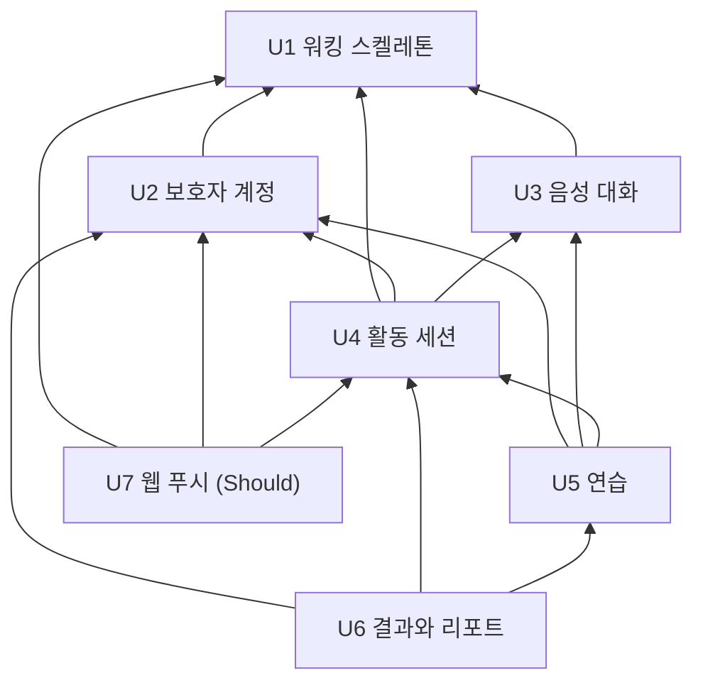

# 무중 유닛 의존 그래프 (Units Generation 2.7)

> Units Generation(2.7) 산출물 · 2026-10-09 (클라우드 세션, 팀장 대리 판단)
> 입력: `components.md`의 컴포넌트 의존(depends_on), `decisions.md` ADR-019(앱 사이 접점 셋 · 이벤트 6종), `unit-of-work.md`, `requirements.md` · `stories.md`.
> 이 문서는 **위상(무엇이 무엇에 기대나)** 만 적는다. 먼저 만들 것 · 임계 경로 · 볼트 순서는 Delivery Planning(2.9)이 정한다.

## 의존 규칙

- "A가 B에 의존"은 A 유닛의 컴포넌트(완성 또는 확장)가 B 유닛이 완성하는 컴포넌트를 부르거나 그 이벤트를 구독한다는 뜻이다(`components.md`의 depends_on을 유닛으로 접은 것).
- 한 유닛이 다른 유닛의 컴포넌트를 **확장**하면 확장하는 쪽이 의존한다(예: U5가 SessionLifecycle에 연습 경로를 붙이므로 U5 → U4). 그래서 U4(활동 세션)는 U5(연습)를 기다리지 않는다(J17).
- 화면 하나가 여러 유닛 데이터를 쓰면 데이터 주인 쪽으로만 화살표를 둔다(J18). 예: 17 정리 상태는 U6가 채우므로 U6 → U4이고 U4 → U6은 없다.
- 계정 삭제는 참가자 등록 방식이라 U2(지휘 틀)가 뒤 유닛에 의존하지 않는다. 뒤 유닛이 U2의 참가자 계약에 기댄다(J19).
- 컴포넌트 단계의 의도된 순환(CoreMessaging ↔ RealtimeMessaging)은 둘 다 U1 안에 있어 유닛 그래프에는 순환이 없다.

## DAG (machine-readable)

```yaml
units:
  - name: u1-walking-skeleton
    kind: service
    depends_on: []
  - name: u2-guardian-account
    kind: service
    depends_on: [u1-walking-skeleton]
  - name: u3-voice-conversation
    kind: service
    depends_on: [u1-walking-skeleton]
  - name: u4-activity-session
    kind: service
    depends_on: [u1-walking-skeleton, u2-guardian-account, u3-voice-conversation]
  - name: u5-practice
    kind: service
    depends_on: [u2-guardian-account, u3-voice-conversation, u4-activity-session]
  - name: u6-results-report
    kind: service
    depends_on: [u2-guardian-account, u4-activity-session, u5-practice]
  - name: u7-web-push
    kind: service
    depends_on: [u1-walking-skeleton, u2-guardian-account, u4-activity-session]
```

## 그림



<!-- Text fallback: 화살표는 "의존한다"는 뜻이다. U2 보호자 계정과 U3 음성 대화는 U1 워킹 스켈레톤에만 기댄다. U4 활동 세션은 U1 · U2 · U3에 기댄다. U5 연습은 U2 · U3 · U4에, U6 결과와 리포트는 U2 · U4 · U5에, U7 웹 푸시는 U1 · U2 · U4에 기댄다. 순환은 없다. -->

## 의존 근거 (컴포넌트 단위)

| 의존 (A → B) | A 쪽 컴포넌트 → B 쪽 컴포넌트 | 접점 종류 |
|---|---|---|
| U2 → U1 | ConsentPolicy · ChildProfile · ParentWeb(05 · 04) → DeviceRegistry, AccountDeletion → CoreMessaging · DeviceRegistry, GuardianIdentity가 U1의 시험 로그인을 실제 구글 로그인으로 대체 | 앱 안 호출 · 이벤트(DeletionRequested) |
| U3 → U1 | DeviceGateway → DeviceRegistry(토큰 확인 · 상태 보고), DeviceGateway → RealtimeMessaging(DeviceStatusChanged), DeviceWeb T19 → DeviceWeb D0 · 기기 토큰 | 앱 사이 내부 HTTP · 이벤트 · WSS |
| U4 → U1 | ActivityCoordinator → DeviceRegistry(기기 안정 · 기기 ID) · CoreMessaging(SessionStateChanged), SessionLifecycle → RealtimeMessaging(SessionStateChanged · SessionRecordCaptured), ActivityRecord → CoreMessaging | 앱 안 호출 · 이벤트 |
| U4 → U2 | ActivityCoordinator → GuardianIdentity · ConsentPolicy(동의 게이트) · ChildProfile(아이 문맥 · 종료 표현) · ApprovedContentCatalog(승인 문구 버전), ActivityRecord → GuardianIdentity, 세션 종료 참가자 → AccountDeletion | 앱 안 호출 |
| U4 → U3 | SessionLifecycle → DeviceGateway(명령) · VoiceRelay(모델 세션) · ConversationLog(전사 · 스냅숏) · OutputGate(상태 · 차단) · DialogPolicy(참여 · 종료 의도) | Realtime 안 호출 |
| U5 → U2 | PracticeGoal → GuardianIdentity, 연습 데이터 삭제 참가자 → AccountDeletion | 앱 안 호출 |
| U5 → U3 | PracticeProtocol → VoiceRelay(역할 · Cue 지시) · OutputGate(단계별 출력 규칙) · DeviceGateway(기회 트리거 대본 재생) · ConversationLog(반응 전사) | Realtime 안 호출 |
| U5 → U4 | PracticeGoal → ActivityRecord(ActivityRecorded), U5의 확장: ActivityCoordinator(연습 시작) · SessionLifecycle(연습 경로 → PracticeProtocol), PracticeProtocol → PracticeGoal은 Realtime → Core 내부 HTTP | 앱 안 이벤트 · 확장 · 앱 사이 내부 HTTP |
| U6 → U2 | ResultPipeline · Report → GuardianIdentity, Report → ChildProfile(PDF 머리), 결과 데이터 삭제 참가자 → AccountDeletion | 앱 안 호출 |
| U6 → U4 | ResultPipeline → ActivityRecord(ActivityRecorded · 작업 입력), Report → ActivityRecord(기간 활동 · 원문), 17 · 27 화면이 U4 화면 틀을 채움 | 앱 안 이벤트 · 호출 |
| U6 → U5 | ResultPipeline → PracticeGoal(후보 · 근거 등록 · 담김 상태) · PragmaticsKnowledge(생활 팁 · 화용 지식) · TextAiGateway(구조화 · 후보 생성) | 앱 안 호출 |
| U7 → U1 | Notification → DeviceRegistry(기기 상태 수신 중단 사건) | 앱 안 이벤트 |
| U7 → U2 | Notification → GuardianIdentity, 구독 삭제 참가자 → AccountDeletion | 앱 안 호출 |
| U7 → U4 | Notification → ActivityCoordinator(세션 상태 사본 변화) | 앱 안 이벤트 |

## 유닛 사이 통합 지점

Contract Design(2.8)이 아래 접점마다 계약을 쓴다.

| 접점 | 제공 유닛 | 쓰는 유닛 | 형태 |
|---|---|---|---|
| 기기 bootstrap · 등록 상태 · 토큰 수령 (REST) | U1 | U3(DeviceWeb T19) | 공개 REST |
| 기기 토큰 확인 · 연결 상태 보고 (Realtime → Core) | U1 | U3 | 내부 HTTP |
| Outbox → Inbox 이벤트 6종: SessionStateChanged · SessionRecordCaptured · DeviceStatusChanged · DeletionCompleted(Realtime → Core), DeviceReleased · DeletionRequested(Core → Realtime) | U1(전달 틀) | U2 · U3 · U4 · U7 | 영속 이벤트 |
| 시작 · 끝내기 · 진행 조회 (Core → Realtime) | U4 | U5(연습 시작 확장) · U7(상태) | 내부 HTTP |
| 다음 목표 상황 요청 (Realtime → Core) | U5 | U5(PracticeProtocol 쪽) | 내부 HTTP |
| 기기 WSS 메시지(시작 · STOP_OUTPUT · PLAY_APPROVED_CONTENT · 종료 · HEARTBEAT · ACK · playbackMark · 음성) | U3 | U1(최소) · U4 · U5 | WSS |
| 동의 게이트 · 아이 문맥 · 승인 문구 버전 | U2 | U4 · U5 | 앱 안 포트 |
| 계정 삭제 참가자 계약 | U2 | U3 · U4 · U5 · U6 · U7 | 앱 안 포트 · DeletionRequested |
| 활동 기록 · ActivityRecorded | U4 | U5 · U6 | 앱 안 포트 · 사건 |
| 후보 · 근거 등록, 담은 목표 · 행동 정의 · 텍스트 AI | U5 | U6 | 앱 안 포트 |
| 결과 작업 상태(17 · 27 정리 상태) | U6 | U4 화면 틀 | REST 응답 칸 |
| 보호자 REST(01~30) | U2 · U4 · U5 · U6 · U7 | ParentWeb | 공개 REST |

## 병행 개발 기회 (위상만)

- U1 뒤에는 **U2와 U3가 서로 의존하지 않는다** — 동시에 만들 수 있다.
- **U7은 U5 · U6에 의존하지 않는다** — U4 뒤에는 U5와 U7을 동시에 만들 수 있다.
- 유효한 위상 순서는 여러 개다(예: U1 → U2 → U3 → U4 → U5 → U7 → U6, U1 → U3 → U2 → U4 → U7 → U5 → U6 등). 무엇을 먼저 할지는 2.9가 정한다.
- 계약(2.8)을 먼저 고정하면 같은 층이 아닌 유닛도 대역(stub)으로 미리 만들 수 있다. 다만 통합 시험은 이 DAG 방향을 따른다.

## 워킹 스켈레톤 (skeleton: on)

- DAG의 첫 유닛 **U1 · u1-walking-skeleton**이 끝까지 실제로 도는 조각이다. 다른 모든 유닛이 U1에 직접 · 간접으로 기대므로 위상 순서상 언제나 맨 앞이다.
- U1만으로 도는 까닭: 기기 등록(DeviceRegistry · D0 · 05a) · 메시징(Outbox/Inbox) · 실행 골격을 U1이 완성하고, 나머지 컴포넌트는 최소 경로(시험 로그인 · 시드 동의/아이 · 세션 6상태 · 음성 1턴 · 게이트 최소 규칙 · 마무리 인사 시드)만 U1 안에 갖는다. 뒤 유닛 코드 없이 "D0 코드 → 05a 등록 → 04 안정 → 08 시작 → 음성 1턴 → P1 → ENDED"를 한 번의 검증 명령으로 보일 수 있다.
- 기대 시연과 실제 통합 검증 명령은 Delivery Planning이 정하고 Code Generation 전에 사람이 승인한다.
