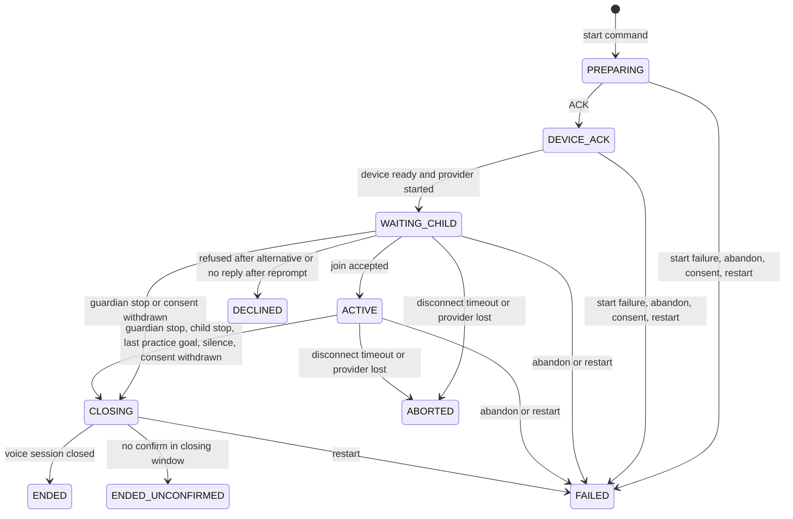
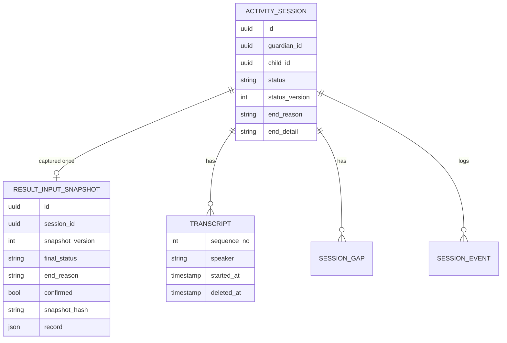

# U4b 기능 명세 — 활동 세션 Realtime 쪽

> Functional Design(3.1) · 작업 기록 `261013-u4b-activity-realtime`.
>
> 이 문서는 흐름(워크플로)과 상태 기계의 정본이다. 데이터 모양은 `entities.md`, 판단 규칙은 `rules.md`가 정본이고, 아래 ER 그림과 규칙 요약은 그 둘에서 옮긴 읽기용 사본이다.
>
> 근거 문서
> - 요구사항: `inception/requirements-analysis/requirements.md`(FR1 ~ FR11)
> - 설계 정본: `docs/units/u4b/design.md`
> - 이 단계 질문의 답: `functional-design-questions.md` Q1 ~ Q6
> - 기존 코드 구조: codekb `aidlc/spaces/default/codekb/mujungi/`

## 1. 개요

- **목적**: U1 · U3가 만든 Realtime 세션 경로를 완성한다.
  - 참여 확인을 거쳐야 대화가 시작된다.
  - 어떤 사유로 끝나든 같은 마무리 순서를 밟는다.
  - 끝난 세션의 결과 입력을 Core로 한 번 넘긴다.
  - 계정 삭제 때 Realtime 데이터를 모두 지운다.
  - U5b가 실행기를 고치지 않고 연습 진행을 붙일 수 있게 한다.
- **범위**: Realtime 앱(세션 · 대화 판정 · 메시징 패키지)과 계약 문서. Core · 보호자 화면 · 기기 웹은 바꾸지 않는다.
- **이 단계에서 정한 것**
  - Q1: 연습 확장점의 시점과 출력 능력
  - Q2: 판정 · 시계를 순수 구성요소로 분리
  - Q3: STOP이면 곧바로 CHILD_STOP
  - Q4: practice는 객체 또는 null만
  - Q5: 삭제 참가자는 순서 값으로 줄을 선다
  - Q6: 연습 완료는 CHILD_STOP + PRACTICE_COMPLETED

## 2. 구성요소 분리 (Q2)

실행기(세션당 직렬 실행자)는 연결 역할만 한다: 메시지 수신, 시계 예약, 부수 효과(기기 명령 · 공급자 명령 · DB 전이 요청). 판단은 아래 순수 구성요소가 맡는다. 순수 구성요소는 입력(사건 · 현재 값 · 시각)을 받아 결정(다음 할 일 목록)을 돌려주고, 시계나 I/O를 직접 만지지 않는다. 그래서 가변 시계 단위 시험으로 경계값을 확인할 수 있다.

| 구성요소 | 맡는 판단 | 규칙 | 상태 |
|---|---|---|---|
| 전이표(사건별 사유 포함) | (사건, 상태) → 도착 상태 · 사유 · end_detail | BR1.1 ~ BR1.4 · BR1.8 · BR1.9 | 기존 확장 |
| 끝내기 응답 결정 | (사유, 상태) → HTTP 응답 · 전이 여부 | BR1.5 · BR1.6 · BR1.9 | 기존 확장 |
| 참여 흐름 | 분류 · 창 만료 · 사용한 안내 → 다음 할 일 | BR2.2 ~ BR2.4 | JoinTracker 되살려 확장 |
| 확인 질문 흐름 | CONFIRM → 질문 · 창, 창 안 대답 → 확정/계속 | BR4.3 · BR4.4 | 신설 |
| 공백 시계 | 누적 · 멈춤 · 리셋 → 경고 · 종료 시각 | BR5.1 ~ BR5.4 | 신설 |
| 기술 일시정지 판정 | 마지막 메시지 · 연결 상태 → 일시정지 켬/끔, 구간 열고 닫기, 40초 | BR6.1 ~ BR6.4 | 기존 끊김 시계 확장 |
| 스냅숏 조립 | 세션 · 전사 · 구간 · 원음 메타 · practice → record · 해시 · 페이로드 | BR8.2 ~ BR8.4 · BR8.8 | 신설 |
| 삭제 처리기 | 강제 정지 → 참가자 순서 호출 → 완료 사건 | BR9.1 ~ BR9.5 | 신설 |
| 연습 확장점 | 들어오는 시점 위임, 출력 능력, 신호 | BR10.1 ~ BR10.6 | 신설(기본 무동작) |

기존 종료 의도 판정기(StopIntentJudge)는 그대로 쓰고, 그 결과를 해석하는 방식만 BR4.2 · BR4.4로 바뀐다. 참여 분류의 낱말 정규화도 이 판정기의 정규화를 함께 쓴다(BR2.3).

## 3. 상태 기계 (세션 생애)



<!-- Text fallback: 세션은 시작 명령으로 PREPARING, ACK로 DEVICE_ACK, 기기 준비와 공급자 시작이 모두 오면 WAITING_CHILD가 된다. WAITING_CHILD에서 참여 응답이면 ACTIVE, 대안 뒤 다시 거부하거나 재안내 뒤 다시 무응답이면 DECLINED, 보호자 끝내기나 동의 철회면 CLOSING이다. ACTIVE는 보호자 끝내기 · 아이 종료 의도 확정 · 연습 마지막 목표 끝 · 공백 6분 · 동의 철회로 CLOSING이 된다. CLOSING은 기기 확인이면 ENDED, 30초 안에 확인이 없으면 ENDED_UNCONFIRMED다. WAITING_CHILD와 ACTIVE는 끊김 40초나 공급자 끊김이면 ABORTED다. 시작 단계는 시작 실패 · Core 취소 · 동의 철회 · 재시작으로, WAITING_CHILD와 ACTIVE는 Core 취소 · 재시작으로, CLOSING은 재시작으로만 FAILED가 된다. -->

### 3.1 전이표

| 사건 | 출발 | 도착 | end_reason · end_detail | 부수 효과 |
|---|---|---|---|---|
| ACK | PREPARING | DEVICE_ACK | — | U1 그대로 |
| 준비 완료(기기 준비 + 공급자 시작) | DEVICE_ACK | WAITING_CHILD | — | 입력 중계(원음 없음), 시작 안내(WF2) |
| 참여 수락 | WAITING_CHILD | ACTIVE | — | started_at, 원음 기록 시작, 응답 생성 요청 1회, 확장점 'ACTIVE 진입' |
| 참여 거절 | WAITING_CHILD | DECLINED | DECLINED | 전사 삭제, 마무리 인사 → CLOSE_TRANSPORT(DECLINED) → 정산(WF6) |
| 보호자 끝내기 | WAITING_CHILD · ACTIVE | CLOSING | GUARDIAN_STOP | 마무리 순서(WF5) |
| 동의 철회 | WAITING_CHILD · ACTIVE | CLOSING | CONSENT_WITHDRAWN | 마무리 순서, 이후 아이 전사 · 원음 저장 차단 |
| 종료 의도 확정 | ACTIVE | CLOSING | CHILD_STOP | 마무리 순서 |
| 연습 마지막 목표 끝 | ACTIVE | CLOSING | CHILD_STOP · PRACTICE_COMPLETED | 마무리 순서(U5b 전에는 발생하지 않음) |
| 공백 6분 | ACTIVE | CLOSING | SILENCE | 마무리 순서 |
| 음성 세션 닫힘 | CLOSING | ENDED | 그대로 | confirmed true, 정산 |
| 마무리 확인 30초 | CLOSING | ENDED_UNCONFIRMED | UNCONFIRMED · 처음 사유 | UNCONFIRMED 구간, 정산 |
| 끊김 40초 · 공급자 끊김 | WAITING_CHILD · ACTIVE | ABORTED | DISCONNECT | 끊김 구간 열린 채, 정산 |
| 시작 시한 · 기기 불가 · 공급자 실패 · 송신 실패 | PREPARING · DEVICE_ACK | FAILED | FAILED | U1 그대로 + 정산(빈 기록 스냅숏) |
| 동의 철회(시작 단계) | PREPARING · DEVICE_ACK | FAILED | CONSENT_WITHDRAWN | START_SESSION이 나갔으면 CLOSE_TRANSPORT(CONSENT_WITHDRAWN), 정산 |
| Core 취소 | PREPARING · DEVICE_ACK · WAITING_CHILD · ACTIVE | FAILED | FAILED | U1 그대로 + 정산. CLOSING · 종료 상태에서는 무동작(BR1.9) |
| 재시작 · 고아 · 최상위 예외 | PREPARING ~ CLOSING | FAILED | FAILED · SERVER_RESTART | 정산(기동 점검이 수행) |

표에 없는 (사건, 상태)는 상태를 바꾸지 않고 TRANSITION_IGNORED를 남긴다(BR1.1). 종료 상태로 가는 모든 전이 뒤에는 정산(WF7)이 이어진다. 시작 단계 FAILED도 빈 기록(utterances · audio 빈 목록, practice null) 스냅숏을 만든다. 그래야 FR7.1의 "종료 다섯 경로와 재시작마다 스냅숏 1건"이 지켜진다.

## 4. 워크플로

### WF1 시작에서 WAITING_CHILD까지
1. Core 시작 명령으로 PREPARING이 된다. ACK가 오면 DEVICE_ACK가 된다(U1 그대로).
2. 기기 준비(OK)와 공급자 session.started가 모두 오면 WAITING_CHILD로 전이한다(BR2.1). 입력 중계를 열되 원음은 기록하지 않는다.
3. 공급자 지시문 끝에 "참여가 확인되면 관심사나 일상 질문 하나로 시작한다"를 더한다(BR2.7).
- 오류 경로: 20초 시작 시한 · 기기 불가 · 공급자 실패면 FAILED와 정산이다.

### WF2 참여 확인
1. 활동 종류에 맞는 시작 안내(INTRO_FREE_TALK · INTRO_PRACTICE)를 재생한다. 이것이 1번째 안내다.
   - 보낸 순간 AI 말풍선 행을 남긴다(BR3.1).
   - 패키지에 안내가 없으면 재생을 건너뛰고 곧바로 재생이 끝난 것으로 본다(BR3.3).
2. 안내 재생 완료 보고를 서버가 받으면 참여 창을 연다(BR2.2). 처음 창은 join-wait, 그 뒤 안내의 창은 join-wait-after-reprompt다.
3. 창 안에 온 아이 확정 전사를 분류한다(BR2.3): 참여 · 거부 · 주제 거부 · 불명확. 이 전사는 저장하지 않는다(BR2.5).
4. 결정표(BR2.4)대로 다음 할 일을 정한다. 재안내 · 대안은 각각 한 번씩, 안내는 처음을 포함해 최대 3번이다.

| 입력 | 대안 안 씀 · 안내 3번 미만 | 대안 이미 씀 또는 안내 3번 | 재안내 안 씀 · 안내 3번 미만 | 재안내 이미 씀 또는 안내 3번 |
|---|---|---|---|---|
| 참여 | ACTIVE(WF3) | ACTIVE | ACTIVE | ACTIVE |
| 거부 · 주제 거부 | DECLINE_ALTERNATIVE 재생 → 2 | DECLINED(WF6) | (대안 열 기준) | (대안 열 기준) |
| 불명확 | (재안내 열 기준) | (재안내 열 기준) | RE_PROMPT 재생 → 2 | 안내 없이 같은 창 계속 |
| 창 만료(무응답) | (재안내 열 기준) | (재안내 열 기준) | RE_PROMPT 재생 → 2 | DECLINED(WF6) |

   읽는 법은 다음과 같다.
   - 거부 계열은 "대안" 두 열을 본다.
   - 불명확과 무응답은 "재안내" 두 열을 본다.
   - 그래서 "거부 2회"는 대안 뒤에 다시 거부한 경우이고, "무응답 2회"는 재안내 뒤에 다시 만료된 경우다.
- 이 단계 동안 시작된 공급자 응답은 취소하고 기기로 보내지 않는다(BR2.6).
- 기술 일시정지 동안 참여 창은 멈췄다가 남은 시간부터 이어진다(BR2.2).
- 보호자 끝내기 · 동의 철회가 오면 CLOSING이다 → WF5.
- 끊김 40초가 지나면 ABORTED다.
- 남기는 사건: JOIN_PROMPTED · JOIN_RE_PROMPTED · JOIN_ALTERNATIVE_OFFERED · JOIN_ACCEPTED · JOIN_DECLINED. payload는 분류 이름 · 횟수만 담는다.

### WF3 ACTIVE 진행
1. 참여가 수락되면 ACTIVE로 전이한다.
   - started_at을 쓰고 원음 기록을 시작한다.
   - 공급자에 응답 생성 요청을 한 번 보낸다(BR2.6).
   - 공백 시계를 0으로 한다(BR5.1).
2. PRACTICE 세션이면 확장점 'ACTIVE 진입'을 부르고, 돌아온 신호를 처리한다(BR10.1 · BR10.3). 기본 구현은 아무것도 하지 않는다(BR10.2).
3. 아이 확정 전사가 오면 다음을 한다.
   - 빈 전사가 아니면 공백 시계를 리셋한다(BR5.1).
   - PRACTICE면 확장점 '전사 전달'을 부르고 신호를 처리한다.
   - 기기 재생 중이 아니면 종료 의도를 판정한다(WF4).
4. 확장점 사건(재생 완료 · 확장점 시계 만료 · 비동기 결과)이 오면 확장점 '사건 전달'을 부르고 신호를 처리한다(BR10.5).
5. 신호는 이렇게 처리한다(BR10.3).
   - NEXT_GOAL이면 계속한다.
   - LAST_GOAL이면 연습 마지막 목표 끝 사건으로 CLOSING(CHILD_STOP, PRACTICE_COMPLETED)이다 → WF5.

### WF4 종료 의도와 확인 질문
1. 판정이 STOP이면 곧바로 CLOSING(CHILD_STOP)이다(BR4.2) → WF5.
2. 판정이 CONFIRM이면 다음을 한다(BR4.3).
   - STOP_CONFIRM을 재생하고 말풍선 행을 남긴다.
   - 공급자 출력을 막는다.
   - 재생이 끝나면 stop-confirm-wait 창을 연다. 이 동안 공백 시계는 멈춘다(BR5.2).
   - STOP_CONFIRM_ASKED를 남긴다.
3. 창 안의 첫 확정 전사를 본다(BR4.4).
   - STOP이거나 참여 분류 '참여'면 CLOSING(CHILD_STOP)이다.
   - 그 밖의 대답이거나 대답 없이 창이 끝나면, 막은 것을 풀고 응답 생성 요청을 한 번 보낸 뒤 대화를 잇는다.
   - 결과는 STOP_CONFIRM_RESOLVED에 남긴다.
4. 확인 대기 동안 시작된 공급자 응답은 취소한다(BR2.6).
- U3의 "STOP이면 출력만 막고 ACTIVE 유지 → 적극적 계속이면 해제" 경로는 없앤다(FD-Q3). U3 시험의 해제 경로 기대값은 새 경로로 바꾸고 report에 목록을 남긴다(FR11.3).

### WF5 공통 마무리
1. CLOSING에 들어가면 end_reason(과 end_detail)에 마무리 사유를 쓴다(BR1.3). SessionStateChanged에 endReason을 싣는다(BR7.2).
2. 대기 중 출력 버퍼를 버린다(BR4.5).
3. STOP_OUTPUT을 보내고 output_stopped_at을 쓴다. 사유는 GUARDIAN_STOP · CHILD_STOP · SILENCE는 같은 값, CONSENT_WITHDRAWN은 BEFORE_CLOSING이다(BR4.6).
4. CLOSING 승인 문구를 1회 재생하고 말풍선 행을 남긴다.
5. 그 재생 표시 뒤 CLOSE_TRANSPORT(end_reason 값)를 보내고 transport_closed_at을 쓴다.
6. 음성 세션 닫힘 보고가 오면 ENDED다. closing-confirm(30초)이 지나면 ENDED_UNCONFIRMED와 UNCONFIRMED 구간이다(BR1.4 · BR6.4).
7. 정산으로 간다 → WF7.
- 동의 철회면 termination_requested_at 뒤의 아이 전사 · 원음을 버린다(BR1.7).
- CLOSING 동안에는 끊김 전이가 없다(BR6.3).

### WF6 DECLINED 마무리
1. DECLINED로 전이하고(end_reason DECLINED), 같은 트랜잭션에서 그 세션의 전사 행을 지운다(BR3.2).
2. closing-confirm 상한 안에서 CLOSING 승인 문구를 1회 재생한다. 말풍선 행은 남기지 않는다.
3. 그 재생 표시 뒤 CLOSE_TRANSPORT(DECLINED)를 보낸다(BR4.7).
4. 인사 순서가 끝나면(CLOSE_TRANSPORT를 보냈거나 상한을 넘김) 정산을 시작한다 → WF7.
   - 정산은 인사 순서보다 앞서지 않는다. 그래서 인사 재생 표시가 정산 뒤 무시 규칙(BR8.7)에 걸리지 않는다.
   - 같은 기기에 새 세션이 오면 남은 인사를 버리고 바로 정산한다.
5. 스냅숏의 utterances · audio는 빈 목록이고 practice는 null이다.

### WF7 정산과 결과 스냅숏
1. 공급자를 닫고 provider_closed_at을 쓴다.
2. 정산 창이 열린다. 연결이 닫히거나 record-settle가 지나면 창이 끝난다.
   - 이 동안 온 아이 확정 전사는 발화 시작이 ended_at보다 이르면 저장하고 아니면 버린다(BR8.6).
   - 확장점 사건은 확장점에 전달하되 신호는 무시한다(BR10.6).
3. 정산 창이 끝나면 PRACTICE 세션은 확장점 '정산'을 한 번 부른다. 남은 목표 NOT_REACHED 정리가 여기서 일어난다(BR10.6).
4. 그 세션의 전사 기록기를 비운다.
5. PRACTICE면 확장점에서 practice 값을 받는다. 없으면 null이다(BR8.3).
6. 스냅숏 조립이 record와 해시를 만든다(BR8.2 · BR8.4). deleted_at이 찬 전사 · 원음 메타는 넣지 않는다.
7. 스냅숏 행과 SessionRecordCaptured Outbox를 한 트랜잭션에 쓰고, RECORD_CAPTURED를 남긴다. 이미 있으면 쓰지 않는다(BR8.5).
   - 페이로드는 BR8.8대로 세션 행과 스냅숏에서 채운다(5.3 표).
8. 이 뒤로 온 사건은 전이 0회이고 기록하지 않는다(BR8.7).
- 오류 경로: 쓰기가 실패하면 재시도한다. 서버가 재시작하면 기동 점검이 FAILED 세션을 닫고 다시 정산한다(BR1.8).

### WF8 공백 시계
1. ACTIVE 진입이나 아이의 빈 아닌 확정 전사가 오면 누적을 0으로 하고 경고를 끈다(BR5.1). SILENCE_RESET을 남긴다.
2. 아래 멈춤 조건 중 하나라도 참인 동안에는 누적을 멈춘다(BR5.2).
   - 기기 재생 중
   - 서버 출력 대기(열린 구간 · 게이트 대기 · 대기 문구)
   - 기술 일시정지
   - 확인 질문 대기
3. 누적이 4분이면 silenceWarning{silentSince, endsAt}을 켜고, 패키지에 있으면 SILENCE_WARNING을 1회 재생한다. 재생은 리셋하지 않는다(BR5.3). SILENCE_WARNED를 남긴다.
4. 누적이 6분이면 CLOSING(SILENCE)이다(BR5.4) → WF5.

### WF9 끊김과 기술 일시정지
1. WAITING_CHILD · ACTIVE에서 연결이 닫히거나 마지막 기기 메시지 뒤 gap-display가 지나면 다음을 한다(BR6.1). TECHNICAL_PAUSE_STARTED를 남긴다.
   - technicalPause{DEVICE, since}를 켠다.
   - DISCONNECT 구간을 연다.
2. 기기 메시지가 다시 오거나 연결이 다시 묶이면 구간을 닫고 일시정지를 끈다(BR6.2). TECHNICAL_PAUSE_ENDED를 남긴다.
3. 마지막 메시지 뒤 40초면 ABORTED(DISCONNECT)다. 구간은 열린 채 남는다(BR6.3) → WF7.
4. 전이 시점에 일시정지 중이면 SessionStateChanged에 technicalPause를 싣는다(BR7.2).

### WF10 진행 조회
1. 실행기는 technicalPause · silenceWarning이 바뀔 때마다 불변 값 하나로 바꿔 쓴다.
2. 조회는 그 값을 읽기만 한다. 종료된 세션은 둘 다 null이다(BR7.1).
3. gaps는 DB에서 읽는다. DISCONNECT와 UNCONFIRMED 구간이 들어 있다.

### WF11 계정 삭제
1. DeletionRequested를 받는다.
2. 그 보호자의 비종료 세션 실행기를 강제 정지한다(BR9.1). DB 전이 · 이벤트 · 스냅숏은 만들지 않고, 상한은 deletion-stop-wait다.
3. 참가자를 순서 값 순으로 부른다(BR9.2 · BR9.3).
   - 음성(100): 전사 원문 비우기, 원음 파일 · 메타 표시, 끊김 구간 · 사건 삭제. 그 안의 진행 세션 차단은 2에서 이미 멈췄으므로 무동작이다.
   - 연습(150): U5b가 등록하면 부르고, 없으면 건너뛴다.
   - 세션(200): 스냅숏 → 세션 사건 → 종료 표현 → 전사 행 → 원음 메타 행 → 세션 행 순으로 실제 삭제한다.
   - 메시징(900).
4. 마지막 트랜잭션에 DeletionCompleted{counts}를 쓴다. 같은 요청 ID로 이미 썼으면 쓰지 않는다(BR9.4).
   - counts.sessions는 200의 세션 행 수다.
   - counts.transcripts는 100이 비운 전사 행 수다.
   - counts.audioFiles는 100이 지운 파일 수다.
   - counts.practiceRecords는 150의 건수이고, 없으면 0이다.
5. 그 행이 발행되면 메시징 참가자를 한 번 더 부른다(BR9.5).
- 오류 경로: 참가자 예외 · 파일 삭제 실패 · 정지 상한 초과는 처리 전체를 실패로 돌려 Inbox 재시도에 맡긴다. 재시도 때 0건이 돌아온 참가자는 counts에 0을 더한다.

### WF12 끝내기 요청 응답
- 사유 × 상태 응답표(BR1.5 · BR1.9)대로 답한다. 같은 세션의 반복 요청은 전이 · 기기 명령 없이 같은 응답만 돌려준다(BR1.6).

| 사유 \ 상태 | PREPARING · DEVICE_ACK | WAITING_CHILD · ACTIVE | CLOSING | 종료 상태 | 모르는 세션 |
|---|---|---|---|---|---|
| GUARDIAN_STOP | 409 SESSION_NOT_ACTIVE | 202 {CLOSING}, CLOSING(GUARDIAN_STOP) | 202 {CLOSING}, 재처리 없음 | 409 | 409 |
| CONSENT_WITHDRAWN | 202 {}, FAILED(CONSENT_WITHDRAWN) | 202 {CLOSING}, CLOSING(CONSENT_WITHDRAWN) | 202 {CLOSING}, 사유는 처음 것, 저장 차단 시작 | 409 | 409 |
| CORE_ABANDONED | 202 {}, FAILED | 202 {}, FAILED | 202 {}, 무동작 | 202 {} | 묘비 202 {} |

## 5. 인터페이스

### 5.1 연습 확장점 (U5b용, Q1)

U5b가 실행기를 고치지 않고 연습을 진행하려면, 확장점이 들어오는 시점만 받는 것으로는 부족하다. 실행기가 확장점에 정해진 출력 능력도 넘긴다. 이름과 시점은 U5b 담당에게 넘기고, `docs/units/u4b/design.md`와 U5b 설계에 같은 문장으로 적는다.

```
PracticeSessionExtension (PRACTICE 세션에서만, 실행기 스레드에서 부른다)
  onActive(ctx: PracticeContext, out: PracticeOutput)            -> Signal
  onChildUtterance(u: Utterance, out: PracticeOutput)            -> Signal
  onExtensionEvent(e: ExtensionEvent, out: PracticeOutput)       -> Signal
  onSettle(end: EndContext)                                      -> void
  practiceRecord()                                               -> Object?
Signal = NONE | NEXT_GOAL | LAST_GOAL
기본 구현: 신호 NONE · 무동작 · practiceRecord null
```

| 입력 · 능력 | 내용 |
|---|---|
| PracticeContext | 세션 id, 시작 패키지의 `practice` 조각(목표 목록 · 첫 상황), 승인 문구 코드 목록, 동의 스냅숏 요약, 활동 시작 시각 |
| Utterance | seq, 확정 시각, 전사 원문, 불확실 여부, 기기 재생 중이었는지 |
| ExtensionEvent | 종류(PLAYBACK_DONE · TIMER_FIRED · ASYNC_RESULT), 확장점이 붙인 이름 · 상관 ID, 비동기 결과 값 |
| EndContext | 도착 상태, end_reason · end_detail, ended_at, 정산 창 안에 확장점에 전달한 사건 수 |
| PracticeOutput(BR10.4) | `playApproved(code)`: 패키지 승인 문구 재생. 완료는 PLAYBACK_DONE으로 돌아온다 |
| | `instructProvider(text)` · `requestResponse()` · `cancelResponse()` · `holdOutput(bool)`: 공급자 지시 · 응답 생성 · 취소 · 출력 차단/해제 |
| | `schedule(name, duration)` · `cancel(name)`: 확장점 시계. 만료는 TIMER_FIRED로 돌아오고, 기술 일시정지 동안 멈춘다 |
| | `post(name, value)`: 다른 스레드에서 끝난 비동기 작업 결과를 ASYNC_RESULT로 편지함에 넣는다 |

- 확장점에 없는 능력: 상태 전이, DB 쓰기, 기기 원시 명령. 상태를 바꾸려면 신호를 돌려준다. 능력 밖 요청은 거절하고 사건에 남긴다(BR10.4).
- 오래 걸리는 일(상황 생성 요청 · 판정)은 확장점이 자기 비동기 작업으로 돌리고 `post`로 결과를 넣는다. 결과는 실행기 스레드에서 `onExtensionEvent`로 다시 들어오고, 그 반환 신호로 다음 목표 · 마지막 목표를 알린다(BR10.5). 그래서 세션당 직렬 실행 원칙이 유지된다.
- 종료 전이 뒤 정산 창 안에 온 확장점 사건은 전달되지만 신호는 무시한다. `onSettle`은 정산 창이 끝난 뒤 한 번 불린다. 정산 창(record-settle)보다 늦게 끝난 판정은 반영되지 않고, 확장점이 `onSettle`에서 정리한다(예: uncertain · NOT_REACHED)(BR10.6).
- 확장점 예외는 PRACTICE_EXTENSION_FAILED에 남기고 자유대화처럼 계속한다. 이때 정산은 건너뛰고 practice는 null이다(BR10.1).
- U5b가 쓸 시간 키(first-response-wait · help-consent-wait · cue-budget · judge-budget · scenario-request-timeout)는 U5b가 `schedule`로 쓴다. 키 연결은 U5b 몫이다.

### 5.2 Realtime 삭제 참가자 (Q5)

```
RealtimeDeletionParticipant
  order()                                   -> int                  // 100 음성 · 150 연습 · 200 세션 · 900 메시징
  deleteByGuardian(guardianId, requestId)   -> Map<name, count>     // 기존 반환 모양 그대로, 멱등, 0건도 성공
```

- 기존 참가자 둘(음성 U3 · 메시징 U1)이 이 계약을 구현하게 바꾼다. 메서드 모양과 반환 지도는 지금과 같고, `order()`만 더한다.
- 세션 참가자(U4b)는 새로 만든다. 연습 참가자(U5b)는 150 자리만 둔다.

### 5.3 외부 계약 변화 (설계 7절, 더하기만)

**SessionRecordCaptured 페이로드(BR8.8)**

| 필드 | 출처 |
|---|---|
| sessionId · childId · activityType | 세션 행 id · child_id · activity_type |
| finalStatus · endReason · confirmed | 스냅숏 final_status · end_reason · confirmed |
| startedAt · endedAt | 세션 행 started_at · ended_at |
| termination.requestedAt | 세션 행 termination_requested_at |
| termination.outputStoppedAt | 세션 행 output_stopped_at |
| termination.transportClosedAt | 세션 행 transport_closed_at |
| termination.providerClosedAt | 세션 행 provider_closed_at |
| snapshotId · snapshotVersion · snapshotHash · record | 스냅숏 id · snapshot_version · snapshot_hash · record |

**그 밖의 계약 변화**
- **C8 끝내기**: WF12 응답표. 편차 (U4b-b).
- **C8 진행 조회**: technicalPause · silenceWarning을 채운다. 응답 모양은 그대로다.
- **이벤트**: SessionStateChanged는 CLOSING에 endReason을, 전이 시점에 일시정지 중이면 technicalPause를 싣는다. DeletionCompleted는 counts를 싣는다. 편차 (U4b-c).
- **record.practice**: 객체 또는 null이다. 계약 6절의 "DECLINED면 practice도 빈 배열"은 utterances · audio에만 해당한다고 보고 편차 (U4b-d)로 적는다(FD-Q4).
- **연습 완료 사유**: CHILD_STOP을 다시 쓰고 end_detail에 PRACTICE_COMPLETED를 남긴다. 사유 열거는 바뀌지 않으므로 편차가 아니다. 다만 계약 문서의 사유 설명에 이 사용을 적는다(FD-Q6).
- **공급자 선 형식**: 서버 → 공급자 `session.response.create`를 더한다. 편차 (U4b-a).
- **기기 WSS**: 새 type · 값이 없다. CLOSE_TRANSPORT 사유는 기존 열거 안에서 쓴다.
- **시간 키(BR11.1)**
  - 예약 표에서 1절로 옮긴다: `mujoong.timing.session.join-wait` · `mujoong.timing.session.join-wait-after-reprompt` · `mujoong.timing.session.silence-warning` · `mujoong.timing.session.silence-end` · `mujoong.timing.device.gap-display`
  - 새로 넣는다: `mujoong.timing.session.stop-confirm-wait` · `mujoong.timing.session.record-settle`(3절), `mujoong.session.deletion-stop-wait`(4절)
  - 옮긴 키를 "Realtime 비소유"로 단언하는 설정 대조 시험의 기대값도 바꾼다.

## 6. 엔터티 관계 (entities.md에서 옮긴 사본)



<!-- Text fallback: 활동 세션 하나에 결과 입력 스냅숏이 최대 한 개, 전사 · 끊김 구간 · 세션 사건이 여러 개 붙는다. 스냅숏은 id · session_id · snapshot_version · final_status · end_reason · confirmed · snapshot_hash · record를 갖는다. 세션은 id · guardian_id · child_id · status · status_version · end_reason · end_detail을 갖는다. 전사는 sequence_no · speaker · started_at · deleted_at 등을 갖는다. -->

## 7. 규칙 요약 (rules.md에서 옮긴 사본)

| 묶음 | 규칙 | 흐름 |
|---|---|---|
| 전이 · 사유 · 끝내기 | BR1.1 ~ BR1.9 | 3절 · WF5 · WF12 |
| 참여 확인 | BR2.1 ~ BR2.7 | WF1 · WF2 · WF3 · WF4 |
| 승인 문구 | BR3.1 ~ BR3.3 | WF2 · WF4 · WF5 · WF6 |
| 종료 의도 · 마무리 | BR4.1 ~ BR4.7 | WF4 · WF5 · WF6 |
| 공백 | BR5.1 ~ BR5.4 | WF8 |
| 끊김 | BR6.1 ~ BR6.4 | WF9 · WF5 |
| 조회 · 사건 | BR7.1 ~ BR7.2 | WF10 · WF9 · WF5 |
| 정산 · 스냅숏 | BR8.1 ~ BR8.8 | WF7 · 5.3 |
| 삭제 | BR9.1 ~ BR9.5 | WF11 · 5.2 |
| 연습 확장점 | BR10.1 ~ BR10.6 | WF3 · WF7 · 5.1 |
| 시간 값 | BR11.1 | 모든 시계 · 5.3 |
| 개인정보 | BR12.1 | 모든 사건 · 로그 |

## 8. 검증 방식과 오류 목록

| 경우 | 처리 | 확인 방법 |
|---|---|---|
| 표에 없는 전이 | 상태 그대로, TRANSITION_IGNORED | 전이표 단위 시험(칸마다) |
| 끝내기 사유 값 오류 | 400 VALIDATION_FAILED | 응답표 시험 |
| 참여 결정 | 결정표 칸마다 | 참여 흐름 단위 시험(분류 4종 × 대안/재안내 사용 여부 × 안내 수) |
| 승인 문구 누락 | 재생 건너뜀, 시계 진행, APPROVED_CONTENT_MISSING 1회 | 빠진 패키지로 DECLINED까지 가는 시험 |
| 확장점 신호 · 사건 · 예외 | 신호 처리 · 정산 창 신호 무시 · 예외 시 자유대화처럼 | 대역 확장점 시험(LAST_GOAL → CHILD_STOP · PRACTICE_COMPLETED, 정산 창 사건, 예외) |
| 스냅숏 쓰기 실패 | 재시도 · 재시작 시 기동 점검 | 통합 시험(재무장) |
| 이벤트 페이로드 | 계약 스키마 검증 | 종료 다섯 경로 · 시작 실패 · 재시작 통합 시험 |
| 삭제 참가자 예외 · 파일 실패 · 정지 상한 초과 | 전체 실패 → Inbox 재시도, counts 합산 | 삭제 통합 시험(재시도 멱등) |
| 늦은 사건 | 정산 창 안이면 ended_at 기준 저장/버림, 뒤면 무시 | 늦은 전사 시험 |
| 개인정보 | 사건 · 로그 · Outbox에 원문 없음 | 로그 · 사건 검사 시험 |

경계값 시험(가변 시계)
- 참여 창: 19초 · 21초
- 공백: 3:59 · 4:01 · 5:59 · 6:01
- 점선 표시: 9초 · 11초
- 끊김: 39초 · 41초
- 확인 질문: 19초 · 21초

## 9. 시험 · 문서 정비 (FR11)

FR11은 업무 규칙이 아니라 작업 방식 요구사항이다. Code Generation 계획에서 단계로 다룬다.
- FR11.1 스키마 판 기대 숫자만 수정. 대상은 RealtimeSchemaIT · core-api FlywayConfIT · SchemaPrivilegeIT이다.
- FR11.2 흔들리는 시험의 행 생성 순서만 변경
- FR11.3 활성화 경로 변경에 따른 U1 · U3 기대값 갱신과 목록 기록. Q3의 해제 경로 제거를 포함한다.
- FR11.4 검증 스크립트 시드 순서에 003 추가
- FR11.5 계약 편차 (U4b-a) ~ (U4b-d), 연습 완료 사유 설명, 설계 문서 갱신
  - 설계 문서에서 고칠 곳: J24 갱신, 5.1 확장점 이름 · 능력 기입, Q3 · Q4 · Q5 · Q6으로 바뀐 가정
- (FR10.1과 함께) 설정 대조 시험이 옮긴 5개 키를 "비소유"로 단언하던 기대값을 소유로 바꾼다.

## Sources

- 요구사항: `aidlc/spaces/default/intents/261013-u4b-activity-realtime/inception/requirements-analysis/requirements.md` FR1.1 ~ FR11.5, NFR1 ~ NFR9
- 이 단계 질문의 답: `functional-design-questions.md` Q1 ~ Q6, 요약 확인 Looks correct
- 설계 정본: `docs/units/u4b/design.md` 1 ~ 10절(U4b-R1 ~ R17, U4b-J1 ~ J26)
- 기존 코드
  - codekb `component-inventory.md` · `architecture.md` · `code-quality-assessment.md`(D3 · D6 · D8 · D10 · D11 · D13)
  - realtime V1 DDL(realtime_activity_session · realtime_transcript 열), `TransitionTable` Trigger 12종, `SessionTimers.Kind` 6종
  - 커밋 5354a32 `JoinTracker` 결정 규칙 · 낱말 목록, `RealtimeVoiceDeletionParticipant` 책임 · 반환 지도, `ConfigKeyContractTest` 비소유 단언
- 계약: `contracts/schemas/event-payloads.schema.json`(SessionRecordCaptured), contract-summary 6 · 7절, `contracts/timing.md` 2절 예약 키
- U5b 맞물림: `docs/units/u5b/brief.md` 「U4b와 맞물리는 곳」 1 ~ 4
