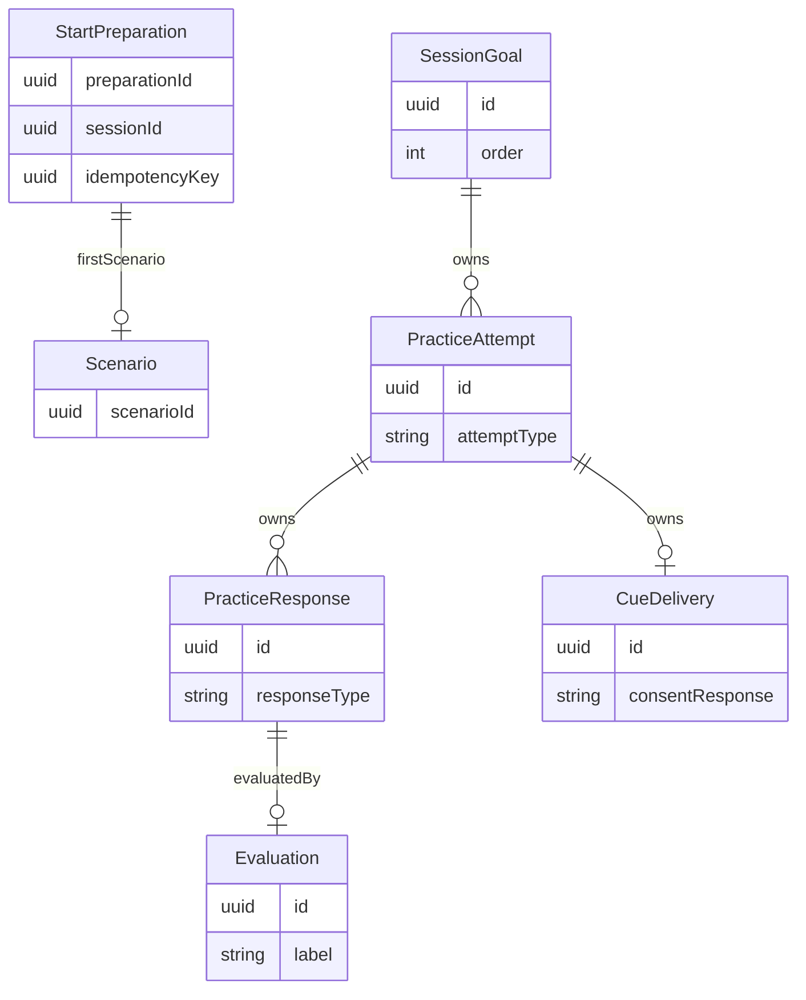

# U5b 기능 설계

## Sources

입력은 `../../inception/requirements-analysis/requirements.md`와 `functional-design-questions.md`의 확인된 Q1~Q6다. 데이터와 규칙은 entities.md/rules.md의 YAML이 정본이고, 이 파일은 순서·상태 전이의 정본이다. 기존 인셉션의 US4.1·US4.2·US6.5, U5/B5 및 계약 5~9절을 읽기 전용 재사용한다. 현재 코드 구조는 `aidlc/spaces/default/codekb/mujungi/`를 참조한다.

U4b 구현 확인 기준은 원격 `origin/unit/u4b-activity-realtime`의 `ffcfb8a09a523b2cb8fff885b1a9fadaefa27251`이다. PracticeSessionExtension·SessionExecutor의 연습 연결·PracticeInstruction·삭제 참가자 및 상대 보고서를 읽었다. 소스 조회와 담당자 합의/CI 통과/병합/실행 시험은 별개다. 이 작업에서 상대 소스나 메인/U4b 기록을 수정하지 않았다.

## 범위와 책임

| 부품 | 소유하는 것 | 외부 경계 |
|---|---|---|
| CorePracticeStart | 선택 검증·준비 원본·첫 상황·시작 인계 | 기존 활동 시작 조건/승인 콘텐츠·공통 상황 생성 |
| PracticeProtocol | 고정 목표·반응 기회·동의·도움·새 상황·정산 | U4b 생명주기 확장점·C10·진행 판정·출력 능력 |
| ResponseEvaluator | 반응별 진행 판정·시한·재시도·uncertain | 시험 전용 공급자, 운영 기본 미연결 |
| StageOutputPolicy/VoiceRelay 확장 | 단계·동의·세대와 최소 입력 | 기존 완결 구간 검사·송신 직전 재검사 |
| Record/Exposure adapter | 자기 기록 투영·실노출 반영 | U4b 결과 입력·Core ActivityRecorded |
| ParentPracticeUI | 화면 18 시작·12 현재 목표/단계 | 기존 인증·요청·폴링·문구 체계 |

U4b가 참여·공백·중단·종료 상태·마무리 인사·최종 스냅숏 발행을 소유한다. U5b는 자신의 진행/기록을 연결하며 상대 생명주기를 복제하지 않는다. 정식 AI 내용/실공급자와 U6 결과 재판정·리포트는 범위 밖이다.

## 데이터 관계 (파생 뷰)

아래는 entities.md의 관계를 읽기 쉽게 나타낸 파생 뷰다. 교차 서비스 ID는 논리 참조이며 상대 저장소의 외래 키가 아니다.

<!-- Text fallback: Core 시작 준비는 첫 상황을 참조한다. Realtime의 세션 목표는 최대 두 종류의 시도를 소유하고, 시도는 반응들과 최대 하나의 도움을 소유한다. 실제 반응에는 최대 하나의 최종 진행 판정이 연결되며 무반응에는 판정 행이 없다. -->

## 시작 준비와 시작 인계

### WF1. 별도 Core 준비 (BR1.1~BR1.6)

1. 보호자 인증·삭제 상태·아이·동의·선택 목표 소유/유효성/중복을 확인한다. 선택이 비어 있거나 판정 기준이 없는 정의는 거절한다.
2. 준비 요청의 해시는 활동 종류와 선택 집합을 정규화해 계산한다. 선택 순서는 서버의 담은 순으로 결정하므로 클라이언트 배열 순서만 다른 동일 선택은 같은 논리 요청이다. 보호자와 멱등 키의 선점 승자는 preparationId/sessionId·목표 정의 버전·가중치·추첨 순서를 한 번 저장한다.
3. 동일 키/해시는 저장 원본을 읽는다. 다른 해시는 IDEMPOTENCY_CONFLICT다. 보호자별 진행 세션과 유효 준비 선점은 함께 검사하여 두 개의 독립 시작을 허용하지 않는다. 같은 키 동시 호출은 하나의 생성 작업을 공유하고 패자는 다른 세션을 만들지 않는다.
4. 외부 AI를 호출하는 동안 보호자 쓰기 잠금을 잡고 있지 않는다. 준비 선점의 generation/leaseUntil과 저장 직전 재인가·조건부 갱신으로 중간 삭제/만료 선점/늦은 결과를 차단한다.
5. 첫 상황 생성은 별도의 **준비 권한 문맥**을 사용한다. 실재 보호자·아이·고정 목표·미리 배정한 sessionId를 검증하며 실제 ACTIVE 세션을 만들어 내거나 active=true를 반환하지 않는다. C10의 외부 활성 세션 검사는 변경하지 않는다. 공통 상황 생성/내용 검사/정의 버전 고정만 공유한다.
6. 15초 전체 예산 안에서 내용 생성과 재생성 한 번을 수행한다. 첫 상황의 두 번 생성 실패는 FAILED/422 SCENARIO_GEN_FAILED로 고정하고 REQUESTED나 Realtime 시작은 만들지 않는다. 인증/동의/소유권 실패와 공급자 미연결/기술 실패는 기존 오류 종류를 구분한다. 모든 생성 실패를 인증 실패까지 포함한 422로 바꾸지 않는다.
7. 저장 직전 계정 활성·동의·고정 버전을 재확인하고 준비 선점 승자만 실재 첫 상황 ID를 저장해 READY로 만든다. 늦은 패자는 발급/READY를 덮어쓰지 않는다. 상황은 ISSUED이며 아직 EXPOSED가 아니다.
8. 동일 sessionId와 저장된 practice 원본을 실제 시작 경로에 인계한다. 시작 조건을 재확인하고 REQUESTED 사본 삽입과 준비 HANDED_OFF 표시는 같은 Core 원자적 경계에서 처리한다. 기존 REQUESTED 10초 시한은 이 삽입 이후부터다. 준비의 15초를 REQUESTED 시계에 넣지 않는다.
9. Realtime 시작 응답/충돌/취소는 기존 U4a 경로와 멱등성 규칙을 사용한다. 성공 응답을 반환하지 못했어도 같은 키로 다시 확인하여 이미 시작한 세션을 재사용한다. READY 전 실패·재시작 시 실제 세션이 없는 사실과 준비 실패를 구분한다.

**변경되는 연결:** 현재 PracticeStart.buildPackage는 guardianId와 goalSelectionIds만 받아 sessionId/멱등 키가 없다. 명시적 PreparedStartContext를 받는 내부 연결과 준비 저장은 **I5 조정 후보**다. 기존 포트를 그대로 호출하면서 숨은 전역/스레드 문맥으로 sessionId를 끼워 넣지 않는다. 새 API/포트·Core V7 이후 마이그레이션의 구체 모양과 처리 중 요청의 HTTP 응답은 U4a 합의 전 확정 계약으로 쓰지 않는다.

**호출자 시한:** 현재 보호자 요청 시한 10초보다 준비 전체 예산 15초가 길 수 있다. 클라이언트 시한은 서버 준비 완료/실패 증거가 아니다. 같은 멱등 키 보존과 준비 진행/재시도 응답·확인 경로는 I5에서 함께 합의한다. 요청 취소가 곧바로 다른 키의 새 세션을 시작하게 하지 않는다. 새 준비 조회 API가 필요하면 편차와 합의 항목이며 임의 공개하지 않는다.

### 준비 상태 전이

| 현재 | 사건·조건 | 다음 | 기록/효과 |
|---|---|---|---|
| 없음 | 유효 요청의 선점 승자 | PREPARING | 고정 sessionId·목표·추첨 순서·선점 세대 |
| PREPARING | 유효 선점의 첫 상황 저장 | READY | 첫 scenarioId 고정, 실제 시작 없음 |
| PREPARING | 두 번 내용 실패 | FAILED | 422 결과 고정, 실제 세션 생성 없음 |
| PREPARING | 일시 실패/선점 만료 | PREPARING 또는 실패 반환 | 원본 재추첨 없이 새 선점 세대로 재처리; 오류/처리 중 응답은 I5 합의 대상 |
| READY | 시작 조건 재확인·REQUESTED 삽입 승자 | HANDED_OFF | 같은 sessionId로 시작 인계 |
| READY | 동의 철회/삭제/다른 진행 세션 발견 | 인계 거절 | 생성 성공을 시작 성공으로 표시하지 않음 |
| HANDED_OFF | 같은 키/해시 재요청 | HANDED_OFF | 기존 활동 시작 결과 재사용 |

새 준비 저장의 삭제·만료·중단 재처리도 I5 계약 시험에 포함한다. READY 원본을 목록 변경이나 별 변경으로 갱신하지 않는다.

### WF1 데이터 인계와 멱등 경계

entities.md의 FrozenGoal이 준비 목표의 정본이다. savedSortOrder와 selectionRank·selectedCount 및 즐겨찾기 배수·weight는 추첨 입력, order는 추첨 결과다. Core에서 입력과 결과를 함께 고정하며, 시작 패키지는 C8에 이미 있는 goalSelectionId/order/displayName/behaviorKey/behaviorVersion/judgmentCriteria만 복사한다. Realtime SessionGoal은 이 값을 다시 조회하거나 추첨하지 않는다. 기준의 내부 저장 이름은 judgmentCriteriaSnapshot이다.

첫 상황은 저장된 StartPreparation.firstScenarioId를 조회하여 현재 PracticePackage.firstScenario에서 C8 첫 order 목표의 firstScenario로 명시적으로 변환한다. 다른 목표의 firstScenario는 null이다. sessionId는 준비에서 선배정한 동일 값을 C8 요청과 모든 SessionGoal에 사용한다. 동일 키 재호출·준비 선점 만료 재처리·Realtime 시작 재전달은 저장된 원본을 재사용한다. 준비 HANDED_OFF와 실제 REQUESTED 삽입의 원자적 경계는 WF1.8을 따른다.

FrozenGoal과 준비 저장은 새 로컬 구조이며 기존 PracticeStart 인자나 C8에 이미 존재한다고 간주하지 않는다. 추첨 입력은 Core에 남기고 C8에 임의 필드를 추가하지 않는다. 새 포트·저장·마이그레이션·동일 sessionId의 원본 충돌 검사 및 활성 목표 조회의 구체 연결은 I5/U4a 합의 항목이다.

## 정상 연습 흐름

### WF2. 참여 수락부터 목표 완료 (BR2·BR3·BR4)

1. U4b의 INTRO_PRACTICE·참여 확인을 거쳐 ACTIVE가 된 뒤 세션별 PracticeProtocol을 시작한다. 현재 U4b는 onActive 호출 전에 공급자 응답 생성을 요청하므로 첫 자유 출력 취소/차단과 단계 설정의 순서는 I1에서 검증해야 한다.
2. 첫 상황의 가상 상황·상대 역할·승인 트리거를 제공한다. 실제 재생 완료 증거를 받기 전에는 첫 반응 시계를 열지 않는다. 실패/생략/표식 없는 출력은 제공 성공으로 바꾸지 않는다.
3. FIRST_RESPONSE에서 첫 반응 기회를 연다. 확정 전사는 WF3.1의 원자적 수락으로 기회를 닫고 PENDING 반응을 먼저 영속 저장한 뒤 판정을 요청한다. 20초 무반응이면 전사 순번 null·FINALIZED·NOT_PERFORMED·NO_RESPONSE를 한 번 저장하며 판정은 호출하지 않는다.
4. functional이면 Cue 없이 새 상황을 준비한다. partial/none이면 HELP_OFFER 승인 질문을 재생하고 실제 완료부터 10초 동의를 기다린다. uncertain은 보류하고 Cue 없이 새 상황으로 간다. NOT_PERFORMED 뒤 도움 제안은 상위 B14 미확정 정책이며 이번 설계가 확정하지 않는다.
5. ACCEPTED에서만 최소 Cue 브리프를 보낸다. 요청부터 실제 재생 시작까지 5초다. 시한 초과/실패는 실제 도움 미제공이며 새 상황 준비로 간다. DECLINED·NO_RESPONSE는 구분해 보존하고 도움을 내보내지 않는다.
6. 실재 Cue 완료 뒤 AFTER_CUE_RESPONSE 기회 한 번을 연다. 20초는 Q2의 로컬 설계 제안이다. 반응은 첫 반응과 독립 저장·판정한다. 무반응이면 NOT_PERFORMED/NO_RESPONSE를 저장하고 판정 없이 새 상황을 준비한다.
7. NEW_SCENARIO는 같은 목표의 ORIGINAL을 previousScenarioId로 C10에 보낸다. 목표·관계·기회 조건은 유지하고 소재만 달라야 한다. 실제 새 상황 트리거 완료 뒤 NEW_SCENARIO_RESPONSE를 연다. Cue는 금지하고 반응 또는 20초 무반응을 독립 보존한다.
8. 정상 두 기회 처리 후 목표를 정산한다. 다음 목표가 있으면 고정 다음 순번으로 이동하여 그 목표의 처음 상황만 C10으로 요청한다. 마지막 정상 목표면 LAST_GOAL로 U4b 마무리를 요청한다. U5b가 종료 상태나 두 번째 마무리 인사를 만들지 않는다.

### 상태와 내부 작업 상태

보호자에 공개하는 여섯 단계와 내부 비동기 작업 상태를 분리한다. EVALUATING·GENERATING_SCENARIO·AWAITING_PLAYBACK·AWAITING_AGREEMENT는 내부 조정 상태이며 공개 stage enum에 추가하지 않는다. 판정 대기를 첫 반응 처리 단계로 나타내더라도 판정값은 공개하지 않는다. 생성/재생 상태를 완료된 다음 단계로 미리 표시하지 않는다.

| 현재 단계 | 사건·조건 | 다음/작업 | 기록 |
|---|---|---|---|
| SCENARIO_INTRO | 실제 원 상황 트리거 완료 | FIRST_RESPONSE | 노출 증거·반응 기회 시작 |
| FIRST_RESPONSE | 유효 확정 반응 | 내부 판정 | FIRST·장면 ID·전사 순번 |
| FIRST_RESPONSE | 20초 무반응 | B14 정책 합의 대기 | NOT_PERFORMED/NO_RESPONSE; 평가 0회 |
| FIRST_RESPONSE 판정 | partial/none | HELP_OFFER | 판정 내부 저장 |
| FIRST_RESPONSE 판정 | functional/uncertain | 새 상황 준비 | Cue 없음; uncertain은 보류 |
| HELP_OFFER | ACCEPTED | CUE | 동의 저장, Cue 5초 예산 시작 |
| HELP_OFFER | DECLINED/10초 무응답 | 새 상황 준비 | 동의 응답 구분, 도움 없음 |
| CUE | 실제 재생 시작·완료 | AFTER_CUE_RESPONSE | 실제 제공 내용/시각과 별도 기회 |
| CUE | 5초 초과/실패 | 새 상황 준비 | 미제공, 늦은 출력 취소 |
| AFTER_CUE_RESPONSE | 반응/제안 20초 만료 | 새 상황 준비 | AFTER_CUE 반응 또는 무반응 |
| 새 상황 준비 | 검증된 새 장면의 실제 트리거 완료 | NEW_SCENARIO_RESPONSE | 실재 scenarioId·노출 증거 |
| 새 상황 준비 | 두 번 실패/15초 초과 | 내부 PREPARATION_FAILED·합의 대기 | 기존 기록 보존; 최종 상태/후속 전이 보류 |
| NEW_SCENARIO_RESPONSE | 반응/제안 20초 만료 | 목표 정산·다음 목표/마무리 제안 | 독립 반응; 추가 Cue 없음 |
| 다음 목표 처음 상황 준비 | 두 번 실패/15초 초과 | 그 목표 SKIPPED·다음/마무리 | 기존 확정 사유와 순서 사용 |
| 모든 단계 | U4b 종료·삭제 | 출력/기회 차단·정산 | 남은 목표 NOT_REACHED; 늦은 세대 무시 |

**시간 경계:** 모든 기회는 session/goal/attempt/responseType/generation으로 식별한다. 중복 전사·재생 표식·시계는 같은 기회를 다시 만들지 않는다. 종료가 이미 반영됐으면 이후 만료/AI 결과를 무시한다. 같은 시각의 전사/만료/종료 우선순위와 기술 일시정지 중 시계 처리의 운영 규칙은 I3 합의 전 미확정이다. 테스트 대역은 가능한 순서를 모두 주입하고 종료 후 재개/중복 기록이 없음을 검증한다.

### WF3. 판정 호출 (BR3.1)

#### WF3.1 반응 수락과 판정 전 저장

세션별 기회 식별자는 sessionId/goal/attempt/responseType/generation이다. 확정 반응 수락에서 열린 기회를 조건부로 닫는 것과 PracticeResponse의 최초 저장을 하나의 원자적 경계로 수행한다. utteranceSeq·scenarioId·acceptedAt·evaluationGeneration을 고정하고 evaluationState=PENDING, label/closedAt=null로 저장한다. 저장 성공 전에는 공급자를 호출하지 않는다. 저장 실패는 반응 수락 성공이나 uncertain으로 위장하지 않고 I2의 저장 실패 경계로 전달한다.

같은 기회·전사 순번의 중복 전달은 저장된 반응을 반환한다. 다른 전사가 이미 닫힌 기회로 들어오면 기존 반응을 덮어쓰거나 새 판정을 시작하지 않는다. 무반응 만료의 승자는 FINALIZED/NOT_PERFORMED/NO_RESPONSE를 저장하고 Evaluation을 만들지 않는다. 반응과 만료의 실제 동시 우선순위는 I3 합의 대상으로 유지하되 어느 순서에서도 수락 승자는 하나여야 한다.

PENDING과 EvaluationWork를 함께 저장한 뒤 별도 호출 작업을 시작한다. 같은 responseId/evaluationGeneration의 작업은 단일 실행 소유권을 가져야 한다. 중복 전달·재시작이 시도 상한이나 acceptedAt/전체 시한을 초기화하지 않도록 시도 번호·토큰·예산 버전·deadlineAt·최종 저장 예약 예산을 반응 소유 EvaluationWork에 보존한다. 이 저장의 구체 구조는 U5b V4 계획 대상이며 기존 U4b 외부 상태가 아니다. 시도별 결과는 최종 Evaluation으로 먼저 공개하지 않는다.

#### WF3.2 판정과 최종 갱신

실재 반응에 고정 기준·장면·전사 순번을 묶어 요청한다. JSON 구조·허용 라벨·동일 발화 증거를 확인한다. 호출당 최대 5초, 재시도는 최대 한 번이며 WF3.4의 최종 저장 예약을 침범하지 않도록 줄이거나 생략한다. 공급자 실패·시한 초과·형식 오류 후 최종 실패 또는 남은 예산 부족은 기존 반응을 보존한 채 uncertain/reviewNeeded=true로 확정한다. 큐에서 예산이 소진되어 호출을 시작하지 못한 실제 반응도 이에 해당하며 attempts=0이다. 무반응은 이 경로에 들어오지 않는다. 운영 미연결이 임의 functional을 만들지 않는다.

성공/최종 실패 결과의 저장은 session 정산 경계와 직렬화된 조건부 원자적 갱신이다. 반응이 PENDING이고 responseId·evaluationGeneration·시도 소유권이 일치하며 종료/삭제가 선행하지 않은 경우에만, (a) responseId 유일 최종 Evaluation 생성, (b) 동일 label을 PracticeResponse.label에 복사, (c) closedAt 설정과 FINALIZED 전이를 함께 커밋한다. 하나라도 실패하면 모두 롤백한다. 최종 기록 두 개가 다른 라벨을 갖는 중간 상태를 읽을 수 없게 한다.

동일 결과 재전달은 이미 저장된 최종 결과를 재사용한다. 이미 FINALIZED인 반응의 다른 결과·이전 시도·낡은 세대·종료 후 결과는 상태를 변경하지 않는다. 첫 시도 취소 후 늦게 온 응답도 두 번째 시도나 최종 uncertain을 덮어쓰지 않는다. 단계 이동은 최종 커밋 뒤 세션 실행기에 같은 responseId/evaluationGeneration 완료 사건으로 전달하며, 중복 사건은 목표·단계 세대 조건으로 한 번만 반영한다. 커밋 후 전달 실패는 같은 완료 사건을 재전달하며 새 반응/판정/기회를 만들지 않는다.

#### WF3.3 판정 대기 중 종료

세션 종료와 최종 갱신은 같은 직렬화 경계에서 승자를 정한다. 최종 커밋이 먼저면 정산은 일치하는 FINALIZED 반응/Evaluation을 읽는다. 종료가 먼저면 PENDING을 TERMINATED_PENDING으로 보존하고 평가 세대를 무효화하며 작업 취소를 요청한다. 이때 확보한 전사 참조·장면·원래 반응은 지우지 않는다. 종료를 판정 실패로 해석해 uncertain/NOT_PERFORMED를 자동 입력하지 않는다. 외부 호출 중에는 저장소/세션 쓰기 잠금을 유지하지 않는다.

TERMINATED_PENDING은 로컬 보존 상태이며 C8·record.practice·보호자 stage enum에 추가하지 않는다. 현행 record.practice.responses는 최종 label을 요구하므로 이 반응의 외부 표현·정산 창 내 완료 허용 여부·스냅숏 재처리는 I2의 U4b/U6 합의 대상이다. 대기 반응을 조용히 누락하거나 최종 판정으로 위장해 완전한 기록이라고 주장하지 않는다. 해당 사례의 실제 스냅숏 통합은 합의 전 보류한다. 남은 목표 NOT_REACHED 규칙과 Q3/I4는 그대로다.

#### WF3.4 시간 계약과 근거 대조

| 근거 | 확인한 규칙 | 확정 범위 |
|---|---|---|
| docs/units/u5b/brief.md ResponseEvaluator | 5초 + 재시도 1회, 실패 uncertain | 진행 판정이며 무반응 호출 없음 |
| 메인 requirements-analysis FR7.6 및 contract-summary 7절 practice.judge-budget | 5초 + 재시도 1회 | 전체 왕복/스케줄링 포함 상한의 별도 수치는 없음 |
| 승인된 U5b requirements.md FR7.6/AC4.2.7·NFR6 | 호출당 5초, 최대 두 시도; 전체 시험 상한은 기능 설계에서 명시 | Q6로 이번 U5b 전체 상한 12초 확인 |
| 기능 설계 Q6 사용자 답변 | 유효 반응 수락부터 최종 원자적 저장까지 12초 이내 | 큐·왕복·검증·재시도 간격·DB 저장 포함; 남은 예산에 따라 재시도 제한/생략; 후속 공급자·부하 시험으로 조정 가능 |

**전체 시간:** t0는 세션 실행기가 유효 확정 반응을 수락한 acceptedAt이며, 최초 저장이 끝난 뒤로 늦추지 않는다. D=t0+12초가 최종 저장 완료 시한이다. 정상 또는 uncertain의 최종 Evaluation과 반응 FINALIZED가 같은 원자적 커밋으로 완료되는 시각이 t1이며 `t1-t0 ≤ 12초`가 합격 조건이다. 최초 반응 저장·큐 대기·네트워크 왕복·응답 검증·재시도 예약/간격·DB 연결/잠금/트랜잭션/커밋 대기를 모두 포함한다. 다음 단계 출력/기기 재생은 이 판정 완료 뒤 별도 계약이며 전체 시계를 다시 시작하지 않는다.

**최종 저장 선예약:** R은 최종 실패 선택·예약기 실행 지연·DB 연결/잠금/원자적 커밋까지 포함한 양수 기술 예산이다. D-R을 공급자/재시도/큐 대기의 마지막 시한 C로 사용한다. 12초가 다 지난 뒤 uncertain 저장을 시작하는 구조를 금지한다. R의 운영 수치는 임의 기본값으로 정하지 않고 코드 계획에서 저장 타임아웃·예약기 상한과 함께 정하며 부하 시험으로 검증한다. 0<R<12초이고 검증된 최종 저장 경로 상한이 R 이내여야 이 시간 계약의 실제 통합을 허용한다. R은 12초에 추가되는 유예가 아니다.

**시도/재시도:** 시도 시작 si는 공급자 어댑터에 넘기기 직전이며 해당 토큰의 시한은 `min(si+5초, C)`다. 네트워크 왕복·파싱·검증을 완료해 이 시한보다 앞서 수락한 응답만 후보가 된다. 정확한 시한부터 해당 토큰을 무효화한다. 재시도 전에 현재 시각과 큐/간격·예약 비용 및 R을 다시 확인한다. C까지 양수 실행 예산을 확보하지 못하면 생략하고, 확보해도 두 번째 시도는 남은 예산으로 줄이며 최대 5초를 넘기지 않는다. 재시도 횟수·큐 대기·재시작으로 D를 연장하지 않는다.

**시간 초과 확정:** C에 도달했거나 재시도할 예산이 없으면 최종 처리 소유권을 조건부로 한 번 선점하고 공급자 토큰을 무효화한다. 기존 반응/전사 참조를 보존한 채 uncertain/reviewNeeded=true의 원자적 저장을 시작하며 D 이내 커밋한다. 판정 최종화 예약은 최초 수락 시 준비하므로 공급자 작업 큐가 막혀도 함께 무한 대기하지 않는다. 유효 결과와 시간 초과는 같은 finalizationClaimed/세대 조건으로 경합하고 한 결과만 커밋한다. 응답을 받았어도 최종 저장 예산을 확보할 수 없으면 성공 확정으로 처리하지 않는다.

**장애와 보장 범위:** 저장소 중단이나 검증된 R을 넘는 예약/저장 지연에서는 DB 커밋을 12초 안에 무조건 보장할 수 없다. 남은 D까지의 시간으로 저장 타임아웃/취소를 전파하며, 미커밋은 롤백하고 원본을 보존한다. 커밋 응답 유실은 responseId/세대의 기존 최종 행으로 확인한다. 시한 후 확인된 커밋을 시한 내 성공으로 보고하지 않으며 자동 재판정/데이터 삭제를 하지 않는다. 원본의 실패 관측·복구/종료·외부 스냅숏은 I2 합의 경계다. 이 경로는 예산 위반 또는 저장 실패이며 12초 충족으로 계수하지 않는다.

**시계와 변경:** Clock으로 t0/D 및 경계 사건을 주입하고, 실행 중 경과 시간은 시계 역행에 영향받지 않는 동일한 시간 추상화로 계산한다. 기술 일시정지가 전체 12초에 유예를 더하지 않는 로컬 기준을 사용하되 실제 U4b의 정지형 단계 시계와 판정 시계의 분리 연결은 I3 합의 전 보류한다. 종료/정산 창은 I2/I3 합의 대상이며 종료가 선행하면 WF3.3을 따른다. 이번 12초와 R은 예산 버전으로 기록한다. 실제 공급자 연동·부하 시험 후 상한을 조정하려면 변경 근거와 확인을 기록하고, 이미 수락한 반응에는 새 값으로 시한을 연장하지 않는다.

## 출력·노출·결과·삭제

### WF4. 출력과 노출 (BR4·BR5.2)

단계/동의/세대가 고정된 출력 요청만 만든다. 구간의 전사·음성 대응과 기존 금지 규칙을 검사하고 송신 직전에 상태·세대·연결·기록 지연을 재확인한다. 요청·발급·송신·실제 재생은 서로 다른 사실이다. 노출 시각은 합의된 실제 기기 재생 증거에서만 얻는다. 승인 콘텐츠 누락으로 만들어진 PLAYBACK_DONE이나 실패/중단과 구분되지 않는 완료는 노출 증거로 채택하지 않는다.

Cue 전달 내용은 승인된 실제 전사 구간과 장면에 귀속시키며 요청 초안으로 deliveredText를 채우지 않는다. 모든 첫/새 상황에 Cue 출력 금지, 도움 수락 여부와 제공 여부 구분, 도움 1회 제한을 재검사한다. 현재 PracticeInstruction 길이 500자와 상황 본문 한도가 다르므로 전체 상황을 잘라 끼워 넣지 않는다. 버전·길이·역할별 최소 입력과 공급자 생성 음성 재생 증거를 전달할 능력은 I1 조정 요청이다.

### WF5. 정산과 스냅숏 (BR5.1·BR5.3)

U4b 종료가 출력/새 기회를 차단하고 정산 창을 운영한다. U5b는 onSettle에서 이미 확보한 장면·반응·동의·도움을 유지하고 미도달 목표를 정산한 뒤 practiceRecord를 반환한다. 판정과 종료의 원자적 경합은 WF3.3을 따른다. 종료가 먼저 반영된 판정 대기 반응의 외부 투영은 I2 합의 전 보류하고 늦은 결과로 보완했다고 주장하지 않는다. 새 활동이나 새 반응 기회를 만들지 않는다.

진행 라벨은 내부 기록에 보존하고 U6가 기록용 재판정에 사용한다. 실제 장면/반응 귀속이 깨진 투영은 외부로 보내지 않는다. FREE_TALK·DECLINED는 practice=null을 사용하도록 검토한 U4b 계약과 맞춘다. Q3의 PREPARATION_FAILED는 내부 사실만 보존하며 목표 최종 상태/스냅숏 표현/후속 이동은 I4 합의 대기다. 완료된 연습으로 위장하거나 임의 DONE/skipReason 투영을 만들지 않는다. 이 경로의 실제 통합 완료는 보류한다.

현재 U4b는 확장점 예외 시 practice=null로 돌아간다. 따라서 결과 저장 예외나 정산 실패를 그냥 전파하면서 기록 보존이 보장된다고 쓰지 않는다. 자기 저장 실패는 원본과 오류를 보존하고 I2에서 종료/재처리/스냅숏 실패 정책을 합의한다. 대역으로 검증한 보존과 상대 실행기의 보존을 구분한다.

### WF6. 실제 노출 반영과 삭제 (BR5.2·BR5.4)

Core의 ActivityRecorded 처리기는 권위 있는 자기 활동 기록에서 실재 scenarioId/exposedAt를 읽고 reconcileExposures를 호출한다. 모든 참조의 세션·아이·목표 소유권과 시각을 검사한다. 발급만 된 상황은 제외한다. 중복 이벤트는 이미 EXPOSED인 상황을 다시 세지 않는다. 활동 기록 커밋 뒤 전달·실패 재처리 방식은 기존 이벤트 수명과 맞춰 코드 계획에서 검증한다.

Realtime 삭제는 U4b의 연습 참가자 순서 150에서 판정→반응/도움→시도→목표의 자기 데이터만 삭제한다. 세션 행 200보다 먼저다. 중간 DB 실패는 상대 삭제 트랜잭션에 전달하고 삭제 완료를 꾸미지 않는다. Core 준비/상황/선택 삭제는 기존 Core 연습 삭제 흐름에 포함하는 I5 합의 항목이다. 삭제 중 외부 생성이 끝나도 재인가/선점 조건에서 저장을 거절한다.

## 접점과 통합 보류 목록

| ID | 확인된 현재 계약 | 필요한 조정/검증 | 합의 전 허용 범위 |
|---|---|---|---|
| I1 | PracticeSessionExtension의 ACTIVE·전사·사건·출력 능력; PLAYBACK_DONE은 성공/중단/실패/누락을 구분하지 않음 | 실제 재생 시작/완료/실패/생략과 correlation·장면·세대·시각, 공급자 출력 증거/내용, 길이/역할 입력, onActive 전 최초 자유 출력 제어 | 분리된 시험 계약 대역; 실제 노출/Cue/기회 시작 통합은 보류 |
| I2 | 확장점 예외 때 자유대화처럼 진행·practice=null, 정산 예외도 null; responses는 최종 label 요구 | 연습 원본 보존·오류/정산 재처리·최종 스냅숏 실패 처리, 판정 대기 중 종료의 외부 표현과 정산 창 | 로컬 PENDING/TERMINATED_PENDING 보존·원자 갱신만 독립 검증; 새 외부 상태 확정 및 상대 보존 보장 주장 금지 |
| I3 | 이름 붙은 단계 시계가 기술 일시정지 동안 멈춤, U4b SILENCE 4분/6분 | 실제 재생 기회 시작·동시 종료/만료/반응 순서·시계 재개·공백 관계 | Q2의 20초 로컬 제안과 양쪽 순서 대역 시험; SILENCE 수정 없음 |
| I4 | record.practice의 실제 장면/반응 귀속과 목표 상태 DONE/SKIPPED/NOT_REACHED | Q3 새 상황 생성 실패의 장면 없는 미실시 표현·목표 상태·후속 전이, U6 소비 | 기존 ORIGINAL 불변 보존·실패 원인 저장만 확정; 임의 외부 투영 금지 |
| I5 | PracticeStart에는 준비 문맥 인자 없음; 공개 practice 시작은 U5b 범위; Core 저장/활성 조회 어댑터 미연결 | PreparedStartContext·준비 저장/Core V7 이후 변경, 처리 중/실패/재시도 API와 보호자 10초 시한, 고정 목표 및 실제 활성 상태 조회, 준비 삭제 | Q5 선택에 따른 설계·독립 검증; 새 API/마이그레이션/상대 포트는 U4a 합의 전 확정 계약 아님 |

현재 공개 확장점의 mapping은 `onActive → WF2 진입`, `onChildUtterance → 해당 열린 기회`, `onExtensionEvent → 세대 확인 후 완료/만료/비동기 결과`, `onSettle → WF5`, `practiceRecord → 투영`, `LAST_GOAL → 상대 마무리`다. 대역은 이 계약 예시와 능력만 구현하며 U4b 실행기 내부를 복제하지 않는다. 상대 최종 합의 증거·계약 시험·U4b V3 병합 뒤 실제 통합 시험을 모두 확보해야 완료를 주장할 수 있다.

## 규칙 요약 (파생 뷰)

| 규칙 | 핵심 흐름 |
|---|---|
| BR1.1~1.6 | 소유 검증→선점/고정→별도 첫 상황→REQUESTED 인계 |
| BR2.1~2.6 | 참여 뒤 안내→반응→판정/도움→새 상황→목표 이동 |
| BR3.1~3.2 | 시한/재시도 판정과 내부 정보 분리 |
| BR4.1~4.4 | 단계별 승인·Cue 제한·실제 출력 증거 |
| BR5.1~5.4 | 기록 귀속·실노출·정산·삭제 |
| BR6.1~6.3 | 화면 표시·같은 키 재시도·미합의 연결 보류 |

## 설계 선택과 대안

### D1. 시작 준비를 REQUESTED 이전에 분리

**Context:** 첫 상황 전체 예산 15초, REQUESTED 10초, C10 ACTIVE 조건과 준비 문맥 없는 기존 시작 포트가 충돌한다.

**Decision:** Q5에 따라 별도 준비 원본과 공통 생성 경계를 설계하고 실제 시작 시계와 분리한다. 새 통합 경계는 I5 합의 후 확정한다.

**Consequences:** 기존 C10 권한을 유지하고 동일 키의 원본을 재사용할 수 있다. 준비 저장/삭제/재처리와 API 시한의 추가 계약이 필요하다. 개인정보 최소화·원문 로그 제외와 보호자별 선점을 적용한다.

**Alternatives Rejected:** REQUESTED 뒤 15초 준비는 기존 10초 정책 변경을 요구하므로 선택하지 않았다. C10에 허위 ACTIVE를 반환하는 방식은 실제 활성 검증을 무너뜨리므로 거절한다.

### D2. 연습 진행과 생명주기를 분리

**Context:** U4b가 참여·중단·정산을 소유하고 U5b가 단계/판정을 추가한다.

**Decision:** 검토한 확장점과 명시적 사건을 사용한다. 부족한 증거는 I1~I3으로 조정하며 대역 완료와 통합 완료를 구분한다.

**Consequences:** 상대 실행기 복제를 피하고 단계 시험을 독립 실행할 수 있다. 실제 재생·실패 보존·시계 계약은 상대 합의가 필요하다. CLOSING/종료에 출력 능력을 행사하지 않고 세대/상태를 재검사한다.

**Alternatives Rejected:** 상대 상태 저장소를 U5b가 직접 수정하는 방식은 종료 소유권과 권한을 깨뜨린다. 단순 PLAYBACK_DONE을 성공으로 보는 방식은 무반응·실노출을 허위로 기록할 수 있으므로 거절한다.

## 검증 계획과 열린 정책

설계 검증은 traceability.json의 각 AC→BR 관계, YAML 데이터/규칙 정합성, Mermaid 선언/참조/화살표/블록 종료 및 표의 문자 escaping을 확인한다. 이 단계는 코드/시험 실행 결과가 아니다. 코드 생성은 구현 후 해당 층 시험을 작성·실행하며 범위 줄 80%와 기존 단언을 유지한다.

- 독립 시험: 고정 시드/1,000회 가중 분포, 동일 키 동시 시작·다른 해시 충돌·선점 만료·삭제 중 생성, 반응 종류/장면 분리, 판정 5초/1회·uncertain, 동의/시한/늦은 Cue, 새 상황 실패의 ORIGINAL 보존, 순서 변경 독립성.
- 계약 대역 시험: 성공/중단/실패/생략 재생 증거, 기술 일시정지와 종료/만료 순서, 정산 예외 원본 보존, 노출과 발급 구분. 대역 통과를 상대 구현 통과로 쓰지 않는다.
- 통합 시험: I1~I5 합의/실제 연결, U4b V3 뒤 U5b V4, 실제 스냅숏·ActivityRecorded·삭제 순서·화면 18→12·기존 U1/U3/U4a/U5a/U4b 회귀.
- 상위 B14: 무반응 뒤 Cue 제안 정책은 정식 AI 계약 확정 전 가정으로 남는다. 첫 무반응 처리 이후 경로는 이를 임의 확정하지 않고 코드 계획 전에 사람/계약 확인이 필요하다.
- I4 실패 후 후속 전이와 I5 처리 중 API는 미결정 정책이다. 판정 전체 시한은 Q6로 12초가 확인됐지만 최종 저장 예약 예산 R의 구현/부하 검증과 I2/I3 실제 연결은 남아 있다. 이를 전체 상한 미결정이나 통합 완료로 혼동하지 않는다. 담당 항목은 Deferred로 추적한다.

### Clock 기반 판정 경계 시험 조건

구현 후 가변 Clock과 제어 가능한 공급자·작업 예약기·저장소 대역으로 검증한다. 실제 sleep으로 지연을 추측하지 않는다. R을 시험 입력으로 두고 C=D-R을 계산한다. 대역의 R은 시험 조건이며 운영 수치 확정 근거로 사용하지 않는다. 건강한 저장 경로에서는 최종 커밋까지 12초 이내여야 한다.

| 조건 | 주입 사건 | 확인할 불변식 |
|---|---|---|
| 시도 경계 | min(si+5초,C) 직전/정각/직후에 검증 완료 | 직전만 유효 토큰 후보; 정각부터 무효, 이전 시도 응답은 최종 결과를 변경하지 않음 |
| 전체 경계 | t0+12초 직전/정각/직후의 커밋 완료 주입 | 직전/정각 커밋은 전체 예산 충족, 직후는 위반; 늦은 응답을 성공 후보로 되살리지 않음 |
| 최종 저장 예약 | C 직전/정각/직후의 응답·시간 초과 동시 주입 | C부터 공급자 후보 금지·uncertain 최종화 단일 선점; 저장 포함 D 이내 완료 |
| 큐·초기 저장 | 최초 저장 또는 작업 큐가 C까지 예산 소비 | 실제 반응 보존·호출 0회·uncertain, 최종 저장 예산 유지; 초기 저장 실패는 별도 장애 |
| 재시도 제한 | 첫 시도 실패 뒤 큐/네트워크/검증/간격 지연을 각각 주입 | 최대 두 호출; 둘째 제한시간=min(5초,C-시작), 양수 잔여 없으면 생략; D 불변 |
| 저장 경로 | 최종 저장 지연 ≤R 및 R 초과/응답 유실 주입 | 전자는 원자적 최종 라벨로 12초 이내, 후자는 실패/위반 관측 및 멱등 조회, 성공 위장 없음 |
| 중복 | 동일 전사/작업/최종 결과/완료 사건 반복 | 반응 1개·최종 Evaluation 최대 1개·최종 라벨 일치·단계 이동 1회 |
| 늦은 첫 시도 | 첫 시도 취소 뒤 두 번째 또는 최종 실패 커밋 후 성공 도착 | 기존 최종 결과/다음 단계를 변경하지 않음 |
| 원자성 | Evaluation 생성과 반응 갱신 사이 저장 실패 | 전부 롤백, PENDING 보존; 불일치 라벨/절반 저장 없음 |
| 종료 경합 | 최종 커밋→종료와 종료→최종 결과 순서 모두 | 앞 순서는 확정 결과 보존, 뒤 순서는 TERMINATED_PENDING 보존 및 결과 거절; 출력 재개 없음 |
| 저장 실패/삭제 | 최초·최종 저장 실패, 작업 중 삭제와 늦은 결과 | 호출 전 저장 원칙·성공 위장 없음·삭제 데이터 부활 없음; I2/I5 경계 유지 |
| 재시작/설정 변경 | 같은 반응 재전달·작업 재시작·예산 버전 변경 | 최초 t0/D/횟수 보존; 새 요청의 설정으로 기존 시한을 초기화하지 않음 |

## 상태 표현

이 문서에서 준비 원본·가중식·분리 저장·권한/보존 불변식은 확인된 로컬 설계다. I1~I5 및 상위 B14는 통합/정책 미확정이다. 설계 문서의 존재나 시험 대역은 실제 연습 완성을 뜻하지 않는다. 구현 파일·SQL·프레임워크 본문은 이 단계에서 생성하지 않았다.
