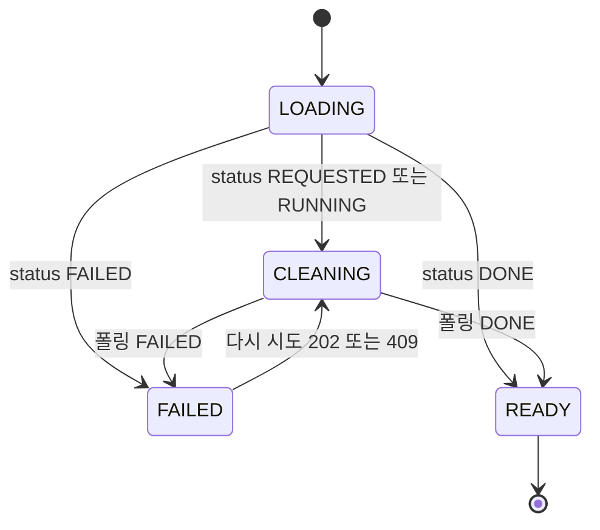

# U6 화면 구성 — 17 · 26 · 27 · 28 · 30

> Functional Design(3.1) · 작업 기록 `261014-u6-result-report`.
>
> 입력: `inception/requirements-analysis/requirements.md` FR11 · FR12 · FR15, 이 단계 `rules.md` BR11.x · BR14.x, `functional-spec.md` 3.3 · WF12 · 5.1, 원래 기록 화면 설계(S-17 · S-26 · S-27 · S-28 · S-30 · §9)와 수용 기준(AC3.6.x · AC4.3.x · AC5.1.x ~ AC5.5.x).
>
> 기존 구조를 따른다: 화면은 `frontend/src/parent/screens/<이름><번호>.tsx`, 라우트는 `frontend/src/app/parent/**/page.tsx`, API는 `frontend/src/parent/api/`, 고정 문구는 `frontend/src/shared/copy/`(임시 문구는 TEMP_COPY 묶음, 금지 표현 검사 대상), data-testid는 `{화면}-{역할}` 케밥 표기다.

## 1. 라우트와 화면

| 화면 | 라우트 | 화면 파일 | 비고 |
|---|---|---|---|
| 17 활동 끝 | `/parent/sessions/[sessionId]/done` | `Done17.tsx`(고침) | 정리 상태 줄 · 단추만 더함 |
| 26 기록 달력 | `/parent/records?date=yyyy-mm-dd` | `Records26.tsx`(새) | 스텁 `records/page.tsx`를 바꿈. 보던 날은 쿼리 `date`로 유지 |
| 27 기록 상세 | `/parent/records/[sessionId]` | `RecordDetail27.tsx`(새) | 「←」 = `/parent/records?date=<그 활동 날짜>` |
| 28 리포트 범위 | `/parent/reports/new` | `ReportRange28.tsx`(새) | 범위 상태는 화면 안(쿼리 `from` · `to`로 30 「←」 복원) |
| 30 리포트 확인 | `/parent/reports/[reportId]` | `Report30.tsx`(새) | 저장 전 「←」 = `/parent/reports/new?from&to` |

`PARENT_ROUTES`에 `recordsOn(date)` · `recordDetail(sessionId)` · `reportNew(from?, to?)` · `report(reportId)`를 더하고, `routeForTab("records")`가 스텁 대신 26으로 가게 한다.

## 2. 공통 구성요소

| 구성요소 | 위치 | 하는 일 | 규칙 |
|---|---|---|---|
| `useResultStatusPolling(sessionId)` | `parent/hooks/` | REQUESTED · RUNNING일 때만 `parent.poll-interval`(2초)로 `/result/status`, 끝 상태면 멈춤, 화면 떠나면 멈춤 | BR11.2 |
| `useReportPolling(reportId, startedAt)` | `parent/hooks/` | GENERATING일 때 2초 폴링, READY · FAILED · 요청부터 60초면 멈춤 | BR11.8 |
| `SceneChip` | `parent/components/` | "장면 n · {chipText}" 글자 칩. 칩 종류는 `data-chip` 속성, 색은 보조 | BR4.5 · BR11.11 |
| `EndReasonCard` | `parent/components/` | 27 끝난 이유 칸(첫 줄 · 둘째 줄 · 9-33) | BR11.5 |
| `MonthCalendar` | `parent/components/` | 26 · 28 공용 달력: 날 칸 44px 이상, 점 낭독 "m월 d일 · 활동 n개", 미래 날 `aria-disabled`, 범위 칠하기 | BR11.3 · BR11.7 |
| `LiveRegion` | `parent/components/` | 상태 변화 글을 `aria-live="polite"`로 알림 | BR11.11 |
| API 함수 | `parent/api/results.ts` · `reports.ts` | C5 9개 경로 호출, 409 · 404 · 403을 `ApiError` 코드로 넘김 | 5.1 |
| 문구 | `shared/copy/result.ts` | 칩 문구 · 9-20 ~ 9-34 · 28 · 30 고정 문구(TEMP_COPY) | NFR3 |

## 3. 17 활동 끝 (고침)

| 요소 | data-testid | 표시 | 규칙 |
|---|---|---|---|
| 정리 줄 | `done-cleaning` | REQUESTED · RUNNING "기록을 정리하고 있어요" / DONE 9-20 "기록 정리가 끝났어요" / FAILED 9-21 첫 두 줄 / NONE 없음 | BR11.1 |
| 「오늘 기록 보기」 | `done-view-record` | DONE일 때만, → 27 | AC3.6.3 |
| 「기록에서 다시 시도」 | `done-retry-in-record` | FAILED일 때만, → 27(27에서 「다시 시도」) | AC3.6.4 |
| 「홈으로」 | `done-home` | 그대로 | AC3.6.5 |

- 상태: 기존 `live view` 상태(마무리 중 · 종료) + `useResultStatusPolling`. 마무리 중(CLOSING)에는 폴링하지 않는다.
- 상태 조회가 실패하면 "기록을 정리하고 있어요"를 유지하고 다음 주기에 다시 묻는다(단추는 보이지 않음).
- 결과 · 해석 · 판정 · 결과 문장은 그리지 않는다(AC3.6.8).
- 바뀌는 시험: `tests/u1/parent/done-17.test.tsx:109-112` · `tests/u4a/parent/screens-u4a.test.tsx:155` — "늘 감춤" → "DONE에서만 보임"(functional-spec 5.4).

## 4. 26 기록 달력

| 요소 | data-testid | 표시 | 규칙 |
|---|---|---|---|
| 머리 | `records-month` | "yyyy년 m월" + ‹ › (`records-prev` · `records-next`) | AC5.1.1 · AC5.1.4 |
| 「상담용 리포트 다운」 | `records-report` | → 28 | AC5.1.1 |
| 달력 | `records-calendar`, 날 칸 `records-day-{yyyy-mm-dd}` | 활동한 날 점(DECLINED만 있는 날도 점), 선택한 날은 색 + 머리 글 | AC5.1.10 · B19 |
| 날 머리 | `records-day-title` | "m월 d일 x요일" | AC5.1.2 |
| 활동 줄 | `records-item-{sessionId}` | "hh:mm  자유대화 · n분" / "hh:mm  연습 · 목표 n개 · n분" / "… · 중간에 끊김" | AC5.1.2 · BR14.2 |
| 미참여 줄 | `records-item-declined-{sessionId}` | 9-24 "hh:mm  자유대화 · 시작하지 못함", 누를 수 없음(`aria-disabled`) | AC5.1.8 |
| 활동 없는 날 | `records-empty-day` | 「활동이 없어요」 | AC5.1.2 |
| 기록 0건 | `records-empty` | 9-23 두 줄, 「상담용 리포트 다운」은 28로(28이 자료 부족 표시) | AC5.1.9 |

- 데이터: U4a `GET /api/records?month=yyyy-mm`(점) · `?date=yyyy-mm-dd`(목록). 진입 때 한 번씩, 날 · 달 바뀔 때 다시 읽는다(폴링 없음).
- 처음 선택 날 = 오늘(Asia/Seoul), 쿼리 `date`가 있으면 그날(27 「←」 복원, AC5.1.5).
- "중간에 끊김" = 기록 `interrupted` 참 또는 재시작 FAILED(finalStatus FAILED).
- 하단 탭 이동은 기존 `BottomTabBar`(AC5.1.6).

## 5. 27 기록 상세

| 요소 | data-testid | 표시 | 규칙 |
|---|---|---|---|
| 머리 | `record-head` | "← m월 d일 자유대화" · "hh:mm ~ hh:mm · n분" / 연습 "… · 목표 n개" | AC5.2.1 |
| 끝난 이유 칸 | `record-end-reason` · 둘째 줄 `record-end-detail` · 미확인 `record-end-unconfirmed` | BR11.5 | AC5.2.11 · BR14.2 |
| 상태 칸 | `record-state` | 정리 중 9-29 앞줄 / 실패 9-29 + 「다시 시도」(`record-retry`) / 자료 부족 9-32 | BR11.4 |
| 연습 목표 묶음 | `record-goal-{order}` | 목표 이름, `SceneChip` 2개(`record-goal-{order}-scene-{n}`), 결과 문장(`record-goal-{order}-sentence`), "제공한 도움 · 도움 n회(동의함/거절함/답 없음)"(`record-goal-{order}-help`) | AC5.2.10 · BR4.6 |
| 탭 | `record-tabs`, 탭 `record-tab-transcript` · `record-tab-tips` · `record-tab-goals` | "대화 기록 · 생활 팁 n · 연습 목표 n" | AC5.2.1 |
| 대화 기록 | `record-transcript` | 기존 `TranscriptList`(전사 · 승인 AI 말), 끊김 "hh:mm ~ hh:mm 끊김", 미확인 9-25, 불확실 표기 다르게 | AC5.2.2(08 배경 제외) |
| 생활 팁 | `record-tip-{supportItemId}` | 제목 + 본문 + 9-26 두 줄, 0개면 9-27(`record-tips-empty`) | AC5.2.3 · BR11.6 |
| 연습 목표 후보 | `record-candidate-{recommendationId}`, 단추 `record-candidate-{id}-select` | 이름 + 「담기」/「담김 ✓」 + "근거 · {reasonText} (hh:mm)", 0개면 9-28(`record-candidates-empty`) | AC4.3.1 ~ AC4.3.5 |

**상태와 데이터 흐름**

<!-- Text fallback: 27은 불러오는 중에서 정리 상태를 읽어 정리 중 · 실패 · 준비됨으로 나뉜다. 정리 중이면 폴링해서 DONE이면 준비됨, FAILED면 실패로 간다. 실패에서 다시 시도를 누르면 응답이 202든 409든 정리 중으로 돌아가 폴링한다. -->

1. 진입: `GET /api/records/{sessionId}`(U4a) + `GET /api/sessions/{sessionId}/result/status`를 함께 읽는다.
2. 기록이 404면(아직 저장 전) 머리 없이 상태 칸만 정리 중으로 보이고 상태 폴링을 한다(가정 G17). 상태도 404면 "기록을 찾을 수 없어요" 공통 오류 화면.
3. DONE이면 `GET /api/sessions/{sessionId}/result`를 한 번 읽어 목표 묶음 · 탭 개수 · 팁 · 후보를 그린다.
4. 「다시 시도」(`record-retry`)는 jobStatus FAILED일 때만 보인다. 누르면 단추를 끄고 POST, 202 · 409 모두 폴링을 다시 시작한다(AC5.2.7).
5. 「담기」 = U5a `POST /api/goal-selections{recommendationId}`, 「담김 ✓」 누름 = U5a 취소 경로. 성공하면 `selected`를 바꿔 그리고, 실패하면 U5a 거절 사유 토스트(§9-12).
6. 자유대화 결과 문장(goalSelectionId 없는 sentences)과 08 배경은 그리지 않는다(편차 (U6-c) · (U6-l)).
7. 「←」 = 26 보던 날(AC5.1.5 · AC5.2.5).

## 6. 28 리포트 범위

| 요소 | data-testid | 표시 | 규칙 |
|---|---|---|---|
| 머리 | `report-range-head` | "← 상담용 리포트" | S-28 |
| 빠른 선택 | `report-range-quick-{recent2w\|month\|all\|custom}` | 최근 2주(기본) · 이번 달 · 전체 · 직접, `aria-pressed` | AC5.3.1 · AC5.3.2 · R-04 |
| 달력 | `report-range-calendar` | `MonthCalendar`, 범위 칠하기, 미래 날 비활성 | AC5.3.3 · AC5.3.4 · AC5.3.14 |
| 요약 줄 | `report-range-summary` | "m/d ~ m/d · 활동 n개" / "시작 m/d · 끝나는 날을 누르세요" | AC5.3.1 · AC5.3.3 |
| 활동 줄 | `report-range-item-{sessionId}` | "m/d 종류 · n분", 체크 토글(`aria-checked`) | AC5.3.5 |
| 만들기 단추 | `report-range-create` | 「활동 N개로 리포트 만들기」 / 0건이면 「리포트 만들기」 꺼짐 + `report-range-empty` 두 줄 | AC5.3.6 |
| 만드는 중 | `report-range-generating` | "리포트를 만들고 있어요" / "고른 기록으로 10개 항목을 만들고 있어요." + 「취소」(`report-range-cancel`) | AC5.3.7 · AC5.3.8 |
| 실패 | `report-range-failed` | "리포트를 만들지 못했어요" / "잠시 뒤 다시 시도해 주세요. 고른 범위는 그대로예요." + 「범위 다시」(`report-range-reset`) · 「다시 시도」(`report-range-retry`) | AC5.3.9 |

**상태**: `RANGE`(고르기) → 「만들기」 → `GENERATING` → READY면 30, FAILED · 60초면 `FAILED` → 「다시 시도」 = 새 idempotencyKey로 `GENERATING`, 「범위 다시」 = `RANGE`. `GENERATING`에서 「취소」 · 「←」 = 폴링만 멈추고 `RANGE`(서버 리포트는 다음 요청 · 24시간 정리로 버려짐, B21 · BR9.3).

- 미리보기: 범위가 바뀔 때마다 `GET /api/reports/preview?from&to`(직전 요청은 취소). 처음 들어올 때 받은 `firstRecordDate`로 「전체 · 직접」 시작일을 정한다.
- 체크는 처음엔 모두 켜짐, 범위가 바뀌면 다시 모두 켜짐.
- idempotencyKey: `RANGE`에서 「만들기」를 처음 누를 때 만들고, `GENERATING` 동안 재탭은 같은 키(AC5.3.13). 「다시 시도」 · 범위 변경은 새 키.
- 60초는 앱이 「만들기」 응답을 받은 때부터 잰다(서버 마감과 같은 기준, 편차 (U6-e)).
- 「←」(`RANGE`) = 26, 고른 범위 버림(AC5.3.10).

## 7. 30 리포트 확인

| 요소 | data-testid | 표시 | 규칙 |
|---|---|---|---|
| 머리 | `report-head` | "← 상담용 리포트" · "m/d ~ m/d · 활동 n개" | AC5.4.1 |
| 고지 | `report-notice` | 고정 고지 문구(응답 notice) | AC5.4.1 |
| 항목 카드 | `report-section-{1..10}` | 제목 + 본문, 인용 `"{quote}" (m/d hh:mm)`, 5항목 줄 꼬리표 `report-section-5-source`("보호자 입력" / "아이 회상"), 결측은 제목 옆 "자료 부족"(`report-section-{n}-missing`, 9-34) | AC5.4.1 · AC5.5.3 · AC5.5.5 |
| 단추 | `report-later` · `report-save` | 「나중에」 · 「PDF 저장」 | AC5.4.1 |
| 저장 확인 시트 | `report-save-sheet`, `report-save-cancel` · `report-save-confirm` | "PDF로 저장할까요?" · "기간 · m/d ~ m/d" · "활동 · n개" · "항목 · 10개 (인용 n개 포함)" · "아이 정보 · 이름 · 나이만" | AC5.4.2 · AC5.4.8 |
| 저장했어요 | `report-saved` | "저장했어요" · 파일명 · 「공유하기 (문자 · 메일 · 메신저)」(`report-share`, Web Share files 지원 때만) · 「파일 열기」(`report-open`) · 안내 "전달은 보호자가 직접 해요. 앱이 자동으로 보내지 않아요." · 「기록으로」(`report-to-records`) | AC5.4.3 · AC5.4.4 |
| 저장 실패 | 토스트 | 9-30 "저장하지 못했어요 · 「다시 시도」" | AC5.4.7 |

**저장 흐름**: 「저장」 → `GET /api/reports/{id}/pdf`를 Blob으로 받음(`parent.request-timeout` 10초) → 성공이면 `a[download]`로 파일명 저장 + `POST /saved` → `report-saved`. 받기 · saved 실패면 토스트, 30 유지(BR11.9).

**이동**: 저장 전 「←」 = `POST /discard` 뒤 28(`from` · `to` 유지), 「나중에」 = `POST /discard` 뒤 26, 저장 뒤 「←」 · 「기록으로」 = 26(AC5.4.5 · AC5.4.6 · R-05). 버림 요청 실패는 이동을 막지 않는다.

**공유 · 열기**: 「공유하기」 = 받아 둔 Blob을 `File`로 만들어 `navigator.share({files})`, 「파일 열기」 = Blob URL을 새 탭으로. 받아 둔 Blob이 없으면(새로 고침 뒤) PDF를 다시 받는다. 둘 다 30 유지.

- 진입: `GET /api/reports/{reportId}` 한 번. READY · SAVED가 아니면(GENERATING · FAILED · DISCARDED) 28로 되돌린다.
- SAVED로 들어오면 바로 `report-saved` 상태를 보인다.

## 8. 접근성 · 문구 공통 (FR12.3)

- 칩 · 상태 · 결측은 글자로 드러내고 색은 보조다(`SceneChip` · "자료 부족" · 9-29).
- 정리 상태 바뀜 · 만드는 중 · 실패 · 저장했어요는 `LiveRegion`으로 알린다.
- 26 · 28 날 칸 44px 이상, 점 · 비활성 날 낭독(AC5.1.10 · AC5.3.14).
- 새 고정 문구는 `shared/copy/result.ts`의 TEMP_COPY에 두고 금지 표현 사전 시험에 넣는다(NFR3).

## 9. 시험 범위 (frontend)

| 시험 파일 | 내용 |
|---|---|
| `tests/u6/parent/done-17-result.test.tsx` | 정리 중 · DONE · FAILED · NONE 표시와 단추, 폴링 멈춤 |
| `tests/u6/parent/records-26.test.tsx` | 줄 글 3종 · 재시작 FAILED "중간에 끊김" · DECLINED 줄 · 빈 상태 · 보던 날 복원 · 낭독 문구 |
| `tests/u6/parent/record-27.test.tsx` | 상태 칸 4종 · 칩 5종 문구 · 도움 문구 · 팁 · 후보 담기 · 다시 시도 연타 · 404 정리 중 · 08 배경 · 자유대화 문장 미표시 |
| `tests/u6/parent/report-28.test.tsx` | 빠른 선택 4종 날짜 · 달력 두 번 누르기 · 미래 날 · 0건 · 같은 키 재탭 · 취소 · 60초 실패 |
| `tests/u6/parent/report-30.test.tsx` | 10개 항목 · 결측 · 출처 꼬리표 · 시트 값 · 저장 성공/실패 · 이동 4종 · Web Share 숨김 |

범위 파일 `frontend/coverage-scope/u6.json`, 줄 커버리지 80% 이상(NFR8).

## Sources

- 요구사항: `inception/requirements-analysis/requirements.md` FR11.1 ~ FR11.3, FR12.1 ~ FR12.3, FR15.1
- 이 단계: `rules.md` BR11.x · BR14.x · BR4.5 · BR4.6, `functional-spec.md` 3.3 · 5.1 · 5.4 · WF12
- 원래 기록 화면 · 수용 기준: `261008-mujoong-service/inception/refined-mockups/mockups.md` S-17 · S-26 · S-27 · S-28 · S-30 · §9, `user-stories/stories.md` US3.6 · US4.3 · US5.1 ~ US5.5
- 기존 코드: `frontend/src/parent/screens/Done17.tsx`, `frontend/src/parent/navigation.ts`, `frontend/src/app/parent/records/page.tsx`(스텁), `frontend/src/parent/components/`, `frontend/coverage-scope/*.json`
