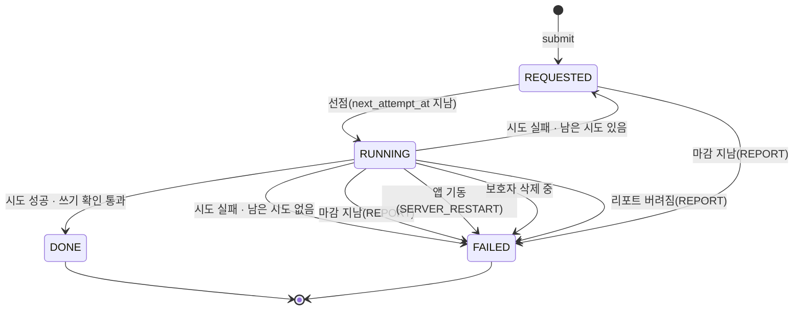
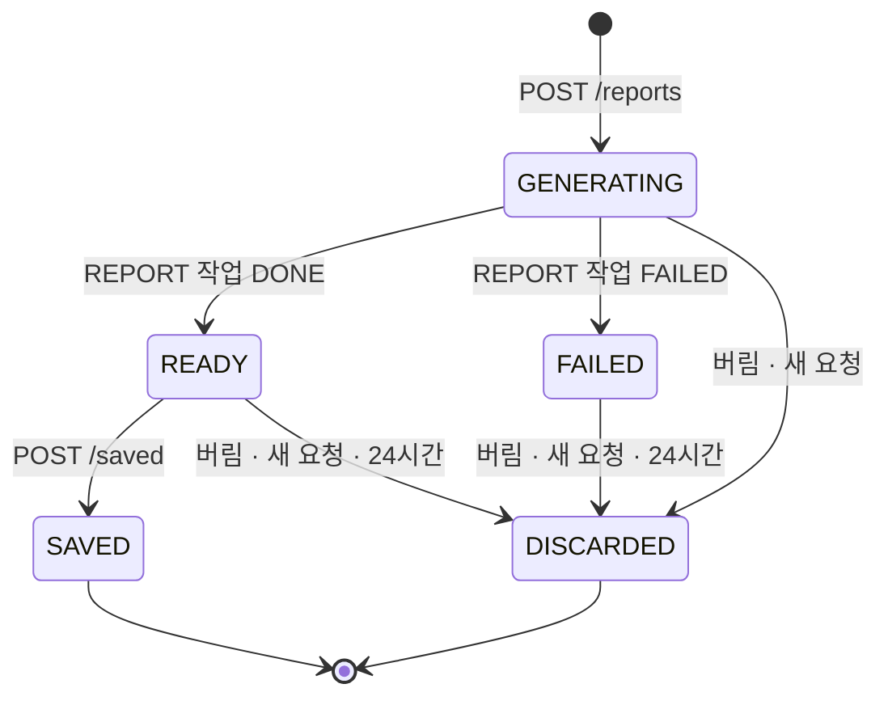
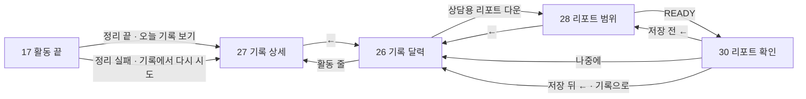
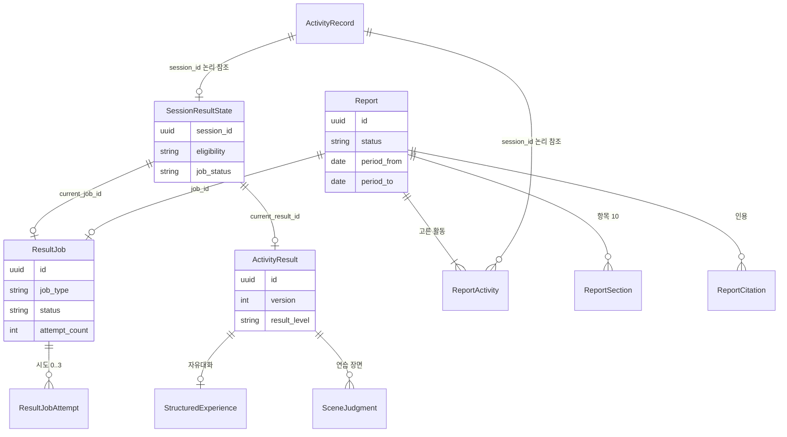

# U6 기능 명세 — 결과와 리포트

> Functional Design(3.1) · 작업 기록 `261014-u6-result-report`.
>
> 이 문서는 **워크플로와 상태 기계의 정본**이다. 데이터 모양은 `entities.md`, 판단 규칙은 `rules.md`가 정본이고, 6절 ER 그림과 7절 규칙 요약은 그 두 파일에서 옮긴 사본이다.
>
> 입력
> - 요구사항 `inception/requirements-analysis/requirements.md`(FR1 ~ FR16, NFR1 ~ NFR12)와 그 단계 답(Q1 ~ Q11, 가정 27건)
> - 이 단계 질문 `functional-design-questions.md` FD-Q1 ~ FD-Q7(모두 A)
> - 원래 기록 `261008-mujoong-service`의 ResultPipeline · Report 컴포넌트, ADR-017, 계약 요약 3절 C5 · 8절, 스토리 수용 기준, 화면 설계
> - 계약 `contracts/ai-io.md` 6절 · `contracts/timing.md`, 기존 코드(codekb `aidlc/spaces/default/codekb/mujungi/`)
>
> 이 작업 기록은 units-generation · domain-design · contract-design을 건너뛰었다. 그래서 유닛 정의(unit-of-work)와 컴포넌트 목록(components) 대신 원래 기록의 컴포넌트 설계와 기존 코드 구조를 도메인 설계로 본다.

## 1. 개요

U6은 끝난 활동을 정리하고(ResultPipeline), 보호자가 기록을 다시 보고(17 · 26 · 27), 상담용 리포트를 만들어 저장하게 한다(Report · 28 · 30 · R-PDF).

| 구역 | 위치 | 하는 일 |
|---|---|---|
| ResultPipeline | `backend/core-api` `kr.mujoong.core.result` | 결과 작업 실행기(JobRunner), ActivityRecorded 접수 · 누락 점검, SESSION_RESULT 처리기(구조화 · 재판정 · 결과 문장 · 결과 수준 · 후보 · 팁), 결과 API |
| Report | `backend/core-api` `kr.mujoong.core.report` | 미리보기 · 생성 · REPORT 처리기(10개 항목 조립) · 저장 · 버림 · 정리 · PDF |
| 공통 검사 | `kr.mujoong.core.result.check` | 인용 대조 · 금지 표현 1차 사전(RESULT_TEXT · PDF) · 2차 분류 호출 · 숫자 검사 |
| U5a 확장(더하기) | `kr.mujoong.core.practice` · `kr.mujoong.core.knowledge` | ScenarioLookup · BehaviorDefinitionLookup · CandidateRegistry 읽기 메서드 · CandidateEvidencePort 실제 어댑터 |
| U4a 변경(FR15) | `kr.mujoong.core.record` · `kr.mujoong.core.activity` | 재시작 FAILED 노출 조건 · 08 배경 읽기 메서드(더하기) |
| 화면 | `frontend/src/parent/screens/` · `frontend/src/app/parent/**` | 17 정리 상태, 26 · 27 · 28 · 30 (`frontend-components.md`) |

실제 텍스트 AI 공급자는 연결하지 않는다. TextAiProvider 기본은 UNAVAILABLE이므로, 운영 기본 설정에서 AI가 필요한 결과 작업은 3회 시도 뒤 FAILED가 되고 27은 「다시 시도」를 보인다. 결과 수준이 INSUFFICIENT인 세션은 AI 없이 DONE이 된다(BR5.6). 구조화 · 재판정 · 결과 문장 · 후보 · 리포트 항목은 시험 소스의 가짜 공급자로 검증한다.

## 2. 구성요소 분리

| 구성요소 | 종류 | 책임 | 규칙 |
|---|---|---|---|
| `JobRunner` · `JobRunnerLoop`(SmartLifecycle) | 실행기 | 선점 · 시도 시한 · 재시도 · 기동 점검 · 임대 만료 | BR1.x |
| `ResultJobRepository` | 저장소 | 작업 · 시도 행, SKIP LOCKED 선점 질의 | BR1.2 · BR1.4 · BR1.5 |
| `ResultIntake` | 앱 이벤트 수신 | ActivityRecorded(AFTER_COMMIT) → 정리 대상 판정 → 접수 | BR2.1 · BR2.2 |
| `ResultReconciler` | 주기 작업 | 누락 접수 · 저장 안 된 리포트 정리(5분 · 기동) | BR2.3 · BR10.4 |
| `SessionResultHandler` | 처리기(SESSION_RESULT) | 입력 조립 → 수준 1단계 → AI 단계 → 검사 → 쓰기 → 후보 등록 | BR3 ~ BR7 |
| `ResultLevelCalculator` | 순수 함수 | 결과 수준 2단계 | BR5.5 |
| `SceneChipMapper` · `NotDoneReasonMapper` | 순수 함수 | 칩 표 · 미실시 사유 사상표 | BR4.4 · BR4.5 |
| `TipMatcher` | 순수 함수 + 저장소 읽기 | behavior_key 교집합 · 금지 사전 · 매칭 로그 | BR7.x |
| `ResultTextGateway` | AI 경계 | 작업별 요청 조립(별칭 · activityNo) · 시한 · 스키마 검사, U5a TextAiGateway와 같은 공급자 포트를 쓰되 설정 `mujoong.text-ai.result.*` | BR3.2 · BR5.2 · BR9.4 |
| `OutputChecker` | 순수 함수 + 2차 분류 호출 | 인용 대조 · 숫자 검사 · 금지 1차 · 2차 묶음 호출 | BR5.2 · BR5.4 |
| `ResultQueryService` · `ResultController` | 조회 · 웹 | `/result` · `/result/status` · `/result/retry` | BR8.x · BR2.4 |
| `ReportService` · `ReportController` | 웹 · 명령 | 미리보기 · 생성 · 조회 · 저장 · 버림 | BR9.1 ~ BR9.3 · BR10.1 ~ BR10.3 |
| `ReportHandler` | 처리기(REPORT) | 항목 조립 · AI 항목 · 템플릿 · 수준 · 인용 수 | BR9.4 ~ BR9.10 |
| `ReportPdfRenderer` | 렌더러 | HTML 템플릿 → OpenHTMLtoPDF → byte[] | BR10.6 · BR10.7 |
| `ResultDeletionParticipant` | 삭제 참가자(70) | U6 새 표 10개 삭제 | BR13.1 |
| `ResultEvidenceAdapter` | U5a 포트 어댑터 | CandidateEvidencePort 실제 구현 | BR6.5 |

의존 방향: `report → result(조회 서비스)`, `result → record · activity · practice · knowledge(공개 서비스만)`. U4a · U5a 저장소를 다른 패키지에서 직접 부르지 않는다(ArchUnit 규칙에 더함). 예외는 근거 확인 어댑터가 `core_activity_record`를 읽기 전용으로 읽는 것뿐이며, 이는 U4a `RecordQueryService`의 공개 읽기 메서드를 통해 한다.

## 3. 상태 기계

### 3.1 결과 작업(ResultJob)

<!-- Text fallback: 작업은 REQUESTED에서 선점되면 RUNNING이 된다. RUNNING은 성공하면 DONE, 실패하고 시도가 남으면 REQUESTED로 돌아가고, 시도가 없거나 마감 · 기동 · 삭제 중이면 FAILED가 된다. REQUESTED도 REPORT 마감이 지나면 FAILED가 된다. DONE · FAILED는 끝 상태이며 다시 시도는 새 작업 행이다. -->

| 사건 | 출발 | 도착 | 함께 쓰는 것 | 규칙 |
|---|---|---|---|---|
| submit(새 키) | — | REQUESTED | next_attempt_at = 지금, REPORT면 deadline_at | BR1.5 |
| 선점 | REQUESTED(next_attempt_at ≤ 지금) | RUNNING | attempt_count + 1, lease_until, 시도 행 | BR1.2 · BR1.3 |
| 시도 성공 + 쓰기 확인 통과 | RUNNING | DONE | 결과 행, finished_at, 시도 SUCCEEDED | BR1.8 |
| 시도 실패, attempt_count < 3, (REPORT면 다음 시각 < deadline) | RUNNING | REQUESTED | next_attempt_at = 지금 + 5초 · 15초, last_error_code, 시도 FAILED | BR1.7 |
| 시도 실패, 남은 시도 · 시간 없음 | RUNNING | FAILED | finished_at, last_error_code | BR1.7 |
| 임대 만료(lease_until < 지금) | RUNNING | REQUESTED 또는 FAILED | 시도 FAILED(TIMEOUT), 위 두 줄과 같이 | BR1.10 |
| 마감 지남(REPORT) | REQUESTED · RUNNING | FAILED | DEADLINE_EXCEEDED | BR9.4 |
| 앱 기동 | RUNNING | FAILED | SERVER_RESTART, 시도 ABANDONED | BR1.9 |
| 보호자 삭제 중(쓰기 단계) | RUNNING | FAILED | ACCOUNT_DELETING | BR13.2 |
| 리포트가 DISCARDED(시도 시작 · 쓰기 확인) | RUNNING | FAILED | REPORT_DISCARDED, 다시 시도 없음 | BR1.12 |

REPORT 작업의 DONE · FAILED 전이는 같은 트랜잭션에서 리포트를 READY · FAILED로 바꾼다(리포트가 GENERATING일 때만, BR1.12). SESSION_RESULT 작업의 전이는 같은 트랜잭션에서 머리 행 job_status를 바꾼다(BR1.11).

표에 없는 쌍은 성립하지 않는다(BR1.1). DONE · FAILED에서 나가는 전이는 없고, 「다시 시도」는 새 작업 행이다(BR2.4).

### 3.2 리포트(Report)

<!-- Text fallback: 리포트는 GENERATING으로 만들어진다. 작업이 DONE이면 READY, FAILED면 FAILED가 된다. READY는 저장하면 SAVED가 된다. 저장 전(GENERATING · READY · FAILED)은 버림 · 새 요청 · 24시간 정리로 DISCARDED가 된다. SAVED와 DISCARDED는 끝 상태다. -->

| 사건 | 출발 | 도착 | 함께 쓰는 것 | 규칙 |
|---|---|---|---|---|
| POST /reports(새 키) | — | GENERATING | ReportActivity, REPORT 작업 | BR9.2 |
| REPORT 작업 DONE | GENERATING | READY | ReportSection · ReportCitation, level · citation_count · ready_at | BR9.5 ~ BR9.10 |
| REPORT 작업 FAILED | GENERATING | FAILED | — | BR9.4 |
| POST /saved | READY | SAVED | saved_at(첫 번만) | BR10.2 |
| POST /saved | SAVED | SAVED | 바꾸지 않음 | BR10.2 |
| POST /discard · 새 요청(BR9.3) | GENERATING · READY · FAILED | DISCARDED | 하위 행 삭제, discarded_at | BR10.3 |
| 정리 점검 24시간 | READY · FAILED | DISCARDED | 하위 행 삭제 | BR10.4 |
| POST /discard | SAVED · DISCARDED | 그대로 | 바꾸지 않음(204) | BR10.3 |

REPORT 작업이 DONE을 쓰는 트랜잭션은 리포트가 아직 GENERATING인지 함께 확인한다. 버려진 리포트에 늦게 끝난 작업은 항목을 쓰지 않는다(BR1.8).

### 3.3 17 · 27 정리 표시 (세션 상태 × 작업 상태)

| 세션 상태 | jobStatus | 17 정리 줄 | 17 단추 | 27 상태 칸 |
|---|---|---|---|---|
| CLOSING | — | 마무리 중(U4a) | 「홈으로」 | 27로 오지 않음 |
| 종료(ENDED · ENDED_UNCONFIRMED · ABORTED · 재시작 FAILED) | REQUESTED · RUNNING | 기록을 정리하고 있어요 | 「홈으로」 | 9-29 정리 중, 2초 폴링 |
| 종료 | DONE | 9-20 기록 정리가 끝났어요 | 「오늘 기록 보기」 → 27 | 결과 표시(INSUFFICIENT면 9-32) |
| 종료 | FAILED | 9-21 | 「기록에서 다시 시도」 → 27 | 9-29 실패 + 「다시 시도」 |
| DECLINED · 발화 0건 · 그 밖 FAILED · 기록이 오지 않는 세션(시작 실패 · 로컬 FAILED) | NONE | 정리 줄 없음 | 「홈으로」 | 26에서 들어올 수 없음 |

머리 행이 아직 없을 때의 jobStatus는 BR8.3이 정한다. 활동 기록이 있으면 판정 함수(BR2.2)로, 기록이 아직 없으면 사본 상태로 낸다. 기록이 꼭 오는 종료(ENDED · ENDED_UNCONFIRMED · ABORTED · 재시작 FAILED)만 REQUESTED이고, 기록이 오지 않는 세션은 NONE이다. 그래서 정리 중 폴링이 끝없이 이어지지 않는다.

근거: AC3.6.12(정리 끝 READY를 DONE으로 읽음, 가정 C19), BR8.3 · BR11.1 · BR11.4.

## 4. 워크플로

### WF1 결과 접수 (ActivityRecorded)

1. U4a `SessionRecordCapturedHandler`가 활동 기록을 새로 저장하고 커밋하면 ActivityRecorded{sessionId, guardianId, childId, activityType, finalStatus, recordedAt}가 나온다.
2. `ResultIntake`(@TransactionalEventListener AFTER_COMMIT, 새 트랜잭션)가 받는다.
3. 보호자 삭제 중이면 아무것도 하지 않는다(BR13.2).
4. SessionResultState가 이미 있으면 끝(같은 세션 한 번만, BR2.1).
5. 활동 기록 · 활동 사본(status · failure_code)을 읽어 판정 함수로 정리 대상을 정한다(BR2.2). 활동 사본 반영(SessionStateChanged)과 기록 저장(SessionRecordCaptured)은 서로 다른 Outbox 이벤트라 도착 순서가 보장되지 않는다. 기록이 FAILED인데 사본이 아직 FAILED가 아니면 UNDECIDED로 보고 머리 행 없이 끝낸다. 다음 누락 점검(WF6)이 사본 반영 뒤 다시 판정한다.
6. ELIGIBLE이면 머리 행(run_ordinal 1)을 INSERT … ON CONFLICT DO NOTHING으로 넣고, 들어갔을 때만 submit(SESSION_RESULT, 'SR:{sessionId}:1', ACTIVITY_RECORDED). NOT_ELIGIBLE이면 머리 행만(job_status NONE). 누락 점검과 겹쳐 삽입이 0행이면 아무것도 하지 않는다(BR2.1).
7. 같은 트랜잭션에 쓰므로 머리 행과 작업은 함께 생기거나 함께 없다. 롤백된 기록 저장에는 이벤트가 나오지 않는다(FR2.1 완료 기준).

이벤트를 놓친 경우는 WF6 누락 점검이 메운다.

### WF2 선점과 시도 (JobRunner)

1. `JobRunnerLoop`가 `result.job-tick`(1초)마다 돈다. 실행 스레드 2개 중 1개는 REPORT 전용, 1개는 SESSION_RESULT용이다. 주기마다 REPORT를 먼저, 그다음 SESSION_RESULT를 빈 스레드만큼 BR1.2 질의로 선점한다. 느린 SESSION_RESULT가 REPORT의 60초 마감을 대기 중에 써 버리지 않게 하려는 것이다.
2. 같은 주기에 임대 만료(BR1.10)와 REPORT 마감(BR9.4)을 확인한다.
3. 선점한 작업마다 실행 스레드에서 등록된 처리기를 부른다. 처리기는 `JobContext{jobId, jobType, subjectId, attemptNo, deadline, clock}`를 받는다.
4. 처리기는 읽기 트랜잭션으로 입력을 모은 뒤 닫고, AI를 트랜잭션 밖에서 부르고, `JobContext.commit(writer)`로 결과를 쓴다. commit은 BR1.8 확인(아직 RUNNING · 같은 attempt_count · 보호자 삭제 아님 · REPORT면 리포트 GENERATING)과 DONE 전이를 같은 트랜잭션에 한다.
5. 처리기가 실패를 돌려주거나 예외 · 시한 초과가 나면 실행기가 BR1.6 · BR1.7로 다음 상태를 정한다.
6. 실행 스레드는 시도 시한(lease_until)에 처리기를 취소한다(Future.cancel + AI 호출 시한). AI 호출 한 번의 시한은 min(10초, lease_until − 지금)이고, 게이트웨이 안 재시도는 없다(BR1.3). 재시도는 작업 단위 3회뿐이다.

**처리기 확장점 계약(JobRunner.register).** 다른 처리기가 붙을 때 실행기를 고치지 않도록 처리기가 할 수 있는 것과 못 하는 것을 정한다.

| 구분 | 내용 |
|---|---|
| 들어오는 시점 | 선점 직후 실행 스레드에서 한 번. 같은 작업에 동시에 두 번 불리지 않는다 |
| 낼 수 있는 것 | `Outcome.done()`(commit 성공 뒤) · `Outcome.failed(code, retryable)`. retryable 코드: PROVIDER_UNAVAILABLE · PROVIDER_ERROR · TIMEOUT · SCHEMA_INVALID · INTERNAL. 마지막 코드: ACCOUNT_DELETING · 입력 없음(INTERNAL, retryable false) |
| 쓸 수 있는 것 | `JobContext.commit(writer)` 안에서 자기 결과 표만. 시계는 `JobContext.clock`(주입 Clock)만, AI 시한은 `deadline`을 넘지 않게 |
| 비동기 결과 | commit 뒤 후크(`afterCommit`) 하나. SESSION_RESULT는 후보 등록(BR6.4)에 쓴다. 후크 실패는 작업 상태를 바꾸지 않는다 |
| 금지 | 작업 · 시도 행을 직접 바꾸기, 같은 subject로 submit, DB 트랜잭션을 쥔 채 AI 호출, Thread.sleep, 로그에 전사 · 08 원문 · AI 출력 본문 넣기 |

### WF3 SESSION_RESULT — 자유대화

1. 입력 모으기(읽기 트랜잭션): 활동 기록(전사 · gaps · 종료 사유 · 확인 · 확보 범위), 08 배경(U4a 읽기 메서드), 아이 별칭 정보(이름은 쓰지 않음), ACTIVE 정의 목록.
2. 결과 수준 1단계(BR5.5). INSUFFICIENT(유효 기록 미달 · 동의 철회)면 7로 건너뛴다(BR5.6).
3. 구조화 AI 호출(BR3.1 · BR3.2) → 스키마 검사 → 칸별 근거 대조(BR3.3).
4. 결과 수준 2단계(구조화 CHILD_RECALL 칸 수 반영).
5. 결과 문장 AI 호출(입력 = 구조화 + 인용 후보 + 종료 사유 · 확보 범위) → BR5.2 ①②, 숫자 검사(BR5.4), 금지 1차.
6. 후보 AI 호출(BR6.1) → 근거 검사(BR6.2) → 금지 1차.
7. 2차 분류 한 번: 남은 결과 문장 + 후보 이유 문장을 한 요청에 묶어 분류(BR5.2 ④). 걸린 결과 문장은 템플릿(BR5.3), 걸린 후보는 버림(BR6.3).
8. 팁 매칭(BR7.1 · BR7.2). 세션 태그 = 남은 후보의 behaviorKey(자유대화에는 목표가 없다).
9. `commit`: ActivityResult(새 버전, pending_candidates_json 포함) · StructuredExperience · 머리 행(current_result_id · job_status DONE) · 이전 버전 invalidated_at.
10. 커밋 뒤 후크: CandidateRegistry.register → 성공하면 candidates_registered_at. 실패하거나 프로세스가 죽으면 누락 점검이 다시 등록한다(BR6.4 · BR2.3 ②).

AI 호출은 많아야 4번(구조화 · 결과 문장 · 후보 · 2차 분류)이다. 각 호출 시한은 min(10초, 시도 마감 − 지금)이다. 그래서 네 호출이 모두 길어도 시도는 30초에 끝나고, 넘치면 TIMEOUT 시도 실패로 다시 시도된다.

### WF4 SESSION_RESULT — 연습

1. 입력 모으기: 활동 기록(전사 · practice), 목표마다 BehaviorDefinitionLookup(requireVersion), 장면마다 ScenarioLookup, 도움(cues).
2. practice가 null이면 result_level INSUFFICIENT, 장면 행 없음, sentences · help 빈 배열, 팁은 비어 있고 noTipReason NEED_MORE_OBSERVATION으로 commit하고 끝(BR4.1).
3. 결과 수준 1단계. INSUFFICIENT면 AI 없이 모든 장면을 사상표로 NOT_DONE(BR4.4), 도움(BR4.6), 팁(목표 behaviorKey로, BR7.1)을 채워 9로 간다.
4. 재판정 AI 호출(온도 0, ai-io 6.2) → 스키마 검사 → 장면 행 채우기(BR4.2), 출력에 없는 장면 · 미실시 사유(BR4.4), 차이 표시(BR4.3), 칩(BR4.5).
5. 결과 수준 2단계(모든 목표에 첫 반응 장면).
6. 결과 문장 AI 호출(입력 = 장면 칩 · 인용 · 종료 사유) → 검사.
7. 후보 AI 호출 → 근거 · 금지 1차.
8. 2차 분류 한 번(결과 문장 + 후보 이유). 걸린 문장 → 연습 템플릿.
9. 도움(BR4.6) · 팁(BR7.1: 태그 = 목표 behaviorKey ∪ 후보 behaviorKey).
10. `commit`(pending_candidates_json 포함) → 후크로 후보 등록, 실패분은 누락 점검이 다시 등록.

### WF5 다시 시도

1. 27 「다시 시도」 → `POST /api/sessions/{id}/result/retry`.
2. 접근 검사(BR8.4) 뒤 BR2.4: job_status가 FAILED면 조건부 갱신으로 새 차수 작업을 만들고 202 {REQUESTED}. 아니면 409 JOB_NOT_FAILED.
3. 앱은 202 · 409 모두 정리 상태 폴링을 다시 시작한다(409는 이미 진행 중이거나 끝난 것이므로 상태를 다시 읽으면 된다).
4. 새 작업이 DONE이면 새 결과 버전이 현재가 되고, FAILED면 이전 버전이 남는다(BR2.5).

### WF6 누락 점검과 리포트 정리

1. `ResultReconciler`가 기동 때 한 번, 그 뒤 `result.reconcile-interval`(5분)마다 돈다.
2. 머리 행 없는 활동 기록(UNDECIDED로 미룬 것 포함)을 최대 100건 읽어 WF1의 4 ~ 6을 한다(trigger RECONCILE, BR2.3 ①).
3. 현재 결과가 DONE인데 candidates_registered_at이 빈 결과의 후보를 다시 등록한다(BR2.3 ②, BR6.4). U5a 중복 키로 합쳐지므로 몇 번 불러도 후보는 한 번만 생긴다.
4. 저장 안 된 READY · FAILED 리포트 중 24시간 지난 것을 버린다(BR10.4).
5. 점검 실패는 코드값만 로그로 남기고 다음 주기에 다시 본다.

### WF7 앱 기동

1. 실행기 시작 전 한 번: RUNNING 작업 → FAILED(SERVER_RESTART), 그 시도 ABANDONED, SESSION_RESULT면 머리 행 job_status FAILED(BR1.9 · BR1.11). REPORT면 리포트 FAILED.
2. REQUESTED 작업은 그대로 둔다. 실행기가 시작되면 next_attempt_at에 따라 이어서 실행된다.
3. WF6 첫 점검을 실행한다.

### WF8 리포트 미리보기와 생성 요청

1. 28이 범위를 바꿀 때마다 `GET /api/reports/preview?from&to` → BR9.1.
2. 「활동 N개로 리포트 만들기」 → `POST /api/reports {from, to, sessionIds, idempotencyKey}` → BR9.2 검사.
3. 새 키면 한 트랜잭션에: 이전 저장 안 된 리포트 버림(BR9.3), Report(GENERATING) · ReportActivity(activity_date = listed_at 날짜 · activity_type) · REPORT 작업(deadline_at = 지금 + 60초). 202 {reportId, GENERATING}.
4. 같은 키면 저장된 첫 결과를 돌려준다(본문이 다르면 409).

### WF9 REPORT 시도

1. 입력 모으기(읽기 트랜잭션): 고른 활동의 활동 기록, 각 활동의 SessionResultState · 현재 ActivityResult · SceneJudgment(칩만) · StructuredExperience(출처 · 근거 칸만), ChildContext.get(이름 · 나이), 목표 정의(BehaviorDefinitionLookup).
2. 활동마다 result_status_at_build를 정하고 항목별 포함 활동을 나눈다(BR9.8).
3. 서버 항목 1 · 3 · 4 · 7 · 8 · 9 조립(BR9.5).
4. 인용 후보 고르기(BR9.7), activityNo 붙이기, 별칭 바꾸기.
5. AI 항목 호출 한 번(sections 2 · 5 · 6 · 10, ai-io 6.5). 시한 = min(10초, deadline − 지금).
6. 스키마 → 인용 대조(activityNo → 세션으로 되돌림) → 숫자 검사(결과 문장과 같은 기준) → 금지 1차.
7. 2차 분류 한 번(항목 2 · 5 · 6 · 10 본문). 걸린 항목은 템플릿(BR9.6). 10항목 고정 문장을 앞에 붙인다.
8. 5항목 출처 행(BR9.10), citation_count · level(BR9.9).
9. `commit`: 리포트가 아직 GENERATING인지 확인하고 ReportSection 10행 · ReportCitation · 머리 값 · READY.
10. 마감(deadline_at)을 넘기면 어느 단계든 실패하고 FAILED(DEADLINE_EXCEEDED)가 된다.

### WF10 확인 · 저장 · 버림 · PDF

1. 30이 `GET /api/reports/{id}`로 항목을 그린다(BR10.1).
2. 「PDF 저장」 → 시트 → 「저장」 → `GET /api/reports/{id}/pdf`(BR10.6 · BR10.7) → 받기 성공이면 브라우저에 파일을 저장시키고 `POST /api/reports/{id}/saved`(BR10.2). 받기 실패 · saved 실패면 9-30 토스트, 30 유지.
3. 「나중에」 · 저장 전 「←」 → `POST /api/reports/{id}/discard`(BR10.3) 뒤 이동(BR11.10).
4. 「공유하기」 · 「파일 열기」는 같은 PDF 경로를 다시 받는다(서버는 매번 렌더링, 파일 없음).

### WF11 계정 삭제

1. 계정 삭제 지휘가 참가자를 순서대로 부른다. U6 참가자는 `ORDER_RESULT = 70`으로 활동 기록(90)보다 먼저 온다.
2. `ResultDeletionParticipant`가 BR13.1 순서로 그 보호자의 행을 지운다. 멱등이다.
3. 실행 중 작업이 늦게 쓰려 하면 BR13.2 확인에서 멈춘다. 확인 전에 이미 쓴 행은 지휘의 재실행에서 다시 지워진다.
4. PDF 파일은 서버에 없으므로 파일 단계가 없다(지시서 「데이터 · 삭제」의 "PDF 파일"은 편차 (U6-k)로 적는다).

### WF12 화면 흐름

<!-- Text fallback: 17에서 정리 끝이나 정리 실패면 그 세션 27로 간다. 26의 활동 줄은 27로 가고 27의 뒤로는 26 보던 날로 돌아온다. 26의 상담용 리포트 다운은 28로 간다. 28에서 리포트가 READY면 30으로 가고 뒤로는 26이다. 30에서 저장 전 뒤로는 28, 나중에는 26, 저장 뒤 뒤로와 기록으로는 26이다. -->

화면별 구성요소 · 상태 · API 연결은 `frontend-components.md`에 있다.

## 5. 인터페이스

### 5.1 보호자 API C5 (9개 경로, `contracts/parent-api.yaml`에 더함)

| 경로 | 성공 | 오류 | 규칙 |
|---|---|---|---|
| `GET /api/sessions/{sessionId}/result` | 200 결과(계약 3절 모양) | 404 · 403 | BR8.1 · BR8.2 · BR8.4 |
| `GET /api/sessions/{sessionId}/result/status` | 200 {sessionStatus, confirmed, jobStatus} | 404 · 403 | BR8.3 |
| `POST /api/sessions/{sessionId}/result/retry` | 202 {status: REQUESTED} | 409 JOB_NOT_FAILED · 404 · 403 | BR2.4 |
| `GET /api/reports/preview?from&to` | 200 {firstRecordDate, activities[{sessionId, date, activityType, startedAt}]} | 400 VALIDATION_FAILED · 403 | BR9.1 |
| `POST /api/reports` | 202 {reportId, status: GENERATING} | 400 VALIDATION_FAILED · 409 IDEMPOTENCY_CONFLICT · 403 | BR9.2 · BR9.3 |
| `GET /api/reports/{reportId}` | 200 {status, level?, periodFrom, periodTo, activityCount, citationCount, child{displayName, age}, notice, sections[10]} | 404 · 403 | BR10.1 |
| `GET /api/reports/{reportId}/pdf` | 200 application/pdf | 409 REPORT_NOT_READY · 404 · 403 | BR10.6 · BR10.7 |
| `POST /api/reports/{reportId}/saved` | 204 | 409 REPORT_NOT_READY · 404 · 403 | BR10.2 |
| `POST /api/reports/{reportId}/discard` | 204 | 404 · 403 | BR10.3 |

- 새 오류 코드 두 개(`JOB_NOT_FAILED` · `REPORT_NOT_READY`)를 `ErrorCode`에 더한다(계약 3절에 이미 있음). `IDEMPOTENCY_CONFLICT`는 기존 코드다.
- 응답 JSON 스키마를 `contracts/schemas/`에 더한다: `session-result-response` · `session-result-status-response` · `report-preview-response` · `report-response`. 모두 additionalProperties false.
- 응답 tips 항목에 선택 필드 `title`을 더한다(편차 (U6-i)).
- 27이 읽는 대화 기록 · 끝난 이유 데이터는 U4a `GET /api/records/{sessionId}`를 그대로 쓴다.

### 5.2 결과 작업 실행기 포트 (계약 8절)

| 메서드 | 입력 | 출력 | 비고 |
|---|---|---|---|
| `JobRunner.register` | jobType, handler | — | 기동 때 한 번. 같은 jobType 두 번이면 기동 실패 |
| `JobRunner.submit` | jobType, subjectId, guardianId, idempotencyKey, triggerType | {jobId, status} | BR1.4 · BR1.5. 호출자 트랜잭션 안에서 쓴다 |
| `JobHandler.handle` | JobContext | Outcome | WF2의 확장점 계약 |

### 5.3 U5a 확장 (J17, 더하기만)

| 대상 | 더하는 것 | 규칙 |
|---|---|---|
| PracticeGoal | `ScenarioLookup.get(guardianId, scenarioIds)` → [{scenarioId, goalSelectionId, behaviorKey, behaviorVersion, situation, partnerUtterance, triggerScript}] | BR12.1 |
| PragmaticsKnowledge | `BehaviorDefinitionLookup.get(behaviorKey, behaviorVersion)` → {displayName, coreFunction, judgmentCriteria} | BR12.2 |
| CandidateRegistry | `viewForResult(sessionId, guardianId)` → evidence · goalSelectionId 포함 목록 | BR12.3 |
| CandidateEvidencePort | `ResultEvidenceAdapter`(같은 타입 빈, 기본 빈 교체) | BR6.5 |
| SupportLibrary | 매칭용 읽기 `approvedByBehaviorKeys(keys)` → [{supportItemId, behaviorKey, title?, condition, content, limitation}] | BR7.1 |

U5a의 기존 메서드 · 시험 · 커버리지 하한은 바꾸지 않는다.

### 5.4 U4a 변경 (FR15 재시작 FAILED 노출 · R-08 반영)

사람 결정(요구사항 Q2 B)에 따라 지시서의 "U4a 시험은 건드리지 않는다" 예외를 넓힌다. 바뀌는 곳과 까닭은 다음과 같다.

| 위치 | 지금 | 바꾼 뒤 | 까닭 |
|---|---|---|---|
| `contracts/schemas/records-response.schema.json` finalStatus enum · description | ENDED · ENDED_UNCONFIRMED · ABORTED · DECLINED, "FAILED는 보이지 않고" | FAILED를 더하고 "정리 대상인 재시작 FAILED만 보인다"로 고침 | 26에 보여야 함(BR14.1) |
| `ActivityRecordRepository.LISTED_STATUSES`(:31) | FAILED 제외 | BR2.2 판정 함수의 ELIGIBLE FAILED를 더함(core_activity 조인: 사본 status = FAILED · failure_code = SERVER_RESTART · 전사 발화 ≥ 1). 판정은 U6 `ResultEligibility`와 같은 조건이며, 조건 문자열을 한 곳(record 쪽 공개 상수)에 두고 U6이 같은 것을 쓴다 | BR14.1 |
| `common/deletion/DeletionParticipant.java` 순서 상수 · 주석 | 90 · 100 · 150 · 200 · 250 · 300 · 900 | `ORDER_RESULT = 70`을 더하고 순서 주석에 "70 결과 · 리포트(U6)"를 더함(U7 60은 U7이 더함) | FR14.1 |
| `RecordQueryService` 상세 필터(:65) | FAILED면 404(U4a-J9) | 위 조건의 FAILED는 상세를 돌려줌 | 27이 열려야 함 |
| `RecordQueryService` · `RecordController` 문서 주석 | "FAILED는 목록에 없고 상세는 404" | "정리 대상이 아닌 FAILED는 …" | 주석 일치 |
| `ActivityContextRepository` | 읽기 메서드 없음 | `findBySession(sessionId)` 공개 읽기(더하기) | 구조화 입력(WF3) |
| `frontend/tests/u1/parent/done-17.test.tsx:109-112` | 「오늘 기록 보기」 늘 감춤(U1 J120) | 정리 끝(DONE)에서만 보임, 그 밖은 감춤 | FR11.1 |
| `frontend/tests/u4a/parent/screens-u4a.test.tsx:155` | 정리 중에도 감춤(U4a-J14) | 같은 단언 유지 + DONE에서 보임 단언 추가 | FR11.1 |
| 원래 기록 AC5.1.8 · AC5.3.5 "FAILED 제외" | — | "정리 대상이 아닌 FAILED 제외"로 읽음(편차 (U6-b)) | 정본 문서는 다른 작업 기록이라 고치지 않고 편차로 적음 |

확인한 것: 현재 U4a 백엔드 시험(`U4aRecordUnitTest` · `U4aActivityApiIT`)에는 기록 목록 · 상세에서 FAILED를 빼는 것을 단언하는 줄이 없다. 그래서 FR15로 고쳐야 하는 U4a 백엔드 단언은 0줄이고, 새 시험(재시작 FAILED + 발화 있음 → 목록 · 상세 보임, 발화 없음 · 그 밖 FAILED → 안 보임)을 U6 시험에 더한다. 17의 FAILED 사유 문구 시험(`screens-u4a.test.tsx:164`)은 그대로 통과해야 한다.

### 5.5 AI 작업 입력 · 출력 (ai-io 6절에 더할 초안, 가정 U6-J)

ai-io 6절에 없는 세 작업의 형식을 6절 모양으로 초안을 정한다. D 담당 확인 전까지 가정이다. 모든 요청은 6.1 공통 시스템 지시를 앞에 붙이고, 아이 이름 대신 "아이", 다른 사람은 별칭, 활동은 activityNo로 보낸다.

| 작업 | 입력 | 출력(JSON) | 온도 |
|---|---|---|---|
| 경험 구조화(6.7 초안) | 전사(seq · speaker · text · uncertain), 08 네 칸(knownContent · situationType · sourceType · question), 종료 사유 · 확보 범위 | `{ "characters": [ {"alias", "source", "utteranceSeq?"} ], "situation": {"text", "source", "utteranceSeq?"}, "partnerUtterance": {…}, "childResponse": {…}, "explanation": {…} }` — 칸이 없으면 null | 낮은 값 |
| 목표 후보(6.8 초안) | 전사, 구조화 결과(자유대화) 또는 장면 칩(연습), ACTIVE 정의 목록(behaviorKey · behaviorVersion · displayName · coreFunction) | `{ "candidates": [ {"behaviorKey", "behaviorVersion", "reasonText", "evidence": [ {"utteranceSeq", "quote", "kind": "CHILD_RECALL"} ] } ] }` | 낮은 값 |
| 금지 2차 분류(6.6 묶음) | 문장 목록 [{id, text}] | `{ "results": [ {"id", "violation", "category?", "span?"} ] }` | 0 |

팁 매칭은 AI를 쓰지 않는다(BR7.1). 프롬프트 본문은 `core-api` 리소스에 버전 파일(`prompts/result/*.v1.txt`)로 두고 결과 행에 promptVersion을 남기지 않는 대신 설정 `mujoong.text-ai.result.prompt-version`을 matching_log와 함께 기록한다.

### 5.6 시간 · 설정 키 (FR16.2, 세 곳 동시)

| 키 | 값 | 출처 |
|---|---|---|
| `mujoong.timing.result.job-attempts` | 3 | 계약 7절 |
| `mujoong.timing.result.job-retry-backoff` | [5s, 15s] | 계약 7절 · 가정 C2 |
| `mujoong.timing.result.job-tick` | 1s | FD-Q2 |
| `mujoong.timing.result.attempt-timeout` | 30s | FD-Q2 |
| `mujoong.timing.result.reconcile-interval` | 5m | FD-Q2 |
| `mujoong.timing.report.ready-target` | 60s | 계약 7절 |
| `mujoong.timing.report.unsaved-retention` | 24h | FD-Q2 |
| `mujoong.text-ai.result.request-timeout` | 10s | FD-Q2 |
| `mujoong.text-ai.result.temperature-judgment` | 0 | ai-io 6.1 · 가정 C1 |
| `mujoong.text-ai.result.temperature-generation` | 0.2 | ai-io 6.1("낮은 값") · 가정 C1 |
| `mujoong.limits.result-workers` | 2(REPORT 전용 1 + SESSION_RESULT 1) | FD-Q1(`background-db-concurrency` 3 안), BR1.2 |

`contracts/timing.md`(2절 예약표를 실제 키로 옮기고 새 키 추가) · `application.yml` · `CoreProperties`(또는 `TextAiProperties`)에 함께 더하고 `ConfigKeyContractTest`가 일치를 강제한다. 운영 소스에 시간 숫자 상수를 두지 않는다(TimeLiteralScanTest).

## 6. 엔터티 관계 (entities.md에서 옮긴 사본)

<!-- Text fallback: 결과 작업 하나에 시도가 0~3개 있다. 세션 결과 머리 행은 현재 작업과 현재 결과 버전을 가리킨다. 결과 버전 하나에 자유대화면 구조화 하나, 연습이면 장면 판정 여러 개가 붙는다. 리포트 하나에 작업 하나, 고른 활동 하나 이상, 항목 최대 10개, 인용 여러 개가 붙는다. U4a 활동 기록과는 session_id 논리 참조이고 FK는 없다. -->

## 7. 규칙 요약 (rules.md에서 옮긴 사본)

| 묶음 | 규칙 | 요점 |
|---|---|---|
| BR1 실행기 | BR1.1 ~ BR1.12 | 리포트 상태 동반 전이 · REPORT 전용 스레드 · DB 선점 · 동시 1개 · 같은 키 같은 작업 · 3회(5 · 15초) · 기동 때 RUNNING → FAILED · AI는 트랜잭션 밖 |
| BR2 접수 | BR2.1 ~ BR2.5 | 이벤트 · 누락 점검으로 한 번 접수, 정리 대상 판정, 다시 시도는 FAILED만, 결과는 버전 |
| BR3 구조화 | BR3.1 ~ BR3.3 | 유효 기록만, 이름 · id 안 보냄, 출처 두 종류 |
| BR4 재판정 · 칩 | BR4.1 ~ BR4.6 | practice null → INSUFFICIENT, 장면 2개, 사상표(FD-Q3), 칩 5종, 도움 |
| BR5 문장 · 수준 | BR5.1 ~ BR5.6 | 검사 4단계, 템플릿 2종, 수준 2단계, INSUFFICIENT는 AI 없이 DONE |
| BR6 후보 | BR6.1 ~ BR6.5 | 최대 3개, 근거 = 아이 회상, 서버 의미 검토, 커밋 뒤 등록 |
| BR7 팁 | BR7.1 ~ BR7.2 | behavior_key 교집합, 금지 사전 팁 숨김 |
| BR8 결과 API | BR8.1 ~ BR8.4 | 칩만, 금지 필드 없음, 정리 끝 = DONE, 404 · 403 |
| BR9 리포트 생성 | BR9.1 ~ BR9.10 | 60초 절대 마감, 서버 6항목 · AI 4항목, 인용 후보 30 · 5, DONE 활동만 결과 값 항목 |
| BR10 저장 · PDF | BR10.1 ~ BR10.7 | 멱등 저장, 묘비 버림, 24시간 정리, 메모리 PDF |
| BR11 화면 | BR11.1 ~ BR11.11 | 17 · 26 · 27 · 28 · 30 |
| BR12 U5a 확장 | BR12.1 ~ BR12.3 | 더하기만 |
| BR13 삭제 | BR13.1 ~ BR13.2 | 순서 70, 삭제 중 쓰기 멈춤 |
| BR14 재시작 FAILED | BR14.1 ~ BR14.2 | 발화 있으면 노출, 기존 문구 |

## 8. 검증 방식과 오류 목록

| 오류 상황 | 처리 | 응답 · 표시 | 규칙 |
|---|---|---|---|
| 공급자 UNAVAILABLE | 시도 실패, 3회 뒤 FAILED | 27 9-29 실패 + 「다시 시도」, 17 9-21 | BR1.6 · BR1.7 |
| AI 호출 10초 · 시도 30초 초과 | TIMEOUT 시도 실패 | 같음 | BR1.3 · BR1.6 |
| AI 출력 스키마 불일치 | SCHEMA_INVALID 시도 실패 | 같음 | BR1.6 |
| 인용 불일치 · 금지 표현 · 금지 숫자 | 실패 아님, 템플릿 · 자료 부족 | 템플릿 문장(templated) | BR5.2 ~ BR5.4 · BR9.6 |
| 리포트 60초 초과 | FAILED(DEADLINE_EXCEEDED) | 28 실패 화면 | BR9.4 |
| 기동 때 RUNNING | FAILED(SERVER_RESTART) | 27 「다시 시도」 · 28 실패 | BR1.9 |
| 다시 시도인데 FAILED 아님 | 거절 | 409 JOB_NOT_FAILED | BR2.4 |
| 같은 키 다른 본문 | 거절 | 409 IDEMPOTENCY_CONFLICT | BR9.2 |
| 남의 세션이 섞인 리포트 요청 | 전체 거절 | 400 VALIDATION_FAILED | BR9.2 |
| 준비 안 된 리포트 PDF · 저장 | 거절 | 409 REPORT_NOT_READY | BR10.2 · BR10.6 |
| 남의 · 없는 세션 · 리포트 | 거절 | 404 NOT_FOUND | BR8.4 |
| 삭제 접수 중 | 거절 · 쓰기 멈춤 | 403 ACCOUNT_DELETION_IN_PROGRESS | BR8.4 · BR13.2 |
| PDF 렌더링 실패 | 로그(코드값만) | 500 INTERNAL_ERROR → 30 토스트 9-30 | BR10.6 |
| 후보 등록 실패(커밋 뒤) | 로그(코드값만), 작업은 DONE | 27 후보 없음 9-28 | BR6.4 |
| 사상표에 없는 값 | ACTIVITY_ENDED + 매핑 로그 | 「미실시 · 활동 끝」 | BR4.4 |

**경계값 시험 목록(Build and Test 기준)**

- 결과 수준: 내용 있는 발화 2 · 3개, 어절 2 · 3개, uncertain 표시, 첫 반응 장면 0 · 1개, 목표 2개 중 하나만 첫 반응, CONSENT_WITHDRAWN, ENDED_UNCONFIRMED · ABORTED · 재시작 FAILED가 FULL이 안 됨.
- 정리 대상: 상태 6종(ENDED · ENDED_UNCONFIRMED · ABORTED · DECLINED · FAILED+SERVER_RESTART · FAILED+그 밖) × 발화 0 · 1개.
- 정리 상태(BR8.3): 머리 행 없음 × {기록 있음 ELIGIBLE · UNDECIDED · NOT_ELIGIBLE, 기록 없음 + 사본 ENDED · 재시작 FAILED · 시작 실패 FAILED · 로컬 FAILED · DECLINED} — 기록이 오지 않는 세션은 NONE이라 폴링이 멈춘다.
- 날짜 기준: startedAt이 없는 활동(listed_at = 사본 요청 시각)이 26 · 28 미리보기 · ReportActivity에서 같은 날짜로 잡힌다.
- 실행기: 1회 실패 → 5초 뒤, 2회 실패 → 15초 뒤, 3회 실패 → FAILED, 2회째 성공 → DONE, 버려진 리포트의 작업 → FAILED(REPORT_DISCARDED) · 리포트 DISCARDED 유지, 기동 → RUNNING만 FAILED · REQUESTED 이어 실행, 같은 키 submit 2번 → 1건, 동시 접수 2개 → 1건, 다시 시도 연타 3번 → 1건.
- 리포트: 마감 직전 재시도 시각이 마감 뒤 → 바로 FAILED, 인용 후보 31개째 · 활동당 6개째 제외, 9항목 같은 목표 1 · 2회, 남의 세션 1개 섞임.
- 칩: 표의 5줄 + timing 없는 functional, 사상표 5줄 + 모르는 값.

## 9. 요구사항 검토 지적 반영 (R-01 ~ R-09)

요구사항 승인 때 감수한 검토 지적을 이 설계에서 다음처럼 풀었다.

| 지적 | 내용 | 반영 |
|---|---|---|
| R-01 | FR8.2 · 9.1 · 9.2 · 10.1 · 10.2 · 11.2 · 11.3 · 12.1 · 12.2에 완료 기준 · AC 번호 없음 | 아래 표로 FR마다 시험 기준 AC를 붙였다. 각 BR의 source에도 AC를 적었다 |
| R-02 | NFR1 60초 시험에 지연 값 없음 | 10.3 시험 값(호출당 2초 · 첫 시도 실패 1회), 편차 (U6-e)로 Q3 A 60초 절대 마감 기록 |
| R-03 | 인용 N | FD-Q4 → BR9.7(항목마다 30, 활동당 5) |
| R-04 | FR12.1 "칩 3개"인데 이름 4개 | 빠른 선택은 4종(최근 2주 · 이번 달 · 전체 · 직접)으로 정정, 원래 AC5.3.1 · S-28 기준(BR11.7) |
| R-05 | AC5.4.6 이동 | BR11.10: 저장 전 「←」 = 28(범위 유지) · 「나중에」 = 26 · 저장 뒤 「←」 · 「기록으로」 = 26 |
| R-06 | 접근성 AC5.1.10 · AC5.3.14 | BR11.3(날 칸 44px · 점 낭독) · BR11.7(미래 날 비활성 낭독 · 요약 줄 글) · BR11.11 |
| R-07 | 안드로이드 크롬 PDF 저장 · 공유 | Build and Test 수동 확인 항목(10.4) |
| R-08 | FR15.1 근거와 바뀌는 U4a 단언 목록 | 5.4 표(근거 = 사람 결정 Q2 B, 지시서 예외 확대) |
| R-09 | 정리 상태가 다른 활동의 리포트 포함 | FD-Q5 → BR9.8 |

**R-01 FR별 시험 기준 AC**

| FR | 시험 기준 |
|---|---|
| FR8.2 정리 상태 | AC3.6.12(정리 끝 = DONE), AC3.6.2 · AC3.6.4 |
| FR9.1 미리보기 | AC5.3.1 ~ AC5.3.5, AC5.3.12, AC5.1.8(재시작 FAILED 포함 편차) |
| FR9.2 생성 요청 | AC5.3.7, AC5.3.13, AC5.5.5(남의 세션 거절 · 0건) |
| FR10.1 조회 · 상태 | AC5.4.1, AC5.5.1 |
| FR10.2 저장 · 버림 | AC5.4.3, AC5.4.6, AC5.4.7, AC5.4.8 |
| FR11.2 26 | AC5.1.1 ~ AC5.1.10 |
| FR11.3 27 | AC5.2.1 ~ AC5.2.12(AC5.2.2의 08 배경 제외, 편차 (U6-c)), AC4.3.1 ~ AC4.3.5 |
| FR12.1 28 | AC5.3.1 ~ AC5.3.14 |
| FR12.2 30 | AC5.4.1 ~ AC5.4.8, AC5.5.1 ~ AC5.5.6 |

## 10. 시험 · 문서 정비 (FR16, 작업 방식 요구사항)

FR16은 업무 규칙을 만들지 않고 Code Generation 계획의 단계로 다룬다.

### 10.1 계약 먼저 (FR16.1)

1. `contracts/parent-api.yaml`에 C5 9개 경로(5.1)를 더하고 머리 주석의 "미룬 경로"에서 `/reports` 등을 뺀다.
2. 응답 스키마 4개를 `contracts/schemas/`에 더한다. `records-response.schema.json`은 5.4대로 고친다.
3. `contracts/ai-io.md` 6절에 6.7 구조화 · 6.8 후보 · 6.6 2차 묶음 형식 초안(5.5)을 더하고, 6.1의 `mujoong.ai.*`를 `mujoong.text-ai.result.*`로 고친다.
4. `contracts/timing.md`에 5.6 키를 더한다.
5. `contracts/deviations.md`에 아래 편차를 `(U6-a)`부터 적는다.

| 편차 | 내용 | 근거 |
|---|---|---|
| (U6-a) | 지시서의 "종료가 확인되지 않은 세션은 정리하지 않는다"를 "종료 전(CLOSING 등) 세션은 정리하지 않는다"로 읽는다. ENDED_UNCONFIRMED · ABORTED도 정리하되 FULL은 안 된다 | 요구사항 Q1 A |
| (U6-b) | 진행 중 서버 재시작 FAILED + 발화 있음은 정리하고 26 · 27 · 28에 보인다. records 스키마 FAILED 추가, U4a-J9 일부 해제, AC5.1.8 · AC5.3.5 "FAILED 제외" → "정리 대상이 아닌 FAILED 제외" | 요구사항 Q2 B · FR15 |
| (U6-c) | 27에 08 배경을 보이지 않는다. AC5.2.2의 "보호자 입력 배경 · 출처 구분" 표시 제외 | 요구사항 Q4 B |
| (U6-d) | NFR8 · 계약의 "3회 재시도"를 "최초 포함 총 3회 시도(간격 5 · 15초)"로 읽는다 | 가정 C2 |
| (U6-e) | `report.ready-target` 60초는 접수부터 재는 서버 절대 마감이다. 3회 시도가 남아도 60초를 넘으면 FAILED. AC5.3.11 "실패는 3회 재시도 뒤 FAILED"보다 마감이 앞선다 | 요구사항 Q3 A · R-02 |
| (U6-f) | ai-io 6.1 설정 이름 `mujoong.ai.*` → `mujoong.text-ai.result.*` | 가정 C1 |
| (U6-g) | 경험 구조화 출처 값 `CHILD_TRANSCRIPT`(계약 요약 9절) → `CHILD_RECALL`로 통일, 리포트 인용 source에 GUARDIAN_INPUT은 quote 없음 | 가정 C7 |
| (U6-h) | "폴링은 12만"(원 A2)을 넘어 17 · 27 정리 중, 28 만드는 중에도 2초 폴링한다. 끝나면 멈춘다 | 가정 C18 |
| (U6-i) | 생활 팁 응답에 선택 필드 `title`, `core_support_item.title`(nullable) 추가 | 가정 C14 · S-27 |
| (U6-j) | AC3.6.12 "정리 끝 = READY"를 작업 상태 DONE으로 읽는다 | 가정 C19 |
| (U6-k) | 계정 삭제 70에 "PDF 파일" 단계가 없다. PDF는 서버에 저장하지 않는다 | 요구사항 Q6 A · FR10.3 |
| (U6-l) | 자유대화 결과 문장은 저장 · API로만 내고 27에 그리지 않는다 | 요구사항 Q5 A |

### 10.2 문서 (FR16.4)

- 이 단계 산출물(entities · rules · functional-spec · frontend-components)의 요지를 `docs/units/u6/design.md`에 옮긴다(Code Generation 첫 단계).
- 끝나면 `docs/units/u6/report.md`를 쓰고 `docs/units/README.md` 현황표의 U4b(병합) · U6(진행 → 완료) 줄을 고친다.

### 10.3 시험 기준

- 태그 `u6`, 범위 파일 `backend/coverage-scope/u6.txt`(U1 형식) · `frontend/coverage-scope/u6.json`(u5a.json 형식), 범위 줄 커버리지 80% 이상(NFR8).
- 시간 값은 줄여 주입한다. 가짜 공급자(`FakeResultTextProvider`)는 시험 소스에만 둔다. 요청 기록을 남겨 이름 · id가 없음을 검사한다(NFR4).
- **60초 시험(NFR1 · R-02)**
  - A(READY): 활동 20건(자유대화 10 · 연습 10, 모두 DONE), `report.ready-target` 60초 그대로, 가짜 공급자 호출당 2초 고정 지연, 첫 시도의 첫 호출만 PROVIDER_ERROR, 간격 5초. 예상: 2초(실패) + 5초 + 2초(항목) + 2초(2차 분류) ≈ 11초 + 집계. 60초 안 READY와 걸린 시간을 기록한다.
  - B(마감): `report.ready-target` 3초로 줄여 주입, 호출당 2초 지연 → 두 번째 호출 중 마감 → FAILED(DEADLINE_EXCEEDED), 남은 시도 없음.
  - C(재시도 시각이 마감 뒤): ready-target 6초, 첫 시도 실패 시각 2초 + 간격 5초 = 7초 > 6초 → 바로 FAILED.
  - D(스레드 경합): SESSION_RESULT 3건이 호출당 10초 지연으로 도는 중에 리포트를 요청해도, REPORT 전용 스레드가 다음 주기(1초) 안에 선점해 A와 같은 시간 안에 READY.
- 접수 순서: 기록 이벤트가 사본 반영보다 먼저 온 재시작 FAILED → UNDECIDED(머리 행 없음, 정리 상태 REQUESTED) → 사본 반영 뒤 누락 점검에서 ELIGIBLE 접수 → 26 · 27 표시가 어긋나지 않음. 이벤트 처리와 누락 점검을 동시에 돌려도 작업 1건.
- 후보 등록 복구: 커밋 뒤 후크를 실패시키면 candidates_registered_at이 비고, 다음 누락 점검에서 등록되며 두 번 불러도 후보는 1건.
- PDF: 활동 20건 리포트 렌더링 시험에서 텍스트 추출이 30 항목과 같고(머리 · 고지 · 10개 항목 · 바닥글), 한글 깨짐 0, 금지 필드 0, `java.io.tmpdir`에 새 파일 0개(NFR12).
- 금지 표현: 칩 문구 · 템플릿 · 고지 · 9-20 ~ 9-34 · 30 · PDF 고정 문구를 사전으로 검사, 0건(NFR3).
- 회귀: U1 · U2 · U3 · U4a · U4b · U5a 시험 전부 통과, 5.4 표 외 단언 변경 없음(NFR9).

### 10.4 Build and Test 수동 확인 (R-07)

- 안드로이드 크롬: 「PDF 저장」 파일 저장 · 파일명, 「공유하기」 Web Share 시트, 「파일 열기」 새 탭.
- 데스크톱 브라우저: Web Share 미지원이면 「공유하기」 숨김, 다운로드만.
- PDF 글꼴: 이미지 크기 증가(글꼴 · 라이브러리 합계)와 OpenHTMLtoPDF · Noto Sans KR 정확한 버전 · 라이선스를 재어 `docs/units/u6/design.md`에 적는다(FD-Q6).

## 11. 가정과 남은 질문

- 가정 U6-J: 5.5의 AI 작업 입력 · 출력 초안, 프롬프트 본문, 금지 사전 v1(ai-io 6.6 초안 표), 생활 팁 시드(정의마다 2건)는 D 담당 확인 전 초안이다.
- 사상표(BR4.4)와 practice null 규칙은 U5b 담당과 맞출 안건이다. 맞춘 결과가 다르면 BR4.4만 고친다.
- 생활 팁은 금지 2차 AI 분류를 하지 않고 1차 사전에 걸리면 숨긴다(BR7.2). 승인된 항목이라 1차로 충분하다고 보고 AI 호출을 줄였다.
- 자유대화 결과 문장의 27 노출은 팀장 확인 항목이다(편차 (U6-l)).
- 가정 U6-K: core-api는 한 인스턴스로 돈다(지금 compose 배포). 기동 때 RUNNING 작업을 모두 FAILED로 굳히는 규칙(BR1.9)은 이 전제에서만 맞다. 여러 인스턴스로 늘리면 기동 점검을 "lease_until이 지난 RUNNING만"으로 바꿔야 한다.

## Sources

- 요구사항: `inception/requirements-analysis/requirements.md` FR1 ~ FR16, NFR1 ~ NFR12, 가정 A1 ~ A7, 요구사항 검토 지적 R-01 ~ R-09(HANDOFF 기록)
- 이 단계 답: `functional-design-questions.md` FD-Q1 ~ FD-Q7, 요약 확인 Looks correct
- 이 단계 산출물: `entities.md`(데이터 정본), `rules.md`(규칙 정본), `frontend-components.md`(화면)
- 유닛 정의 · 컴포넌트 목록: 이 기록은 units-generation · domain-design을 건너뛰어 `unit-of-work.md` · `components.md`가 없다. 대신 원래 기록 `261008-mujoong-service/inception/units-generation/unit-of-work.md` U6, `domain-design/components.md` ResultPipeline · Report · J3 · J6 · J8, `decisions.md` ADR-017을 썼다
- 원래 기록: `contract-design/contract-summary.md` 2절 · 3절 C5 · 7절 · 8절 · 9절, `user-stories/stories.md` US3.6 · US4.3 · US5.1 ~ US5.5, `refined-mockups/mockups.md` S-17 · S-26 · S-27 · S-28 · S-30 · R-PDF · §9
- 계약: `contracts/ai-io.md` 6.1 ~ 6.6 · 7절, `contracts/timing.md` 2절, `contracts/schemas/records-response.schema.json`, `contracts/deviations.md`
- 기존 코드: `backend/core-api/.../record/ActivityRecordRepository.java:31`, `RecordQueryService.java:65`, `V3__u4a_activity_core.sql`(core_activity_context), `backend/contract-model/.../ErrorCode.java`, `frontend/tests/u1/parent/done-17.test.tsx:109-112`, `frontend/tests/u4a/parent/screens-u4a.test.tsx:155`
