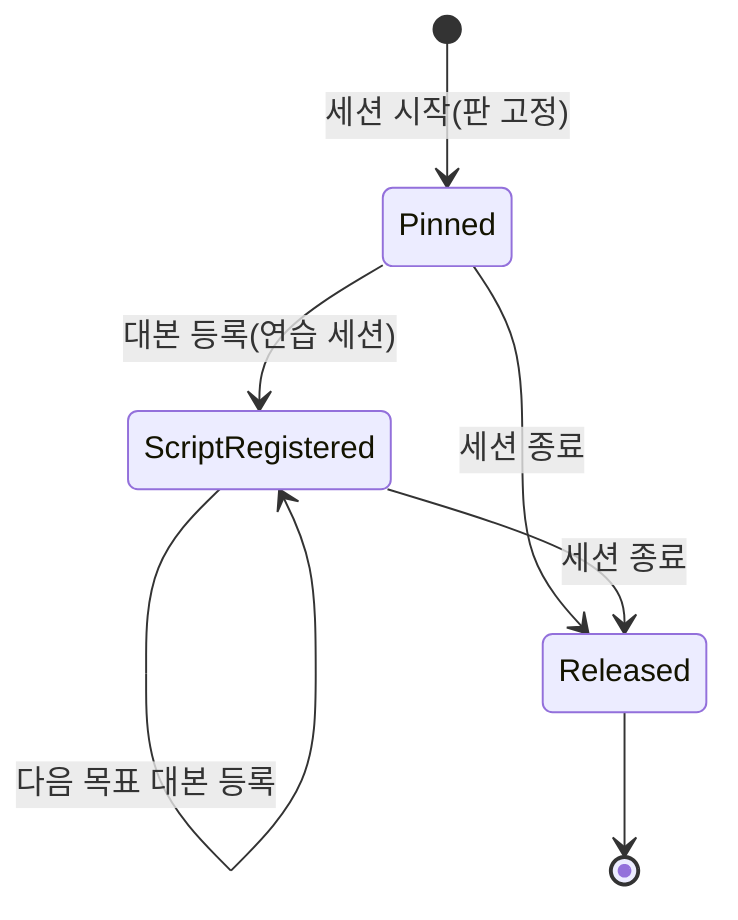
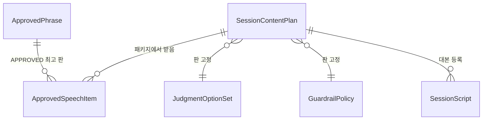

# U8 계약 · 버전 리소스 — 동작 명세

> 근거: `../../../inception/units-generation/unit-of-work.md`(U8 책임), `../../../inception/units-generation/unit-of-work-story-map.md`(U8은 스토리 밖 FR10 · FR11), `../../../inception/requirements-analysis/requirements.md`, `../../../inception/domain-design/components.md`, `../../../inception/contract-design/contract-summary.md`, `entities.md` · `rules.md`(같은 폴더), 질문 · 답 `functional-design-questions.md`.
> 이 문서는 흐름과 상태 변화의 정본이다. 데이터 모양은 `entities.md`, 판단 규칙은 `rules.md`가 정본이다.

## 1. 이 단위가 만드는 것

| 묶음 | 결과물(Code Generation에서) | 쓰는 단위 |
|---|---|---|
| 승인 문구 | 새 승인 문구 시드 SQL(`infra/seed/`), 시작 패키지 새 선택 속성 `approvedSpeech`(스키마 · core 조립 · realtime 수신), 코드에 박힌 '도움을 받아 볼까?'의 시드 이전 | U11 · U12 · U13 |
| 판 리소스 · 세션 고정 | realtime `LiveContentRegistry`(판정 선택지 · 가드레일 정책 자원 적재, 세션 고정, 대본 등록, 원문 일치 확인)와 자원 파일 | U11 · U12 · U13 |
| 시간 값 | timing.md 새 절 + 두 앱 `application.yml` + 설정 레코드 | U11 · U12 · U13 · U15 |
| 비밀 이름 | `OPENAI_API_KEY` · `JEV_API_KEY`를 R-M9 목록 전부에 | U9 · U13 |
| AI 입출력 | `contracts/schemas/ai-*.schema.json` · `guardrail-*.schema.json`, `ai-io.md` 새 절(규칙 · 금지 필드 · 목적별 재시도 · R-F15) | U9 · U10 · U11 · U13 · U14 · U15 |
| 기록 형식 | `contracts/schemas/practice-record-v2.schema.json`, 이벤트 문서 갱신 | U11 · U12 · U14 |
| 편차 | `contracts/deviations.md` U8 절 | — |

## 2. 흐름

### W1. 세션 시작 때 콘텐츠 고정

1. core가 활동을 시작하며 세션 패키지를 조립한다.
   - 음성 파일이 있는 승인 문구는 지금처럼 `approvedContent`에 넣는다.
   - 음성 파일 없는 승인 발화는 새 `approvedSpeech`에 `{contentVersionId, text}`로 넣는다(BR1.2). 각 code의 APPROVED 최고 판을 쓴다(BR1.3).
2. realtime이 `POST /internal/sessions`로 패키지를 받는다.
3. `LiveContentRegistry`가 세션 콘텐츠 계획을 만든다.
   - 기동 때 읽은 판정 선택지 판과 가드레일 정책 판의 번호
   - 패키지의 `approvedContent` · `approvedSpeech` contentVersionId
   - 이 둘을 메모리 실행 계획에 고정한다(BR2.2).
4. 세션이 끝날 때까지 계획은 바뀌지 않는다. 판정 · 가드레일 기록 행은 계획의 판 번호를 함께 남긴다.

**실패:** 기동 때 자원 파일이 없거나 형식이 틀리면 realtime이 기동을 거부한다(BR2.1). 세션 시작 때 필요한 승인 발화가 패키지에 없으면 지금처럼 `APPROVED_CONTENT_MISSING`을 남긴다. 연습 세션이면 연습 확장이 그 문구를 쓰는 지점에서 승인 원문 재생 대신 막힘으로 처리한다(U11 · U12가 처리).

### W2. 대본 등록과 원문 일치 확인

1. realtime 연습 흐름(U12)이 core에서 대본을 받는다(C-DS1).
2. 받은 직후 대본 문장을 `scriptVersion`과 함께 `LiveContentRegistry`에 등록한다(BR2.3).
3. GPT-Live 출력 전사가 완성되면 출력 게이트(U11 · U13)가 `LiveContentRegistry`에 원문 일치를 묻는다.
4. 공백을 뺀 전사가 승인 발화 또는 등록된 대본 문장과 정확히 같으면 `MATCHED{source, version}`, 아니면 `NOT_MATCHED`다(BR1.4). 출처를 알 수 없으면 `UNKNOWN`이다.
5. `MATCHED`일 때만 제브 검사를 생략할 수 있다. `NOT_MATCHED` · `UNKNOWN`은 새 발화로 검사한다(FR6.6, U13이 판단).

```text
matchApproved(sessionId, outputText) -> MATCHED{source, version} | NOT_MATCHED | UNKNOWN
  // 공백 제거 뒤 완전 일치만. 다른 정규화 없음
```

### W3. Luna 호출 실패와 재시도 판단 (U9가 구현, 규칙은 U8 계약)

| 목적 | 재시도 분류 | 호출 안 재시도 | 실패 뒤 |
|---|---|---|---|
| 진행 중 판정(J1 ~ J6) | `NONE` | 없음(2초) | 판정 보류 |
| 상황 생성 · 자체 검토 · 새 씨앗 | `REQUEST_BOUNDED` | 일시 실패 기술 재시도 1회 + 내용 재생성 1회(스키마 불일치 포함), 요청 예산 안 | 상황: `SCENARIO_GEN_FAILED`. 씨앗: `NONE` 유지 |
| 결과 문장 · 목표 후보 · 기록용 재판정 | `JOB_ATTEMPT` | 없음 | 결과 작업 시도 실패로 세고, 작업 재시도로 다시 한다 |

- 모든 목적에서 길이 초과 · 빈 응답 · 스키마 최종 실패는 성공으로 저장하지 않는다(BR5.3).
- 기록에는 사유 코드 · 모델 · 프롬프트 판 · 지연만 남기고 원문은 남기지 않는다.

### W4. 계약 · 설정 변경 절차 (한 PR 안)

1. 새 스키마 · 문서 절 · 시간 키 · 비밀 이름 · 시드를 더한다.
2. 바뀌는 곳마다 `deviations.md` U8 절에 행을 더하고 스펙에 표시한다(BR7.1).
3. 시간 키는 세 곳(timing.md 표 · `application.yml` · 설정 레코드)을 함께 고친다(BR3.1).
4. 비밀 이름은 R-M9 목록 전부에 함께 넣는다(BR4.1).
5. 계약 대조 시험 · 비밀 검사 · `infra-validate`를 돌린다. 실패하면 계약 · 설정 쪽을 고친다(BR7.2).
6. `contracts/`가 바뀌므로 PR의 `ci-gate`가 전 작업을 돈다.

## 3. 상태

이 단위에는 수명 상태가 있는 엔티티가 거의 없다. 세션 콘텐츠 계획만 단순한 수명을 가진다.



<!-- Text fallback: 세션 콘텐츠 계획은 세션 시작 때 Pinned가 되고, 연습 세션에서 대본을 받으면 ScriptRegistered가 되며 목표마다 대본이 더 등록될 수 있다. 세션이 끝나면 Released로 메모리에서 지워진다. 고정된 판 번호는 어느 상태에서도 바뀌지 않는다. -->

승인 문구(`ApprovedPhrase`)의 DRAFT → APPROVED → RETIRED 수명은 기존 core 규칙 그대로이고, 이 단위는 바꾸지 않는다.

## 4. 엔티티 관계 (`entities.md`에서 끌어낸 보기)



<!-- Text fallback: 승인 문구 한 판은 여러 세션의 승인 발화 항목이 가리킬 수 있다. 세션 콘텐츠 계획은 판정 선택지 판 하나와 가드레일 정책 판 하나를 고정하고, 대본 여러 개와 승인 발화 항목 여러 개를 가진다. TimingKey · SecretName · AiIoSchema · PracticeRecordV2 · DeviationRow는 서로 관계가 없는 계약 · 설정 모양이라 그림에서 뺐다. -->

## 5. 규칙 요약 (`rules.md`에서 끌어낸 보기)

- 승인 문구는 core DB 하나가 정본이다. 음성 없는 발화는 `approvedSpeech`로 넘기고, 공백 제거 완전 일치만 원문으로 본다(BR1.1 ~ BR1.4).
- 판정 · 가드레일 판은 자원 파일로 두고 세션 시작 때 고정하며, 기록 행마다 판 번호를 남긴다(BR2.1 ~ BR2.3).
- 새 시간 키는 세 곳을 함께 고치고, 기존 키 값은 쓰는 단위가 바꾼다(BR3.1 ~ BR3.3).
- 비밀 이름은 `OPENAI_API_KEY` · `JEV_API_KEY` 둘이고, Neo4j는 `NEO4J_AUTH`다(BR4.1 ~ BR4.3).
- AI 입출력은 스키마가 정본이고, 재시도는 목적별, 실패는 저장하지 않으며, 최소 필드와 R-F15 가드를 지킨다(BR5.1 ~ BR5.5).
- 새 연습 기록은 `flowVersion`으로 구분한다(BR6.1). 계약은 더하기만 하고, 대조 시험은 고치지 않으며, 새 오류 코드는 없다(BR7.1 ~ BR7.3).

## 6. 다른 단위와의 경계

| 이 단위가 정하는 것 | 다른 단위가 하는 것 |
|---|---|
| `approvedSpeech` 형식 · 시드 · 조립 | U11 · U12가 그 code로 재생을 요청한다 |
| `LiveContentRegistry` 조회 · 원문 일치 | U13이 일치 결과로 제브 생략을 판단한다 |
| AI 스키마 · 재시도 분류 | U9가 호출부에 구현하고, 각 단위가 프롬프트를 쓴다 |
| 새 시간 키 정의 | U11 · U12 · U13 · U15가 읽는다 |
| `practice-record-v2` 형식 | U12가 채우고, U11이 발행하며, U14가 읽는다 |
| — | 결과 재시도 기존 키 값 변경은 U14(BR3.2) |

## 7. 시험 계획 (test-after, Standard)

- **계약 대조:** `ContractFilesTest`(새 스키마 2020-12 · `$id`) · `ConfigKeyContractTest`(새 timing 행 ↔ yml ↔ 레코드) · `TimeLiteralScanTest` · `ErrorCodeTest`(변경 없음 확인)가 통과한다.
- **스키마 예시:** U8 단위 시험이 AI 스키마마다 정상 예시 1개 이상과 거절 예시(금지 필드 · 빠진 필수)를 검증한다.
- **`LiveContentRegistry` 단위 시험(5 ~ 8개)**
  - 자원 적재 성공
  - 자원 형식 오류 시 기동 거부
  - 세션 고정이 세션 중 바뀌지 않음
  - 계획 고정 전 `UNKNOWN`, 대본 등록 전 대본 문장은 `NOT_MATCHED`(8.3)
  - 공백 차이만 있는 완전 일치는 `MATCHED`
  - 한 글자만 달라도 `NOT_MATCHED`
- **시작 패키지:** core 조립 시험(음성 없는 문구는 `approvedSpeech`로만), realtime 수신 시험(`approvedSpeech` 없어도 기존 세션 정상), 계약 대역 서버 스키마 검사.
- **비밀 이름:** `infra/ci/test-infra-validate.sh` · `test-host-tools.sh`와 CI 비밀 검사로 새 이름을 확인한다.
- **범위:** `@Tag("u8")`. 코드가 있는 realtime · core 파일만 `coverage-scope/u8.txt`에 넣고, 범위 줄 80%를 지킨다.

## 8. 세부 결정 (설계 검토 지적 반영, Q3-A)

### 8.1 승인 발화 시드와 조립 (검토 R-01 · R-03)

- **시드 위치:** 새 파일 `infra/seed/004-u8-reference.sql`과 dev 시드(`DevSeedRunner`, `SeedIds`)에 같은 행을 넣는다. 001 ~ 003은 고치지 않는다.
- **새 `content_type` 값:** `APPROVED_SPEECH`. 음성 파일 없이 GPT-Live 지시 + 공백 제거 완전 일치로 재생하는 승인 발화다. 기존 `APPROVED_AUDIO`는 그대로 둔다.
- **문구 텍스트:** 아래 표의 텍스트는 정본(B §4 · §8.5, 화면 설계 문구표)에서 글자 그대로 옮긴다. 정본에 없는 code는 시드하지 않는다.

| content_code | content_type | 넣는 활동 | 정본 | 메모 |
|---|---|---|---|---|
| `HELP_OFFER` | `APPROVED_SPEECH` | PRACTICE | B §8.5(도움 제안) | 기존 v1 DRAFT '같이 살펴볼까?'를 RETIRED로, v2 APPROVED를 정본 문구로. 코드에 박힌 '도움을 받아 볼까?'는 지운다 |
| `D_REST_ACK_START` | `APPROVED_SPEECH` | FREE_TALK · PRACTICE | B `D_REST_ACK_START` | 시작 응답에서 휴식 요청(AC1.1.2) |
| `D_REST_ACK` | `APPROVED_SPEECH` | FREE_TALK · PRACTICE | B `D_REST_ACK` | 활동 중 휴식 요청(AC1.7.6) |
| `D_REPROMPT` | `APPROVED_SPEECH` | FREE_TALK · PRACTICE | B `D_REPROMPT` | 휴식 뒤 질문 다시 들려주기(AC1.7.6) |
| `COACH_SWITCH` | `APPROVED_SPEECH` | PRACTICE | B §8.5 '잠깐, 무중이가 도와줄게' | code 이름은 B에 id가 있으면 그 id를 쓴다 |
| `PEER_RETURN` | `APPROVED_SPEECH` | PRACTICE | B §8.5 '다시 친구 역할로 돌아갈게' | 위와 같음 |

- **조립:** `StartActivityService`가 활동 유형별 허용 목록(위 표의 '넣는 활동')을 설정 상수로 두고, `content_type`이 `APPROVED_SPEECH`이고 APPROVED 판이 있는 code만 `approvedSpeech`에 싣는다. 지금 PRACTICE에 요청하던 `HELP_OFFER`는 `approvedContent` 후보에서 `approvedSpeech`로 옮긴다.
- **스키마:** `internal-session-start-request.schema.json`의 `properties`에 선택 속성 `approvedSpeech`(값: `{contentVersionId, text}`, `additionalProperties: false`)를 더한다. `internal-api.yaml` 예시도 하나 더한다(`ContractFilesTest` 예시 검증). 두 맵의 code 배타는 스키마로 막지 못하므로 core 조립 시험과 realtime 수신 검사가 확인한다.
- **배포:** core와 realtime은 같은 릴리스로 함께 배포한다. 따로 배포해야 하면 realtime(새 속성을 읽는 쪽)을 먼저 배포한다. realtime 수신 시험에 '`approvedSpeech`가 없는 옛 패키지도 정상'과 '모르는 속성이 있어도 거절하지 않음'을 넣는다.

### 8.2 U8이 더하는 시간 키 (검토 R-02)

timing.md에 새 절 'U8 새 연습 흐름 · 판정 · 가드레일 · 그래프'를 만들고 `키 | 기본값 | 소유 앱` 표로 둔다. 소유 앱 `application.yml`과 설정 레코드에 같은 값을 넣는다.

| 키 | 기본값 | 소유 앱 | 읽는 단위 | 근거 |
|---|---|---|---|---|
| `mujoong.timing.judgment.live-budget` | `2s` | realtime-activity | U11 | FR3.4 |
| `mujoong.timing.judgment.response-ready` | `10s` | realtime-activity | U11 | FR5.3 |
| `mujoong.timing.guardrail.jev-budget` | `800ms` | realtime-activity | U13 | FR6.2 |
| `mujoong.timing.conversation.no-response-wait` | `10s` | realtime-activity | U12 | AC1.9.1 |
| `mujoong.timing.conversation.focus-max` | `90s` | realtime-activity | U12 | AC1.5.4 |
| `mujoong.timing.conversation.goal-active-limit` | `10m` | realtime-activity | U12 | FR4.5 |
| `mujoong.timing.knowledge.graph-budget` | `2s` | core-api | U15 | FR9.5 |

- 새 연습 흐름 키는 `mujoong.timing.practice`가 아니라 `mujoong.timing.conversation` 아래에 둔다. 기존 U5b 키는 `practice/u5b-runtime.yml`로 따로 묶이므로 이름 공간을 나눠야 두 바인딩이 섞이지 않는다. 레거시 `practice.judge-*` 키는 U12가 새 흐름으로 바꾼 뒤에도 과거 경로용으로 남는다고 timing.md 12절에 한 줄 적는다.
- 설정 레코드
  - realtime: `JudgmentTimingProperties`, `GuardrailTimingProperties`, `ConversationTimingProperties`
  - core: 기존 `CoreProperties.timing`에 `knowledge` 묶음을 더한다.
  - 레코드 이름은 Code Generation에서 기존 `RealtimeProperties` 구조를 보고 맞춘다.
- 계약 요약 C-DS13의 8번째 키 `result.retry-delays`는 만들지 않는다(BR3.2).
- `timing-defaults.json` 제외는 BR3.1의 해석이고, `deviations.md` U8 절에 행으로 남긴다.

### 8.3 판 리소스 파일 형식과 원문 일치 조건 (검토 R-04)

| 파일(realtime `src/main/resources/`) | 최상위 키 | 기동 검증(하나라도 틀리면 기동 거부) |
|---|---|---|
| `judgment/option-sets-v1.json` | `version` · `source` · `points[]{point, question, options[]}` | `version` 비지 않음, `point`가 J1 ~ J6 각각 정확히 하나, `options` 비지 않고 판 안에서 중복 없음 |
| `guardrail/policy-v1.json` | `version` · `source` · `systemPrompt` · `categories[]` · `modes[]` | `systemPrompt` 비지 않음, `categories` 7개 · 중복 없음, `modes`가 `FREE_TALK` · `PRACTICE_PEER` · `PRACTICE_COACH` 정확히 셋 |

- **J7을 넣지 않는 까닭:** J7(연습 대본 사전 검사)은 core의 상황 생성 자체 검토(U10) 프롬프트이고 진행 중 판정이 아니다. 그래서 realtime 판정 판에 넣지 않는다. 요구사항 FR10.1의 'J1 ~ J7'은 J1 ~ J6(realtime 판)과 J7(core 프롬프트 판)으로 나눠 고정한다.
- **원문 일치 결과 조건**
  - `UNKNOWN`: 세션 콘텐츠 계획이 없다(고정 전 · 놓은 뒤).
  - `NOT_MATCHED`: 계획은 있으나 승인 발화 · 등록된 대본 어디와도 완전 일치하지 않는다.
  - `MATCHED{source, version}`: 하나와 완전 일치한다.
  - 대본 등록 전의 대본 문장은 `NOT_MATCHED`(새 발화)다. 6절 시험의 '대본 등록 전 `UNKNOWN`'은 '계획 고정 전 `UNKNOWN`'으로 바꿔 읽는다.
- **고정 · 놓기 지점:** 고정은 `StartSessionHandler`가 세션 패키지를 받아 실행 계획을 만들 때 한다. 놓기는 세션 정산 창이 끝난 뒤(`SessionExecutor` 종료 정리 경로) 한다.
- **계약 요약 C-DS9 정정:** `approved-content/*.yml` · `ContentResource{resourceKey, kind, version, source}` 구조 대신 위 두 파일을 쓴다. 승인 문구는 core DB로 옮겼다(Q1-A).

### 8.4 Luna 목적 → 호출 경로 → 재시도 분류 (검토 R-06, ai-io.md 새 절에 옮김)

| 목적 | 호출 경로(단위) | 분류 | 비고 |
|---|---|---|---|
| 진행 중 판정 J1 ~ J6 | realtime 판정 턴(U11) | `NONE` | 2초, 실패는 보류 |
| 상황 생성 | core 상황 생성 요청(U10) | `REQUEST_BOUNDED` | ai-io 7절 승계, 15초 |
| 자체 검토(J7) | core 상황 생성 요청(U10) | `REQUEST_BOUNDED` | 같은 15초 예산 |
| 새 씨앗 | core 결과 작업 뒤 씨앗 생성(U15) | `REQUEST_BOUNDED` | 실패는 `NONE` 유지 |
| 결과 문장 | core 결과 작업(U14) | `JOB_ATTEMPT` | 작업 시도 수는 timing.md 10절 |
| 목표 후보 | core 결과 작업(U14) | `JOB_ATTEMPT` | 지금 코드에서 결과 작업 안에서만 부름 |
| 기록용 재판정 | core 결과 작업(U14) | `JOB_ATTEMPT` | 위와 같음 |

- `ai-io.md` 6.9의 '작업당 총 3회'는 U14가 시도 수를 바꿀 때 함께 고친다(BR3.2).

## Sources

- `entities.md`, `rules.md`, `functional-design-questions.md`(같은 폴더)
- `../../../inception/units-generation/unit-of-work.md`, `../../../inception/units-generation/unit-of-work-story-map.md`
- `../../../inception/requirements-analysis/requirements.md`, `../../../inception/domain-design/components.md`, `../../../inception/contract-design/contract-summary.md`
- 계약 · 코드 확인: `contracts/ai-io.md` · `timing.md` · `deviations.md` · `schemas/internal-session-start-request.schema.json`, `core/activity/ApprovedContentCatalog.java` · `StartActivityService.java`, `realtime/session/StartSessionHandler.java` · `SessionExecutor.java`, `realtime/voice/PracticeSpeech.java`, `realtime/gate/seed-dictionary.json`

## Assumptions & Open Questions

- 계약 요약 C-DS9의 컴포넌트 이름 `ApprovedContentCatalog`(realtime)는 core의 같은 이름 클래스와 겹쳐 `LiveContentRegistry`로 바꾼다(가정 1). Domain Design · Contract Design 문서는 승인 산출물이라 고치지 않고 이 문서가 정정을 기록한다.
- 막힌 발화 대체 승인 문구는 문구표에 없어 시드하지 않는다(스토리 열린 항목 2).
