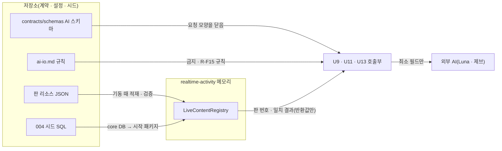

# U8 계약 · 버전 리소스 — 보안 설계

> 근거: `../nfr-requirements/security-requirements.md`(NFR2.1 ~ NFR6.2), `../nfr-requirements/tech-stack-decisions.md`, `../functional-design/functional-spec.md`(8절), `../../../inception/contract-design/contract-summary.md`(C-DS4 · C-DS8 · C-DS9 · C-DS14), 질문 · 답 `nfr-design-questions.md`(가정 1 ~ 5 수락).
> 코드 사실: `gate/SeedDictionary`(JsonCodec 적재 + `LoadException`), `startup/RealtimeStartupChecks`(기동 확인), `testsupport/log/LogCapture`(시험 로그 수집), `infra/bin/infra-validate`(`SECRET_NAMES` · 서비스별 `SECRET_TABLE`), `infra/bin/render-env`(`REQUIRED` · `OPTIONAL` · `write_env`).

## 1. 신뢰 경계

<!-- Text fallback: 저장소의 AI 스키마와 ai-io.md 규칙이 호출부(U9 · U11 · U13)가 외부 AI로 보낼 수 있는 필드를 닫는다. 판 리소스 JSON은 realtime 기동 때 LiveContentRegistry로 적재 · 검증되고, 004 시드 승인 발화는 core DB와 시작 패키지를 거쳐 들어온다. LiveContentRegistry는 판 번호와 일치 결과를 반환값으로만 내고 로그를 쓰지 않는다. -->

## 2. 설계

### SD1. AI 요청 스키마를 닫는다 (NFR3.1 · NFR3.2)

- 모든 요청 스키마(`ai-judgment-request` · `guardrail-request` 및 core 생성 · 후보 · 씨앗 요청)는 루트와 하위 객체 모두 `additionalProperties: false`다.
- 속성 목록에 식별자 · 키 · 원음 · 보호자 입력 원문을 두지 않는다.
- 아이 문자열 필드(`childUtterance` · `recentTurns[].text` 등)의 `description`에 "아이 이름은 '아이'로 치환된 값"을 적는다.
- **계약 시험(U8, `@Tag("u8")`)이 단언하는 것**
  - 스키마마다 정상 예시 1개가 통과한다.
  - 금지 이름(`childId` · `guardianId` · `sessionId` · `deviceId` · `apiKey` · `audio`)을 하나씩 넣은 거절 예시가 실패한다.
  - 아이 문자열 필드 `description`에 치환 문구가 있다.

### SD2. 외부 전달 규칙을 계약 문장으로 고정한다 (NFR3.3)

- `ai-io.md` 새 절 '10. U8 공통 규칙'에 아래를 적는다.
  - 금지 필드 목록
  - 목적별 재시도 표(functional-spec 8.4)
  - **`R-F15`** 표식이 붙은 문장: "공급자 약관 · 보호자 동의 확인 전에는 실제 아동 데이터를 외부 모델로 보내지 않는다. 실호출은 합성 자료로만 한다."
- 계약 시험이 그 절 안에 `R-F15` 표식 문장이 있는지 단언한다. 문단이 지워지면 CI가 실패한다.

### SD3. 비밀을 앱별 최소 범위로 나눈다 (NFR3.4 · NFR3.5)

| 비밀 | core-api | realtime-activity | 필수 여부 |
|---|---|---|---|
| `OPENAI_API_KEY`(Luna) | 받음 | 받음 | OPTIONAL — 없으면 실제 어댑터를 끈다 |
| `JEV_API_KEY` | — | 받음 | OPTIONAL — 단 demo · prod 기동 검사는 U13 |
| `PROVIDER_API_KEY`(GPT-Live, 기존) | — | 받음(그대로) | 기존 그대로 |

- 고칠 곳은 R-M9 목록 전부다.
  - `infra-validate`의 `SECRET_NAMES`와 서비스별 `SECRET_TABLE`(위 표대로)
  - `render-env`의 `OPTIONAL` 배열과 앱별 `write_env`
  - `ci.yml:249` · `image-checks.sh:119`의 이름 정규식
  - `log-hygiene-check`의 `SECRET_VARS`
  - `scripts/verify/lib.sh` · `b-stack.sh`
  - `gen-env.sh`(빈 값 예시)
  - `README.md` 비밀 목록
  - `RUNBOOK.md` 단계 4 · 회전 표
- **빈 값 = 미설정:** `render-env`의 `write_env`는 값이 없어도 `OPENAI_API_KEY=` 같은 빈 줄을 쓴다(기존 `GOOGLE_OAUTH_CLIENT_SECRET` 선례). 그래서 앱은 비어 있거나 공백뿐인 값을 '미설정'으로 보고 실제 어댑터를 끈다(U9 · U13이 구현, 단위 시험 항목).
- `infra-validate`의 `SECRET_TABLE` 배열은 이름순 정렬을 지켜 새 이름을 끼워 넣는다.
- 시험: `infra/ci/test-infra-validate.sh` · `test-host-tools.sh`에 새 이름의 앱별 분배 사례를 더하고, CI 비밀 검사가 통과하는지 본다.
- `.gitleaks.toml` 허용 목록은 늘리지 않는다(R-F9). 시험 · 예시에 쓰는 값은 비어 있거나 명백한 자리표시자다.

### SD4. `LiveContentRegistry`는 메모리에만 두고 로그를 쓰지 않는다 (NFR3.6 · NFR2.4)

- **저장:** 세션 id를 키로 하는 동시성 맵 하나에 세션 계획(판 번호 · 승인 발화 contentVersionId · 대본 문장)을 둔다.
  - 세션을 받을 때 고정하고, 세션 정산이 끝나면 지운다.
  - DB · 파일 · 캐시에 쓰지 않는다.
  - 앱이 재시작되면 사라지고, 진행 중 세션은 기존 재시작 규칙대로 실패한다.
- **로그:** 이 컴포넌트는 로그를 쓰지 않는다. 반환값은 판 번호와 결과 종류(`MATCHED` · `NOT_MATCHED` · `UNKNOWN`)뿐이다.
- **이상 수신:** 같은 code가 `approvedContent`와 `approvedSpeech` 둘 다에 있으면 `approvedSpeech` 쪽을 버린다. 이때 세션 수신부가 기존 `EventCode.APP_ERROR`의 `errorKind` 값 `APPROVED_SPEECH_DUPLICATE_CODE`(식별자 이름 규칙: 대문자 · 밑줄)만 남기고, 문구 텍스트는 남기지 않는다. 새 `EventCode` · `AttrKey`는 더하지 않는다.
- **시험**
  - **구조 시험(로그 없음 증명):** ArchUnit 규칙을 더한다. `LiveContentRegistry`가 있는 패키지는 `org.slf4j` · `kr.mujoong.contract.log`(EventLog) · `java.lang.System.out/err`에 의존하지 못한다. 기존 `realtime/arch` 시험 묶음에 넣는다.
  - `LogCapture` 시험은 범위를 세션 수신부의 이상 수신 경로로 좁힌다. 중복 code 수신 뒤 `APP_ERROR` 줄에 문구 텍스트가 없는지 단언한다.
  - 정산 뒤 조회가 `UNKNOWN`인지 단언한다.

### SD5. 판 리소스는 기동 때 검증하고 실패하면 기동을 거부한다 (NFR2.3)

- `SeedDictionary`와 같은 모양으로 둔다.
  - `judgment/option-sets-v1.json` · `guardrail/policy-v1.json`을 `JsonCodec`으로 읽는다.
  - functional-spec 8.3의 규칙으로 검증하고, 실패하면 적재 예외를 던진다.
- `RealtimeStartupChecks`에 적재 확인을 더한다. 지금 생성자는 `Supplier<SeedDictionary>` 하나만 받고 `SeedDictionary.LoadException`만 잡는다. 그래서 판 리소스 적재기용 두 번째 `Supplier`를 받는 생성자를 더하고, 기존 생성자는 오버로드로 남겨 기존 기동 시험이 그대로 돈다. 판 리소스 적재 예외는 `SeedDictionary.LoadException`과 같은 모양의 별도 예외로 둔다. 실패하면 준비 상태가 되지 않고 기동이 거부되며, 사유는 기존 기동 실패 기록 방식대로 남긴다.
- 시험: 형식이 틀린 자원(빠진 J 지점 · 빈 선택지 · 분류 6개)마다 적재가 실패하는지 단언한다.

### SD6. 원문 일치는 좁게 판단한다 (NFR2.1 · NFR2.2)

- 기존 `PracticeSpeech.matches`를 그대로 재사용한다. 이 정규화는 Java 정규식 `\s+`로 **ASCII 공백만**(space · `\t` · `\n` · `\x0B` · `\f` · `\r`) 지우고, 그 뒤 문자열이 완전히 같을 때만 `MATCHED`다. NBSP(U+00A0) · 전각 공백(U+3000) · 제로폭 공백이 끼면 `NOT_MATCHED`(새 발화, 제브 검사)로 본다. 이 편이 안전 쪽이다.
- 시험: NBSP · 전각 공백이 낀 같은 문장이 `NOT_MATCHED`인지, ASCII 공백 차이만 있는 문장이 `MATCHED`인지 단언한다.
- 세션 계획이 없으면 `UNKNOWN`이다. `UNKNOWN` · `NOT_MATCHED`는 제브 생략 근거가 될 수 없다고 `ai-io.md` 10절에 적는다.

### SD7. 더하기만으로 호환을 지킨다 (NFR6.1 · NFR6.2)

- `approvedSpeech`는 시작 요청 스키마 `properties`의 선택 속성이다. realtime 수신은 기존 `JsonCodec`(모르는 속성 무시) 그대로다.
- 시험
  - `approvedSpeech`가 없는 옛 패키지로 세션이 정상 시작한다.
  - `approvedSpeech`가 있는 패키지를 옛 수신 경로가 거절하지 않는다.
- `practice-record-v2.schema.json`은 `flowVersion`이 필수이고, `flowVersion`이 없는 기록은 이 스키마의 대상이 아니다(U5b 형식). `snapshotVersion`은 건드리지 않는다.

## 3. 남는 위험

| 위험 | 대응 | 남는 정도 |
|---|---|---|
| 다른 단위가 스키마를 우회해 직접 필드를 더해 보냄 | 요청 객체를 스키마에서 만든 형식으로만 만들게 U9가 강제(U9 몫) | 중 — U9 설계에서 확인 |
| `R-F15` '확인됨' 상태 판정이 비어 실호출이 열림 | U8은 문장만, 판정은 U9 | 중 — U9 설계에서 확인 |
| 메모리 맵이 정산 누락으로 쌓임 | 정산 경로에서 지운다. 시험: 정산 뒤 맵에 그 세션이 없음. 비정상 종료 경로(장애 · 재시작 정리)에서도 지우는지 U11이 확인 | 낮음 |

## Sources

- `nfr-design-questions.md`(같은 폴더), `../nfr-requirements/security-requirements.md`, `../nfr-requirements/tech-stack-decisions.md`
- `../functional-design/functional-spec.md`, `../../../inception/contract-design/contract-summary.md`
- 코드: `realtime/gate/SeedDictionary.java`, `realtime/startup/RealtimeStartupChecks.java`, `testsupport/log/LogCapture.java`, `infra/bin/infra-validate`, `infra/bin/render-env`

## Assumptions & Open Questions

- 없음(가정 1 ~ 5 수락).
