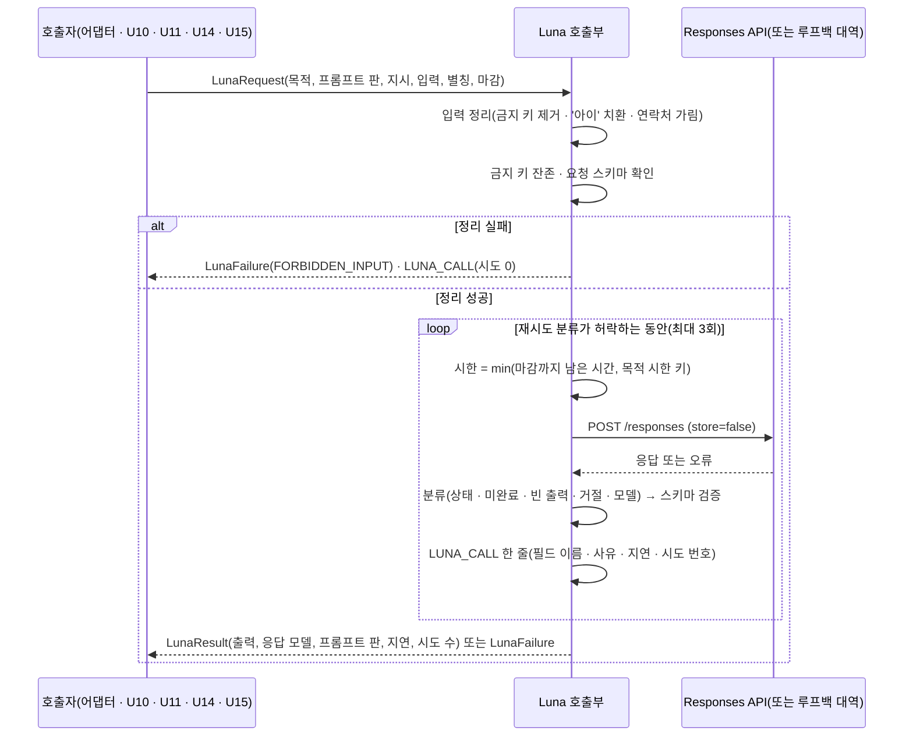
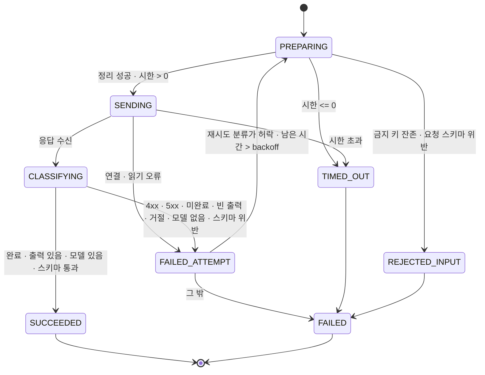
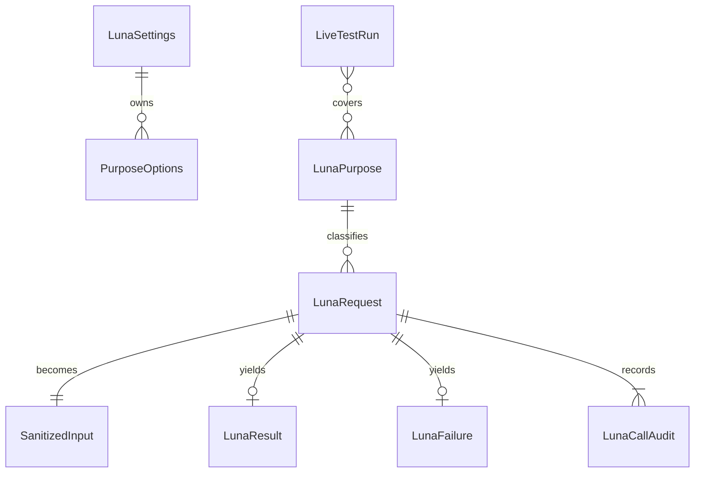

# U9 Luna 호출부 — 동작 명세

> 이 문서는 흐름 · 상태의 정본이다. 데이터 모양은 `entities.md`, 판단 규칙은 `rules.md`가 정본이고, 4 · 5절은 그 둘에서 끌어낸 보기다.
> 질문 · 답: `functional-design-questions.md`(Q1-A · Q2-B · Q3-A · Q4-A + 실호출 요구, 가정 1 ~ 12 · 3-1 수락).

## 1. 이 단위가 만드는 것

| 앱 | 만드는 것 | 쓰는 곳 |
|---|---|---|
| core-api | `CoreLunaClient`(공통 호출), `TextAiProvider` · `ResultTextProvider` 실제 어댑터 | 지금: U5a 상황 생성 · U6 결과 작업. 뒤: U10 · U14 · U15 |
| realtime-activity | `RealtimeLunaClient`(공통 호출) | U11 `JudgeClient` 구현이 그 위에 얹힌다 |
| test-support | Responses API 루프백 대역(`POST /v1/responses`, 요청 스키마의 비지원 키워드를 400으로 거절하는 모드 포함) | 두 앱 단위 · 통합 시험 |
| 빌드 | `contracts/schemas/ai-*.schema.json`을 두 앱 실행 자원으로 복사, 스키마 검증 라이브러리를 실행 범위로 | Q3-A |
| 빌드 | `lunaLiveTest` 별도 작업(태그 `luna-live`). 공통 빌드 규칙(`build-logic` `mujoong.java-conventions`)이 기본 `test`에서 이 태그를 언제나 뺀다 | 키를 넣고 사람이 돌리는 실호출 시험(편차 U9-c) |
| contracts | `ai-io.md` 10절 보강(U9 결정 · 감사 로그 · 실패 사유), `deviations.md` U9 절 | 계약 대조 시험 |

공급자 호출은 JDK `HttpClient` + `JsonCodec`으로 Responses API(`POST {baseUrl}/responses`)를 직접 부른다(Q1-A). 요청 모양은 `model` · `instructions` · `input` · `text.format`(`json_schema` 또는 `json_object`) · `max_output_tokens` · `reasoning.effort` · `store=false`다. `temperature`는 보내지 않는다(BR1.8).

## 2. 흐름

### W1. 기동 때 켜고 끄기 (BR1.1 ~ BR1.5)

1. 앱 설정에서 `mujoong.luna.*`(모델 · 주소 · 목적별 출력 한도 · 추론 강도)를 바인딩한다.
2. 주소를 프로필 규칙으로 확인한다. demo · prod는 `https` + `api.openai.com`, dev는 그 규칙 또는 루프백, test는 루프백만 받는다. 어기면 기동 거부(BR1.4).
3. env `OPENAI_API_KEY`를 읽는다.
   - 있음 → 호출부와 실제 어댑터 빈을 만든다. `LUNA_ENABLED`를 기록한다.
   - 없음 → 빈을 만들지 않는다. 기존 실패 기본 빈이 쓰인다. `LUNA_DISABLED_NO_KEY`를 기록한다. 기동은 계속된다.
4. 출력 스키마 파일(실행 자원)을 기동 때 모두 읽어, 목적마다 스키마 짝(검증용 원본 · 요청용 사본 · strict 여부)을 만든다(BR4.5). 하나라도 읽거나 만들지 못하면 기동 거부(스키마 없는 호출을 막음).

### W2. 호출 한 건 (BR2 ~ BR6)

<!-- Text fallback: 호출자가 LunaRequest를 넘기면 호출부가 입력을 정리하고(금지 키 제거, 아이 이름 치환, 연락처 가림) 금지 키 잔존과 요청 스키마를 확인한다. 실패면 공급자를 부르지 않고 FORBIDDEN_INPUT으로 돌려준다. 성공이면 재시도 분류가 허락하는 동안(최대 3회) 시한을 계산해 Responses API를 부르고, 응답을 분류 · 스키마 검증한 뒤 시도마다 LUNA_CALL 감사 한 줄을 남긴다. 마지막에 LunaResult 또는 LunaFailure를 돌려준다. -->

단계별 규칙:

1. **입력 정리** — BR2.1(금지 키) → BR2.2(별칭) → BR2.3(연락처 가림. UUID 참조화는 호출자 몫). 결과는 `SanitizedInput`과 보낸 최상위 필드 이름 목록이다.
2. **입력 확인** — BR2.4. 요청 스키마가 있는 목적(`JUDGMENT_LIVE`)은 `ai-judgment-request.schema.json`으로 검증한다.
3. **요청 조립** — BR1.5 · BR1.6 · BR1.8 · BR2.5. 지시는 `instructions`, 데이터는 `input`에 JSON 문자열로 넣는다. 출력 스키마가 있으면 `text.format = json_schema(요청용 사본, strict 여부는 BR4.5)`, 없으면 `json_object`.
4. **시도** — BR5.1. 시한이 0 이하면 부르지 않고 `TIMEOUT`.
5. **응답 분류** — BR4.4(상태 코드) → BR4.1(미완료 · 빈 출력 · 거절) → BR4.3(모델) → BR4.2(원본 계약 스키마로 검증).
6. **다음 시도 판단** — 목적의 재시도 분류(BR3.1 ~ BR3.6)와 남은 시간.
7. **기록** — BR6.1. 시도마다 한 줄.

### W3. 기존 인터페이스 어댑터 (FR1.3, BR3.4 · BR7.2 · BR8)

| 기존 빈 | 어댑터가 하는 일 | 바깥에서 그대로 도는 것 |
|---|---|---|
| `TextAiProvider.generateScenario(prompt, timeout)` | `ai-io.md` 7절 상황 생성 지시 + `ScenarioPrompt` 입력을 `SCENARIO_GENERATION` 목적 · `json_object`로 1회 부르고 `GeneratedScenario`로 읽는다. `modelVersion` = 응답 모델, `promptVersion` = 보낸 판 | `TextAiGateway`의 기술 재시도 · 길이 · 판 정규식 · 금지 표현 검사, `ScenarioService` |
| `ResultTextProvider.generate(request, timeout)` | `prompts/result/{task}.{판}.txt` 지시 + 게이트웨이가 정리한 입력을 `RESULT_TEXT` 목적 · `json_object`로 1회 부르고 출력 문자열을 돌려준다. `request.temperature`는 무시한다(BR1.8) | `ResultTextGateway`의 `sanitize`(식별자 키 제거 · UUID → '참조N' · 연락처 · 별칭 · 작업별 맥락 거르기) · `ResultAiSchema` 검증 · 참조 복원 · 인용 대조, `OutputChecker`(1차 사전 · `classify`), 결과 작업 재시도 |

- `ResultTextGateway.sanitize`와 `restore`는 지금 그대로 둔다(검토 R-01). 참조 표는 게이트웨이 안에서 만들고 복원하므로 `generate`가 문자열만 돌려줘도 된다. 호출부는 그 뒤에 금지 키 확인 · 연락처 가림을 안전망으로 한 번 더 한다(BR2.3 · BR2.4). FR1.2의 '인용 검증'은 이 게이트웨이의 인용 대조와 U14가 맡는다. U9 호출부는 스키마까지만 본다.
- 실패는 BR8.1 · BR8.2 결정표대로 기존 예외로 바꾼다.
- 프롬프트 · 출력 모양을 새 스키마(`ai-scenario-*` · `ai-goal-candidate-output` · `ai-rejudgment-output` · `ai-seed-output`)로 바꾸는 일은 U10 · U14 · U15가 각자 `CoreLunaClient`를 직접 부르며 한다. 그때 목적별 재시도 분류(`REQUEST_BOUNDED` 등)가 적용된다.

### W4. 실호출 시험 (가정 3-1, BR9.2)

1. 사람이 이 PC의 env에 `OPENAI_API_KEY`를 넣고 `./gradlew lunaLiveTest`를 돌린다. 이 작업은 `check` · CI · `verify.sh`에 들어가지 않는다(BR9.3). 앱 프로필 없이 호출부를 직접 만들고, 주소 규칙은 demo · prod와 같다(BR1.4).
2. 키가 없으면 모든 사례가 `SKIPPED_NO_KEY`로 끝나고, 작업 결과에 '건너뜀'을 적는다. 통과로 보고하지 않는다.
3. 키가 있으면 맨 먼저 목적마다 요청용 스키마 사본이 공급자에게 거절되지 않는지(`REQUEST_REJECTED` 여부)와 `temperature` 없이 요청이 받아들여지는지를 확인한다. 그다음 목적마다 합성 자료 1건 이상으로 실제 Responses API를 부른다. 지금 있는 목적(`SCENARIO_GENERATION` 기존 경로 · `RESULT_TEXT` 작업 한 가지 이상 · `JUDGMENT_LIVE` 호출부 단독)을 먼저 하고, 스키마 파일이 있는 목적은 스키마 검증까지 본다.
4. 결과(목적 · 응답 모델 · 지연 · 사유 코드)를 '실제 API · 합성 자료' 증거로 보고서 파일에 남긴다. 원문은 남기지 않는다(R-M11 · R-F14).

## 3. 상태

시도 하나의 상태(호출부 안, 저장하지 않음):

<!-- Text fallback: 시도는 PREPARING에서 시작한다. 입력 정리가 실패하면 REJECTED_INPUT, 시한이 0 이하면 TIMED_OUT, 아니면 SENDING. SENDING에서 응답을 받으면 CLASSIFYING, 시한 초과면 TIMED_OUT, 연결 오류면 FAILED_ATTEMPT. CLASSIFYING에서 모든 검사를 통과하면 SUCCEEDED, 아니면 FAILED_ATTEMPT. FAILED_ATTEMPT는 재시도 분류와 남은 시간이 허락하면 PREPARING으로 돌아가고, 아니면 FAILED. TIMED_OUT · REJECTED_INPUT은 FAILED로 끝난다. -->

목적별 최대 시도: `NONE` · `JOB_ATTEMPT` · 기존 인터페이스 어댑터 1회, `REQUEST_BOUNDED` 3회(기술 1 + 스키마 1).

## 4. 엔티티 관계 (`entities.md`에서 끌어낸 보기)

<!-- Text fallback: LunaSettings는 목적별 PurposeOptions를 가진다. LunaPurpose가 LunaRequest를 분류하고, LunaRequest는 SanitizedInput이 되며 LunaResult나 LunaFailure 중 하나를 낳고, 시도마다 LunaCallAudit를 하나 이상 남긴다. LiveTestRun은 여러 목적을 다룬다. -->

## 5. 규칙 요약 (`rules.md`에서 끌어낸 보기)

| 묶음 | 핵심 |
|---|---|
| BR1 켜고 끄기 | 키 있으면 켜짐(Q2-B) · 호스트 허용 목록 · `store=false` · R-F15는 RUNBOOK 절차 |
| BR2 입력 | 금지 키 제거 · '아이' 치환 · UUID 참조화 · 지시/데이터 분리 · 정리 실패면 미호출 |
| BR3 재시도 | `NONE` 1 · `REQUEST_BOUNDED` 기술 1 + 스키마 1 · `JOB_ATTEMPT` 1 · 기존 어댑터 1 · 401/403 재시도 없음 |
| BR4 응답 | 미완료 · 빈 출력 · 거절 · 모델 없음 · 스키마 위반은 실패. 같은 스키마 파일로 검증 |
| BR5 시간 | min(마감, 기존 키) · 새 키 없음 |
| BR6 기록 | 시도마다 `LUNA_CALL`, 본문 없음 |
| BR7 경계 | 제브 참조 금지 · 기존 검증 경로 유지 · 앱 사이 코드 공유 없음 |
| BR8 바꾸기 | 실패 → `TextAiException` · `ResultAiException` 기존 사유 |
| BR9 시험 | 기본은 루프백 대역 · 실호출은 별도 작업 |

## 6. 다른 단위와의 경계

| 단위 | U9가 주는 것 | 그 단위가 하는 것 |
|---|---|---|
| U8 | — (받음: AI 스키마 · 금지 필드 · 재시도 분류 · 비밀 이름) | — |
| U10 상황 생성 | `CoreLunaClient`(`SCENARIO_GENERATION` · `SCENARIO_REVIEW`, `REQUEST_BOUNDED`), 쓴 시도 수 · 스키마 재요청 여부 | 프롬프트 · 새 스키마 전환, 내용 재생성 1회 예산 계산, 결과 행에 `model` · `prompt_version` 저장 |
| U11 판정 턴 | `RealtimeLunaClient`(`JUDGMENT_LIVE`, `NONE`, 요청 스키마 검증) | `JudgeClient` 포트 · 구현, 실패 → 판정 보류, `judgment_live` 기록 |
| U14 목표 · 결과 | `CoreLunaClient`(`RESULT_TEXT` · `GOAL_CANDIDATES` · `REJUDGMENT`, `JOB_ATTEMPT`) | 새 스키마 전환, 작업 시도 수, 결과 행 저장 |
| U15 지식 그래프 | `CoreLunaClient`(`SEED_GENERATION`, `REQUEST_BOUNDED`) | 씨앗 프롬프트, 실패 시 `skill_ref=NONE` 유지 |
| U13 제브 | — | Luna 경로는 제브를 부르지 않는다(BR7.1) |

## 7. 계약 · 설정 변경 (R-M10)

- `contracts/ai-io.md` 10절에 더한다.
  - 10.2의 'U9가 정한다' 자리: R-F15는 코드 스위치 없이 RUNBOOK "키를 넣기 전 확인" 절차로 지킨다(Q2-B).
  - 새 하위 절: 호출 방식(Responses API 직접 호출, `store=false`, 스키마 파일을 요청 · 검증에 함께 씀), 실패 사유 코드 표(BR4.4 · BR4.1), `LUNA_CALL` 감사 속성 목록, 기존 인터페이스 어댑터의 시도 1회 규칙(BR3.4).
- `contracts/deviations.md` 새 절 'U9':
  - `U9-a` FR1.1 'openai-java' → JDK `HttpClient` 직접 호출(Q1-A, J139).
  - `U9-b` R-F15 판정을 코드 대신 운영 절차로(Q2-B).
  - `U9-c` 사람이 직접 돌리는 실호출 시험 `lunaLiveTest`(R-F1의 글자와 다름. 합성 자료 · 선택 작업 · 자동 검증 경로 밖, Q4 추가 요구).
- `backend/build-logic` `mujoong.java-conventions`: 기본 `test` 작업이 `luna-live` 태그를 언제나 빼게 하고, `lunaLiveTest` 작업을 더한다(BR9.3).
- `infra/RUNBOOK.md` Parameter Store 단계 4의 `OPENAI_API_KEY` 항목 옆에 "넣기 전 R-F15 확인(약관 · 개인정보 처리 조건 · 보호자 동의 범위)" 절차 한 줄과 `lunaLiveTest` 사용법을 적는다.
- 앱 설정: 두 앱 `application.yml`에 `mujoong.luna.*`(모델 · 주소 · 목적별 출력 한도 · 추론 강도). 시간 값이 아니므로 `timing.md` · `timing-defaults.json`은 바꾸지 않는다. 새 비밀 이름은 없다(U8이 `OPENAI_API_KEY`를 이미 목록에 넣음).
- `EventLog`(contract-model): 사건 `LUNA_CALL` · 기동 사유 코드 `LUNA_ENABLED` · `LUNA_DISABLED_NO_KEY`, 속성 키, `Component.LUNA_CLIENT`(두 앱 쪽 하나씩)를 더한다. 새 HTTP 오류 코드는 없다(`ErrorCode` 변경 없음).

## 8. 시험 계획 (test-after, Standard)

| 층 | 시험(`@Tag("u9")`) | 확인하는 규칙 |
|---|---|---|
| 설정 | 키 있음 · 없음 · 공백 → 빈 생성 여부와 기본 빈 유지, 기동 사유 기록, 프로필별 주소 거부(demo에 http · 다른 호스트, test에 비루프백, dev 루프백 허용), 허용 호스트 상수 = ai-io.md 값 | BR1.1 ~ BR1.5 |
| 입력 정리 | 중첩 금지 키 제거, 별칭 치환, 연락처 가림, 금지 키 잔존 · 요청 스키마 위반 시 미호출, 게이트웨이 참조화 · 복원 유지 | BR2.1 ~ BR2.4 |
| 요청 조립 | `store=false`, `temperature` 없음, 지시/데이터 자리 분리, 스키마 있음 → 요청용 사본 · strict 판정, 없음 → `json_object` | BR1.6 · BR1.8 · BR2.5 · BR4.2 · BR4.5 |
| 스키마 짝 | 계약 스키마마다 요청용 사본에 비지원 키워드가 없음(대역 거절 모드 통과), strict 판정, 원본 검증이 빠진 제약(길이 · 범위 · 패턴)을 잡음 | BR4.5 |
| 응답 분류 | 정상 · 미완료 · 빈 출력 · 거절 · 모델 없음 · 스키마 위반 · 429 · 500 · 401 · 지연 초과 | BR4.1 ~ BR4.4 · BR5.1 |
| 재시도 | `NONE` 1회, `REQUEST_BOUNDED` 일시 실패 → 재시도 1, 스키마 위반 → 재요청 1, 남은 시간 부족 → 생략, 401 → 재시도 없음, `JOB_ATTEMPT` 1회 | BR3.1 ~ BR3.6 |
| 기록 | `LogCapture`로 시도마다 `LUNA_CALL` 한 줄 · 허용 속성만 · 본문 · 이름 · 키 문자열 0건, toString `[redacted]` | BR6.1 ~ BR6.3 |
| 기존 어댑터(통합) | 루프백 대역 → `TextAiGateway` → `ScenarioService` 정상 · 실패 경로(결정표 사유마다 재시도 여부), 루프백 대역 → `ResultTextGateway` → `OutputChecker` 정상 · 스키마 실패 · 참조 복원, 제브 대역 호출 수 0 | BR3.4 · BR7.2 · BR8 · AC2.4.1 · AC2.4.2 |
| 빌드 구성 | 기본 `test`가 `luna-live`를 빼는지, `check` 작업 그래프에 `lunaLiveTest`가 없는지 | BR9.3 |
| 아키텍처 | `..luna..`가 가드레일 · slf4j · 상대 앱 패키지에 의존하지 않음 | BR6.3 · BR7.1 · BR7.3 |
| 기존 대조 시험 | `ContractFilesTest` · `ConfigKeyContractTest` · `TimeLiteralScanTest` · `U8ContractSchemasTest` 그대로 통과 | BR5.2 |
| 실호출(별도 작업) | 키 없음 → SKIPPED, 키 있음 → 목적별 합성 1건 실제 호출 | BR9.2 |

범위 파일 `backend/coverage-scope/u9.txt`(U9가 만들거나 고친 운영 Java 파일, 줄 80%).

## 9. 편차와 남은 점

- **편차 U9-a (Q1-A):** FR1.1의 'openai-java'를 JDK `HttpClient` 직접 호출로 바꾼다. 까닭: J139(Jackson은 `JsonCodec` 한 곳), 바깥 호출 관례, 새 의존성 · 취약점 점검 대상 없음. 요청 · 응답은 같은 Responses API다.
- **편차 U9-b (Q2-B):** R-F15 '확인됨' 판정을 코드가 아니라 운영 절차로 한다. 키를 넣는 순간 실제 아동 데이터가 나갈 수 있으므로, RUNBOOK 절차가 유일한 방어선이라는 점을 RUNBOOK · `ai-io.md`에 그대로 적는다.
- **편차 U9-c (Q4 추가 요구):** `lunaLiveTest`는 실공급자를 부르는 시험이라 R-F1의 글자와 다르다. 사람이 직접 돌리는 선택 작업이고 합성 자료만 쓰며, 기본 `test` · `check` · CI · `verify.sh`에는 들어가지 않는다(BR9.3). 결과는 '실제 API · 합성 자료' 증거로 따로 보고한다.
- **설계 검토 반영 (Q5-A):** UUID 참조화는 게이트웨이에 남김(R-01), 요청용 스키마 사본과 strict 판정 · 대역 거절 모드(R-02), 빌드 태그 제외와 편차 U9-c(R-03), 예외 결정표(R-04), dev 프로필 · 실호출 시험 주소 규칙(R-05), 추적표 보강과 인용 검증 소관(R-06), `temperature` 미전송(R-07).
- **실행 의존성 (Q3-A):** 스키마 검증 라이브러리를 실행 범위로 옮긴다. 이미 `libs.versions.toml`에 선언된 것을 쓰므로 그 파일은 고치지 않는다. 범위 변경은 앱 `build.gradle.kts`에서 한다.
- **끝-끝 경로 (Q4-A):** U9만 합쳐진 상태의 `verify.sh`는 키가 없어 실제 어댑터 경로를 지나지 않는다(지금처럼 실패 경로). Node 가짜에 텍스트 경로를 더해 끝-끝으로 도는 일은 Build and Test에서 U10 · U14와 함께 정한다.

## Sources

- `entities.md`, `rules.md`, `functional-design-questions.md`(같은 폴더)
- `../../../inception/units-generation/unit-of-work.md`(U9), `../../../inception/units-generation/unit-of-work-story-map.md`(US2.4)
- `../../../inception/requirements-analysis/requirements.md`(FR1, NFR1 · NFR3 · NFR5), `../../../inception/user-stories/stories.md`(US2.3 · US2.4)
- `../../../inception/domain-design/components.md`(CoreLunaClient · RealtimeLunaClient), `../../../inception/contract-design/contract-summary.md`(C-DS4 ~ C-DS7, 열린 질문 1)
- U8 `../../u8-contracts-catalog/functional-design/functional-spec.md`(W3 · 8.4)
- 계약 · 코드 확인: `contracts/ai-io.md` 7 · 10절, `core/textai/TextAiProvider` · `TextAiGateway` · `TextAiConfiguration`, `core/result/ResultTextProvider` · `ResultTextGateway` · `ResultTextConfiguration` · `ResultAiException`, `realtime/voice/ProviderClient` · `ProviderHosts`, `contract/log/EventLog`, `contract/json/JsonCodec`, `test-support` `ContractStubServer` · `LogCapture`, `backend/gradle/libs.versions.toml`
- 인계서 C §5 · §9, 조원 하네스 `config/luna_analysis_settings.json` · `reference_harness/src/luna_runner.py`

## Assumptions & Open Questions

- 기존 인터페이스 경로(`SCENARIO_GENERATION` 지금 경로 · `RESULT_TEXT`)는 새 스키마 파일이 없어 `json_object` 출력만 요청하고 바깥 게이트웨이가 내용을 검증한다. 새 스키마로 바꾸는 시점은 U10 · U14가 정한다(Q3-A의 '같은 파일로 요청 · 검증'은 스키마 파일이 있는 목적에 적용).
- Responses API 응답의 미완료 · 거절 표시 필드 이름(`status` · `incomplete_details` · 거절 항목)은 공식 문서 기준으로 구현하고, `lunaLiveTest` 첫 실호출에서 확인한다. 다르면 분류 코드만 고친다.
- 판정 확률 값(토큰 log-probability)을 받을지는 U11이 정한다(요구사항 열린 항목 4). U9 호출부는 구조화 출력의 확률 값을 그대로 돌려준다.
- 이름 치환은 별칭 표에 있는 표시 이름만 바꾼다. 아이가 다른 아이 이름이나 별명을 말하는 경우는 다루지 않는다(B §1.3 범위).
