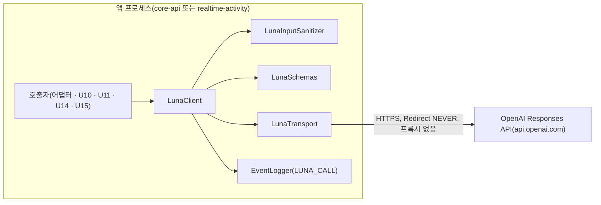

# U9 Luna 호출부 — 보안 · 품질 설계

> 근거: `../nfr-requirements/security-requirements.md`(NFR1.1 ~ NFR6.1), `../nfr-requirements/tech-stack-decisions.md`, `../functional-design/functional-spec.md` · `rules.md`, `../../../inception/contract-design/contract-summary.md`(C-DS4 ~ C-DS7), 질문 · 답 `nfr-design-questions.md`(가정 1 ~ 9 수락).
> U9는 `library` 단위라 성능 · 확장성 · 신뢰성 · 관측 설계를 이 문서에 함께 적는다. 컴포넌트 목록은 `logical-components.md`.

## 1. 신뢰 경계

<!-- Text fallback: 앱 프로세스 안에서 호출자가 LunaClient를 부르고, LunaClient가 LunaInputSanitizer(입력 정리) · LunaSchemas(스키마) · LunaTransport(HTTP) · EventLogger(감사 기록)를 쓴다. 신뢰 경계를 넘는 길은 LunaTransport에서 OpenAI Responses API로 가는 HTTPS 하나이고, 리다이렉트를 따르지 않으며 프록시를 쓰지 않는다. -->

경계를 넘는 길은 `LunaTransport` 하나다. 경계 안쪽에서 정리 · 검증 · 기록을 모두 마친 뒤에만 그 길을 탄다.

## 2. 설계

### SD1. 보내기 전에 정리하고, 남으면 보내지 않는다 (NFR3.1 · NFR3.2)

- `LunaInputSanitizer`가 입력 JSON 트리를 한 번 내려가며 금지 키를 지우고, 문자열 값에 별칭 치환 · 연락처 가림을 한다. 금지 키 목록은 앱마다 상수(ai-io.md 10.2 + core `PRIVATE_KEYS`)이고, 시험이 ai-io.md 목록과 대조한다.
- 정리 결과를 한 번 더 훑어 금지 키가 남았거나 요청 스키마(`JUDGMENT_LIVE`)에 맞지 않으면 `FORBIDDEN_INPUT`으로 끝내고 `LunaTransport`를 부르지 않는다.
- 별칭 표 밖 이름은 잔여 위험이다(3절). 호출 단위가 별칭 표를 채운다.

### SD2. 요청은 고정된 모양으로만 조립한다 (NFR3.3, BR1.8 · BR2.5 · BR4.5)

- 요청 본문은 `LunaClient` 안의 요청 레코드 하나로만 만든다: `model` · `instructions` · `input`(정리된 데이터의 JSON 문자열) · `text.format` · `max_output_tokens` · `reasoning.effort` · `store=false`. `temperature` 필드는 레코드에 없다.
- 지시는 프롬프트 판 파일에서만 오고, 입력 데이터는 `input` 자리에만 들어간다.
- 출력 스키마가 있으면 `LunaSchemas`가 기동 때 만든 요청용 사본을 싣는다.

### SD3. 나가는 길을 하나로 좁힌다 (NFR3.4 · NFR3.9 · NFR3.10)

- `LunaTransport`는 앱마다 하나인 `HttpClient`를 `Redirect.NEVER` · 프록시 없음으로 만든다. 3xx 응답은 `REQUEST_REJECTED`다.
- 보내기 직전 대상 URI를 `LunaHosts` 규칙으로 다시 확인한다. 기동 때 확인과 같은 함수 `LunaHosts.check(uri, mode)`를 쓰고, `mode`는 `STRICT`(https + `api.openai.com`) · `DEV`(STRICT 또는 루프백) · `TEST`(루프백만) 셋뿐이다. 활성 프로필에 `dev`가 있으면 `DEV`, `test`만 있으면 `TEST`, 그 밖(demo · prod · 프로필 없음 · 모르는 프로필 · `lunaLiveTest`)은 모두 `STRICT`다. 가장 엄격한 규칙이 기본값이다.
- 응답 본문은 바이트를 세는 수신기로 읽고, `mujoong.luna.max-response-bytes`(기본 1,000,000바이트)를 넘으면 읽기를 멈추고 `LENGTH_EXCEEDED`로 끝낸다.
- 시도 시한은 응답 헤더뿐 아니라 본문 수신 끝까지 덮는다. JDK `HttpRequest.timeout`은 헤더까지만 덮으므로, 보낸 요청의 `CompletableFuture`에 같은 남은 시간으로 `orTimeout`을 걸고, 넘으면 요청을 취소하고 `TIMEOUT`으로 끝낸다(느리게 흘리는 본문 대비).
- `Authorization: Bearer` 헤더는 `LunaTransport`가 env 키로 그 자리에서 붙이고, 키를 필드 · 레코드 · 로그에 두지 않는다(NFR3.6).

### SD4. 응답은 원본 계약 스키마로 검증한다 (NFR2.1, BR4)

- 분류 순서: 상태 코드(429 · 5xx · 401/403 · 3xx · 그 밖 4xx) → 응답 상태(미완료 · 거절) → 출력 텍스트(빈 값) → 응답 `model` → 출력 스키마.
- 출력 스키마 검증은 `LunaSchemas`의 원본 계약 스키마로, 검증기는 문자열 입력으로 부른다. 기존 인터페이스 경로(출력 스키마 없음)는 JSON 객체 파싱만 하고 바깥 게이트웨이가 내용을 본다.
- 어떤 실패도 빈 값이나 부분 응답으로 성공을 돌려주지 않는다.

### SD5. 시간 · 재시도는 마감 안에서만 (NFR1.1 · NFR1.3, BR3 · BR5)

- 시도마다 `limit = min(마감 − 지금, 목적 시한 키)`를 계산하고, `limit ≤ 0`이면 보내지 않는다. 시각은 `MujoongClock`.
- 재시도 대기 = max(`text-ai.retry.backoff`, 429의 `Retry-After`). 대기 ≥ 남은 시간이면 재시도하지 않는다. 판정(`NONE`) · 결과류(`JOB_ATTEMPT`) · 기존 어댑터는 재시도 자체가 없다.
- 차단기는 두지 않는다(가정 4). 호출량이 적고 재시도가 묶여 있어, 공급자 장애는 각 호출자의 실패 경로(판정 보류 · 결과 작업 재시도 · `SCENARIO_GEN_FAILED`)로 흡수한다.

### SD6. 기록은 사건 코드 하나로, 허용 속성만 (NFR1.2 · NFR3.5 · NFR4.1)

- contract-model `EventLog`에 사건 `LUNA_CALL`을 더하고 허용 속성을 아래 표로 고정한다. 지금 `AttrKey.ValueType`(NUMBER · ENUM · BOOLEAN · TIMESTAMP · UUID · IDENTIFIER)에 모델 이름(`gpt-6-luna`처럼 하이픈 포함)과 이름 목록을 담을 형식이 없어서, 값 형식 두 가지를 더한다. 형식에 맞지 않는 값은 기존 규칙대로 `UNKNOWN`이 된다(조용히 사라지지 않음).

| 속성 키 | 값 형식 | 값 |
|---|---|---|
| `lunaPurpose` | ENUM | `JUDGMENT_LIVE` · `SCENARIO_GENERATION` · `SCENARIO_REVIEW` · `SEED_GENERATION` · `RESULT_TEXT` · `GOAL_CANDIDATES` · `REJUDGMENT` |
| `lunaOutcome` | ENUM | `OK` · `LunaFailure.reason` 12개 |
| `model` | LABEL(새) | `[A-Za-z0-9][A-Za-z0-9._-]{0,63}` — 요청 모델, 응답 모델이 다르면 `responseModel`도 |
| `responseModel` | LABEL(새) | 같은 형식 |
| `promptVersion` | LABEL(새) | 같은 형식 |
| `sentFields` | NAME_LIST(새) | 쉼표로 이은 최상위 키 이름, 이름마다 `[A-Za-z][A-Za-z0-9_]{0,63}`, 최대 32개. 하나라도 어긋나면 `UNKNOWN` |
| `latencyMs` | NUMBER | 시도 지연 |
| `attempt` | NUMBER | 1 ~ 3(정리 실패 · 시한 0은 0) |

- 기동 사건 `LUNA_STARTUP`은 `lunaState` ENUM(`ENABLED` · `DISABLED_NO_KEY`) 하나만 갖는다. `Component.LUNA_CLIENT`를 두 앱 쪽에 하나씩 더한다.
- 사건 코드 · 속성 · 값 형식을 더하는 일은 로그 계약 변경이라 같은 커밋에서 함께 고친다(R-M10): contract-model `EventCode` · `AttrKey` · 포매터 검증과 그 시험, `infra/bin/log-hygiene-check`의 허용 속성 목록과 `infra/ci/test-host-tools.sh` 사례, `infra/RUNBOOK.md`의 로그 사건 절, `contracts/ai-io.md` 10절(감사 로그 속성 목록).
- 요청 · 응답 레코드 · 실패 예외의 `toString`은 `[redacted]`이고, 예외 메시지에는 사유 코드만 둔다.

### SD7. 패키지 경계를 시험으로 묶는다 (NFR3.8)

- ArchUnit: `..luna..`가 의존하면 안 되는 패키지 — 가드레일(U13 `..guardrail..`), `org.slf4j..`, `ch.qos.logback..`, `java.util.logging..`, `org.apache.logging..`, 상대 앱(`kr.mujoong.realtime..` 또는 `kr.mujoong.core..`), `tools.jackson..`(`JsonCodec` 밖 사용 금지, 기존 규칙). 의존해도 되는 기록 패키지 — `kr.mujoong.contract.log..`와 앱 `..observability..`(`EventLogger`). `System.out` · `System.err` 접근도 금지한다.
- realtime `..luna..`는 `java.net.http.WebSocket` · `ProviderClient`에 의존하지 않는다(기존 ⑥ 규칙과 같은 방향).

### SD8. 실호출 시험은 자동 검증 경로 밖에 둔다 (NFR5.1 · NFR5.2 · NFR5.3)

- `luna-live` 고정 제외는 기본 `test` 작업에만 건다. `lunaLiveTest`는 같은 시험 소스에서 `luna-live` 태그만 포함하고 `check` · `build`에 물리지 않는다. 고정 제외 값은 `-PexcludeTags`와 함께 시험 작업 입력으로 잡아 캐시 키에 들어가게 한다.
- `lunaLiveTest`는 프로필 없이 `LunaClient`를 직접 만들고, 키가 없으면 모든 사례를 `SKIPPED_NO_KEY`로 끝낸다. 합성 자료만 쓰고, 결과를 `build/luna-live/report.txt`(목적 · 응답 모델 · 지연 · 사유, 원문 없음)에 남긴다.
- 빌드 구성 시험이 세 가지를 단언한다: `check` 작업 그래프에 `lunaLiveTest` 없음, 기본 `test` 제외 목록에 `luna-live` 있음, `lunaLiveTest` 포함 목록 = `luna-live`.

### SD9. 의존성 이동은 점검과 한 묶음으로 (NFR5.4)

- `json-schema-validator`를 `implementation`으로 옮기는 커밋 직후에 의존성 취약점 스캔과 `infra/ci/image-checks.sh`를 돌려 결과를 Code Generation 요약에 적는다. 예외가 필요하면 `ci/security-exceptions.yml` 승인 절차(R-M7).

### SD10. R-F15는 기록이 남는 절차로 (NFR3.7)

- RUNBOOK Parameter Store 단계 4의 `OPENAI_API_KEY` 바로 앞에 체크 항목과 확인 기록 표(확인자 · 날짜 · 확인한 약관 판 · 환경, 키 · 계정 값 없음)를 둔다. 기록 없이는 키를 넣지 않는다.
- `contracts/ai-io.md` 10.2의 'U9가 코드로 정한다' 문장을 'U9는 코드로 판정하지 않고 RUNBOOK 확인 기록으로 지킨다(편차 U9-b)'로 바꾸고, `U8ContractSchemasTest`의 R-F15 문장 대조를 새 문장에 맞춘다(R-M10).

### SD12. 설정 키는 레코드에 묶고 대조 시험에 올린다 (NFR3.4 · NFR3.10)

- 새 키 `mujoong.luna.*`(모델 · 주소 · 목적별 `max-output-tokens` · `reasoning-effort` · `max-response-bytes`)는 두 앱 `application.yml`과 앱별 설정 레코드(`LunaProperties`)에 함께 두고, 두 앱 `ConfigKeyContractTest`의 레코드 목록에 `LunaProperties`를 더한다(yml 키 집합 = 레코드 키 집합). 시간 값이 아니므로 `contracts/timing.md` · `timing-defaults.json`은 고치지 않는다. 키 이름 · 기본값은 `contracts/ai-io.md` 10절 표에 적는다(R-M10).

### SD11. 호환은 인터페이스를 그대로 두는 것으로 (NFR2.2 · NFR6.1)

- 빈 등록 순서에 기대지 않는다. 키 존재를 판정하는 조건 하나(`LunaKeyPresentCondition`, env `OPENAI_API_KEY`가 비어 있지 않음)를 만들어, 어댑터 빈은 이 조건이 참일 때만, 기존 실패 기본 빈(`TextAiConfiguration.unavailableTextAiProvider` · `ResultTextConfiguration.unavailableResultProvider`)은 반대 조건(`LunaKeyAbsentCondition`)일 때만 등록되게 한다. 기존 `@ConditionalOnMissingBean`은 시험이 대역 빈을 넣는 경로를 위해 함께 둔다. 키가 있으면 실패 빈이 아예 만들어지지 않으므로 처리 순서가 결과를 바꾸지 못한다.
- 컨텍스트 시험이 단언한다: 키 있음 → `TextAiProvider` · `ResultTextProvider` 빈이 각각 하나이고 Luna 어댑터다, 키 없음 · 공백 → 실패 기본 빈이다, 시험 대역 빈을 넣으면 대역이 이긴다.
- `TextAiProvider` · `ResultTextProvider` 시그니처, `TextAiGateway` · `ResultTextGateway` · `OutputChecker` 흐름은 바꾸지 않는다. 기존 시험 기준선과 비교해 회귀 0을 확인한다.

## 3. 남는 위험

| 위험 | 까닭 | 대응 |
|---|---|---|
| 키를 넣으면 실제 아동 데이터가 나감 | Q2-B: 코드 스위치 없음 | SD10 확인 기록 절차 하나가 방어선. 운영 키 투입은 기록이 있을 때만 |
| 별칭 표 밖 이름 유출 | 표에 있는 이름만 바꿈 | 호출 단위(U10 · U11 · U14) 설계가 표 밖 이름 처리를 정함 |
| 공급자 strict 구조화 출력 지원 범위 변화 | 모델 · 시점별로 다름 | 요청용 사본 + 대역 거절 모드 + `lunaLiveTest` 첫 확인 항목 |
| 공급자 장애가 길어짐 | 차단기 없음 | 호출자 실패 경로로 흡수, `LUNA_CALL` 사유 · 지연으로 관측 뒤 필요하면 추가 |

## Sources

- `nfr-design-questions.md`(같은 폴더), `logical-components.md`
- `../nfr-requirements/security-requirements.md` · `tech-stack-decisions.md`
- `../functional-design/functional-spec.md` · `rules.md` · `entities.md`
- `../../../inception/contract-design/contract-summary.md`(C-DS4 ~ C-DS7)
- 코드: core `textai/TextAiConfiguration` · `TextAiGateway`, `result/ResultTextGateway`, realtime `voice/ProviderHosts` · `startup/RealtimeStartupChecks`, contract-model `log/EventLog` · `json/JsonCodec`, test-support `http/ContractStubServer`, `backend/build-logic/src/main/kotlin/mujoong.java-conventions.gradle.kts`

## Assumptions & Open Questions

- 새 값 형식 LABEL · NAME_LIST는 `AttrKey.ValueType`과 포매터 검증에 더한다(설계 검토 R-01, Q1-A). 기존 사건의 속성은 바꾸지 않는다.
- realtime 비동기 호출에서 시한 초과 시 진행 중인 HTTP 요청 취소는 `CompletableFuture` 취소와 `HttpClient` 비동기 요청 취소로 한다. 취소가 공급자 과금을 멈추는지는 공급자 쪽 사정이라 보장하지 않는다.
