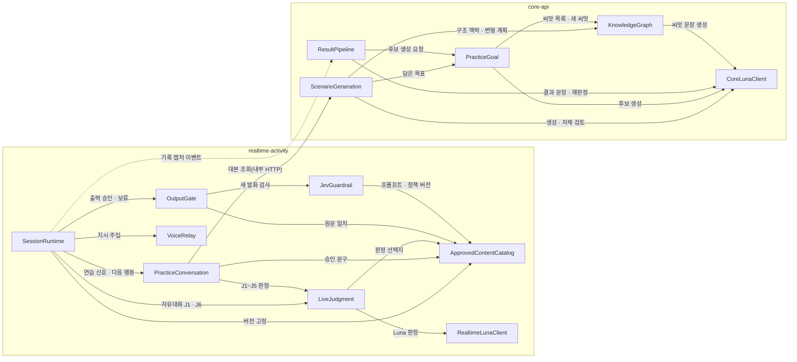

# 컴포넌트 설계 — 문서 기반 코드 갱신

> 근거: `../requirements-analysis/requirements.md`(FR1~FR12 · NFR1~NFR7), `../user-stories/stories.md`(US1.1~US5.2), `../refined-mockups/mockups.md`, CodeKB `aidlc/spaces/default/codekb/mujungi/architecture.md` · `component-inventory.md`, 팀 규칙 `../practices-discovery/team-practices.md`, 질문 · 답 `domain-design-questions.md`(Q1-A · Q2-A · Q3-A).
> 범위: 이번 작업에서 **새로 만들거나 책임이 바뀌는** 컴포넌트만 적는다. 바뀌지 않는 기존 기능 패키지(계정 · 기기 · 알림 등)는 `component-inventory.md`가 정본이다.
> 앱 배치(core-api / realtime-activity)는 지금 코드의 두 앱 분리(R-F5)를 따르는 사실이고, 배포 단위를 새로 정하는 것은 Units Generation의 일이다.
> 엔티티는 소유 컴포넌트 · 식별자 · 속성 이름까지만 적는다. 형식 · 제약 · 관계 수는 Functional Design에서 정한다.

## A. 컴포넌트 목록 (기계 판독용)

```yaml
components:
  # ---------- realtime-activity ----------
  - name: SessionRuntime
    summary: 실시간 세션 실행부 — 판정 턴 조율, 다음 행동 지시 수행, 기기 상태 표시
    behaviour: >
      기존 SessionExecutor · SessionTimers · TransitionTable 묶음이다. 이번 변경으로 판정 턴(J1~J6)을 연다:
      판정 턴 동안 출력 게이트를 '보류'로 두고, 판정 결과로 받은 다음 행동 지시를 GPT-Live에
      session.instructions.correct + session.response.create 선 형식으로 넣는다(FR5.2). 판정 · 지시 · 제브 검사를
      기다리는 동안 보낼 응답이 없으면 기기를 '생각 중'(T19)으로 유지하고, 버린 출력 때문에 '듣는 중'으로 되돌리지
      않는다(AC1.10.4). 아이 말 끝 뒤 10초 안에 응답이 준비되지 않으면 판정 보류로 처리한다(FR5.3). 판정 턴 중
      음성 장애가 나면 판정을 '장애 취소'로 버린다(FR5.4). 등록 종료 표현은 판정 없이 바로 종료하고, 판정 턴 중
      종료 표현이 나오면 판정을 멈춘다(FR3.5). 자유대화는 상태 기계 없이 진행하고 J1 · J6만 판정을 부른다(FR4.8).
      연습 세션에서는 연습 확장점(PracticeSessionExtension)으로 PracticeConversation을 부르고, 그 결과인 다음 행동
      지시(재생 · 공급자 지시 · 타이머 · 장면 정리)만 수행한다. 세션 시작 때 콘텐츠 버전을 고정한다.
    responsibilities:
      - 세션 상태 기계와 판정 턴 수명(열기 · 닫기 · 장애 취소)
      - 다음 행동 지시를 GPT-Live 지시 · 승인 재생 · 타이머로 수행
      - 기기 '생각 중' 상태 유지와 10초 응답 준비 시한
      - 종료 표현 즉시 처리, 자유대화의 J1 · J6 판정 호출
      - 세션 기록 캡처 이벤트 발행(결과 작업 입력)
    depends_on:
      - component: PracticeConversation
        interaction: 연습 세션의 아이 말 · 재생 완료 · 타이머 신호를 넘기고 다음 행동 지시를 받는다(확장점)
        style: sync
      - component: LiveJudgment
        interaction: 자유대화의 J1(시작 응답) · J6(종료 의도) 판정
        style: sync
      - component: OutputGate
        interaction: 공급자 출력 문장 단위 승인 · 보류 · 폐기, 판정 턴 출력 보류 지시
        style: sync
      - component: VoiceRelay
        interaction: GPT-Live 세션 연결, 아이 음성 중계, 다음 행동 지시 주입
        style: sync
      - component: ApprovedContentCatalog
        interaction: 세션 시작 때 판정 · 가드레일 · 승인 문구 · 대본 버전을 세션 계획에 고정
        style: sync
      - component: ResultPipeline
        interaction: 세션이 끝나면 SessionRecordCaptured 이벤트(Outbox/Inbox)로 기록 사실을 넘긴다
        style: event
    dependents: []
    external_dependencies:
      - name: PostgreSQL realtime 스키마
        kind: database
        purpose: 세션 행 · 세션 이벤트 · 대화 기록
    entities:
      - name: ActivitySession
        identifier: sessionId
        attributes: [sessionId, activityType, state, endReason, contentPlanRef]

  - name: PracticeConversation
    summary: 새 연습 상태 기계 — SCENE_INTRO부터 CLOSING까지, 친구 · 코치 역할, 도움 · 변형 기록 (Q1-A)
    behaviour: >
      A §4.3의 단계(SCENE_INTRO → OPPORTUNITY → REASK → HELP_OFFER → FOCUS → RETRY → SCENE_WRAP → (선택) VARIANT →
      NEXT_GOAL / CLOSING)를 소유한다. 도움 · 변형을 반드시 거치지 않는다(FR4.1). 되묻기로 해결되면 집중 연습을
      강제하지 않고(FR4.2), 상황을 이해하지 못하면 교정 전에 상황부터 다시 설명한다(FR4.3). 무응답이면 1회 다시
      안내하고 그래도 없으면 장면을 미실시로 둔다. 코치 전환 · 복귀 알림을 내고, 표현 예시는 코치 역할 · 동의 뒤에만
      허용한다(역할별 정책, FR4.4). 변형 장면은 변형 존재 · 참여 의사 · 목표당 ACTIVE 10분 전 · 집중 연습 한도 안일 때만
      제안한다(FR4.5). 판정 보류는 교정이 따르는 행동으로 바꾸지 않는다(FR3.4). 다음 행동 지시에는 판정 라벨 · 확률 ·
      기준을 넣지 않는다(FR3.7). 세션 실행부를 직접 부르지 않고 다음 행동 지시만 돌려준다. 레거시 PracticeProtocol ·
      EvaluationProvider · ResponseEvaluator · CueProvider는 새 세션에서 쓰지 않으며, 과거 기록 읽기용으로 남긴다(FR4.6).
    responsibilities:
      - 연습 단계 전이와 판정 지점(J1~J5) 결정
      - 역할(친구/코치) 상태와 역할별 출력 정책
      - 도움 제공 · 동의 · 변형 제안 · 생략 사유 기록(FR4.7)
      - 장면을 실제로 시작할 때 노출 이력 기록
      - 과거 U5b 연습 기록과 새 기록의 버전 구분
    depends_on:
      - component: LiveJudgment
        interaction: J1~J5 판정 요청과 보류 여부 수신
        style: sync
      - component: ApprovedContentCatalog
        interaction: 승인 문구(휴식 받아 주기 · 역할 전환 · 다시 묻기) 원문과 버전 조회
        style: sync
      - component: ScenarioGeneration
        interaction: 세션 대본(장면 · 기회 문장 · 다시 설명 · 집중 요점 · 표현 예시 · 변형) 조회 — 내부 HTTP /internal/practice/scenarios
        style: sync
    dependents:
      - component: SessionRuntime
        interaction: 연습 확장점으로 신호를 넘기고 다음 행동 지시를 받는다
    external_dependencies:
      - name: PostgreSQL realtime 스키마
        kind: database
        purpose: 장면 실행 · 도움 · 역할 전환 기록
    entities:
      - name: PracticeScene
        identifier: sceneRunId
        attributes: [sceneRunId, sessionId, scenarioRef, goalRef, sceneKind, startedAt, outcomeTiming, variantDecision, variantSkipReason, recordVersion]
        references:
          - entity: ActivitySession
            owned_by: SessionRuntime
            relationship: 장면 실행은 한 세션에 속한다
          - entity: Scenario
            owned_by: ScenarioGeneration
            relationship: 장면 실행은 core가 만든 대본의 한 장면을 가리킨다(앱 사이 ID 참조)
          - entity: SavedGoal
            owned_by: PracticeGoal
            relationship: 장면 실행은 보호자가 담은 목표 하나를 연습한다(앱 사이 ID 참조)
      - name: HelpRecord
        identifier: helpId
        attributes: [helpId, sceneRunId, role, helpKind, content, exampleGiven, consentAnswer, occurredAt]
        references:
          - entity: PracticeScene
            owned_by: PracticeConversation
            relationship: 도움 · 역할 전환 기록은 한 장면 실행에 속한다

  - name: LiveJudgment
    summary: 진행 중 판정 J1~J6 — JudgeClient 포트, 보류 규칙, 진행용 판정 기록
    behaviour: >
      기존 EvaluationProvider와 별개인 JudgeClient 포트를 둔다(FR3.1). 판정 지점별 질문 · 선택지는 버전 파일에서 읽고
      세션 동안 고정한다(FR3.2). 1 · 2순위와 확률을 받아, 1순위 확률이 하한보다 낮거나 두 순위 차이가 작으면
      보류한다(설정값, FR3.3). 제한 시간 2초, 시간 초과 · 형식 오류는 재시도 없이 보류다(FR3.4). 입력 전사가 비었거나
      전사 시간 초과 · 낮은 신뢰도 · 수신 끊김이면 판독 불가 · 보류로 본다(AC1.8.5). 담은 목표의 4요소에서 판정 기준을
      만든다(AC4.6.3). 판정마다 judgment_live 1건을 남기며, 이 기록은 보호자 화면 · 리포트에 쓰지 않는다(FR3.6).
      제한 시간이 지난 뒤 온 판정은 진행에 쓰지 않는다. 시험에서는 가짜 판정기만 쓴다(R-F1).
    responsibilities:
      - 판정 요청 구성(최소 필드, 아이 이름 '아이'로 치환)과 결과 해석
      - 보류 규칙(확률 하한 · 순위 차이 · 시간 초과 · 판독 불가)
      - 진행용 판정 기록 저장, 보류율 · 지연 지표
    depends_on:
      - component: RealtimeLunaClient
        interaction: GPT-6-Luna 구조화 출력 호출
        style: sync
      - component: ApprovedContentCatalog
        interaction: 세션에 고정된 판정 질문 · 선택지 버전 조회
        style: sync
    dependents:
      - component: SessionRuntime
        interaction: 자유대화 J1 · J6 판정
      - component: PracticeConversation
        interaction: 연습 J1~J5 판정
    external_dependencies:
      - name: PostgreSQL realtime 스키마
        kind: database
        purpose: judgment_live 저장
    entities:
      - name: JudgmentLive
        identifier: judgmentId
        attributes: [judgmentId, sessionId, sceneRunId, judgmentPoint, inputTranscriptRef, optionSetVersion, firstChoice, secondChoice, probabilities, abstained, abstainReason, latencyMs, nextAction, heldOutputTranscript, cancelled]
        references:
          - entity: ActivitySession
            owned_by: SessionRuntime
            relationship: 판정 기록은 한 세션에 속한다
          - entity: PracticeScene
            owned_by: PracticeConversation
            relationship: 연습 판정은 한 장면 실행을 가리킨다(자유대화는 없음)

  - name: OutputGate
    summary: 출력 게이트 — 문장 단위 승인, 판정 턴 보류, 제브 단계, 늦은 결과 무효화
    behaviour: >
      기존 OutputGate · SegmentBuffer · SeedDictionary · ApprovedPlayback이다. 판정 턴에는 게이트를 닫아 받은 GPT-Live
      출력을 기기로 보내지 않고 버리며, 버린 전사는 판정 기록 쪽으로만 넘기고 대화 기록 · 보호자 중계에 넣지 않는다(FR5.1).
      지시 뒤의 응답만 통과시킨다(FR5.2). GPT-Live 새 발화는 inspect(구조 · 1차 사전) 뒤, recheck 전에 제브 검사를 거치고
      ALLOW일 때만 그 음성 구간을 보낸다(FR6.3). BLOCK · REVIEW · 시간 초과 · 오류 · 잘못된 JSON · 정책 버전 불일치면
      재생하지 않는다(FR6.4). 취소 · 중단 · 연결 해제 · 출력 세대 변경 뒤의 ALLOW는 무효이고, 검사한 전사와 보내는 PCM이
      같은 응답 · 구간이 아니면 막는다(FR6.5). 승인 원문과 공백 제거 뒤 완전 일치하는 재생은 제브를 부르지 않고 출처 ·
      원문 일치만 확인하며, 출처가 불확실하면 생략하지 않는다(FR6.6).
    responsibilities:
      - 판정 턴 출력 보류와 버린 출력 전사 분리
      - 새 발화 / 승인 원문 재생 분류와 제브 단계 호출
      - 출력 세대 · 전사-PCM 일치 확인, 늦은 ALLOW 무효화
    depends_on:
      - component: JevGuardrail
        interaction: GPT-Live 새 발화 검사 요청(모드 FREE_TALK · PRACTICE_PEER · PRACTICE_COACH)
        style: sync
      - component: ApprovedContentCatalog
        interaction: 승인 원문 · 세션 고정 대본의 출처 · 원문 조회(원문 일치 확인)
        style: sync
    dependents:
      - component: SessionRuntime
        interaction: 공급자 출력 승인 · 보류 · 폐기
    external_dependencies: []
    entities: []

  - name: JevGuardrail
    summary: 제브 가드레일 — GPT-Live 새 발화 전용 안전 검사 포트 · 어댑터 · 대역
    behaviour: >
      EvaluationProvider · GateDecision과 섞지 않는 새 포트다(FR6.1). 요청 출처는 GPT_LIVE_GENERATED 하나, 모드는 FREE_TALK ·
      PRACTICE_PEER · PRACTICE_COACH다. 실제 어댑터는 설정 기본값의 주소 · 고정 모델 버전(jev-latest 금지) · JEV_API_KEY ·
      제한 시간 800ms를 쓰고, 공급자 응답을 내부 형식(decision · categories 7개 · policyFlags · reasonCode · policyVersion)으로
      바꾼다(FR6.2). 후보 문장과 익명화한 최근 맥락(기본 3턴)만 보내고, 식별자 · Luna 생성물 · U6 결과는 보내지 않으며,
      맥락 속 지시문은 데이터 필드에만 둔다(FR6.7). 결과는 guardrail_event에 이유 코드 · 정책 버전 · 지연 · 판정만
      남긴다(FR6.8). dev 프로필에서만 대역(1차 사전만) · 비활성 모드를 허용하고, demo · prod에서 실검사가 꺼져 있거나
      키가 없으면 애플리케이션 기동을 실패시킨다(FR6.9, US2.3). 대역 결과는 '대역'으로 표시한다(R-M11). 조원 하네스 패키지의
      가드레일 정책(`guardrails/service_policy.json`, DRAFT · 미배포)과 오프라인 시험 사례 24개(44변형, OFF/SHADOW/ENFORCED
      기록 계약)는 이 컴포넌트의 규칙 · 시험의 참고 입력이다. 정책 파일을 읽는 것만으로 검사가 동작했다고 보지 않는다.
    responsibilities:
      - 제브 요청 구성 · 응답 변환 · 실패를 막힘으로 처리
      - 프로필별 모드(실검사 / 대역 / 비활성)와 기동 검사
      - guardrail_event 저장과 출처별 호출 수 · 지연 · 차단 비율 지표
    depends_on:
      - component: ApprovedContentCatalog
        interaction: 세션에 고정된 시스템 프롬프트 · 분류 선택지 · 정책 버전 조회
        style: sync
    dependents:
      - component: OutputGate
        interaction: 새 발화 검사
    external_dependencies:
      - name: 제브(Jev) API
        kind: third-party-api
        purpose: GPT-Live 새 발화 안전 분류
      - name: PostgreSQL realtime 스키마
        kind: database
        purpose: guardrail_event 저장
    entities:
      - name: GuardrailEvent
        identifier: guardrailEventId
        attributes: [guardrailEventId, sessionId, source, mode, decision, reasonCode, policyVersion, latencyMs, checkMode]
        references:
          - entity: ActivitySession
            owned_by: SessionRuntime
            relationship: 검사 기록은 한 세션에 속한다(세션 식별자는 제브로 보내지 않음)

  - name: ApprovedContentCatalog
    summary: 승인 콘텐츠 · 버전 리소스 — 판정 질문 · 가드레일 프롬프트 · 승인 문구 · 세션 고정 대본
    behaviour: >
      판정 지점 J1~J6 질문 · 선택지, 제브 시스템 프롬프트(C §3.3) · 분류 선택지, 승인 문구를 출처 · 버전 · 원문과 함께
      버전 리소스로 둔다(FR6.10 · FR10.1 · FR10.2). 세션 시작 때 버전을 세션 계획에 고정하고, 세션 동안 바꾸지 않는다.
      세션 고정 대본(장면 대본 원문)도 출처 · 버전과 함께 기억해 원문 일치 확인에 쓴다.
    responsibilities:
      - 버전 리소스 적재와 조회
      - 세션별 콘텐츠 버전 고정
      - 승인 원문 · 세션 대본의 출처 · 원문 제공
    depends_on: []
    dependents:
      - component: SessionRuntime
        interaction: 세션 시작 때 버전 고정
      - component: PracticeConversation
        interaction: 승인 문구 조회
      - component: LiveJudgment
        interaction: 판정 질문 · 선택지 조회
      - component: OutputGate
        interaction: 원문 일치 확인
      - component: JevGuardrail
        interaction: 프롬프트 · 분류 · 정책 버전 조회
    external_dependencies: []
    entities:
      - name: ContentResource
        identifier: resourceKey
        attributes: [resourceKey, kind, version, source, text, options]
      - name: SessionContentPlan
        identifier: sessionId
        attributes: [sessionId, judgmentSetVersion, guardrailPolicyVersion, approvedPhraseVersion, scriptVersion]
        references:
          - entity: ActivitySession
            owned_by: SessionRuntime
            relationship: 세션마다 콘텐츠 계획이 하나 있다
          - entity: ContentResource
            owned_by: ApprovedContentCatalog
            relationship: 계획은 리소스 버전을 가리킨다

  - name: VoiceRelay
    summary: GPT-Live 음성 공급자 연결 — 선 형식 소유, 지시 주입
    behaviour: >
      기존 voice 패키지(ProviderClient · ProviderRequestFactory · ProviderConnector · InputRelay)다. 허용 호스트 고정을 유지한다.
      음성은 서버가 중계한다: 기기 ↔ realtime-activity ↔ GPT-Live. 브라우저가 공급자와 직접 음성을 주고받는 방식은 쓰지
      않는다(Q4-A, ADR-007). 다음 행동 지시를 session.instructions.correct + session.response.create로 보낸다. 실제 선 형식은
      P5 실호출(FR12.2)에서 확인하기 전까지 바꾸지 않고, 확인되면 코드 · 가짜 공급자 · 시험을 한 번에 고친다. 이때 조원
      하네스 패키지의 실제 세션 생성(`POST /v1/live/sessions`) · 제어 채널(`/attach`) · 허용 이벤트 · 종료(session.close →
      session.closed) 형식을 어댑터 매핑의 참고 자료로 쓴다. 서버 쪽 전송이 GPT-Live에서 가능한지도 FR12.2에서 확정한다.
      공급자 이벤트는 이 어댑터 안에서만 내부 이벤트로 바꾼다. 키 이름 통일(PROVIDER_API_KEY → OPENAI_API_KEY)도 그때 정한다.
    responsibilities:
      - 공급자 세션 연결 · 음성 중계 · 출력 수신
      - 다음 행동 지시 송신
    depends_on: []
    dependents:
      - component: SessionRuntime
        interaction: 공급자 연결 · 지시 주입
    external_dependencies:
      - name: GPT-Live(OpenAI 음성 공급자)
        kind: third-party-api
        purpose: 아이와 실시간 음성 대화
    entities: []

  - name: RealtimeLunaClient
    summary: realtime-activity의 GPT-6-Luna 호출부 — 구조화 출력, 스키마 검증, 필드 이름 감사
    behaviour: >
      openai-java Responses API와 JSON Schema 구조화 출력으로 Luna를 부른다(FR1.1). 모델 이름 OPENAI_JUDGE_MODEL,
      키 OPENAI_API_KEY를 환경에서 읽고, 키가 없으면 실제 어댑터를 켜지 않는다(AC2.3.3). 요청마다 보낸 필드 이름 목록만
      감사 로그로 남기고 요청 · 응답 본문은 남기지 않는다(FR1.4). core 쪽 호출부와 코드를 공유하지 않는다(R-F5).
      진행 중 판정은 재시도하지 않으므로 이 호출부는 판정용으로 '재시도 없음' 정책을 받는다.
    responsibilities:
      - Luna 요청 · 구조화 출력 · 스키마 검증
      - 필드 이름 감사 · 키 관리 · 켜고 끔
    depends_on: []
    dependents:
      - component: LiveJudgment
        interaction: 판정 호출
    external_dependencies:
      - name: GPT-6-Luna(OpenAI Responses API)
        kind: third-party-api
        purpose: 진행 중 판정
    entities: []

  # ---------- core-api ----------
  - name: ScenarioGeneration
    summary: 연습 상황 생성 — Luna 생성, 분리된 자체 검토, 서버 독립 검사, 새 대본 필드
    behaviour: >
      순서: (그래프 맥락이 있으면 구조 맥락 · 변형 계획 조회) → Luna 생성 → 생성과 분리한 Luna 자체 검토 → 서버 독립 검사
      (TextAiGateway · ScenarioContentPolicy · 금지 표현 · 중복 지문 · 기회 일치)(FR2.1). 자체 검토는 APPROVE / REJECT /
      UNCERTAIN과 승인된 사유 목록으로 받고, APPROVE가 아니거나 서버 검사에 실패하면 막는다(FR2.2). 허용 횟수(기본 1회)
      안에서 다시 만들고, 그래도 실패하면 SCENARIO_GEN_FAILED로 끝낸다(FR2.3). 대본에 장면 설명 · 상대 역할 · 기회 문장 ·
      상황 다시 설명 · 집중 연습 요점 · 표현 예시 · 변형 장면, 장면마다 관계 · 자리 · 화제를 담는다(FR2.4). 전체 15초
      예산을 늘리지 않는다(FR2.5). Luna 생성물과 자체 검토 결과는 제브로 보내지 않는다(FR2.6). 담은 목표의 4요소와
      skill_ref 구조 맥락을 생성 입력으로 쓴다(AC4.6.2). 그래프가 꺼져 있거나 2초 초과 · skill_ref=NONE이면 구조 맥락
      없이 기본 경로로 만든다(FR9.5). 구조 맥락이 있으면 변형 장면 보존 판정을 한다(FR9.6).
    responsibilities:
      - 상황 생성 · 자체 검토 · 서버 검사 · 재생성 · 15초 예산
      - 대본 필드 저장과 realtime에 대본 제공(내부 HTTP)
      - 변형 장면 보존 판정
    depends_on:
      - component: CoreLunaClient
        interaction: 상황 생성 · 자체 검토 호출
        style: sync
      - component: PracticeGoal
        interaction: 담은 목표의 4요소 · skill_ref 읽기
        style: sync
      - component: KnowledgeGraph
        interaction: 구조 맥락(skill_context) · 변형 계획 조회(2초 제한)
        style: sync
    dependents:
      - component: PracticeConversation
        interaction: 세션 대본 조회(내부 HTTP)
    external_dependencies:
      - name: PostgreSQL core 스키마
        kind: database
        purpose: 상황 · 대본 저장
    entities:
      - name: Scenario
        identifier: scenarioId
        attributes: [scenarioId, sessionId, goalRef, scenes, opportunitySentence, reexplanation, focusPoints, expressionExamples, variantScenes, selfReviewVerdict, contentFingerprint, model, promptVersion, graphContextUsed]
        references:
          - entity: SavedGoal
            owned_by: PracticeGoal
            relationship: 상황은 담은 목표 하나로 만든다
          - entity: KgVersion
            owned_by: KnowledgeGraph
            relationship: 구조 맥락을 썼으면 그때의 그래프 버전을 가리킨다

  - name: PracticeGoal
    summary: 연습 목표 — Luna 목표 후보 생성 · 검증, 보호자가 담은 목표 (Q2-A)
    behaviour: >
      목표 후보와 담은 목표의 유일한 주인이다. 결과 작업이 요청하면 Luna로 아이 기록(전사 · 경험 구조화 · 장면 기록)에서
      후보를 만든다. 미리 정한 목록에서 고르지 않고 연령은 쓰지 않는다(FR8.1). 4요소가 모두 있고, 근거 발화를 저장된
      전사에서 글자 단위로 찾을 수 있고, skill_ref가 씨앗 요약 목록에 있는 id이거나 NONE인 후보만 남긴다(FR8.2,
      AC4.5.2 · AC4.5.3). 출처를 확인할 수 없는 발화 · 동의 철회 · 삭제 자료는 근거로 쓰지 않는다. 후보 수 · 글 길이
      한도를 지키고, 화면용 근거 문구는 근거 발화와 따로 저장해 금지 표현 검사를 거친다(AC4.5.6 · AC4.5.7). 남는 후보가
      없으면 '후보 없음'이다. 보호자가 [담기]하면 담은 목표가 후보 버전을 가리키고, 이후 후보가 바뀌어도 담은 내용은
      바뀌지 않는다(AC4.6.1). AI가 목표를 확정하거나 자동으로 담지 않는다(FR8.4). 기존 승인 행동 정의 기반 목표도 계속
      읽힌다(AC4.6.4). 자유대화 뒤 skill_ref=NONE 후보가 있으면 KnowledgeGraph에 새 씨앗 생성을 요청하며, 씨앗 실패가
      결과 상태를 바꾸지 않는다(FR8.3). 지금 core.practice의 CandidateRegistry · PracticeGoalRepository와 core.result의
      CandidateScreen 책임을 이 컴포넌트로 모은다.
    responsibilities:
      - 목표 후보 생성 · 검증 · 저장과 '후보 없음'
      - 담기(후보 버전 고정)와 담은 목표 조회
      - 과거 행동 정의 기반 목표 읽기
      - 새 씨앗 생성 요청
    depends_on:
      - component: CoreLunaClient
        interaction: 목표 후보 생성 호출
        style: sync
      - component: KnowledgeGraph
        interaction: 씨앗 요약 목록 조회 · skill_ref 검증, NONE 후보의 새 씨앗 생성 요청
        style: sync
    dependents:
      - component: ScenarioGeneration
        interaction: 담은 목표 읽기
      - component: ResultPipeline
        interaction: 결과 작업 중 후보 생성 요청, 27 목표 칸 조회
    external_dependencies:
      - name: PostgreSQL core 스키마
        kind: database
        purpose: 후보 · 담은 목표 저장
    entities:
      - name: GoalCandidate
        identifier: candidateId
        attributes: [candidateId, candidateVersion, childId, sessionId, displayName, targetExpression, fourElements, skillRef, reasonText, evidenceUtterance, evidenceAt, displayEvidence, model, promptVersion]
        references:
          - entity: Seed
            owned_by: KnowledgeGraph
            relationship: 후보는 가장 가까운 씨앗 하나를 가리키거나 NONE이다
      - name: SavedGoal
        identifier: selectionId
        attributes: [selectionId, childId, candidateRef, candidateVersion, legacyBehaviorKey, legacyBehaviorVersion, savedAt]
        references:
          - entity: GoalCandidate
            owned_by: PracticeGoal
            relationship: 담은 목표는 후보 하나의 특정 버전을 가리킨다(과거 목표는 행동 정의를 가리킴)

  - name: ResultPipeline
    summary: 결과 작업 — 새 기록 사실, 되묻기 뒤 시점, 재판정, 버전 구분, 재시도, 27 표시 매핑 (Q3-A)
    behaviour: >
      기존 core.result(JobRunner · SessionResultHandler · ResultLevelCalculator · SceneChipMapper 등)다. 장면 결과 시점에
      '되묻기 뒤'(AFTER_REASK)를 더해 API · 리포트 집계에 그대로 둔다(FR7.1). 단 보호자 27 화면의 칩 매핑에서만
      AFTER_REASK를 '바로 전달'(DONE_IMMEDIATE)로 접어 27의 칩 5종 모양을 유지한다(Q3-A). '다시 말해 줄래?' 확인은
      시점을 바꾸지 않는다. 장면 수를 1 · 2로 고정하지 않고, 실제로 시작한 장면만 줄로 보이며, 없는 장면 · 도움 없는
      장면을 실패 · 미완료로 보이지 않는다(FR7.2). 새 기록 사실(되묻기 해결 · 설명 · 도움 · 역할 전환 · 변형 · 종료 사유)을
      U6 입력으로 쓴다(FR7.3). 기록용 재판정을 새 흐름의 장면 · 시점에 맞추고, 진행 중 판정과 다르면 differs_from_live로만
      남긴다(FR7.4). 과거 U5b 결과는 버전으로 구분해 원래 의미로 읽는다(FR7.5). 재시도는 추가 최대 3회(5 · 15 · 30초)다
      (FR7.6). 결과 · 리포트 2차 검사는 기존 classify · OutputChecker를 유지하고 제브로 보내지 않는다(FR7.7). 결과 작업
      중에 PracticeGoal에 후보 생성을 요청한다.
    responsibilities:
      - 결과 수준 · 결과 문장 · 장면 결과 시점 계산
      - 27 표시용 칩 매핑(AFTER_REASK → '바로 전달')
      - 기록용 재판정과 차이 표시
      - 버전별 결과 읽기, 재시도 정책
      - 목표 후보 생성 요청
    depends_on:
      - component: CoreLunaClient
        interaction: 결과 문장 · 기록용 재판정 호출(기존 ResultTextProvider를 Luna 어댑터로)
        style: sync
      - component: PracticeGoal
        interaction: 결과 작업 중 후보 생성 요청, 27 목표 칸 후보 조회
        style: sync
    dependents:
      - component: SessionRuntime
        interaction: SessionRecordCaptured 이벤트로 기록 사실을 받는다
    external_dependencies:
      - name: PostgreSQL core 스키마
        kind: database
        purpose: 결과 · 장면 결과 · 결과 작업 저장
    entities:
      - name: SceneResult
        identifier: sceneResultId
        attributes: [sceneResultId, resultId, sceneRunRef, value, timing, chipText, differsFromLive, recordVersion]
        references:
          - entity: PracticeScene
            owned_by: PracticeConversation
            relationship: 장면 결과는 실제로 시작한 장면 실행 하나를 가리킨다(이벤트로 받은 ID)
      - name: ResultJob
        identifier: jobId
        attributes: [jobId, sessionId, jobKind, state, attemptCount, nextAttemptAt]
        references:
          - entity: ActivitySession
            owned_by: SessionRuntime
            relationship: 결과 작업은 끝난 세션 하나에 대해 돈다(이벤트로 받은 ID)

  - name: KnowledgeGraph
    summary: 화용 지식 그래프 — Neo4j 어댑터 · 메모리 대역 · 적재 · 새 씨앗 · 삭제 참여
    behaviour: >
      기존 core.knowledge(KnowledgeGraphLookup 인터페이스 · JDBC 저장소)에 Neo4j 어댑터를 더한다(FR9.1). 기능: 아이 그래프
      초기화 · 씨앗 요약 목록 · 목표 구조 맥락(skill_context) · 변형 계획 · 만든 씨앗 쓰기와 지우기. 모든 질의는 child_id로
      범위를 한정한다. 공통 씨앗 · 어휘는 social-comm-poc 자료에서 적재하고 그래프 버전을 남긴다(FR9.2). 원문 전사 ·
      보호자 입력 원문은 그래프에 넣지 않는다(FR9.3). 새 씨앗은 Luna로 만들고 허용 값 · 원문 겹침(5글자) · 금지 표현 ·
      중복 · 불변 문장 길이를 검사하며, 실패하면 1회 다시, 또 실패하면 NONE을 유지한다(FR8.3). 그래프가 꺼져 있거나
      장애 · 2초 초과면 호출자가 기본 경로를 타게 '없음'을 돌려주고, 빈 응답을 개인화 완료로 표시하지 않는다(FR9.5).
      아동 · 계정 · 기록 삭제 때 아이 그래프와 만든 씨앗을 지우는 삭제 참여자를 둔다(FR9.4). 시험 · 개발용 메모리 대역에
      기본 씨앗 목록을 채운다(FR9.7).
    responsibilities:
      - 그래프 조회(씨앗 목록 · 구조 맥락 · 변형 계획)와 제한 시간
      - 공통 씨앗 적재 · 그래프 버전
      - 새 씨앗 생성 · 검사 · 저장(그래프 + PostgreSQL generated_seed)
      - 삭제 참여, 동의 철회 자료 제외
    depends_on:
      - component: CoreLunaClient
        interaction: 새 씨앗 문장 생성 호출
        style: sync
    dependents:
      - component: ScenarioGeneration
        interaction: 구조 맥락 · 변형 계획 조회
      - component: PracticeGoal
        interaction: 씨앗 목록 · skill_ref 검증 · 새 씨앗 생성 요청
    external_dependencies:
      - name: Neo4j
        kind: database
        purpose: 아이별 화용 지식 그래프
      - name: PostgreSQL core 스키마
        kind: database
        purpose: generated_seed 원본 출처 · 그래프 버전 기록
    entities:
      - name: Seed
        identifier: seedId
        attributes: [seedId, origin, childId, kgVersion, skillName, invariantSentence, sourceCandidateRef, createdAt]
        references:
          - entity: GoalCandidate
            owned_by: PracticeGoal
            relationship: 만든 씨앗은 그 씨앗을 낳은 후보 하나를 가리킨다(공통 씨앗은 없음)
      - name: KgVersion
        identifier: kgVersion
        attributes: [kgVersion, sourceArchive, loadedAt]

  - name: CoreLunaClient
    summary: core-api의 GPT-6-Luna 호출부 — 구조화 출력, 스키마 1회 재요청, 인용 검증, 필드 이름 감사
    behaviour: >
      openai-java Responses API와 JSON Schema 구조화 출력으로 Luna를 부른다(FR1.1). 모델 이름 OPENAI_ANALYSIS_MODEL, 키
      OPENAI_API_KEY를 환경에서 읽는다. 스키마가 맞지 않으면 1회 다시 요청하고 그래도 안 되면 작업 실패로 처리하며, 결과
      행마다 model · prompt_version을 남기게 돌려준다(FR1.2). U5a TextAiProvider · U6 ResultTextProvider의 기본 실패 빈을
      설정으로 켜고 끄는 실제 어댑터로 바꾸고, 꺼져 있으면 지금 실패 경로를 유지한다(FR1.3). 필드 이름 목록만 감사
      로그로 남기고 본문은 남기지 않으며, 아이 이름은 '아이'로 바꿔 보낸다(FR1.4). realtime 쪽 호출부와 코드를 공유하지
      않는다(R-F5). 시험 · CI에서는 가짜 공급자만 쓴다(R-F1).
    responsibilities:
      - Luna 요청 · 구조화 출력 · 스키마 재요청
      - 필드 이름 감사 · 이름 치환 · 키 관리 · 켜고 끔
    depends_on: []
    dependents:
      - component: ScenarioGeneration
        interaction: 상황 생성 · 자체 검토
      - component: PracticeGoal
        interaction: 목표 후보 생성
      - component: ResultPipeline
        interaction: 결과 문장 · 기록용 재판정
      - component: KnowledgeGraph
        interaction: 새 씨앗 생성
    external_dependencies:
      - name: GPT-6-Luna(OpenAI Responses API)
        kind: third-party-api
        purpose: 상황 생성 · 자체 검토 · 결과 · 목표 후보 · 씨앗 · 재판정
    entities: []
```

## B. 사람이 읽는 보기

### 컴포넌트 다이어그램



<!-- Text fallback: realtime-activity 안에서 SessionRuntime이 PracticeConversation(연습 흐름), LiveJudgment(자유대화 J1 · J6), OutputGate(출력 승인), VoiceRelay(GPT-Live 연결), ApprovedContentCatalog(버전 고정)를 부르고, 세션이 끝나면 core-api의 ResultPipeline에 이벤트를 보낸다. PracticeConversation은 LiveJudgment · ApprovedContentCatalog를 부르고, core-api ScenarioGeneration에서 대본을 내부 HTTP로 가져온다. LiveJudgment는 RealtimeLunaClient와 ApprovedContentCatalog를, OutputGate는 JevGuardrail과 ApprovedContentCatalog를, JevGuardrail은 ApprovedContentCatalog를 부른다. core-api 안에서 ScenarioGeneration은 CoreLunaClient · PracticeGoal · KnowledgeGraph를, PracticeGoal은 CoreLunaClient · KnowledgeGraph를, ResultPipeline은 CoreLunaClient · PracticeGoal을, KnowledgeGraph는 CoreLunaClient를 부른다. 순환은 없다. -->

### 컴포넌트 요약

| Component | Purpose | Depends On | Dependents | Entities Owned |
|---|---|---|---|---|
| SessionRuntime | 세션 실행 · 판정 턴 조율 · 다음 행동 수행 | PracticeConversation, LiveJudgment, OutputGate, VoiceRelay, ApprovedContentCatalog, ResultPipeline(이벤트) | — | ActivitySession |
| PracticeConversation | 새 연습 상태 기계 · 역할 · 도움 · 변형 | LiveJudgment, ApprovedContentCatalog, ScenarioGeneration | SessionRuntime | PracticeScene, HelpRecord |
| LiveJudgment | 진행 중 판정 J1~J6 · 보류 · judgment_live | RealtimeLunaClient, ApprovedContentCatalog | SessionRuntime, PracticeConversation | JudgmentLive |
| OutputGate | 출력 승인 · 판정 턴 보류 · 제브 단계 | JevGuardrail, ApprovedContentCatalog | SessionRuntime | — |
| JevGuardrail | GPT-Live 새 발화 안전 검사 | ApprovedContentCatalog | OutputGate | GuardrailEvent |
| ApprovedContentCatalog | 버전 리소스 · 세션 고정 | — | SessionRuntime, PracticeConversation, LiveJudgment, OutputGate, JevGuardrail | ContentResource, SessionContentPlan |
| VoiceRelay | GPT-Live 연결 · 지시 주입 | — | SessionRuntime | — |
| RealtimeLunaClient | realtime의 Luna 호출부 | — | LiveJudgment | — |
| ScenarioGeneration | 상황 생성 · 자체 검토 · 서버 검사 | CoreLunaClient, PracticeGoal, KnowledgeGraph | PracticeConversation | Scenario |
| PracticeGoal | 목표 후보 · 담은 목표 | CoreLunaClient, KnowledgeGraph | ScenarioGeneration, ResultPipeline | GoalCandidate, SavedGoal |
| ResultPipeline | 결과 작업 · 시점 · 재판정 · 27 매핑 | CoreLunaClient, PracticeGoal | SessionRuntime(이벤트) | SceneResult, ResultJob |
| KnowledgeGraph | Neo4j · 씨앗 · 삭제 참여 | CoreLunaClient | ScenarioGeneration, PracticeGoal | Seed, KgVersion |
| CoreLunaClient | core의 Luna 호출부 | — | ScenarioGeneration, PracticeGoal, ResultPipeline, KnowledgeGraph | — |

### 엔티티 소유

| Entity | Owning Component | Identifier | Attributes | References |
|---|---|---|---|---|
| ActivitySession | SessionRuntime | sessionId | activityType, state, endReason, contentPlanRef | — |
| PracticeScene | PracticeConversation | sceneRunId | sessionId, scenarioRef, goalRef, sceneKind, startedAt, outcomeTiming, variantDecision, variantSkipReason, recordVersion | ActivitySession, Scenario, SavedGoal |
| HelpRecord | PracticeConversation | helpId | sceneRunId, role, helpKind, content, exampleGiven, consentAnswer, occurredAt | PracticeScene |
| JudgmentLive | LiveJudgment | judgmentId | sessionId, sceneRunId, judgmentPoint, inputTranscriptRef, optionSetVersion, firstChoice, secondChoice, probabilities, abstained, abstainReason, latencyMs, nextAction, heldOutputTranscript, cancelled | ActivitySession, PracticeScene |
| GuardrailEvent | JevGuardrail | guardrailEventId | sessionId, source, mode, decision, reasonCode, policyVersion, latencyMs, checkMode | ActivitySession |
| ContentResource | ApprovedContentCatalog | resourceKey | kind, version, source, text, options | — |
| SessionContentPlan | ApprovedContentCatalog | sessionId | judgmentSetVersion, guardrailPolicyVersion, approvedPhraseVersion, scriptVersion | ActivitySession, ContentResource |
| Scenario | ScenarioGeneration | scenarioId | sessionId, goalRef, scenes, opportunitySentence, reexplanation, focusPoints, expressionExamples, variantScenes, selfReviewVerdict, contentFingerprint, model, promptVersion, graphContextUsed | SavedGoal, KgVersion |
| GoalCandidate | PracticeGoal | candidateId | candidateVersion, childId, sessionId, displayName, targetExpression, fourElements, skillRef, reasonText, evidenceUtterance, evidenceAt, displayEvidence, model, promptVersion | Seed |
| SavedGoal | PracticeGoal | selectionId | childId, candidateRef, candidateVersion, legacyBehaviorKey, legacyBehaviorVersion, savedAt | GoalCandidate |
| SceneResult | ResultPipeline | sceneResultId | resultId, sceneRunRef, value, timing, chipText, differsFromLive, recordVersion | PracticeScene |
| ResultJob | ResultPipeline | jobId | sessionId, jobKind, state, attemptCount, nextAttemptAt | ActivitySession |
| Seed | KnowledgeGraph | seedId | origin, childId, kgVersion, skillName, invariantSentence, sourceCandidateRef, createdAt | GoalCandidate |
| KgVersion | KnowledgeGraph | kgVersion | sourceArchive, loadedAt | — |

앱 사이 참조(realtime 엔티티 → core 엔티티, core 엔티티 → realtime 엔티티)는 모두 ID 값으로만 들고, 상대 앱의 표를 읽지 않는다(R-F5).

### 외부 의존

| Component | Dependency | Kind | Purpose |
|---|---|---|---|
| SessionRuntime | PostgreSQL realtime 스키마 | database | 세션 · 이벤트 · 대화 기록 |
| PracticeConversation | PostgreSQL realtime 스키마 | database | 장면 실행 · 도움 · 역할 기록 |
| LiveJudgment | PostgreSQL realtime 스키마 | database | judgment_live |
| JevGuardrail | 제브(Jev) API | third-party-api | 새 발화 안전 분류 |
| JevGuardrail | PostgreSQL realtime 스키마 | database | guardrail_event |
| VoiceRelay | GPT-Live(OpenAI 음성 공급자) | third-party-api | 실시간 음성 대화 |
| RealtimeLunaClient | GPT-6-Luna(OpenAI Responses API) | third-party-api | 진행 중 판정 |
| ScenarioGeneration | PostgreSQL core 스키마 | database | 상황 · 대본 |
| PracticeGoal | PostgreSQL core 스키마 | database | 후보 · 담은 목표 |
| ResultPipeline | PostgreSQL core 스키마 | database | 결과 · 장면 결과 · 작업 |
| KnowledgeGraph | Neo4j | database | 아이별 화용 그래프 |
| KnowledgeGraph | PostgreSQL core 스키마 | database | generated_seed · 그래프 버전 |
| CoreLunaClient | GPT-6-Luna(OpenAI Responses API) | third-party-api | 상황 · 검토 · 결과 · 후보 · 씨앗 · 재판정 |

### 근거 (왜 따로 두는가)

| Component | 새로 / 바뀜 | 따로 두는 까닭 |
|---|---|---|
| SessionRuntime | 바뀜(기존 SessionExecutor 묶음) | 세션 수명 · 타이머 · 출력 조율은 연습 · 자유대화 공통이다. 판정 턴 조율이 여기 붙는다. 연습 규칙은 넣지 않아 3,388줄 파일(TD-4)이 더 커지지 않게 한다. |
| PracticeConversation | 새로(Q1-A) | 단계 · 판정 · 기록이 레거시 PracticeProtocol과 모두 달라 변경 이유가 다르다. 레거시는 과거 기록 읽기용으로 남고 새 흐름은 레거시 포트에 기대지 않는다(AC1.1.5). |
| LiveJudgment | 새로 | 판정 지점 · 보류 규칙 · judgment_live는 연습과 자유대화가 함께 쓰고, 기존 EvaluationProvider와 섞지 말라는 C의 결정이 있다. |
| OutputGate | 바뀜 | 공급자 출력의 '보낼지 말지' 결정을 한곳에 둬야 판정 턴 보류 · 제브 · 늦은 결과 무효가 서로 엇갈리지 않는다. |
| JevGuardrail | 새로 | 외부 공급자 · 프로필별 기동 규칙 · 감사 기록이 있는 별도 관심사이고, GateDecision과 섞지 말라는 C의 결정이 있다. |
| ApprovedContentCatalog | 새로 | 판정 · 가드레일 · 승인 문구 버전을 세션 단위로 고정하는 일은 네 컴포넌트가 함께 기대는 공통 데이터다. 한 곳에서 고정해야 세션 중 버전이 섞이지 않는다. |
| VoiceRelay | 바뀜(작게) | 선 형식을 한곳에서 소유한다(TD-2). 이번에는 지시 주입만 쓰고, 형식 변경은 P5 실호출 뒤로 미룬다. |
| RealtimeLunaClient · CoreLunaClient | 새로 | 공급자 SDK · 키 · 감사 규칙을 포트 뒤에 가둔다. 두 앱 직접 참조 금지(R-F5) 때문에 앱마다 하나씩 둔다(ADR-004). |
| ScenarioGeneration | 바뀜 | 생성 · 자체 검토 · 서버 검사 · 15초 예산이 한 묶음의 트랜잭션처럼 움직인다. |
| PracticeGoal | 새로(Q2-A) | 후보와 담은 목표는 화면 · 상황 생성 · 판정 기준이 모두 보는 데이터라 주인이 하나여야 한다. |
| ResultPipeline | 바뀜 | 결과 시점 · 재판정 · 버전 구분 · 27 표시 매핑은 결과 작업 하나의 변경 이유다. |
| KnowledgeGraph | 바뀜(Neo4j 어댑터 추가) | 외부 그래프 · 적재 · 삭제 참여 · 제한 시간이 있는 별도 데이터 소유자다. |

**보호자 웹(`frontend/src/parent`)**: 27(`RecordDetail27.tsx`)은 서버가 보낸 칩 값을 그대로 그리므로, Q3-A의 접기는 서버 쪽 27 표시 매핑(ResultPipeline)에서 끝난다. 이번 설계에서는 새 프런트 컴포넌트를 두지 않는다. 목표 후보 칸도 지금 화면 항목(목표 이름 · 근거 문구 · 시각 · [담기] · 후보 없음)을 그대로 쓴다(AC4.5.5).

**계약 · 설정 정비(FR11)**: 컴포넌트가 아니다. 새 포트 계약은 `contracts/ai-io.md`, 시간 값은 세 곳 동시 수정(R-M5), 비밀 이름은 검사 목록 전부(R-M9)에 걸리며, Contract Design · Code Generation에서 다룬다.

#### 선택한 분해와 버린 안 (Alternatives Rejected)

- **연습 흐름(Q1)**: 새 `PracticeConversation`을 골랐다. 버린 안 — 기존 `PracticeProtocol`을 그 자리에서 고치기: 과거 기록 호환과 새 흐름이 한 클래스에 섞이고 되돌리기 어렵다(ADR-001).
- **목표 소유(Q2)**: 새 `PracticeGoal`을 골랐다. 버린 안 — 후보는 결과 쪽, 담은 목표는 연습 쪽에 나눠 두기: 후보 버전 참조가 모듈 경계를 넘고 판정 기준을 만들 때 두 곳을 봐야 한다(ADR-002).
- **27 표시(Q3)**: '바로 전달'로 접기를 골랐다(사람이 추천 C 대신 선택). 버린 안 — '도움 뒤 전달'로 접기, 칩 생략, 새 칩 추가(ADR-003).
- **Luna 호출부**: 앱마다 하나를 골랐다. 버린 안 — contract-model 공용 호출부(ADR-004).

## Sources

- `../requirements-analysis/requirements.md` — FR1~FR12, NFR1~NFR7, 문서 우선순위
- `../user-stories/stories.md` — US1.1~US5.2와 인수 기준
- `../refined-mockups/mockups.md` — 27 · 목표 칸 화면 항목, 검토 지적 R-01
- `aidlc/spaces/default/codekb/mujungi/architecture.md` — 두 앱 분리 · 내부 HTTP · Outbox/Inbox · 기본 실패 빈
- `aidlc/spaces/default/codekb/mujungi/component-inventory.md` — 기존 패키지 이름과 위치
- `../practices-discovery/team-practices.md` — R-F5(두 앱 직접 참조 금지) · R-F1(가짜 공급자) · R-M5 · R-M9 · R-M10
- `domain-design-questions.md` — Q1-A · Q2-A · Q3-A · Q4-A
- 조원 하네스 패키지 `aidlc/spaces/default/knowledge/documents/MUJUNG_SERVICE_HANDOFF_SPRING_2026-10-15.zip`(reference 0.1, 실제 API 호출 0회) — `docs/INTEGRATION_FLOW.txt` · `GUARDRAILS.txt` · `MEMORY_AND_ANALYSIS_NEXT.txt`, `spring/…/OpenAiLiveGateway.java`, `guardrails/service_policy.json`, `config/luna_analysis_settings.json`
- 코드 확인: `core/practice/CandidateRegistry.java` · `PracticeGoalRepository.java`, `core/result/SceneChipMapper.java`, `realtime/session/PracticeSessionExtension.java`

## Assumptions & Open Questions

- [assumption] 지금 목표 후보 · 담은 목표 표는 core.practice가 쓰고 core.result의 `CandidateScreen`이 고른다. 질문지 Q2의 설명(후보는 core.result가 저장)과 다르지만, 답(A)의 뜻대로 두 책임을 모두 `PracticeGoal`로 모은다.
- [assumption] 27 칩 매핑은 서버(`SceneChipMapper`)가 만든다. 그래서 Q3-A의 접기를 서버 쪽 27 표시 매핑에 둔다. 리포트 · PDF가 같은 매퍼를 쓰는지는 Functional Design에서 확인하고, 쓴다면 27 전용 매핑을 따로 둔다.
- 열림: `ActivitySession` · `PracticeScene` 등 엔티티를 새 표로 둘지, 기존 표에 열을 더할지는 Functional Design에서 정한다(마이그레이션 core V8~ · realtime V5~).
- 열림: 요구사항 열린 항목 1(압축 파일 라이선스 · 커밋)과 5(GPT-Live 실제 선 형식)는 이 설계를 바꾸지 않지만 Construction 전에 정해야 한다.
- 열림: 조원 하네스 패키지에도 라이선스 문서가 없다. 저장소에 커밋할지, `.gitignore`로 뺄지 정해야 한다. 함께 놓인 `Zone.Identifier` 파일은 커밋하지 않는다.
- 기록: 두 압축 파일은 2026-10-16에 `knowledge/documents/`로 옮겨 문서 목록에 등록하고 이 작업 기록에 연결했다. 요구사항 FR9.2가 적은 `knowledge/social-comm-poc.zip` 경로는 이제 `knowledge/documents/social-comm-poc.zip`이다.
- 열림(주의): `social-comm-poc.zip`은 이미 커밋 `b131957`에 들어가 개인 원격 `personal/feat/doc-sync-code-update`에 올라가 있다. 압축 안의 `DATA_LICENSE_NOTES.md`가 일부 자료를 '재배포 불가'로 적으므로, `main` PR 전에 이력에서 뺄지 사람이 정해야 한다(요구사항 열린 항목 1).
- 열림: 조원 패키지의 Luna 분석 설정은 '자동 재시도 없음, 길이 초과 · 빈 응답은 실패로 저장'이다. FR1.2(스키마가 맞지 않으면 1회 재요청)와 다르므로 Functional Design에서 확인한다.
- 기록: 조원 패키지의 시험 결과(Spring 32 · 하네스 69 · 가드레일 평가기 42 통과)는 오프라인 결과다. 실제 GPT-Live 연결 · 제브 차단의 증거로 쓰지 않는다(R-M11).
