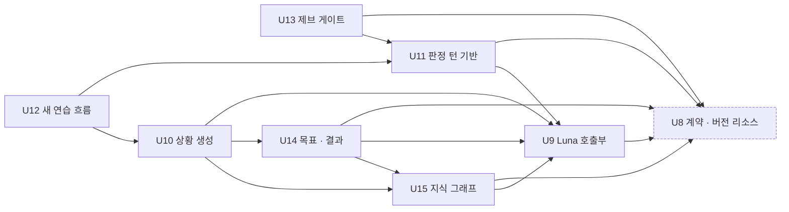

# 작업 단위 의존 관계

> 근거: `unit-of-work.md`, `../domain-design/components.md`(컴포넌트 간선), `../domain-design/decisions.md`, `../requirements-analysis/requirements.md`, `../user-stories/stories.md`('의존과 순서').
> 이 문서는 무엇이 무엇에 기대는지(위상)만 적는다. 구현 순서 추천과 핵심 경로는 Delivery Planning이 정한다.

## 의존 그래프

"A → B"는 "A가 B에 기댄다"이다.



<!-- Text fallback: U9는 U8에 기댄다. U10은 U9 · U14 · U15에, U11은 U8 · U9에, U12는 U11 · U10에, U13은 U8 · U11에, U14는 U8 · U9 · U15에, U15는 U8 · U9에 기댄다. U8은 아무것에도 기대지 않는다. 순환은 없다. -->

## 간선과 근거

| 단위 | 기대는 단위 | 까닭(무엇이 필요한가) |
|---|---|---|
| U8 | — | 공통 계약 · 버전 리소스의 출발점 |
| U9 | U8 | `contracts/ai-io.md`의 Luna 입출력 · 금지 필드, 새 비밀 이름 |
| U10 | U9 | 상황 생성 · 자체 검토 호출 |
| U10 | U14 | 담은 목표(4요소 · `skill_ref`) 읽기 — `SavedGoal` 주인이 U14(ADR-002) |
| U10 | U15 | 구조 맥락 · 변형 계획 조회(꺼지면 기본 경로이지만 인터페이스는 필요) |
| U11 | U8 | 판정 질문 · 선택지 버전 리소스, 시간 값(2초 · 10초), 세션 콘텐츠 고정 |
| U11 | U9 | 진행 중 판정 Luna 호출 |
| U12 | U11 | 판정 요청 · 보류 규칙 · 판정 턴 보류 · 확장점 신호 |
| U12 | U10 | 새 대본 필드(장면 · 다시 설명 · 집중 요점 · 표현 예시 · 변형)의 내부 HTTP 계약 |
| U13 | U8 | 제브 프롬프트 · 분류 · 정책 버전, `JEV_API_KEY` 비밀 이름, 승인 원문 |
| U13 | U11 | 출력 게이트의 보류 · 출력 세대 규칙 위에 제브 단계를 얹는다 |
| U14 | U8 | 기록 캡처 이벤트의 새 기록 사실 · 판정 요약 필드 계약 |
| U14 | U9 | 결과 문장 · 재판정 · 목표 후보 Luna 호출 |
| U14 | U15 | 씨앗 요약 목록 · `skill_ref` 검증, 새 씨앗 생성 요청 |
| U15 | U8 | 오류 코드 · 시간 값(그래프 2초) · 비밀 이름(Neo4j 접속) |
| U15 | U9 | 새 씨앗 문장 생성 Luna 호출 |

**순환을 끊은 곳:** U14는 U12가 남기는 새 연습 기록 사실을 입력으로 쓴다. 하지만 U14 → U12 간선을 두면 U12 → U10 → U14 → U12 순환이 생긴다. 그래서 이벤트 필드를 U8의 계약으로 정했다. U12는 그 계약대로 내보내고 U14는 계약에만 기댄다. 끝-끝 확인(실제 연습 기록이 결과로 이어지는지)은 두 단위가 모두 합쳐진 뒤 Build and Test의 `verify.sh`에서 한다.

## 통합 지점

| 지점 | 방식 | 만드는 쪽 → 쓰는 쪽 | 계약 위치 |
|---|---|---|---|
| 대본 조회 `/internal/practice/scenarios` | 내부 HTTP(동기) | U10 → U12 | `contracts/internal-api.yaml` · `PracticePorts.Scene` |
| 기록 캡처 `SessionRecordCaptured` | Outbox/Inbox 이벤트 | U12 · U11 → U14 | `contracts/` 이벤트 스키마(U8) |
| Luna 입출력 | 외부 API, 앱마다 호출부 | U9 → U10 · U11 · U14 · U15 | `contracts/ai-io.md`(U8) |
| 제브 입출력 | 외부 API | U13 | `contracts/ai-io.md`(U8) |
| 판정 · 가드레일 · 승인 문구 버전 | 버전 리소스 · 세션 고정 | U8 → U11 · U12 · U13 | `ApprovedContentCatalog`(U8) |
| 시간 값 | 설정 키 3곳 | U8 → 전 단위 | `mujoong.timing.*` · `contracts/timing.md` · `timing-defaults.json` |
| 목표 · 씨앗 조회 | 앱 안 호출 | U14 · U15 → U10, U15 → U14 | core-api 안 포트 |

앱 사이 연결은 모두 내부 HTTP나 이벤트다. 상대 앱의 표를 읽지 않는다(R-F5).

## 동시에 만들 수 있는 단위

서로 기대지 않는 단위 묶음이다. 같은 묶음 안에서는 어떤 순서로 만들어도 된다.

- `U8`이 끝나면 `U9`를 만든다. 다른 모든 단위가 `U8`에 기대고, 대부분이 `U9`에도 기댄다.
- `U9` 뒤에는 `U11`(realtime)과 `U15`(core)가 서로 기대지 않는다.
- `U11` 뒤의 `U13`과, `U15` 뒤의 `U14`는 서로 기대지 않는다.
- `U13`과 `U10`, `U13`과 `U12`도 서로 기대지 않는다.
- 같은 앱 같은 파일을 고치는 단위는 의존이 없어도 병합 때 부딪힌다.
  - realtime: `U11` · `U12` · `U13`이 `SessionExecutor` · `OutputGate`를 함께 고친다.
  - core: `U14` · `U10`이 `core.practice`를 함께 고친다.
- 병합 순서는 마이그레이션 번호 순서를 따른다(team.md, Flyway `outOfOrder` 꺼짐). 번호 배정은 Delivery Planning에서 한다.

## 의존 목록 (기계 판독용)

```yaml
units:
  - name: u8-contracts-catalog
    kind: spec
    depends_on: []
  - name: u9-luna-clients
    kind: library
    depends_on: [u8-contracts-catalog]
  - name: u10-scenario-generation
    kind: service
    depends_on: [u9-luna-clients, u14-goal-result, u15-knowledge-graph]
  - name: u11-judgment-turn
    kind: service
    depends_on: [u8-contracts-catalog, u9-luna-clients]
  - name: u12-practice-conversation
    kind: service
    depends_on: [u11-judgment-turn, u10-scenario-generation]
  - name: u13-jev-guardrail
    kind: service
    depends_on: [u8-contracts-catalog, u11-judgment-turn]
  - name: u14-goal-result
    kind: service
    depends_on: [u8-contracts-catalog, u9-luna-clients, u15-knowledge-graph]
  - name: u15-knowledge-graph
    kind: service
    depends_on: [u8-contracts-catalog, u9-luna-clients]
```

## Sources

- `unit-of-work.md`(같은 폴더), `units-generation-questions.md`
- `../domain-design/components.md` · `../domain-design/decisions.md`
- `../requirements-analysis/requirements.md`, `../user-stories/stories.md`
- `aidlc/spaces/default/memory/team.md`(마이그레이션 병합 순서)

## Assumptions & Open Questions

- 스켈레톤 의식은 없다(`classic`). 그래서 첫 단위를 끝-끝 조각으로 만드는 제약도 없다.
- U10 → U15 간선은 그래프가 꺼져도 동작해야 한다는 요구(FR9.5) 때문에 약한 의존이다. U15의 메모리 대역 인터페이스만 있으면 U10을 만들 수 있다.
