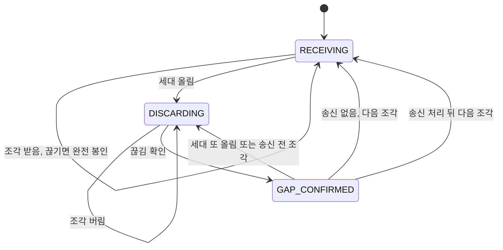
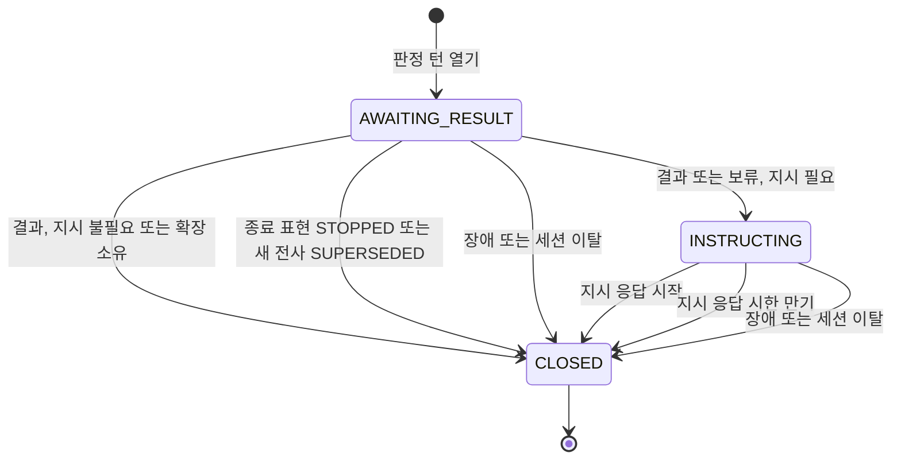
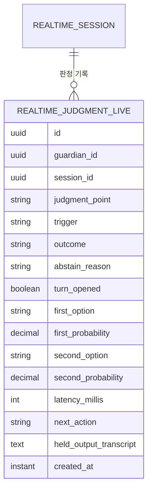

# U11 판정 턴 기반 — 기능 명세

> 근거: `functional-design-questions.md`(첫 판 Q1-C · Q1-1-A · Q2-A · Q3-A와 가정 1 ~ 13, 범위 확장 개정 Q4-A · Q5-A · Q6-B · Q6-1-A와 가정 1 ~ 13), `../../inception/requirements-analysis/requirements.md`(2026-10-17 재승인 판, FR1 ~ FR13, NFR1 ~ NFR9), 원래 기록 스토리 US1.7 · US1.8 · US1.10 · US2.5와 계약 요약 C-DS2 · C-DS3 · C-DS4 · C-DS15, 실호출 보고서 `backend/realtime-activity/build/gpt-live/report.md`(2026-10-16T08:39Z), 코드 지식 베이스 `architecture.md` · `code-quality-assessment.md` 6절(U11-R1 ~ R13), 읽기 전용 코드 조사(줄 번호는 지금 브랜치의 `SessionExecutor.java`, 이하 SE).
> 이 문서는 흐름과 상태 전이의 정본이다. 데이터 모양은 `entities.md`, 판단 규칙은 `rules.md`가 정본이고, 아래 ER 그림 · 규칙 요약은 그 둘에서 옮긴 보기다.

## 1. 개요

U11은 두 묶음이다(요구사항 Q12-A).

- **PR1 선 형식 정비 · 키 통일(FR12 · FR13)**: 실제 GPT-Live 형식으로 세션 시작 · 지시 · 해석을 바꾸고, 응답 id 대신 서버 **출력 세대**로 출력을 묶고 버린다. 키는 `OPENAI_API_KEY` 하나로 합치고, realtime Luna는 스위치로도 켠다. TTS 실호출 결과가 보고서에 남은 뒤에 합친다(BR9.3).
- **PR2 판정 턴(FR1 ~ FR11)**: realtime 세션 실행부에 **판정 턴**을 더한다. 판정 턴은 아이 말 하나를 Luna로 판정하는 동안 GPT-Live 출력을 막고, 판정 뒤 서버가 정한 지시로만 대화를 잇게 하는 짧은 구간이다.
  - 실행부가 직접 여는 판정 턴은 자유대화 · 연습 공통의 **J1(시작 응답)** 과 **J6(종료 의도)** 두 가지다. 둘 다 기존 규칙 판정기(`JoinTracker` · `StopIntentJudge`)가 확정하지 못한 순간에만 열린다(BR6.3 · BR7.1).
  - 연습의 J2 ~ J5는 확장점 능력 `requestJudgment`로 열리고, 다음 행동은 확장(U12)이 정한다(BR8.2).
  - realtime Luna가 꺼져 있으면(키 없음 · 스위치 꺼짐) 판정 턴을 아예 열지 않고 지금 흐름으로 바로 간다. 보기 · 세션 사건 순서가 지금과 같고, 다른 표에 보류 기록 1건만 더 남는다(BR1.6).

구성 요소:

| 구성 요소 | 책임 | 비고 |
|---|---|---|
| `ProviderRequestFactory`(바꿈) | 중첩 세션 시작 · 음성 append · instructions.append · response.create · close 다섯 가지만 만든다 | BR11.1 · BR11.2 |
| `ProviderClient` · 해석기(바꿈) | `delta` 음성 · `error` · `usage.updated` 해석, 응답 id 없음, 키가 비면 헤더 없음, (필요 시) 24k ↔ 16k 변환 한 곳 | BR11.3 · BR11.8 · BR12.2 |
| 출력 세대 협력 객체(새) | 세대 번호 · RECEIVING/DISCARDING/GAP_CONFIRMED · 끊김 판단 · 송신 대기 | 실행기 스레드 전용. BR11.5 ~ BR11.7 |
| 공급자 직렬 송신 경로(새) | 모든 서버 송신을 올림 → 끊김 → append → create 한 작업으로 | BR3.3 · BR11.4 |
| `SegmentBuffer` · `OutputGate`(바꿈) | 구간 열쇠를 응답 id에서 세대로, 완전 = 끊김 봉인 | BR11.6 |
| `JudgeClient`(포트) · Luna 구현 · 보류 구현 | 판정 요청 → `JudgeOutcome`, `available()` | 새 패키지 `kr.mujoong.realtime.judgment`. Luna 빈이 없으면 보류 구현(BR1.6) |
| 판정 턴 협력 객체 | `JudgmentTurn` 수명 · 차례 id · 시계 · 모은 전사 · 늦은 결과 거르기 · 미룬 참여 창 만기 | 실행기 스레드 전용. `SessionExecutor`에는 호출 지점만 |
| 다음 행동 지시 템플릿 | `NextActionInstruction` 세 종류 | `DialogInstructions`의 지시 종류에 더함 |
| 판정 기록 저장소 · 비동기 기록기 · 삭제 참여자 | `realtime_judgment_live` 쓰기 · 삭제 | 순서 180(BR2.4) |
| 판정 설정 · Luna 스위치 | `Judgment(minConfidence, minMargin)`, `mujoong.luna.enabled` | `RealtimeProperties` 루트 · luna 아래 |

## 2. 상태 기계

### 2.1 출력 세대 (`OutputGeneration`)

응답 id를 대신한다. 세션당 하나이고 번호는 올리기만 한다(BR11.5 ~ BR11.7).

**끊김 확인의 기준(BR11.7)**: 아래 두 조건이 모두 참일 때만 끊김이다.
1. 마지막 조각 시각(`lastDeltaAt`, 어느 단계 · 출력 범위 밖에서 버린 조각도 포함)과 세대를 올린 시각 중 늦은 쪽에서 `segment-quiet`(800ms)가 지났다.
2. 이번 아이 말에 대한 자동 응답이 '끝났거나 오지 않는 것'으로 볼 수 있다. 아이 말 끝 이후 조각이 한 번이라도 왔으면 1로 충분하다. 한 번도 오지 않았으면 말 끝 시각 + 자동 응답 시작 대기(새 시간 키 `mujoong.timing.provider.auto-response-start`, 값은 W7 ⑧ 관측 P95에 여유를 더해 정하고 세 곳을 함께 고침, R-M5)가 지나야 한다. 자동 응답이 아직 시작 전인데 끊김으로 잘못 보는 일을 막기 위해서다.

| 지금 단계 | 사건 | 조건 | 다음 단계 | 동작 |
|---|---|---|---|---|
| 어느 단계든 | 출력 조각 | `outputHeld()` 참(WAITING_CHILD · 종료 확인 진행 중 · 연습 보류, BR11.13) | 그대로 | 음성 · 전사 모두 버림(판정 턴이면 전사만 모음), `lastDeltaAt` 갱신, `SEGMENT_QUIET` 다시 걸기. 구간을 열지 않음 |
| RECEIVING | 출력 조각(음성 · 전사) | 보류 아님 | RECEIVING | 열린 구간이 없으면 이 조각부터 새 구간, `lastDeltaAt` 갱신, `SEGMENT_QUIET` 다시 걸기 |
| RECEIVING | `SEGMENT_QUIET` 만기 | 열린 구간 있음 | RECEIVING | 구간을 '완전'으로 봉인 → 게이트(BR11.6) |
| 어느 단계든 | 세대 올림(판정 턴 열기 · 서버 송신 요청 · 끼어들기 · 종료 의도 · 연습 폐기 · 게이트 교정 · 보류 해제) | — | DISCARDING | `generation += 1`, `bumpedAt` 기록, 열린 구간은 '불완전'으로 봉인해 버림, 기기 재생 중이면 지금처럼 기기 정지 명령, 끊김 대기 상한 걸기 |
| DISCARDING | 출력 조각 | — | DISCARDING | 버림(판정 턴이면 전사만 모음, BR3.1), `lastDeltaAt` 갱신, `SEGMENT_QUIET` 다시 걸기 |
| DISCARDING | `SEGMENT_QUIET` · `AUTO_RESPONSE_START` 만기 | 끊김 확인 기준 1 · 2 충족 | GAP_CONFIRMED | `permitSeq += 1`, 송신 대기가 있으면 직렬 경로에 `SendPermit{generation, permitSeq}` 신호 |
| DISCARDING | 위 만기 | 기준 2 미충족 | DISCARDING | `AUTO_RESPONSE_START`(말 끝 + 자동 응답 시작 대기)를 걸고 기다림 |
| GAP_CONFIRMED | 출력 조각 | 송신 대기 없음(끼어들기 등) | RECEIVING | 이 조각부터 새 구간 |
| GAP_CONFIRMED | 출력 조각 | 송신 대기 있음 · `InstructionSent` 미처리 | DISCARDING | 버림, 끊김 확인을 무효로 하고(`permitSeq += 1`) 다시 기다림. 직렬 작업은 송신 직전 확인에서 낡은 허가를 보고 보내지 않는다(W9) |
| GAP_CONFIRMED | `InstructionSent{generation, permitSeq}` | 세대 · 허가 번호 일치 | GAP_CONFIRMED(송신 처리됨) | 다음 조각부터 RECEIVING |
| GAP_CONFIRMED(송신 처리됨) | 출력 조각 | — | RECEIVING | 이 조각부터 지시 응답 구간 |
| DISCARDING · GAP_CONFIRMED | 끊김 대기 상한 만기 | 송신 전 | 그대로 | 송신하지 않음, 사유 `OUTPUT_GAP_NOT_OBSERVED`(BR4.5 · BR11.7) |
| 어느 단계든 | `SendAborted{generation, permitSeq}` | — | 그대로 | 판정 턴이 INSTRUCTING이면 바로 닫음(사유 `SEND_ABORTED`, 보기 복원). 새 송신이 대기 중이면 그 작업이 다음 차례 |

**보류 해제(BR11.13)**: `outputHeld()`가 참에서 거짓으로 바뀌는 순간(참여 START, 종료 확인 해소, 연습 보류 해제) 세대를 올린다(HOLD_RELEASED). 보류 중 시작된 자동 응답의 꼬리가 풀린 직후 기기로 가지 않게 하기 위해서다. 참여 START는 곧이어 W9 `response.create`가 같은 세대 올림을 쓴다.

텍스트 대체: 출력 세대는 평소 조각을 받다가 끊기면 그 구간을 완전한 것으로 봉인한다. 서버가 세대를 올리면 버리는 단계가 되고, 조각이 끊기고 자동 응답이 끝났거나 오지 않는 것으로 볼 수 있으면 끊김 확인 단계로 간다. 보낼 지시가 없으면 다음 조각부터, 보낼 지시가 있으면 송신을 처리한 뒤의 다음 조각부터 다시 받는다. 송신 전에 조각이 오거나 세대를 또 올리면 다시 버리는 단계로 간다. 출력 보류 중에는 단계와 관계없이 조각을 버린다.

### 2.2 판정 턴 (`JudgmentTurn`)

세션당 열린 턴은 최대 1개다. realtime Luna가 없으면(BR1.6) 아래 표 전체를 건너뛴다.

| 지금 상태 | 사건 | 조건 | 다음 상태 | 동작 |
|---|---|---|---|---|
| (없음) | 판정 턴 열기 | 공급자 있음 · 입력 판독 가능(BR4.3) · 열린 턴 없음 · WAITING_CHILD 또는 ACTIVE | AWAITING_RESULT | turnId 발급, `openedInStatus` 기록, 출력 세대 올림(JUDGMENT_TURN), ACTIVE면 THINKING(WAITING_CHILD는 보기 그대로), 판정 요청(비동기), 시계 `JUDGMENT_LIVE`(열기 + 4s) · `JUDGMENT_READY`(말 끝 + 10s) |
| (없음) | 판정 턴 열기 | 입력 판독 불가 | (없음) | 공급자 부르지 않음, ABSTAINED(UNREADABLE_INPUT) 기록 1건, 보류 줄로 바로 |
| AWAITING_RESULT | 출력 조각 | — | AWAITING_RESULT | 음성 버림, 전사 조각만 모음(BR3.1 · BR3.2) |
| AWAITING_RESULT | 아이 확정 전사 STOP | — | CLOSED(STOPPED) | 요청 취소, 종료 처리(BR6.2) |
| AWAITING_RESULT | 아이 확정 전사(STOP 아님) | owner = EXECUTOR | CLOSED(SUPERSEDED) | 요청 취소, 새 전사를 처음부터 지금 흐름에 넣음(BR5.3) |
| AWAITING_RESULT | 아이 확정 전사(STOP 아님) | owner = EXTENSION | AWAITING_RESULT | 지금처럼 확장에 전달 |
| AWAITING_RESULT | `JudgmentArrived`(일반 편지함) | turnId 일치 · 상태 = openedInStatus · 시한 전 | INSTRUCTING 또는 CLOSED | 결과를 지점별 분기(W1 · W2 · W4)에 넘김 |
| AWAITING_RESULT | `JUDGMENT_LIVE` 만기(4.000초 포함) | — | INSTRUCTING 또는 CLOSED | 요청 취소, ABSTAINED(TIMEOUT) → 보류 줄 |
| AWAITING_RESULT | `JUDGMENT_READY` 만기 | 판정이 아직 | INSTRUCTING 또는 CLOSED | 요청 취소, ABSTAINED(RESPONSE_NOT_READY) → 보류 줄 |
| INSTRUCTING | (진입) | — | INSTRUCTING | `JUDGMENT_READY`와 `JUDGMENT_LIVE` 해제, `instructionDeadline` = 지금 + 10s(`JUDGMENT_INSTRUCTION`), 직렬 경로에 지시 넣기(세대 올림 SERVER_SEND → 끊김 대기, BR3.3). INSTRUCTING에서는 `JUDGMENT_READY`가 없다 |
| INSTRUCTING | `SendAborted` | turnId 일치 | CLOSED | 사유 `SEND_ABORTED`, 지시를 다시 내지 않음, 보기 복원(BR4.5) |
| INSTRUCTING | `InstructionSent{turnId, generation}` | turnId 일치 · 세대 일치 | INSTRUCTING | `instructedGeneration` 기록, 다음 조각부터 지시 응답(BR3.7) |
| INSTRUCTING | 출력 조각 | `InstructionSent` 처리 전 | INSTRUCTING | 버림(전사는 모음) |
| INSTRUCTING | 출력 조각 | `InstructionSent` 처리 뒤 | CLOSED | 이 조각부터 지시 응답 구간으로 일반 출력 경로(게이트)에 넘김 |
| INSTRUCTING | `instructionDeadline` 만기 | — | CLOSED | 끊김을 못 봤으면 `OUTPUT_GAP_NOT_OBSERVED`(송신 안 함), 송신 뒤면 `INSTRUCTED_RESPONSE_MISSING`. 지시를 다시 내지 않음(BR4.5) |
| AWAITING_RESULT · INSTRUCTING | 공급자 끊김 · 기술적 일시 정지 | — | CLOSED(FAULT_CANCELLED) | 요청 취소, 결과를 쓰지 않음, 회복은 지금 흐름(BR5.1) |
| AWAITING_RESULT · INSTRUCTING | 세션 상태가 `openedInStatus`를 벗어남 | — | CLOSED(SESSION_EXITED) | 요청 취소(BR5.4) |
| 어느 상태든 | 늦은 결과 · 송신 완료 · 전사 | turnId 불일치 또는 CLOSED 또는 상태 다름 | 그대로 | 버림, 사유 코드만(BR5.2) |
| CLOSED | (닫힐 때마다) | — | — | 시계 모두 해제, 보기 복원(아래), 판정 기록 1건 비동기 쓰기(BR2.1 · BR2.5), 미룬 참여 창 만기가 있으면 `tick`(W1) |

**보기 복원(BR3.6)**: 닫힐 때 상태가 ACTIVE이고, 지시 응답이 시작돼 닫힌 것이 아니며, 출력 · 승인 문구 재생이 없으면 `listeningAgain()`으로 LISTENING을 되돌린다. WAITING_CHILD는 판정 턴이 보기를 바꾸지 않았으므로 되돌릴 것이 없다. 판정 턴이 열린 동안에는 `listeningAgain()`의 호출처가 LISTENING으로 되돌리지 않는다.

텍스트 대체: 판정 턴은 열리면 결과를 기다린다. 결과나 보류가 오면 지시가 필요할 때만 지시 상태로 가고, 아니면 바로 닫힌다. 종료 표현 · 새 아이 말 · 장애 · 세션 이탈은 어느 때든 턴을 닫는다. 지시 상태는 끊김을 확인하고 지시를 보낸 뒤 지시 응답이 시작되거나, 지시 응답 시한이 지나면 닫힌다. 닫힐 때마다 시계를 풀고 보기를 되돌리며 판정 기록 1건을 남긴다.

## 3. 흐름

### W1. 참여 확인 중 J1 (자유대화 · 연습 공통)

1. WAITING_CHILD에서 아이 확정 전사가 오면 지금처럼 `JoinTracker.classify`로 분류한다(SE:1665-1668). 신뢰도는 확정 전사의 `confidence`(공급자가 주지 않으면 없음)와 `transcript.uncertain-below-percent`로 `uncertain`을 계산해 BR4.3에 쓴다.
2. ACCEPT · REFUSE · TOPIC_REFUSAL이면 지금처럼 `join.reply`에 넣는다. 판정 턴을 열지 않는다(BR7.1).
3. UNCLEAR이면 그 답을 아직 `join.reply`에 넣지 않고 J1 판정 턴을 연다(trigger JOIN_UNCLEAR, owner EXECUTOR). 공급자가 없으면 판정 턴 없이 UNCLEAR를 그대로 넣는다(지금 흐름, BR1.6). WAITING_CHILD는 이미 출력 보류 상태이고 판정 턴은 보기를 바꾸지 않는다.
4. 결과를 `JoinTracker` 답으로 바꿔 `join.reply(답, 원래 확정 시각)`에 **한 번** 넣고, 나온 동작을 지금 흐름(SE:956-977)대로 실행한다. 재안내 · 대안 횟수는 이 한 번으로만 센다.

| J1 결과 | 넣는 답 | 결과적인 동작(지금 흐름) | 기록 nextAction |
|---|---|---|---|
| PARTICIPATE | ACCEPT | START(`acceptJoin`) → 첫 응답 요청은 W9 직렬 경로의 `response.create` | START_JOIN |
| DECLINE | REFUSE | 대안 제안 → 거절 | DECLINE_JOIN |
| REST · UNCLEAR · UNREADABLE · 보류(모든 사유) | UNCLEAR | 재안내(CLARIFY) 또는 같은 창 대기 | REPROMPT_JOIN |

5. 참여 확인 중 휴식 요청에 받아 주는 말을 만들지 않는다. 참여 전에는 응답을 만들지 않는다는 계약(편차 U4b-a, (U11-a)가 같은 뜻으로 대체)과 WAITING_CHILD 출력 보류 때문에 들릴 수 없기 때문이다(편차 U11-D6).
6. J1이 열린 동안 `JOIN_WINDOW` 만기가 오면 `deferredJoinTick`만 표시하고, 턴이 닫힌 뒤 아직 WAITING_CHILD면 `tick`을 부른다.
7. J1 중 새 확정 전사가 오면 BR5.3대로 이전 J1을 SUPERSEDED로 닫고 새 전사를 1단계부터 다시 처리한다.

### W2. 종료 · 휴식 뜻 후보와 J6

1. ACTIVE에서 아이 확정 전사가 오면 지금처럼 `judgeStopIntent`를 부른다. 출력권 여부에 따른 호출 순서(SE:1676-1688)는 그대로 둔다.
2. STOP이면 판정 없이 지금처럼 종료한다(BR6.1). 판정 턴이 열려 있었으면 STOPPED로 닫는다(BR6.2).
3. CONFIRM이면 지금처럼 출력권 연습의 연습 시계를 멈추고 연습 발화를 끊고, `stopOutputForIntent`(세대 올림 STOP_INTENT · 기기 정지)를 부른 뒤, **`stopConfirm.onJudgment`를 부르지 않고** J6 판정 턴을 연다(trigger STOP_CONFIRM_CANDIDATE, owner EXECUTOR). J6 동안 `StopConfirmFlow`는 IDLE이고, 다음 전사는 BR5.3으로 처리된다. 공급자가 없으면 판정 턴 없이 지금처럼 `onJudgment(CONFIRM)` → 확인 질문으로 간다(BR1.6).
4. 결과별 처리와 사건:

| J6 결과 | 다음 행동 | 세션 사건 | 기록 nextAction |
|---|---|---|---|
| END_CLEAR | 종료 처리(`beginClosing(CHILD_STOP_CONFIRMED)`) | `CHILD_STOP_INTENT{basis: LUNA_J6}`(BR6.5) | CLOSE |
| REST | BR6.4 휴식 지시(W3). 출력권 연습이면 연습 시계 재개 + `REST_REQUESTED` 사건(확장점) | 새 세션 사건 없음 | REST_ACK_AND_RETURN 또는 REST_ACK_ONLY |
| NOT_END | 이어 가기: 출력권 연습이면 연습 시계 재개, 아니면 응답 요청(W9 `response.create`) | 새 세션 사건 없음 | RESUME |
| UNCLEAR · 보류(모든 사유) | 이때 `stopConfirm.onJudgment(CONFIRM)` → 지금의 확인 질문(`playStopConfirm`) | 지금처럼 `STOP_CONFIRM_ASKED`, 이후 `STOP_CONFIRM_RESOLVED` | ASK_STOP_CONFIRM |
| FAULT_CANCELLED | 이어 가기(NOT_END와 같되 응답 요청은 하지 않음. 회복은 기술적 일시 정지 해제 흐름) | 없음 | NONE |

5. 확인 질문 흐름 안에서 온 답은 지금처럼 `StopConfirmFlow`가 처리한다(SE:1811-1816). 여기서 다시 J6를 열지 않는다.

### W3. 판정 뒤 지시

1. 실행부가 `NextActionInstruction`을 정한다(HOLD_REASK · REST_ACK_AND_RETURN · REST_ACK_ONLY). 지시는 ACTIVE에서만 낸다.
2. 턴을 INSTRUCTING으로 바꾸고 W9 직렬 경로에 `append(지시문) + create`를 넣는다. 판정 턴을 열 때 이미 세대를 올렸으므로, 직렬 경로는 세대를 한 번 더 올리고(SERVER_SEND) 끊김을 기다린다.
3. 끊김이 확인되면 직렬 작업이 `session.instructions.append` → 세대 재확인 → 일반 편지함에 `InstructionSent{turnId, generation}`('보내는 중' 표시)을 넣은 **다음** `response.create`를 보낸다. 표시를 `create`보다 먼저 넣으므로, 지시 응답의 첫 조각은 항상 표시 뒤에 편지함에 들어온다(경주 없음, R-16). `create` 송신이 실패하면 지금 공급자 송신 실패 경로(providerLost)로 가고, 응답이 오지 않는 경우는 `instructionDeadline`이 닫는다.
4. 실행기가 `InstructionSent`를 처리하기 전에 온 조각은 버린다. 처리한 뒤 처음 온 조각부터 지시 응답 구간이고, 일반 출력 경로(구간 → 끊김 봉인 → 게이트)로 간다. 게이트 · 원문 일치 · U13 제브 단계는 바꾸지 않는다.
5. 남은 자동 응답이 끊기지 않아 `instructionDeadline` 안에 끊김을 못 보면 지시를 보내지 않고 턴을 닫는다(`OUTPUT_GAP_NOT_OBSERVED`). 이 경우 그 뒤에 오는 자동 응답은 평소처럼 게이트를 거친다. 실제 GPT-Live에 응답 경계 사건이 있는지는 W7에서 확인하고, 있으면 끊김 대신 그 사건으로 바꾼다.

### W4. 확장이 요청한 판정 (J2 ~ J5)

1. 확장이 ACTIVE에서 `requestJudgment(JudgmentPoint point, long transcriptSeq, UUID correlationId, Map criteria)`를 부른다. 반환은 `boolean`(받음 · 거절).
   - ACTIVE가 아니면 거절하고 `PRACTICE_EXTENSION_FAILED{reason NOT_ACTIVE, capability requestJudgment}`(BR8.4).
   - 판정 턴이 이미 열려 있거나, `point`가 J1 · J6이거나, `transcriptSeq`가 세션 메모리의 최근 확정 전사(최대 4개)에 없으면 거절한다.
2. 실행부가 판정 턴을 연다(trigger EXTENSION_REQUEST, owner EXTENSION). `childUtterance`는 `transcriptSeq`의 확정 전사, `recentTurns`는 그 앞 최대 3개, `criteria`는 확장이 준 객체 그대로다(J2 · J3 · J5만). 출력 보류 · THINKING은 판정 턴 열기와 같다.
3. 결과가 오면 `ExtensionEvent(JUDGMENT_RESULT, "judgment", correlationId, {point, firstOption, secondOption})` 또는 `ExtensionEvent(JUDGMENT_ABSTAINED, "judgment", correlationId, {point, abstainReason})`를 넘기고 턴을 닫는다. 확률은 넘기지 않는다.
4. 모은 출력 전사가 있으면 `ExtensionEvent(HELD_OUTPUT_TRANSCRIPT, "judgment", correlationId, {text})`도 넘긴다(BR8.3).
5. 장애로 닫히면 `JUDGMENT_ABSTAINED{abstainReason FAULT}`를 넘긴다(BR5.1).
6. 다음 행동 지시는 확장이 정한다. 확장의 지시도 W9 직렬 경로를 탄다. 실행부는 HOLD_REASK를 넣지 않는다(BR8.2).
7. U5b 레거시 확장은 이 능력을 쓰지 않으므로 지금 동작이 바뀌지 않는다.

### W5. 4초 판정 · 10초 응답 준비 · 지시 응답 시한

1. 판정 턴을 열 때 `JUDGMENT_LIVE`를 열기 + `live-budget`(4s)에, `JUDGMENT_READY`를 `speechEndAt + response-ready`(10s)에 건다. 10초는 말 끝부터 재며 판정 4초를 포함한다. `speechEndAt`은 판정 대상 전사에 대응하는 말 끝 시각이다(BR11.9).
2. `JUDGMENT_LIVE`가 4.000초에 만기되면 그 순간 보류(TIMEOUT)다. 결과와 만기가 같은 틱이면 편지함에 먼저 들어온 쪽이 이긴다(BR1.4).
3. 판정이 오기 전에 `JUDGMENT_READY`가 만기되면 ABSTAINED(RESPONSE_NOT_READY)로 닫고 공급자 요청을 취소한다. 실행부 소유 턴은 보류 줄(J1 재안내 · J6 확인 질문 · 그 밖의 HOLD_REASK)로, 확장 소유 턴은 JUDGMENT_ABSTAINED 사건으로 간다. 판정 턴이 말 끝 직후에 열리면 `JUDGMENT_LIVE`(4초)가 늘 먼저 만기되므로, 이 시계가 실제로 먼저 만기되는 것은 턴이 말 끝보다 6초 넘게 늦게 열린 경우(확장이 늦게 요청한 J2 ~ J5, 늦게 확정된 전사)뿐이다. 시험은 그 경우로 만든다.
4. 시계는 두 단계로 나눈다(BR4.1 · BR4.5). **판정 단계**(AWAITING_RESULT)는 말 끝 + 10s(`JUDGMENT_READY`)와 열기 + 4s(`JUDGMENT_LIVE`)로 잰다. 판정이 끝나 지시를 정하면 이 둘을 풀고, **지시 단계**(INSTRUCTING)는 진입 + 10s(`instructionDeadline`)로 따로 잰다. 끊김 대기와 지시 응답 대기를 합친 시간이다. 지시 응답이 시작되면 끈다. 만기되면 지시를 다시 내지 않고 턴을 닫고 보기를 복원한다.
5. FR4.1의 "말 끝 뒤 10초 안에 응답이 준비되지 않으면 보류로 보고 되묻기"는 판정 단계에 적용한다. 판정 단계가 끝나면 그 결과(보류면 되묻기 지시)가 '준비된 응답'이므로, 말 끝부터 지시 응답 첫 소리까지는 최악 약 4초 + 10초 = 14초가 될 수 있다. 지시 단계에서 다시 10초가 지나면 되묻기를 또 하지 않고 턴을 닫는다(편차 U11-D3에 이 해석을 함께 적음).
6. 판정 턴이 아닌 일반 대화 턴에는 이 시계들을 걸지 않는다(첫 판 Q3-A).

### W6. 장애 · 세션 이탈 · 늦은 결과

1. 판정 턴 중 `providerLost` · `abortProviderLost` · `startPause`에 들어가면 열린 턴을 FAULT_CANCELLED로 닫고 요청을 취소한다. 회복은 지금 흐름에 맡긴다.
   - J1: 기술적 일시 정지가 풀리면 `endPause`가 참여 창을 밀어 다시 건다. 재안내는 창 만기 규칙대로 이어진다.
   - J6: 확인 흐름에 들어가지 않았으므로 W2 표의 FAULT_CANCELLED 줄대로 연습 시계만 되돌린다.
   - 확장 소유 턴: JUDGMENT_ABSTAINED{FAULT} 사건.
2. 공급자에서 `error` 사건이 오면 지금 `session.error`와 같은 처리(사유 코드 기록, 연결 오류면 `providerLost`)를 한다. 코드 · 사유만 남기고 message 원문은 남기지 않는다.
3. 세션이 `openedInStatus`를 벗어나는 모든 전이에서 열린 턴을 SESSION_EXITED로 닫는다(BR5.4). 전이 공통 지점에서 처리한다. WAITING_CHILD → ACTIVE로 바뀌는 J1의 START는 J1 결과를 처리한 뒤에 일어나므로 이 규칙에 걸리지 않는다.
4. Luna 완료 콜백은 HTTP 클라이언트 스레드에서 돈다. 결과는 `JudgmentArrived{turnId, outcome}`로 **일반 편지함**에 넣어 앞서 도착한 출력 조각보다 먼저 처리되지 않게 한다(BR1.8). 실행기가 꺼낼 때 turnId가 다르거나 턴이 닫혔거나 상태가 다르면 버린다(BR5.2).

### W7. GPT-Live 합성 말소리(TTS) 실호출 (PR1 첫 작업)

1. 실호출 도구 `gptLiveTest`(태그 `gpt-live`, `check` · CI 밖)를 운영 형식(app) 하나만 시도하도록 고친다. kit 비교 모드는 지운다(BR9.1).
2. 입력은 합성 말소리 원시 PCM(`GPT_LIVE_INPUT_PCM`, 예: 키트 `cache/`의 Piper 음성)이다. 사람이 키를 넣기 전에 RUNBOOK 단계 4의 R-F15 확인 기록을 남긴다(넓힌 대상, BR12.4).
3. 한 실행에서 확인할 것과 결과별 갈래:

| 확인 | 관측되면 | 관측되지 않으면 |
|---|---|---|
| ① 24kHz 중첩 세션 시작 수락 | 변환 없음(BR11.8) | 16kHz + `ProviderClient` 한 곳 변환, J131 편차 |
| ② 출력 전사 사건 이름 · 모양 | 해석기에 더함, 게이트 그대로 | **멈추고 사람과 다시 정함**(BR9.2) |
| ③ 입력 전사 조각 · 완료 사건 | 해석기에 더함, 지금 흐름 | 서버 확정(새 시간 키, BR11.9) |
| ④ 말 끝 사건 | 해석기에 더함 | 지연 출처 `INPUT_TRANSCRIPT_FINAL` · `LAST_INPUT_FRAME` |
| ⑤ 응답 끝 · 응답 경계 사건 | 끊김 대신 그 사건으로 봉인 · 새 응답 시작(BR11.6 · BR11.7) | 끊김(800ms) 그대로 |
| ⑥ `instructions.append` 누적 | 지시문 끝 단발 문장(BR11.4), 그래도 남으면 멈춤 | 그대로 |
| ⑦ `append` + `create` 뒤 응답, 지원 목록 밖 type 0건 | 정비 완료 | 멈추고 사람과 다시 정함 |
| ⑧ 말 끝 → 자동 응답 첫 조각까지 걸린 시간(여러 발화) | P95 + 여유로 `auto-response-start` 값을 정함(세 곳). 값 + `segment-quiet`(800ms)가 지시 단계 10초(`response-ready`)의 절반(5초)을 넘으면 사람과 다시 정한다 | 자동 응답이 오지 않으면 값을 `segment-quiet`와 같게 둠 |
| ⑨ 자동 응답 안의 쉼 길이 · `session.update`로 자동 응답을 끌 수 있는지(지원 목록에 `session.update` 있음) | 보고서에 관측만 남김. 쉼이 800ms를 자주 넘거나 끌 수단이 있으면 사람에게 다시 묻는다(첫 판 Q5는 A로 정했음) | 그대로 |

4. 키가 없으면 '건너뜀'이고 통과로 보지 않는다. 결과는 `[실호출-합성]`으로 단위 보고서에 표로 남기고(R-M11), 그 뒤에 PR1을 합친다(BR9.3).
5. 관측 결과로 가짜 공급자 두 곳 · 계약 표를 같은 커밋에서 맞춘다(BR11.10 · BR11.12).

### W8. 출력 구간 (응답 id 없음)

0. `outputHeld()`가 참인 동안(WAITING_CHILD · 종료 확인 진행 중 · 연습 보류) 온 조각은 세대 단계와 관계없이 모두 버리고 `lastDeltaAt`만 갱신한다. 지금 `refuseHeldResponse`의 조각별 거부를 대신한다(BR11.13). 보류가 풀리면 세대를 올린다(2.1 보류 해제).
1. 출력 세대가 RECEIVING이고 보류가 아닐 때 첫 조각이 오면 새 구간을 연다(`fromStart = true`). 이후 조각을 이어 붙이고 조각마다 `SEGMENT_QUIET`(800ms)를 다시 건다. `inOutputRange()` 밖에서 버리는 조각도 `lastDeltaAt`과 `SEGMENT_QUIET`는 갱신한다.
2. 구간 상한(지금 출력 상한)을 넘으면 지금처럼 떼어 낸다.
3. `SEGMENT_QUIET`가 만기되면 구간을 '완전'으로 봉인해 게이트에 넣는다(BR11.6). ⑤ 응답 끝 사건이 관측됐다면 그 사건이 먼저 봉인한다.
4. 세대가 바뀌면 열린 구간은 '불완전'으로 봉인해 버린다(GATE_EMPTY 사유 그대로).
5. 게이트를 통과한 구간은 지금처럼 기기로 보내고(재생 id ↔ 세대 대응을 `playbackResponses` 대신 둔다), 대화 기록 AI 행 확정(`transcripts.aiFinal`)은 봉인 시각에 한다. 지연 기록의 '공급자 출력 끝'은 봉인 시각이 아니라 구간의 마지막 조각 시각(`lastDeltaAt`)을 써서 800ms 대기가 지표에 섞이지 않게 하고, 봉인 대기는 따로 '게이트 대기'로 남긴다. 기기에 첫 소리가 가는 시각은 지금보다 최대 800ms 늦어진다(U11-D7).
6. 게이트가 구간을 버리면 지금처럼 교정 지시를 세대당 한 번 W9 경로로 보낸다(`correctAfterDiscard`의 열쇠가 세대).
7. 끼어들기(`onBargeIn`) · 종료 의도(`stopOutputForIntent`) · 연습 폐기는 공급자 취소 대신 세대를 올리고 기기 재생을 멈춘다.

### W9. 서버 송신 공통 직렬 경로

1. 지시 · 응답 요청을 보내는 일곱 경로가 모두 이 경로를 쓴다: 판정 뒤 지시(W3), 되묻기(BR4.2), 휴식 지시(BR6.4), 게이트 교정(W8-6), 연습 발화 `speak`(ai-io.md 8절), 참여 뒤 첫 응답 · 확인 뒤 이어 가기 · 연습 `requestResponse`(`response.create`만).
2. 한 세션에 직렬 큐 하나를 둔다. 출력권 연습의 `enqueuePracticeProvider` 큐와 같은 큐다. 지금 `toProvider`의 "송신마다 따로 띄우기"는 쓰지 않는다(U11-R2).
3. 작업 순서: 실행기에서 세대 올림(SERVER_SEND, `pendingSend = true`)하고 송신 작업을 큐에 넣는다 → 실행기가 끊김을 확인하면 그 작업의 허가 칸(한 번만 채워지는 값)에 `SendPermit{generation, permitSeq}`를 채운다 → 큐 작업이 허가를 받으면 송신 직전에 실행기가 내보내는 읽기 전용 값(`volatile` 현재 세대 · 현재 허가 번호)과 허가를 대조한다 → 같으면 `append`(있으면) → 다시 대조 → 일반 편지함 `InstructionSent{turnId?, generation, permitSeq}`('보내는 중' 표시) → `create`. 표시가 `create`보다 앞서므로 지시 응답의 첫 조각은 표시 처리 뒤에 도착한다.
4. **허가 칸 해제**: 직렬 큐는 세션당 하나이므로 허가를 기다리는 작업이 큐를 쥔 채 남지 않게 한다. 끊김 대기 상한이 만기되거나 세션이 종료 · 장애로 들어가면 실행기가 그 허가 칸을 '거부' 값으로 채우고, 대기 중이던 작업은 송신 없이 끝나 일반 편지함에 `SendAborted{turnId?, generation, permitSeq, reason}`(reason = `GAP_TIMEOUT` · `SESSION_END` · `FAULT`)을 넣는다. 판정 턴이면 INSTRUCTING이 닫히고(사유 `OUTPUT_GAP_NOT_OBSERVED` 또는 `SEND_ABORTED`), 판정 턴 밖 송신이면 사유 코드만 남긴다. 어느 경우도 다음 송신 작업이 막히지 않는다.
5. 대조가 어긋나면(끼어들기 · 종료 의도 · 새 송신으로 세대가 바뀜, 또는 허가 뒤 조각이 와서 실행기가 허가 번호를 올림) 그 단계에서 보내지 않고 일반 편지함에 `SendAborted{turnId?, generation, permitSeq}`를 넣고 끝난다. 실행기는 같은 세대에서 허가 번호만 올라간 경우 다시 끊김을 기다려 새 허가를 내고 작업을 다시 큐에 넣는다. 세대가 바뀐 경우 판정 턴이면 SEND_ABORTED로 닫는다. 새 송신이 있으면 그 작업이 다음 차례다. 출력 세대 객체 자체는 실행기 스레드에서만 바꾼다.
6. 상한까지 끊김이 없으면 4번대로 허가 칸을 거부로 채워 보내지 않고 사유 `OUTPUT_GAP_NOT_OBSERVED`를 남긴다. 연습 발화(`speak`)는 지금처럼 확장에 실패를 알린다.

### W10. 기동 · 키 · Luna 스위치

1. realtime 기동 점검: demo 프로필에서 `OPENAI_API_KEY`가 비면 기동을 거부한다. 다른 프로필은 키 없이 뜬다(BR12.2). demo 공급자 주소 규칙(ProviderHosts)은 그대로다.
2. `ProviderClient.open`: 키가 있으면 `Authorization: Bearer` 헤더를 싣고, 없으면 싣지 않는다. 가짜 공급자는 헤더를 보지 않는다.
3. realtime Luna: 키가 있고 `mujoong.luna.enabled = true`일 때만 `LunaTransport` · `RealtimeLunaClient`를 등록한다. 기동 기록 `LUNA_STARTUP lunaState`는 `ENABLED` · `DISABLED_NO_KEY` · `DISABLED_SWITCH_OFF`다(BR12.3). core-api Luna는 지금 그대로다.
4. CI · 검증(`infra/ci/gen-env.sh`)은 realtime env에 키 자리값을 넣지 않고, `OPENAI_API_KEY`를 빈 값으로 둔다. 스위치는 기본 `false`라 설정하지 않는다.
5. RUNBOOK(BR12.4): ① R-F15 확인 대상을 "Luna 판정 · GPT-Live 음성 중계"로 넓힌다. ② PR1 배포 전에 `/mujoong/demo/OPENAI_API_KEY`에 GPT-Live 키가 들어 있는지 확인한다. ③ PR1 이전 이미지는 demo에서 `PROVIDER_API_KEY`가 비면 기동을 거부하므로, 롤백 대상(`deploy.log`의 마지막 `result=OK` SHA)이 PR1 이후 SHA뿐이게 될 때까지 두 이름을 같은 값으로 함께 둔다. 그 뒤에 `/mujoong/demo/PROVIDER_API_KEY`를 지운다. ④ realtime Luna를 켜려면 확인 기록 뒤 demo 설정의 `mujoong.luna.enabled`를 `true`로 바꾼다. 이번 작업은 절차만 적고 Parameter Store · 배포를 바꾸지 않는다.

## 4. 인터페이스 (설계 수준)

- 공급자 송신(팩토리 한 곳, BR11.1 · BR11.2): `session.start{session{model, instructions, audio{format{type, rate}}}}`, `session.input_audio.append{audio}`, `session.instructions.append{text}`(필드 이름은 TTS 실호출에서 확인), `response.create{}`, `session.close{}`.
- 공급자 수신(BR11.3): `session.started` → `Started`, `session.output_audio.delta{delta}` → `OutputAudioDelta(audio)`(응답 id 없음), `session.usage.updated{usage.seconds}` → `UsageUpdated`, `error{error{type, code, param}}` → `Error(code)`, `session.closed` → `Closed`. 출력 전사 · 입력 전사 · 말 끝 · 응답 경계는 W7 관측 뒤 그 이름으로 더한다(지금 내부 레코드 `OutputTranscriptDelta` · `InputTranscriptDelta` · `InputTranscriptDone` · `SpeechStopped`는 응답 id만 빼고 이름을 유지).
- `JudgeClient`
  - `available() → boolean`: 공급자가 있는지. 없으면 실행부가 판정 턴을 열지 않는다(BR1.6).
  - `judge(JudgeRequest, UUID turnId) → 비동기 JudgeOutcome`: 예외를 던지지 않고 실패도 ABSTAINED로 돌려준다.
- `PracticeOutput`에 더하는 능력(모두 기본 `false`): `requestJudgment(JudgmentPoint point, long transcriptSeq, UUID correlationId, Map<String, Object> criteria)`, `announceRoleSwitch(String toRole)`(자리와 거절 규칙만), `setThinking(boolean on)`.
- `ExtensionEvent.Kind`에 더하는 값: `JUDGMENT_RESULT` · `JUDGMENT_ABSTAINED` · `HELD_OUTPUT_TRANSCRIPT` · `GUARDRAIL_BLOCKED`(자리만) · `REST_REQUESTED`. 레코드 모양 `(Kind, String name, UUID correlationId, Object value)`은 그대로다.
- 실행부 내부 편지함 메시지(일반 편지함): `JudgmentArrived{turnId, outcome}`, `InstructionSent{turnId?, generation}`(판정 턴 밖 송신이면 turnId 없음).
- 시계 종류: `SessionTimers.Kind`에 `JUDGMENT_LIVE` · `JUDGMENT_READY` · `JUDGMENT_INSTRUCTION` · `OUTPUT_GAP_WAIT`(판정 턴 밖 송신의 끊김 대기 상한) · `AUTO_RESPONSE_START`(말 끝 + 자동 응답 시작 대기)를 더한다. `SEGMENT_QUIET`는 끊김 판단에도 쓴다.
- 직렬 작업 ↔ 실행기 신호: `SendPermit{generation, permitSeq}`(실행기 → 작업, 한 번만 채워지는 값), 실행기가 내보내는 읽기 전용 `volatile` 현재 세대 · 허가 번호, `InstructionSent{turnId?, generation, permitSeq}` · `SendAborted{turnId?, generation, permitSeq}`(작업 → 일반 편지함).
- 세션 메모리: 최근 아이 확정 전사 최대 4개(순번 · 원문 · uncertain)를 실행기 안에 둔다. 판정 요청 만들기에만 쓰고 로그에 남기지 않는다.
- 설정
  - `mujoong.judgment.min-confidence` · `min-margin`(새 `Judgment` 레코드, 시간 값 아님).
  - `mujoong.luna.enabled`(realtime, 기본 `false`, 시간 값 아님).
  - `mujoong.timing.judgment.live-budget` 4s(값 변경: timing.md 13절 · realtime `application.yml` · 설정 레코드 세 곳, R-M5), `response-ready` 10s 그대로.
  - `mujoong.timing.provider.auto-response-start`(새 시간 키, 값은 W7 ⑧ 관측 뒤, 세 곳).
  - BR11.9 서버 확정이 필요해지면 새 시간 키 하나 더(이름 · 값은 W7 뒤, 세 곳).

## 5. 검증 규칙

| 대상 | 규칙 | 실패 시 |
|---|---|---|
| 공급자 송신 type | 다섯 가지 안(BR11.2) | 시험 실패(운영에서는 팩토리가 만들 수 없음) |
| 공급자 수신 | 알려진 type만 해석, `delta` base64 디코드 | 디코드 실패는 조각 버림 · 사유 코드, 모르는 type은 개수만 |
| 판정 입력 전사 | 공백 아님 · uncertain 아님 · 수신 끊김 아님 | ABSTAINED(UNREADABLE_INPUT), 공급자 안 부름 |
| 판정 요청 | 스키마 `ai-judgment-request` 통과(U9가 검사) · 금지 키 없음 | ABSTAINED(PROVIDER_ERROR, U9 FORBIDDEN_INPUT 사유) |
| 판정 결과 | 스키마 통과 · 선택지 안 · 1 · 2순위 다름 · 확률 0 ~ 1 | ABSTAINED(SCHEMA_INVALID · OPTION_OUT_OF_SET · DUPLICATE_OPTION · PROBABILITY_OUT_OF_RANGE) |
| 보류 기준 | first ≥ 0.6 · first − second ≥ 0.15 | ABSTAINED(LOW_CONFIDENCE · LOW_MARGIN) |
| 지시문 | 템플릿에서만 · 500자 이하 · 제어 문자 없음 · 선택지 코드 · 숫자 확률 없음 | 지시를 내지 않고 앱 오류(사유 코드) |
| `requestJudgment` | ACTIVE · 열린 턴 없음 · J2 ~ J5 · 최근 전사에 있는 순번 | `false` 반환(ACTIVE가 아니면 `PRACTICE_EXTENSION_FAILED`) |
| 설정 | 0 ≤ minConfidence ≤ 1, 0 ≤ minMargin ≤ 1 | 기동 거부(필수 설정 검사) |
| 기동 키 | demo에서 `OPENAI_API_KEY` 있음 | 기동 거부 |

판정 시험 벡터(1순위 확률, 2순위 확률): (0.59, 0.10) 보류(LOW_CONFIDENCE) · (0.70, 0.60) 보류(LOW_MARGIN) · (0.70, 0.40) 확정 · (0.60, 0.45) 확정(경계) · (0.60, 0.46) 보류(LOW_MARGIN). 시한 벡터: 3.999초 도착 확정 · 4.000초 만기 보류.

## 6. 오류 · 사유 코드

새 HTTP 오류 코드는 없다(`ErrorCode` · `contracts/errors.md` 변경 없음). 판정 · 선 형식 쪽 실패는 모두 내부 사유다.

| 사유 | 어디에 남나 | 비고 |
|---|---|---|
| `JudgeOutcome.abstainReason` 11종 | `realtime_judgment_live.abstain_reason`, 이벤트 로그 사유 코드 | 전사 · 지시문 원문은 로그에 없음(R-F14) |
| 늦은 결과 · 전사 폐기 | 이벤트 로그 사유 코드(`JUDGMENT_LATE_DROPPED`) | 개수만 |
| 지시 응답 시한 만기 | 사유 코드 `INSTRUCTED_RESPONSE_MISSING` | BR4.5 |
| 끊김 대기 상한 만기 | 사유 코드 `OUTPUT_GAP_NOT_OBSERVED` | BR4.5 · BR11.7, 송신하지 않음 |
| 송신 직전 대조 실패 | 사유 코드 `SEND_ABORTED` | W9 4, 판정 턴이면 닫음 |
| 버린 세대 조각 | 사유 코드 `GENERATION_DISCARDED`(개수) | 세대 올림 까닭(`bumpReason`)과 함께 |
| 공급자 `error` | 지금 `session.error` 처리 경로, code · param만 | message 원문은 남기지 않음 |
| 판정 기록 쓰기 실패 | 앱 오류(`events.appError`) | 일시 실패만 재시도, 제약 위반은 버림 |
| 확장 능력 거절 | 지금 `PRACTICE_EXTENSION_FAILED{reason, capability}` | 능력 이름만 더함 |

## 7. 저장 (realtime V5)

- 표 `realtime.realtime_judgment_live`(V1 ~ V4의 `realtime_` 접두 관례). 열은 `entities.md`의 `JudgmentLiveRecord` 그대로이고, 묶음 값은 V4 관례대로 `data jsonb`(객체 검사) 하나에 둘 수 있다.
- `guardian_id` 색인, `session_id` 외래 키. 기존 표에 제약을 더하지 않는다(`infra/migration-approvals.txt` 대상 아님).
- 삭제 참여자 순서 180, `guardian_id` 기준(BR2.4). 비동기 기록기는 일시 실패만 재시도하고, 외래 키 · 검사 제약 위반과 삭제로 막힌 세션의 기록은 버린다(BR2.5).
- 판 단언 갱신: `RealtimeSchemaIT`(표 목록 · 최신 판 · 표 수), `PracticeMigrationRegistrationTest`(최신 판), `PracticeMigrationIT`를 새 사실로만 갱신한다(BR2.3).
- 선 형식 정비 묶음(PR1)에는 마이그레이션이 없다. V5는 PR2에 든다.

텍스트 대체: 세션 하나에 판정 기록이 여러 건 달린다. 판정 기록은 지점 · 계기 · 결과 · 보류 사유 · 턴을 열었는지 · 1 · 2순위와 확률 · 걸린 시간 · 다음 행동 · 모은 출력 전사 · 만든 시각을 갖는다.

## 8. 편차 · 결정

설계 편차(`U11-Dn`, 이 문서와 `docs/units/u11/design.md`에 적음):

| ID | 내용 | 근거 |
|---|---|---|
| U11-D1 | 휴식 요청 때 승인 문구 `D_REST_ACK`(음성 파일 없음)를 재생하지 않고 일반 지시(REST_ACK_AND_RETURN · REST_ACK_ONLY)로 대신한다. 요구사항 FR6.4 · AC1.7.6과 다르다 | 첫 판 Q1-C · Q1-1-A |
| U11-D2 | 판정 턴 중 GPT-Live 응답은 공급자 취소가 없어 받되 음성을 버리고 전사만 모은다(첫 판 "바로 취소"를 바꿈). 모은 전사는 2000자에서 자른다 | 첫 판 Q2-A, 범위 확장 가정 5 |
| U11-D3 | 10초 응답 준비 시계는 판정 턴의 판정 단계에만 건다. 지시 단계는 진입부터 10초를 따로 재므로 말 끝부터 지시 응답 첫 소리까지 최악 약 14초다 | 첫 판 Q3-A, 설계 검토 R-03 |
| U11-D4 | GPT-Live 실호출 확인을 Requirements Analysis 전이 아니라 Code Generation 첫 단계에서 했고, 그 결과로 범위를 넓혔다(지시서와 다름) | 요구사항 Q1-B, 코드 생성 Step 3-3 B |
| U11-D5 | 판 번호 · 표 목록 단언 3곳을 새 사실로 갱신한다(낮추지 않음) | 요구사항 Q2-A, 첫 판 가정 7 |
| U11-D6 | 참여 확인 중(J1) 휴식 요청은 받아 주는 말 없이 재안내로 보낸다 | 첫 판 설계 검토 R-01 |
| U11-D7 | 지시 응답 식별과 출력 구간 끝을 응답 id · `output.done` 대신 서버 세대와 800ms 끊김으로 정한다. 남은 자동 응답에 800ms 넘는 쉼이 있으면 그 뒤 조각이 새 응답으로 받아질 수 있으나, 게이트 검사는 그대로 거친다. 자동 응답이 시작 전인 경우는 자동 응답 시작 대기로 막는다. 비용: 모든 AI 응답이 마지막 조각 뒤 800ms를 더 기다려 게이트를 통과하므로 기기 첫 소리가 최대 800ms 늦어진다(지연 지표의 공급자 출력 끝은 마지막 조각 시각으로 남겨 보정). 송신 쪽도 모든 서버 송신(참여 뒤 첫 응답 · 이어 가기 · 연습 발화 · 게이트 교정 · 판정 뒤 지시)이 세대 올림 뒤 최소 800ms(올림 전에 이미 800ms 이상 조용했으면 즉시, 말 끝 이후 조각이 없었으면 `auto-response-start`까지)를 기다려 나가므로 그만큼 늦어진다. `auto-response-start` 값은 지시 단계 10초 예산 안에 들어야 한다 | Q4-A · Q5-A, 설계 검토 R-01 · R-06 |
| U11-D8 | 키 통일 뒤 realtime Luna는 키 + 스위치(기본 꺼짐)로 켜고 core는 키만으로 켠다. 두 앱의 켜짐 조건이 달라진다 | Q6-B · Q6-1-A |

계약 편차(`contracts/deviations.md`, R-M10, 코드와 같은 커밋):

| ID(예정) | 내용 | 대체하는 편차 · 고치는 계약 |
|---|---|---|
| (U11-a) | GPT-Live 실제 선 형식: 중첩 세션 시작, 송신 다섯 가지, `delta` 음성 · `error` · `usage.updated` 수신, 응답 id · `output.done` · `response.cancel` · `instructions.correct` 없음, 서버 세대 · 800ms 끊김으로 구간 완전 · 응답 경계를 정함, 참여 전에는 응답을 요청하지 않음 | (z) · (aa) · (U4b-a)를 대체(지우지 않고 대체 표시), `ai-io.md` 2 · 3 · 8절 |
| (U11-b) | 판정 시한 `live-budget` 2s → 4s | 원 AC1.8.2 · NFR1, `timing.md` 13절 |
| (U11-c) | 공급자 키 `PROVIDER_API_KEY` → `OPENAI_API_KEY` 통일, GPT-Live 키는 demo만 필수, realtime `mujoong.luna.enabled` · `lunaState DISABLED_SWITCH_OFF` | `ai-io.md` 2절 · 10절 |
| 다음 빈 (U11-?) | (W7 ①에서 24kHz가 거절되면) 공급자 구간만 16kHz, `ProviderClient` 한 곳 변환 | J131, `ai-io.md` 2절 |

판정 턴 묶음은 계약을 더 바꾸지 않는다.
- 세션 사건 `CHILD_STOP_INTENT`의 basis 값 `LUNA_J6`는 realtime 내부 표 값이다.
- `mujoong.judgment.min-confidence` · `min-margin`은 내부 설정이라 R-M10 대상이 아니다. 기본값과 뜻은 `docs/units/u11/design.md`에 적는다.

## 9. 규칙 요약 (rules.md에서 옮김)

- 판정 호출(BR1.1 ~ BR1.8): `JudgeClient` → Luna, 판 고정, 0.6 · 0.15, 4초(4.000초는 보류) · 무재시도, 결과 검증, Luna가 없으면 턴 없이 지금 흐름, 최소 입력, 일반 편지함.
- 판정 기록(BR2.1 ~ BR2.5): 턴마다 1건, 비노출, V5 · 단언 갱신, 삭제 180, 비동기 쓰기 · 제약 위반 폐기.
- 출력 보류(BR3.1 ~ BR3.7): 세대 올림 · 전사만 모음, 대화 기록 밖, 모든 송신은 직렬(올림 → 끊김 → append → create), 지시 뒤 세대만, 지시문 금지 내용, 생각 중 유지 · 복원, 지시 응답 = 송신 처리 뒤 첫 조각.
- 진행(BR4.1 ~ BR4.5): 10초는 판정 턴만 · 말 끝부터, 보류면 되묻기, 판독 불가, 되묻기 전 세대 올림, 끊김 대기 + 응답 대기 10초.
- 장애 · 대체 · 이탈(BR5.1 ~ BR5.4), 종료 · 휴식(BR6.1 ~ BR6.5), 자유대화(BR7.1 · BR7.2), 확장점(BR8.1 ~ BR8.4), 실호출 · 병합 순서(BR9.1 ~ BR9.3), 기록 이벤트(BR10.1).
- 선 형식(BR11.1 ~ BR11.13): 중첩 세션 시작, 송신 다섯 가지, 해석기, append → create, 세대 · DISCARDING, 끊김 봉인, 끊김 뒤 송신(자동 응답 시작 대기 · 허가 대조), 표본율, 말 끝, 가짜 공급자, 단언 갱신, 계약 · 편차, 출력 보류 중 조각 버림 · 보류 해제 세대 올림.
- 키 · Luna(BR12.1 ~ BR12.5): `OPENAI_API_KEY` 하나, demo만 필수, realtime 스위치, R-F15 확대 · Parameter Store 순서, 검사 목록 전부.

## 10. 시험 계획 (Standard)

| 층 | 대상 | 주요 경우 |
|---|---|---|
| 단위 | `ProviderRequestFactory` | 중첩 세션 시작 키 집합, 송신 type 다섯 가지뿐, `childContext` · `delegation` 없음 |
| 단위 | 해석기 | `delta` 음성 바이트, `error` → `Error(code)`, `usage.updated`, 모르는 type 개수, 응답 id 없음 |
| 단위 | 출력 세대 협력 객체 | 2.1 표 전 행, 끊김 기준 1 · 2(말 끝 뒤 조각이 없을 때 자동 응답 시작 대기), 허가 뒤 조각 → 허가 무효, 출력 보류 중 조각 버림 · `lastDeltaAt` 갱신, 보류 해제 세대 올림, 끊김 대기 상한, 세대 또 올림, 송신 처리 전 · 뒤 조각 |
| 단위 | 시계 단계 | INSTRUCTING 진입 때 READY · LIVE 해제, 판정 단계 READY가 먼저 만기되는 경우(말 끝 6초 뒤 열린 확장 소유 턴), 지시 단계 10초 만기 |
| 실행기 | W9 핸드셰이크 | 허가 뒤 조각 → `SendAborted` → 재허가 · 재송신, 세대 변경 → 판정 턴 SEND_ABORTED, 판독 불가 입력 직후 송신이 자동 응답 시작 대기를 지킴 |
| 실행기 | 허가 칸 해제(R-04) | 끊김 대기 상한 만기 · 세션 종료 · 장애 때 칸이 거부로 채워지고 작업이 `SendAborted`로 끝나, 곧이어 들어온 다음 송신이 막히지 않음 |
| 실행기 | 송신 표시 경주(R-16) | 지시 응답 첫 조각이 `create` 직후 즉시 도착해도 표시가 먼저 처리돼 응답이 버려지지 않음(`ManualLauncher`로 편지함 순서 고정) |
| 단위 | `SegmentBuffer` · `OutputGate` | 끊김 봉인 = 완전, 세대 변경 = 불완전, 응답 끝 사건 우선(대역) |
| 단위 | 보류 판정기 · 결과 검증 | 5절 벡터, 4.000초, 선택지 밖 · 중복 · 확률 이상, Luna 없음(`available() = false`) |
| 단위 | 판정 턴 협력 객체 | 열기 · 결과 · 시한 · 10초 · 지시 응답 시한 · STOPPED · SUPERSEDED · FAULT_CANCELLED · SESSION_EXITED · 늦은 turnId · 상태 다른 결과 |
| 단위 | 지시 템플릿 | 지시문에 선택지 코드 · 숫자 없음, 단발 문장 부가(관측 시) |
| 단위 | Luna 활성화 · 기동 점검 | 키 × 스위치 네 경우의 `lunaState`, demo 키 없음 거부, 다른 프로필 키 없음 기동, 키 없을 때 헤더 없음 |
| 실행기(`SessionHarness`, 가짜 공급자 · 가짜 판정기 · 수동 시계) | 출력 경로 | 응답 id 없는 조각으로 자유대화 한 턴이 기기에 소리로 나감(무음 아님), 끼어들기 · 종료 의도 뒤 버린 세대 조각 0건 |
| 실행기 | W9 직렬 송신 | 일곱 경로가 같은 큐, append → create 순서, 끊김 전 송신 0건, 대기 중 세대 변경이면 송신 안 함, 상한 만기 `OUTPUT_GAP_NOT_OBSERVED` |
| 실행기 | W1 · W2 | J1 세 줄, J6 다섯 줄, 사건 순서 |
| 실행기 | 출력 보류 · 지시 | 판정 중 출력 → 기기 0 · 대화 기록 0 · 모은 전사, THINKING 유지, 닫힌 뒤 LISTENING 복원, 지시 응답 시한 만기 |
| 실행기 | 장애 · 이탈 · 대체 | 판정 중 공급자 끊김 · 일시 정지 · 보호자 종료 · 새 전사 |
| 실행기 | Luna 없음 회귀 | J1 UNCLEAR · J6 CONFIRM의 보기 · 세션 사건 순서가 지금과 같음 |
| 통합(Testcontainers · `FakeProviderWsServer`) | 선 형식 | 새 형식 송수신, 목록 밖 type이면 `error`, 공급자 쪽 SHA(또는 변환 시 길이 · 표본 수) |
| 통합 | V5 · 저장소 · 삭제 참여자 | 기록 1건, 같은 id 덮어쓰기, 외래 키 위반 폐기, 보호자 삭제 뒤 0건 |
| tools(Vitest) | `tools/fake-provider` | 새 형식 내보내기, 목록 밖 type 오류, 조각 사이 무음 |
| 인프라 | `infra-validate` · 이미지 점검 · 비밀 스캔 | 새 키 이름, CI 자리값 없음 |
| 계약 · 구조 | `ContractFilesTest` · `ConfigKeyContractTest` · `TimeLiteralScanTest` · ArchUnit | 고치지 않고 통과 |
| 끝-끝 | `bash scripts/verify.sh` | C 단계가 새 형식 가짜 공급자로 PASS(`response.create` 수신 단언은 새 type으로) |
| 실호출(격리) | W7 | 사람 실행, `[실호출-합성]`, 결과표가 단위 보고서에 있어야 PR1 병합 |

바꾸는 기존 단언은 BR2.3(판 번호 세 곳)과 BR11.11(선 형식)뿐이다. 선 형식 단언 대상 파일(코드 조사 기준): U1 `OutputGateTest` · `SegmentBufferTest` · `ProviderClientIT` · `ProviderRequestWhitelistIT` · `ProviderResponseIdTest` · `RealtimeLogHygieneIT`, U3 `SessionVoiceU3Test` · `SessionExecutorReviewU3Test` · `Review2U3` · `Review3U3` · `ProviderClientU3IT` · `SessionVoiceU3IT`, U4b `SessionStopU4bTest` · `SessionJoinU4bTest` · `PracticeExtensionU4bTest` · `SessionLifecycleU4bIT`, `SessionExecutorTest` · `PracticeExecutorIntegrationTest` · `RealtimeArchTest`(요청 레코드 이름), tools `tests/u1` · `u3` · `u4b`의 fake-provider 시험, `tools/skeleton-e2e/steps.mjs`, 실호출 도구 `GptLiveIsolationTest`. 정확한 전 · 후 목록은 코드 생성 요약에 남긴다.

태그 `u11`, 범위 파일 `backend/coverage-scope/u11.txt`(형식 · 세대 · 판정 파일과 `SessionExecutor`), 범위 줄 80%.

## Assumptions & Open Questions

- **가정**: 질문 파일의 첫 판 가정 1 ~ 13 · Q1-C · Q1-1-A · Q2-A · Q3-A와 범위 확장 개정 가정 1 ~ 13 · Q4-A · Q5-A · Q6-B · Q6-1-A를 반영했다. 첫 판 가정 4의 J1 휴식 처리는 재안내(U11-D6), 첫 판 Q2-A는 전사만 모음(U11-D2)으로 바뀌었다.
- **열린 질문**
  1. W7 TTS 실호출 결과(①~⑦)에 따라 BR11.4 · BR11.6 · BR11.7 · BR11.8 · BR11.9의 정해진 갈래를 고른다. 출력 전사가 없으면 멈춘다.
  2. `session.instructions.append`의 실제 필드 이름(`text` 등)은 지원 목록에 type만 있어 W7에서 확인한다.
  3. 800ms 끊김 판단은 실제 GPT-Live 응답 안의 쉼 길이에 기댄다. W7에서 응답 안 쉼이 800ms를 넘는 일이 잦으면(U11-D7) 사람과 다시 정한다.
  4. U12가 `announceRoleSwitch`를 실제로 쓸 때의 승인 문구 재생 방식은 U12 몫이다.
  5. 화면 17의 종료 근거 표시는 프런트가 지금 상수만 쓰므로, `LUNA_J6` 값을 화면까지 잇는 일은 프런트 · 계약 작업으로 남는다.

## Sources

- `functional-design-questions.md`(첫 판 Q1-C · Q1-1-A · Q2-A · Q3-A · 가정 1 ~ 13, 범위 확장 개정 Q4-A · Q5-A · Q6-B · Q6-1-A · 가정 1 ~ 13, 요약 확인 Looks correct 2026-10-17)
- `../../inception/requirements-analysis/requirements.md`(2026-10-17 재승인 판), `requirements-analysis-questions.md`(Q1 ~ Q12)
- 실호출: `backend/realtime-activity/build/gpt-live/report.md`(2026-10-16T08:39Z, 지원 type 15종 · 수신 사건 모양), `../code-generation/code-generation-questions.md` Step 3-1 ~ 3-3
- 원래 기록 `aidlc/spaces/default/intents/261015-doc-sync-code-update/inception/`: `user-stories/stories.md`(US1.7 · US1.8 · US1.10 · US2.5), `contract-design/contract-summary.md`(C-DS2 · C-DS3 · C-DS4 · C-DS15), `delivery-planning/risk-and-sequencing-rationale.md`(R1 · 중단 조건)
- 계약: `contracts/ai-io.md` 2 · 3 · 8 · 10절, `contracts/timing.md` 13절, `contracts/schemas/ai-judgment-request.schema.json` · `ai-judgment-output.schema.json`, `contracts/events.asyncapi.yaml`, `contracts/deviations.md` (z) · (aa) · (U4b-a)
- 읽기 전용 코드 조사(2026-10-17): `ProviderRequestFactory` · `ProviderClient` · `ProviderPort` · `SessionExecutor`(응답 id 사용처 약 25곳, `SEGMENT_QUIET` SE:1698 · 2907) · `SegmentBuffer` · `OutputGate` · `tools/fake-provider` · `FakeProviderWsServer` · `FakeProviderPort` · `RealtimeStartupChecks` · `LunaKeyPresentCondition` · `LunaStartup` · `infra/ci/gen-env.sh` · `infra/RUNBOOK.md` 단계 4 · `GptLiveProbe`, 형식 단언 시험 파일 목록
- 코드 지식 베이스 `aidlc/spaces/default/codekb/mujungi/architecture.md` · `code-structure.md` · `code-quality-assessment.md`
