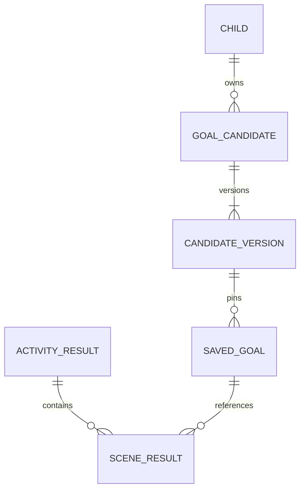

# U14 목표 · 결과 기능 설계

## 기준과 경계

이 기록의 inception/requirements-analysis/requirements.md FR1.1~FR4.2, NFR1~NFR5가 구현 기준이다. 상위 components.md의 PracticeGoal·ResultPipeline, contract-summary.md C-DS2/6/10/12, unit-of-work.md U14와 B6을 재사용한다. 별도 새 Unit DAG는 만들지 않는다. 순차 구현이며 27 화면 코드와 realtime 운영 로직은 범위 밖이다.

## 첫 작업: 실제 엄격 계약과 변경 분류 (Contract Design R-01)

실제 session-result-response.schema.json은 additionalProperties=false, 후보 reasonText 필수, sceneNo enum[1,2], raw timing 없음이다. 따라서 새 필드 허용을 단순 비파괴 변경이라고 부를 수 없다.

- 새 후보는 displayEvidence를 공개하고 내부 reasonText/fourElements/skillRef는 공개하지 않는다. 기존 저장 결과에는 레거시 후보 모양을 허용한다. 엄격 응답 스키마는 레거시·새 후보를 명시적으로 구분해 검증한다.
- 새 장면에는 timing(IMMEDIATE/AFTER_REASK/AFTER_HELP 또는 null) 선택 필드와 양의 sceneNo를 허용한다. sceneChip enum은 기존 5종을 유지한다. 기존 응답도 계속 유효하게 한다.
- 구 스키마 검증기는 새 응답을 거절할 수 있으므로 엄격 소비자 관점의 깨는 변경으로 contracts/deviations.md에 U14-a를 기록한다. 프런트 결과 파서가 displayEvidence를 기존 화면 모델의 reasonText 슬롯으로 변환한다. 이는 공개 DTO에 내부 reasonText를 다시 넣는 방식이 아니다.
- C-DS6의 4요소 이름 situation/partner/intent/expression을 확정한다. 전부 비어 있지 않아야 한다.
- GOAL_CANDIDATES의 내부 전용 구조 추상화는 U15의 다섯 필드(targetSkill/requiredInference/perspectiveStructure/decidableByEvidence/directCheckAllowed)에 대응한다. 새 스키마·프롬프트·대역을 함께 맞추고 U14-b로 기록한다. 내부 strict 출력 형식 변경이며 외부 보호자 응답에는 없다.
- practice-record-v2 자체와 U12 출력 계약은 바꾸지 않는다. facts의 모르는 값은 받는 쪽에서 무시하고 허용된 사실만 내부 투영에 쓴다.

## D1. 후보·선택 소유권과 저장

Context: 기존 V4 추천/선택은 behavior_key/version 필수 및 승인 행동 FK를 가진다. 생성 목표를 가짜 행동 정의로 등록하면 FR8.1과 버전 고정을 깨뜨린다.

Decision: PracticeGoal 컴포넌트가 새 후보·불변 버전·선택 스냅샷을 소유한다. 별도 생성 후보 저장 구조를 V9로 확장하며 기존 레거시 추천/선택은 읽기·쓰기 호환 경로로 남긴다. UI에 보이는 selectionId/recommendationId의 의미는 유지한다. 기존 CandidateRegistry/PracticeGoalRepository는 호환 진입점으로 유지 가능하지만 새 목표 쓰기는 같은 소유자의 서비스/저장소에 위임한다. core.result.CandidateScreen의 새 후보 검증 책임을 PracticeGoal로 옮기고 기존 테스트·호출자는 얇은 호환 어댑터로 지킨다. 다른 소유자의 SQL 쓰기는 금지한다.

Consequences: 새 스냅샷은 candidateRef/version, targetExpression, fourElements, skillRef, displayName, displayEvidence와 근거를 고정한다. 데이터 이중 쓰기는 피하고 통합 읽기에서 kind로 분기한다. 선택 API·삭제/복원/즐겨찾기/준비의 기존 레거시 동작은 보존한다. 새 목표의 상황 생성은 U10 소유이며 U14가 기존 행동 FK를 조작해 U10 기능을 흉내 내지 않는다.

Alternatives rejected: 기존 FK를 모두 제거하고 한 표를 재사용하면 구 앱 쓰기/회귀 위험이 크다. 생성 목표를 임의 승인 행동에 매핑하면 후보의 원뜻을 잃는다.

SavedGoalReader.find(childId,selectionId)는 C-DS10 그대로 SavedGoalView 또는 empty를 반환한다. required selectionId/childId/kind; optional candidateRef/candidateVersion/targetExpression/fourElements/skillRef/legacyBehaviorKey/legacyBehaviorVersion. 새 목표는 선택 시 복사한 불변 버전을 반환한다. 비활성·타 아동·철회·삭제 자료는 empty다. 과거 결과의 표시 이름은 소유권 확인 뒤 보관 스냅샷으로 읽고 활성 목표 조회와 섞지 않는다.

### 선택 요청에 버전을 운반하는 공개 핸들

새 후보 응답의 recommendationId는 안정된 candidateRef 자체가 아니라 특정 CandidateVersion의 불변 UUID 핸들이다. 기존 goal-selection-add-request의 recommendationId 하나만으로 관측한 버전을 다시 찾는다. 새 버전 게시 때 새 핸들을 발급하고 이전 핸들도 해당 버전을 계속 가리킨다. 아이·출처 결과가 유효하고 후보가 무효화되지 않은 동안 이전 화면의 핸들도 허용한다. 선택 시 currentVersion을 다시 읽어 다른 버전을 담지 않는다.

활성 선택의 중복 판정은 childId+안정된 candidateRef로 한다. 이미 활성 선택이 있으면 기존 selectionId와 고정 스냅샷을 반환하고 버전을 덮어쓰지 않는다. 새 후보 버전의 selected/goalSelectionId도 이 안정된 정체성으로 표시한다. 선택을 삭제한 뒤 새 버전 핸들을 담으면 그 버전으로 새 선택을 만들 수 있으며, 이전 선택 복원은 같은 후보의 다른 활성 선택과 충돌하면 기존 충돌 오류로 거절한다. 같은 핸들 재시도는 같은 선택으로 처리한다.

필수 경합 시험: v1(NONE) 화면 조회 → v2(seedId) 게시 → 이전 화면의 v1 핸들 담기 = v1/NONE 고정. v2 먼저 담기 = v2/seedId 고정. v1이 활성인 상태에서 v2 담기/동시 담기는 기존 선택 유지. 삭제 뒤 v2 담기와 v1 복원 충돌도 검증한다. 추가 버전 필드를 보호자 화면이나 선택 요청에 요구하는 대안은 27 코드 변경을 피하기 위해 채택하지 않는다.

## D2. 후보 생성·검증·결과 이후 씨앗 연결

1. 결과 작업이 유효 기록·동의를 확인한다. 기존 Luna 입력 정리 경계로 아이 이름을 '아이'로 치환하고 연령·계정/아동 식별자·보호자 입력 원문·원음을 AI 입력에서 제외한다. 서버 내부 키와 공급자 payload를 분리한다.
2. 전사·경험 구조·장면 사실과 해당 아이 seedSummaries의 구조 요약만 GOAL_CANDIDATES에 전달한다. JOB_ATTEMPT이므로 내부 추가 재시도는 없다. JSON 스키마 검증을 한다.
3. 후보마다 이름 12자·displayEvidence 40자·4요소·목표 표현·skillRef를 검사한다. 근거 seq/quote를 동일하게 비식별화한 전사와 글자 단위로 대조하고 불확실·출처 불명 자료를 제외한다. 원 전사 인용의 출처 키는 서버에만 둔다.
4. OutputChecker/classify를 기존 경로로 적용한다. 후보는 최대 3개이며 남는 것이 없으면 빈 목록이다. 정리 문장의 성공을 후보 없음만으로 실패로 바꾸지 않는다.
5. 결과 트랜잭션은 기존 guardian→job→report 순서와 임대/attempt identity를 확인하고 결과·후보 전달용 정본을 원자적으로 남긴다. 이미 존재하는 durable pending candidate replay를 유지/확장한다. 후보 등록은 재생 가능한 커밋 후 처리로 한다.
6. 자유대화의 NONE 후보를 결과 커밋 뒤 처리한다. 등록된 candidateRef와 version으로 U15 SeedGenerationService를 호출하고, 검증된 구조 추상화만 전달한다. 원문을 구조 서명으로 복사하거나 상수 서명을 만들지 않는다. 추상화가 없거나 검증에 실패하면 NONE 유지다.
7. 성공한 seedId는 현재 candidate version이 아직 같은 경우에만 새 후보 버전으로 게시한다. 기존 버전은 변경하지 않는다. 동시 담기는 관측한 버전을 고정한다. 생성 전에 담으면 NONE 스냅샷, 생성 뒤 담으면 새 seedId 스냅샷이다. 이미 담은 목표에 뒤늦게 seedId를 덮어쓰지 않는다.
8. 같은 callback/replay는 candidate+version과 U15 idempotency 키로 한 번만 반영한다. 삭제/철회·더 최신 버전이면 반영하지 않는다. 씨앗 실패는 고정 이유 코드만 기록하고 결과 DONE을 유지한다. 새 무한 재개/스케줄 루프를 만들지 않는다.

D2 alternatives: 결과 트랜잭션 안에서 그래프/AI를 호출하면 잠금·장애가 결과 완료를 막는다. 실패마다 결과 작업을 재개하면 완료 상태가 뒤집히고 중복 호출이 생긴다. 두 방식 모두 채택하지 않는다.

## D3. 버전별 기록과 재판정

1. flowVersion이 없으면 기존 U5b parser/judgment/두 장면 규칙을 그대로 쓴다. snapshotVersion은 기존 의미를 유지한다.
2. flowVersion이 practice-conversation-v1이면 practice-record-v2의 scenes를 읽는다. 지원하지 않는 flowVersion을 레거시로 오인하지 않고 명확한 검증 오류로 처리한다.
3. 실제 시작 시각과 유효 sceneRunId/goalRef가 있는 장면만 처리한다. 중복 sceneRunId·잘못된 형식은 잘못된 입력으로 처리한다. sceneNo는 같은 목표 내 입력 순서의 양수이며 장면 수 2 제한을 두지 않는다.
4. goalRef로 고정 목표 맥락을 내부에서 읽고 없으면 안전한 표시 이름/전달 표현으로 대체한다. 다른 아이의 선택은 처리하지 않는다. 사실/variantSkipReason을 구분해 재판정 입력으로 보낸다. 재발화 확인만으로 AFTER_REASK를 만들지 않는다.
5. REJUDGMENT는 ai-rejudgment-output.schema.json의 scenes를 한 번에 받는다. 입력 sceneRunId 집합과 응답 집합이 정확히 같아야 한다. 중복·누락·모르는 ID·value/timing 비일관성은 SCHEMA_INVALID로 기존 작업 재시도 정책에 따른다.
6. value와 timing, 장면 ID, flowVersion, 사실·생략 사유, differs_from_live를 내부 저장한다. differs는 liveOutcome.timing과 재판정 timing의 비교로 계산하며 raw 라벨/확률은 새 기록에 만들지 않는다.
7. 실제 없는 두 번째 장면을 NOT_DONE 행으로 만들지 않는다. 도움 없음 자체는 실패나 미완료가 아니다. 도움 수·수락/거절과 종료 사유는 사실에서 집계하되 동일 장면 내 중복 fact를 중복 집계하지 않는다.

## D4. 저장·27·리포트 분리

저장의 value/timing은 정본이다. 새 결과의 27 mapper에서만 functional+AFTER_REASK를 DONE_IMMEDIATE 칩으로 변환한다. 기존 5chip enum과 화면 문구는 유지한다. targetExpression을 무제한으로 chipText에 복사하지 않고 표시 목표 표현은 기본 8자 이내로 제한하며 금지 표현·공백이면 '전달'로 대체한다. 기존 고정 칩 문구는 별도 UI 계약으로 유지한다.

리포트 mapper는 저장 timing을 읽어 '바로 전달'·'되묻기 뒤 전달'·'도움 뒤 전달'을 구분한다. 기존 U5b 결과는 기존 문구/순서로 남긴다. 새 형식과 레거시가 섞인 집계에서도 chip에서 timing을 역산하지 않는다. 도움/사실/변형 생략은 기록 버전별 어댑터를 통해 집계한다. API는 새 결과의 timing만 공개하고 rationale/live값/differs 플래그는 공개하지 않는다.

## D5. 4회 작업과 마이그레이션

결과 상태 REQUESTED→RUNNING→DONE 또는 재시도 REQUESTED/최종 FAILED의 기존 전이를 유지한다. 총 시도 4, 추가 지연 5·15·30초다. 임대/동시 실행 가드를 그대로 쓰며 GOAL_CANDIDATES/REJUDGMENT/RESULT_TEXT 내부 재시도는 없다. 기존 수동 다시 요청이 같은 job을 재실행하는 의미를 유지한다.

V9는 새 목표/버전/선택 스냅샷 저장을 추가하고 core_result_job.attempt_count, core_result_job_attempt.attempt_no, core_scene_judgment.scene_no/timing 제약을 완화·확장한다. 기존 V1~V8 내용은 바꾸지 않는다. 구 앱이 쓰는 기존 허용 값은 전부 계속 허용한다. 새 구조는 기존 표 필수 열을 채우게 하지 않는다. NOT NULL/FK를 추가하는 경우 새 표 안에 한정하며 구 표에 대한 모든 변경은 문장별 호환 근거를 적는다.

시간 기본값은 양 앱 application.yml, contracts/timing.md, frontend timing-defaults.json과 같은 커밋에서 바꾼다. ai-io.md 6.9의 총 3회 표현도 10.3과 같이 총 4회로 맞춘다. infra/migration-approvals.txt에는 실제 문장 번호·해시·구 앱 호환 근거를 마련하되 사람 확인 전 승인자 서명을 만들지 않는다. 새 값이 쓰인 뒤 구 앱으로 롤백하면 새 목표/시점을 해석하지 못하는 한계는 명시한다.

## D6. 삭제·보안·경쟁

기존 RESULT 70, PRACTICE 150 참여자를 확장하며 U15 80과 겹치지 않는다. 결과 삭제는 새 장면 사실·재판정·pending candidate 데이터를 포함하고, PracticeGoal 삭제는 candidate versions/evidence/selection snapshots를 포함한다. 실제 FK 순서를 따른다. 선택이 필요한 과거 레거시 삭제/복원 의미를 바꾸지 않는다.

장애 중 일부 삭제를 성공으로 보고하지 않는다. AI 대기 중 잠금을 유지하지 않으며 커밋/씨앗 반영 시 소유권·동의·아동/활동 생존을 다시 확인한다. 타 아동 접근, 지연 callback의 삭제 자료 복구, 실제 공급자 호출은 각각 부정 시험을 둔다.

## 파생 엔터티 관계와 규칙 요약

텍스트 대안: 아이→후보→불변 버전→담은 목표. 활동 결과→실제 장면 결과이며 각 장면은 담은 목표를 가리킨다. 상세 데이터 정본은 entities.md의 YAML, 규칙 정본은 rules.md의 BR1.1~BR4.2다.

## 검증과 구현 순서

1. V9·소유권·SavedGoalReader와 레거시 호환/아동 격리 PostgreSQL 시험.
2. 후보 생성·스키마/근거/skillRef 검증·씨앗 연결과 실패/동시 선택/중복 callback 시험.
3. 새 기록·장면별 재판정·timing 분리·4회 재시도와 구형/신형 혼합 리포트 시험. 시간 계약 변경도 이 커밋에 포함.
4. REST·프런트 파서 최소 어댑터·삭제 참여와 비공개 필드/삭제 경쟁 시험.
5. u14 태그·범위80%·전체 backend check·frontend eslint/coverage/build·verify.sh·PR CI. 다른 유닛 단언을 고쳐 통과시키지 않는다.

## Sources

- 이 기록 inception/requirements-analysis/requirements.md와 검토 review-01.md의 씨앗 버전·비식별화·칩 제한 보완.
- 261015-doc-sync-code-update/inception/domain-design/components.md, decisions.md, contract-design/contract-summary.md, units-generation/unit-of-work.md, user-stories/stories.md.
- docs/units/u14/brief.md 및 이 기록 inception/reverse-engineering/developer-scan.md.
- contracts/README.md, ai-io.md, schemas/ai-goal-candidate-output.schema.json, ai-rejudgment-output.schema.json, practice-record-v2.schema.json, session-result-response.schema.json.
- backend/core-api의 PracticeGoalRepository, ResultQueryService, ResultData, ResultAiSchema, SceneJudgmentRepository, report/ReportAssembler, knowledge/StructureSignature.

## Assumptions & Open Questions

None. 기술 선택의 대안과 한계는 D1~D6에 기록했다. 실제 마이그레이션 문장 승인과 실공급자/실기기 성공을 미리 주장하지 않는다.

