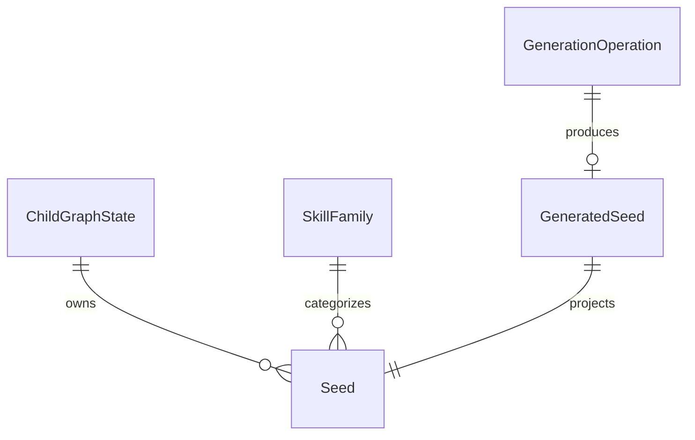

# U15 기능 설계

## Sources

현재 기록의 inception/units-generation/unit-of-work.md · unit-of-work-story-map.md와 inception/requirements-analysis/requirements.md를 따른다. 기존 261015-doc-sync-code-update/inception/domain-design/components.md · decisions.md 및 contract-design/contract-summary.md(C-DS7·C-DS11)를 참조한다. 현재 기록의 domain-design/components.md와 stories.md는 생성되지 않았다. docs/units/u15/brief.md, 기술명세서 v0.3 §6.4·6.5·13과 실제 contracts/ai-io.md·timing.md·schemas/ai-seed-output.schema.json를 대조했다.

실제 경계: KnowledgeGraphLookup은 공개 행동키 메서드 하나다. PragmaticsKnowledge의 생성자·기존 계약을 보존하고 새 아동용 서비스/어댑터 포트를 별도로 제공한다. ChildProfileService.register는 등록 트랜잭션을 소유하며, ConsentPolicyService.check가 현재 정책의 4항목 동의를 확인한다. 현재 철회는 계정 삭제로 구현돼 있다. GuardianWriteLock은 보호자 우선 잠금의 정본이다. DeletionParticipant는 deleteByGuardian만 정의하므로 별도 아동·기록 삭제 포트는 U15가 제공하고 기존 계정 삭제 참가자에 연결한다.

## 기능 경계와 입력

- 외부 공개 HTTP API를 새로 만들지 않는다. core 내부 서비스가 guardianId와 childId로 권한을 검사하고 아동용 어댑터에 childId를 필수 전달한다.
- 제공 기능: initializeChild, seedSummaries, skillContext, variantPlan, generateSeed, deleteChild, deleteGeneratedSeedsForRecord. 기존 findRelatedBehaviorKeys는 공개 행동 카탈로그 전용이며 새 인터페이스 때문에 기존 람다 구현이 깨지지 않게 유지한다.
- seedSummaries는 활성 씨앗의 ID·이름·계열·targetSkill·불변 문장·증거 판정·직접 확인 허용만 반환한다. skillContext는 구조 서명·보존 조건·아동용 관계/자리·허용 목록·판을 반환한다.
- variantPlan 입력은 씨앗·기본 관계/자리, 기본 화제/장소/등장인물, 최근 노출 목록과 동일 맥락 실제 노출 횟수다. U10이 저장된 실제 노출을 공급하며 호출자가 주장한 노출을 외부 HTTP에서 그대로 받지 않는다.
- 생성 요청은 내부 신뢰 경계에서 활동·후보 참조, FREE_TALK 여부, 기존 skillRef, 추상화된 후보 구조를 받는다. 실제 활동의 아동·보호자·종류를 기록에서 다시 확인한다. 비교할 전사/배경/이름은 서버에서 읽어 검사에만 쓰고 외부 모델에 보내지 않는다.

## 초기화·적재·조회 순서

1. ZIP에서 정해진 씨앗/어휘 파일만 스트림으로 읽는다. 경로 정규화 뒤 절대 경로·상위 탈출·중복 충돌·손상·과도한 크기를 거절한다. 파일을 임의 경로에 풀지 않는다. 같은 내용의 루트/접두 중복은 하나만 사용하고 내용이 다르면 실패한다.
2. 필수 자료·S1~S10/X1~X4 14개 유일 ID·구조 서명·계열·허용 맥락을 모두 검증한다. COWORKER→CLASSMATE, SUPERVISOR→TEACHER, WORKPLACE→SCHOOL_GROUP만 명시적으로 변환하고 알려지지 않은 값은 실패한다.
3. 전체 검증 후 기본 자료와 판을 한 단위로 적재한다. 같은 판 재적재는 멱등이고 같은 판에 다른 해시는 거절한다. 실패한 판은 완료 판으로 공개하지 않는다.
4. 아동 등록 성공 후 초기화를 시도한다. 등록 자체를 그래프 장애로 롤백하지 않는다. 첫 조회에서 권한과 동의를 확인한 뒤 누락 초기화·판 갱신을 재시도한다.
5. 외부 그래프 쓰기 전에 해당 아동의 graphMayExist를 원장에 확정한다. 기본 갱신은 POC만 갱신하고 GENERATED는 보존한다. 생성 씨앗 재구성은 성공 원장만 사용한다.
6. 조회 전체는 기존 graph-budget 2초 안에 처리한다. 생성 씨앗은 성공 원장에 존재하며 삭제/정리 중이 아닌 ID만 노출한다. 꺼짐·연결 실패·시한 초과·NONE은 빈 결과와 이유로 반환하며 개인화 성공으로 표시하지 않는다.
7. 읽기만 별도 제한 시간 작업으로 실행할 수 있다. 초기화·복구를 분리해 늦은 읽기 결과가 쓰기를 수행하지 않도록 한다. 쓰기는 보호자 직렬화와 서버 트랜잭션 시한을 적용하며, 취소를 성공 증거로 간주하지 않는다.

## 구조 보존과 변형 계획

SAME_CONTEXT는 화제·장소·등장인물 중 정확히 한 요소만 바꾸고 관계/자리·LOW·recoverable=true·5필드·불변 문장·보존 조건을 그대로 둔다. 입력 후보 값은 승인된 어휘에서 선택한다. 기본값과 같은 후보를 제외하고, 최근 노출과 겹치지 않는 값을 우선한 뒤 필드와 값의 고정 사전순으로 결정한다. 유효 후보가 없으면 빈 계획을 반환한다.

같은 씨앗·관계·자리 실제 노출이 3회 이상이면 NEAR를 우선한다. 아동 허용 관계 또는 자리 중 하나만 바꾼다. 기본 관계/자리가 허용 밖이면 씨앗 기본값으로 몰래 바꾸지 않고 빈 계획으로 처리한다. FAR는 제공하지 않는다. 횟수 2/3과 후보 전부 최근 노출인 경우를 시험한다. 최근 중복 회피가 불가능하면 고정 순서의 유효 후보를 쓰되 다른 구조는 바꾸지 않는다. U10은 이 입력을 대본 생성과 보존 판정에 함께 사용한다.

## 생성 상태와 처리 순서

GenerationOperation 상태: RESERVED → PROJECTING → COMMITTED 또는 NONE/CLEANUP_REQUIRED. 중복 성공은 RESERVED → REUSED와 reusedSeedId로 원장에 확정한다. REUSED는 생성 상한에 세지 않고 예약 자리를 반환한다. 같은 후보 재호출은 모델 호출 없이 동일 reusedSeedId를 반환하되 현재 아동의 활성 목록에서 사라지면 NONE을 반환한다. NONE은 같은 후보 재전달 때 다시 생성하지 않는 최종 결과다. CLEANUP_REQUIRED는 성공이 아니며 새 시드로 노출하지 않는다. 만료된 RESERVED는 시한을 확인해 NONE으로 정리한다. COMMITTED는 성공 원장과 결합해 기존 seedId를 반환한다. 기록 삭제 표식은 어떤 상태에서도 새 쓰기보다 우선한다.

1. 생성 기능이 켜졌는지, 아동 소유권·현재 동의·계정/아동 상태·활동 존재와 FREE_TALK·NONE을 확인한다. 목록 조회가 실패하거나 비활성 씨앗만 있어 중복 검사가 불가능하면 NONE이다.
2. 보호자 잠금 아래 후보 멱등 키를 예약한다. 같은 활동의 RESERVED/PROJECTING/COMMITTED를 합쳐 두 자리를 넘지 못한다. 아동별 다음 번호를 할당하고 재사용하지 않는다. 장시간 모델 호출 동안 DB 잠금은 잡지 않는다.
3. 외부 입력은 추상화된 목표 구조와 활성 seed_catalog만 보낸다. 식별자·전사·보호자 원문·상세 배경·이름은 보내지 않는다. 문자열 표현·로그도 원문을 숨긴다.
4. SEED_GENERATION 계약 스키마와 seed-generation.v2 프롬프트를 쓴다. contracts/knowledge-graph.md의 정확한 GENERATED/DUPLICATE/NONE 세 분기를 요청한다. GENERATED는 outcome·skillName·invariantSentence·signature(5필드)·family·preservationRule·relationship·situation·misreadCost·recoverable가 필수다. DUPLICATE는 outcome·duplicate_of만, NONE은 outcome·none_reason만 받는다. 각 분기는 스키마에서 추가 필드를 금지한다. 기존 outcome 없는 2필드 모양은 공통 호출부 호환 분기로만 남기며 U15는 내용 실패로 처리한다.
5. 검사는 출력의 모든 자유문자열에 적용한다. Unicode NFKC, 제어/제로폭 문자 거절, 정규화 후 Unicode code point 기준 길이. 겹침은 공백·구두점을 제거한 정규화 코드포인트 연속 5개를 서버 원문과 비교한다. 이름 목록, 연락처/주소/학교/기관/날짜 패턴, 금지 사전과 명시적 안전 검사를 적용한다. 불변 문장은 1~60자 한 문장, 줄바꿈/복수 종결문/목록은 거절한다. 자동 검사는 모든 고유명사를 탐지하는 모델 품질 보증이 아니며 실호출 품질 증거와 구별한다.
6. duplicate_of는 조회했던 활성 목록 및 저장 직전 동일 아동의 현재 활성 목록 모두에 존재해야 한다. 유효 중복이면 새 노드/성공 원장 없이 기존 ID를 반환한다. none_reason이면 NONE. 구조가 같은 S4/S5를 단순 동일서명만으로 합치지 않으며 계열/보존 조건/정규화 문장까지 대조한다.
7. 내용 실패 재생성은 최대 한 번이고 스키마 재요청과 같은 수정 슬롯을 공유한다. 기술 재시도는 최대 한 번, 전체 전송은 최대 세 번, 모든 호출은 동일한 최초 마감이다. 기존 CoreLunaClient에 선택적 공유 시도 예산을 추가하되 기존 call 동작은 유지한다. 기술·스키마 예산을 새 call마다 초기화하지 않는다.
8. 성공 응답 후 보호자 잠금을 다시 잡고 동의·활동/아동 존재·삭제 표식·상한·생성 설정·마감을 다시 확인한다. 실패하면 NONE이며 그래프에 쓰지 않는다. 원장에 PROJECTING과 복구용 검증된 구조를 먼저 확정한다.
9. 아래 T1~T3 경계를 따라 그래프 쓰기를 확인한 뒤 성공 generated_seed와 COMMITTED를 확정한다. 쓰기 실패/결과 불명은 CLEANUP_REQUIRED로 남기고 성공 원장은 만들지 않는다. 그래프 성공 뒤 원장 실패도 조회에서 숨기고 동일 ID 정리 대상으로 남긴다. 재시도/다음 접근 때 원장 기반으로 정리한 뒤 진행한다. 복구가 불가능하면 NONE을 유지하며 삭제는 완료시키지 않는다.
10. 결과 상태(result_status)나 판정 기준은 바꾸지 않는다. 반환 ID를 후보에 붙이는 책임은 U14다.

## 저장 트랜잭션 경계와 중단 회수

- T1: 보호자 잠금 아래 예약·번호·최초 마감을 확정한 뒤 잠금을 풀고 모델을 호출한다. 재호출자는 예약 중이면 새 모델 호출 없이 NONE/진행 중 사유를 받는다.
- T2: 보호자 잠금을 다시 잡고 전체 상태를 재확인한다. 쓰기 없는 명시적 그래프 트랜잭션을 열어 반환된 핸들을 확보하고, PROJECTING·검증된 구조·핸들·graphMayExist를 원장에 커밋한다. 이때 잠금은 해제된다. 핸들 기록 실패 시 빈 그래프 트랜잭션을 롤백하고 종료한다. 프로세스가 먼저 죽어도 아직 자료 쓰기는 없으므로 빈 트랜잭션의 만료만 남는다.
- T3: 별도의 트랜잭션에서 보호자 잠금을 다시 잡는다. 자신의 PROJECTING 핸들이 아직 유효하고 삭제 의도·동의·활동·마감 조건을 모두 만족하는지 재확인한다. T2와 T3 사이 삭제가 먼저 왔으면 쓰지 않는다. 이 잠금을 유지한 채 같은 명시적 그래프 트랜잭션에 쓰고 명시적으로 커밋한다. 자동 커밋·전송 자동 재시도는 사용하지 않는다. 그래프 커밋 완료 응답 뒤 성공 원장과 COMMITTED를 같은 DB 트랜잭션으로 확정한다. T3 실패로 DB가 롤백되어도 T2의 PROJECTING/핸들은 남는다.
- 회수: 프로세스 중단 뒤 PROJECTING/CLEANUP_REQUIRED를 발견한 다음 요청·삭제 작업은 보호자 잠금을 잡고 저장된 그래프 트랜잭션을 롤백/종료 확인한다. 서버가 트랜잭션 종료를 확정하기 전에는 새 쓰기·재구성·삭제 완료를 허용하지 않는다. 종료 확인 뒤 해당 seedId를 멱등 삭제하고 NONE으로 확정한다. COMMITTED만 재구성한다. 그래프가 이미 커밋됐으나 DB는 실패한 경우도 삭제하며 성공으로 승격하지 않는다.
- 원격 커밋 요청이 진행 중이라 종료가 확인되지 않으면 RETRY를 유지한다. 클라이언트 타임아웃·취소만으로 완료를 추정하지 않는다. 핸들 없는 늦은 쓰기가 발생하지 않도록 실제 어댑터는 명시적 트랜잭션 방식만 제공한다. 읽기 시간 제한 작업은 쓰기를 수행하지 않는다.

## 삭제·동시성·복구

아동/계정 삭제는 보호자 → 아동 그래프 상태 → 생성 예약 순서로 직렬화한다. 계정 삭제는 기존 참가자 순서 70(결과) 다음 80(그래프), 90(기록) 전에 실행한다. 생성 원장은 결과/후보에 삭제 제한 FK를 두지 않아 먼저 삭제된 결과 때문에 교착되지 않는다. 아동/보호자 참조와 출처 ID는 기록 삭제 전에 필요한 정보를 유지한다.

삭제 작업은 삭제 의도를 먼저 내구적으로 기록해 생성 재진입을 차단하고, 그래프의 해당 아동 노드 또는 해당 기록의 생성 ID만 지운다. 그래프 삭제 성공 확인 뒤 원장·예약·아동 상태를 정리한다. 실패 시 예외를 기존 지휘에 전달해 재시도하며 원장을 먼저 지워 대상 ID를 잃지 않는다. DB 정리 실패도 반복 그래프 삭제 후 재시도한다. 삭제 상태에서는 조회/재구성을 수행하지 않는다.

기록별 삭제는 DeletedSource를 먼저 남기고 해당 활동의 생성 원장/작업만 정리한다. 다른 기록·기본 씨앗·다른 아동은 보존한다. 기본 씨앗과 공유 어휘는 아동/계정 삭제에서도 보존한다. 과거 생성 번호는 되돌리지 않는다. U14의 끊긴 skillRef는 조회 없음으로 반환되어 NONE 기본 경로를 쓴다.

그래프가 꺼졌을 때 원장이 graphMayExist=false이고 초기화나 쓰기 시도 이력이 없다고 증명하면 NOT_APPLICABLE이다. 이력이 없다는 것을 확인할 수 없거나 true이면 RETRY다. 기능 꺼짐 자체를 무자료 증거로 쓰지 않는다. 외부 쓰기의 성공 여부가 불명인 동안 삭제 성공을 보고하지 않으며 서버가 쓰기 종료/롤백을 확인한 뒤 삭제를 직렬 수행한다.

## 엔티티 관계와 규칙 요약

<!-- Text fallback: 아동 그래프는 여러 씨앗을 소유하고 계열이 씨앗을 분류한다. 생성 작업은 최대 하나의 성공 원장을 만들며 원장이 씨앗으로 투영된다. -->

이 그림은 entities.md의 파생 보기다. BR1은 접근 경계, BR2는 적재/버전, BR3은 변형, BR4는 생성, BR5는 삭제, BR6은 장애 기본 경로를 정의한다. 판정 규칙의 정본은 rules.md다.

## 검증·설정·제약

그래프 기본 꺼짐을 유지하고 생성 독립 설정은 기술명세 §13대로 기본 켬으로 정의하되 그래프 꺼짐 또는 키 없음은 외부 호출을 막는다. 실제 키 없이 기동/모든 자동 시험이 가능해야 한다. Neo4j 장애 후 프로세스 재시작 없이 재접속한다. 메모리와 Neo4j는 동일 원천과 동작 계약 시험을 공유한다.

FR1~FR6은 rules.md의 동번호 BR로 추적한다. NFR1은 조회/생성 시한 분리, NFR2는 권한/파라미터/로그, NFR3은 부분 실패/재시도 시험으로 확인한다. NFR4~6은 Code Generation/Build and Test의 검증·커버리지·증거·문서 작업으로 추적한다. 4/5글자, 60/61자, 노출 2/3회, 한도 1/2/3개, 동의 철회 전후, 아동 혼합, 중복, 삭제 중 늦은 응답, 그래프 성공 후 DB 실패, 시한 초과 후 잔여 작업을 포함한다.

프런트 변경은 없어서 frontend-components.md는 생성하지 않는다. 새 공개 HTTP·독립 배포·realtime 코드는 범위 밖이다. 기본 자료 라이선스와 원본 보존을 지키며 원본 ZIP은 변경하지 않는다.

## Assumptions & Open Questions

- 기존 동의 철회 API는 없지만 매 접근 시 ConsentPolicyService.check와 ACTIVE 상태를 확인하여 추후 철회 상태도 기본 거절한다.
- 기록/아동 개별 삭제 UI/API는 이번에 새로 만들지 않는다. U15의 삭제 포트를 제공하고 현재 계정 삭제 참가자를 실제 연결한다.
- 생성 실패 복구용 작업 원장은 성공 generated_seed와 구별하는 추가 내부 장치다. 개인정보 원문은 저장하지 않는다.
- 추가 업무 질문: None.

