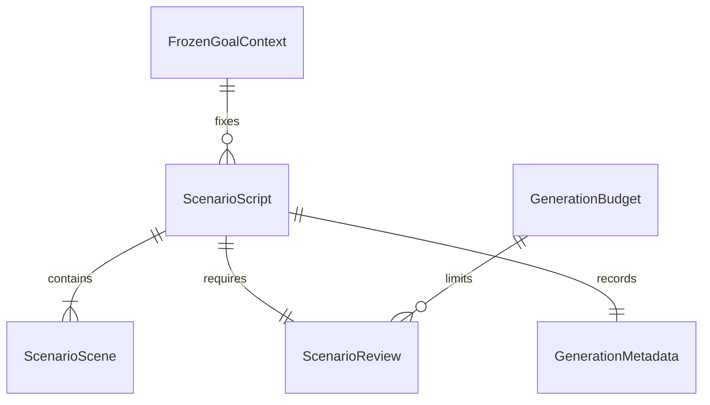

# U10 상세 동작 설계

## Sources

상위 정본: `../../inception/requirements-analysis/requirements.md` 전체 FR/NFR, `functional-design-questions.md` Q1-A. 데이터 정본은 `entities.md`, 규칙 정본은 `rules.md`다. 이 기록은 units-generation/domain-design을 생략한 refactor이므로 없는 Unit/컴포넌트 산출물을 만들지 않는다. 원 기록 `261015-doc-sync-code-update`의 U10·B7·C-DS1·C-DS5·C-DS10·C-DS11과 현재 CodeKB의 U10 절을 참조한다. `docs/units/u10/design.md`는 구현 연결 설명의 동반 문서다.

## 목표와 책임

U10은 연습 목표 하나의 상황 생성부터 발급까지 책임진다. 목표 준비·첫 대본 전달의 기존 연결도 보완한다. 기존 실시간 상태 기계·기기 재생·보호자 화면은 변경하지 않는다. 생성 응답을 스스로 승인한 것으로 취급하지 않고, 독립 요청의 검토 승인과 서버 검사가 모두 있어야 한다.

## 엔터티 관계 — 파생 뷰

텍스트 대체: 담은 목표의 고정 내용으로 여러 요청의 대본을 만들 수 있다. 각 대본은 장면·검토·생성 출처를 가지며 모든 호출은 요청 예산 하나에 제한된다. 이 그림은 entities.md의 파생 뷰다.

## W1 준비와 목표 고정

1. 기존 계정·동의·기기/활동 준비 가능 여부와 멱등 요청을 확인한다. 성공 재사용은 기존 순서·대본을 그대로 반환한다.
2. 소유자 잠금 아래 요청한 선택을 아이별 목표 읽기 경계로 읽는다. 활성 선택이 아니거나 다른 아이의 선택이면 거절한다.
3. LEGACY_BEHAVIOR는 실제 행동 정의의 버전을 고정한다. CANDIDATE는 담은 후보 버전의 표현·4요소·skillRef를 고정하며 행동 정의 카탈로그로 재조회하지 않는다.
4. 기존 즐겨찾기·저장 순위·비복원 순서 결정은 유지한다. 종류별 목표 내용과 판정 기준을 준비 원본에 함께 고정한다. 후보와 기존 목표의 저장 순서가 같을 수 있으므로 종류를 포함한 안정적 선택 ID를 동률 정렬 기준으로 쓰되 저장 원본의 순위·가중치를 바꾸지 않는다.
5. 잠금을 해제하고 첫 목표 대본을 생성한다. 처음 준비한 마감의 남은 시간을 전달하며 생성기가 새 15초를 더 만들지 않는다.
6. 발급 직전 계정·동의·아이·선점·준비 원본을 재확인한 뒤 첫 대본과 준비 READY를 확정한다. 기존 시작 유스케이스가 같은 패키지를 전달한다.

준비 후 담기를 해제하더라도 진행 중 세션은 이미 고정한 목표 내용으로 수행한다. 단, 동의 철회·아이/계정 삭제·세션 소유권 변경은 발급을 막는다. 아직 준비하지 않은 선택의 해제는 새 시작을 막는다. 이는 현재 스냅샷 원칙을 유지하는 것이며 실시간 실행기를 수정하지 않는다.

## W2 상황 생성·검토·발급

1. 최초 요청 마감과 단조시계 시작을 고정한다. 현재 세션/준비 원본과 고정 목표를 확인하고 기존 논리 요청 키로 선점한다. 기존 READY 재사용에도 소유권·동의 확인을 먼저 한다.
2. 이전 상황을 쓰는 요청은 같은 아이·세션·선택·고정 목표 버전의 ORIGINAL인지 검증한다. 다른 원본·교차 아이 참조는 NOT_FOUND다.
3. W3의 합계 2초 안에서 구조 맥락과 변형 계획을 선택적으로 얻는다. 이 시간도 전체 15초에 포함한다.
4. 허용된 고정 목표 내용, 나이, 정리된 관심사, 필요한 최소 이전 상황, 유효 그래프 맥락만 생성 요청에 넣는다. 실제 ID와 판정 전용 원문은 넣지 않는다.
5. 생성 출력 스키마를 검증한다. 유효 출력이면 그 대본·나이·목표·최소 이전 상황·구조 기준을 별도 검토 요청에 넣는다. 생성과 검토는 서로 다른 목적·프롬프트·스키마로 기록한다.
6. 검토 결과가 유효한 APPROVE일 때만 W4 서버 독립 검사를 한다. 모델의 validation 플래그나 자기 승인 문장은 버린다.
7. 내용 실패·스키마 불일치·검토 반려는 요청 전체의 내용 수정 슬롯 한 번만 사용한다. 수정한 생성물도 다시 별도 검토·서버 검사를 통과해야 한다. 같은 실패를 안쪽 공급자와 바깥 흐름이 각각 재시도하지 않는다.
8. 첫 BASE로 레거시 필드를 서버가 만들고 상대 역할을 고정한다. 발급 직전 최신 소유자·아이·세션/준비·동의·삭제·선점·고정 목표 내용과 마감을 재확인한다.
9. 같은 잠금 아래 지문을 다시 확인하고 대본의 기존 필드·선택 확장·판·목표 맥락을 함께 저장한다. 요청 READY와 결과 ID도 같은 작업에서 확정한다. 경합으로 이미 저장한 다른 내용이 사라지지 않게 한다.
10. 미완료 요청은 기존 정책대로 해제한다. 연속 내용 실패만 실패 상태로 굳히고, 일시 서비스 실패·취소·경합을 성공으로 꾸미지 않는다. 늦은 응답은 저장하지 않는다.

### W2a 실제 노출 이력의 읽기

W2의 선점 뒤, 외부 생성·그래프 호출 전에 보호자 잠금을 해제한 읽기 구간에서 비교 이력을 확정한다. ORIGINAL과 NEW_SCENARIO 모두 권한 확인한 같은 보호자·아이의 실제 EXPOSED 자료만 읽는다. 노출 시각이 존재하고 최초 요청 시작 시각 이하인 자료를 목표·세션과 무관하게 노출 시각 내림차순, 내부 고유 식별자 내림차순으로 최대 3건 선택한다. 발급만 된 ISSUED와 다른 아이 자료는 제외한다. 지문 존재 여부만 반환하는 중복 검사로 이 읽기를 대체하지 않는다.

각 자료의 상황 본문 전체 최대 8,000자와 트리거 전체 최대 2,000자만 비교 입력으로 사용한다. 전체 상한은 30,000자다. 상한을 넘으면 잘라서 완전한 이력이라고 표시하지 않고 미발급 실패로 끝낸다. 실제 이력 없음은 빈 배열이나, 읽기 오류·시한·취소는 빈 배열로 대체하지 않는다. 조회 시한은 최초 15초 잔여와 500ms의 작은 값이며 저장소 조회와 바깥 실행 모두 취소를 적용한다. 이 시간도 전체 마감에 포함한다.

동일한 정리 이력을 생성·별도 검토·보정·BASE-only 검토에 전달한다. NEW의 지정 ORIGINAL은 W2-2에서 따로 검증하는 원본이며 이력과 구분한다. 지정 원본이 미노출이면 노출 건수에 세지 않는다. 실제 노출을 기록하거나 새로 갱신하는 기능은 이 읽기의 범위 밖이다. 검사 범위는 최근 3건이며 모든 과거 자료의 의미 반복을 완전히 배제한다고 주장하지 않는다.

### S1 요청 상태

| 현재 | 조건 | 다음 | 결과 |
|---|---|---|---|
| 미선점/만료 | 권한·목표·마감 유효 | GENERATING | 새로운 claim |
| GENERATING | 같은 유효 claim 진행 중 | 그대로 | 기존 SERVICE_NOT_READY |
| GENERATING | 승인·서버 검사·마감·최종 권한 유효 | READY | 결과 ID와 대본 원자 확정 |
| GENERATING | 허용 내용 수정 후에도 실패 | FAILED | SCENARIO_GEN_FAILED |
| GENERATING | 일시 실패·취소·경합 | 만료된 GENERATING | 재요청 가능, 새 성공 없음 |
| READY | 같은 권한/요청 | READY | 같은 scenarioId |
| FAILED | 같은 요청 | FAILED | SCENARIO_GEN_FAILED |

### S2 대본 상태

대기 중 생성물은 메모리에만 존재한다. 검토 승인·서버 검사·최종 권한 확인 뒤 ISSUED가 되고, 권위 있는 실제 노출 기록을 정산할 때 EXPOSED가 된다. 반려·UNCERTAIN·오류·마감 상태에서 ISSUED로 가는 전이는 없다.

## W3 그래프 조회와 보존 기준

구조 맥락과 변형 계획 조회를 하나의 합계 마감으로 감싼다. 두 조회에 각각 새 2초를 주지 않는다. 기존 변형 계획 내부에 구조 조회가 중복돼도 바깥 합계 시한과 취소를 적용한다. 읽기 전용 결과만 받으며 늦은 결과는 버린다. 그래프가 꺼짐·NONE·빈 값·장애·시간 초과면 맥락과 계획을 함께 비우고 기본 경로로 만든다. 외부 조회 동안 보호자 잠금·저장 트랜잭션을 유지하지 않는다.

현재 요청의 고정 목표와 맥락의 skillRef가 일치해야 한다. BASE의 관계·상황과 기준 맥락을 명시적으로 고정한다. 변형은 계획의 허용된 축만 바꾸며 관계·자리·화제·참여자·상황을 구조 데이터로 비교한다. 임의 자유문에서 새 맥락을 추측해 계획을 만들지 않는다. 기존 계획기가 다루지 못하는 맥락이면 변형 계획은 없음으로 처리한다.

변형 입력/출력에는 비발화용 구조 필드 `skillRef`, `invariantSentence`, `preservationRule`, `transferDistance`, `changedElement`, `participants`, `situation`을 선택 확장한다. 그래프 없는 경로에서는 이 값으로 개인화를 주장하지 않는다. 서버는 실제 장면의 관계·자리·화제·참여자·상황과 고정 기준의 차이를 계산하고, 바뀐 한 축·허용 거리·같은 기술·불변/보존 기준을 대조한다. 모델이 돌려준 보존 성공 참거짓은 사용하지 않는다.

표현의 의미 자체에 대한 판단은 별도 검토 요청의 항목이다. 결정적 서버 검사는 구조 일치·필수 맥락/기회 포함·금지/답 누출 등의 검증 가능한 대조를 수행한다. 문자열 메타데이터가 같다는 이유만으로 실제 의미 품질까지 증명했다고 보고하지 않는다. 기준을 구조적으로 대조할 수 없는 변형은 제외한다. 실제 의미 보존·전이 품질은 합성 자료 실호출 관측에 남긴다.

## W4 독립 검사와 변형 실패

- 장면 목록이 비지 않았고 첫 장면이 BASE이며 BASE가 정확히 하나인지, 키가 유일한지 확인한다. 각 문자열·배열은 계약 길이를 지킨다. 전체 응답 크기는 기존 공급자 제한을 유지한다.
- 생성 출력에 상대 역할을 요구하지 않는다. 장면·기회·다시 설명 등 실제 발화 영역에서 금지 표현·정답 선제 제시·압박을 검사한다. 코치 역할에만 허용된 표현 예시는 해당 영역에서 분리한다.
- 기존 목표는 고정된 관계·기회와 트리거 포함 규칙을 유지한다. 후보 목표는 4요소의 상황·상대·의도·표현에서 서버가 고정한 맥락과 대조한다. 판정 기준을 생성 입력에 그대로 복사하지 않는다.
- 동일 지문·NEW_SCENARIO 원문/문장부호 변형을 거절한다. 의미상 반복과 나이 적합성은 별도 검토 항목이며 서버는 해당 반려를 우회하지 않는다.
- BASE 실패는 한 번의 전체 재생성 대상이다. VARIANT만 실패하고 내용 수정 슬롯이 남았으면 BASE를 고정한 채 변형 보정 한 번을 요청하고 조립된 대본을 다시 별도 검토한다.
- 변형 보정도 실패하거나 변형을 제외해야 하면 유효한 BASE만 남긴 정확한 본문으로 BASE-only 별도 검토를 최대 한 번 수행한다. APPROVE와 서버 검사 전에는 이 축소 대본도 발급하지 않는다. 이 호출은 내용 생성 추가 허용이 아니며 같은 최초 마감 안에서만 수행한다. 검토 실패·시한 부족이면 전체 요청은 실패다.

## W5 호출 예산과 오류

최초 마감까지 남은 UTC 시간과 단조시계 잔여 시간의 작은 값을 쓴다. 외부 호출마다 남은 시간과 기존 목적별 호출 시한의 작은 값으로 제한하고, 전체 흐름을 실행하는 바깥 작업도 남은 시간에 취소한다. 정각은 만료이며 늦은 정상 응답도 저장하지 않는다.

기술 재시도는 최초 일시 실패에만 전체 한 번이다. 대기는 기존 backoff와 공급자 Retry-After 중 큰 값이며, 대기와 다음 최소 시도 창을 남길 수 없으면 시도하지 않는다. 인증·잘못된 입력·거절은 기술 재시도하지 않는다. 스키마 불일치는 내용 수정 슬롯이다.

호출 수는 정상 생성+검토 2회, 내용 보정의 생성+검토 최대 2회, BASE-only 검토 최대 1회, 기술 재시도 최대 1회로 최대 6회다. 이것은 6회를 반드시 수행한다는 뜻이 아니다. 모든 시도·대기는 최초 15초 안에 들어갈 때만 수행한다. 기존 다른 유닛의 최대3회 예산은 그대로 둔다.

| 상황 | 내부 처리 / 공개 결과 |
|---|---|
| 기존 대역·공급자 미연결 경로 UNAVAILABLE/TIMEOUT | 기존 HTTP SERVICE_NOT_READY 계약 유지 |
| 새 대본 생성·검토·검사·마감으로 승인 대본 없음 | SCENARIO_GEN_FAILED, 미발급 |
| 인증·필드 정리 실패 | 공급자 세부·본문을 숨기고 기존 서비스 오류 정책 사용, 성공 없음 |
| 다른 아이·잘못된 원본·선택 | NOT_FOUND |
| 비활성 세션 | SESSION_NOT_ACTIVE |
| 동의·삭제 | 기존 동의·계정 오류, 미발급 |
| 같은 키 다른 시작 입력 | IDEMPOTENCY_CONFLICT |

레거시 대역 API와 새 실제 공급자 경로의 선택을 명시적으로 분리하고, 단위 시험의 기존 오류 단언을 바꾸지 않는다. 새 대본 경로의 최종 실패를 구형 게이트웨이의 재시도로 다시 감싸지 않는다.

## W6 입력·판·관측

Q1-A에 따라 나이와 정리된 관심사 이름을 상황 생성·검토 목적에만 허용한다. 최상위 허용 필드만 사용하고 모든 깊이에서 실제 식별자·키·동의·원음·보호자 원문을 제거한다. 관심사도 이름 별칭·연락처 마스킹과 기존 필드 길이/목록 크기 제한을 거친다. 별칭 밖 고유명사를 완벽히 판별할 수 있다는 주장은 하지 않으며 의심스러운 자유 입력·과도한 값은 제외한다. 다른 목적의 interests 금지는 유지한다. 다른 키로 바꿔 금지 입력을 우회하지 않는다.

이름 치환 정보는 계정의 일반 연습 맥락에서 추측하지 않는다. 권한·동의·아이 확인 뒤 아동 프로필 소유 서비스의 내부 읽기 경계에서 현재 아이의 표시 이름을 얻고, 요청 아이와 일치하는지 확인해 `아이` 별칭을 만든다. 프로필·소유 관계·유효 이름을 얻지 못하거나 읽기가 실패하면 공급자 호출 전 미발급 실패로 끝낸다. 빈 별칭 표를 정상 경로로 대신 쓰지 않는다. 이 조회도 최초 마감 안에서 수행한다.

원래 이름은 Core 내부 일시 정리 값이며 공급자 입력의 필드·공개 응답·저장·로그·오류·값 객체의 기본 출력에 포함하지 않는다. 이름 표는 정리기에만 별도 전달한다. 목표·관심사·지정 원본·W2a의 노출 이력과 생성물을 검토에 넣을 때 모든 문자열을 같은 규칙으로 정리한다. 최종 대본에 알려진 원래 이름이 남으면 발급하지 않고 내용 실패로 처리한다. 알려지지 않은 타인의 이름까지 완전히 검출한다는 보장은 하지 않는다.

생성 판은 `scenario-generation.v2`, 검토 판은 `scenario-review.v1`, 공개 대본 판은 `scenario-script.v1`로 제안한다. 생성 스키마와 실제 프롬프트를 함께 갱신하며 기존 이름의 계약 파일이 정본이다. 자체 검토 사유 목록은 `ANSWER_INCLUDED`, `EARLY_CUE`, `PRESSURE`, `AGE_MISMATCH`, `GOAL_MISMATCH`, `REPETITION`, `FORBIDDEN_CONTENT`, `INCOMPLETE_SCENE`, `INVARIANT_MISMATCH`, `SKILL_MISMATCH`, `TRANSFER_MISMATCH`, `UNCHANGED_VARIANT`로 닫는다. `OTHER_APPROVED_REASON` 자유 확장은 제거하고 알 수 없는 사유를 실패로 본다. APPROVE의 reasons는 비어야 한다.

생성·검토 원문, 목표 원문, 개인정보는 로그에 남기지 않는다. 허용된 코드·목적·모델·판·보낸 필드 이름·시간·시도 수만 기록한다. 제브 호출은 없다. 저장·응답의 selfReview는 승인과 허용 출처만 담고 실패 사유 원문을 담지 않는다.

## W7 검증과 추적

- 정상·REJECT·UNCERTAIN·누락·스키마·시간 초과·APPROVE+서버 거절·재생성·변형 제외/재검토·나이 입력·의미 반복 반려의 대조 시험을 둔다.
- CANDIDATE/LEGACY_BEHAVIOR 각각 준비→생성→고정 버전→첫 전달을 시험한다. 기존 생성/순서/멱등·동의·삭제·경합/권한 시험을 유지한다.
- 알려진 이름이 관심사·목표·지정 원본·노출 이력에 포함돼도 생성과 검토에 전달되지 않는지, 프로필 실패/다른 아이/빈 이름이면 공급자 호출이 없는지 확인한다. 원래 이름의 저장·응답·로그·기본 출력 유출을 검사한다.
- 과거 세션의 실제 노출 이력이 ORIGINAL/NEW 양쪽 생성·검토에 전달되는지, 미노출·다른 아이 제외, 정렬·최근 3건·문자 상한, 실제 빈 이력과 조회 실패의 구별, 조회 500ms·전체 마감·취소, 지정 원본과의 구분을 시험한다.
- 실제 저장소로 V9 자료 보존·구버전 쓰기·V10 왕복·재사용·삭제를 확인한다. 순수 대역으로 그래프 합계 2초·전체15초와 취소 무시·정각·늦은 응답을 확인한다.
- 범위 줄 80%와 전체 회귀, 별도 검증 스택의 verify.sh 및 PR CI를 확인한다. 원 단언·계약 대조·범위 하한을 낮추지 않는다.
- 실제 API는 자동 시험에서 호출하지 않는다. 별도 준비 확인 후 합성 자료 측정만 수행하고 결과를 자동 대역·실호출 합성·실기기로 나눠 적는다. 미측정은 미측정이다. 15초를 넘으면 사전 생성·캐시 대안을 보고한다.

업무 규칙의 파생 요약은 rules.md의 BR1~BR8이고, FR/NFR 전체 대응은 traceability.json이 정본이다. 문서·시험·CI 작업 방식은 새 BR을 만들지 않고 NFR/검증 절로 추적한다.

## Alternatives and consequences

요청 전체의 예산 관리 대신 각 호출의 자동 재시도를 그대로 중첩하는 방안은 마감·횟수 추적이 불가능해 제외한다. 기존 모든 유닛의 공용 최대3회를 늘리는 방안도 범위를 넘겨 제외한다. U10은 스키마를 적용한 단일 호출 능력과 별도 예산을 사용한다.

기존 행을 새 형식으로 일괄 바꾸거나 행동 정의를 임의로 만들어 후보를 끼워 넣는 방안은 기존 의미·승인 경계를 깨므로 제외한다. 선택 필드·종류별 목표 맥락과 명시적 호환 식별자를 추가한다. 신규 후보를 지원하지 않는 과거 앱으로 되돌리면 신규 후보의 준비·생성이 실패할 수 있다. 기존 행동 목표·기존 행·구버전 쓰기 보존과 신규 기능의 구버전 지원은 구분한다.

## Assumptions & Open Questions

Q1은 실제 답변으로 해결됐다. 정리 범위와 잔여 이름 위험은 W6 및 개인정보 시험에 명시했다. 다른 유닛의 런타임·호출 한도를 바꾸지 않는다. 실제 모델의 품질·15초 성공률은 구현 전 보장하지 않으며 실측 준비 여부는 별도로 확인한다. 계약과 코드의 구체적인 연결은 동반 design.md에 기록하고 구현에서 어긋나면 보고한다.
