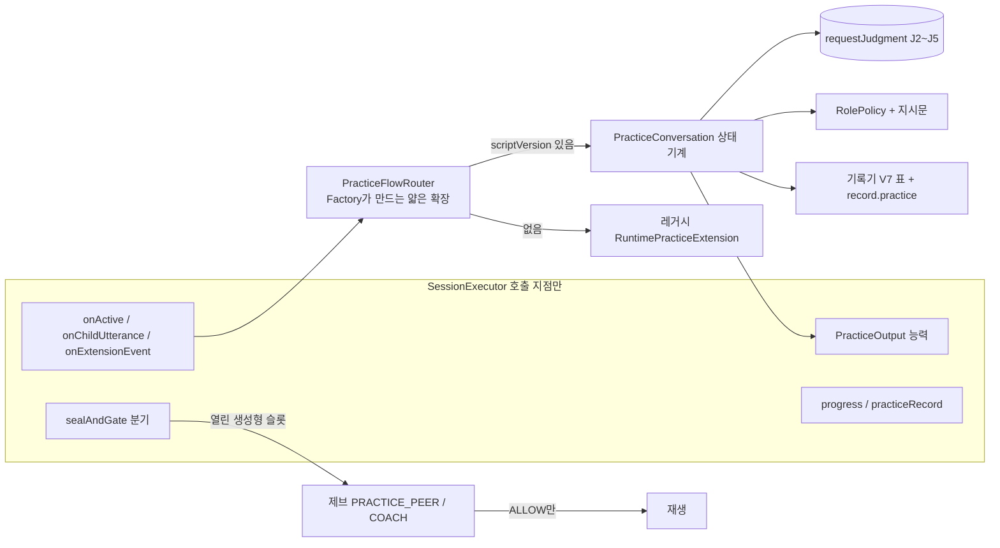
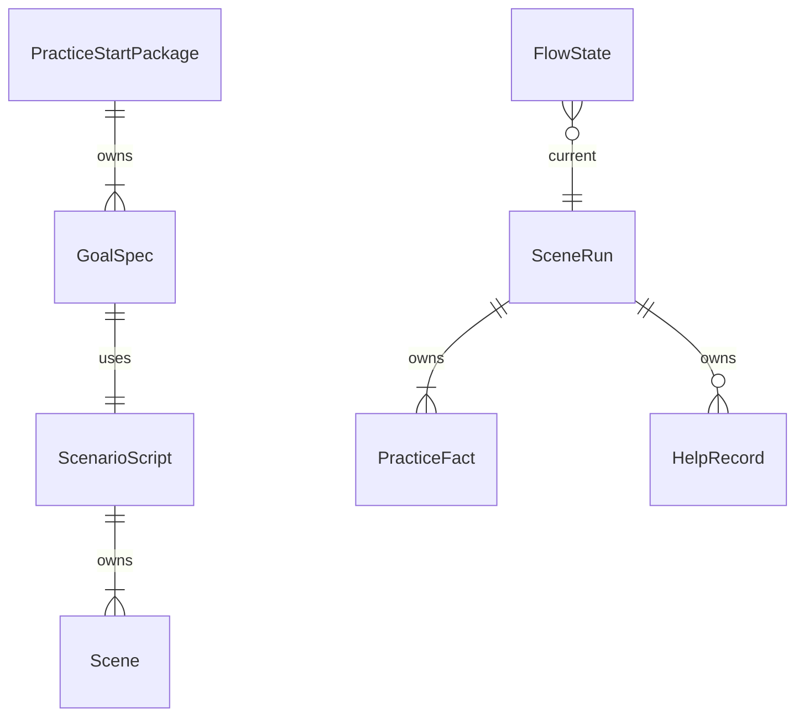

# U12 새 연습 흐름 — 기능 설계

> 작업 기록 `261017-u12-practice-flow` · Functional Design(검토 1회차 지적 반영판) · 2026-10-18 · 범위 `refactor` · 깊이 Standard
> 입력: `requirements.md`(FR1 ~ FR8 · NFR1 ~ NFR8, 열린 질문 9개), RA 검토 R-01 ~ R-06, 이 단계 검토 1회차 R-01 ~ R-09, 코드 사실(`developer-scan.md` · 이 단계에서 읽은 `SessionExecutor` · `GuardrailCoordinator` · `PracticeSessionExtension` · `JudgmentPoint` · `option-sets-v1.json`). 이 문서가 워크플로와 상태 전이의 정본이다. 엔터티 모양은 `entities.md`, 결정 규칙은 `rules.md`가 정본이다.

## 1. 설계 한눈에

연습은 기존 확장점(`PracticeSessionExtension`) 위에 **새 확장 `PracticeConversation`**을 얹어 만든다. 실행부(`SessionExecutor`)는 상태를 모르고 호출 지점만 더한다. 상태 · 전이 · 역할 · 기록은 새 패키지(`practiceflow`, 레거시 `practice/`와 분리)에 둔다.

**참여 확인(J1) · 종료 의도(J6) · 시작 전 거부 · 휴식은 실행부가 소유하고 이미 구현되어 있다**(U4b · U11). 확장은 참여가 끝나 ACTIVE가 된 `onActive`에서 시작하므로, 새 확장에는 '시작 전' 단계가 없다. J2 ~ J5만 확장이 `requestJudgment`로 연다.

텍스트 대체: 실행부가 확장(라우터)을 부르고, 라우터는 대본 `scriptVersion`으로 새 상태 기계 또는 레거시를 고른다. 새 상태 기계는 출력 능력 · 판정 요청 · 역할 정책 · 기록기를 쓰며, 연습 발화는 제브(연습 모드) `ALLOW` 뒤에만 재생된다.

## 2. 설계 결정 요약

| ID | 결정 | 근거 |
|---|---|---|
| D1 | 분기는 `Factory.create(sessionId)` 시그니처를 바꾸지 않고, 세션당 하나인 얇은 `PracticeFlowRouter`가 `onActive`에서 `practiceJson`의 `scriptVersion`을 보고 새 흐름 또는 레거시 한 쪽에 위임한다. `controlsOutput()`은 분기 전에도 참이다 | 실행부가 `onActive` 전에 `controlsOutput()`을 묻는다. 시험 약 10개와 `RealtimeRuntimeConfig`가 시그니처에 묶여 있다. 사람이 Q3(A)로 선택 |
| D2 | `coreFunction`은 목표의 `judgmentCriteria` 문자열에서 만든다(`JudgeRequest`는 J2 · J3 · J5에만 criteria를 허용하므로 J4에는 싣지 않는다). 후보 목표 필드는 읽지 않는다 | 패키지 목표에 필드가 그것 하나뿐이고 U14가 쓰지 않는다 |
| D3 | 시계는 모두 `schedule`(확장점 시계)로 건다. 따라서 실행부의 일시정지 규칙(기술 일시정지 · J6 · 종료 확인)을 따라 **그 구간은 한도에서 제외**된다. 열린 판정(J2 ~ J5) 중에는 확장이 **무응답 시계만** 취소하고 집중 90초 · 목표 10분 시계는 두며 판정 지연은 한도에 센다 | 사람이 Q2(A)로 선택. 검토 R-09 |
| D4 | `judgment_live.goal_ref` · `scene_ref`는 null로 둔다(`requestJudgment` 시그니처 확장 안 함) | U14가 읽지 않는다. 후속 개선 |
| D5 | 역할 전환 · 복귀 알림은 시작 패키지 `approvedSpeech`의 승인 문장을 기존 승인 발화 재생(`speak`) 길로 재생한다. 코드가 없을 때만 GPT-Live가 만든 역할 발화로 지시하고 제브 검사를 받는다 | 사람이 Q1(A)로 선택. 승인 원문은 U13 분류 ①이라 제브를 부르지 않는다 |
| D6 | **GPT-Live가 만드는 모든 역할 발화**(친구 되묻기 · 재안내 · 코치 도움 · 생성형 알림 · 변형 제안. 장면 마무리 별도 발화는 없다)는 새 출력 능력 `speakGenerated(correlationId, role, 지시문)` **하나로만** 낸다. 이 능력이 한 번에 ① 생성형 슬롯을 열고 ② 연습 출력 보류를 풀고 ③ 출력 세대를 올리고 ④ 지시를 `replayable=true`로 송신하며(제브 첫 막힘 뒤 재지시가 **같은 역할 지시문**을 다시 보낸다) ⑤ 송신 실패 · 새 말 미시작이면 기존 `u5b-voice-failed` 길로 실패를 알린다. `instructProvider`는 새 흐름이 부르지 않는다 | 검토 R-01: `instructProvider`는 재생 불가 지시(`replayable=false`)라 막힘 뒤 역할 없는 자유 턴이 나가고 보류도 풀지 않는다 |
| D7 | `PracticeContext`에 승인 발화 문장 지도를 더한다(기존 생성자 유지) | `approvedSpeech`가 확장에 닿지 않는 지금 구조를 고친다(FR3.2) |
| D8 | 변형 제안에 대한 동의 판정은 **J4(수락 · 거절 · 불명확)를 재사용**한다. J4의 질문 문구는 '도와줘도 되는지'이므로 분류 품질은 `[실호출-합성]` 확인 대상이다. 계약 · 선택지 판은 바꾸지 않는다 | 새 판정 지점을 만들면 계약이 바뀐다. 편차 `U12-D3` |
| D9 | 변형 장면은 BASE와 같은 하위 흐름을 `sceneKind=VARIANT`로 다시 쓴다(새 `SceneRun`). 변형 장면의 정리 뒤에는 변형을 다시 제안하지 않는다 | 정본에 변형의 변형 규칙이 없다 |

## 3. 워크플로

### 3.1 시작 경로 (BR1)

1. core가 `POST /internal/sessions`(`activityType=PRACTICE` + 선택 본문 `practice`)를 보낸다. 시작 API는 이를 받고(BR1.1) 시작 처리기가 `practice` 원문을 `Plan`에 싣는다(BR1.2).
2. 실행부가 참여 확인(J1)을 끝내고 ACTIVE가 되면 `onActive(PracticeContext)`를 부른다. 맥락에 `practiceJson` · 승인 문구 코드 · 승인 발화 문장 지도가 들어 있다(D7). **`onActive`에 닿았다는 것이 곧 참여 완료**이므로 확장은 곧바로 `SCENE_INTRO`를 시작한다.
3. 라우터가 `scriptVersion`을 읽어 분기한다(BR1.4). `scenario-script.v1`이면 `PracticeConversation`이 `firstScenario`로 목표 0을 준비한다.
4. 목표가 더 있으면 다음 목표 대본을 내부 호출(`POST /internal/practice/scenarios`, kind ORIGINAL)로 비동기 요청한다(`post`로 `ASYNC_RESULT`). 거절되면 그 목표는 '미실시'다(BR1.3).

### 3.2 시계 (BR3.6 · BR3.8 · BR6.3 · BR6.4 · BR9)

| 시계 이름 | 시작 | 취소 · 정지 | 만료 |
|---|---|---|---|
| `no-response` | 입력을 기다리는 단계(OPPORTUNITY · REASK · HELP_OFFER · RETRY · VARIANT_OFFER)의 확장 발화 재생 완료 뒤 | 아이 전사 도착 · 판정 요청 때 취소, 판정 끝나고 입력이 더 필요하면 다시 건다. 실행부 일시정지 동안 멈춤 | 첫 만료 = 같은 단계에서 재안내 1회(같은 역할). 둘째 만료 = §3.3 '무응답' 열 |
| `focus-max` | FOCUS 첫 진입 | 장면 정리 때 취소. 실행부 일시정지 동안 멈춤. 판정 중에도 흐름 | 만료 시 FOCUS · RETRY면 현재 슬롯을 취소하고 SCENE_WRAP(FOCUS_LIMIT) |
| `goal-limit` | 목표 첫 `SCENE_INTRO` | 목표 정리 때 취소. 일시정지 동안 멈춤 | 만료 시 어느 단계든 현재 슬롯을 취소하고 장면을 정리해 NEXT_GOAL 또는 CLOSING(TIME_LIMIT) |
| `slot-guard-<correlationId>` | 슬롯을 열 때 | 슬롯 종료 사건이 오면 취소 | 종료 사건이 끝내 오지 않으면 FAILED로 간주한다(안전망, §3.5). 길이는 기존 재생 만료 시간 키(`mujoong.timing.*`)를 읽는다 |

### 3.3 장면 전이표 (판정 지점 + 선택지 코드 기준, BR2 ~ BR6)

장면 하나의 정상 경로: `SCENE_INTRO → OPPORTUNITY(J2) → (REASK(J3)) → SCENE_WRAP`. 도움 · 변형은 가지다. 입력을 기다리는 단계는 한 가지 판정 지점에 묶인다: **OPPORTUNITY = J2, REASK = J3, HELP_OFFER = J4, RETRY = J5, VARIANT_OFFER = J4(재사용, D8)**. 판정 보류(`JUDGMENT_ABSTAINED`) · `requestJudgment` 거짓 · 장애는 모두 아래 `UNREADABLE`과 같이 처리한다(교정 없이 이어 가기, BR3.7).

| 현재(판정 지점) | 입력 | 다음 | 동작 · 기록 | 규칙 |
|---|---|---|---|---|
| (진입) onActive | 참여 완료 | SCENE_INTRO | 목표 0, 상황 승인 발화 재생. 재생 성공 뒤 `SceneRun` 행 생성 | BR2.1, BR7.3 |
| SCENE_INTRO | 도입 재생 PLAYED | OPPORTUNITY | 기회 문장(승인 발화) 재생 → 재생 완료 뒤 `no-response` 시작 | BR3.1 |
| SCENE_INTRO | 도입 재생 FAILED | (장면 건너뜀) | 행 없음, 장면 미실시 → NEXT_GOAL | BR7.3 |
| OPPORTUNITY(J2) | FULL | SCENE_WRAP | liveTiming IMMEDIATE | BR3.2 |
| OPPORTUNITY(J2) | PARTIAL | REASK | 친구 되묻기 1회(`speakGenerated` PEER) | BR3.2 |
| OPPORTUNITY(J2) | HELP | FOCUS | 역할 전환 알림 뒤 코치(도움 요청) | BR4.1, BR5.1 |
| OPPORTUNITY(J2) | NOT_UNDERSTOOD · IRRELEVANT | OPPORTUNITY | `reexplainCount < reexplainMax`면 상황 다시 설명(승인 발화) 뒤 기회 문장으로 복귀(SITUATION_EXPLAINED). 한도면 HELP_OFFER | BR3.5 |
| OPPORTUNITY(J2) | UNREADABLE · 보류 | OPPORTUNITY | 교정 없이 같은 질문 재안내(장면당 1회). 두 번째면 SCENE_WRAP 미실시(TRANSCRIPT_FAILED, NONE) | BR3.7 |
| OPPORTUNITY(J2) | 무응답 둘째 만료 | SCENE_WRAP | 미실시(TIMEOUT, NONE) | BR3.6 |
| REASK(J3) | DELIVERED | SCENE_WRAP | 집중 도움 없이 AFTER_REASK, REASK_RESOLVED | BR3.3 |
| REASK(J3) | STILL_SHORT | HELP_OFFER | 도움 제안(강제 아님) | BR3.4 |
| REASK(J3) | HELP | FOCUS | 코치 전환 | BR4.1 |
| REASK(J3) | UNREADABLE · 보류 | REASK | 재안내 1회, 두 번째면 SCENE_WRAP 미실시(TRANSCRIPT_FAILED) | BR3.7 |
| REASK(J3) | 무응답 둘째 만료 | SCENE_WRAP | 미실시(TIMEOUT, NONE) | BR3.6 |
| HELP_OFFER(J4) | ACCEPT | FOCUS | HELP_ACCEPTED, `focus-max` 시작 | BR4.2 |
| HELP_OFFER(J4) | REFUSE | SCENE_WRAP | HELP_DECLINED, liveTiming NONE, '미완료' 표시 없음 | BR4.3 |
| HELP_OFFER(J4) | UNCLEAR · 보류 | HELP_OFFER | 교정 없이 다시 제안 1회, 두 번째면 SCENE_WRAP | BR4.4 |
| HELP_OFFER | 무응답 둘째 만료 | SCENE_WRAP | TIMEOUT, 변형 안 함(END_OR_REST) | BR3.6 |
| FOCUS(진입 ①) | 역할 전환 알림 PLAYED | FOCUS(진입 ②) | 승인 문장 알림(없으면 생성형)이 끝난 뒤에만 `role=COACH`, 첫 코치 발화를 `speakGenerated` COACH로 낸다. `focus-max` 시작 | BR5.1, BR5.4 |
| FOCUS(진입 ①) | 알림 FAILED · INTERRUPTED · 막힘 · 알림 낼 수 없음 | SCENE_WRAP | 역할을 바꾸지 않는다(PEER 유지), 도움 없이 정리. 재생 실패면 PLAYBACK_FAILED 사실 | BR5.1, BR5.5 |
| FOCUS(진입 ②) | 코치 발화 PLAYED(또는 INTERRUPTED) | RETRY | `retryCount += 1`, 아이에게 다시 해 보기 유도. 아이 전사가 INTERRUPTED를 일으킨 경우 그 전사를 곧바로 J5 입력으로 처리 | BR5.2, BR6.3 |
| FOCUS(진입 ②) | 코치 발화 FAILED · 막힘 | SCENE_WRAP | 복귀 알림 규칙으로 PEER로 돌아간다. PLAYBACK_FAILED는 재생 실패일 때만 | BR5.3, BR5.7 |
| RETRY(J5) | FULL | SCENE_WRAP | AFTER_HELP, 복귀 알림, COACH_RETURN, ORIGINAL_SCENE_RETURN | BR5.3 |
| RETRY(J5) | COPIED | SCENE_WRAP | 코치 표현을 따라 한 것으로 인정, AFTER_HELP, 복귀 알림 | BR5.3 |
| RETRY(J5) | PARTIAL · HELP | FOCUS | `retryCount < retryMax` AND 집중 시계 남음이면 한 번 더. 아니면 SCENE_WRAP(FOCUS_LIMIT) + 복귀 알림 | BR6.3 |
| RETRY(J5) | NOT_UNDERSTOOD · IRRELEVANT | FOCUS(진입 ②) 또는 SCENE_WRAP | `reexplainCount < reexplainMax` AND `retryCount < retryMax` AND 집중 시계 남음이면 상황 다시 설명(승인 발화) 뒤 코치 발화로 돌아가 FOCUS(진입 ②)로 간다(역할은 이미 COACH라 알림 없음, 이 코치 발화 뒤 RETRY 진입에서 `retryCount`가 오른다). 하나라도 아니면 SCENE_WRAP(사유 FOCUS_LIMIT) + 복귀 알림. `reexplainCount`는 장면 전체에서 OPPORTUNITY와 RETRY가 공유한다 | BR3.5 |
| RETRY(J5) | UNREADABLE · 보류 | RETRY | 재안내 1회, 두 번째면 SCENE_WRAP | BR3.7 |
| RETRY | 무응답 둘째 만료 | SCENE_WRAP | TIMEOUT, 복귀 알림, 변형 안 함(END_OR_REST) | BR3.6 |
| SCENE_WRAP(진입) | 역할이 COACH | SCENE_WRAP(복귀 알림) | 복귀 알림(승인 문장 PEER_RETURN 우선, 없으면 생성형)을 낸다. 장면 마무리 별도 발화는 없다 | BR5.3 |
| SCENE_WRAP(진입) | 역할이 PEER | SCENE_WRAP(변형 평가) | 알림 없이 곧바로 평가 | BR6.1 |
| SCENE_WRAP(복귀 알림) | 알림 PLAYED · FAILED · INTERRUPTED · 막힘 어느 것이든 | SCENE_WRAP(변형 평가) | `role=PEER`로 돌린다(알림이 실패해도 역할은 돌아간다). 이 단계의 실패는 다시 SCENE_WRAP 알림을 만들지 않고 평가로 넘어간다 | BR5.3 |
| SCENE_WRAP(변형 평가) | §3.3a 표에서 변형 가능 | VARIANT_OFFER | 변형 제안 발화(`speakGenerated` PEER) 뒤 J4 대기 | BR6.1 |
| SCENE_WRAP(변형 평가) | 변형 불가 | NEXT_GOAL 또는 CLOSING | VARIANT_SKIPPED + §3.3a 사유 | BR6.1, BR6.2 |
| VARIANT_OFFER(J4 재사용) | ACCEPT | SCENE_INTRO(VARIANT) | 새 `SceneRun`(sceneKind VARIANT). 이후 BASE와 같은 하위 흐름 | D9 |
| VARIANT_OFFER(J4 재사용) | REFUSE | NEXT_GOAL 또는 CLOSING | DECLINED 기록 | BR6.2 |
| VARIANT_OFFER(J4 재사용) | UNCLEAR · 보류 | VARIANT_OFFER | 다시 제안 1회, 두 번째면 DECLINED | BR6.2 |
| VARIANT_OFFER | 무응답 둘째 만료 | NEXT_GOAL 또는 CLOSING | DECLINED | BR6.2 |
| 변형 장면의 SCENE_WRAP | 정리 끝 | NEXT_GOAL 또는 CLOSING | VARIANT_PLAYED(변형 행). 변형을 다시 제안하지 않는다 | D9 |
| (아무 단계) | `goal-limit` 만료 | NEXT_GOAL 또는 CLOSING | 슬롯 취소, 현재 장면 정리, TIME_LIMIT | BR6.4 |
| (FOCUS · RETRY) | `focus-max` 만료 | SCENE_WRAP | 슬롯 취소, FOCUS_LIMIT | BR6.3 |
| (아무 단계) | `REST_REQUESTED` · 실행부 종료 신호 | CLOSING | END_REQUEST, END_OR_REST (종료 · 휴식 판정은 실행부 J6 소유) | BR6.2 |
| (아무 단계) | 슬롯 두 번째 막힘(`GUARDRAIL_BLOCKED`) | SCENE_WRAP | 후보 문장 저장 없음. 뒤따르는 FAILED 사건은 무시(§3.5) | BR5.7 |

**3.3a 장면 종료 원인별 변형 제안과 생략 사유** (계약의 `variantSkipReason` 5값 안에서 가장 가까운 값을 쓰고, 실제 원인은 `facts`에 남는다)

| 장면 종료 원인 | 변형 제안 | 생략 사유 | `facts` · `liveTiming` |
|---|---|---|---|
| 정상(FULL · DELIVERED · COPIED, AFTER_REASK · AFTER_HELP) | 4조건이 참이면 제안 | 조건 거짓일 때만: 변형 없음 NO_VARIANT, 종료 · 휴식 END_OR_REST, 목표 10분 TIME_LIMIT, 집중 한도 FOCUS_LIMIT | 해당 사실, IMMEDIATE · AFTER_REASK · AFTER_HELP |
| 도움 제안 거절(HELP_DECLINED) | 4조건이 참이면 제안 | 위와 같음 | HELP_DECLINED, NONE |
| 무응답 미실시(TIMEOUT) | 제안 안 함 | END_OR_REST(참여 의사 없음) | TIMEOUT, NONE |
| 판독 불가 두 번째(TRANSCRIPT_FAILED) | 제안 안 함 | END_OR_REST | TRANSCRIPT_FAILED, NONE |
| 판정 보류 · 장애 두 번째 | 제안 안 함 | NO_VARIANT | (없음), ABSTAINED |
| 슬롯 두 번째 막힘 · 재생 실패 | 제안 안 함 | NO_VARIANT | PLAYBACK_FAILED(재생 실패일 때), NONE |
| 목표 시간 만료 | 제안 안 함 | TIME_LIMIT | (없음) |
| 집중 한도 · 다시 해 보기 한도 | 제안 안 함 | FOCUS_LIMIT | (없음) |

즉 네 조건(BR6.1)에 더해 **장면이 정상으로 수행되어 끝났을 것**(위 표의 앞 두 행)이 변형 제안의 필요조건이다.

NEXT_GOAL이면 다음 목표의 `SCENE_INTRO`로 가고 마지막 목표면 `CLOSING`으로 간다. CLOSING에서는 확장이 `Signal.LAST_GOAL`을 돌려 실행부가 `PRACTICE_COMPLETED`로 종료한다(기존 규칙). 표에 없는 입력은 오류가 아니라 같은 단계에서 무시한다(중복 · 늦은 사건), 앱 오류 한 줄(내용 없음)만 남긴다. 위 표는 J2 ~ J5의 모든 선택지 코드를 덮는다(J2 6개 · J3 4개 · J4 3개 · J5 7개).

### 3.4 판정 호출과 지시 (BR3.7)

아이 확정 전사가 오면 확장은 현재 단계의 판정 지점에 맞춰 `requestJudgment`를 건다(J2 · J3 · J5는 `coreFunction`을 criteria로 싣고 J4는 싣지 않는다). 결과는 사건으로 돌아와 전이표의 입력이 된다. 다음 행동은 `speakGenerated`(생성형) 또는 승인 발화 재생(대본 문장)으로 낸다. 지시문은 역할 템플릿(BR5.2)에서 만들고 판정 라벨 · 확률 · 기준은 넣지 않는다. 거절 · 보류 · 장애는 전이표의 UNREADABLE 행으로 처리한다.

### 3.5 출력 · 슬롯 · 제브 (BR5.4 ~ BR5.7)

**생성형 슬롯의 저장 위치와 타입.** 슬롯은 실행부의 기존 승인 발화 칸(`pendingPracticeSpeech`)에 **`PracticeSpeech`의 생성형 변형**으로 넣는다. `PracticeSpeech`에 선택 성분 `generated`(기본 거짓, 기존 생성자 유지)를 더하고, 생성형일 때 `partnerRole`은 `PEER`/`COACH`, `text`는 **서버가 만든 지시문 템플릿 문장**(아이 발화 · 모델 출력 원문이 아니다)이며 `matches()`는 언제나 거짓이다(원문 일치로 제브를 건너뛸 수 없다). 이렇게 하면 `PracticeSpeech`에 묶인 지점이 새 타입 없이 그대로 지난다.

| 지점 | 승인 발화(기존) | 생성형 슬롯 | U5b 시험 단언 |
|---|---|---|---|
| `practiceSpeechId()` (`PRACTICE_CHANGED` 판단) | correlationId | 같은 correlationId | 무변경 |
| `sealAndGate` 연습 통제 분기 | 원문 일치면 제브 없이 재생, 아니면 폐기 | 원문 일치 불가 → `guardrail.enabled()`면 `begin(sealed, 슬롯 role의 PRACTICE_PEER/COACH, correlationId)`로 넘기고 ALLOW만 재생. 제브가 꺼져 있거나 시작이 실패하면 폐기(fail-closed) | 기존 `generated=false` 경로 무변경(레거시는 슬롯을 열 수 없다) |
| 막힘 첫 번째(`blocked` → 재지시) | (해당 없음) | `speakGenerated`가 `replayable=true`로 보냈으므로 `lastInstruction`이 같은 역할 지시문을 다시 보낸다. 재지시 동안 슬롯은 열려 있어야 한다(`discardForRetry`가 슬롯을 닫으면 재지시 송신 때 다시 연다. Code Generation이 이 점을 시험으로 고정) | 신규 시험 |
| 막힘 두 번째 | (해당 없음) | `GUARDRAIL_BLOCKED` 사건 → 이어 `abandon → discard`가 FAILED 사실 한 번 | 신규 시험 |
| `send()`의 `practiceAudio.put` · 재생 만료 시계 | 승인 발화 재생 증거 | 같은 증거 | 무변경 |
| 재생 종료 사실 `PLAYBACK_FACT` | `PlaybackFact(speech, status, text)` | 같은 모양. `text`는 지시문 템플릿(아이 · 모델 원문 아님)이고 메모리 안에서만 쓰며 저장하지 않는다. 확장은 길이만 본다 | 무변경 |
| `discard()` · `u5b-voice-failed` | FAILED 사실 | 같은 길 | 무변경 |

**슬롯 종료 원인과 확장에 닿는 사건** (검토 R-06). 실행부는 슬롯이 어떤 이유로 사라져도 **정확히 한 번** `PLAYBACK_FACT`(PLAYED · FAILED · INTERRUPTED)를 확장에 보낸다.

| 원인 | 확장에 닿는 사건 | 확장의 처리 |
|---|---|---|
| ALLOW 뒤 재생 완료 | PLAYED | 전이표의 '재생 완료' 입력, 무응답 시계 시작 |
| 두 번째 막힘 | `GUARDRAIL_BLOCKED` 다음 FAILED | 앞 사건으로 SCENE_WRAP, FAILED는 같은 correlationId의 두 번째 종료 사건이라 무시 |
| 검사 중 아이가 말함(`CHILD_SPOKE`) · 출력 보류 · 세대 변경(`voided`) | INTERRUPTED(실행부가 슬롯을 닫으며 보낸다) | 전이표의 '재생 완료'와 같은 입력으로 보되 `RETRY` 진입 때는 아이 전사를 J5 입력으로 처리 |
| 지시 미시작 · 송신 실패 · 재생 실패 | FAILED | SCENE_WRAP(재생 실패 사실은 장면 안일 때만 PLAYBACK_FAILED) |
| 위 어느 사건도 오지 않음 | `slot-guard` 만료 | FAILED와 같은 처리(안전망) |

확장은 correlationId마다 **첫 종료 사건만** 처리하고 나머지는 무시한다. 확장이 `cancelSpeech`로 스스로 닫은 슬롯(`goal-limit` · `focus-max` · 단계 변경)의 correlationId는 취소 즉시 `handledSlotIds`에 넣어, 뒤늦게 닿는 INTERRUPTED · FAILED · PLAYED를 무시한다. 판정이 열려 있거나 단계가 이미 바뀐 뒤에는 `no-response` 시계를 걸지 않는다(늦은 사건이 시계를 다시 거는 경쟁 차단).

**슬롯 필드의 출처.** `scenarioId`는 현재 장면의 `scenarioRef`(대본 `scenarioId`), `generation`은 실행부가 `speakGenerated` 안에서 올린 출력 세대다. `OutputKind`(`SCENARIO` · `HELP_QUESTION` · `CUE`)는 발화별로 다음에 대응한다: 친구 되묻기 · 재안내 · 변형 제안 · 복귀 알림 → `SCENARIO`, 도움 제안 → `HELP_QUESTION`, 코치 도움 · 역할 전환 알림 → `CUE`. 레거시 `StageOutputPolicy`는 새 흐름에서 쓰지 않으므로 이 값은 제브 요청 · 기록에 영향을 주지 않고 재생 증거 표지로만 쓰인다.

### 3.6 기록 (BR7)

- 장면의 도입 재생이 성공한 뒤 `SceneRun` 행을 만들고, 사실은 일어난 순간마다 `PracticeFact`로 쌓는다. 도입이 실패하면 행이 없다(스키마의 `scenes`는 '도입을 재생한 장면만'). 도움 · 역할 전환은 `HelpRecord`(코드 · 길이)로 쌓는다.
- 정산(`onSettle` → `practiceRecord`)에서 `record.practice` 값을 만든다(BR7.2). 정산 복구는 같은 표에서 같은 값을 다시 만든다.
- 삭제 참여자(순서 190)가 새 표를 비운다. V7 마이그레이션은 expand 전용(새 표만)이다.

## 4. 진행 단계 표시 매핑 (R-06, BR8.1)

| 새 단계 | 보호자 화면 6값 |
|---|---|
| SCENE_INTRO | SCENARIO_INTRO |
| OPPORTUNITY | FIRST_RESPONSE |
| REASK | FIRST_RESPONSE |
| HELP_OFFER | HELP_OFFER |
| FOCUS | CUE |
| RETRY | AFTER_CUE_RESPONSE |
| SCENE_WRAP | AFTER_CUE_RESPONSE |
| VARIANT_OFFER | AFTER_CUE_RESPONSE |
| 변형 장면(`sceneKind=VARIANT`)의 모든 단계 | NEW_SCENARIO_RESPONSE |
| NEXT_GOAL | SCENARIO_INTRO |
| CLOSING | 직전에 보낸 값 유지 |

## 5. 엔터티 관계 (entities.md에서 파생)

## 6. 규칙 요약 (rules.md에서 파생)

BR1 시작 · 분기, BR2 시작 · 레거시 비의존(참여 확인은 실행부), BR3 장면 진행 · 판정 · 시계, BR4 도움, BR5 역할 · 출력 · 제브, BR6 변형 · 한도, BR7 기록 · 삭제, BR8 진행 표시, BR9 설정, BR10 레거시 보존 · 구조. 정본은 `rules.md`다.

## 7. 변경이 닿는 곳 (구현 안내, 코드 아님)

| 영역 | 변경 | 시험 |
|---|---|---|
| 시작 API · 처리기 | PRACTICE · `practice` 허용, `Plan.practiceJson`에 싣기 | 거절 단언 둘을 새 사실로 교체, 202 · 보존 시험 |
| `PracticeSessionExtension` · `PracticeSpeech` | `PracticeContext`에 승인 발화 지도(생성자 하나 더), `PracticeOutput`에 `speakGenerated`(기본 거짓), `PracticeSpeech`에 `generated` 성분(기존 생성자 유지) | 능력 거절(NOT_ACTIVE) 시험 |
| `SessionExecutor` | `speakGenerated` · `announceRoleSwitch` 구현, `sealAndGate` 분기(§3.5), 슬롯 종료 시 PLAYBACK_FACT 한 번 보장, `GUARDRAIL_BLOCKED` 전달 연결 | 제브 ALLOW · BLOCK · 비활성 · 레거시 폐기 단언 · 종료 원인별 사건 |
| 새 패키지 `practiceflow` | 라우터 · 상태 기계 · 전이표 · 역할 정책 · 지시문 · 대본 읽기 · 기록기 · 진행 매핑 | 전이표 시험, ArchUnit |
| V7 · 삭제 · 복구 | 새 표 두 개, 삭제 참여자 190, 복구 | 표 · 제약 · 순서 시험, `:core-api:check` 병행 |
| 설정 · 계약 문서 | 새 키 `mujoong.practice-flow.retry-max`(기본 2) · `mujoong.practice-flow.reexplain-max`(기본 1)을 `contracts/ai-io.md` 표에 더하고 `ConfigKeyContractTest`에 등록, `contracts/deviations.md`에 U12-D1 ~ D3. `mujoong.timing.conversation.*`는 읽기만. **스키마 · 이벤트 모양은 불변, 문서 표만 갱신**(R-M10에 따라 계약 파일이 닿으므로 CI 전 작업이 돈다) | `ConfigKeyContractTest` · `TimeLiteralScanTest` |

## 8. 편차 (정본과 다르게 정한 것)

| ID | 대상 | 정본 | 이 설계 | 까닭 |
|---|---|---|---|---|
| U12-D1 | AC1.1.2 | 시작 전 휴식에 `D_REST_ACK_START` 재생 | 받아 주는 말 없이 재안내(U11-D6, 실행부 소유, 변경 없음) | 참여 전 응답은 계약 (U4b-a)상 들리지 않는다. 사람이 Q1(A)로 선택 |
| U12-D2 | AC1.5.5 | 도움 내용 기록 | 도움 종류 · 예시 여부 · 동의 응답 · 시각 · 내용 **길이**만 저장, 원문 금지 | R-F14, RA 검토 R-02 |
| U12-D3 | AC1.5.4 | 변형 제안 동의 판정 지점이 정해져 있지 않음 | J4(수락 · 거절 · 불명확)를 재사용한다(D8) | 새 판정 지점은 계약을 바꾼다. 분류 품질은 실호출 확인 대상 |

AC1.1.1 ~ AC1.1.4는 실행부(U4b · U11)가 이미 충족하며 U12는 회귀 시험으로만 확인한다(검토 R-03).

## 9. 검토 지적 반영

| 지적 | 반영 |
|---|---|
| RA R-01 ~ R-06 | D6 · BR5.6 · U12-D2 · BR6.1 · AC 29개 · BR7.1 표식 시험 · §4 매핑표 |
| FD 1회차 R-01 | D6: 생성형 발화는 `speakGenerated` 하나, `replayable=true`, `instructProvider` 미사용 |
| R-02 | §3.5 슬롯 타입(`PracticeSpeech` 생성형 변형)과 지점별 표, FA3를 표로 닫음 |
| R-03 | PRE_START · `refusedOnce` 삭제, AC1.1.1 ~ AC1.1.4는 실행부 충족 + 회귀 시험 |
| R-04 | §3.3 전이표를 판정 지점 + 선택지 코드 기준으로 재작성(J2 6 · J3 4 · J4 3 · J5 7 전부) |
| R-05 | D8 · D9 · §3.2 시계 표(무응답이 모든 입력 단계에, 집중 90초 시계) |
| R-06 | §3.5 종료 원인 표, 한 번만 처리, `slot-guard` 안전망 |
| R-07 | BR7.3 정리(도입 재생 성공 뒤 행 생성, 미실시 TIMEOUT도 행 있음) |
| R-08 | traceability 보강 |
| R-09 | D3 · §7 설정 표(일시정지 제외, 키 이름 · 기본값 · 문서 위치) |

### 2회차 검토(NOT-READY, Major 2 · Minor 5) 반영

2회차 지적은 모두 문서에 반영했다. 단 검토는 최대 2회라 반영본은 다시 검토받지 않았다(승인 화면에 알린다).

| 지적 | 반영 |
|---|---|
| R-01 SCENE_WRAP 미정의 | §3.3 SCENE_WRAP 소단계(복귀 알림 → 변형 평가) 행, §3.3a 종료 원인별 변형 가능 여부 · 사유 표, 장면 마무리 별도 발화 없음(D6) |
| R-02 RETRY 상황 이해 못함 행 모순 | 도착 단계 FOCUS(진입 ②) 또는 SCENE_WRAP 하나로 정리, `reexplainCount` 장면 전체 공유, BR3.5 · BR3.1(`VARIANT_OFFER`) 표에 맞춤 |
| R-03 BR3.7 옛 문구 | `speakGenerated` 한 길로 수정 |
| R-04 FOCUS 진입 순서 | 진입 ①(알림) · ②(코치 발화) 행과 알림 실패 전이 |
| R-05 슬롯 취소 경쟁 | 취소한 슬롯을 `handledSlotIds`에 넣고 판정 중 · 단계 변경 뒤에는 `no-response` 시계를 걸지 않음 |
| R-06 슬롯 필드 출처 | `scenarioId`=현재 장면 `scenarioRef`, `OutputKind` 대응 표 |
| R-07 한도 판단 기준 | 시계 만료 표지(`focusLimitReached` · `goalLimitReached`)로 판단, `Instant`는 기록용, `ABSTAINED`는 판정 보류 · 장애 두 번째 때 사용 |

## 10. 시험 설계 (Standard 전략: 컴포넌트당 5 ~ 8개 + 핵심 경계 통합)

| 층 | 핵심 시험 |
|---|---|
| 전이표(순수) | §3.3 행마다 입력 → 다음 단계 · 사실 · 사유(경계: 9초/10초, 90초 경계, 재시도 2회, 목표 10분) |
| 상태 기계 + 가짜 출력 | AC1.2.3 시나리오(되묻기로 해결, AFTER_REASK, 집중 도움 0건), 판정 거절 경로, 지시문에 라벨 · 확률 없음 |
| 실행부 통합(가짜 공급자 · 가짜 제브) | 시작 202, `practiceJson` 도달, 슬롯 + ALLOW 재생, BLOCK 0바이트, 제브 비활성 폐기, 첫 막힘 재지시가 같은 역할 지시문, 종료 원인별 사건 한 번, 레거시 폐기 단언 무변경 |
| 기록 · 삭제 | V7 표 제약, `record.practice` 스키마 통과, 행 생성 조건, 삭제 순서, 복구, 원문 표식 시험 |
| 구조 | ArchUnit(새 패키지가 `practice/` 미참조, 금지 능력), `progress()` 6값 매핑 |
| 회귀 | 참여 확인 · 거부 · 휴식(AC1.1.x) U4b · U11 시험 무변경, `:realtime-activity:check`, `:core-api:check`, U5b 범위 80%, `verify.sh` |

증거는 테스트 대역 · 합성 대화 · 실제 API · 실제 기기를 나눠 보고한다(R-M11). 한국어 되묻기 · 코치 표현 품질, 역할 전환 이해, J4 재사용 변형 동의 분류 품질은 사람 몫이다.

## Assumptions & Open Questions

### 가정

| 번호 | 가정 | 근거 |
|---|---|---|
| FA1 | 승인 발화 문장 지도를 시작 패키지 `approvedSpeech`에서 `PracticeContext`로 실어 줄 수 있다 | `StartSessionHandler`가 이미 `approvedSpeech`를 고정한다 |
| FA2 | 제브 단계가 켜져 있는 운영 구성이 연습 모드 호출(`PRACTICE_PEER` · `PRACTICE_COACH`)을 지원한다 | U13 BR6.5가 모드를 정의하고 `GuardrailCoordinator.begin`이 모드를 받는다 |
| FA3 | 생성형 슬롯이 승인 발화 재생 경로를 그대로 쓴다 | §3.5 표로 지점별 닫았다. 다만 `discardForRetry`가 슬롯을 닫는지는 Code Generation이 코드로 확인하고 닫으면 재지시 때 다시 연다 |
| FA4 | 장면당 변형은 대본의 VARIANT `scenes[]` 첫 항목 하나를 쓴다 | 정본에 복수 변형 규칙이 없다 |
| FA5 | 도움 제안 거절(REFUSE)은 장면을 정리한다(원래 장면을 잇는 것은 코치에서 돌아올 때의 복귀 알림뿐) | AC1.4.3 '잇거나 정리' 중 정리를 택함 |

### 열린 질문

1. 연습 끝-끝 최소 범위(가짜 공급자 · 시뮬레이터에 연습 시작과 되묻기 대본 추가, `verify.sh` 단계 추가 여부)는 Code Generation 계획이 정한다(FR8.1).
2. 한국어 되묻기 · 코치 표현 품질, 역할 전환 이해, J4 재사용 변형 동의 분류 품질은 `[실호출-합성]` · `[실기기]`로 사람이 확인한다.
3. `team.md`의 낡은 마이그레이션 번호 알림은 학습 절차로만 고친다.

## Sources

- 이 단계의 질문과 답: `functional-design-questions.md` Q1(A 승인 문장 우선) · Q2(A 무응답 시계만 멈춤) · Q3(A 얇은 분기 확장), 가정 확인 A. Accept assumptions, 요약 확인 Looks correct. 검토 1회차 지적 반영은 사람 선택을 바꾸지 않는다(구현 방식 · 전이 상세 보강)
- 요구사항: `inception/requirements-analysis/requirements.md` FR1 ~ FR8 · NFR1 ~ NFR8 · 열린 질문 9개, 검토 `reviews/review-01.md` R-01 ~ R-06
- 코드 사실(이 단계에서 직접 읽음): `session/PracticeSessionExtension.java`, `session/SessionExecutor.java` 1280 ~ 1475 · 1740 ~ 1755 · 1860 ~ 2080 · 2395 ~ 2425 · 2960 ~ 3140, `session/GuardrailCoordinator.java` 250 ~ 660, `voice/PracticeSpeech.java`, `practice/StageOutputPolicy.java`, `judgment/JudgmentPoint.java` · `JudgmentPrompt.java` · `JudgeRequest.java`, `resources/judgment/option-sets-v1.json`
- 계약: `contracts/schemas/practice-record-v2.schema.json`, `contracts/deviations.md`, `contracts/ai-io.md`
- 팀 규칙: `memory/project.md`(R-F5 · R-F6 · R-F7 · R-F14 · R-M5 · R-M10 · R-M11), `memory/team.md`
- 앞 볼트: U11 설계(U11-D6 · U11-D9), U13 설계(BR6.5 · BR7.1), U10 대본 계약
