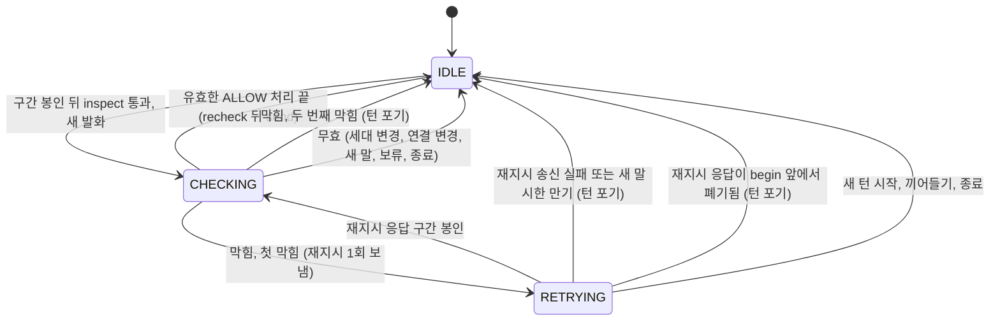
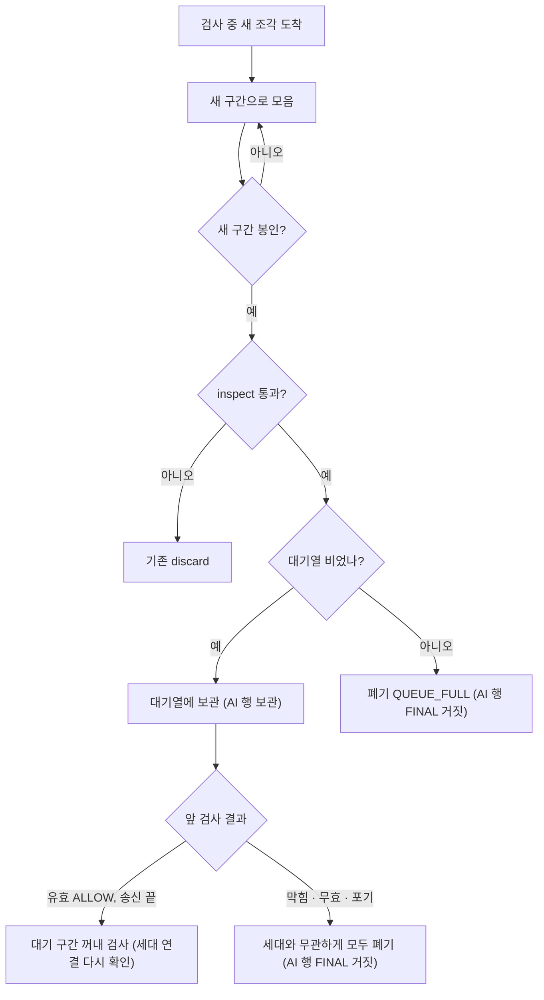
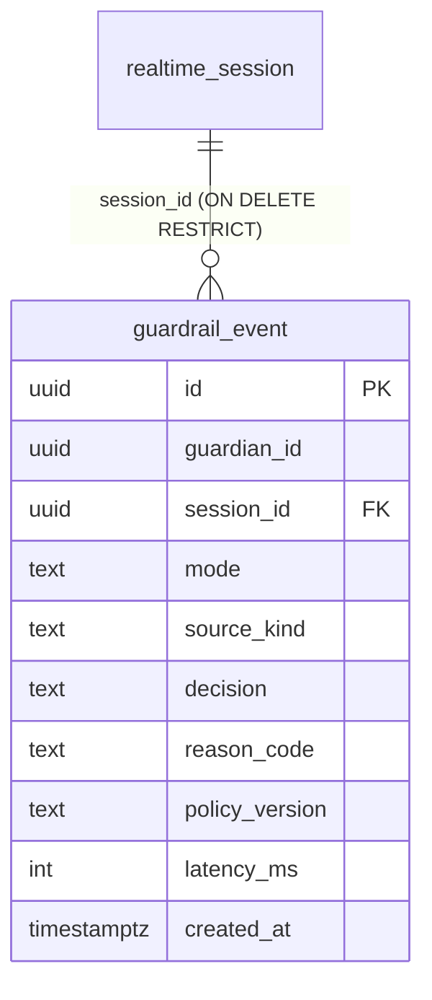

# U13 제브 게이트 — 기능 명세

> 작업 기록 `261017-u13-jev-guardrail` · Functional Design(3.1) · 2026-10-17
> 근거: `functional-design-questions.md`(Q1-A · Q2-B · Q3-A, 가정 1 ~ 17, 요약 확인), `../../inception/requirements-analysis/requirements.md`(FR1 ~ FR8, NFR1 ~ NFR9), `../../inception/reverse-engineering/developer-scan.md`(갭 G1 ~ G12), `docs/units/u13/brief.md`, 앞 볼트 `docs/units/u11/design.md` · `report.md`.
> 이 문서는 **흐름과 상태 전이의 정본**이다. 데이터 모양은 `entities.md`, 판단 규칙은 `rules.md`가 정본이고, 아래 7절의 ER 그림과 9절의 규칙 요약은 그 파생 보기다.
> 설계 수준 문서다. 클래스 이름은 코드 지식 베이스의 이름을 따르고 구현 코드는 쓰지 않는다.

## 1. 개요

GPT-Live가 그 자리에서 만든 말(새 발화)은 제브(외부 안전 검사)가 `ALLOW`한 것만 기기로 나간다. 검사는 실행기 스레드를 막지 않고, 막히거나 늦거나 실패하면 그 말은 한 바이트도 나가지 않으며 아이는 '생각 중'을 유지하다가 같은 다음 행동을 한 번 다시 받는다.

- **어디에 끼는가:** `SessionExecutor.sealAndGate`에서 `OutputGate.inspect`(구조 · 1차 사전) 통과와 연습 원문 일치 검사 **뒤**, `OutputGate.recheck` **앞**이다. `OutputGate`는 동기 판정 클래스라 바꾸지 않는다(편차 U13-D1). 제브 대기는 실행기 쪽 협력 객체 `GuardrailCoordinator`가 U11 `JudgmentCoordinator`와 같은 방식(비동기 결과를 `SessionMailbox` 메시지 `GuardrailArrived`로 실행기 스레드에 돌려놓음)으로 이어 붙인다.
- **무엇을 쥐는가:** 검사표(`GuardrailTicket`)가 봉인된 구간 하나(`Sealed`)와 두 출력 세대 · 연결 id · 입력 묶음 id를 쥐고, 결과가 돌아오면 모두 그대로일 때만 ALLOW가 유효하다.
- **세션당 검사는 1건**이고, 검사 중 도착한 새 조각은 새 구간으로 모아 대기열 1칸에 둔다(Q2 답 B).
- **모드 하나:** `mujoong.guardrail.jev.mode` = `REAL`(실제 어댑터) · `STUB`(대역, demo · prod 밖) · `OFF`(건너뜀, demo · prod 밖). demo · prod는 `REAL` + 키가 아니면 기동 실패(Q1 답 A).
- **하지 않는 것:** 연습 상태 기계 · 역할 정책(U12), Luna 생성물 검사, GPT-Live 선 형식 변경, 기기 · 프런트 변경, 지표 이름 계약 표(설계서에만), 세션 종료 합계 로그 한 줄(편차 U13-D2).

## 2. 상태 기계

### 2.1 검사 (`GuardrailCheck`, 세션당 하나)

텍스트 대안: 평소에는 `IDLE`이다. 새 발화 구간이 inspect를 통과하면 `CHECKING`이 되고(검사표를 만들고 요청을 보냄), 결과가 유효한 ALLOW면 recheck → send를 하고 `IDLE`로 돌아온다. 막히면 첫 막힘은 재지시를 보내고 `RETRYING`(재지시 응답을 기다림)이 되며, 재지시 응답 구간이 봉인되면 다시 `CHECKING`이다. 재지시를 보내지 못했거나(`sendInstruction`이 거짓 또는 송신 실패) 새 말이 시한 안에 시작하지 않으면(`NEW_SPEECH_NOT_OBSERVED`) 그 턴을 포기하고 `IDLE`로 돌아온다(BR6.6). 재지시 응답이 제브에 닿기 전에(`begin` 앞에서) 어떤 길로든 폐기되어도(inspect 실패 · 연습 원문 불일치 · 오버사이즈 · 소리 없는 전사 · 공급자 오류 · `catch`) 같은 포기로 `IDLE`로 돌아온다. 훅은 `discard()` 한 지점에 있다(BR6.6). 두 번째 막힘 · 무효 · 새 턴 · 끼어들기 · 종료도 `IDLE`로 돌아온다. `OFF` 모드에서는 이 기계가 돌지 않는다.

| 상태 | 뜻 | 기기 보기 |
|---|---|---|
| `IDLE` | 검사 중인 구간이 없다 | 그대로(듣는 중 · 재생 중) |
| `CHECKING` | 제브 결과를 기다린다(최대 `jev-budget` 800ms) | `THINKING` 유지(BR3.4) |
| `RETRYING` | 재지시를 보냈고 그 응답이 봉인되기를 기다린다 | `THINKING` 유지 |

### 2.2 대기열 1칸 (Q2 답 B)

텍스트 대안: 검사 중 도착한 조각은 새 구간으로 모인다. 새 구간이 봉인되어 inspect를 통과하면, 대기열이 비어 있으면 보관하고 차 있으면 `QUEUE_FULL`로 폐기한다. 앞 검사가 유효한 ALLOW로 송신을 마치면 대기 구간을 꺼내 세대 · 연결을 다시 확인한 뒤 검사한다. 앞 검사가 막힘 · 무효 · 포기로 끝났다면 세대가 올랐는지와 무관하게 대기 구간을 모두 폐기한다(재지시는 세대를 올리지만 무효 · 포기 경로의 `discard(correct=false)`는 올리지 않기 때문에 세대 비교에 기대지 않는다).

### 2.3 턴 재지시 (`GuardrailTurnState`)

| 현재 | 사건 | 다음 | 효과 |
|---|---|---|---|
| `retries 0` | 첫 막힘 | `retries 1` | 재지시 1회(BR6.2). 기기 THINKING 유지 |
| `retries 1` | 두 번째 막힘(자유대화) | 포기 | 구간 폐기, 대기 문구 또는 듣기 복귀(BR6.3) |
| `retries 1` | 두 번째 막힘(연습, 시험에서만) | 포기 | `GuardrailBlockedEvent`를 확장점에 알림(BR6.5) |
| 어느 쪽이든 | 아이 확정 전사 · 끼어들기 · 종료 | `retries 0` | 새 턴 |

## 3. 흐름

### W1. 정상 한 턴 (자유대화, REAL, ALLOW)
1. 공급자 출력 조각 → `SegmentBuffer`(기존). 조용 시간(800ms) 뒤 봉인(`sealAndGate`).
2. `gate.inspect(sealed)` 통과, 연습이 출력을 쥐고 있지 않음.
3. 분류(W5): 승인 원문이 아님 → 새 발화.
4. 협력 객체가 `transcripts.aiHold()`로 AI 행을 보관 손잡이로 빼고, 검사표를 만들어(요청 id · `Sealed` · 두 세대 · 연결 id · 입력 묶음 id) `GuardrailRequestFactory`로 요청을 구성한 뒤 `GuardrailClient.check`를 비동기로 부른다. 기기는 `THINKING` 유지. `sealAndGate`는 여기서 끝난다(BR3.1).
5. 결과 완료 콜백 스레드가 **일반 편지함**(`putFromProvider`, U11 `JudgmentArrived`와 같은 길)에 `GuardrailArrived`를 넣는다(BR3.1). 안전 편지함(`putSafety`)은 일반 편지함보다 먼저 비워져, 이미 일반 편지함에 쌓인 기기 · 공급자 사건보다 앞질러 처리되면 `ALLOW`가 "그 사건이 반영되기 전 상태"로 검증되기 때문이다(`onOutputQuiet`가 `pendingOutputChunks`로 막는 것과 같은 경주).
6. 실행기가 `GuardrailArrived`를 처리: 검사표 유효 조건 다섯(BR4.2)을 확인.
7. 유효한 `ALLOW` → `gate.recheck`(NOT_ACTIVE · RECORDER_DEGRADED · 출력 레인 예약) → `send`(여기서 `aiFinal(보관 손잡이, 전사, true)`로 보호자 화면 승인, 지연 기록 `gatePassed`) → `guardrail_event`(ALLOW) 기록.
8. 대기 구간이 있으면 꺼내 검사(BR5.4).

### W2. 막힘과 재지시 (첫 막힘 → 재지시 → 두 번째 막힘)
1. W1의 6단계에서 결과가 막힘(BLOCK · REVIEW · TIMEOUT · 전송 오류 · 잘못된 JSON · 정책 판 불일치 · 어댑터 없음, BR3.3).
2. 구간 AI 행을 `aiFinal(보관 손잡이, 전사, false)`로 닫고 `mujoong.gate.discard{reason=GUARDRAIL_*}`와 `guardrail_event`(BLOCK · REVIEW · TIMEOUT · ERROR)를 남긴다. 기기로는 한 바이트도 안 나간다.
3. `retries`가 0이면: 마지막 서버 지시가 있으면 그 템플릿을, 없으면 `RETRY_FREE_TURN`을 `sendInstruction(GUARDRAIL_RETRY, …, onFailure)`로 보낸다(W2b에서 어떤 지시가 '마지막 서버 지시'인지 정한다). 이때 공급자 출력 세대가 오르고 `INSTRUCTION_WAIT`가 걸린다. 상태는 `RETRYING`, 기기 `THINKING` 유지. `retries = 1`. `sendInstruction`이 거짓을 돌려주면(공급자 연결 없음) 바로 5단계의 포기로 간다. `onFailure`(송신 실패 · `NEW_SPEECH_NOT_OBSERVED`)는 협력 객체의 `onRetryNotHeard()`를 불러 같은 포기로 보낸다(BR6.6).
4. 재지시 응답이 봉인되면 W1의 4단계부터 다시(BR6.4, 같은 검사).
5. 그 결과가 또 막힘이면(`retries 1`): 자유대화는 `discard(sealed, 제브 사유, correct=false)`로 마무리(`WAITING_FILLER` 재생 또는 듣기 복귀)하고 턴을 포기한다. 고정 교정 문장은 보내지 않는다(BR6.3).

### W2b. 마지막 서버 지시의 기억과 지움 (재지시가 무엇을 다시 보내는가)
`sendInstruction`은 서버 발화 · 판정 지시 · 연습 · 교정에서 모두 불리므로 호출 지점별로 정한다.

| 호출 지점(코드 스캔 기준) | 기억하나 | 재지시 때 |
|---|---|---|
| 판정 뒤 다음 행동 지시(`JudgmentEnv.sendInstruction`, `NextAction` 템플릿) | **기억한다**(`ReplayableInstruction`) | 같은 템플릿을 다시 보낸다 |
| 아이 말에 응답 시작 지시(`requestResponse`, `ResponseStart`) | **기억한다** | 같은 시작 지시를 다시 보낸다 |
| 연습 승인 발화 `speak`(`provider-practice-speech-`) | 기억하지 않는다 | 해당 없음(연습 중 제브 호출 없음, 원문 일치 때문에 다시 보내는 의미가 달라짐) |
| 연습 확장점 지시(`provider-practice-`) | 기억하지 않는다 | 해당 없음 |
| 게이트 교정 지시(`GATE_CORRECTION`) | 기억하지 않는다 | 교정 응답이 막히면 자유 응답으로 보고 `RETRY_FREE_TURN` |
| 제브 재지시(`GUARDRAIL_RETRY`) 자신 | 기억하지 않는다 | 재지시는 한 번뿐이라 다시 보내지 않는다(BR6.1) |

- 기억한 지시는 **아이 확정 전사가 새로 들어올 때**(새 턴), 다른 종류의 `sendInstruction`이 불릴 때, 재지시로 한 번 쓰였을 때 지운다.
- 기억이 없으면(자유 응답) `RETRY_FREE_TURN`을 보낸다(BR6.2).

### W3. 늦은 ALLOW 무효 (표)
| 결과가 도착했을 때 상태 | 판정 | 처리 |
|---|---|---|
| 요청 id가 지금 검사표와 다름 | 버림 | 아무것도 하지 않음(이미 다른 검사가 진행 중이거나 끝남) |
| 공급자 출력 세대가 올랐음(재지시 · 판정 턴 · 보류 해제 · 연습 폐기) | 무효 `GENERATION_CHANGED` | 재생 안 함, 기록 VOIDED, 재지시 없음 |
| 기기 프레임 세대가 올랐음(끼어들기 · 종료 의도 · 연결 교체) | 무효 `GENERATION_CHANGED` | 같음 |
| 기기 연결이 바뀌었거나 닫힘 | 무효 `CONNECTION_CHANGED` | 같음 |
| 상태가 `ACTIVE`가 아니거나 세션 종료 · teardown | 무효 `SESSION_ENDED` | 요청은 teardown이 이미 취소. 보관 행은 closeAll이 닫음 |
| 출력 보류(WAITING_CHILD · 종료 확인 · 판정 턴 · 연습 보류) | 무효 `HELD` | 재생 안 함 |
| 새 아이 입력 묶음이 열림(BR4.4: 요청 이후 입력 묶음 열림 횟수가 늘었음) | 무효 `CHILD_SPOKE` | 재생 안 함, 기록 남김. 같은 묶음의 꼬리 조각이면 무효 아님. 묶음이 확정되어 지워져도(`clearInputGroup`) 열림 횟수는 줄지 않아 비교가 어긋나지 않는다 |
| 연습 발화가 바뀌었음(`pendingPracticeSpeech` 비었거나 다름) | 무효 `PRACTICE_CHANGED` | 재생 안 함(지금 운영에서는 해당 없음) |

무효 뒤에는 재지시를 하지 않는다(상태가 이미 바뀌었기 때문). `listeningAgain()`만 부른다. 대기 구간이 있으면 무효도 '앞 검사가 ALLOW로 끝나지 않은 경우'이므로 세대와 무관하게 폐기된다(BR5.4).

### W4. 검사 중 새 조각 (대기열)
1. `onOutputChunk`는 지금처럼 새 조각을 받는다. 출력 보류로 버리지 않는다(BR5.2).
2. 앞 구간의 AI 행은 보관 손잡이에 있으므로 `aiStart`가 새 행을 연다(`TranscriptWriter`는 열린 행 + 보관 손잡이 2개를 안다, BR5.5).
3. 새 구간이 봉인되면 `inspect` → 대기열 비었으면 보관(AI 행도 보관 손잡이로), 차 있으면 폐기(`QUEUE_FULL`, AI 행 FINAL · 거짓).
4. 앞 검사가 **유효한 ALLOW로 송신을 마친 경우에만** 대기 구간을 꺼내 검사한다. 이때 검사표는 꺼내는 순간의 세대 · 연결 · 입력 묶음 열림 횟수로 새로 만들고, 봉인 때의 공급자 출력 세대와 지금 값이 다르면(그 사이 지시 · 판정 · 보류가 세대를 올렸으면) 재생하지 않고 폐기한다. **앞 검사가 막힘 · 무효 · 포기로 끝났으면 세대가 올랐는지와 무관하게 대기 구간을 모두 폐기한다.** 폐기하는 구간의 보관 AI 행은 `aiFinal(손잡이, 전사, false)`로 닫는다(BR5.4). 재지시 응답은 대기 구간이 아니라 재지시 뒤 새로 모이는 구간이다.

### W5. 분류: 승인 원문 생략 vs 새 발화
1. 연습이 출력을 쥐고 있으면(`practice.controlsOutput()`): 전사가 `pendingPracticeSpeech.matches`이면 생략(기존 통과), 아니면 기존 `GATE_PATTERN` 폐기(제브 안 부름, BR7.6).
2. 아니면 `LiveContentRegistry.matchApproved(세션, 전사)`: `MATCHED`이면 생략(`guardrail_event` APPROVED_VERBATIM_SKIPPED, 지연 0), `UNKNOWN` · `NOT_MATCHED`이면 새 발화로 검사(BR7.1 ~ BR7.5).
3. 정규화는 ASCII 공백 제거뿐이다(BR7.3). 대본 문장(`registerScript`)은 U12가 등록한 뒤부터 일치한다(BR7.4).

### W6. 기동 점검
`RealtimeStartupChecks.problems`에 모드 × 프로필 × 키 규칙을 더한다(BR9.1).

| 프로필 | `REAL` + 키 있음 | `REAL` + 키 없음 | `STUB` | `OFF` |
|---|---|---|---|---|
| `demo` · `prod` | 허용 | 기동 거부(이유 로그) | 기동 거부 | 기동 거부 |
| `dev`(로컬 · CI · 검증 스택) | 허용 | 기동 거부(AC2.3.3) | 허용(대역 표시) | 허용(비활성 표시) |
| `test`(시험 프로필) · 활성 프로필 없음 | `dev`와 같다(비강제) | 기동 거부 | 허용(기본값) | 허용 |

프로필 분류는 기존 `RealtimeStartupChecks`의 `PUBLIC_PROFILES = {demo, prod}`를 따른다. 여기에 속하면 강제(REAL + 키 + 허용 호스트 + 고정 모델), 그 밖은 비강제다(`test` · `dev` · 활성 프로필 없음). 기본 모드는 강제 프로필 = `REAL`, 그 밖 = `STUB`이다.
그 밖의 점검: demo · prod의 호스트가 허용 목록 안(BR2.2), 모델이 고정 버전(BR2.3), 정책 리소스 적재(U8). 비실검사로 시작하면 기동 로그 한 줄(BR9.2). 기존 `RealtimeStartupChecks.Inputs` 레코드에는 제브 입력(모드 · 키 유무 · 주소 · 모델)을 필드로 더하되 기존 생성자 오버로드를 유지해 기존 시험이 그대로 컴파일되게 한다(BR9.1).

### W7. 기록 · 삭제 · 계측
- 검사 결과마다 `guardrail_event`(BR8.1), 비동기 기록기(BR8.2), 보호자 삭제 참여자 185(BR8.3).
- 지표는 `RealtimeMetrics`에 `mujoong.guardrail.*` 접두어로 더한다(BR8.5). 이름 · 종류는 `docs/units/u13/design.md`에 적는다.
- 보호자 화면은 새 필터 없이 `approved_for_display`로 걸러지고, 승인 시점이 ALLOW 뒤다(BR8.4).

### W8. 연습 갈래 (U13은 정의와 단위 시험까지)
확장점 이벤트 열거형에 `GuardrailBlocked`를 더하고, 시험이 `PRACTICE_PEER` · `PRACTICE_COACH` 모드를 대역으로 주입해 두 번째 막힘에 이벤트가 한 번 전달되는지 확인한다. 운영 호출자는 U12다. 지금 운영 연습 경로는 그대로다(BR7.6).

## 4. 인터페이스 (설계 수준)

| 이름 | 역할 | 주의 |
|---|---|---|
| `GuardrailClient`(포트) | `available()` + `check(request, deadline) -> CompletionStage<GuardrailVerdict>` | 예외 없이 모든 실패를 `FAILED`로 완료(BR1.2) |
| `JevGuardrailClient`(어댑터) | HTTPS 한 번, 응답 → 내부 형식 변환 한 곳 | 재시도 없음, 호스트 재확인(BR2.1 · BR2.2 · BR2.6) |
| `StubGuardrailClient`(대역) | 즉시 `ALLOW`(reasonCode `STUB_ALLOW`), 시험이 손으로 푸는 대역도 같은 포트 | '대역' 표시(BR1.4) |
| `GuardrailRequestFactory` | 후보 + 익명 맥락 3턴, 이름 치환, 길이 상한 | 지시문은 데이터 필드에만(BR2.4 · BR2.5) |
| `GuardrailCoordinator`(협력 객체) | 검사 상태 기계, 검사표, 대기열, 턴 재지시 | 실행기 스레드 전용, `Env`로만 실행기와 닿음 |
| `GuardrailCoordinator.Env` | `now`, `status`, 기기 연결 id, 두 세대, 출력 보류 여부, **입력 묶음 열림 횟수**(BR4.4), `recheckAndSend(sealed, …)`, `discard(sealed, 사유, correct)`, `sendReplay(instruction, onFailure)`, `sendRetryFreeTurn(onFailure)`, 보기 유지, 연습 확장점 알림, 최근 맥락, 비동기 결과 우편(`postFromProvider`) | U11 `JudgmentCoordinator.Env`와 같은 모양. `sendReplay` · `sendRetryFreeTurn`은 `sendInstruction`의 거짓 반환과 `onFailure`를 협력 객체의 포기 경로로 잇는다(BR6.6) |
| `SessionMailbox.GuardrailArrived` | 비동기 결과를 실행기 스레드로 | **일반 편지함**(`putFromProvider`, U11 `JudgmentArrived`와 같은 길). 안전 편지함이 아님(BR3.1) |
| `GateDecision.DiscardReason`(열거형 확장) | 제브 사유 값을 더함: `GUARDRAIL_BLOCK` · `GUARDRAIL_REVIEW` · `GUARDRAIL_TIMEOUT` · `GUARDRAIL_ERROR` · `GUARDRAIL_QUEUE_FULL`(무효 원인은 `guardrail_event`의 사유 코드로만 남기고 `discard` 사유로 쓰지 않는다) | 기존 값은 그대로. `RealtimeMetrics.gateDiscard`의 태그 값 목록과 이 열거형을 단언하는 시험을 새 사실로 갱신(BR3.3) |
| `GuardrailSupport`(기록) | 협력 객체 생성에 필요한 것(클라이언트, 모드, 기록기, 레지스트리 포트)을 묶음. `DISABLED`(= OFF) 기본값 | `Services` 오버로드를 늘리지 않음(BR1.6 · BR7.4) |
| `TranscriptWriter.aiHold()` / `aiFinal(손잡이, …)` | 열린 AI 행을 보관 손잡이로 분리 · 나중에 닫기 | `closeAll`이 보관 행도 닫음(BR5.5) |
| `InstructionTemplates` | 새 템플릿 `RETRY_FREE_TURN` | 정책 내용 · 후보 문장 없음(BR6.2) |
| `OutputGeneration.BumpReason` | 새 값 `GUARDRAIL_RETRY` | |
| `GuardrailEventRecorder` / `GuardrailEventRepository` / `GuardrailEventDeletionParticipant` | 비동기 기록 · upsert · 삭제 | U11 판정 기록과 같은 모양, SI-10 표식 |
| `PracticeSessionExtension` 이벤트 열거형 | `GuardrailBlocked` | 기존 확장 구현체는 바꾸지 않음(BR6.5) |
| `SessionExecutor` 호출 지점(최소) | ① `sealAndGate`의 inspect 통과 · 연습 확인 뒤 `guardrail.begin(...)`, ② `GuardrailArrived` 사례, ③ 아이 확정 전사 → `onNewTurn`, ④ `teardown` → `onExit`, ⑤ `listeningAgain` 유지 조건, ⑥ W2b 표의 두 호출 지점(판정 뒤 다음 행동 지시 · `requestResponse`)에서 마지막 서버 지시 기억, 다른 `sendInstruction`에서 지움, ⑦ `send` · `discard`가 AI 행 닫기 방식을 매개로 받음, ⑧ 입력 묶음을 처음 열 때(`groupInputDelta`) 열림 횟수를 1 올림 | 상태 필드는 협력 객체에만 둔다(NFR8). 열림 횟수 카운터만 실행기에 있다 |
| 폐기 훅(R-02 · R-11) | 재지시 응답이 `begin`에 닿지 못하고 폐기되는 길은 여럿이다(`sealAndGate`의 `inspect` 실패 · 연습 원문 불일치 `GATE_PATTERN` · `catch`, `onOutputChunk`의 `SEGMENT_OVERSIZE`, `onOutputQuiet`의 `ABANDON_NO_AUDIO`, `providerError`의 `discard(GATE_EMPTY)`, `recheck` 실패). 길마다 훅을 걸지 않고 **`discard()` 한 지점**에 건다. `discard`의 맨 앞(AI 행을 닫기 전)에서 사유가 `GUARDRAIL_*`가 아니고 협력 객체가 `RETRYING`이면 `onDiscardedBeforeCheck()`로 `IDLE`로 돌려놓는다. 훅 자신은 `listeningAgain`을 부르지 않는다 — `discard`의 기존 마무리(교정 지시 · 대기 문구 · `listeningAgain`)가 그대로 이어지므로 중복 호출이 없다. 이 마무리가 교정 지시를 보내 새 응답을 기다리게 되면 그 응답은 새 검사(`CHECKING`)로 가고 턴의 `retries`는 이미 1이라 또 막히면 곧바로 포기한다. `sealed == null`로 끝나는 경로는 폐기가 아니라 아직 응답이 오지 않은 것이라 훅을 부르지 않는다(`RETRYING`을 조기에 포기하지 않음) | BR6.6 |
| `begin`의 예외 처리 | `begin`을 부르는 자리에 **전용 `try/catch`**를 둔다(공용 `sealAndGate`의 `catch`는 `hasOpenAi()`가 거짓이면 아무것도 하지 않으므로 기대지 않는다). `begin`이 `aiHold` 뒤에 던지면 ① 보관 행을 `aiFinal(손잡이, 전사, false)`로 닫고 ② 검사표를 버리고 협력 객체를 `IDLE`로 돌린 뒤 ③ `discard(sealed, GUARDRAIL_ERROR, correct=false)`를 부른다. ③의 마무리가 `listeningAgain`까지 하므로 `RETRYING`이었더라도(①의 `IDLE` 전환과 폐기 훅 모두 적용) 기기가 `THINKING`에 갇히지 않는다 | BR3.1 · BR6.6 |

## 5. 검증 규칙

| 입력 | 규칙 | 실패하면 |
|---|---|---|
| 모드 키 값 | `REAL` · `STUB` · `OFF` 중 하나, demo · prod는 `REAL` | 기동 거부 |
| `JEV_API_KEY` | `REAL`이면 비어 있지 않음 | 기동 거부 |
| 제브 주소 호스트 | 허용 목록 안(demo · prod 기동, 모든 프로필 요청 직전) | 기동 거부 / `TRANSPORT_ERROR` |
| 모델 이름 | 고정 버전, `-latest` 별칭 거부(demo · prod) | 기동 거부 |
| 요청 후보 문장 | 1 ~ 4000자 | 요청을 만들지 않고 막힘(`INVALID_REQUEST`) |
| 응답 | JSON, 필수 필드, 판 일치 | `INVALID_JSON` / `POLICY_MISMATCH` |
| 검사표 | 요청 id · 두 세대 · 연결 · 상태 · 보류 · 입력 묶음 · 연습 발화 | 무효(BR4.2) |
| 재지시 | 턴당 1회 | 두 번째 막힘은 포기 |
| 대기열 | 최대 1칸 | 폐기 `QUEUE_FULL` |

## 6. 오류 · 사유 코드

사유 코드는 `appError(Component.OUTPUT_GATE, "<코드>", Level)`와 `mujoong.gate.discard{reason}`, `guardrail_event.reason_code`에만 쓴다(새 사건 코드 없음). 입력값 · 전사 · 예외 메시지 · 스택은 담지 않는다.

| 코드 | 언제 | 처리 |
|---|---|---|
| `GUARDRAIL_BLOCK` · `GUARDRAIL_REVIEW` | 제브가 막음 · 사람 검토 필요 | 막힘(BR3.3) |
| `GUARDRAIL_TIMEOUT` | 800ms 초과 | 막힘 |
| `GUARDRAIL_ERROR` | 전송 오류 · 잘못된 JSON · 정책 판 불일치 · 어댑터 없음 · 호스트 재확인 실패 · 요청 길이 초과 | 막힘 |
| `GUARDRAIL_QUEUE_FULL` | 대기열이 차서 새 구간 폐기 | 폐기, 재지시 없음 |
| `GuardrailRetryNotHeard` | 재지시를 보내지 못했거나 새 말이 시한 안에 시작하지 않아 턴을 포기 | 한 줄 로그(WARN), `IDLE` 복귀, `listeningAgain`(BR6.6) |
| `GUARDRAIL_VOID_*` | 무효 원인(`GENERATION_CHANGED` · `CONNECTION_CHANGED` · `SESSION_ENDED` · `HELD` · `CHILD_SPOKE` · `PRACTICE_CHANGED`) | 재생 안 함, 재지시 없음 |
| `GuardrailModeOff` · `GuardrailModeStub` | 기동 때 비실검사 모드 | 한 줄 로그(WARN) |

## 7. 저장 (realtime V6)

텍스트 대안: 표 `guardrail_event` 하나. 칸은 `id`(= 검사 요청 id), `guardian_id`, `session_id`(세션 행을 가리키는 외래 키, 삭제 제한), `mode`(`REAL` · `STUB`), `source_kind`(`NEW_UTTERANCE` · `APPROVED_VERBATIM_SKIPPED`), `decision`(`ALLOW` · `BLOCK` · `REVIEW` · `TIMEOUT` · `ERROR` · `VOIDED` · `QUEUE_FULL`), `reason_code`, `policy_version`, `latency_ms`, `created_at`. 전사 원문 칸이 없다. `guardian_id` 색인 하나. 기존 표 제약은 건드리지 않아 `infra/migration-approvals.txt` 승인 대상이 아니다.

바뀌는 시험 단언(V6 사실로만, 약화하지 않음): `RealtimeSchemaIT`(표 목록 · 이력 버전 · 최대 버전 "6"), `PracticeMigrationIT` · `PracticeMigrationRegistrationTest`(`V6__u13_jev_guardrail.sql` 존재, 기대 판 "6"), `RealtimeDb`(비우는 표 목록에 `guardrail_event`를 세션보다 먼저), `SingleInstanceMarkerTest`(SI-10 지도에 `GuardrailEventRecorder`), `RealtimeDeletionParticipantOrderTest`(순서 185).

## 8. 편차 · 결정

| ID | 내용 | 근거 |
|---|---|---|
| U13-D1 | ADR-006의 "`OutputGate` 안 한 단계"는 개념 표현으로 읽는다. 실제 구현은 동기 클래스 `OutputGate`를 바꾸지 않고 실행기 쪽 협력 객체가 `inspect`와 `recheck` 사이에 비동기로 이어 붙인다 | 코드 스캔 G1, 가정 1 |
| U13-D2 | 요구사항 FR6.3의 "세션이 끝날 때 합계를 한 줄로 로그에 남긴다"는 이 단계에서 줄인다. 새 사건 코드(`EventCode` · `AttrKey`)가 필요해 `contract-model`과 `log-hygiene-check` 허용 표를 바꾸게 되고, 가정 12(새 사건 코드 없음)와 충돌한다. 합계는 `guardrail_event` 집계와 지표로 낸다 | BR8.6, 가정 12. **승인 때 사람이 판단할 편차** |
| U13-D3 | 정본(AC2.1.3)의 "그 장면 정리"는 자유대화에서 '그 턴을 포기하고 기존 discard 마무리(대기 문구 또는 듣기 복귀)'로 구체화한다. 연습의 장면 정리는 U12 몫이다 | Q1 답, BR6.3 |
| U13-D4 | 사람이 추천(버림)과 다른 B(모았다가 이어서 검사)를 골랐다. 대기열 1칸 · AI 행 보관 손잡이 2개 · 겹치는 턴의 지연 기록이 더해져 시험과 설계 범위가 커진다 | Q2 답 B |
| U13-D5 | 모드 키는 하나(`mujoong.guardrail.jev.mode`)다. 키 이름과 허용값은 `contracts/ai-io.md` 10절과 `ConfigKeyContractTest`에 같은 커밋으로 넣는다(작은 계약 변경, `(U13-a)`) | Q1 답 A, 요구사항 열린 질문 9 |
| U13-D6 | 제브 재시도 분류 표 행("재시도 없음")과 스키마 예시 판 이름 정정을 같은 작업에서 한다(`(U13-b)`). 제브 지표 이름은 설계서에만 둔다 | 가정 14, Q3 답 C(요구사항) |
| U13-D7 | `GuardrailSupport.DISABLED`(= OFF)가 기존 생성 경로의 기본값이다. '검사 없음'이지만 REAL이 아니라는 표시를 가진다 | BR1.6 |

계약 편차 번호 `(U13-a)` · `(U13-b)`는 `contracts/deviations.md`에 쓴다(위 U13-D5 · U13-D6).

## 9. 규칙 요약 (rules.md에서 옮김)

rules.md 끝의 요약 표와 같다. 제브 단계의 핵심만 줄이면 다음과 같다.
- 새 발화만, `inspect` 뒤 · `recheck` 앞, 유효한 `ALLOW`만 송신, 자동 `ALLOW` 없음(BR3.1 ~ BR3.3).
- 늦은 `ALLOW`는 요청 id · 두 세대 · 연결 · 상태 · 보류 · 입력 묶음이 하나라도 달라지면 무효(BR4.2 ~ BR4.4).
- 세션당 검사 1건 + 대기열 1칸, AI 행은 보관 손잡이로 분리(BR5.1 ~ BR5.5).
- 재지시는 턴당 1회, 같은 템플릿 또는 `RETRY_FREE_TURN`, 두 번째 막힘은 포기(BR6.1 ~ BR6.4).
- 승인 원문은 서버 기억으로만 생략(BR7.1 ~ BR7.4).

## 10. 시험 계획 (Standard)

테스트 대역(가짜 제브 · 수동 시계 · 가짜 공급자)만 쓴다. 실제 제브 호출은 이 단위의 자동 시험에 없다(R-F1).

| 대상 | 시험 클래스(예) | 개수 | 핵심 경우 |
|---|---|---|---|
| 포트 · 대역 · 모드 · 기동 | `GuardrailModeStartupChecksTest` · `StubGuardrailClientTest` | 8 이상 | 모드 × 프로필 × 키 표의 모든 칸, 모델 별칭 거부, 호스트 목록, 비실검사 기동 로그, STUB '대역' 표시 |
| 요청 구성 | `GuardrailRequestFactoryTest` | 6 ~ 8 | 이름 치환, 식별자 필드 없음, 맥락 3턴 이하, 지시문이 맥락 필드에만, 길이 상한, 판 이름 `jev-guardrail-v1` |
| 어댑터 변환 | `JevGuardrailClientTest`(가짜 제브 서버) | 8 ~ 10 | ALLOW · BLOCK · REVIEW 변환, 시간 초과 · 전송 오류 · 잘못된 JSON · 판 불일치, 재시도 없음(호출 1회), 800ms 경계(시계), 키 값이 본문에 없음 |
| 협력 객체 상태 기계 | `GuardrailCoordinatorTest` | 14 이상 | 정상 ALLOW, 막힘 일곱 가지, 재지시 → 재막힘 포기, 재지시 불발(송신 실패 · 시한 만기) 포기, **재지시 응답이 `GATE_PATTERN` · inspect 실패 · 오버사이즈 · `ABANDON_NO_AUDIO` · 공급자 오류 · `begin` 예외로 폐기되어도 `RETRYING`에서 빠져나와 기기가 `THINKING`에 갇히지 않음(훅이 `discard()` 한 지점에서 한 번만 걸리고 `listeningAgain`이 중복되지 않음, `sealed == null`은 조기 포기하지 않음)**, 무효 여덟 경우(W3 표), 새 입력 묶음 vs 꼬리 조각 두 시험, 대기열 보관 · 꺼냄 · 앞 검사가 ALLOW가 아니면 세대와 무관하게 폐기 · 가득 참 |
| 실행기 연결 | `GuardrailExecutorTest` | 10 이상 | begin 위치(inspect 뒤 recheck 앞), 승인 시점이 ALLOW 뒤, THINKING 유지, 연습 통제 중 호출 0, 원문 일치 생략 · UNKNOWN은 검사, teardown 취소 |
| 연습 갈래 | `GuardrailPracticeEventTest` | 3 | 대역으로 PRACTICE 모드 주입 시 `GuardrailBlocked`가 한 번 전달, 기존 확장 구현체 수정 없음 |
| 전사 행 | `TranscriptWriterHoldTest` | 5 | aiHold · aiFinal(손잡이) · closeAll이 보관 행도 닫음, 새 행이 보관 행을 재사용 안 함 |
| 기록 | `GuardrailEventSchemaIT` · `GuardrailEventRepositoryIT` · `GuardrailEventRecorderTest` · `GuardrailEventDeletionParticipantIT` | 5 ~ 8 + 통합 | 표 · 제약, 덮어쓰기, FK 위반 폐기, 일시 실패 재시도, 삭제 뒤 0건 |
| 통합 | `GuardrailTurnIT`(가짜 공급자 + 수동 완료 가짜 제브, `segment-quiet` 800ms) | 4 ~ 5 | ALLOW 한 턴이 기기로 나감, BLOCK이면 0바이트 + 재지시 + 보호자 화면에 안 나옴, 늦은 ALLOW 무효, 대기열 |
| 아키텍처 · 계약 대조 | `GuardrailPackageArchTest` · 기존 `LunaArchTest` · `ConfigKeyContractTest` · `TimeLiteralScanTest` | 3 ~ 4 | 패키지 경계, 새 설정 키 대조, 시간 숫자 상수 0건 |
| 바뀌는 기존 단언 | V6 사실(7절) | 기존 | 같은 행동 단언이 남고 느슨해지지 않음 |

- 시험은 제브 대역을 시험이 손으로 푸는 `CompletableFuture`로 만들어 실제 800ms를 기다리지 않는다. 800ms 경계는 수동 시계로 밀어 확인한다(정확히 800.000ms에서 시간 초과, 799.999ms 직전 ALLOW 허용).
- 태그 `@Tag("u13")`, DB 통합은 `@Tag("db")`. 범위 파일 `backend/coverage-scope/u13.txt`(`SessionExecutor`는 목록에 넣지 않고 사유를 적는다, u11.txt 방식), 줄 80%.
- 실제 제브 응답 형식에 대한 `[실호출-합성]` 확인과 분류 품질(AC2.1.10 ~ AC2.1.16)은 사람이 키를 넣은 뒤의 몫이고 이 단계의 자동 시험에 없다.

## Assumptions & Open Questions

### 가정
- 요구사항 가정 A1 ~ A18과 이 단계 가정 17개(요약 확인 Looks correct)를 그대로 쓴다. 그중 이 문서에 직접 영향을 주는 것은 Q1 답 A(모드 키 하나), Q2 답 B(대기열 1칸), Q3 답 A(재지시 문구)다.
- `LatencyRecorder`는 한 번에 한 턴만 안다. 검사 대기 중 겹치는 턴의 기록 순서(BR5.6)는 Code Generation에서 `LatencyRecorder`의 한 턴 규칙에 맞춘다.
- 제브 실제 응답의 분류 이름 7개와 응답 필드는 실호출로 확정한다. 그 전에는 어댑터 변환의 형식 가정 시험으로 못 박는다.

### 열린 질문
1. **`OutputGate.recheck`의 `reserve` 시점:** 지금 `recheck`가 출력 레인 예약을 한다. 제브 ALLOW를 기다린 뒤에 예약하므로 대기 중 레인 상태가 바뀔 수 있다. Code Generation에서 `recheck` 실패(OUTBOUND_FULL 등) 때 막힘과 같은 흐름을 쓰는지 확인한다.
2. **`LatencyRecorder` 겹치는 턴:** BR5.6의 세부(첫 턴 `gatePassed` 시각이 제브 대기를 포함하는 의미 변화)를 Code Generation에서 정한다.
3. **마지막 서버 지시의 기억 범위:** W2b 표로 이 단계에서 정했다(기억 = 판정 뒤 다음 행동 지시 · `requestResponse`, 지움 = 새 턴 · 다른 종류의 지시 · 재지시 사용). Code Generation은 호출 지점의 실제 시그니처(`build` 람다)에서 다시 보낼 값을 어떻게 보관하는지(템플릿 이름 + 매개변수)만 확정한다.
4. **`DeletionRequestedHandler`의 `default` 가지:** 순서 185가 건수에 들어가지 않는다는 U11 선례가 이번에도 그대로인지 시험으로 못 박는다.
5. **허용 호스트 값:** `JevHosts.ALLOWED_HOSTS`의 실제 호스트 문자열은 코드 상수로 두되, 제브 계정 승인 뒤 API 문서로 확정한다(계약 C-DS8 열린 점). 값을 문서에 쓰는 위치는 `ai-io.md` 10절 대조 표 한 곳이다.
6. **R-F15:** 키를 넣어 실제 제브가 켜지면 아이 발화 후보와 최근 맥락 3턴이 외부 공급자로 나간다. 약관 · 아동 데이터 전달 범위 확인 기록(RUNBOOK 단계 4) 전에는 키를 넣지 않는다. 운영 투입은 이 단위 밖이다.

## Sources

- 이 단계의 질문과 답: `functional-design-questions.md` Q1(A) · Q2(B) · Q3(A), 가정 확인 A. Accept assumptions, 요약 확인 Looks correct
- 요구사항: `../../inception/requirements-analysis/requirements.md`(승인판, 제품 리더 READY 재검토 포함)
- 코드 스캔: `../../inception/reverse-engineering/developer-scan.md` 1절(게이트 구조 · 삽입 지점 · 두 세대 · AI 행), 2절(승인 원문), 3절(포트 선례 · 기동), 4절(영속화 · 삭제), 5절(지표 · 보호자 경로), 6절(시험 인프라), 7절(계약), 갭 G1 ~ G12
- 직접 확인한 코드: `log/TranscriptWriter.java`(`aiStart` · `aiFinal` · `closeAll`), `session/SessionExecutor.java`(`sealAndGate` · `send` · `discard` · `correctAfterDiscard` · `sendInstruction` · `listeningAgain`), `compose.ci.yml` · `compose.demo.yml`(프로필)
- 계약: `contracts/schemas/guardrail-request.schema.json` · `guardrail-result.schema.json`, `contracts/ai-io.md` 10절, `contracts/timing.md` 13절, `contracts/deviations.md`
- 앞 볼트: `docs/units/u11/design.md` · `report.md`(출력 세대 · 판정 턴 · 확장점), 코드 지식 베이스 `aidlc/spaces/default/codekb/mujungi/`의 U13 갱신절
- 팀 규칙: `team.md`, `project.md`(R-F1 · R-F3 · R-F5 · R-F6 · R-F7 · R-F14 · R-F15 · R-M2 · R-M5 · R-M9 · R-M10 · R-M11, 교정)
