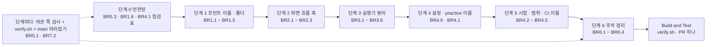
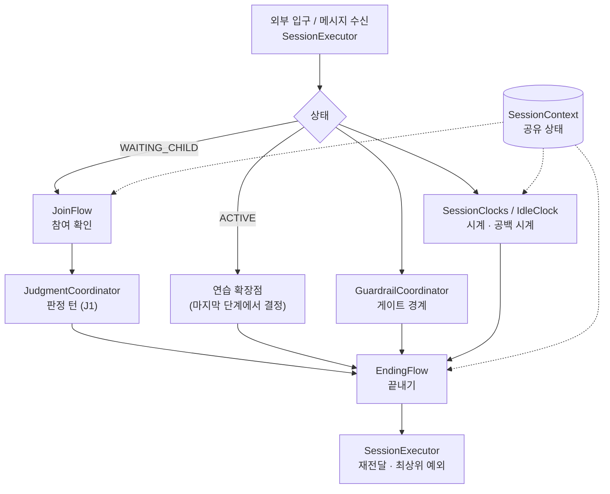

# 구조 · 이름 리팩토링 — 기능 명세 (functional-spec)

> 작업 기록 `261018-structure-refactor` · Functional Design · 범위 `refactor` · 깊이 Minimal.
> 이 문서는 **작업 순서(워크플로)와 상태 전이의 정본**이다. 대상 구조 요소는 `entities.md`, 작업 규칙은 `rules.md`(BR1.1 ~ BR7.3)가 정본이고, 이 문서의 규칙 요약과 다이어그램은 거기서 파생된 읽기용이다. 이 기록은 유닛 나누기 · 도메인 설계를 건너뛰었으므로(refactor 범위) 현재 코드 구조를 사실상의 도메인 설계로 본다. 코드 변경은 하지 않았다.
> 근거: 요구사항 `inception/requirements-analysis/requirements.md`, 코드 스캔 `aidlc/spaces/default/codekb/mujungi/`(원격 `main` 570a625), 팀 확인한 `docs/refactor-structure-before-after.md`.

## 1. 전체 순서



- 모든 단계는 같은 브랜치 `claude/refactor-structure`에서 한다(BR7.1). 한 단계는 여러 커밋을 가지며 **이동 커밋**과 **내용 커밋**을 나눈다(BR1.1).
- 단계가 끝나면 합격 기준(5절)을 명령으로 확인하고, 바꾼 쪽 검사와 `verify.sh`를 통과시킨 뒤 다음 단계로 간다(BR5.1 · BR5.4). 다음 단계 시작 전 `main`을 merge해 따라잡는다(BR7.2).
- 단계 3의 연습 확장점 구역은 마지막에 따로 결정한다(BR3.5). 단계 6은 주석 규칙 개정이 기록된 뒤에만 한다(BR6.1).

## 2. 단계별 워크플로

### 단계 0 — 안전망

| 순서 | 작업 | 규칙 | 산출 |
|---|---|---|---|
| 0.1 | `SessionExecutor`의 처리 순서 7구간(메시지 수신 · 참여 확인 · 판정 · 연습 확장점 · 게이트 · 끝내기 · 시계)마다 고정 시험이 있는지 확인하고, 없으면 현재 동작을 고정하는 시험을 더한다. 이미 덮이면 구간 ↔ 시험 대응표만 만든다 | BR5.3 | 구간 ↔ 시험 대응표, 필요 시 새 시험 |
| 0.2 | `SessionExecutor` 머리 619줄과 끝의 "전이 보조" 약 282줄의 필드 목록을 만들고 소유자(SessionContext / 각 협력 객체)를 정한다. 단계 3.0이 이 표로 `SessionContext`를 만든다 | BR3.2 | 필드 소유자 표 |
| 0.3 | 이름에 묶인 참조 점검표를 코드 스캔 표에서 옮겨 단계별 체크리스트로 만든다(이름으로 읽는 자원 파일 4개와 이동 대상을 import하는 프런트 시험 47개 포함) | BR4.1 | 단계별 참조 점검표 |
| 0.4 | 화면 번호 ↔ 새 파일 경로 표 `docs/screen-map.md`를 만든다. 3절의 컴포넌트 이동 매핑은 import 그래프로 한 번 더 확인한다(한 기능만 쓰면 기능 폴더, 둘 이상이면 `common`) | BR1.6 · BR1.4 | `docs/screen-map.md` |
| 0.5 | AC-1 ~ AC-9의 "시작 전 값"(5절 기준선)과 지정 화면 9개의 요청 · 이동 · 오류 호출 수, 건드릴 파일의 결정 ID 주석 수를 기록한다 | BR2.1 · BR5.4 | 기준선 수치 |
| 0.6 | 원격 `main`에서 `verify.sh`와 `gradlew check`를 한 번 돌려 시작 전 결과를 기록한다(`main` CI `skeleton` 실패 이력이 있어 변경과 섞이지 않게 한다) | BR5.1 | `main` 기준 검증 결과 |

종료: 합격 기준 AC-1 ~ AC-9의 "시작 전 값"이 기록되고, **0.2의 필드 표가 끝나면 5절 AC-4의 "3.5 뒤 줄 수 상한"에 숫자가 적혀 있고**(0.2의 종료 조건), 새 시험(있다면)과 기존 시험이 모두 통과한다.

### 단계 1 — 프런트 이름 · 폴더 (이동만)

| 순서 | 작업 | 규칙 |
|---|---|---|
| 1.1 | 보호자 화면 17개를 3절 매핑대로 `parent/features/<기능>/`으로 `git mv` + import 수정 | BR1.2 · BR1.3 |
| 1.2 | 한 기능만 쓰는 컴포넌트 · 훅 · 요청 · 문구를 해당 기능 폴더로, 여러 기능이 쓰는 것은 `parent/common/`으로 이동 | BR1.4 |
| 1.3 | 기기 화면을 `device/features/{first-boot,status,debug}`로 이동(인프라 폴더는 그대로) | BR1.4 |
| 1.4 | `src/app/**/page.tsx`의 import, 이동 대상을 import하는 시험 47개(`frontend/tests/u*`의 `@/parent/screens` 등), `frontend/coverage-scope/*.json`의 경로, ESLint glob · 예외 파일 경로(`parent/push/browserPush.ts`, `device/mic/micPermission.ts`), `docs/` 경로(코드가 읽는 것만)를 같은 커밋에서 수정 | BR4.1 · BR1.5 |
| 1.5 | `u5bCopy.ts` 등 유닛 번호가 든 소스 이름을 기능 이름으로 | BR1.3 |

종료: AC-1(번호 접미 파일 0), AC-6(경계 규칙 통과), `eslint .` · `vitest --coverage` · `next build` 통과, `verify.sh` 통과.

### 단계 2 — 화면 흐름 훅 분리

| 순서 | 작업 | 규칙 |
|---|---|---|
| 2.1 | 대상 화면 9개(`Live`, `Home`, `Done`, `Device`, `Child`, `Consent`, `StopExpressions`, `Free`, `DeviceRegister`)에서 `router.*` · 요청 호출 · 오류 분기를 `use<기능>Screen` 훅으로 옮긴다. 화면은 값과 핸들러만 쓴다 | BR2.1 |
| 2.2 | 기능 전용 요청을 기능 `api.ts`로 나누고, 연습 요청(`api` + `startApi`)을 `features/practice/api.ts` 하나로 합친다. `parent/account.ts`는 기능별로 나눈다 | BR2.3 · BR1.4 |
| 2.3 | 오류 문구는 `codeToCopy`만 쓴다. 문구는 기능 `copy.ts` 또는 `shared/copy` | BR2.2 |

종료: AC-3, `vitest` 화면 시험 무변경 통과, `verify.sh` 통과.

### 단계 3 — Realtime 실행기 분리

각 단계는 **커밋 한 개**로 닫는다(BR1.1): 추출한 코드의 잘라 붙이기 + 호출 지점을 새 객체 호출로 바꾸는 치환 + 그 이름을 부르는 참조 갱신(`REALTIME_SHARE`(SI-2 · SI-9) · `TimeLiteralScanTest` 허용 목록 · ArchUnit · 범위 파일 · 문서)이 한 커밋에 들어간다. 로직 변경은 넣지 않는다. 각 커밋 전에 구역 고정 시험이 있어야 하고(단계 0.1), 커밋 뒤에는 바꾼 쪽 검사 + `verify.sh`를 돌린다. 클래스 추출은 새 파일을 만드는 일이라 `git mv`가 아니라 BR1.1의 추출 커밋 규칙을 따른다.

| 순서 | 협력 객체 | 원래 구역(코드 스캔 줄 범위) | 비고 |
|---|---|---|---|
| 3.0 | `SessionContext` 도입 | 머리 1~619의 공유 필드 | 단계 0.2의 필드 표대로 **필드와 접근자만** 옮긴다. 로직 변경 없음. 이후 모든 협력 객체가 이것을 받는다(BR3.2) |
| 3.1 | `EndingFlow` | 기기 표식 · 끝내기 3335~3838 (504줄) | 가장 큰 쉬운 구역부터 |
| 3.2 | `SessionClocks` | 시계 3839~4022 (184줄) | 시각은 `MujoongClock` 주입, 숫자 시간 값 금지(BR3.6) |
| 3.3 | `IdleClock` | 공백 시계 · 기술 일시정지 · 진행 조회 2809~3060 (252줄) | |
| 3.4 | `JoinFlow` + `JudgmentCoordinator` 흡수 | 참여 확인 1017~1094 (78줄), U11 판정 턴 1095~1354 (260줄) | 판정 턴은 기존 `JudgmentCoordinator` 쪽으로 흡수 |
| 3.5 | 정리 | 머리의 협력 객체 전용 필드, 전이 보조 4080~4361 | 단계 0.2의 소유자 표대로 `SessionContext` 또는 협력 객체로 배정 |
| 3.6 | 게이트 경계 | 게이트 3061~3334 (274줄) | `GuardrailCoordinator`와의 경계만 설계서에 적고 옮길 범위는 그 시점에 정한다(BR3.4). 옮기지 않으면 실행기에 남는다 |
| 3.7 | 판단 | 연습 확장점 1355~2808 (1,454줄) | 3.1 ~ 3.6이 끝난 뒤 사람이 계속하자고 할 때만(BR3.5). 하지 않으면 실행기에 남는다 |

3.4까지 끝난 뒤 `SessionExecutor`에는 4,361 − 504 − 184 − 252 − 78 − 260 = **3,083줄**이 남는다(머리 619줄과 전이 보조 282줄이 그대로일 때). 연습 확장점(1,454줄)과 게이트(274줄)가 실행기에 남는 한 "실행기는 분배만 한다"는 최종 상태는 이번 합격 기준이 아니다(BR3.3). 3.5에서 머리 · 전이 보조가 `SessionContext`로 옮겨진 줄 수만큼 더 줄어들며, 이 값은 단계 0.2의 필드 표 뒤에 5절 AC-4에 숫자로 적는다.

종료: AC-4(`SessionExecutor` 줄 수와 분리한 구역의 코드 잔존 0), `SingleInstanceMarkerTest` · `TimeLiteralScanTest` · ArchUnit 통과, 기존 시험 무변경, `verify.sh` 통과.

### 단계 4 — 설정 레코드 · `practice` 이름

| 순서 | 작업 | 규칙 |
|---|---|---|
| 4.1 | `RealtimeProperties` · `CoreProperties`의 중첩 record를 기능별 파일로 나눈다. 키 이름 · prefix 불변 | BR4.6 |
| 4.2 | realtime `practice/`(운영 30파일)를 `practicelegacy`로 변경한다. 같은 패키지 이름을 쓰는 시험(package-private 접근, 시험 폴더 이름)과 이 패키지를 import하는 파일 13개를 함께 옮기고, `PracticeFlowArchTest` 패키지 문자열 · `u5b` 범위 파일 경로 · 계약 경로를 같은 커밋에서 수정한다. 이름 `legacy`는 사람이 고른 값(Q3 A)이다 | BR4.1 |

종료: `ConfigKeyContractTest` 통과, ArchUnit 규칙이 비지 않음(`allowEmptyShould`), `verify.sh` 통과.

### 단계 5 — 시험 · 범위 · CI 이름

| 순서 | 작업 | 규칙 |
|---|---|---|
| 5.1 | 프런트 `tests/u*`를 소스 구조를 따라가는 폴더로 옮기고 공용 준비 `tests/u1/setup.ts` → `tests/setup.ts`, `tests/u1/support` → `tests/support`로 옮긴다. `vitest.config.ts`의 `setupFiles` · `a-checks.sh` 참조를 같은 커밋에서 고친다. `tools/tests/u*`(u1 · u3 · u4a · u4b · u11)도 3.1절 표의 기능 이름으로 옮긴다. **프런트 범위 시험(`u5b` → `practice-legacy`, `u7` → `web-push`)은 폴더가 아니라 시험 파일 목록 `frontend/coverage-scope/<이름>.tests`로 고른다**: 옮기기 전 `tests/u5b`의 3개 파일(32개 시험)과 `tests/u7`의 6개 파일(89개 시험)을 옮긴 위치로 한 줄씩 적고, CI `vitest run`에 그 목록을 넘긴다. 옮긴 뒤 같은 범위를 돌려 시험 파일 수 · 시험 수가 같아야 한다(AC-8) | BR1.3 · BR4.1 · BR4.8 · BR4.9 |
| 5.2 | 범위 파일(백엔드 18개, 프런트 8개)을 3.1절 표의 이름으로 바꾸고 대상 집합은 그대로 | BR4.2 · BR4.8 |
| 5.3 | 이름에 `U<번호>`가 든 Java 파일 **103개**(접두 70 + 중간 33, 운영 클래스 1개 `U2PracticeAccountAdapter` 포함)에서 번호를 뺀다. 같은 폴더에서 겹치는 **20건**은 번호 자리에 기능 이름을 넣어 구분한다(BR4.5). `@Tag("u…")`가 붙은 시험 파일 **450개**의 태그를 3.1절 표의 이름으로 바꾼다(CI `-PincludeTags`와 같은 커밋). 이름으로 읽는 자원 4개(`textai/u5a-forbidden-patterns.txt`, `practice/u5b-independent.yml`, `practice/u5b-runtime.yml`, `contracts/u14-compatibility.md`)와 그것을 읽는 코드의 문자열도 같이 바꾼다. 마이그레이션 파일은 제외. 충돌 목록은 이 단계의 첫 커밋에서 스크립트로 만든다 | BR4.5 · BR4.3 · BR4.8 |
| 5.4 | `ci.yml` 작업 이름(`u5b-scope` 등) · `-PincludeTags` · `-PcoverageScope` · `MUJOONG_COVERAGE_SCOPE` · `vitest run tests/u5b` · `hashFiles('…/coverage-scope/u7.*')` · `ci-gate` needs를 같은 커밋에서 고친다. `hashFiles` 경로가 새 파일 이름과 다르면 단계가 조용히 건너뛰어지므로 새 이름으로 정확히 맞춘다. 프런트 `u5b` · `u7` 범위 단계는 5.1의 시험 파일 목록(`<이름>.tests`)을 쓰도록 바꾼다. 바뀐 이름을 문서에 남긴다. **종료 확인(AC-9)**: 이름 변경 뒤 첫 CI 실행의 단계 기록에서 `hashFiles` 조건 단계(프런트 `web-push` 범위, 백엔드 `web-push` 범위)가 `skipped`가 아니라 `success`인지 확인한다 | BR4.4 · BR4.9 |

종료: AC-2(유닛 번호 경로 0), AC-8(범위 시험 파일 수 · 시험 수 대조), AC-9(`hashFiles` 조건 단계가 건너뛰기가 아님), 시험 수가 단계 전과 같음(이름 변경 제외), `ci-gate` 구성이 새 작업 이름과 같음, `verify.sh` 통과.

### 단계 6 — 주석 정리 (조건부)

| 순서 | 작업 | 규칙 |
|---|---|---|
| 6.0 | `team.md` 규칙 4개(화면 번호 접미 · `tests/<유닛>/`과 유닛 태그 · 주석 ID 인용 · 범위 파일 이름)를 학습 절차(§13)로 올려 사람이 승인한다 | BR6.3 |
| 6.1 | 승인되었으면 이 기록이 건드린 파일의 주석을 "무엇을 왜"만 남기고 결정 ID는 필요할 때 한 줄 문서 링크로 줄인다 | BR6.1 · BR6.4 |
| 6.2 | 거절되면 단계 6을 건너뛰고 Build and Test 요약에 이유를 적는다 | BR6.2 |

종료: AC-7(건드린 파일의 ID 주석 수가 기준선 이하로 감소), 시험 · 린트 통과.

## 3. 프런트 이동 매핑 (보호자)

| 지금 | 이후 (`frontend/src/parent/…`) | 비고 |
|---|---|---|
| `screens/Login01` · `LoginCallback` · `DevLogin` | `features/login/LoginScreen` · `LoginCallbackScreen` · `DevLoginScreen` | `account.ts`의 로그인 부분 → `login/api.ts` |
| `screens/Consent02` | `features/consent/ConsentScreen` + `useConsentScreen` | 동의 요청 → `consent/api.ts` |
| `screens/Child03` · `StopExpressions01` | `features/child/ChildScreen` · `StopExpressionsScreen` + 훅 | 자녀 · 정지 표현 요청 → `child/api.ts` |
| `screens/Home04` + `activity/homeActivity` | `features/home/HomeScreen` + `useHomeScreen` + `presentation.ts` | |
| `screens/Device05` · `Register05a` + `components/CodeInput` | `features/device/DeviceScreen` · `DeviceRegisterScreen` + 훅, `CodeInput` | `CodeInput`은 이 기능만 쓸 때 |
| `screens/Free08` + `activity/freeFailure` | `features/free/FreeTalkScreen` + 훅 + `failure.ts` | |
| `screens/Live12` + `hooks/useLivePolling` + `activity/livePresentation` | `features/live/LiveScreen` + `useLiveScreen` + `useLivePolling` + `presentation.ts` | 가장 많은 요청 · 오류 분기 |
| `screens/Done17` + `hooks/useResultStatusPolling` + `activity/donePresentation` | `features/done/DoneScreen` + `useDoneScreen` + 폴링 훅 + `presentation.ts` | |
| `screens/Practice18` + `practice/*` | `features/practice/PracticeScreen` + `PracticeHeader` · `PracticeStartAction` · `usePracticeGoals` · `practiceStart` · `practiceProgress` · `api.ts`(`api` + `startApi`) · `copy.ts`(`copy` + `u5bCopy`) | |
| `screens/Records26` · `RecordDetail27` | `features/records/RecordsScreen` · `RecordDetailScreen` + 훅 | |
| `screens/ReportRange28` · `Report30` + `hooks/useReportPolling` | `features/reports/ReportRangeScreen` · `ReportScreen` + 훅 | |
| `api/{apiClient,csrf,types}` | `common/api/` | 보호자 전용 공통 (편차 FD-D1) |
| `hooks/useBackGuard` · `push/*` · `navigation.ts` · `oauth.ts` · `ParentProviders.tsx` | `common/hooks/` · `common/push/` · `common/` | |

#### 3.a `parent/api/*.ts` 파일별 목적지 (실제 export 기준)

| 지금 | 이후 | 근거 |
|---|---|---|
| `api/account.ts` (로그인 · 계정: `Me` `parseMe` `loginWithGoogle` `logout` `fetchMe` `requestAccountDeletion`) | `common/api/account.ts` | `Home04` · `SettingsSheet` · `Device05` · `LoginCallback`이 함께 씀 |
| `api/account.ts` (동의: `ConsentStatus` `ConsentType` `Policy*` `fetchPolicy` `saveConsents`) | `features/consent/api.ts` | `Consent02`만 씀 |
| `api/account.ts` (자녀 · 정지 표현: `Child*` `StopExpression*` `fetchChild` `registerChild` `updateChild` `fetchStopExpressions` `saveStopExpression`) | `features/child/api.ts` | `Child03` · `StopExpressions01` |
| `api/activity.ts` (`ActivityKind` `SessionSummary` `LiveExtras` `fetchCurrentSession` …) | `common/api/activity.ts` | `homeActivity` · `livePresentation` · `TranscriptList`이 함께 씀 |
| `api/push.ts` | `common/push/api.ts` | `PushSettingsRow`만 씀, 푸시는 `common/push` |
| `api/reports.ts` | `features/reports/api.ts` | `ReportRange28` · `Report30` · `useReportPolling` |
| `api/results.ts` | `common/api/results.ts` | `Records26` · `RecordDetail27`(records)와 `useResultStatusPolling`(done)이 함께 씀 |
| `api/queries.ts` (`queryKeys` `createParentQueryClient` `ApiClientContext` `useApiClient`) | `common/api/queries.ts` | 모든 화면이 씀 |
| `api/queries.ts` (`fetchHome` `useHomeQuery`) | `features/home/api.ts` | |
| `api/queries.ts` (`registerDevice`) | `features/device/api.ts` | |
| `api/queries.ts` (`StartFreeTalkBody` `startFreeTalk`) | `features/free/api.ts` | |
| `api/queries.ts` (`fetchLiveView` `endSession` `mergeBubbles` `mergeLiveView`) | `features/live/api.ts` | |
| `api/queries.ts` (`devLogin`) | `features/login/api.ts` | |

#### 3.b `parent/components/*.tsx` 16개 (현재 import 그래프 기준 초안, 단계 0.4에서 재확인)

| 컴포넌트 | 이후 | 쓰는 쪽 |
|---|---|---|
| `BottomTabBar` | `common/components/` | device · done · free · home · live · practice · records |
| `BottomSheet` · `ConfirmDialog` | `common/components/` | consent · live · `SettingsSheet`(home) |
| `LiveRegion` · `MonthCalendar` · `TranscriptList` | `common/components/` | records · reports · live |
| `ChipGroup` · `TextArea200` | `features/free/` | free만 |
| `CodeInput` | `features/device/` | device만 |
| `DeviceCard` · `SettingsSheet` · `PushSettingsRow` | `features/home/` | home만(`SettingsSheet`이 `PushSettingsRow`를 씀) |
| `EndReasonCard` · `SceneChip` | `features/records/` | records만 |
| `NoticeDialog` · `StatusLine` | `features/live/` | live만 |

#### 3.c CSS와 기타

| 지금 | 이후 |
|---|---|
| `parent/{parent,account,activity,result}.css` | `parent/common/styles/` (이동만, 기능별 분리는 하지 않음) |
| `parent/practice/practice.css` | `features/practice/practice.css` |
| `device/device.css` · `shared/styles/tokens.css` · `shared/toast/toast.css` | 그대로 |
| `parent/hooks/useBackGuard` | `common/hooks/useBackGuard` |
| `parent/hooks/useLivePolling` · `useReportPolling` · `useResultStatusPolling` | 각각 `features/live/` · `features/reports/` · `features/done/` |
| `parent/activity/{homeActivity,livePresentation,donePresentation,freeFailure}` | 각각 `features/home/presentation` · `features/live/presentation` · `features/done/presentation` · `features/free/failure` |

#### 3.1 유닛 번호 → 기능 이름 대응표 (BR4.8의 정본)

범위 파일, 시험 태그, `tests/u*` · `tools/tests/u*` 폴더, CI 작업 · 인자, Java 클래스 이름(충돌 시 파스칼 케이스)은 모두 이 표만 따른다.

| 유닛 | 의미(유닛 지시서 기준) | 소문자 하이픈 이름(범위 파일 · 태그 · 폴더) | 파스칼 케이스(Java 충돌 구분) |
|---|---|---|---|
| u1 | 워킹 스켈레톤(두 앱 · 기기 등록 · 자유대화 한 턴) | `skeleton` | `Skeleton` |
| u2 | 보호자 계정 | `parent-account` | `ParentAccount` |
| u3 | 음성 대화 | `voice-session` | `VoiceSession` |
| u4a | 활동 세션 Core · /parent 화면 | `activity-session` | `ActivitySession` |
| u4b | 활동 세션 Realtime | `session-runtime` | `SessionRuntime` |
| u5a | 연습 Core | `practice-core` | `PracticeCore` |
| u5b | 연습 Realtime(레거시) | `practice-legacy` | `PracticeLegacy` |
| u5b-core | 연습 레거시의 core 몫 | `practice-legacy-core` | `PracticeLegacyCore` |
| u6 | 결과와 리포트 | `result-report` | `ResultReport` |
| u7 | 웹 푸시 | `web-push` | `WebPush` |
| u8 | 계약 · 버전 리소스(콘텐츠 카탈로그) | `live-content` | `LiveContent` |
| u9 | Luna 호출부 | `luna` | `Luna` |
| u10 | 상황 생성 | `scenario-generation` | `ScenarioGeneration` |
| u11 | 판정 턴 | `judgment-turn` | `JudgmentTurn` |
| u12 | 새 연습 흐름 | `practice-flow` | `PracticeFlow` |
| u13 | 제브 게이트 | `jev-guardrail` | `JevGuardrail` |
| u14 | 목표 · 결과 | `goal-result` | `GoalResult` |
| u15 | 지식 그래프 | `knowledge-graph` | `KnowledgeGraph` |

- 프런트 `tests/u1`(시험 34개)은 `device` · `parent` · `shared` · `lint` 하위 폴더를 이미 갖고 있어, 유닛 이름 폴더 없이 소스 구조를 따라간다(`tests/parent/…`, `tests/device/…`, `tests/shared/…`, `tests/lint/…`). `u1` 행은 `skeleton`이라는 태그 · 범위 파일 이름에만 쓴다.
- 이 표의 의미 열은 `docs/units/README.md`와 유닛 지시서의 제목을 따랐다. 틀린 곳은 이 표를 먼저 고친다(BR4.8).

기기: `device/components/D0View` → `device/features/first-boot/FirstBootView`, `T19View` → `device/features/status/StatusView`, `DebugLog` → `device/features/debug/DebugLog`. `audio · ws · mic · power · runtime · machine · api · DeviceApp.tsx`는 그대로.

## 4. 실행기 분배 순서 (단계 3 이후 목표 상태)



이 그림은 코드 스캔의 구역 제목(`// ---- 제목`) 순서에서 가져온 **구역 단위** 흐름이다. 구역 사이 호출의 세부 순서와 공유 필드는 단계 0.1 · 0.2에서 코드로 확인해 확정하며, 확인 결과가 다르면 이 그림과 `rules.md` BR3.2를 먼저 고친다.

## 5. 합격 기준 (기계로 확인)

아래 표는 기준을 말하고, 실제 명령은 표 뒤 코드 블록(AC-1 ~ AC-9)에 있다. 명령은 `main` 570a625에서 실제로 돌려 "시작 전 값"을 얻은 것이다. 시작 전 값은 단계 0.5에서 다시 기록한다.

| ID | 단계 | 무엇을 확인하나 | 시작 전 값 | 기대값 | 규칙 |
|---|---|---|---|---|---|
| AC-1 | 1 | 화면 번호가 든 프런트 파일(`Login01.tsx` 등 화면 파일 15개 + 기기의 `D0View` · `T19View`), 유닛 번호가 든 프런트 소스 이름(`u5bCopy.ts`), `parent/screens` 폴더 | 17개 + 1개(`u5bCopy.ts`) | 둘 다 0개, `parent/screens` 폴더 없음 (`TextArea200`은 3자리 숫자라 패턴에 걸리지 않으므로 예외 목록이 필요 없다) | BR1.3 |
| AC-2 | 5 | 유닛 번호가 든 이름: ① 경로 · 파일 이름(Flyway 제외), ② `@Tag("u…")` 시험 파일, ③ `ci.yml` 줄 | ① 230개 ② 450개 ③ 17줄 | 모두 0 (`docs/` 이력 문서는 BR4.7에 따라 검사 대상이 아니다) | BR1.3 · BR4.4 · BR4.8 |
| AC-3 | 2 | 대상 9개 화면(`*Screen.tsx`)에 `router.` · `useRouter` · `catch` · `await` · 기능 `api` import가 남아 있는지 | 이름 바뀌기 전 `Live12` 21 · `Home04` 16 · `Done17` 13 · `Consent02` 12 · `Device05` 9 · `Child03` 8 · `StopExpressions01` 8 · `Register05a` 6 · `Free08` 5 (옛 패턴 `router.` `useRouter` `fetch` `endSession` `catch` 기준) | 9개 화면 모두 0건 | BR2.1 |
| AC-4 | 3 | `SessionExecutor.java` 줄 수와 분리한 구역의 제목 표식 잔존 | 4,361줄, 표식 5개 | 3.4 뒤 **3,100줄 이하**, 분리한 구역의 표식 0개, 협력 객체 파일 존재. 3.5 뒤의 상한은 **단계 0.2 종료 조건**으로 필드 표가 끝나는 즉시 이 칸에 숫자로 적는다(미기재면 단계 0을 닫지 않는다) | BR3.3 |
| AC-5 | 모든 | 바꾼 쪽 검사 + `bash scripts/verify.sh` | `main` 기준 결과(단계 0.6) | 모두 통과, 시험 수가 단계 전과 같음(이름 변경 제외) | BR5.1 · BR5.2 |
| AC-6 | 1 · 4 | ESLint 경계 규칙 · ArchUnit · 경계 시험 | 통과 | 통과, 규칙이 빈 상태로 통과하지 않음 | BR1.5 |
| AC-7 | 6 | 단계 6에서 건드린 파일의 결정 ID 주석 수 | 단계 0.5에 기록 | 기준선보다 감소 (주석 규칙이 승인된 경우만) | BR6.1 |
| AC-8 | 5 | 프런트 범위 시험(`practice-legacy`, `web-push`)이 옮기기 전과 같은 시험을 도는지 | `u5b` 3개 파일 32개 시험, `u7` 6개 파일 89개 시험 (`main` 570a625에서 측정) | 같은 파일 수 · 같은 시험 수, 목록 파일(`<이름>.tests`)이 비어 있지 않고 없는 경로가 없음 | BR4.9 |
| AC-9 | 5 | 이름 변경 뒤 첫 CI 실행에서 `hashFiles` 조건 단계가 건너뛰기가 아닌지 | 해당 없음(옛 이름에서는 실행됨) | 프런트 · 백엔드 `web-push` 범위 단계가 `success`(단계 기록에서 확인) | BR4.4 |

```bash
# AC-1 (프런트 소스 루트에서 실행: 0이어야 한다)
git ls-files frontend/src | grep -E '[A-Za-z][0-9]{2}[a-z]?\.tsx$|/D0View|/T19View' | wc -l
git ls-files frontend/src | grep -cE '(^|/)u[0-9]+[ab]?[A-Z]|[a-z]u[0-9]+[ab]?[A-Z]'      # u5bCopy.ts 같은 유닛 번호 소스 이름
test ! -d frontend/src/parent/screens && echo "parent/screens 없음"

# AC-2 ① 경로 · 파일 이름 (Flyway 제외, docs · aidlc 제외)
git ls-files frontend tools backend .github ci scripts infra contracts | grep -v '/db/migration/' \
  | grep -cE '(^|/)u[0-9]+[ab]?(-core)?([./-]|$)|/U[0-9]+[ab]?[A-Z]|[a-z]U[0-9]+[ab]?([A-Z]|\.java)|/u[0-9]+[ab]?-[a-z]'
# AC-2 ② 시험 태그
grep -rlE '@Tag\("u[0-9]' backend --include=*.java | wc -l
# AC-2 ③ CI
grep -cE 'u[0-9]+[ab]?(-core|-scope)?\b' .github/workflows/ci.yml

# AC-3 (대상 9개 *Screen.tsx 각각, 0이어야 한다)
grep -cE 'router\.|useRouter|catch|await |/api"' frontend/src/parent/features/live/LiveScreen.tsx

# AC-8 (옮기기 전: tests/u5b → 3개 파일 32개 시험, tests/u7 → 6개 파일 89개 시험. 옮긴 뒤: 목록 파일을 넘겨 같은 수가 나와야 한다)
cd frontend && MUJOONG_COVERAGE_SCOPE=practice-legacy npx --no-install vitest run $(cat coverage-scope/practice-legacy.tests) --reporter=json --outputFile=/tmp/scope.json
test -s coverage-scope/practice-legacy.tests && test -s coverage-scope/web-push.tests

# AC-9 (이름 변경 뒤 첫 CI 실행의 단계 기록, <run-id>는 그 실행)
gh run view <run-id> --json jobs --jq '.jobs[].steps[] | select(.name | test("web-push|U7")) | .conclusion'     # success여야 한다

# AC-4
wc -l < backend/realtime-activity/src/main/java/kr/mujoong/realtime/session/SessionExecutor.java
grep -cE '// -+ .*(끝내기|시계|참여 확인|판정 턴)' backend/realtime-activity/src/main/java/kr/mujoong/realtime/session/SessionExecutor.java
```

## 6. 편차 (요구사항과 다르게 정한 것)

| ID | 내용 | 근거 |
|---|---|---|
| FD-D1 | 요구사항 FR3.2의 "공통 클라이언트 · CSRF는 `shared/api`"를 **`parent/common/api`**로 정정한다 | `apiClient`는 보호자 전용이고 `shared`는 `parent` · `device`를 import하지 않는다(BR1.5). 사람이 Q4 A로 선택 |
| FD-D2 | NFR6의 "PR 단위 병합"을 **"단계(커밋 묶음) 단위 `verify.sh`, PR 하나"**로 읽는다 | Q1 B(통합 브랜치 PR 1개)와 Q3 B(`verify.sh` 모든 단계)의 합. 사람이 선택 |
| FD-D3 | 요구사항 OQ1 "Java 시험 클래스 · 태그 · 표식 파일 후속"을 **이번 범위에 포함**한다. 범위는 Java 파일 103개(운영 클래스 1개 포함), `@Tag` 450개 파일, 이름으로 읽는 자원 4개다 | Q2 B("전부 변경"). 사람이 선택. 마이그레이션 파일명은 제외(BR4.3). "표식 파일 약 134개"는 `@Tag("db")` 수를 잘못 센 값이라 정정 |
| FD-D5 | 요구사항 NFR2의 "새 시험은 특성화 시험에 한한다"에 **연습 확장점 구간도 포함**한다(7구간) | FR1.1이 처리 순서에 연습 확장점을 넣고 있어 BR5.3의 6구간이 FR1.1과 어긋난 것을 바로잡음 |
| FD-D6 | 요구사항 FR3.2 "연습 요청은 기능 폴더"를 **`features/practice/api.ts` 하나로 합친다**고 구체화한다 | `api.ts` + `startApi.ts`가 같은 기능의 요청이라 두 파일을 합침(BR2.3) |
| FD-D4 | 요구사항 OQ2 "이력 문서 갱신 여부"의 기본값을 **고치지 않고 대응표로 안내**로 정한다 | 팀이 구조 문서의 잠정 선택을 승인(팀 확인). 코드가 읽는 문서는 BR4.1대로 고친다 |

## 7. 남은 위험과 확인 항목

- 통합 브랜치 하나에 파일 이동 약 200개, 실행기 분리, Java 파일 103개 이름 변경, `@Tag` 450개 파일 수정이 모인다. 단계마다 `main`을 따라잡고(BR7.2) 이동 · 추출 커밋 / 로직 커밋을 나눠 리뷰한다.
- `main`의 최근 두 병합(#90, #92)에서 CI `skeleton`이 실패했다. 이 기록의 변경으로 단정하지 않기 위해 단계 0에서 `main` 기준 `verify.sh` 결과를 먼저 기록한다(BR5.1). 원인은 이 기록에서 조사하지 않았다.
- 코드 스캔이 확인하지 못한 것: 구역 간 호출 순서를 고정하는 시험의 유무(단계 0.1), `Live12` 시험이 있는 `tests/u*` 폴더(단계 5.1), 브랜치 보호의 필수 검사(요구사항 OQ5, 지금 `main`에는 보호가 없다).
- 이름 충돌: Java 파일 103개 중 번호를 빼면 같은 폴더에서 겹치는 것이 현재 20건이다(BR4.5). 충돌 목록은 단계 5.3의 첫 커밋에서 스크립트로 만들고, 구분 이름은 3.1절 표를 따른다.
- 프런트 `u5b` · `u7` 범위는 폴더 대신 시험 파일 목록으로 고른다(BR4.9). 목록 파일은 `coverage-scope/<이름>.tests`이고, 이 형식은 이 기록이 새로 정한 것이라 단계 5.1의 첫 커밋에서 vitest 설정이 목록을 읽는 방식(CI는 `vitest run $(cat 목록)`)으로 확인한다.
- 3.b 컴포넌트 표의 `LiveRegion` · `MonthCalendar` · `TranscriptList` 쓰는 쪽에서 `LiveRegion`은 live가 아니라 records · reports다(목적지 `common/components/`는 그대로).
- 질문 파일(`functional-design-questions.md`)의 Q2 설명에 있는 "Java 시험 클래스 63개 · 표식 파일 약 134개"는 답을 받을 때의 추정치이며 틀렸다. 정정된 값은 103개 · `@Tag` 450개 파일이다(검토에서 확인). 사람이 고른 답(B "전부 변경")은 그대로이고 범위만 정정된다.
