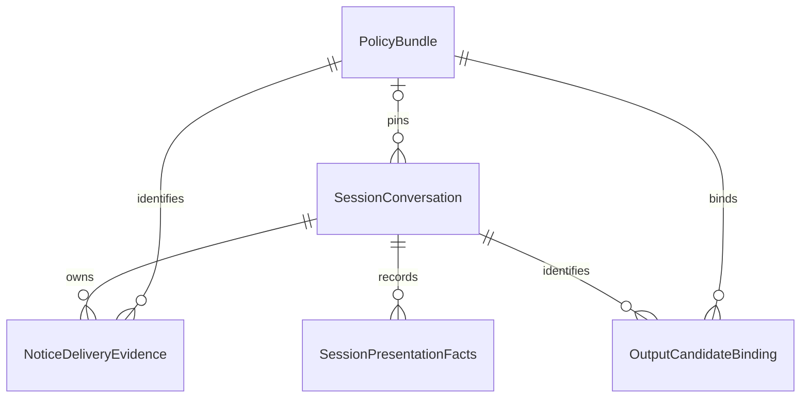

# U16 상세 기능 설계

## Sources

- ../../../inception/requirements-analysis/requirements.md: FR1–FR7, NFR1–NFR6.
- ../../../inception/units-generation/unit-of-work.md 및 unit-of-work-story-map.md: U16 서버 책임과 U17 소비 경계.
- ../../../inception/domain-design/components.md: 소유·참조, 상태 권위는 기존 세션 실행기 하나.
- ../../../inception/contract-design/contract-summary.md: C1–C6 및 GuardrailPresentation.
- ../../../inception/user-stories/stories.md: 8개 스토리의 AC, 협력 부분을 포함하되 전체 스토리 완료와 구별.
- functional-design-questions.md: 기존 음성 활용·후속 자원 정리, GPT-Live 사전 낭독/파일화 가능성.
- ../nfr-design/nfr-design-questions.md Q1-A: 복구 가능한 확인 질문 실패는 질문 귀속/보류를 해제하고 듣기로 복귀. 지속적인 기기/연결 장애는 기존 기술 정리.

## Scope and Authority

U16은 기존 백엔드의 서비스 정책·판단·안내/참여·종료·검수와 사실 생산을 설계한다. entities.md의 YAML은 자료형/소유, rules.md의 YAML은 판단 규칙, 이 문서는 순서/상태 전이의 정본이다. 구현 코드·물리 저장문/DDL·구체적인 클래스 본문은 코드 생성 단계에서 정한다. U17의 화면/기기 웹 구현은 이 문서가 대신하지 않는다.

상위 story-map의 협력 배정까지 포함해 AC40개를 U16 규칙으로 추적하되 UI 결과까지 U16만으로 완료했다고 하지 않는다. User Stories R-01은 실제 local/J6 판정 요청의 검증 책임으로 승계한다.

## Functional Workflows

### WF1 — 정책 적재와 세션 고정

1. 빌드에 포함한 자유대화 적용 자원·판 식별/정본 및 적용본 SHA256·서비스 사실 기준을 읽는다. UTF-8 바이트를 정본으로 삼고 해시 계산 전에 줄바꿈/문자를 몰래 바꾸지 않는다.
2. 누락/빈 본문/중복 판 식별의 다른 바이트/메타데이터 불일치는 명시적 정책 오류다. 새 일반 대화를 열지 않으며 예전 역할 문구로 되돌리지 않는다. 사용자 knowledge 원본·ZIP·운영체제 메타데이터를 실행 자원으로 읽지 않는다.
3. 모드에 맞는 불변 묶음을 세션 시작에 고정한다. 연습은 기존 역할/지시를 유지하며 자유대화 본문을 공통 입구에 무조건 추가하지 않는다.
4. 이름10자·관심사10개×20자·나이6–12의 기존 검증/이스케이프를 유지한다. 문맥은 인용된 데이터이며 내부 ID/키·다른 아이·보호자 입력 원문을 추가하지 않는다.
5. 초기 요청에 적용본을 한 번 포함하고 강제 첫 관심사 질문을 제거한다. 기존 모델/4개 송신 type·형식과 연습 전용 검증 경로를 유지한다. 판/해시는 내부 추적용이며 공급자 API 필드가 아니다.
6. 새 후속 지시는 현재 정책·허용 상태만 사용하고 이번 응답 범위를 닫는다. 새 정책을 매 append에 전체 반복하지 않는다.

원본 정책의 저장/열람/공유/삭제 설명은 현재 기능에 맞춰 적용하며 편차표에 문장/근거/적용본 판을 남긴다. 실제 기능이 불명확하면 약속하지 않는다. 정책 텍스트의 존재만으로 모델의 항상 준수를 보장하지 않는다.

### WF2 — 승인 안내 자원과 실제 재생

1. 현재 자유대화의 승인 콘텐츠 판을 기존 카탈로그에서 고정한다. 승인 본문·음성 위치/실제 해시·재생 길이·말소리 검수 판이 같은 자료여야 한다.
2. 필수 안내 사실은 AI임, 대화 글과 아이 음성의 실제 저장 조건, 보호자 글 열람/수동 공유 가능, 말하지 않거나 그만둘 수 있음이다. 원음 재생·삭제 완료·외부 사본 삭제 등 없는 기능을 약속하지 않는다.
3. 기존 저장소의 톤/무음 WAV는 PLACEHOLDER다. 현재 파일은 재생 전달/실패/표식 연결 대역 시험에 활용한다. 카탈로그의 APPROVED 행이라는 이유만으로 새 안내 문구의 실제 말소리로 인증하지 않는다.
4. 실제 서비스 안내를 여는 조건은 SPOKEN_VERIFIED의 본문/음성 판·해시·PCM형식·20초이하 길이 일치다. 미준비면 notice FAILED와 기존 기술 정리를 적용하고 일반 출력을 열지 않는다. 기존 파일 유지와 실제 안내 미완료를 동시에 명시한다.
5. 유효 자원에서는 서버가 현재 세션/정책·프롬프트/재생ID/승인 콘텐츠/연결과 마감을 묶은 증거를 먼저 만든다. 그 다음 기존 승인 콘텐츠 재생 명령을 보낸다. 송신 실패는 완료가 아니다.
6. 현재 기기 연결의 실제 COMPLETED가 현재 기대 ID에 맞고 유효 기한 안이면 한 번만 완료한다. STARTED 없이도 적법한 COMPLETED를 처리할 수 있으나 중단/실패/대체/만료/옛 연결의 표식은 완료를 복구하지 못한다.
7. ACK·prefetch·텍스트 말풍선·STARTED는 완료 근거가 아니다. 기기 observedAt 대신 서버 수신 시각으로 만료를 판단한다. 같은 시각이면 만료가 우선한다.
8. 완료 증거를 기존 세션 기록 경계에 확정하고 현재 참여 창을 연다. 안내에 참여 질문이 포함되지 않은 경우는 승인된 별도 참여 질문의 실제 재생 완료 후 창을 연다. 두 완료를 섞거나 같은 질문을 모델에게 다시 시키지 않는다.

현재20초 상한 안에서 모든 필수 사실을 알아듣게 담는 실제 문구/음성은 생성·청취 검수 시 확정한다. 길이 초과를 잘라 내거나 알아듣기 어렵게 속도를 높여 통과시키지 않는다. 상한 내 구성이 불가능하면 별도 콘텐츠 분할/계약 검토를 사람에게 제시하며 현재 계약을 몰래 바꾸지 않는다.

### WF3 — 현재 참여와 원자적 시작

1. WAITING_CHILD의 참여 전 입력은 기존처럼 전사 분류에만 쓰고 새 원음/전사를 영속하지 않는다.
2. 안내가 끝나기 전 시작된 입력/분류 결과에는 완료 후 창의 권한이 없다. 완료 시 이전 입력 묶음과 열린 J1의 상관값을 무효화한다. 늦게 확정된 조기 발화도 입력 시작/귀속으로 배제한다.
3. 안내 완료 뒤 현재 참여 창에서 새로 시작된 입력만 로컬 참여 분류 또는 기존 J1 경로로 처리한다. 보호자 동의·이전 세션 수락은 대체 근거가 아니다.
4. 명확한 수락이면 현재 상태/정책/창/세대를 다시 확인하고 WAITING_CHILD→ACTIVE와 participation ACCEPTED 사실을 같은 원자적 경계에서 기록한다.
5. 저장 전이 승자만 원음 기록 시작·현재 상태 투영·첫 일반 응답을 각각 한 번 수행한다. 저장 실패/경합 패자는 효과를 실행하지 않는다.
6. 명확한 거절은 participation REFUSED와 DECLINED, 기존 참여 전 전사 정리를 같은 원자적 경계로 적용한다. 대안/만류/재확인을 하지 않는다.
7. 불명확할 때만 기존 한 차례 짧은 확인을 사용하고, 무응답은 실제 재생 뒤20초 및 재안내 뒤20초를 따른다. 두 창의 무응답 만료만 NO_RESPONSE이며 자원·연결·판정 실패를 그렇게 번역하지 않는다.
8. 기술 일시정지 중에는 기존처럼 창을 멈추고 재개 때 남은 시간을 유지한다. 열린 J1 중 창 만료는 기존 판정 턴 정리 후 현재 시각으로 재평가한다. 기존4초 판정 마감을 늘리거나 새 재시도 루프를 만들지 않는다.

### WF4 — 대화·거절·휴식·제한된 도움

기본 모델 지시는 아이 질문/경험/정정과 화제 선택을 우선하며, 답변마다 새 질문·맞장구·실제 경험 수집을 강제하지 않는다. 서버는 이미 처리 중인 요청/지시의 현재성, 도움 사용 횟수, 거절·휴식 상태를 소유한다. 자유 의미 전체를 새 분류기 없이 완벽히 판정했다고 하지 않는다.

| 현재 의미/확인 상태 | 서버 정책/상태 | 허용 효과 |
|---|---|---|
| 질문/경험을 이미 말함 | 질문 내용 우선, 옛 FIRST 강제 제거 | 현재 문맥을 먼저 따르는 지시 |
| 아이가 막힘, 거절/휴식 없음 | 주요 요청 최대1개라는 기본 정책 | 새 질문을 반드시 붙이는 지시 없음 |
| 명확한 화제 거절 | 현재 정보 요구 참조를 거절 상태로 유지 | 수용, 같은 요청/재표현을 강제로 반복하지 않음 |
| 명시적으로 새 화제/거절 화제를 다시 엶 | 해당 참조 전환/거절 해제 | 아이가 선택한 맥락으로 이동 |
| 휴식/생각할 시간 | resting 설정, 과거 일반 후보 무효화 | 짧은 수용은 최대1회, 이후 새 입력까지 일반 출력 보류 |
| 명확한 새 입력으로 휴식 해제 | 현재 세대/의사 재확인 | 기존 일반 흐름 재개, 자동 재개 권유 없음 |
| 실제 이해 실패가 있고 현재 정보 요구의 도움 미사용 | helpUsed=true를 효과보다 먼저 반영 | 도움/재설명 한 번 |
| 같은 요구에서 이미 도움 사용/거절/불명확 | 키/횟수 유지, 새 확인 강제 안 함 | 수용/기다림/아이의 새 주도 |
| 교정·판정 보류·기술 재시도 | 이해 실패를 꾸미지 않는 범위 닫힌 지시 | 취소 질문을 잇거나 도움 횟수를 새로 얻지 않음 |

현재 요청의 식별은 서버가 발행한 정보 요구의 참조다. 단순한 발화 순번 증가나 같은 요구의 재표현/송신 재시도를 새 요구로 세지 않는다. 의미를 확정할 수 없으면 새 도움/질문을 강제로 추가하지 않는 방향으로 처리한다. 원문 화제의 새 장기 저장·새 AI 호출을 만들지 않는다. 공급자가 자발적으로 낸 발화의 임의 의미까지 이 작은 서버 상태로 판정할 수 있는 것은 아니므로 전달 정책/서버 효과 시험과 실제 모델 품질 평가를 분리한다.

휴식 수용을 허용하는 출력 목적 REST_ACK를 내부 후보 분류에 추가한다. 이는 새 공급자 필드/새 JEV 범주가 아니다. 현재 resting 상태의 짧은 수용 후보 하나만 허용하고 종료/끼어들기/현재성 검사를 동일하게 적용한다. 이후 일반 출력은 새 입력까지 보류하되 기존 공백 시계의4분/6분 의미를 임의로 영구 중지하지 않는다.

### WF5 — 명확/모호 종료와 실제 판정 요청

1. 현재 확정 입력은 기존 로컬 종료 규칙을 먼저 적용한다. 등록/비등록 전체 종료, 인용/역할 대사, 종료 부정, 화제만 거절, 휴식과 모호함을 구별한다. 명확한 현재 종료는 즉시 CHILD_STOP과 일반 출력 세대 무효화로 연결한다.
2. 기존 J6가 필요한 모호한 후보에서만 현재 호출을 사용한다. 고정 질문/선택지 판·criteria=null·익명화한 발화/최근 턴의 실제 어댑터 요청을 시험한다. 기존 END_CLEAR/REST/NOT_END/UNCLEAR를 유지한다.
3. END_CLEAR는 다시 묻지 않고 종료, REST는 재개 압박 없는 수용/대기, NOT_END는 현재 의미에 맞는 기존 흐름, UNCLEAR는 정말 모호한 종료인 경우에만 짧은 확인으로 연결한다.
4. 확인 ASKING 중 일반 출력은 보류한다. 현재 질문의 유효 재생 완료 뒤 WAITING을 열고20초를 잰다. 질문 중 들어온 조기 긍정/옛 판정으로 종료하지 않는다. 별도로 명확한 현재 전체 종료는 어느 단계든 즉시 존중한다.
5. WAITING에서 현재 질문에 대한 명확한 전체 종료 답은 종료, 명확한 계속 답은 재개한다. 불명확한 답은 재확인 질문을 반복하지 않고 남은 창을 유지한다. 무응답/모호함은 종료 동의가 아니며20초 만료 시 기존 재개로 돌아간다.

확인 질문 전달 실패는 다음 결정표를 적용한다. 모든 경로에서 현재 질문ID·재생ID·대답 창/시계를 무효화하고 ASKING/WAITING의 보류 귀속을 해제한다. 전달되지 않은 질문을 완료 처리하거나 그 질문에 대한 답을 추정하지 않는다. 이미 종료/휴식 등 다른 현재 보류가 있으면 그것까지 해제하지 않는다.

| 실패/중단 조건 | 현재 상태/가용성 확인 | 다음 처리 |
|---|---|---|
| 질문 자원 누락·생성/검수 실패·송신 거절·재생 FAILED | 여전히 ACTIVE, 현재 연결/기기/공급자 가용 | 확인IDLE로 복귀하고 새 입력을 듣는다. 질문 재생/일반 재개 발화 요청을 자동 발행하지 않음 |
| 질문 재생 확인 만료 | 기존 승인 재생20초 만료, 현재 연결/기기/공급자 정상 | 같은 듣기 복귀. 기존 공백 시계 제외를 해제하고 기존 남은 공백 시간을 이어감 |
| 아이 끼어들기/새 발화로 질문 STOPPED | 현재 세션 새 입력, 종료가 아님 | 현재 질문 귀속을 먼저 폐기하고 그 입력을 현재 의미로 처리. 명확한 종료면 즉시 종료, 그 밖은 현재 대화/휴식 규칙 적용 |
| 연결 단절·교체·기기 출력/마이크 장애·공급자 장애 | 현재 정상 가용성을 확인할 수 없음 | 질문을 들었다고 하지 않고 기존 기술 일시정지·재접속/장애 정리 적용. 새 연결에서 옛 질문 완료/답을 재사용하지 않음 |
| 종료/명확한 전체 종료·즉시 중단이 먼저 적용됨 | ACTIVE 아님 또는 즉시 중단 | 질문 실패 복구로 ACTIVE/출력을 열지 않음. 기존 종료·정리만 유지 |
| 실패 뒤 늦은 COMPLETED·판정·답 | 무효화된 질문/재생/세대 | no-op. 듣기 복귀/일반 발화를 중복 실행하지 않음 |

질문 실패가 처리된 다음의 확정 일반 발화/명확 종료는 새 현재 입력으로 처리한다. 질문 대기만 해제한 상태에서는 무응답을 성공/종료 동의로 만들지 않고 기존 공백 정책을 따른다. 실제 재생 완료 후 정상 WAITING의20초 만료와, 질문 미전달 실패 후 듣기 복귀를 혼동하지 않는다.

6. 종료 진입 때 열린 판정/후속 지시·검수 후보·서버/기기 대기열의 세대 권한을 무효화한다. 공급자 cancel/correct 같은 미지원 wire를 추가하지 않는다.
7. 일반 종료는 현재 승인된 짧은 인사를 최대1회 허용한다. 즉시 음소거/서버 즉시 중단은 인사 NONE이며 추가 발화0이다. 현재 인사 STARTED 전에는 화면에 PLAYING을 내보내지 않는다.
8. 실제 기기 출력/마이크 정리 확인은 기존30초 안에서 처리한다. 확인 전에는 멈춤 완료라고 말하지 않으며 기존 ENDED/ENDED_UNCONFIRMED·정산/연결 정리 의미를 유지한다.

**R-01 실제 요청 시험 매트릭스:** 등록 표현, 등록되지 않은 명확 종료, 인용/역할 대사, 화제만 거절, 종료 부정, 모호함, 확인 뒤 명확 답, 휴식 각각을 실제 로컬 분류와 실제 J6 요청 구성에서 확인한다. J6 결과를 대역으로 고정한 상태 전이 시험은 별도로 필요하지만 그 시험만으로 요청 정책 전달을 증명하지 않는다.

### WF6 — 검수와 현재 출력 권한

1. 기존 후보가 완결/음성-전사 대응을 갖춘 경우만 기존 JEV 어댑터로 검사한다. 새 자유대화 지시가 기존7개 금지 범주·확률/동률·결과 형식·마감을 낮추지 않는다.
2. 후보는 session/mode/generation/프롬프트 판/서비스 정책 판/JEV 판/목적/본문 해시에 묶는다. 서비스 판과 JEV 판은 서로 다른 값이며 외부에 내부 상관 ID를 추가하지 않는다.
3. 결과 PENDING/BLOCK/REVIEW/실패/타임아웃·불완전/정렬미확인은 일반 재생을 허가하지 않는다. 새 자동 ALLOW나 검사 재시도 루프가 없다.
4. ALLOW 결과가 도착해도 actor가 현재 상태·모드·세대·후보·허용 목적을 다시 확인한다. 현재 정책 판이 맞아도 옛 세대면 폐기한다.
5. 일반 출력은 안내 완료/참여 ACCEPTED/ACTIVE이며 종료 확인·휴식 보류가 아닐 때만 허용한다. 승인 안내·확인 질문·짧은 휴식 수용·승인 인사/연습은 각각의 현재 상태와 목적별 경계를 따른다.
6. 검수 뒤 큐에 들어간 뒤에도 취소/세대 무효화가 반영되어야 하며 기기 중단/끼어들기 보고와 기존 로컬 큐 정리를 유지한다. 서버 검사 통과를 영구 재생 권한으로 취급하지 않는다.

### WF7 — 최소 사실 기록·종료 후 조회

1. 새 DB 저장소를 만들지 않고 기존 Realtime 세션 이벤트에 앱 도메인 사건 SESSION_GUARDRAIL_FACTS를 기록한다. 이는 AI-DLC 감사 이벤트가 아니다.
2. payload는 schemaVersion/session 귀속·단조 revision/그 사실의 statusVersion·notice/participation/goodbye/허용 전사 seq·서버시각만 갖는다. 새 원문·원음·비밀·모델 자유서술을 넣지 않는다.
3. 안내 완료/참여 ACCEPTED·REFUSED·NO_RESPONSE/현재 종료 참조 등 중요한 사실은 관련 상태 전이와 같은 원자적 경계에서 기록한다. 적용할 상태·기존 버전 조건이 맞는 한 승자만 쓴다. 저장 실패를 메모리 성공으로 대신하지 않는다.
4. 재생 STARTED/진행·완료/중단의 현재 동적 상태는 actor의 불변 projection으로 내보낸다. CLOSING 진입에서는 이전 재생 사실을 해제한다. 이후 **현재 승인 인사**의 유효 STARTED가 확인되면 CLOSING 중에도 PLAYING을 내보내고, 그 인사의 완료/중단/실패·단절/만료 또는 최종 종료에서 해제한다. 즉시 음소거의 NONE은 STARTED로 바뀌지 않는다. 최종 확정 상태를 기록하며 재시작/actor 제거는 PLAYING을 복구하지 않는다.
5. 내부 조회는 세션 행·가시 전사와 현재 projection/최신 유효 사실 개정을 대조한다. actor 없음/재시작에서는 저장된 확정 사실만 읽고 동적 PLAYING/PENDING을 UNKNOWN으로 낮춘다. 이전 세션/정책 증거로 새 ACTIVE를 복구하지 않는다.
6. 같은 revision의 서로 다른 payload, 잘못된 schema/순번/상태 버전·참조는 성공 사실로 쓰지 않는다. 현재 세션 상태와 모순되면 guardrail=null 또는 해당 UNKNOWN으로 낮춘다. 사실이 없는 옛 세션도 같은 규칙이다.
7. 종료 인용 참조는 현재 CHILD_STOP 근거로 확정한 동일 세션의 공개 허용 final/uncertain=false CHILD 전사만 가리킨다. 저장/가시성 확인이 안 되면 null이고 기본 등록 표현을 넣지 않는다.
8. Core는 기존 소유 확인 뒤 내부 조회를 중계하고 새 사실 사본을 별도 영속화하지 않는다. 내부 조회 실패는 stale=false여도 guardrail=null이다. API/Java 모델/스키마를 같이 갱신한다.
9. 기존 세션·아이/계정 삭제와 보존 정리에 이벤트도 귀속된다. 조회는 새로운 사실을 만들지 않으며 권한이 없는 요청은 기존404/접근 차단을 따른다.
10. U17은 이번 응답의 null을 옛 사실로 채우지 않고, 순서가 뒤집힌 요청·다른 세션의 응답을 버린다. U16은 그 대역 응답을 제공하지만 프런트 구현은 U17의 책임이다.

기존 사건 저장은 추가 전용이며 시각+임의 ID만으로 새 revision의 순서를 추정하지 않는다. 세션 단조 revision과 상태 버전을 함께 사용한다. 동시에 쓸 수 있는 권위는 세션 전이 경계 하나이며 DB 경합 패자의 revision/효과는 적용하지 않는다. 실제 기존 저장/전이 어댑터의 원자적 연결은 코드 계획에 반영한다.

## Lifecycle State Transitions

기존 외부 session.status enum을 변경하지 않는다. 아래 notice/participation/확인 상태는 세션 내부 단계다.

| 현재 상태/내부 단계 | 사건과 조건 | 다음 상태/효과 | 금지 |
|---|---|---|---|
| 시작 준비 | 정책/필수 자원 부적합 | 기존 FAILED/기술 정리, notice FAILED | 옛 정책/톤으로 완료 대체 |
| WAITING_CHILD, 안내 대기 | 현재 유효 COMPLETED | notice COMPLETED, 참여 질문 완료 후 참여 창 PENDING | 조기 입력 수락 |
| WAITING_CHILD, 안내 대기 | 실패/만료/중단 | FAILED/기술 정리 또는 현재 재접속 정책, 일반 출력 잠금 | 무응답/거절로 번역 |
| WAITING_CHILD, 현재 창 | 유효 ACCEPT | ACTIVE+ACCEPTED 기록 후 효과1회 | 중복 ACTIVE/첫 응답 |
| WAITING_CHILD, 현재 창 | 명확 거절 | DECLINED+REFUSED/참여전 기록 정리 | 대안 만류 |
| WAITING_CHILD, 현재 창 | 두 기존 창의 실제 무응답 만료 | DECLINED+NO_RESPONSE | 기술 실패를 침묵으로 번역 |
| ACTIVE | 명확한 현재 전체 종료 | CLOSING CHILD_STOP, 인사 최대1 또는 NONE | 이유/재확인 |
| ACTIVE, 확인IDLE | 진짜 모호함 | 현재 확인 ASKING, 일반 출력 보류 | 질문 반복 |
| ACTIVE, 확인ASKING | 유효 질문 완료 | 확인WAITING,20초 창 | 조기 긍정 재사용 |
| ACTIVE, 확인ASKING/WAITING | 질문 실패/만료, 연결·기기/공급자 정상 | 현재 질문/시계만 해제, 확인IDLE·듣기 복귀 | 자동 질문 반복/재개 발화·미전달 답 추정 |
| ACTIVE, 확인ASKING/WAITING | 기기/연결/공급자 장애 지속 | 현재 질문 무효화·기존 기술 일시정지/정리 | 옛 완료를 재접속 뒤 재사용 |
| ACTIVE, 확인WAITING | 명확 종료/계속 | CLOSING 또는 ACTIVE 일반 흐름 | 같은 종료 재확인 |
| ACTIVE, 확인WAITING | 무응답/모호함 | 창 유지, 만료 때 기존 재개 | 동의로 꾸밈 |
| ACTIVE | 휴식/생각 | 상태ACTIVE 유지, resting·짧은 수용1회 뒤 출력 보류 | 자동 재개 압박 |
| 모든 현재 단계 | 종료/끼어들기/연결 무효화 | 세대/재생 귀속 무효화 | 옛 결과 재활성화 |
| CLOSING | 현재 기기 정리 확인/30초 만료 | 기존 ENDED/ENDED_UNCONFIRMED | 확인 전 멈춤 완료 선언 |
| CLOSING, goodbye PENDING | 현재 승인 인사 STARTED | goodbye PLAYING, 현재 관측만 조회 | 이전 재생·즉시음소거에 PLAYING |
| CLOSING, goodbye PLAYING | 현재 인사 완료/중단/실패·단절/만료 또는 최종 종료 | 해당 완료/중단/실패 또는 UNKNOWN, 재생 줄 해제 | 인사 재생 사실의 영구 유지 |

연습 세션의 시작/종료·확장 방향은 기존대로다. 자유대화의 새 notice/정책 상태를 연습에 무조건 적용하지 않는다.

## Derived Entity Relationship View

아래 관계도는 entities.md YAML에서 파생했다. 자료형·수의 정본은 YAML이다.

텍스트 대안: 정책 하나를 여러 세션/안내/후보가 참조한다. 세션은 재생별 안내 증거와 사실 개정을 소유하고 후보는 그 세션을 식별 참조한다. 후보가 세션 상태를 바꾸는 역호출은 없다.

## Derived Rules Summary

아래 표는 rules.md YAML에서 파생한 읽기용 요약이다.

| Rule | 내용 |
|---|---|
| BR1.1 | 모드에 맞는 비어 있지 않은 고정 정책만 사용 |
| BR1.2 | 정본/적용본과 앱 산출물을 추적 |
| BR1.3 | 최소 아이 문맥을 데이터로만 전달 |
| BR1.4 | 기존 공급자·연습 요청 형식 유지 |
| BR2.1 | 승인된 실제 안내 자원을 확인 |
| BR2.2 | 현재 실제 완료만 안내 증거로 인정 |
| BR2.3 | 안내 누락·실패·만료를 기술 실패로 처리 |
| BR2.4 | 안내 뒤 새 참여 수락만 ACTIVE로 전환 |
| BR2.5 | 명확한 거절과 무응답을 구별 |
| BR2.6 | 정책/참여 상태를 모델에 중복 안내 없이 전달 |
| BR3.1 | 아이 화제·질문과 출처를 우선 |
| BR3.2 | 거절·휴식에는 기다리고 아이가 연 화제를 따름 |
| BR3.3 | 같은 정보 요구의 도움을 한 번으로 제한 |
| BR3.4 | 정정·끼어들기와 지시 범위를 존중 |
| BR4.1 | 명확한 전체 종료를 바로 처리 |
| BR4.2 | 정말 모호한 종료만 한 번 확인 |
| BR4.3 | 실제 로컬/J6 요청의 종료 구분 기준을 시험 |
| BR4.4 | 모든 비동기 결과의 현재 귀속 재확인 |
| BR5.1 | 서비스 기능과 완료 여부를 꾸미지 않음 |
| BR5.2 | 비밀·장기 기억·진단·대리 조사 약속 금지 |
| BR5.3 | 최소 확정 사실을 기존 세션 수명에 보존 |
| BR5.4 | 조회는 사실 부재와 실제 재생을 구별 |
| BR6.1 | 기존 시간·제외/경합 의미 유지 |
| BR6.2 | 기존 기록/동의/삭제·증거 구분 보존 |
| BR7.1 | 기존 JEV 결과·정렬·판·연습 경계 유지 |

## Timing, Errors and Corners

| 경계 | 명시한 동작/근거 |
|---|---|
| 누락/빈/잘린 정책·인코딩/해시 불일치 | 명시적 자원 실패, 이전 정책 fallback 없음. 한글/인용/줄바꿈은 원문 바이트와 적용본 편차로 추적 |
| 현재 자원 교체 중 | 빌드 불변 자원과 세션 고정 판 사용. 세션 중 hot reload/사용자 원본 접근 없음 |
| 다른 계정/기기/세션/옛 연결 | 기존 인증/소유 검사, 현재 상관값 불일치는 no-op, 원문 로그 없음 |
| 늦은/중복/순서 역전 | actor 수신 순서와 현재 세대/판정·재생 ID, 같은 마감은 만료 우선, 완료/ACTIVE 효과 한 번 |
| 기기 시계 어긋남 | observedAt은 참고, 서버 clock/현재 deadline이 권위. 음수 남은 시간은0으로 만료 |
| 저장 중 단절·경합 | 상태와 확정 사실 원자적, 패자/실패는 효과 없음. 정리 실패도 출력은 닫고 기존 장애 정리에 넘김 |
| Core 조회 실패·옛 응답 | 기존1초/연결500ms·무재시도, stale와 무관한 null, 현재 사실 추정 없음 |
| 종료 후 조회·삭제된 참조 | 확정 metadata만 읽고 인용 없음/UNKNOWN 허용. 기존 삭제/보존/권한 적용 |
| 입력 없음/불명확/장애 | 무응답 창·기술 일시정지·J1 보류를 분리. 실패를 NO_RESPONSE로 바꾸지 않음 |
| 도움/화제 의미 불명확 | 추가 요구를 강제하지 않음. 단순 문자열 동일성을 의미 동일성 보장으로 보고하지 않음 |
| 모드 공통 코드 | 실제 초기/후속 요청을 자유/연습 양쪽에서 대조. JEV 판/범주와 지원 wire 동일 |
| 새 장기 기억/돈·목록 집계/새 UI·권한 | 해당 기능 변경은 제외. 기존 정책/화면 회귀는 유지 |

기존 공백4분/6분, 참여20초/재안내20초, 재접속40초, 기기종료30초, 모호종료20초, 승인재생20초·기존 판정4초/검사800ms를 유지한다. 재생/출력대기·기술 일시정지·확인질문 제외 의미도 유지한다. 오프라인 음성 제작 도구의 수집 제한은 서비스 세션의 마감/호출 예산과 별개이며 아직 실제 실행하지 않았다.

## Validation Handoff

- 정책/문맥: 초기·FIRST/CONTINUE/REST/교정/재시도 실제 요청에 새 본문1회, 강제 질문·재개·의무 맞장구 제거, 범위 닫기·해시·모드/형식/이스케이프를 확인한다.
- 안내/참여: 유효 말소리 메타데이터 대역의 정상 완료/실패·만료·다른ID/옛 연결/중단·중복, 안내 중 시작해 뒤늦게 확정된 입력, 종료 경합에서 일반 재생·중복 ACTIVE·중복 첫 응답0회.
- 판단/출력: R-01 요청 매트릭스와 별도 상태효과 시험, 후보 ALLOW 뒤의 세대/모드·목적 변경/끼어들기·즉시 중단/기기 확인 누락을 포함한다. 확인 질문의 자원·생성/검수/송신/재생 실패·만료·중단 각각에서 ASKING 해제/현재 질문 무효화·보류 소유 구분·듣기 복귀/기술 정리를 확인하고, 늦은 완료/답이 창을 다시 열거나 자동 재개 발화를 내지 못하게 한다.
- 기록/조회: 전이와 사실 저장의 경합·실패 원자성, actor 제거·재시작/legacy·삭제/미확정 전사/Core fallback에서 거짓 인용/PLAYING/참여 사유0회. CLOSING 진입의 이전 재생 해제와 현재 승인 인사 STARTED/종료의 PLAYING 변화를 각각 확인한다.
- 기존 연습/시간/기록·권한/JEV 회귀, 모듈/해당 기능 줄80%, 승인된 단위 검증 명령과 최종 verify.sh는 이후 구현·검증 단계가 수행한다.
- 설계 추적40AC의 OK는 규칙에 배정됐다는 뜻이다. 실제 안내 자원·코드·실호출·실기기 성공을 뜻하지 않는다.

## Follow-up — 실제 안내 음성 제작/등록

| 항목 | 현재 상태 | 완료 조건 |
|---|---|---|
| 기존 WAV 활용 | 톤/무음 파일 유지, 대역 재생/표식·실패 연결에 활용 | 실제 말소리로 표시/승격하지 않음 |
| GPT-Live 사전 낭독·WAV 추출 | 기술적 가능 확인. 기존 .env 키를 쓰는 독립 제작 세션으로 가능, 호출 미실행 | 실제 호출 범위를 확인한 뒤 안내 문구별 생성. 원문 밖 추가 발화/잘림을 검증 |
| 실제 말소리 검수 | 미완료 | 원문/출력 전사 대조와 청취, PCM16LE24kHz모노/길이20초이하, 필수 사실의 이해 가능성 확인 |
| 승인 판 등록 | 미완료 | 새 콘텐츠 판·텍스트/음성 해시/길이·검수 판을 고정해 기존 카탈로그/승인 경로로 연결. 이전 버전을 덮어쓰지 않음 |
| 전체 안내 기능 완료 | 위 항목 미충족 | 실제 자원 연결·현재 기기 재생 확인·현재 참여의 통합 검증. 대역과 실제 청취 증거 구분 |

GPT-Live 수신 음성 조각을 순서대로 모아 WAV로 저장할 수 있다. 기본 연결에 output-audio-done 사건이 없으므로 독립 수집 도구는 전사와 조용함/명시적 수집 제한으로 경계를 확인하고 문장 중간 잘림/끝의 추가 발화를 검사해야 한다. 문구별 독립 세션을 사용하면 이전 발화 꼬리/지속 지시 혼합을 줄일 수 있다. 이는 수집 설계이며 실제 정확한 낭독을 보장하지 않는다. 안내 제작 때 한 번 생성해 고정 파일을 재사용하고 운영 세션에 새 AI 호출 루프를 추가하지 않는다. 키는 서버 환경에서만 읽으며 출력/브라우저/아티팩트에 넣지 않는다.

## Assumptions & Open Questions

- 현재 선택은 기존 파일 활용과 후속 항목 정리다. 실제 낭독 생성의 가능 여부는 확인했지만 아직 유료 호출 실행 승인은 기록하지 않았다. 실제 자원 미준비를 전체 교체 완료로 보고하지 않는다.
- 임의 모델 발화의 의미 준수·실제 아이 청취/이해는 대역/프롬프트 검사만으로 보장하지 않는다. 별도 실모델 평가와 구분한다.
- 공개 GuardrailPresentation/C1–C6의 주소/형식/enum은 상위 계약을 유지한다. REST_ACK는 서버 내부 목적이며 새 wire 필드가 아니다.

