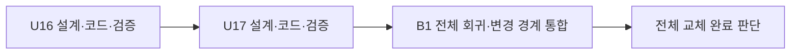

# 통합 구현 계획

## Sources

- delivery-planning-questions.md Q1-B, Q2-A: 하나의 통합 Bolt, 이 세션에서 순차 진행.
- ../units-generation/{unit-of-work,unit-of-work-dependency,unit-of-work-story-map}.md: U16/U17의 책임과 U17 → U16 의존.
- ../contract-design/contract-summary.md: C1–C6, 표시 공통 스키마와 기존 wire/실패/호환 의미.
- ../requirements-analysis/requirements.md, ../user-stories/stories.md: FR/NFR·8개 스토리·40개 AC.
- ../refined-mockups/mockups.md, ../domain-design/components.md: 기존 화면·논리 책임 유지.
- ../practices-discovery/team-practices.md: test-after/80%, main/merge commit, 가짜 공급자, 기존 전체 회귀, 배포 제외.

## Work Streams

Bolt는 일부 작업을 설계·구현해 실행 가능한 결과로 끝내는 한 차례의 작업 묶음이다. 이번 B1은 두 단위를 포함한 통합 Bolt 하나이며, 중간 단위의 합격과 최종 제품 결과의 완료를 구별한다.

| Bolt | Unit | 작업 | 복잡도 | 주 담당/통합 |
|---|---|---|---|---|
| B1 service-guardrail-integration | U16 u16-service-guardrail | 정책 적재/모드·순수 판단, 안내/참여·종료/검수, 사실 수명·공개 계약/서버 어댑터 | L | aidlc-developer-agent, 기존 realtime/core/contract-model |
| 같은 B1 | U17 u17-guardrail-presentation | 사실 파싱·RP-1–RP-4 표시·기기 웹의 현재 재생 보고 소비 | M | aidlc-developer-agent, 기존 frontend |

US1.1–US1.6/US2.2의 주 담당은 U16, US2.1은 U17이다. 협력 부분은 상위 story-map을 그대로 유지하며 두 단위에 걸친 스토리는 양쪽과 통합 회귀가 완료되어야 합격이다. 작업 파일 소유는 unit-of-work.md의 경계를 따른다.

## Implementation Sequence

1. **U16 적용 설계와 코드**: 현재 단위별 진행 설정에 따라 해당 설계 단계와 Code Generation을 진행한다. 첫 상세 설계에서 실제 승인 안내 콘텐츠·20초 상한·최소 사실 메타데이터를 구체화한다. 각 층을 구현한 뒤 그 층 시험을 실행한다.
2. **U16 완료 확인**: 승인받은 단위 검증 명령으로 동작/회귀를 확인한다. 이 결과는 U16의 완료이고 전체 화면 교체 완료가 아니다.
3. **U17 적용 설계와 코드**: 고정 계약과 U16의 실제 사실 생산을 사용해 타입/파싱→표시→필요한 기기 소비를 구현하고 각 층을 시험한다. 같은 단위 검증 명령으로 확인한다.
4. **B1 최종 Build and Test**: 기존 전체 `bash scripts/verify.sh`와 바뀐 경계의 추가 대역 통합·계약/기능 커버리지를 확인한다. 기존 끝-끝 경로가 새 안내/참여 사실과 양립하는지 검증한다. 완료한 단위의 결과를 사용하고 미구현 단위를 대역 합격으로 위장하지 않는다.

현재 Unit DAG가 실행 순서의 기준이며 이 계획은 단위 묶음을 새 실행 배치로 바꾸지 않는다. 순서는 U16 → U17이고 병렬 집합은 없다. 두 단위와 통합 검증이 모두 직렬 경로에 있어 앞의 지연이 뒤의 완료를 늦춘다. 각 단위의 설계/구현 계획 승인은 유지한다. 자동 진행 여부는 Construction 진입의 별도 선택을 따른다.

## Detailed Analysis Summary

- 신규 논리 책임5개, 기존 앱에 포함하는 구현 단위2개, 통합 Bolt1개, 주 스토리8개/AC40개, 경계 계약6개다.
- 새 서비스·새 페이지·새 AI 공급자·새 장기 저장/권한 정책은 없다. 변경 파일 수·코드량·인일은 아직 실측하지 않았으며 코드 계획에서 확정한다.
- 테스트 이름/범위는 service-guardrail 및 guardrail-presentation 같은 기능 이름을 사용한다. Unit 번호를 시험 규칙으로 강제하지 않는다.

## Definition of Done — B1

1. 새 자유대화 지시문이 실제 초기/후속 요청에 적용되고 원본/적용본 해시·편차를 추적한다. 기존 연습과 공급자4type/JEV 판을 보존한다.
2. 실제 승인 안내 자원이 필수 사실·텍스트/음성 버전·기존20초한도에 맞고, 현재 실제 완료 뒤 현재 참여 수락에서만 일반 대화를 연다. 누락/실패/조기·중복/늦은 사건의 잘못된 ACTIVE/일반 음성 재생은0회다.
3. 명확한 종료·모호함·인용·화제 거절을 로컬/J6 실제 요청 정책과 상태 효과의 시험으로 검증한다. User Stories R-01은 결과 주입만으로 해결 처리하지 않는다.
4. U17이 거절/무응답/기술 실패를 구별하고 실제로 확인한 전사만 인용한다. 실제 인사 재생 중에만 해당 줄을 표시하고 fallback/unknown/없는 값은 추정하지 않는다.
5. 기존 시간/저장·삭제/권한·미검사 출력 보류/연습 회귀·한글/이스케이프·접근성을 검증한다. 모듈 및 적용 기능 범위 줄80%와 기존 계약/ArchUnit 검사를 유지한다.
6. 승인된 단위 검증과 최종 전체 verify.sh를 통과하고, 변경된 안내·참여/종료 경계의 대역 통합 근거를 남긴다. 가짜/실공급자·실기기·실아동 증거를 구분한다.
7. 실제 안내 자원 없이 fail-closed 대역 시험만 통과했다면 부분 완료로 남긴다. 실제 자원 기능 완료·실기기 성공으로 보고하지 않는다. 실제 배포/유료 호출/수동 스택 변경은 하지 않는다.

## Confidence Hypothesis and Demo

**검증 가설:** 새 자유대화 정책을 서버·기기·화면이 같은 세션 사실로 처리하고, 안내 미확인/참여 거절/명확한 종료·늦은 사건/조회 실패에서 아이의 선택과 실제 상태를 뒤집는 출력·표시가 발생하지 않는다.

**예상 시연:** 가짜 공급자와 기기 대역으로 안내 실제 완료→새 참여→자유대화→자연어 종료를 연결한다. 별도로 안내 실패/조기 수락/거절·무응답/즉시 음소거/늦은 표식·판정/Core fallback을 재현해 일반 대화 차단과 사실 기반 화면을 확인한다. 승인 음성 자원의 유효성은 따로 확인하며 합성 표식만으로 실제 청취를 주장하지 않는다.

## Workflow Visualization

텍스트 대안: 하나의 B1 안에서 U16 다음 U17을 검증하고 최종 통합 결과로 전체 완료를 판단한다. 화살표3개, 순환 없음.

## Stage Configuration

실행 단계/깊이는 승인된 classic/Standard 설정을 승계하며 이 계획에서 바꾸지 않는다. 각 Unit의 kind별 적용 설계 산출물은 후속 단계가 결정한다. 인프라 단계가 나타나더라도 이번 변경에 새 인프라가 없다는 근거를 설계로 남기며 실제 배포로 확대하지 않는다. 단위별 순차·단일 세션의 현재 설정을 유지한다. 새 최소 연결본을 만드는 별도 스켈레톤 의식은 없다.

## Git and Integration

- 기존 작업 브랜치 feat/service-guardrail-replacement와 타인의 선행 변경을 보존한다. Construction 작업 트리가 필요하면 팀의 `--base main --target main --strategy merge`를 따른다.
- 두 단위의 변경을 연결할 때 U17 검증 checkout에 검증된 U16 결과가 실제로 있어야 한다. 작업 트리 통합은 제공되는 절차를 따르며 별도 checkout의 결과를 문서만으로 연결했다고 하지 않는다.
- AI-DLC 기록도 커밋 대상이다. 새 마이그레이션은 구현 시 실제 최댓값 다음 번호를 사용한다. main 병합이 demo 배포를 유발할 수 있으므로 이번 배포 제외 범위에서 임의로 main 병합/배포를 실행하지 않는다.

## Verification Command

단위 완료 체크포인트용 명령은 intent의 verification-command.txt에 있으며 별도 사람 승인과 전용 설정 반영을 마쳤다. 실제 실행/통과는 아직 아니다.

`(cd backend && ./gradlew --no-daemon clean check -Pmujoong.test.db=docker) && (cd frontend && npm run lint && npx vitest run tests --coverage && npm run build)`

이 명령은 백엔드 정적/단위/통합·커버리지와 프런트 lint/단위·커버리지/빌드를 모두 확인한다. 최종 전체 verify.sh는 Build and Test에서 한 번 수행하는 기존 합의를 유지한다. 의존성 설치·JDK21/Node22/Docker 준비는 실행 전에 확인한다.

## Assumptions & Open Questions

실제 안내 음성 제작/제공 담당·소요 시간과 최소 메타데이터의 물리 구현은 아직 미확인이다. 첫 U16 상세 설계에서 확인하며 해결되지 않은 것을 성공으로 덮지 않는다. 최종 완료 일정은 이 의존과 코드 계획이 확인된 뒤 갱신한다.
