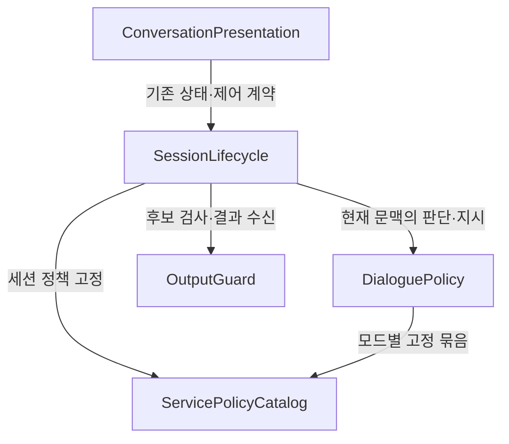

# 무중 서비스 가드레일 논리 컴포넌트

## Sources

- ../requirements-analysis/requirements.md: FR1–FR7, NFR1–NFR6와 승인 범위.
- ../user-stories/stories.md: US1.1–US1.6, US2.1–US2.2, R-01의 종료 판단 요청 검증 인계.
- aidlc/spaces/default/codekb/mujungi/architecture.md 및 component-inventory.md: 기존 realtime 실행기·지시·검수·앱 경계. 아래는 전체 서비스 재구축 목록이 아니라 이번 변경의 책임 경계다.
- ../practices-discovery/team-practices.md: 단일 상태 변경 경계·앱/DB 분리·기존 공급자/시험/시간·배포 제외.
- ../refined-mockups/{mockups,interaction-spec}.md: RP-1–RP-4의 사유·표현·재생 사실 투영.
- domain-design-questions.md Q1-A: 기존 실행기의 단일 상태 소유와 정책/판단 분리.
- backend/realtime-activity/.../session/{SessionExecutor,SessionContext,JoinFlow,GuardrailCoordinator}.java, dialog/{DialogInstructions,InstructionTemplates,StopIntentJudge,StopConfirmFlow}.java, voice/ProviderRequestFactory.java: 현재 구현 경계. 내부 소유를 명시하되 기존 파일 전체 재작성이나 새 원격 서비스를 뜻하지 않는다.

## Component Catalogue

논리 컴포넌트 5개다. 새로 명시하는 PolicyBundle의 적재/식별 수명주기 때문에 이 설계가 필요하다. 나머지는 기존 코드의 책임을 정리하고 필요한 부분만 확장한다. 각 entity는 식별/속성 이름/참조만 기록한다. 자료형·검증·허용값·수와 세부 스키마는 후속 Functional Design에서 정한다.

```yaml
components:
  - name: ServicePolicyCatalog
    summary: 버전이 고정된 모드별 정책 자원의 적재와 식별
    behaviour: >
      앱 산출물 안의 정책 본문과 출처/적용본 해시를 검증하고 세션에 사용할 묶음을 제공한다.
      자유대화와 기존 연습의 선택 경계를 유지하며 원본 knowledge 폴더를 실행 시 읽지 않는다.
      누락/빈 값/검증 실패 시 새 일반 대화를 열 수 있는 정책을 제공하지 않는다.
    responsibilities:
      - 정책 자원과 서비스 사실 기준의 버전/해시 소유
      - 세션 시작 시 선택한 묶음의 불변 참조 제공
    depends_on: []
    dependents:
      - component: DialoguePolicy
        interaction: 모드별 기본/후속 지시의 기준 묶음 제공
      - component: SessionLifecycle
        interaction: 세션에 정책 버전을 고정하고 안내 자원 일치 기준 제공
    external_dependencies:
      - name: AppBundledPolicyResources
        kind: other
        purpose: 빌드에 포함한 정책 본문과 승인 안내의 식별 자료
    entities:
      - name: PolicyBundle
        identifier: promptVersion
        attributes: [promptVersion, policyVersion, mode, sourceHash, appliedHash, instructions, approvedNoticeTextHash, serviceFactsRevision]

  - name: DialoguePolicy
    summary: 허용 문맥과 대화/종료 판단의 순수 규칙 및 지시 구성
    behaviour: >
      아이의 화제/질문/정정/휴식/종료 선택을 반영하는 정책을 구성한다.
      기존 로컬 종료 규칙과 기존 J6 판단 요청에도 전체 종료/인용/화제 거절/모호함 구분 기준을 반영한다.
      상태 전이·재생·시계·기록을 실행하지 않고 의도/지시만 반환한다.
    responsibilities:
      - 기본/후속/교정/재시도 지시의 모드별 일관성
      - 최소 아이 문맥의 데이터 분리와 기존 상한/이스케이프
      - 종료/휴식 등 기존 판단 경로의 정책 의미와 요청 경계 시험 지점
    depends_on:
      - component: ServicePolicyCatalog
        interaction: 고정된 정책 묶음에 맞는 지시 구성
        style: sync
    dependents:
      - component: SessionLifecycle
        interaction: 현재 문맥에 대한 의도/지시를 받아 실행 여부 결정
    external_dependencies: []
    entities: []

  - name: OutputGuard
    summary: 기존 후보 검수와 음성/전사 대응·허용 결과 관리
    behaviour: >
      기존 OutputGate/GuardrailCoordinator와 JEV 어댑터를 사용해 후보를 검수한다.
      후보의 세션/정책/모드/세대/음성 대응에 묶인 결과만 반환하며 미검사/실패/지난 후보를 허가하지 않는다.
      세션 상태의 권위를 소유하지 않고 최종 현재 상태 재확인은 SessionLifecycle에 남긴다.
    responsibilities:
      - 검수 후보와 그에 귀속된 결과의 소유
      - 기존 검사 범주/오류 검증/미승인 출력 보류 경계 유지
    depends_on: []
    dependents:
      - component: SessionLifecycle
        interaction: 후보 검사 요청과 비동기 결과 수신 후 현재 상태 재확인
    external_dependencies:
      - name: ExistingJevProvider
        kind: third-party-api
        purpose: 기존 선 형식/범주/마감 안의 출력 검수
    entities:
      - name: OutputCandidateBinding
        identifier: candidateId
        attributes: [candidateId, sessionId, promptVersion, policyVersion, mode, generationId, contentHash, audioAlignment, decision, outputPurpose]
        references:
          - entity: SessionConversation
            owned_by: SessionLifecycle
            relationship: 검수 요청이 가리키는 세션의 식별 참조
          - entity: PolicyBundle
            owned_by: ServicePolicyCatalog
            relationship: 이 후보에 적용한 정책 묶음의 식별 참조

  - name: SessionLifecycle
    summary: 기존 직렬 실행기 안의 안내·참여·대화·종료와 출력 효과 조정
    behaviour: >
      기존 SessionExecutor/mailbox만 세션 상태와 증거를 바꾼다.
      실제 안내 재생 확인 뒤 현재 참여를 수락해야 일반 대화를 열고 조기/중복/지난 결과를 거절한다.
      판단/검수 결과를 수신하면 현재 모드/세대/상태/허용 목적을 다시 확인해 출력/전이/기록을 실행한다.
      연습 확장은 기존 방향의 지시/결과를 반환하며 실행기/상태를 역호출해 바꾸지 않는다.
    responsibilities:
      - 세션 상태·출력 세대·안내 증거·참여 사유·종료/기기 확인의 단일 변경 소유
      - 거절한 화제/도움 사용/종료 확인 등 현재 세션의 정책 상태 소유
      - 기존 공급자 요청·재생·시계·기록과 연습 확장 조정
      - 검증된 사실만 기존 조회/이벤트 경계로 투영
    depends_on:
      - component: ServicePolicyCatalog
        interaction: 시작 시 정책 묶음을 고정하고 안내 자원과 연결
        style: sync
      - component: DialoguePolicy
        interaction: 현재 세션의 허용 문맥으로 지시/판단 규칙을 얻음
        style: sync
      - component: OutputGuard
        interaction: 검수 후보를 보내고 결과를 mailbox로 돌려받음
        style: async
    dependents:
      - component: ConversationPresentation
        interaction: 기존 상태 투영과 제어 계약을 사용
    external_dependencies:
      - name: ExistingSessionStorageAndMailbox
        kind: other
        purpose: 기존 직렬 실행·상태/조회/이벤트 보존 경계
      - name: ExistingGptLiveProvider
        kind: third-party-api
        purpose: 기존 요청 팩토리와 4개 지원 wire type을 사용하는 음성 대화
      - name: ExistingJudgmentProvider
        kind: third-party-api
        purpose: 기존 J1/J6 등 판정 경로를 유지하며 추가 공급자/호출 루프 없이 정책 정합성 확인
      - name: ExistingApprovedContentAndDeviceTransport
        kind: other
        purpose: 승인 안내/인사 재생 및 실제 기기 확인 수신
      - name: ExistingPracticeExtension
        kind: other
        purpose: 기존 연습 출력/지시 경계의 호환성 유지
    entities:
      - name: SessionConversation
        identifier: sessionId
        attributes: [sessionId, mode, promptVersion, status, generationId, noticeEvidenceId, participationDisposition, refusedTopicContext, clarificationBudget, stopConfirmation, endCause, immediateMute, goodbyePlaybackEvidence, confirmedStopExpressionReference, deviceStopConfirmation]
        references:
          - entity: PolicyBundle
            owned_by: ServicePolicyCatalog
            relationship: 세션 시작 때 고정한 정책 묶음 참조
      - name: NoticeDeliveryEvidence
        identifier: noticeEvidenceId
        attributes: [noticeEvidenceId, sessionId, playbackId, policyVersion, promptVersion, noticeTextHash, approvedAudioVersion, reportedAt, confirmedAt, deliveryResult]

  - name: ConversationPresentation
    summary: 기존 보호자/기기 화면과 확인된 세션 사실의 표현 매핑
    behaviour: >
      기존 화면 배치와 보호자 P-01을 유지하면서 RP-1~RP-4를 적용한다.
      거절/무응답/기술 실패를 구분하고 실제 확인된 인용/인사/기기 완료만 표시한다.
      불명확한 정보는 생략/확인 불가로 남기며 화면이 세션 참여/종료를 자체 승인하지 않는다.
    responsibilities:
      - 기존 copy 모듈과 상태/사유/인용/인사 줄의 사실 기반 매핑
      - 키보드/초점/상태 알림·반응형 등 변경 표면의 기존 사용성 유지
    depends_on:
      - component: SessionLifecycle
        interaction: 기존 보호자 REST와 Core~Realtime 내부 HTTP 및 기기 WS를 통한 상태/제어 계약
        style: event
    dependents: []
    external_dependencies:
      - name: ExistingFrontendComponentsAndCopy
        kind: other
        purpose: 기존 LiveScreen/DoneScreen/StatusView 및 모듈/토큰 재사용
    entities: []
```

표시 컴포넌트의 `event`는 논리 상태/제어 교환의 분류다. 실제 화면 조회는 기존 보호자 REST→Core→Realtime 조회 계약, 기기 제어/재생 확인은 기존 WS를 따른다. 단일 새 이벤트 버스나 직접 프런트→Realtime DB 경로를 뜻하지 않는다. 출력 검수의 `async` 결과도 기존 실행기 mailbox로 수신하며 새 큐 제품을 추가하지 않는다.

## Component Diagram



텍스트 대안: 표시 계층은 기존 상태/제어 계약을 사용한다. 기존 세션 실행기가 정책 묶음·순수 판단·검수를 이용하고, 순수 판단도 같은 정책 묶음을 사용한다. 검수 결과가 세션 상태를 직접 바꾸는 호출은 없다. 선언한 노드 5개와 의존 간선 5개는 순환하지 않는다.

## Component Summary

| Component | Purpose | Depends On | Dependents | Entities Owned |
|---|---|---|---|---|
| ServicePolicyCatalog | 빌드 자원의 모드별 정책 적재/식별 | 없음 | DialoguePolicy, SessionLifecycle | PolicyBundle |
| DialoguePolicy | 허용 문맥·기본/후속·판단 지시의 순수 규칙 | ServicePolicyCatalog | SessionLifecycle | 없음 |
| OutputGuard | 기존 후보 검수/음성 대응 | 없음 | SessionLifecycle | OutputCandidateBinding |
| SessionLifecycle | 단일 세션 상태와 모든 효과 조정 | ServicePolicyCatalog, DialoguePolicy, OutputGuard | ConversationPresentation | SessionConversation, NoticeDeliveryEvidence |
| ConversationPresentation | 기존 화면의 사실 기반 매핑 | SessionLifecycle | 없음 | 없음 |

## Entity Ownership

| Entity | Owning Component | Identifier | Attributes | References |
|---|---|---|---|---|
| PolicyBundle | ServicePolicyCatalog | promptVersion | policyVersion, mode, sourceHash, appliedHash, instructions, approvedNoticeTextHash, serviceFactsRevision | 없음 |
| SessionConversation | SessionLifecycle | sessionId | mode, promptVersion, status, generationId, noticeEvidenceId, participationDisposition, refusedTopicContext, clarificationBudget, stopConfirmation, endCause, immediateMute, goodbyePlaybackEvidence, confirmedStopExpressionReference, deviceStopConfirmation | PolicyBundle |
| NoticeDeliveryEvidence | SessionLifecycle | noticeEvidenceId | sessionId, playbackId, policyVersion, promptVersion, noticeTextHash, approvedAudioVersion, reportedAt, confirmedAt, deliveryResult | 같은 소유자의 SessionConversation과 내부 연계 |
| OutputCandidateBinding | OutputGuard | candidateId | sessionId, promptVersion, policyVersion, mode, generationId, contentHash, audioAlignment, decision, outputPurpose | SessionConversation, PolicyBundle |

이는 새 DB 테이블/외부 DTO 목록이 아니다. 기존 상태·값·조회 스냅숏에 무엇이 추가로 필요한지 후속 설계에서 대조한다. NoticeDeliveryEvidence와 세션 정책 제한은 기존 actor 안의 소유 상태이며, 다른 컴포넌트는 불변 값/식별 참조를 읽는다. OutputCandidateBinding의 세션 참조는 상관 식별자이고 OutputGuard가 SessionLifecycle을 호출하거나 세션 상태를 변경한다는 뜻이 아니다.

## External Dependencies

| Component | Dependency | Kind | Purpose |
|---|---|---|---|
| ServicePolicyCatalog | AppBundledPolicyResources | other | 앱에 포함한 정책 본문·해시·승인 안내 기준 |
| SessionLifecycle | ExistingSessionStorageAndMailbox | other | 기존 세션 직렬 실행과 상태/조회 보존 |
| SessionLifecycle | ExistingGptLiveProvider | third-party-api | 현재 GPT-Live 요청/음성 경로 |
| SessionLifecycle | ExistingJudgmentProvider | third-party-api | 현재 참여/종료 판정, 새 제공자/추가 루프 없음 |
| SessionLifecycle | ExistingApprovedContentAndDeviceTransport | other | 승인 음성과 실제 재생/종료 확인 |
| SessionLifecycle | ExistingPracticeExtension | other | 기존 연습 연결의 호환성 경계 |
| OutputGuard | ExistingJevProvider | third-party-api | 현재 JEV 범주/검증/보류 |
| ConversationPresentation | ExistingFrontendComponentsAndCopy | other | 기존 화면/토큰/문구 |

이 표는 이미 존재하는 외부/주변 의존 경계다. 새 공급자·저장 정책·인프라 배포를 결정하지 않는다.

## Rationale

| Component | 별도 책임의 이유 | Alternatives Rejected |
|---|---|---|
| ServicePolicyCatalog | 버전/해시를 가진 적재 수명주기와 정책 변경 속도가 세션 전이와 다름 | 원본 폴더 실시간 적재·세션 중 hot reload, 기존 지시 클래스마다 본문/해시 중복 |
| DialoguePolicy | 지시/판단 의미는 순수 규칙으로 시험하고 실행 효과와 분리 | 판단 규칙이 세션 전이·시계·재생을 직접 실행 |
| OutputGuard | 기존 후보 검수 수명주기·실패 보류를 보존 | 새 제안 분류기/범주로 JEV 전면 교체, 모델 프롬프트만으로 미검사 출력 허용 |
| SessionLifecycle | 기존 mailbox의 단일 직렬 변경 소유를 보존 | 별도 정책 상태 서비스나 프런트/검수 모듈의 이중 승인 |
| ConversationPresentation | 표시 변경과 상태 권위를 분리해 사실 없는 인용/인사를 막음 | 상태 문구로 안내/참여 완료 추정, 새 정책 대시보드/화면 재설계 |

Q1에서는 A(위 분리)를 선택했다. B(기존 클래스 안에 변경 집중)는 초기 파일 수를 줄일 수 있으나 적재·버전·모드·순수 판단·상태가 결합돼 회귀 범위가 커져 선택하지 않았다. 정책/판단의 내부 경계는 되돌릴 수 있지만 단일 상태 권위와 앱/DB 경계는 기존 규칙을 유지한다. 상세 ADR은 decisions.md에 있다.

## 동작과 상호작용의 소유

1. 세션 시작에서 모드와 고정 PolicyBundle을 선택한다. 자유대화만 새 service-0.1 기반 본문을 사용한다. 연습의 기존 지침을 일괄 변경하지 않는다.
2. SessionLifecycle이 승인 안내 재생 요청과 예상 식별/정책을 소유한다. 현재 기기의 실제 확인이 들어오면 세션·재생·정책·현재 상태를 검증해 NoticeDeliveryEvidence를 갱신한다.
3. 안내 누락/실패/만료는 완료가 아니다. 안내 중 대답만으로 참여하지 않고, 완료 뒤 현재 수락을 확인한다. 기존 시간·저장 정책은 유지한다.
4. DialoguePolicy는 현재 문맥에 대한 지시/판단 의미를 반환한다. SessionLifecycle은 현재 상태에서 허용된 효과만 실행한다. 같은 정보 도움 사용과 거절 화제 같은 상태도 이 actor만 변경한다.
5. OutputGuard 결과가 비동기로 돌아오면 actor가 후보 귀속과 현재 세대/모드/상태/목적을 다시 확인한다. 큐에 넣은 뒤의 중단·세대 무효화와 기기 측 재생 차단도 기존 경계에서 확인한다. 검수 허가가 영구 재생 권한이 되지 않는다.
6. 종료 원인·현재 확인 상태·참여 사유·실제 인사/표현 사실만 기존 조회/알림으로 투영한다. UI는 기술 실패·거절·무응답을 유추하거나 고정 기본 종료 인용을 채우지 않는다.

## 후속 설계 인계

| 항목 | 소유/다음 결정 |
|---|---|
| 정책 적재 시점·구성 검증·적용본 해시 | ServicePolicyCatalog. 실패 규칙과 필수 자원은 Functional Design에서 구체화 |
| 모드별 초기 요청·작은 후속 정책 상태 | DialoguePolicy/SessionLifecycle. ProviderRequestFactory의 기존 whitelist를 유지하고 내부 최소 인자만 확장. 실제 API 필드 추가로 오해하지 않음 |
| 안내 재생 식별/버전/정책 귀속과 중복/조기 응답 | SessionLifecycle. 상태/계약 세부와 실제 승인 음성 자원 일치는 Contract/Functional Design |
| 같은 정보 요구·거절 화제·정정 문맥 | SessionLifecycle 소유 상태를 DialoguePolicy에 제공. 키/범위/보관은 Functional Design에서 정의하고 장기 기억으로 확대하지 않음 |
| RP-2/3/4의 사유·확인된 인용/인사 사실 | actor의 현재 사실과 기존 조회 스냅숏을 대조. actor 종료/조회 재시작 후에도 오해하지 않게 보존/unknown 규칙을 계약 설계에서 정함. 기존 저장 정책을 전면 바꾸지 않음 |
| User Stories R-01 | 로컬 StopIntentJudge와 기존 J6 요청 구성·결과 매핑·출력 실행의 실제 경계 시험으로 구체화. 대역 판정 결과 주입만으로 종료 정책 전달을 검증했다고 하지 않음 |
| 호출/환경/품질 | 새 AI 호출 루프·공급자·DB 교차 접근 없음. NFR 세부·기존 전체 회귀는 다음 단계로 추적 |

## Assumptions & Open Questions

- 자료형·허용값·관계 수·API/DB 변경·시간 결정표·구현 클래스 수는 이 단계에서 확정하지 않는다. 위 속성은 소유와 형태를 드러내기 위한 논리 이름이다.
- 현재 공급자는 세션 취소/교정 wire type을 지원한다고 가정하지 않는다. 기존 4개 type과 서버 세대 무효화로 처리한다.
- 일반 로그에 원음·전사·비밀을 추가하지 않으며 모델 문맥에는 허용된 정책 사실/최소 아이 문맥/확인 상태만 보낸다. 원문 내부 지시가 정책/권한을 바꾸지 못한다.
- 기존 User Stories R-01은 인계 중이다. 컴포넌트를 나눴다는 이유로 검증 완료로 표시하지 않는다. 동작·시험 상세의 책임은 위 인계 표에 명시했다.
- 물리 배포·Unit 묶음은 다음 단계에서 정하고, 기존 문서 원본/라이선스·실호출 품질의 미확인은 승계한다.
