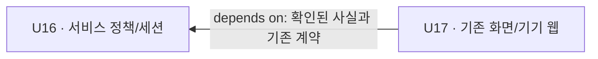

# 구현 단위 의존 관계

## Sources

- unit-of-work.md 및 units-generation-questions.md Approve Plan: U16 service, U17 ui의 소유/경계.
- ../domain-design/components.md 및 decisions.md: 단일 actor·정책/판단 분리·사실 투영.
- ../requirements-analysis/requirements.md 및 ../user-stories/stories.md: 현재 세션의 확인된 사실을 따르는 사용자 결과.

## Dependency DAG

```yaml
units:
  - name: u16-service-guardrail
    kind: service
    depends_on: []
  - name: u17-guardrail-presentation
    kind: ui
    depends_on: [u16-service-guardrail]
```



텍스트 대안: U17은 U16이 제공하는 정책에 일치한 서버 사실·계약에 의존한다. U16은 이번 신규 Unit에 의존하지 않는다. 이름 2개·직접 간선 1개이고 순환/자기 참조가 없다. 화살표는 ‘의존하는 쪽 → 의존 대상’이다.

## Integration Points

| 소비 단위 → 제공 단위 | 내용 | 계약/소유 |
|---|---|---|
| U17 → U16 | 참여 거절/무응답/기술 실패, 확인된 종료 표현, 실제 인사 재생/기기 확인과 unknown | 기존 보호자 REST→Core→Realtime 조회. 공개 계약/Java 모델/서버 투영은 U16, 프런트 타입·표시는 U17 |
| U17 → U16 | 승인 안내·재생/종료 확인의 현재 세션/재생 귀속 | 기존 기기 WS. 서버 검증/상태 소유 U16, 기기 웹의 소비/보고 U17 |
| U17 → U16 | 실제/구버전/필드 없음/미확인 응답 회귀 | Contract Design에서 허용값·선택성·호환성과 대표 대역을 확정 |

U16은 U17의 코드·상태를 호출해 참여를 확정하지 않는다. 기기 메시지는 기존 외부 이벤트 경계를 통해 actor로 들어오며, 구현 단위 소스 의존의 역간선을 만들지 않는다. 기존 인증/계정/기기/DB 경계를 바꾸지 않는다.

## 파일 소유와 병렬 가능성

| 영역 | 단일 소유 |
|---|---|
| 정책/판단/실행기/검수/서버 사실/공개 계약·Java 모델 | U16 |
| 프런트 타입/파싱/copy/화면·기기 웹 소비 | U17 |
| 각 변경의 시험/기능 범위 파일 | 해당 운영 파일의 소유 단위 |

두 Unit은 직접 의존하므로 서로 독립인 복수 Unit 집합은 없다. 계약 확정 후 UI 대역 개발은 가능하지만 의존성/통합 완료 조건을 제거하지 않는다. 한 실행기 파일을 여러 담당자가 병렬 수정하는 계획은 만들지 않는다.

## Skeleton Stance

classic의 skeleton off와 기존 팀 관례를 따른다. 새 첫 Unit 스켈레톤 의식이나 새 최소 서비스/배포를 만들지 않는다. 기존 전체 verify.sh 회귀는 최종 Build and Test에 남는다.

## 경제적 순서와의 구분

위 간선은 정보/구현의 전제만 표현한다. 권장 구현 순서·임계 경로·Bolt 우선순위는 이 단계에서 선정하지 않는다. Delivery Planning이 이 DAG와 각 단위 검증 조건을 사용해 실제 작업 묶음·순서를 결정한다.
