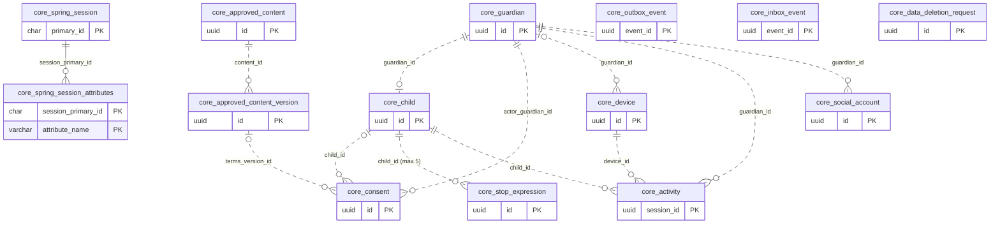
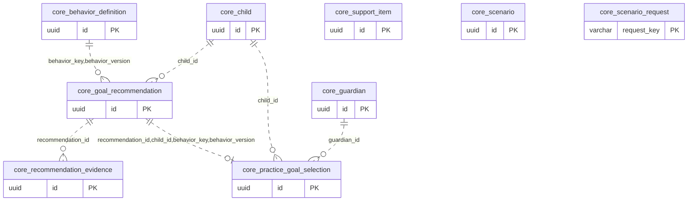
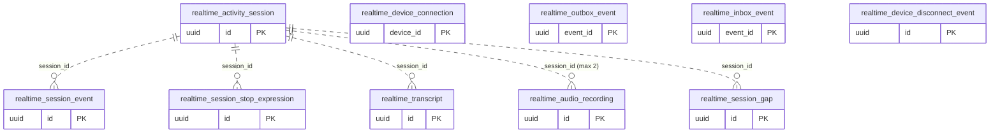
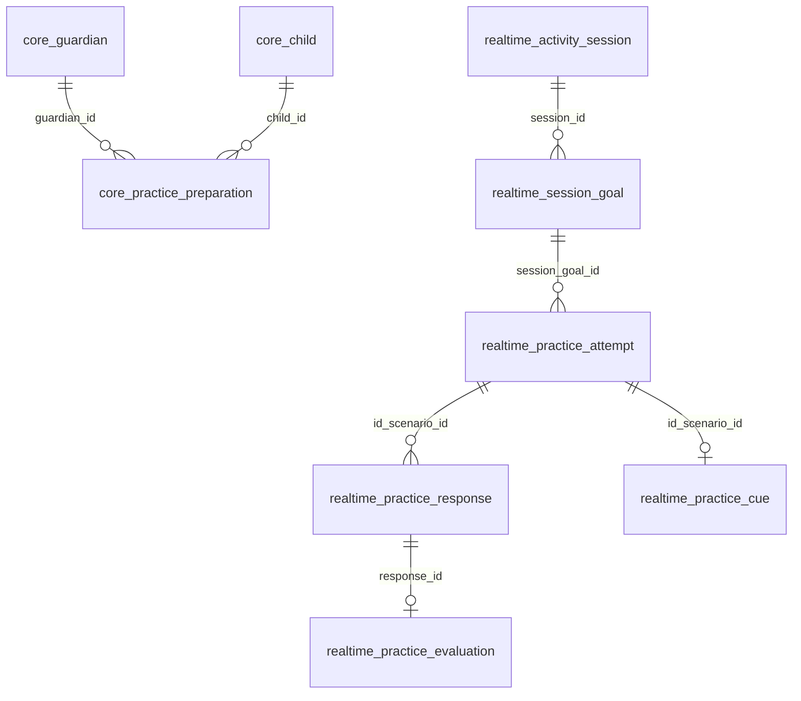

# 팀 ERD v0.2 — 구현 SQL 기준

작성일: 2026-10-12. 이 문서는 v0.1 개념 모델을 실제 마이그레이션과 대조한 데이터 사전이다.

2026-10-14 U5b 통합의 새 표·실제 물리명·관계는 [§8 U5b 통합 갱신](#8-2026-10-14-u5b-통합-갱신)을 먼저 본다. §1~§7은 2026-10-12 조사 스냅숏으로 보존하며, 그 합계나 예정 목록을 현재 전체 저장소의 상태로 읽지 않는다.

## 1. 기준과 읽는 법

### 1.1 스냅숏 및 구현 상태

**구현 DDL이 확인된 애플리케이션 테이블은 총 31개·354열**이다. 최신 `origin/main`의 **21개**와 아직 병합되지 않은 U3 원격 브랜치 **3개**, U5a 로컬 브랜치 **7개**를 문서상 합산했다. 이 합계는 현재 main 또는 실행 중인 DB의 스키마가 아니다. DB에 접속하거나 마이그레이션을 실행하지 않았으며, 예약된 core V3을 건너뛰어 V4를 운영에 적용하라는 뜻도 아니다.

| 상태 | 고정 ref / 커밋 | 대상 SQL | 테이블 | 열 |
|---|---|---|---:|---:|
| main 구현 | `origin/main@2c116870705259302fc71ba884e7cba6990f415c` | core V1+V2, realtime V1 | 21 | 247 |
| U3 원격 구현·main 미병합 | `origin/claude/friendly-shannon-i89iyx@5354a3201e3d81acec6b9a55846ee35b981a6a65` | realtime V2 | 3 | 23 |
| U5a 로컬 구현·main 미병합 | `unit/u5a-practice-core@d25124e53aa7e3d8ac2700d56debf66f4d6402be` | core V4 | 7 | 84 |
| 문서상 구현 합계 | 위 세 스냅숏의 합집합 | core 21개 + realtime 10개 | **31** | **354** |
| 예정 / DDL 미확정 | §7에 별도 수록 | 아직 CREATE TABLE 없음 | 합계에서 제외 | 타입·제약 미확정 |

U2는 기준 main에 병합되어 있다. U4a의 작업 배정은 진행 중이지만 이 문서의 조사 대상에는 core V3 DDL이 없으므로 해당 새 테이블은 예정으로 표시한다. 기존 U1 테이블의 존재와 그 테이블을 사용하는 후속 유닛의 기능 완료는 구별한다.

### 1.2 정본과 출처

열 이름·타입·NULL·DEFAULT·CHECK·PK·UNIQUE·FK·인덱스는 **마이그레이션 SQL이 정본**이다. 설계 문서는 소유 컴포넌트, 유닛 배정, 논리 관계 및 향후 변경 의도를 설명하는 근거다. SQL에 없는 제약이나 설계상 열은 구현된 것으로 보충하지 않는다.

| 식별 | 근거 | 적용 범위 |
|---|---|---|
| E0 | [ERD v0.1 Markdown 원본](../../aidlc/spaces/default/knowledge/documents/60_ERD_v0.1/ERD_데이터사전_v0.1.md) | 원본 40개 테이블의 비교 기준 |
| RPT | [cloud_run_report.md §6](../cloud_run_report.md) | 신설 8개, J12 열 변경, ADR-018 21항목, E1–E9 |
| C1 | [core V1](../../backend/core-api/src/main/resources/db/migration/core/V1__core_base.sql) · main | Core 기반 12개 테이블 |
| C2 | [core V2](../../backend/core-api/src/main/resources/db/migration/core/V2__u2_guardian_account.sql) · main | U2 2개 추가 및 기존 열·제약 변경 |
| R1 | [realtime V1](../../backend/realtime-activity/src/main/resources/db/migration/realtime/V1__realtime_base.sql) · main | Realtime 기반 7개 테이블 |
| R2 | `backend/realtime-activity/src/main/resources/db/migration/realtime/V2__u3_voice_conversation.sql` · 위 U3 ref | U3 3개 추가 |
| C4 | `backend/core-api/src/main/resources/db/migration/core/V4__u5a_practice_core.sql` · 위 U5a ref | U5a 7개 추가 |
| D2 | [U2 설계](../units/u2/design.md) · main | 보호자 계정 엔터티 |
| D3 | `docs/units/u3/design.md` · 위 U3 ref | 기기 연결·음성·전사 엔터티 |
| D5 | `docs/units/u5a/design.md` · 위 U5a ref | 행동 정의·후보·선택·상황 엔터티와 가정 |
| CMP | [components.md — 엔터티 소유](../../aidlc/spaces/default/intents/261008-mujoong-service/inception/domain-design/components.md#엔터티-소유) · main | 컴포넌트 소유, 미구현 엔터티, J9/J12 |
| UNIT | [유닛 배정표](../units/README.md) · main | core V2=U2 / V3=U4a / V4=U5a / V5=U6 / V6=U7, realtime V2=U3 / V3=U4b / V4=U5b |

요청에서 언급한 `40_` 묶음은 이 main에서 기능 명세이고, ERD의 실제 위치는 `60_ERD_v0.1`이다. 같은 묶음의 Markdown 쌍둥이를 읽어 비교했다. R2·C4·D3·D5는 이 문서 브랜치에 없는 파일이므로 일반 파일 링크 대신 경로와 ref를 기록했다. 위 표의 main 출처는 모두 §1.1의 main 커밋으로 고정한다.

브랜치 전환 없이 근거를 다시 읽는 방법:

```text
git show 5354a3201e3d81acec6b9a55846ee35b981a6a65:docs/units/u3/design.md
git show 5354a3201e3d81acec6b9a55846ee35b981a6a65:backend/realtime-activity/src/main/resources/db/migration/realtime/V2__u3_voice_conversation.sql
git show d25124e53aa7e3d8ac2700d56debf66f4d6402be:docs/units/u5a/design.md
git show d25124e53aa7e3d8ac2700d56debf66f4d6402be:backend/core-api/src/main/resources/db/migration/core/V4__u5a_practice_core.sql
```

### 1.3 표기와 범위

- `core.core_*`와 `realtime.realtime_*`는 스키마를 포함한 실제 SQL 이름이다.
- **물리 FK**는 SQL의 REFERENCES 선언만 뜻한다. UUID·이름이 비슷해도 FK 없는 참조는 §5.5의 **논리 참조**다. 스키마 간 FK는 없다.
- 열 표의 DEFAULT `없음`은 선언 부재다. PK가 암시하는 NOT NULL, NULL 허용, 기본값을 별도로 구분한다. 긴 SQL 식은 공백·줄바꿈만 정리했다.
- CHECK의 UNKNOWN 허용 여부, 복합 UNIQUE, 부분 인덱스 조건은 SQL 그대로 보존한다. 애플리케이션 검증·시간 제한·보존 정책은 DB 제약으로 그리지 않는다.
- PK/UNIQUE가 만드는 지원 인덱스와 명시적 CREATE INDEX를 구분한다. FK만으로 자식 열 인덱스가 생긴다고 가정하지 않는다.
- Flyway의 `flyway.core_schema_history`, `flyway.realtime_schema_history`는 애플리케이션 31개에서 제외한다. 이력 표의 구조는 Flyway가 생성하며 여기서 다루는 버전 SQL에 CREATE TABLE이 없다. 이름·스키마 근거는 [core 설정](../../infra/migrate/flyway-core.conf), [realtime 설정](../../infra/migrate/flyway-realtime.conf)이다.
- 비밀값, 접속 주소, 실제 도메인, 운영 데이터 예시는 기재하지 않는다. `data_class`는 분류 메타데이터이며 모든 테이블에 실제로 존재하는 공통 열이 아니다.

## 2. 스키마별 테이블과 소유

| 스키마 | main 구현 | 브랜치 구현·미병합 | 합계 | 열 | 물리 FK | 명시 CREATE INDEX |
|---|---:|---:|---:|---:|---:|---:|
| core | 14 | U5a 7 | **21** | 234 | 18 | 18 |
| realtime | 7 | U3 3 | **10** | 120 | 5 | 8 |
| 합계 | **21** | **10** | **31** | **354** | **23** | **26** |

### 2.1 Core

| 테이블 | 소유 컴포넌트 | 생성·기능 유닛 | 정본 | 열 | 상태 |
|---|---|---|---|---:|---|
| `core.core_guardian` | GuardianIdentity | U1 기반 · U2 | C1 | 4 | main 구현 |
| `core.core_spring_session` | GuardianIdentity | U1 기반 · U2 | C1 | 7 | main 구현 |
| `core.core_spring_session_attributes` | GuardianIdentity | U1 기반 · U2 | C1 | 3 | main 구현 |
| `core.core_child` | ChildProfile | U1 기반 · U2 | C1 | 9 | main 구현 |
| `core.core_consent` | ConsentPolicy | U1 기반 · U2 | C1 + C2 | 11 | main 구현 |
| `core.core_stop_expression` | ChildProfile | U1 기반 · U2 | C1 + C2 | 7 | main 구현 |
| `core.core_approved_content` | ApprovedContentCatalog | U1 기반 · U2 | C1 | 4 | main 구현 |
| `core.core_approved_content_version` | ApprovedContentCatalog | U1 기반 · U2 | C1 | 7 | main 구현 |
| `core.core_device` | DeviceRegistry | U1 등록 · U2 상태 화면 | C1 | 22 | main 구현 |
| `core.core_activity` | ActivityCoordinator | U1 기반 · U4a 기능 예정 | C1 | 20 | main 구현 |
| `core.core_outbox_event` | CoreMessaging | U1 공통 기반 | C1 | 17 | main 구현 |
| `core.core_inbox_event` | CoreMessaging | U1 공통 기반 | C1 | 17 | main 구현 |
| `core.core_social_account` | GuardianIdentity | U2 | C2 | 6 | main 구현 |
| `core.core_data_deletion_request` | AccountDeletion | U2 | C2 | 16 | main 구현 |
| `core.core_behavior_definition` | PragmaticsKnowledge | U5a | C4 | 11 | U5a 로컬·미병합 |
| `core.core_support_item` | PragmaticsKnowledge | U5a | C4 | 8 | U5a 로컬·미병합 |
| `core.core_goal_recommendation` | PracticeGoal | U5a | C4 | 11 | U5a 로컬·미병합 |
| `core.core_recommendation_evidence` | PracticeGoal | U5a | C4 | 6 | U5a 로컬·미병합 |
| `core.core_practice_goal_selection` | PracticeGoal | U5a | C4 | 13 | U5a 로컬·미병합 |
| `core.core_scenario` | PracticeGoal | U5a | C4 | 22 | U5a 로컬·미병합 |
| `core.core_scenario_request` | PracticeGoal (구현 추가) | U5a | C4 | 13 | U5a 로컬·미병합 |

### 2.2 Realtime

| 테이블 | 소유 컴포넌트 | 생성·기능 유닛 | 정본 | 열 | 상태 |
|---|---|---|---|---:|---|
| `realtime.realtime_activity_session` | SessionLifecycle | U1 기반 · U4b 기능 예정 | R1 | 29 | main 구현 |
| `realtime.realtime_session_event` | SessionLifecycle | U1 기반 · U3 기록 · U4b | R1 | 6 | main 구현 |
| `realtime.realtime_session_stop_expression` | SessionLifecycle | U1 기반 · U4b 기능 예정 | R1 | 6 | main 구현 |
| `realtime.realtime_transcript` | ConversationLog | U1 기반 · U3 | R1 | 12 | main 구현 |
| `realtime.realtime_device_connection` | DeviceGateway | U1 기반 · U3 | R1 | 10 | main 구현 |
| `realtime.realtime_outbox_event` | RealtimeMessaging | U1 공통 기반 | R1 | 17 | main 구현 |
| `realtime.realtime_inbox_event` | RealtimeMessaging | U1 공통 기반 | R1 | 17 | main 구현 |
| `realtime.realtime_device_disconnect_event` | DeviceGateway (구현 추가) | U3 | R2 | 7 | U3 원격·미병합 |
| `realtime.realtime_audio_recording` | VoiceRelay | U3 | R2 | 10 | U3 원격·미병합 |
| `realtime.realtime_session_gap` | ConversationLog (구현 추가) | U3 | R2 | 6 | U3 원격·미병합 |

이후 §3·§4는 위 **31개 구현 테이블만** 상세화한다. DDL 없는 테이블의 열·타입·제약은 §7에서 미확정으로 남긴다.

## 3. Core 스키마 상세

이 절은 `origin/main@2c11687`의 V1+V2에 `unit/u5a-practice-core@d25124e`의 V4를 **문서상 합산**한 열·제약 목록이다. V4를 main에 병합하거나 DB에 적용한 결과를 뜻하지 않는다. 애플리케이션 표는 main 14개, U5a 로컬 7개로 총21개이며 Flyway 이력 표는 제외한다. V4에는 ALTER TABLE이 없으며 기존 표를 바꾸는 구문은 V2에 있다.

소유 근거: `aidlc/spaces/default/intents/261008-mujoong-service/inception/domain-design/components.md`의 컴포넌트 요약·엔터티 소유 (`origin/main@2c11687`), `docs/units/u2/design.md` 2~3절 (`origin/main@2c11687`), `docs/units/u5a/design.md` 2~4절·가정 J5/J8/J9/J15/J18/J19 (`unit/u5a-practice-core@d25124e`). 타입·제약은 아래 SQL 정본을 우선한다.

표기: DEFAULT `없음`은 SQL에 기본값 선언이 없다는 뜻이다. PK 선언이 암시하는 NOT NULL과 명시적 NOT NULL을 구별한다. PK/UNIQUE는 PostgreSQL이 지원 인덱스를 만들지만, 별도 CREATE INDEX와 구분한다. 이름 없는 제약의 자동 생성 이름은 추측하지 않는다. NULLS NOT DISTINCT 선언은 없으며 nullable UNIQUE 열의 NULL은 서로 같다고 취급하지 않는다. 명시하지 않은 FK ON UPDATE는 PostgreSQL 기본 NO ACTION, DEFERRABLE 미선언 제약은 기본 NOT DEFERRABLE이다.

### 3.1 `core.core_guardian`

소유 컴포넌트: **GuardianIdentity**. 상태·유닛: **U1 기반·U2 기능, main 구현**. 열 4개.

SQL 근거: `backend/core-api/src/main/resources/db/migration/core/V1__core_base.sql` (`2c11687`; `origin/main`).

| 열 | SQL 타입 | NULL | DEFAULT | 열 단위 제약 |
|---|---|---|---|---|
| `id` | `uuid` | NOT NULL (명시) | 없음 | — |
| `status` | `varchar(30)` | NOT NULL (명시) | `'ACTIVE'` | — |
| `created_at` | `timestamptz` | NOT NULL (명시) | 없음 | — |
| `updated_at` | `timestamptz` | NOT NULL (명시) | 없음 | — |

**테이블 제약**

| 식별/종류 | SQL 정의 |
|---|---|
| `core_guardian_pk` / PRIMARY KEY (`V1`) | `CONSTRAINT core_guardian_pk PRIMARY KEY (id)` |
| `core_guardian_status_ck` / CHECK (`V1`) | `CONSTRAINT core_guardian_status_ck CHECK (status IN ('ACTIVE', 'DELETION_REQUESTED'))` |

**명시적 인덱스·저장 옵션**

| 이름 | UNIQUE | SQL 정의 |
|---|---|---|
| — | — | 별도 CREATE INDEX 없음. PK/UNIQUE 제약의 지원 인덱스는 위 제약에 포함된다. |

V1/V2/V4에서 이 표의 트리거 선언 없음.

계정 삭제 중 상태는 DELETION_REQUESTED다. V2는 이 표의 열을 추가하지 않는다.

### 3.2 `core.core_spring_session`

소유 컴포넌트: **GuardianIdentity (Spring Session JDBC)**. 상태·유닛: **U1 기반·U2 로그인, main 구현**. 열 7개.

SQL 근거: `backend/core-api/src/main/resources/db/migration/core/V1__core_base.sql` (`2c11687`; `origin/main`).

| 열 | SQL 타입 | NULL | DEFAULT | 열 단위 제약 |
|---|---|---|---|---|
| `primary_id` | `char(36)` | NOT NULL (명시) | 없음 | — |
| `session_id` | `char(36)` | NOT NULL (명시) | 없음 | — |
| `creation_time` | `bigint` | NOT NULL (명시) | 없음 | — |
| `last_access_time` | `bigint` | NOT NULL (명시) | 없음 | — |
| `max_inactive_interval` | `integer` | NOT NULL (명시) | 없음 | — |
| `expiry_time` | `bigint` | NOT NULL (명시) | 없음 | — |
| `principal_name` | `varchar(100)` | NULL 허용 | 없음 | — |

**테이블 제약**

| 식별/종류 | SQL 정의 |
|---|---|
| `core_spring_session_pk` / PRIMARY KEY (`V1`) | `CONSTRAINT core_spring_session_pk PRIMARY KEY (primary_id)` |

**명시적 인덱스·저장 옵션**

| 이름 | UNIQUE | SQL 정의 |
|---|---|---|
| `core_spring_session_ix1` | 예 | `CREATE UNIQUE INDEX core_spring_session_ix1 ON core.core_spring_session (session_id);` |
| `core_spring_session_ix2` | 아니요 | `CREATE INDEX core_spring_session_ix2 ON core.core_spring_session (expiry_time);` |
| `core_spring_session_ix3` | 아니요 | `CREATE INDEX core_spring_session_ix3 ON core.core_spring_session (principal_name);` |

V1/V2/V4에서 이 표의 트리거 선언 없음.

시각 열은 Spring Session JDBC가 사용하는 epoch 밀리초 bigint이고 max_inactive_interval은 초 단위다. principal_name은 보호자 UUID를 담을 수 있지만 물리 FK가 없다. session_id 유일성은 UNIQUE 제약 선언이 아닌 이름 있는 UNIQUE INDEX로 구현된다.

### 3.3 `core.core_spring_session_attributes`

소유 컴포넌트: **GuardianIdentity (Spring Session JDBC)**. 상태·유닛: **U1 기반·U2 로그인, main 구현**. 열 3개.

SQL 근거: `backend/core-api/src/main/resources/db/migration/core/V1__core_base.sql` (`2c11687`; `origin/main`).

| 열 | SQL 타입 | NULL | DEFAULT | 열 단위 제약 |
|---|---|---|---|---|
| `session_primary_id` | `char(36)` | NOT NULL (명시) | 없음 | — |
| `attribute_name` | `varchar(200)` | NOT NULL (명시) | 없음 | — |
| `attribute_bytes` | `bytea` | NOT NULL (명시) | 없음 | — |

**테이블 제약**

| 식별/종류 | SQL 정의 |
|---|---|
| `core_spring_session_attributes_pk` / PRIMARY KEY (`V1`) | `CONSTRAINT core_spring_session_attributes_pk PRIMARY KEY (session_primary_id, attribute_name)` |
| `core_spring_session_attributes_fk` / FOREIGN KEY (`V1`) | `CONSTRAINT core_spring_session_attributes_fk FOREIGN KEY (session_primary_id) REFERENCES core.core_spring_session (primary_id) ON DELETE CASCADE` |

**명시적 인덱스·저장 옵션**

| 이름 | UNIQUE | SQL 정의 |
|---|---|---|
| — | — | 별도 CREATE INDEX 없음. PK/UNIQUE 제약의 지원 인덱스는 위 제약에 포함된다. |

V1/V2/V4에서 이 표의 트리거 선언 없음.

유일한 ON DELETE CASCADE 관계다. 그 밖의 명시적 Core FK는 모두 ON DELETE RESTRICT다.

### 3.4 `core.core_child`

소유 컴포넌트: **ChildProfile**. 상태·유닛: **U1 기반·U2 기능, main 구현**. 열 9개.

SQL 근거: `backend/core-api/src/main/resources/db/migration/core/V1__core_base.sql` (`2c11687`; `origin/main`).

| 열 | SQL 타입 | NULL | DEFAULT | 열 단위 제약 |
|---|---|---|---|---|
| `id` | `uuid` | NOT NULL (명시) | 없음 | — |
| `guardian_id` | `uuid` | NOT NULL (명시) | 없음 | — |
| `display_name` | `varchar(100)` | NOT NULL (명시) | 없음 | — |
| `age` | `integer` | NULL 허용 | 없음 | — |
| `interests_json` | `jsonb` | NULL 허용 | 없음 | — |
| `status` | `varchar(30)` | NOT NULL (명시) | 없음 | — |
| `created_at` | `timestamptz` | NOT NULL (명시) | 없음 | — |
| `updated_at` | `timestamptz` | NOT NULL (명시) | 없음 | — |
| `deleted_at` | `timestamptz` | NULL 허용 | 없음 | — |

**테이블 제약**

| 식별/종류 | SQL 정의 |
|---|---|
| `core_child_pk` / PRIMARY KEY (`V1`) | `CONSTRAINT core_child_pk PRIMARY KEY (id)` |
| `core_child_guardian_uk` / UNIQUE (`V1`) | `CONSTRAINT core_child_guardian_uk UNIQUE (guardian_id)` |
| `core_child_guardian_fk` / FOREIGN KEY (`V1`) | `CONSTRAINT core_child_guardian_fk FOREIGN KEY (guardian_id) REFERENCES core.core_guardian (id) ON DELETE RESTRICT` |

**명시적 인덱스·저장 옵션**

| 이름 | UNIQUE | SQL 정의 |
|---|---|---|
| — | — | 별도 CREATE INDEX 없음. PK/UNIQUE 제약의 지원 인덱스는 위 제약에 포함된다. |

V1/V2/V4에서 이 표의 트리거 선언 없음.

guardian_id UNIQUE이므로 보호자당 아이 행은 최대 하나다(삭제 여부와 무관). 이름 1~10자·나이 6~12·관심사 규칙은 U2 앱 검증이며 SQL CHECK가 아니다. V2에서 이 표는 변경되지 않는다.

### 3.5 `core.core_consent`

소유 컴포넌트: **ConsentPolicy**. 상태·유닛: **U1 기반·U2 확장, main 구현**. 열 11개.

SQL 근거: `backend/core-api/src/main/resources/db/migration/core/V1__core_base.sql` (`2c11687`; `origin/main`) + `backend/core-api/src/main/resources/db/migration/core/V2__u2_guardian_account.sql` (`2c11687`; `origin/main`).

| 열 | SQL 타입 | NULL | DEFAULT | 열 단위 제약 |
|---|---|---|---|---|
| `id` | `uuid` | NOT NULL (명시) | 없음 | — |
| `actor_guardian_id` | `uuid` | NOT NULL (명시) | 없음 | — |
| `child_id` | `uuid` | NULL 허용 | 없음 | — |
| `consent_type` | `varchar(50)` | NOT NULL (명시) | 없음 | — |
| `consent_status` | `varchar(30)` | NOT NULL (명시) | 없음 | — |
| `consent_version` | `integer` | NOT NULL (명시) | 없음 | — |
| `policy_version` | `varchar(50)` | NULL 허용 | 없음 | — |
| `effective_from` | `timestamptz` | NOT NULL (명시) | 없음 | — |
| `effective_to` | `timestamptz` | NULL 허용 | 없음 | — |
| `created_at` | `timestamptz` | NOT NULL (명시) | 없음 | — |
| `terms_version_id` | `uuid` | NULL 허용 | 없음 | — |

**테이블 제약**

| 식별/종류 | SQL 정의 |
|---|---|
| `core_consent_pk` / PRIMARY KEY (`V1`) | `CONSTRAINT core_consent_pk PRIMARY KEY (id)` |
| `core_consent_actor_guardian_fk` / FOREIGN KEY (`V1`) | `CONSTRAINT core_consent_actor_guardian_fk FOREIGN KEY (actor_guardian_id) REFERENCES core.core_guardian (id) ON DELETE RESTRICT` |
| `core_consent_child_fk` / FOREIGN KEY (`V1`) | `CONSTRAINT core_consent_child_fk FOREIGN KEY (child_id) REFERENCES core.core_child (id) ON DELETE RESTRICT` |
| `core_consent_type_ck` / CHECK (`V1`) | `CONSTRAINT core_consent_type_ck CHECK (consent_type IN ('VOICE_AND_TEXT', 'GUARDIAN_VIEW', 'REPORT_SHARING', 'RAW_AUDIO'))` |
| `core_consent_status_ck` / CHECK (`V1`) | `CONSTRAINT core_consent_status_ck CHECK (consent_status IN ('GIVEN', 'WITHDRAWN'))` |
| `core_consent_terms_version_fk` / FOREIGN KEY (`V2`) | `CONSTRAINT core_consent_terms_version_fk FOREIGN KEY (terms_version_id) REFERENCES core.core_approved_content_version (id) ON DELETE RESTRICT` |
| `core_consent_consent_version_ck` / CHECK (`V2`) | `CONSTRAINT core_consent_consent_version_ck CHECK (consent_version >= 1)` |

**명시적 인덱스·저장 옵션**

| 이름 | UNIQUE | SQL 정의 |
|---|---|---|
| `core_consent_actor_type_idx` | 아니요 | `CREATE INDEX core_consent_actor_type_idx ON core.core_consent (actor_guardian_id, consent_type);` |

V1/V2/V4에서 이 표의 트리거 선언 없음.

V2에서 child_id NOT NULL을 해제하고 terms_version_id를 추가했다. 두 선택적 FK는 NULL을 허용한다. consent_version>=1이 V2에서 추가되었다. 아이와 보호자가 같은 소유 관계인지까지 묶는 복합 FK는 없다.

### 3.6 `core.core_stop_expression`

소유 컴포넌트: **ChildProfile**. 상태·유닛: **U1 기반·U2 확장, main 구현**. 열 7개.

SQL 근거: `backend/core-api/src/main/resources/db/migration/core/V1__core_base.sql` (`2c11687`; `origin/main`) + `backend/core-api/src/main/resources/db/migration/core/V2__u2_guardian_account.sql` (`2c11687`; `origin/main`).

| 열 | SQL 타입 | NULL | DEFAULT | 열 단위 제약 |
|---|---|---|---|---|
| `id` | `uuid` | NOT NULL (명시) | 없음 | — |
| `child_id` | `uuid` | NOT NULL (명시) | 없음 | — |
| `expression_text` | `varchar(20)` | NOT NULL (명시) | 없음 | — |
| `normalized_text` | `varchar(40)` | NOT NULL (명시) | 없음 | — |
| `sort_order` | `integer` | NOT NULL (명시) | 없음 | — |
| `created_at` | `timestamptz` | NOT NULL (명시) | 없음 | — |
| `updated_at` | `timestamptz` | NOT NULL (명시) | 없음 | — |

**테이블 제약**

| 식별/종류 | SQL 정의 |
|---|---|
| `core_stop_expression_pk` / PRIMARY KEY (`V1`) | `CONSTRAINT core_stop_expression_pk PRIMARY KEY (id)` |
| `core_stop_expression_child_fk` / FOREIGN KEY (`V1`) | `CONSTRAINT core_stop_expression_child_fk FOREIGN KEY (child_id) REFERENCES core.core_child (id) ON DELETE RESTRICT` |
| `core_stop_expression_text_ck` / CHECK (`V2`) | `CONSTRAINT core_stop_expression_text_ck CHECK ( char_length(expression_text) BETWEEN 2 AND 20)` |
| `core_stop_expression_sort_order_ck` / CHECK (`V2`) | `CONSTRAINT core_stop_expression_sort_order_ck CHECK (sort_order BETWEEN 1 AND 5)` |
| `core_stop_expression_normalized_uk` / UNIQUE (`V2`) | `CONSTRAINT core_stop_expression_normalized_uk UNIQUE (child_id, normalized_text)` |
| `core_stop_expression_sort_order_uk` / UNIQUE (`V2`) | `CONSTRAINT core_stop_expression_sort_order_uk UNIQUE (child_id, sort_order) DEFERRABLE INITIALLY DEFERRED` |

**명시적 인덱스·저장 옵션**

| 이름 | UNIQUE | SQL 정의 |
|---|---|---|
| — | — | 별도 CREATE INDEX 없음. PK/UNIQUE 제약의 지원 인덱스는 위 제약에 포함된다. |

V1/V2/V4에서 이 표의 트리거 선언 없음.

V2의 (child_id, sort_order) UNIQUE는 DEFERRABLE INITIALLY DEFERRED다. 별도 단독 child_id CREATE INDEX는 없다; child_id로 시작하는 두 UNIQUE 제약의 지원 색인은 존재한다. core_child 행당 최대5개라는 SQL 효과는 순번1~5와 아이별 순번 유일성의 조합이다.

### 3.7 `core.core_approved_content`

소유 컴포넌트: **ApprovedContentCatalog**. 상태·유닛: **U1 구현, main**. 열 4개.

SQL 근거: `backend/core-api/src/main/resources/db/migration/core/V1__core_base.sql` (`2c11687`; `origin/main`).

| 열 | SQL 타입 | NULL | DEFAULT | 열 단위 제약 |
|---|---|---|---|---|
| `id` | `uuid` | NOT NULL (명시) | 없음 | — |
| `content_code` | `varchar(100)` | NOT NULL (명시) | 없음 | — |
| `content_type` | `varchar(50)` | NOT NULL (명시) | 없음 | — |
| `created_at` | `timestamptz` | NOT NULL (명시) | 없음 | — |

**테이블 제약**

| 식별/종류 | SQL 정의 |
|---|---|
| `core_approved_content_pk` / PRIMARY KEY (`V1`) | `CONSTRAINT core_approved_content_pk PRIMARY KEY (id)` |
| `core_approved_content_code_uk` / UNIQUE (`V1`) | `CONSTRAINT core_approved_content_code_uk UNIQUE (content_code)` |

**명시적 인덱스·저장 옵션**

| 이름 | UNIQUE | SQL 정의 |
|---|---|---|
| — | — | 별도 CREATE INDEX 없음. PK/UNIQUE 제약의 지원 인덱스는 위 제약에 포함된다. |

V1/V2/V4에서 이 표의 트리거 선언 없음.

content_code는 NULL 불가이며 유일하다. content_type의 enum CHECK는 SQL에 없다.

### 3.8 `core.core_approved_content_version`

소유 컴포넌트: **ApprovedContentCatalog**. 상태·유닛: **U1 구현, main**. 열 7개.

SQL 근거: `backend/core-api/src/main/resources/db/migration/core/V1__core_base.sql` (`2c11687`; `origin/main`).

| 열 | SQL 타입 | NULL | DEFAULT | 열 단위 제약 |
|---|---|---|---|---|
| `id` | `uuid` | NOT NULL (명시) | 없음 | — |
| `content_id` | `uuid` | NOT NULL (명시) | 없음 | — |
| `version` | `integer` | NOT NULL (명시) | 없음 | — |
| `content_text` | `text` | NOT NULL (명시) | 없음 | — |
| `audio_path` | `varchar(500)` | NULL 허용 | 없음 | — |
| `status` | `varchar(30)` | NOT NULL (명시) | 없음 | — |
| `created_at` | `timestamptz` | NOT NULL (명시) | 없음 | — |

**테이블 제약**

| 식별/종류 | SQL 정의 |
|---|---|
| `core_approved_content_version_pk` / PRIMARY KEY (`V1`) | `CONSTRAINT core_approved_content_version_pk PRIMARY KEY (id)` |
| `core_approved_content_version_content_fk` / FOREIGN KEY (`V1`) | `CONSTRAINT core_approved_content_version_content_fk FOREIGN KEY (content_id) REFERENCES core.core_approved_content (id) ON DELETE RESTRICT` |
| `core_approved_content_version_uk` / UNIQUE (`V1`) | `CONSTRAINT core_approved_content_version_uk UNIQUE (content_id, version)` |
| `core_approved_content_version_version_ck` / CHECK (`V1`) | `CONSTRAINT core_approved_content_version_version_ck CHECK (version >= 1)` |
| `core_approved_content_version_status_ck` / CHECK (`V1`) | `CONSTRAINT core_approved_content_version_status_ck CHECK (status IN ('DRAFT', 'APPROVED', 'RETIRED'))` |
| `core_approved_content_version_audio_path_ck` / CHECK (`V1`) | `CONSTRAINT core_approved_content_version_audio_path_ck CHECK ( audio_path IS NULL OR audio_path ~ '^[A-Za-z0-9._-]+\.wav$')` |

**명시적 인덱스·저장 옵션**

| 이름 | UNIQUE | SQL 정의 |
|---|---|---|
| — | — | 별도 CREATE INDEX 없음. PK/UNIQUE 제약의 지원 인덱스는 위 제약에 포함된다. |

V1/V2/V4에서 이 표의 트리거 선언 없음.

audio_path는 NULL 또는 허용 파일명 형태의 .wav만 받는다. 버전 값은1이상이고 content_id+version이 유일하다.

### 3.9 `core.core_device`

소유 컴포넌트: **DeviceRegistry**. 상태·유닛: **U1 구현, main**. 열 22개.

SQL 근거: `backend/core-api/src/main/resources/db/migration/core/V1__core_base.sql` (`2c11687`; `origin/main`).

| 열 | SQL 타입 | NULL | DEFAULT | 열 단위 제약 |
|---|---|---|---|---|
| `id` | `uuid` | NOT NULL (명시) | 없음 | — |
| `guardian_id` | `uuid` | NULL 허용 | 없음 | — |
| `registration_code` | `varchar(8)` | NOT NULL (명시) | 없음 | — |
| `code_issued_at` | `timestamptz` | NOT NULL (명시) | 없음 | — |
| `code_expires_at` | `timestamptz` | NOT NULL (명시) | 없음 | — |
| `bootstrap_secret_hash` | `varchar(64)` | NOT NULL (명시) | 없음 | — |
| `device_token_hash` | `varchar(64)` | NULL 허용 | 없음 | — |
| `token_issued_at` | `timestamptz` | NULL 허용 | 없음 | — |
| `first_connected_at` | `timestamptz` | NULL 허용 | 없음 | — |
| `registration_status` | `varchar(20)` | NOT NULL (명시) | `'UNREGISTERED'` | — |
| `registered_at` | `timestamptz` | NULL 허용 | 없음 | — |
| `released_at` | `timestamptz` | NULL 허용 | 없음 | — |
| `release_reason` | `varchar(30)` | NULL 허용 | 없음 | — |
| `reported_connection_state` | `varchar(20)` | NULL 허용 | 없음 | — |
| `reported_at` | `timestamptz` | NULL 허용 | 없음 | — |
| `last_seen_at` | `timestamptz` | NULL 허용 | 없음 | — |
| `connection_since` | `timestamptz` | NULL 허용 | 없음 | — |
| `rtt_ms` | `integer` | NULL 허용 | 없음 | — |
| `recent_disconnect_count` | `integer` | NOT NULL (명시) | `0` | — |
| `created_at` | `timestamptz` | NOT NULL (명시) | 없음 | — |
| `updated_at` | `timestamptz` | NOT NULL (명시) | 없음 | — |
| `row_version` | `bigint` | NOT NULL (명시) | `0` | — |

**테이블 제약**

| 식별/종류 | SQL 정의 |
|---|---|
| `core_device_pk` / PRIMARY KEY (`V1`) | `CONSTRAINT core_device_pk PRIMARY KEY (id)` |
| `core_device_bootstrap_secret_hash_uk` / UNIQUE (`V1`) | `CONSTRAINT core_device_bootstrap_secret_hash_uk UNIQUE (bootstrap_secret_hash)` |
| `core_device_device_token_hash_uk` / UNIQUE (`V1`) | `CONSTRAINT core_device_device_token_hash_uk UNIQUE (device_token_hash)` |
| `core_device_guardian_fk` / FOREIGN KEY (`V1`) | `CONSTRAINT core_device_guardian_fk FOREIGN KEY (guardian_id) REFERENCES core.core_guardian (id) ON DELETE RESTRICT` |
| `core_device_status_ck` / CHECK (`V1`) | `CONSTRAINT core_device_status_ck CHECK ( registration_status IN ('UNREGISTERED', 'REGISTERED', 'RELEASED', 'EXPIRED'))` |
| `core_device_registered_ck` / CHECK (`V1`) | `CONSTRAINT core_device_registered_ck CHECK ( registration_status <> 'REGISTERED' OR (guardian_id IS NOT NULL AND registered_at IS NOT NULL))` |
| `core_device_released_ck` / CHECK (`V1`) | `CONSTRAINT core_device_released_ck CHECK ( registration_status <> 'RELEASED' OR (released_at IS NOT NULL AND release_reason IS NOT NULL AND release_reason IN ('REREGISTERED', 'ACCOUNT_DELETED') AND device_token_hash IS NULL))` |
| `core_device_unbound_ck` / CHECK (`V1`) | `CONSTRAINT core_device_unbound_ck CHECK ( registration_status NOT IN ('UNREGISTERED', 'EXPIRED') OR guardian_id IS NULL)` |

**명시적 인덱스·저장 옵션**

| 이름 | UNIQUE | SQL 정의 |
|---|---|---|
| `core_device_active_guardian_uk` | 예 | `CREATE UNIQUE INDEX core_device_active_guardian_uk ON core.core_device (guardian_id) WHERE registration_status = 'REGISTERED';` |
| `core_device_pending_code_uk` | 예 | `CREATE UNIQUE INDEX core_device_pending_code_uk ON core.core_device (registration_code) WHERE registration_status = 'UNREGISTERED';` |

저장 옵션: `WITH (fillfactor = 90)`.

V1/V2/V4에서 이 표의 트리거 선언 없음.

guardian_id·device_token_hash는 NULL을 허용한다. device_token_hash UNIQUE는 NULLS NOT DISTINCT가 없으므로 NULL 여러 개를 허용한다. 보호자당 REGISTERED 하나 및 UNREGISTERED 등록 코드 중복 금지는 각각 부분 UNIQUE INDEX다. fillfactor=90. 시각/상태의 나머지 조합은 아래 SQL CHECK 범위만 보장한다.

### 3.10 `core.core_activity`

소유 컴포넌트: **ActivityCoordinator**. 상태·유닛: **U1 세션 사본 구현, main; U2 삭제 참가자, 후속 U4 이관 예정**. 열 20개.

SQL 근거: `backend/core-api/src/main/resources/db/migration/core/V1__core_base.sql` (`2c11687`; `origin/main`).

| 열 | SQL 타입 | NULL | DEFAULT | 열 단위 제약 |
|---|---|---|---|---|
| `session_id` | `uuid` | NOT NULL (명시) | 없음 | — |
| `guardian_id` | `uuid` | NOT NULL (명시) | 없음 | — |
| `child_id` | `uuid` | NOT NULL (명시) | 없음 | — |
| `device_id` | `uuid` | NOT NULL (명시) | 없음 | — |
| `activity_type` | `varchar(30)` | NOT NULL (명시) | 없음 | — |
| `status` | `varchar(30)` | NOT NULL (명시) | `'REQUESTED'` | — |
| `status_version` | `integer` | NOT NULL (명시) | `0` | — |
| `end_reason` | `varchar(50)` | NULL 허용 | 없음 | — |
| `failure_code` | `varchar(50)` | NULL 허용 | 없음 | — |
| `confirmed` | `boolean` | NOT NULL (명시) | `false` | — |
| `local_failed` | `boolean` | NOT NULL (명시) | `false` | — |
| `start_result_code` | `integer` | NULL 허용 | 없음 | — |
| `start_idempotency_key` | `varchar(100)` | NOT NULL (명시) | 없음 | — |
| `request_hash` | `varchar(64)` | NOT NULL (명시) | 없음 | — |
| `requested_at` | `timestamptz` | NOT NULL (명시) | 없음 | — |
| `started_at` | `timestamptz` | NULL 허용 | 없음 | — |
| `ended_at` | `timestamptz` | NULL 허용 | 없음 | — |
| `observed_at` | `timestamptz` | NULL 허용 | 없음 | — |
| `created_at` | `timestamptz` | NOT NULL (명시) | 없음 | — |
| `updated_at` | `timestamptz` | NOT NULL (명시) | 없음 | — |

**테이블 제약**

| 식별/종류 | SQL 정의 |
|---|---|
| `core_activity_pk` / PRIMARY KEY (`V1`) | `CONSTRAINT core_activity_pk PRIMARY KEY (session_id)` |
| `core_activity_idempotency_uk` / UNIQUE (`V1`) | `CONSTRAINT core_activity_idempotency_uk UNIQUE (guardian_id, start_idempotency_key)` |
| `core_activity_guardian_fk` / FOREIGN KEY (`V1`) | `CONSTRAINT core_activity_guardian_fk FOREIGN KEY (guardian_id) REFERENCES core.core_guardian (id) ON DELETE RESTRICT` |
| `core_activity_child_fk` / FOREIGN KEY (`V1`) | `CONSTRAINT core_activity_child_fk FOREIGN KEY (child_id) REFERENCES core.core_child (id) ON DELETE RESTRICT` |
| `core_activity_device_fk` / FOREIGN KEY (`V1`) | `CONSTRAINT core_activity_device_fk FOREIGN KEY (device_id) REFERENCES core.core_device (id) ON DELETE RESTRICT` |
| `core_activity_type_ck` / CHECK (`V1`) | `CONSTRAINT core_activity_type_ck CHECK (activity_type IN ('FREE_TALK', 'PRACTICE'))` |
| `core_activity_status_ck` / CHECK (`V1`) | `CONSTRAINT core_activity_status_ck CHECK (status IN ( 'REQUESTED', 'PREPARING', 'DEVICE_ACK', 'WAITING_CHILD', 'ACTIVE', 'CLOSING', 'ENDED', 'ENDED_UNCONFIRMED', 'ABORTED', 'DECLINED', 'FAILED'))` |
| `core_activity_status_version_ck` / CHECK (`V1`) | `CONSTRAINT core_activity_status_version_ck CHECK (status_version >= 0)` |
| `core_activity_local_failed_ck` / CHECK (`V1`) | `CONSTRAINT core_activity_local_failed_ck CHECK (( (local_failed AND status = 'FAILED' AND failure_code IS NULL AND start_result_code IS NOT NULL AND start_result_code IN (202, 409, 423, 503)) OR (NOT local_failed AND start_result_code IS NULL) ) IS TRUE)` |

**명시적 인덱스·저장 옵션**

| 이름 | UNIQUE | SQL 정의 |
|---|---|---|
| `core_activity_in_progress_guardian_uk` | 예 | `CREATE UNIQUE INDEX core_activity_in_progress_guardian_uk ON core.core_activity (guardian_id) WHERE status IN ('REQUESTED', 'PREPARING', 'DEVICE_ACK', 'WAITING_CHILD', 'ACTIVE', 'CLOSING');` |

V1/V2/V4에서 이 표의 트리거 선언 없음.

session_id는 이 표의 PK이며 Realtime 세션과의 관계는 물리 FK가 아니다. 진행중 보호자 유일성은 지정된6개 상태에만 적용된다. local_failed 제약의 마지막 IS TRUE는 UNKNOWN도 거절한다. core_activity_context·core_activity_record는 이 문서의 구현표에 포함되지 않는다.

### 3.11 `core.core_outbox_event`

소유 컴포넌트: **CoreMessaging**. 상태·유닛: **U1 구현, main**. 열 17개.

SQL 근거: `backend/core-api/src/main/resources/db/migration/core/V1__core_base.sql` (`2c11687`; `origin/main`).

| 열 | SQL 타입 | NULL | DEFAULT | 열 단위 제약 |
|---|---|---|---|---|
| `event_id` | `uuid` | NOT NULL (명시) | 없음 | — |
| `event_type` | `varchar(100)` | NOT NULL (명시) | 없음 | — |
| `schema_version` | `integer` | NOT NULL (명시) | `1` | — |
| `occurred_at` | `timestamptz` | NOT NULL (명시) | 없음 | — |
| `aggregate_type` | `varchar(100)` | NOT NULL (명시) | 없음 | — |
| `aggregate_id` | `uuid` | NOT NULL (명시) | 없음 | — |
| `guardian_id` | `uuid` | NULL 허용 | 없음 | — |
| `payload_json` | `jsonb` | NOT NULL (명시) | 없음 | — |
| `payload_hash` | `varchar(64)` | NOT NULL (명시) | 없음 | — |
| `status` | `varchar(30)` | NOT NULL (명시) | `'PENDING'` | — |
| `retry_count` | `integer` | NOT NULL (명시) | `0` | — |
| `available_at` | `timestamptz` | NOT NULL (명시) | 없음 | — |
| `published_at` | `timestamptz` | NULL 허용 | 없음 | — |
| `last_error` | `text` | NULL 허용 | 없음 | — |
| `purged_at` | `timestamptz` | NULL 허용 | 없음 | — |
| `created_at` | `timestamptz` | NOT NULL (명시) | 없음 | — |
| `trace_id` | `varchar(32)` | NULL 허용 | 없음 | — |

**테이블 제약**

| 식별/종류 | SQL 정의 |
|---|---|
| `core_outbox_event_pk` / PRIMARY KEY (`V1`) | `CONSTRAINT core_outbox_event_pk PRIMARY KEY (event_id)` |
| `core_outbox_event_status_ck` / CHECK (`V1`) | `CONSTRAINT core_outbox_event_status_ck CHECK (status IN ('PENDING', 'PUBLISHED', 'FAILED'))` |
| `core_outbox_event_schema_version_ck` / CHECK (`V1`) | `CONSTRAINT core_outbox_event_schema_version_ck CHECK (schema_version >= 1)` |
| `core_outbox_event_retry_count_ck` / CHECK (`V1`) | `CONSTRAINT core_outbox_event_retry_count_ck CHECK (retry_count BETWEEN 0 AND 20)` |
| `core_outbox_event_published_purged_ck` / CHECK (`V1`) | `CONSTRAINT core_outbox_event_published_purged_ck CHECK ( status <> 'PUBLISHED' OR purged_at IS NOT NULL OR payload_json = '{}'::jsonb)` |
| `core_outbox_event_trace_id_ck` / CHECK (`V1`) | `CONSTRAINT core_outbox_event_trace_id_ck CHECK (trace_id IS NULL OR trace_id ~ '^[0-9a-f]{32}$')` |

**명시적 인덱스·저장 옵션**

| 이름 | UNIQUE | SQL 정의 |
|---|---|---|
| `core_outbox_event_poll_idx` | 아니요 | `CREATE INDEX core_outbox_event_poll_idx ON core.core_outbox_event (status, available_at, created_at);` |
| `core_outbox_event_guardian_idx` | 아니요 | `CREATE INDEX core_outbox_event_guardian_idx ON core.core_outbox_event (guardian_id);` |

V1/V2/V4에서 이 표의 트리거 선언 없음.

guardian_id·aggregate_id는 물리 FK 없는 논리 참조다. PUBLISHED의 payload 정리 제약은 purged_at IS NOT NULL 또는 payload_json={} 중 하나로 충족된다. 그 밖의 payload 내용과 aggregate_type별 참조는 DB가 검증하지 않는다.

### 3.12 `core.core_inbox_event`

소유 컴포넌트: **CoreMessaging**. 상태·유닛: **U1 구현, main**. 열 17개.

SQL 근거: `backend/core-api/src/main/resources/db/migration/core/V1__core_base.sql` (`2c11687`; `origin/main`).

| 열 | SQL 타입 | NULL | DEFAULT | 열 단위 제약 |
|---|---|---|---|---|
| `event_id` | `uuid` | NOT NULL (명시) | 없음 | — |
| `source_service` | `varchar(50)` | NOT NULL (명시) | 없음 | — |
| `event_type` | `varchar(100)` | NOT NULL (명시) | 없음 | — |
| `schema_version` | `integer` | NOT NULL (명시) | `1` | — |
| `occurred_at` | `timestamptz` | NOT NULL (명시) | 없음 | — |
| `aggregate_id` | `uuid` | NOT NULL (명시) | 없음 | — |
| `guardian_id` | `uuid` | NULL 허용 | 없음 | — |
| `payload_json` | `jsonb` | NOT NULL (명시) | 없음 | — |
| `payload_hash` | `varchar(64)` | NOT NULL (명시) | 없음 | — |
| `status` | `varchar(30)` | NOT NULL (명시) | `'RECEIVED'` | — |
| `retry_count` | `integer` | NOT NULL (명시) | `0` | — |
| `next_attempt_at` | `timestamptz` | NULL 허용 | 없음 | — |
| `received_at` | `timestamptz` | NOT NULL (명시) | 없음 | — |
| `processed_at` | `timestamptz` | NULL 허용 | 없음 | — |
| `last_error` | `text` | NULL 허용 | 없음 | — |
| `purged_at` | `timestamptz` | NULL 허용 | 없음 | — |
| `trace_id` | `varchar(32)` | NULL 허용 | 없음 | — |

**테이블 제약**

| 식별/종류 | SQL 정의 |
|---|---|
| `core_inbox_event_pk` / PRIMARY KEY (`V1`) | `CONSTRAINT core_inbox_event_pk PRIMARY KEY (event_id)` |
| `core_inbox_event_source_ck` / CHECK (`V1`) | `CONSTRAINT core_inbox_event_source_ck CHECK (source_service = 'REALTIME')` |
| `core_inbox_event_status_ck` / CHECK (`V1`) | `CONSTRAINT core_inbox_event_status_ck CHECK (status IN ('RECEIVED', 'PROCESSED', 'IGNORED', 'DEAD'))` |
| `core_inbox_event_schema_version_ck` / CHECK (`V1`) | `CONSTRAINT core_inbox_event_schema_version_ck CHECK (schema_version >= 1)` |
| `core_inbox_event_retry_count_ck` / CHECK (`V1`) | `CONSTRAINT core_inbox_event_retry_count_ck CHECK (retry_count BETWEEN 0 AND 5)` |
| `core_inbox_event_received_next_attempt_ck` / CHECK (`V1`) | `CONSTRAINT core_inbox_event_received_next_attempt_ck CHECK (status <> 'RECEIVED' OR next_attempt_at IS NOT NULL)` |
| `core_inbox_event_trace_id_ck` / CHECK (`V1`) | `CONSTRAINT core_inbox_event_trace_id_ck CHECK (trace_id IS NULL OR trace_id ~ '^[0-9a-f]{32}$')` |

**명시적 인덱스·저장 옵션**

| 이름 | UNIQUE | SQL 정의 |
|---|---|---|
| `core_inbox_event_poll_idx` | 아니요 | `CREATE INDEX core_inbox_event_poll_idx ON core.core_inbox_event (status, next_attempt_at);` |
| `core_inbox_event_guardian_idx` | 아니요 | `CREATE INDEX core_inbox_event_guardian_idx ON core.core_inbox_event (guardian_id);` |

V1/V2/V4에서 이 표의 트리거 선언 없음.

guardian_id·aggregate_id는 물리 FK 없는 논리 참조다. RECEIVED일 때만 next_attempt_at이 필수다. source_service는 REALTIME만 허용한다.

### 3.13 `core.core_social_account`

소유 컴포넌트: **GuardianIdentity**. 상태·유닛: **U2 구현, main**. 열 6개.

SQL 근거: `backend/core-api/src/main/resources/db/migration/core/V2__u2_guardian_account.sql` (`2c11687`; `origin/main`).

| 열 | SQL 타입 | NULL | DEFAULT | 열 단위 제약 |
|---|---|---|---|---|
| `id` | `uuid` | NOT NULL (명시) | 없음 | — |
| `guardian_id` | `uuid` | NOT NULL (명시) | 없음 | — |
| `provider` | `varchar(20)` | NOT NULL (명시) | 없음 | — |
| `provider_user_id` | `varchar(255)` | NOT NULL (명시) | 없음 | — |
| `created_at` | `timestamptz` | NOT NULL (명시) | 없음 | — |
| `updated_at` | `timestamptz` | NOT NULL (명시) | 없음 | — |

**테이블 제약**

| 식별/종류 | SQL 정의 |
|---|---|
| `core_social_account_pk` / PRIMARY KEY (`V2`) | `CONSTRAINT core_social_account_pk PRIMARY KEY (id)` |
| `core_social_account_provider_user_uk` / UNIQUE (`V2`) | `CONSTRAINT core_social_account_provider_user_uk UNIQUE (provider, provider_user_id)` |
| `core_social_account_guardian_fk` / FOREIGN KEY (`V2`) | `CONSTRAINT core_social_account_guardian_fk FOREIGN KEY (guardian_id) REFERENCES core.core_guardian (id) ON DELETE RESTRICT` |
| `core_social_account_provider_ck` / CHECK (`V2`) | `CONSTRAINT core_social_account_provider_ck CHECK (provider IN ('GOOGLE'))` |
| `core_social_account_provider_user_ck` / CHECK (`V2`) | `CONSTRAINT core_social_account_provider_user_ck CHECK (char_length(provider_user_id) BETWEEN 1 AND 255)` |

**명시적 인덱스·저장 옵션**

| 이름 | UNIQUE | SQL 정의 |
|---|---|---|
| `core_social_account_guardian_idx` | 아니요 | `CREATE INDEX core_social_account_guardian_idx ON core.core_social_account (guardian_id);` |

V1/V2/V4에서 이 표의 트리거 선언 없음.

이메일 열은 없다. components.md 초기 providerEmail 기재보다 V2 SQL과 U2 설계가 우선한다. UNIQUE(provider, provider_user_id)는 같은 외부계정 중복만 방지하며 guardian_id 자체에 UNIQUE는 없다.

### 3.14 `core.core_data_deletion_request`

소유 컴포넌트: **AccountDeletion**. 상태·유닛: **U2 구현, main**. 열 16개.

SQL 근거: `backend/core-api/src/main/resources/db/migration/core/V2__u2_guardian_account.sql` (`2c11687`; `origin/main`).

| 열 | SQL 타입 | NULL | DEFAULT | 열 단위 제약 |
|---|---|---|---|---|
| `id` | `uuid` | NOT NULL (명시) | 없음 | — |
| `guardian_id` | `uuid` | NOT NULL (명시) | 없음 | — |
| `child_id` | `uuid` | NULL 허용 | 없음 | — |
| `status` | `varchar(20)` | NOT NULL (명시) | 없음 | — |
| `requested_at` | `timestamptz` | NOT NULL (명시) | 없음 | — |
| `blocked_at` | `timestamptz` | NOT NULL (명시) | 없음 | — |
| `session_end_requested_at` | `timestamptz` | NULL 허용 | 없음 | — |
| `core_cleared_at` | `timestamptz` | NULL 허용 | 없음 | — |
| `realtime_requested_at` | `timestamptz` | NULL 허용 | 없음 | — |
| `realtime_completed_at` | `timestamptz` | NULL 허용 | 없음 | — |
| `completed_at` | `timestamptz` | NULL 허용 | 없음 | — |
| `attempt_count` | `integer` | NOT NULL (명시) | `0` | — |
| `next_attempt_at` | `timestamptz` | NOT NULL (명시) | 없음 | — |
| `last_error` | `varchar(100)` | NULL 허용 | 없음 | — |
| `created_at` | `timestamptz` | NOT NULL (명시) | 없음 | — |
| `updated_at` | `timestamptz` | NOT NULL (명시) | 없음 | — |

**테이블 제약**

| 식별/종류 | SQL 정의 |
|---|---|
| `core_data_deletion_request_pk` / PRIMARY KEY (`V2`) | `CONSTRAINT core_data_deletion_request_pk PRIMARY KEY (id)` |
| `core_data_deletion_request_status_ck` / CHECK (`V2`) | `CONSTRAINT core_data_deletion_request_status_ck CHECK (status IN ('REQUESTED', 'DONE'))` |
| `core_data_deletion_request_done_ck` / CHECK (`V2`) | `CONSTRAINT core_data_deletion_request_done_ck CHECK (status <> 'DONE' OR completed_at IS NOT NULL)` |
| `core_data_deletion_request_attempt_ck` / CHECK (`V2`) | `CONSTRAINT core_data_deletion_request_attempt_ck CHECK (attempt_count >= 0)` |
| `core_data_deletion_request_realtime_ck` / CHECK (`V2`) | `CONSTRAINT core_data_deletion_request_realtime_ck CHECK ( realtime_completed_at IS NULL OR realtime_requested_at IS NOT NULL)` |

**명시적 인덱스·저장 옵션**

| 이름 | UNIQUE | SQL 정의 |
|---|---|---|
| `core_data_deletion_request_open_guardian_uk` | 예 | `CREATE UNIQUE INDEX core_data_deletion_request_open_guardian_uk ON core.core_data_deletion_request (guardian_id) WHERE status = 'REQUESTED';` |
| `core_data_deletion_request_poll_idx` | 아니요 | `CREATE INDEX core_data_deletion_request_poll_idx ON core.core_data_deletion_request (status, next_attempt_at);` |

V1/V2/V4에서 이 표의 트리거 선언 없음.

guardian_id와 child_id는 모두 FK 없는 논리 참조다. 계정 삭제 완료 뒤에도 DONE 기록을 남길 수 있다. 보호자당 REQUESTED 하나는 부분 UNIQUE INDEX이며 DONE 여러 건은 허용한다.

### 3.15 `core.core_behavior_definition`

소유 컴포넌트: **PragmaticsKnowledge**. 상태·유닛: **U5a 로컬 구현, main 미병합**. 열 11개.

SQL 근거: `backend/core-api/src/main/resources/db/migration/core/V4__u5a_practice_core.sql` (`d25124e`; `unit/u5a-practice-core`, 미병합).

| 열 | SQL 타입 | NULL | DEFAULT | 열 단위 제약 |
|---|---|---|---|---|
| `id` | `uuid` | NOT NULL (PK 암시) | 없음 | 이름 미지정: `PRIMARY KEY` |
| `behavior_key` | `varchar(120)` | NOT NULL (명시) | 없음 | — |
| `version` | `integer` | NOT NULL (명시) | 없음 | 이름 미지정: `CHECK(version>0)` |
| `display_name` | `text` | NOT NULL (명시) | 없음 | — |
| `behavior_definition_text` | `text` | NOT NULL (명시) | `''` | — |
| `opportunity_condition` | `text` | NOT NULL (명시) | `''` | — |
| `scenario_condition` | `text` | NOT NULL (명시) | `''` | — |
| `judgment_criteria` | `text` | NOT NULL (명시) | `''` | — |
| `status` | `varchar(20)` | NOT NULL (명시) | 없음 | 이름 미지정: `CHECK(status IN('DRAFT','ACTIVE','RETIRED'))` |
| `created_at` | `timestamptz` | NOT NULL (명시) | 없음 | — |
| `used_at` | `timestamptz` | NULL 허용 | 없음 | 이름 미지정: `CHECK(used_at IS NULL OR status IN('ACTIVE','RETIRED'))` |

**테이블 제약**

| 식별/종류 | SQL 정의 |
|---|---|
| 이름 미지정 / UNIQUE (`V4`) | `UNIQUE(behavior_key,version)` |
| 이름 미지정 / CHECK (`V4`) | `CHECK(status<>'ACTIVE' OR (btrim(display_name)<>'' AND btrim(behavior_definition_text)<>'' AND btrim(opportunity_condition)<>'' AND btrim(scenario_condition)<>'' AND btrim(judgment_criteria)<>''))` |

**명시적 인덱스·저장 옵션**

| 이름 | UNIQUE | SQL 정의 |
|---|---|---|
| — | — | 별도 CREATE INDEX 없음. PK/UNIQUE 제약의 지원 인덱스는 위 제약에 포함된다. |

**트리거·함수 (V4 원문)**

```sql
CREATE FUNCTION core.guard_used_behavior_definition() RETURNS trigger LANGUAGE plpgsql AS $guard$
BEGIN
 IF OLD.used_at IS NOT NULL THEN
  IF TG_OP='DELETE' THEN RAISE EXCEPTION 'Used behavior definitions are immutable' USING ERRCODE='23514'; END IF;
  IF ROW(NEW.id,NEW.behavior_key,NEW.version,NEW.display_name,NEW.behavior_definition_text,
   NEW.opportunity_condition,NEW.scenario_condition,NEW.judgment_criteria,NEW.created_at,NEW.used_at)
   IS DISTINCT FROM ROW(OLD.id,OLD.behavior_key,OLD.version,OLD.display_name,OLD.behavior_definition_text,
   OLD.opportunity_condition,OLD.scenario_condition,OLD.judgment_criteria,OLD.created_at,OLD.used_at)
   THEN RAISE EXCEPTION 'Used behavior definitions are immutable' USING ERRCODE='23514'; END IF;
 END IF;
 IF TG_OP='DELETE' THEN RETURN OLD; END IF;
 RETURN NEW;
END;
$guard$;
CREATE TRIGGER used_behavior_definition_immutable BEFORE UPDATE OR DELETE ON core.core_behavior_definition
 FOR EACH ROW EXECUTE FUNCTION core.guard_used_behavior_definition();
```

사용된 버전의 불변성은 아래 트리거와 CHECK로 보장한다. used_at이 있는 행은 ACTIVE↔RETIRED 변경이 가능하나 DRAFT가 될 수 없다. 최초 NULL→used_at 설정 이후 used_at 자체 변경·해제, 내용·식별자 변경·행 삭제가 거절된다. V4에는 ACTIVE v1 데모 정의3개가 있으며 개인별 후보/선택 자동 시드는 없다.

### 3.16 `core.core_support_item`

소유 컴포넌트: **PragmaticsKnowledge**. 상태·유닛: **U5a 로컬 구현, main 미병합**. 열 8개.

SQL 근거: `backend/core-api/src/main/resources/db/migration/core/V4__u5a_practice_core.sql` (`d25124e`; `unit/u5a-practice-core`, 미병합).

| 열 | SQL 타입 | NULL | DEFAULT | 열 단위 제약 |
|---|---|---|---|---|
| `id` | `uuid` | NOT NULL (PK 암시) | 없음 | 이름 미지정: `PRIMARY KEY` |
| `behavior_key` | `varchar(120)` | NOT NULL (명시) | 없음 | — |
| `condition_text` | `text` | NOT NULL (명시) | 없음 | — |
| `content_text` | `text` | NOT NULL (명시) | 없음 | — |
| `limitation_text` | `text` | NOT NULL (명시) | 없음 | — |
| `status` | `varchar(20)` | NOT NULL (명시) | 없음 | 이름 미지정: `CHECK(status IN('DRAFT','APPROVED','RETIRED'))` |
| `created_at` | `timestamptz` | NOT NULL (명시) | 없음 | — |
| `updated_at` | `timestamptz` | NOT NULL (명시) | 없음 | — |

**테이블 제약**

| 식별/종류 | SQL 정의 |
|---|---|
| 이름 미지정 / CHECK (`V4`) | `CHECK(btrim(condition_text)<>'' AND btrim(content_text)<>'' AND btrim(limitation_text)<>'')` |

**명시적 인덱스·저장 옵션**

| 이름 | UNIQUE | SQL 정의 |
|---|---|---|
| `core_support_item_behavior_idx` | 아니요 | `CREATE INDEX core_support_item_behavior_idx ON core.core_support_item(behavior_key,status);` |

V1/V2/V4에서 이 표의 트리거 선언 없음.

behavior_key는 BehaviorDefinition으로 향하는 물리 FK가 없다. 동작 정의는 (behavior_key, version)으로 유일하므로 버전 없는 support_item을 임의의 FK로 연결하지 않는다. V4의 승인 데모 팁1개 외에 개인 행 시드는 없다.

### 3.17 `core.core_goal_recommendation`

소유 컴포넌트: **PracticeGoal**. 상태·유닛: **U5a 로컬 구현, main 미병합**. 열 11개.

SQL 근거: `backend/core-api/src/main/resources/db/migration/core/V4__u5a_practice_core.sql` (`d25124e`; `unit/u5a-practice-core`, 미병합).

| 열 | SQL 타입 | NULL | DEFAULT | 열 단위 제약 |
|---|---|---|---|---|
| `id` | `uuid` | NOT NULL (PK 암시) | 없음 | 이름 미지정: `PRIMARY KEY` |
| `child_id` | `uuid` | NOT NULL (명시) | 없음 | 이름 미지정: `REFERENCES core.core_child(id) ON DELETE RESTRICT` |
| `source_session_id` | `uuid` | NOT NULL (명시) | 없음 | — |
| `structured_experience_id` | `uuid` | NULL 허용 | 없음 | — |
| `behavior_key` | `varchar(120)` | NOT NULL (명시) | 없음 | — |
| `behavior_version` | `integer` | NOT NULL (명시) | 없음 | — |
| `display_name` | `text` | NOT NULL (명시) | 없음 | 이름 미지정: `CHECK(btrim(display_name)<>'')` |
| `reason_text` | `text` | NOT NULL (명시) | 없음 | 이름 미지정: `CHECK(btrim(reason_text)<>'')` |
| `status` | `varchar(20)` | NOT NULL (명시) | 없음 | 이름 미지정: `CHECK(status IN('ACTIVE','INVALIDATED'))` |
| `created_at` | `timestamptz` | NOT NULL (명시) | 없음 | — |
| `invalidated_at` | `timestamptz` | NULL 허용 | 없음 | — |

**테이블 제약**

| 식별/종류 | SQL 정의 |
|---|---|
| 이름 미지정 / FOREIGN KEY (`V4`) | `FOREIGN KEY(behavior_key,behavior_version) REFERENCES core.core_behavior_definition(behavior_key,version) ON DELETE RESTRICT` |
| 이름 미지정 / UNIQUE (`V4`) | `UNIQUE(child_id,source_session_id,behavior_key,behavior_version)` |
| 이름 미지정 / UNIQUE (`V4`) | `UNIQUE(id,child_id,behavior_key,behavior_version)` |
| 이름 미지정 / CHECK (`V4`) | `CHECK((status='ACTIVE' AND invalidated_at IS NULL) OR(status='INVALIDATED' AND invalidated_at IS NOT NULL))` |

**명시적 인덱스·저장 옵션**

| 이름 | UNIQUE | SQL 정의 |
|---|---|---|
| — | — | 별도 CREATE INDEX 없음. PK/UNIQUE 제약의 지원 인덱스는 위 제약에 포함된다. |

V1/V2/V4에서 이 표의 트리거 선언 없음.

source_session_id와 structured_experience_id는 FK 없는 논리 참조이며 후자는 NULL을 허용한다. 아직 없는 U4 활동기록/U6 구조화 결과 표를 FK 대상으로 만들지 않았다. 후보의 행동 버전은 물리 복합 FK로 카탈로그의 (behavior_key,version)에 고정된다.

### 3.18 `core.core_recommendation_evidence`

소유 컴포넌트: **PracticeGoal**. 상태·유닛: **U5a 로컬 구현, main 미병합**. 열 6개.

SQL 근거: `backend/core-api/src/main/resources/db/migration/core/V4__u5a_practice_core.sql` (`d25124e`; `unit/u5a-practice-core`, 미병합).

| 열 | SQL 타입 | NULL | DEFAULT | 열 단위 제약 |
|---|---|---|---|---|
| `id` | `uuid` | NOT NULL (PK 암시) | 없음 | 이름 미지정: `PRIMARY KEY` |
| `recommendation_id` | `uuid` | NOT NULL (명시) | 없음 | 이름 미지정: `REFERENCES core.core_goal_recommendation(id) ON DELETE RESTRICT` |
| `session_id` | `uuid` | NOT NULL (명시) | 없음 | — |
| `utterance_sequence_no` | `bigint` | NOT NULL (명시) | 없음 | 이름 미지정: `CHECK(utterance_sequence_no>0)` |
| `evidence_type` | `varchar(30)` | NOT NULL (명시) | 없음 | 이름 미지정: `CHECK(evidence_type IN('GUARDIAN_INPUT','CHILD_RECALL'))` |
| `created_at` | `timestamptz` | NOT NULL (명시) | 없음 | — |

**테이블 제약**

| 식별/종류 | SQL 정의 |
|---|---|
| 이름 미지정 / UNIQUE (`V4`) | `UNIQUE(recommendation_id,session_id,utterance_sequence_no,evidence_type)` |

**명시적 인덱스·저장 옵션**

| 이름 | UNIQUE | SQL 정의 |
|---|---|---|
| — | — | 별도 CREATE INDEX 없음. PK/UNIQUE 제약의 지원 인덱스는 위 제약에 포함된다. |

V1/V2/V4에서 이 표의 트리거 선언 없음.

session_id는 논리 참조다. Realtime 전사 표 또는 아직 없는 Core 활동기록 표로의 물리 FK는 없다. recommendation_id+session_id+utterance_sequence_no+evidence_type으로 근거 중복을 막는다.

### 3.19 `core.core_practice_goal_selection`

소유 컴포넌트: **PracticeGoal**. 상태·유닛: **U5a 로컬 구현, main 미병합**. 열 13개.

SQL 근거: `backend/core-api/src/main/resources/db/migration/core/V4__u5a_practice_core.sql` (`d25124e`; `unit/u5a-practice-core`, 미병합).

| 열 | SQL 타입 | NULL | DEFAULT | 열 단위 제약 |
|---|---|---|---|---|
| `id` | `uuid` | NOT NULL (PK 암시) | 없음 | 이름 미지정: `PRIMARY KEY` |
| `guardian_id` | `uuid` | NOT NULL (명시) | 없음 | 이름 미지정: `REFERENCES core.core_guardian(id) ON DELETE RESTRICT` |
| `child_id` | `uuid` | NOT NULL (명시) | 없음 | 이름 미지정: `REFERENCES core.core_child(id) ON DELETE RESTRICT` |
| `recommendation_id` | `uuid` | NOT NULL (명시) | 없음 | — |
| `behavior_key` | `varchar(120)` | NOT NULL (명시) | 없음 | — |
| `behavior_version` | `integer` | NOT NULL (명시) | 없음 | — |
| `display_name` | `text` | NOT NULL (명시) | 없음 | 이름 미지정: `CHECK(btrim(display_name)<>'')` |
| `is_favorite` | `boolean` | NOT NULL (명시) | `false` | — |
| `sort_order` | `bigint` | NOT NULL (명시) | 없음 | 이름 미지정: `CHECK(sort_order>0)` |
| `status` | `varchar(20)` | NOT NULL (명시) | 없음 | 이름 미지정: `CHECK(status IN('ACTIVE','DELETED'))` |
| `selected_at` | `timestamptz` | NOT NULL (명시) | 없음 | — |
| `deleted_at` | `timestamptz` | NULL 허용 | 없음 | — |
| `restore_until` | `timestamptz` | NULL 허용 | 없음 | — |

**테이블 제약**

| 식별/종류 | SQL 정의 |
|---|---|
| 이름 미지정 / FOREIGN KEY (`V4`) | `FOREIGN KEY(recommendation_id,child_id,behavior_key,behavior_version) REFERENCES core.core_goal_recommendation(id,child_id,behavior_key,behavior_version) ON DELETE RESTRICT` |
| 이름 미지정 / UNIQUE (`V4`) | `UNIQUE(child_id,recommendation_id)` |
| 이름 미지정 / UNIQUE (`V4`) | `UNIQUE(guardian_id,sort_order)` |
| 이름 미지정 / CHECK (`V4`) | `CHECK((status='ACTIVE' AND deleted_at IS NULL AND restore_until IS NULL) OR (status='DELETED' AND deleted_at IS NOT NULL AND restore_until>deleted_at))` |

**명시적 인덱스·저장 옵션**

| 이름 | UNIQUE | SQL 정의 |
|---|---|---|
| `core_goal_selection_list_idx` | 아니요 | `CREATE INDEX core_goal_selection_list_idx ON core.core_practice_goal_selection(guardian_id,status,is_favorite DESC,sort_order);` |

V1/V2/V4에서 이 표의 트리거 선언 없음.

후보 ID·아이·행동 키·버전을 한 복합 FK로 묶는다. guardian_id가 그 child_id의 보호자인지는 별도 복합 FK로 보장하지 않으며 앱이 검증한다. 소프트 삭제해도 UNIQUE(child_id,recommendation_id)와 UNIQUE(guardian_id,sort_order)가 유지된다. SQL 주의: DELETED 분기의 restore_until>deleted_at는 restore_until이 NULL이면 UNKNOWN이므로 CHECK만으로 restore_until NOT NULL까지 강제하지 않는다; 서비스가 기한을 기록한다. 존재하는 SQL보다 강한 제약으로 ERD에 표시하지 않는다.

### 3.20 `core.core_scenario`

소유 컴포넌트: **PracticeGoal**. 상태·유닛: **U5a 로컬 구현, main 미병합**. 열 22개.

SQL 근거: `backend/core-api/src/main/resources/db/migration/core/V4__u5a_practice_core.sql` (`d25124e`; `unit/u5a-practice-core`, 미병합).

| 열 | SQL 타입 | NULL | DEFAULT | 열 단위 제약 |
|---|---|---|---|---|
| `id` | `uuid` | NOT NULL (PK 암시) | 없음 | 이름 미지정: `PRIMARY KEY` |
| `guardian_id` | `uuid` | NOT NULL (명시) | 없음 | — |
| `child_id` | `uuid` | NOT NULL (명시) | 없음 | — |
| `session_id` | `uuid` | NOT NULL (명시) | 없음 | — |
| `goal_selection_id` | `uuid` | NOT NULL (명시) | 없음 | — |
| `behavior_key` | `varchar(120)` | NOT NULL (명시) | 없음 | — |
| `behavior_version` | `integer` | NOT NULL (명시) | 없음 | — |
| `kind` | `varchar(20)` | NOT NULL (명시) | 없음 | 이름 미지정: `CHECK(kind IN('ORIGINAL','NEW_SCENARIO'))` |
| `previous_scenario_id` | `uuid` | NULL 허용 | 없음 | — |
| `relation_type` | `text` | NOT NULL (명시) | 없음 | — |
| `opportunity_condition` | `text` | NOT NULL (명시) | 없음 | — |
| `scenario_text` | `text` | NOT NULL (명시) | 없음 | — |
| `partner_role_text` | `text` | NOT NULL (명시) | 없음 | — |
| `trigger_script` | `text` | NOT NULL (명시) | 없음 | — |
| `validation_json` | `jsonb` | NOT NULL (명시) | 없음 | — |
| `content_fingerprint` | `varchar(64)` | NOT NULL (명시) | 없음 | — |
| `status` | `varchar(20)` | NOT NULL (명시) | 없음 | 이름 미지정: `CHECK(status IN('ISSUED','EXPOSED'))` |
| `exposed_session_id` | `uuid` | NULL 허용 | 없음 | — |
| `model_version` | `varchar(120)` | NOT NULL (명시) | 없음 | — |
| `prompt_version` | `varchar(120)` | NOT NULL (명시) | 없음 | — |
| `created_at` | `timestamptz` | NOT NULL (명시) | 없음 | — |
| `exposed_at` | `timestamptz` | NULL 허용 | 없음 | — |

**테이블 제약**

| 식별/종류 | SQL 정의 |
|---|---|
| 이름 미지정 / UNIQUE (`V4`) | `UNIQUE(child_id,content_fingerprint)` |
| 이름 미지정 / CHECK (`V4`) | `CHECK((kind='ORIGINAL' AND previous_scenario_id IS NULL) OR(kind='NEW_SCENARIO' AND previous_scenario_id IS NOT NULL))` |
| 이름 미지정 / CHECK (`V4`) | `CHECK((status='ISSUED' AND exposed_session_id IS NULL AND exposed_at IS NULL) OR (status='EXPOSED' AND exposed_session_id IS NOT NULL AND exposed_at IS NOT NULL))` |

**명시적 인덱스·저장 옵션**

| 이름 | UNIQUE | SQL 정의 |
|---|---|---|
| `core_scenario_guardian_idx` | 아니요 | `CREATE INDEX core_scenario_guardian_idx ON core.core_scenario(guardian_id);` |

V1/V2/V4에서 이 표의 트리거 선언 없음.

이 표에는 물리 FK가 전혀 없다. guardian/child/session/goal/behavior/previous/exposed_session은 서비스가 검증하는 고정 논리 참조다. ISSUED(발급)와 EXPOSED(실제 기록된 노출)를 구분한다. UNIQUE(child_id,content_fingerprint)는 같은 아이의 본문 지문 재발급을 막는다. behavior_version의 양수 CHECK·지문 문자열 정규식·validation_json 내부 JSON Schema는 SQL에 없다.

### 3.21 `core.core_scenario_request`

소유 컴포넌트: **PracticeGoal (상황 생성 요청 장부)**. 상태·유닛: **U5a 로컬 구현, main 미병합**. 열 13개.

SQL 근거: `backend/core-api/src/main/resources/db/migration/core/V4__u5a_practice_core.sql` (`d25124e`; `unit/u5a-practice-core`, 미병합).

| 열 | SQL 타입 | NULL | DEFAULT | 열 단위 제약 |
|---|---|---|---|---|
| `request_key` | `varchar(64)` | NOT NULL (PK 암시) | 없음 | 이름 미지정: `PRIMARY KEY` |
| `guardian_id` | `uuid` | NOT NULL (명시) | 없음 | — |
| `child_id` | `uuid` | NOT NULL (명시) | 없음 | — |
| `session_id` | `uuid` | NOT NULL (명시) | 없음 | — |
| `goal_selection_id` | `uuid` | NOT NULL (명시) | 없음 | — |
| `kind` | `varchar(20)` | NOT NULL (명시) | 없음 | — |
| `previous_scenario_id` | `uuid` | NULL 허용 | 없음 | — |
| `claim_id` | `uuid` | NOT NULL (명시) | 없음 | — |
| `lease_until` | `timestamptz` | NOT NULL (명시) | 없음 | — |
| `status` | `varchar(20)` | NOT NULL (명시) | 없음 | 이름 미지정: `CHECK(status IN('GENERATING','READY','FAILED'))` |
| `result_scenario_id` | `uuid` | NULL 허용 | 없음 | — |
| `created_at` | `timestamptz` | NOT NULL (명시) | 없음 | — |
| `updated_at` | `timestamptz` | NOT NULL (명시) | 없음 | — |

**테이블 제약**

| 식별/종류 | SQL 정의 |
|---|---|
| 이름 미지정 / CHECK (`V4`) | `CHECK(kind IN('ORIGINAL','NEW_SCENARIO'))` |
| 이름 미지정 / CHECK (`V4`) | `CHECK((status='READY' AND result_scenario_id IS NOT NULL) OR(status<>'READY' AND result_scenario_id IS NULL))` |

**명시적 인덱스·저장 옵션**

| 이름 | UNIQUE | SQL 정의 |
|---|---|---|
| `core_scenario_request_guardian_idx` | 아니요 | `CREATE INDEX core_scenario_request_guardian_idx ON core.core_scenario_request(guardian_id);` |

V1/V2/V4에서 이 표의 트리거 선언 없음.

이 표에도 물리 FK가 없다. result_scenario_id·previous_scenario_id를 포함한 모든 UUID 관계는 논리 참조다. request_key는 논리 생성 요청의 멱등 키, claim_id/lease_until은 작업 선점 토큰/만료다. SQL은 kind 목록과 READY↔result_scenario_id 존재만 검증한다; ORIGINAL/NEW_SCENARIO와 previous_scenario_id의 조합은 이 표의 CHECK가 아니다.

## 4. Realtime 스키마 상세

이 절은 `origin/main`의 V1과 **main에 아직 병합되지 않은 U3 원격 브랜치의 V2**를 합쳐 읽는 비교용 스냅숏이다. V2의 표가 현재 main 또는 실행 중 DB에 적용됐다는 뜻이 아니다. DB 접속·마이그레이션 실행 없이 SQL 선언만 문서화했다.

- main 기준: `origin/main` · `2c116870705259302fc71ba884e7cba6990f415c`.
- U3 기준: `origin/claude/friendly-shannon-i89iyx` · `5354a3201e3d81acec6b9a55846ee35b981a6a65`. 이 커밋은 위 main의 조상이 아니다.
- V1 정본: `backend/realtime-activity/src/main/resources/db/migration/realtime/V1__realtime_base.sql` (`origin/main@2c116870705259302fc71ba884e7cba6990f415c`).
- V2 정본: `backend/realtime-activity/src/main/resources/db/migration/realtime/V2__u3_voice_conversation.sql` (`origin/claude/friendly-shannon-i89iyx@5354a3201e3d81acec6b9a55846ee35b981a6a65`).
- 두 ref의 V1 blob은 `be335584f7782ef5c94eafcc07b05d46af7bbdbd`로 동일하다. U3 V2는 V1을 변경하지 않고 3표를 추가한다.
- 소유 근거: `aidlc/spaces/default/intents/261008-mujoong-service/inception/domain-design/components.md` (`origin/main@2c116870705259302fc71ba884e7cba6990f415c`, 컴포넌트 요약/엔터티 소유) 및 `docs/units/u3/design.md` (`origin/claude/friendly-shannon-i89iyx@5354a3201e3d81acec6b9a55846ee35b981a6a65`, §1·§3·U3-J18).

총 **10표·120열**이다(V1 7표·97열, V2 3표·23열). 모든 PK 열은 명시적 `NOT NULL`이며 UUID/시각 자동 생성 기본값은 없다. 아래 `없음`은 DEFAULT 절 부재, `허용`은 NULL 허용을 뜻한다. `timestamptz` 값은 앱 Clock에서 바인딩한다. 아래에서 없는 FK·CHECK·UNIQUE·트리거를 개념 설계만으로 보충하지 않는다.

| 범위 | PK | 물리 FK | UNIQUE 제약(PK 제외) | CHECK | 명시 CREATE INDEX | 트리거 |
|---|---:|---:|---:|---:|---:|---:|
| main V1 | 7 | 3 | 1 | 20 | 6 (부분 UNIQUE 2 + 일반 4) | 0 |
| U3 V2 추가분 | 3 | 2 | 1 | 6 | 2 (일반 2) | 0 |
| 합계 | 10 | 5 | 2 | 26 | 8 | 0 |

PK 10개와 UNIQUE 제약 2개가 만드는 암시적 유일 B-tree 인덱스 12개는 위 `CREATE INDEX` 8개와 별개다. 따라서 선언을 정상 적용한 애플리케이션 표의 인덱스는 합계 20개다(Flyway 시스템 표 제외). 모든 FK의 `ON DELETE`는 `RESTRICT`; 명시되지 않은 `ON UPDATE`는 PostgreSQL 기본 `NO ACTION`이다.

### 4.1 `realtime.realtime_activity_session`

진행 중 세션의 상태 원장과 시작 시 고정한 동의/문맥 스냅숏. 소유 컴포넌트: **SessionLifecycle**. 유닛: **U1 생성 · U4b 세션 기능 소유**.

근거: `backend/realtime-activity/src/main/resources/db/migration/realtime/V1__realtime_base.sql:22` · `origin/main@2c116870705259302fc71ba884e7cba6990f415c`.

| 열 | SQL 타입 | NULL | DEFAULT | 키 |
|---|---|---|---|---|
| `id` | `uuid` | 불가 | 없음 | PK |
| `guardian_id` | `uuid` | 불가 | 없음 | — |
| `child_id` | `uuid` | 불가 | 없음 | — |
| `device_id` | `uuid` | 불가 | 없음 | — |
| `activity_type` | `varchar(30)` | 불가 | 없음 | — |
| `status` | `varchar(30)` | 불가 | 없음 | — |
| `status_version` | `integer` | 불가 | 없음 | — |
| `start_idempotency_key` | `varchar(100)` | 불가 | 없음 | — |
| `gpt_live_session_id` | `varchar(255)` | 허용 | 없음 | — |
| `consent_version` | `integer` | 허용 | 없음 | — |
| `consent_checked_at` | `timestamptz` | 불가 | 없음 | — |
| `consent_snapshot_json` | `jsonb` | 불가 | 없음 | — |
| `policy_version` | `varchar(50)` | 불가 | 없음 | — |
| `data_collection_allowed` | `boolean` | 불가 | 없음 | — |
| `transcript_storage_allowed` | `boolean` | 불가 | 없음 | — |
| `child_context_json` | `jsonb` | 허용 | 없음 | — |
| `intro_content_version_id` | `uuid` | 허용 | 없음 | — |
| `closing_content_version_id` | `uuid` | 허용 | 없음 | — |
| `end_reason` | `varchar(50)` | 허용 | 없음 | — |
| `end_detail` | `text` | 허용 | 없음 | — |
| `termination_requested_at` | `timestamptz` | 허용 | 없음 | — |
| `output_stopped_at` | `timestamptz` | 허용 | 없음 | — |
| `transport_closed_at` | `timestamptz` | 허용 | 없음 | — |
| `provider_closed_at` | `timestamptz` | 허용 | 없음 | — |
| `started_at` | `timestamptz` | 허용 | 없음 | — |
| `ended_at` | `timestamptz` | 허용 | 없음 | — |
| `row_version` | `bigint` | 불가 | `0` | — |
| `created_at` | `timestamptz` | 불가 | 없음 | — |
| `updated_at` | `timestamptz` | 불가 | 없음 | — |

**제약**

| 제약명 | 종류 | SQL 정의 |
|---|---|---|
| `realtime_activity_session_pk` | PRIMARY KEY | `CONSTRAINT realtime_activity_session_pk PRIMARY KEY (id)` |
| `realtime_activity_session_type_ck` | CHECK | `CONSTRAINT realtime_activity_session_type_ck CHECK (activity_type IN ('FREE_TALK', 'PRACTICE'))` |
| `realtime_activity_session_status_ck` | CHECK | `CONSTRAINT realtime_activity_session_status_ck CHECK (status IN ( 'PREPARING', 'DEVICE_ACK', 'WAITING_CHILD', 'ACTIVE', 'CLOSING', 'ENDED', 'ENDED_UNCONFIRMED', 'ABORTED', 'DECLINED', 'FAILED'))` |
| `realtime_activity_session_status_version_ck` | CHECK | `CONSTRAINT realtime_activity_session_status_version_ck CHECK (status_version >= 1)` |
| `realtime_activity_session_consent_snapshot_ck` | CHECK | `CONSTRAINT realtime_activity_session_consent_snapshot_ck CHECK (( jsonb_typeof(consent_snapshot_json) = 'object' AND jsonb_typeof(consent_snapshot_json -> 'policyVersion') = 'string' AND jsonb_typeof(consent_snapshot_json -> 'voiceAndText') = 'boolean' AND jsonb_typeof(consent_snapshot_json -> 'guardianView') = 'boolean' AND jsonb_typeof(consent_snapshot_json -> 'reportSharing') = 'boolean' AND jsonb_typeof(consent_snapshot_json -> 'rawAudio') = 'boolean' AND consent_snapshot_json -> 'policyVersion' = to_jsonb(policy_version) AND consent_snapshot_json -> 'voiceAndText' = to_jsonb(data_collection_allowed) AND consent_snapshot_json -> 'voiceAndText' = to_jsonb(transcript_storage_allowed) ) IS TRUE)` |

**인덱스·트리거**

- PK backing index: `realtime_activity_session_pk` · UNIQUE B-tree `(id)`.

| 인덱스명 | 생성 방식 | UNIQUE | SQL 정의/근거 |
|---|---|---|---|
| `realtime_activity_session_pk` | PRIMARY KEY backing (암시적) | 예 | `CONSTRAINT realtime_activity_session_pk PRIMARY KEY (id)` |
| `realtime_activity_session_in_progress_guardian_uk` | 명시 B-tree | 예 | `CREATE UNIQUE INDEX realtime_activity_session_in_progress_guardian_uk ON realtime.realtime_activity_session (guardian_id) WHERE status IN ('PREPARING', 'DEVICE_ACK', 'WAITING_CHILD', 'ACTIVE', 'CLOSING');` |
| `realtime_activity_session_in_progress_device_uk` | 명시 B-tree | 예 | `CREATE UNIQUE INDEX realtime_activity_session_in_progress_device_uk ON realtime.realtime_activity_session (device_id) WHERE status IN ('PREPARING', 'DEVICE_ACK', 'WAITING_CHILD', 'ACTIVE', 'CLOSING');` |

암시적 인덱스 행의 SQL은 해당 인덱스를 생성하는 원본 PK/UNIQUE 제약이다. 별도 `CREATE INDEX` 문을 만들어 적은 것이 아니다.

- 트리거: 없음.

**물리 모델 해석**

- guardian_id, child_id, device_id와 intro_content_version_id, closing_content_version_id는 Core를 가리키는 논리 참조이며 DB FK가 없다. id는 Core의 활동 session_id와 같은 값으로 연결하지만 교차 스키마 FK는 없다.
- 동의 JSON CHECK는 object 및 policyVersion/voiceAndText/guardianView/reportSharing/rawAudio 키의 형식을 검사하고, policyVersion·voiceAndText를 파생 열과 대조한다. 전체 식의 IS TRUE가 누락 키의 NULL 통과를 막는다.
- 활동 상태 CHECK는 10개 값이다. 개념 설계에 있던 REQUESTED는 Core 사본 상태로, 이 테이블에는 허용되지 않는다. end_reason과 consent_version에는 별도 CHECK가 없다.
- 세션 40초 시계와 10분 묘비는 메모리 값이며 별도 열·DB TTL/트리거가 없다. 종료 시각 열 사이의 선후 관계나 상태 전이는 이 SQL에서 CHECK/트리거로 강제하지 않는다.

### 4.2 `realtime.realtime_session_event`

세션의 명령·전이 사건 기록. 소유 컴포넌트: **SessionLifecycle**. 유닛: **U1 생성 · U4b 세션 기능 소유, U3 사건 추가 기록**.

근거: `backend/realtime-activity/src/main/resources/db/migration/realtime/V1__realtime_base.sql:85` · `origin/main@2c116870705259302fc71ba884e7cba6990f415c`.

| 열 | SQL 타입 | NULL | DEFAULT | 키 |
|---|---|---|---|---|
| `id` | `uuid` | 불가 | 없음 | PK |
| `session_id` | `uuid` | 불가 | 없음 | FK |
| `event_type` | `varchar(100)` | 불가 | 없음 | — |
| `op_id` | `varchar(100)` | 허용 | 없음 | — |
| `payload_json` | `jsonb` | 허용 | 없음 | — |
| `created_at` | `timestamptz` | 불가 | 없음 | — |

**제약**

| 제약명 | 종류 | SQL 정의 |
|---|---|---|
| `realtime_session_event_pk` | PRIMARY KEY | `CONSTRAINT realtime_session_event_pk PRIMARY KEY (id)` |
| `realtime_session_event_session_fk` | FOREIGN KEY | `CONSTRAINT realtime_session_event_session_fk FOREIGN KEY (session_id) REFERENCES realtime.realtime_activity_session (id) ON DELETE RESTRICT` |

**인덱스·트리거**

- PK backing index: `realtime_session_event_pk` · UNIQUE B-tree `(id)`.

| 인덱스명 | 생성 방식 | UNIQUE | SQL 정의/근거 |
|---|---|---|---|
| `realtime_session_event_pk` | PRIMARY KEY backing (암시적) | 예 | `CONSTRAINT realtime_session_event_pk PRIMARY KEY (id)` |

암시적 인덱스 행의 SQL은 해당 인덱스를 생성하는 원본 PK/UNIQUE 제약이다. 별도 `CREATE INDEX` 문을 만들어 적은 것이 아니다.

- 별도 `CREATE INDEX`: 없음. FK만으로 인덱스가 자동 생성되지는 않는다.
- 트리거: 없음.

**물리 모델 해석**

- session_id만 물리 FK다. op_id는 기기 명령의 논리 식별자이며 FK/UNIQUE가 없다. event_type의 값 집합과 payload_json의 개인정보 배제는 이 DDL의 CHECK 대상이 아니다.

### 4.3 `realtime.realtime_session_stop_expression`

세션 시작 때 복사해 고정하는 종료 표현 스냅숏. 소유 컴포넌트: **SessionLifecycle**. 유닛: **U1 생성 · U4b 세션 기능 소유**.

근거: `backend/realtime-activity/src/main/resources/db/migration/realtime/V1__realtime_base.sql:100` · `origin/main@2c116870705259302fc71ba884e7cba6990f415c`.

| 열 | SQL 타입 | NULL | DEFAULT | 키 |
|---|---|---|---|---|
| `id` | `uuid` | 불가 | 없음 | PK |
| `session_id` | `uuid` | 불가 | 없음 | FK |
| `expression_text` | `varchar(100)` | 불가 | 없음 | — |
| `is_default` | `boolean` | 불가 | `false` | — |
| `sort_order` | `integer` | 불가 | 없음 | — |
| `created_at` | `timestamptz` | 불가 | 없음 | — |

**제약**

| 제약명 | 종류 | SQL 정의 |
|---|---|---|
| `realtime_session_stop_expression_pk` | PRIMARY KEY | `CONSTRAINT realtime_session_stop_expression_pk PRIMARY KEY (id)` |
| `realtime_session_stop_expression_session_fk` | FOREIGN KEY | `CONSTRAINT realtime_session_stop_expression_session_fk FOREIGN KEY (session_id) REFERENCES realtime.realtime_activity_session (id) ON DELETE RESTRICT` |

**인덱스·트리거**

- PK backing index: `realtime_session_stop_expression_pk` · UNIQUE B-tree `(id)`.

| 인덱스명 | 생성 방식 | UNIQUE | SQL 정의/근거 |
|---|---|---|---|
| `realtime_session_stop_expression_pk` | PRIMARY KEY backing (암시적) | 예 | `CONSTRAINT realtime_session_stop_expression_pk PRIMARY KEY (id)` |

암시적 인덱스 행의 SQL은 해당 인덱스를 생성하는 원본 PK/UNIQUE 제약이다. 별도 `CREATE INDEX` 문을 만들어 적은 것이 아니다.

- 별도 `CREATE INDEX`: 없음. FK만으로 인덱스가 자동 생성되지는 않는다.
- 트리거: 없음.

**물리 모델 해석**

- Core ChildProfile의 종료 표현을 복사한 문자열이므로 원본 종료 표현 id 열/FK가 없다. session_id만 물리 FK다. 세션별 expression_text/sort_order 유일성, sort_order 양수, is_default 한 행 제약은 이 SQL에 없다.

### 4.4 `realtime.realtime_transcript`

발화 전사 조각과 확정본 및 보호자 표시 승인 여부. 소유 컴포넌트: **ConversationLog**. 유닛: **U1 생성 · U3 불확실 표시/전사 처리**.

근거: `backend/realtime-activity/src/main/resources/db/migration/realtime/V1__realtime_base.sql:117` · `origin/main@2c116870705259302fc71ba884e7cba6990f415c`.

| 열 | SQL 타입 | NULL | DEFAULT | 키 |
|---|---|---|---|---|
| `id` | `uuid` | 불가 | 없음 | PK |
| `session_id` | `uuid` | 불가 | 없음 | FK |
| `sequence_no` | `integer` | 불가 | 없음 | — |
| `speaker` | `varchar(30)` | 불가 | 없음 | — |
| `text` | `text` | 불가 | 없음 | — |
| `assembly_status` | `varchar(30)` | 불가 | 없음 | — |
| `review_needed` | `boolean` | 불가 | `false` | — |
| `approved_for_display` | `boolean` | 불가 | `false` | — |
| `started_at` | `timestamptz` | 허용 | 없음 | — |
| `ended_at` | `timestamptz` | 허용 | 없음 | — |
| `created_at` | `timestamptz` | 불가 | 없음 | — |
| `deleted_at` | `timestamptz` | 허용 | 없음 | — |

**제약**

| 제약명 | 종류 | SQL 정의 |
|---|---|---|
| `realtime_transcript_pk` | PRIMARY KEY | `CONSTRAINT realtime_transcript_pk PRIMARY KEY (id)` |
| `realtime_transcript_session_fk` | FOREIGN KEY | `CONSTRAINT realtime_transcript_session_fk FOREIGN KEY (session_id) REFERENCES realtime.realtime_activity_session (id) ON DELETE RESTRICT` |
| `realtime_transcript_sequence_uk` | UNIQUE | `CONSTRAINT realtime_transcript_sequence_uk UNIQUE (session_id, sequence_no)` |
| `realtime_transcript_sequence_ck` | CHECK | `CONSTRAINT realtime_transcript_sequence_ck CHECK (sequence_no >= 1)` |
| `realtime_transcript_speaker_ck` | CHECK | `CONSTRAINT realtime_transcript_speaker_ck CHECK (speaker IN ('CHILD', 'AI'))` |
| `realtime_transcript_assembly_ck` | CHECK | `CONSTRAINT realtime_transcript_assembly_ck CHECK (assembly_status IN ('PARTIAL', 'FINAL'))` |

**인덱스·트리거**

- PK backing index: `realtime_transcript_pk` · UNIQUE B-tree `(id)`.
- UNIQUE 제약 backing index: `realtime_transcript_sequence_uk` · UNIQUE B-tree `(session_id, sequence_no)`.

| 인덱스명 | 생성 방식 | UNIQUE | SQL 정의/근거 |
|---|---|---|---|
| `realtime_transcript_pk` | PRIMARY KEY backing (암시적) | 예 | `CONSTRAINT realtime_transcript_pk PRIMARY KEY (id)` |
| `realtime_transcript_sequence_uk` | UNIQUE backing (암시적) | 예 | `CONSTRAINT realtime_transcript_sequence_uk UNIQUE (session_id, sequence_no)` |

암시적 인덱스 행의 SQL은 해당 인덱스를 생성하는 원본 PK/UNIQUE 제약이다. 별도 `CREATE INDEX` 문을 만들어 적은 것이 아니다.

- 별도 `CREATE INDEX`: 없음. FK만으로 인덱스가 자동 생성되지는 않는다.
- 트리거: 없음.

**물리 모델 해석**

- (session_id, sequence_no) 유일 제약으로 동일 순번의 PARTIAL→FINAL 갱신을 식별한다. session_id만 물리 FK다.
- U3는 기존 review_needed를 사용하며 이 표의 열을 추가하지 않는다. deleted_at은 nullable 시각 열일 뿐 자동 삭제/시간 트리거가 아니며, AI 표시 승인·전사 수정 금지는 앱 정책이다.

### 4.5 `realtime.realtime_device_connection`

기기 한 대의 최신 연결 상태 원장. 소유 컴포넌트: **DeviceGateway**. 유닛: **U1 생성 · U3 연결 판정/복구**.

근거: `backend/realtime-activity/src/main/resources/db/migration/realtime/V1__realtime_base.sql:143` · `origin/main@2c116870705259302fc71ba884e7cba6990f415c`.

| 열 | SQL 타입 | NULL | DEFAULT | 키 |
|---|---|---|---|---|
| `device_id` | `uuid` | 불가 | 없음 | PK |
| `guardian_id` | `uuid` | 불가 | 없음 | — |
| `child_id` | `uuid` | 허용 | 없음 | — |
| `connection_state` | `varchar(20)` | 불가 | `'OFFLINE'` | — |
| `connection_id` | `uuid` | 허용 | 없음 | — |
| `connection_since` | `timestamptz` | 허용 | 없음 | — |
| `last_seen_at` | `timestamptz` | 허용 | 없음 | — |
| `last_rtt_ms` | `integer` | 허용 | 없음 | — |
| `recent_disconnects` | `integer` | 불가 | `0` | — |
| `updated_at` | `timestamptz` | 불가 | 없음 | — |

**제약**

| 제약명 | 종류 | SQL 정의 |
|---|---|---|
| `realtime_device_connection_pk` | PRIMARY KEY | `CONSTRAINT realtime_device_connection_pk PRIMARY KEY (device_id)` |
| `realtime_device_connection_state_ck` | CHECK | `CONSTRAINT realtime_device_connection_state_ck CHECK ( connection_state IN ('OFFLINE', 'CONNECTED', 'UNSTABLE', 'DISCONNECTED', 'UNRESPONSIVE'))` |
| `realtime_device_connection_counts_ck` | CHECK | `CONSTRAINT realtime_device_connection_counts_ck CHECK ( recent_disconnects >= 0 AND (last_rtt_ms IS NULL OR last_rtt_ms >= 0))` |

**인덱스·트리거**

- PK backing index: `realtime_device_connection_pk` · UNIQUE B-tree `(device_id)`.

| 인덱스명 | 생성 방식 | UNIQUE | SQL 정의/근거 |
|---|---|---|---|
| `realtime_device_connection_pk` | PRIMARY KEY backing (암시적) | 예 | `CONSTRAINT realtime_device_connection_pk PRIMARY KEY (device_id)` |

암시적 인덱스 행의 SQL은 해당 인덱스를 생성하는 원본 PK/UNIQUE 제약이다. 별도 `CREATE INDEX` 문을 만들어 적은 것이 아니다.

- 별도 `CREATE INDEX`: 없음. FK만으로 인덱스가 자동 생성되지는 않는다.
- 테이블 저장 옵션: `fillfactor = 90`.
- 트리거: 없음.

**물리 모델 해석**

- device_id는 PK이면서 Core Device의 논리 참조다. guardian_id/child_id도 Core 논리 참조이며 FK가 없다.
- connection_id는 런타임 연결 식별자다. UNIQUE도 FK도 없고 연결 세대에 대한 조건부 갱신은 앱 책임이다. U3의 disconnect event.connection_id와도 DB FK로 연결되지 않는다.
- 테이블 저장 옵션은 fillfactor = 90. U3는 기존 UNSTABLE과 recent_disconnects를 사용한다. last_seen_at·connection_since는 관측 시각이며 DB가 heartbeat 만료를 자동 계산하지 않는다.

### 4.6 `realtime.realtime_outbox_event`

Realtime→Core 유실 불가 이벤트의 발행 장부. 소유 컴포넌트: **RealtimeMessaging**. 유닛: **U1**.

근거: `backend/realtime-activity/src/main/resources/db/migration/realtime/V1__realtime_base.sql:165` · `origin/main@2c116870705259302fc71ba884e7cba6990f415c`.

| 열 | SQL 타입 | NULL | DEFAULT | 키 |
|---|---|---|---|---|
| `event_id` | `uuid` | 불가 | 없음 | PK |
| `event_type` | `varchar(100)` | 불가 | 없음 | — |
| `schema_version` | `integer` | 불가 | `1` | — |
| `occurred_at` | `timestamptz` | 불가 | 없음 | — |
| `aggregate_type` | `varchar(100)` | 불가 | 없음 | — |
| `aggregate_id` | `uuid` | 불가 | 없음 | — |
| `guardian_id` | `uuid` | 허용 | 없음 | — |
| `payload_json` | `jsonb` | 불가 | 없음 | — |
| `payload_hash` | `varchar(64)` | 불가 | 없음 | — |
| `status` | `varchar(30)` | 불가 | `'PENDING'` | — |
| `retry_count` | `integer` | 불가 | `0` | — |
| `available_at` | `timestamptz` | 불가 | 없음 | — |
| `published_at` | `timestamptz` | 허용 | 없음 | — |
| `last_error` | `text` | 허용 | 없음 | — |
| `purged_at` | `timestamptz` | 허용 | 없음 | — |
| `created_at` | `timestamptz` | 불가 | 없음 | — |
| `trace_id` | `varchar(32)` | 허용 | 없음 | — |

**제약**

| 제약명 | 종류 | SQL 정의 |
|---|---|---|
| `realtime_outbox_event_pk` | PRIMARY KEY | `CONSTRAINT realtime_outbox_event_pk PRIMARY KEY (event_id)` |
| `realtime_outbox_event_status_ck` | CHECK | `CONSTRAINT realtime_outbox_event_status_ck CHECK (status IN ('PENDING', 'PUBLISHED', 'FAILED'))` |
| `realtime_outbox_event_schema_version_ck` | CHECK | `CONSTRAINT realtime_outbox_event_schema_version_ck CHECK (schema_version >= 1)` |
| `realtime_outbox_event_retry_count_ck` | CHECK | `CONSTRAINT realtime_outbox_event_retry_count_ck CHECK (retry_count BETWEEN 0 AND 20)` |
| `realtime_outbox_event_published_purged_ck` | CHECK | `CONSTRAINT realtime_outbox_event_published_purged_ck CHECK ( status <> 'PUBLISHED' OR purged_at IS NOT NULL OR payload_json = '{}'::jsonb)` |
| `realtime_outbox_event_trace_id_ck` | CHECK | `CONSTRAINT realtime_outbox_event_trace_id_ck CHECK (trace_id IS NULL OR trace_id ~ '^[0-9a-f]{32}$')` |

**인덱스·트리거**

- PK backing index: `realtime_outbox_event_pk` · UNIQUE B-tree `(event_id)`.

| 인덱스명 | 생성 방식 | UNIQUE | SQL 정의/근거 |
|---|---|---|---|
| `realtime_outbox_event_pk` | PRIMARY KEY backing (암시적) | 예 | `CONSTRAINT realtime_outbox_event_pk PRIMARY KEY (event_id)` |
| `realtime_outbox_event_poll_idx` | 명시 B-tree | 아니오 | `CREATE INDEX realtime_outbox_event_poll_idx ON realtime.realtime_outbox_event (status, available_at, created_at);` |
| `realtime_outbox_event_guardian_idx` | 명시 B-tree | 아니오 | `CREATE INDEX realtime_outbox_event_guardian_idx ON realtime.realtime_outbox_event (guardian_id);` |

암시적 인덱스 행의 SQL은 해당 인덱스를 생성하는 원본 PK/UNIQUE 제약이다. 별도 `CREATE INDEX` 문을 만들어 적은 것이 아니다.

- 트리거: 없음.

**물리 모델 해석**

- aggregate_id는 aggregate_type에 따른 논리 집합체 식별자이며 FK가 없다. guardian_id도 Core Guardian 논리 참조다. event_id는 상대 Inbox와 논리적으로 대응하지만 교차 스키마 FK가 없다.
- PUBLISHED CHECK는 purged_at이 있거나 payload_json이 빈 object이면 통과한다. 두 조건을 동시에 요구하지 않는다. published_at의 필수화/상태 전이 CHECK는 없다.
- available_at은 발행 가능 시각이다. 앱 폴러가 조회하며 DB 시간 함수·예약 트리거는 없다.

### 4.7 `realtime.realtime_inbox_event`

Core→Realtime 이벤트 수락·재처리 장부. 소유 컴포넌트: **RealtimeMessaging**. 유닛: **U1**.

근거: `backend/realtime-activity/src/main/resources/db/migration/realtime/V1__realtime_base.sql:200` · `origin/main@2c116870705259302fc71ba884e7cba6990f415c`.

| 열 | SQL 타입 | NULL | DEFAULT | 키 |
|---|---|---|---|---|
| `event_id` | `uuid` | 불가 | 없음 | PK |
| `source_service` | `varchar(50)` | 불가 | 없음 | — |
| `event_type` | `varchar(100)` | 불가 | 없음 | — |
| `schema_version` | `integer` | 불가 | `1` | — |
| `occurred_at` | `timestamptz` | 불가 | 없음 | — |
| `aggregate_id` | `uuid` | 불가 | 없음 | — |
| `guardian_id` | `uuid` | 허용 | 없음 | — |
| `payload_json` | `jsonb` | 불가 | 없음 | — |
| `payload_hash` | `varchar(64)` | 불가 | 없음 | — |
| `status` | `varchar(30)` | 불가 | `'RECEIVED'` | — |
| `retry_count` | `integer` | 불가 | `0` | — |
| `next_attempt_at` | `timestamptz` | 허용 | 없음 | — |
| `received_at` | `timestamptz` | 불가 | 없음 | — |
| `processed_at` | `timestamptz` | 허용 | 없음 | — |
| `last_error` | `text` | 허용 | 없음 | — |
| `purged_at` | `timestamptz` | 허용 | 없음 | — |
| `trace_id` | `varchar(32)` | 허용 | 없음 | — |

**제약**

| 제약명 | 종류 | SQL 정의 |
|---|---|---|
| `realtime_inbox_event_pk` | PRIMARY KEY | `CONSTRAINT realtime_inbox_event_pk PRIMARY KEY (event_id)` |
| `realtime_inbox_event_source_ck` | CHECK | `CONSTRAINT realtime_inbox_event_source_ck CHECK (source_service = 'CORE')` |
| `realtime_inbox_event_status_ck` | CHECK | `CONSTRAINT realtime_inbox_event_status_ck CHECK (status IN ('RECEIVED', 'PROCESSED', 'IGNORED', 'DEAD'))` |
| `realtime_inbox_event_schema_version_ck` | CHECK | `CONSTRAINT realtime_inbox_event_schema_version_ck CHECK (schema_version >= 1)` |
| `realtime_inbox_event_retry_count_ck` | CHECK | `CONSTRAINT realtime_inbox_event_retry_count_ck CHECK (retry_count BETWEEN 0 AND 5)` |
| `realtime_inbox_event_received_next_attempt_ck` | CHECK | `CONSTRAINT realtime_inbox_event_received_next_attempt_ck CHECK ( status <> 'RECEIVED' OR next_attempt_at IS NOT NULL)` |
| `realtime_inbox_event_trace_id_ck` | CHECK | `CONSTRAINT realtime_inbox_event_trace_id_ck CHECK (trace_id IS NULL OR trace_id ~ '^[0-9a-f]{32}$')` |

**인덱스·트리거**

- PK backing index: `realtime_inbox_event_pk` · UNIQUE B-tree `(event_id)`.

| 인덱스명 | 생성 방식 | UNIQUE | SQL 정의/근거 |
|---|---|---|---|
| `realtime_inbox_event_pk` | PRIMARY KEY backing (암시적) | 예 | `CONSTRAINT realtime_inbox_event_pk PRIMARY KEY (event_id)` |
| `realtime_inbox_event_poll_idx` | 명시 B-tree | 아니오 | `CREATE INDEX realtime_inbox_event_poll_idx ON realtime.realtime_inbox_event (status, next_attempt_at);` |
| `realtime_inbox_event_guardian_idx` | 명시 B-tree | 아니오 | `CREATE INDEX realtime_inbox_event_guardian_idx ON realtime.realtime_inbox_event (guardian_id);` |

암시적 인덱스 행의 SQL은 해당 인덱스를 생성하는 원본 PK/UNIQUE 제약이다. 별도 `CREATE INDEX` 문을 만들어 적은 것이 아니다.

- 트리거: 없음.

**물리 모델 해석**

- aggregate_id, guardian_id, event_id의 앱 간 관계는 논리 참조이며 FK가 없다. source_service는 CORE만 허용한다.
- RECEIVED 상태에서만 next_attempt_at이 반드시 필요하다. 처리/재시도 시각은 앱이 쓰며 DB 예약 트리거가 없다.

### 4.8 `realtime.realtime_device_disconnect_event`

기기 연결 단절 사건과 관측 시각. 최근 시간 창의 끊김 횟수 원천. 소유 컴포넌트: **DeviceGateway**. 유닛: **U3 원격 V2 · main 미병합**.

근거: `backend/realtime-activity/src/main/resources/db/migration/realtime/V2__u3_voice_conversation.sql:15` · `origin/claude/friendly-shannon-i89iyx@5354a3201e3d81acec6b9a55846ee35b981a6a65`.

| 열 | SQL 타입 | NULL | DEFAULT | 키 |
|---|---|---|---|---|
| `id` | `uuid` | 불가 | 없음 | PK |
| `device_id` | `uuid` | 불가 | 없음 | — |
| `connection_id` | `uuid` | 불가 | 없음 | — |
| `kind` | `varchar(20)` | 불가 | 없음 | — |
| `close_code` | `integer` | 허용 | 없음 | — |
| `occurred_at` | `timestamptz` | 불가 | 없음 | — |
| `created_at` | `timestamptz` | 불가 | 없음 | — |

**제약**

| 제약명 | 종류 | SQL 정의 |
|---|---|---|
| `realtime_device_disconnect_event_pk` | PRIMARY KEY | `CONSTRAINT realtime_device_disconnect_event_pk PRIMARY KEY (id)` |
| `realtime_device_disconnect_event_kind_ck` | CHECK | `CONSTRAINT realtime_device_disconnect_event_kind_ck CHECK (kind IN ('CLOSED', 'SILENT'))` |
| `realtime_device_disconnect_event_code_ck` | CHECK | `CONSTRAINT realtime_device_disconnect_event_code_ck CHECK (close_code IS NULL OR close_code BETWEEN 1000 AND 4999)` |

**인덱스·트리거**

- PK backing index: `realtime_device_disconnect_event_pk` · UNIQUE B-tree `(id)`.

| 인덱스명 | 생성 방식 | UNIQUE | SQL 정의/근거 |
|---|---|---|---|
| `realtime_device_disconnect_event_pk` | PRIMARY KEY backing (암시적) | 예 | `CONSTRAINT realtime_device_disconnect_event_pk PRIMARY KEY (id)` |
| `realtime_device_disconnect_event_device_idx` | 명시 B-tree | 아니오 | `CREATE INDEX realtime_device_disconnect_event_device_idx ON realtime.realtime_device_disconnect_event (device_id, occurred_at);` |

암시적 인덱스 행의 SQL은 해당 인덱스를 생성하는 원본 PK/UNIQUE 제약이다. 별도 `CREATE INDEX` 문을 만들어 적은 것이 아니다.

- 트리거: 없음.

**물리 모델 해석**

- device_id는 Core Device 논리 참조다. connection_id는 런타임 연결 식별자이며 realtime_device_connection의 현재 연결과 FK로 묶지 않는다. 과거 연결 사건을 저장하므로 현재 연결 교체와 독립적이다.
- DB는 kind 집합과 close_code의 NULL 또는 1000..4999 범위만 강제한다. CLOSED이면 코드 필수/SILENT이면 NULL 같은 교차 조건, 특정 close code 제외, 5분 창 집계는 DDL 제약이 아니다.
- V2 SQL 주석은 초기 CLOSED 예시(1001·1011·4400·4408 등)를 적고 있지만 같은 U3 SHA의 design.md §3/U3-J2는 의도적·서버 사유의 닫기를 더 좁게 제외한다. ERD의 물리 제약은 SQL을 따르며 사건 기록 정책은 U3 설계를 별도 근거로 읽어야 한다.

### 4.9 `realtime.realtime_audio_recording`

동의된 세션의 화자별 원음 파일 메타데이터. 소유 컴포넌트: **VoiceRelay**. 유닛: **U3 원격 V2 · main 미병합**.

근거: `backend/realtime-activity/src/main/resources/db/migration/realtime/V2__u3_voice_conversation.sql:35` · `origin/claude/friendly-shannon-i89iyx@5354a3201e3d81acec6b9a55846ee35b981a6a65`.

| 열 | SQL 타입 | NULL | DEFAULT | 키 |
|---|---|---|---|---|
| `id` | `uuid` | 불가 | 없음 | PK |
| `session_id` | `uuid` | 불가 | 없음 | FK |
| `speaker` | `varchar(30)` | 불가 | 없음 | — |
| `storage_path` | `text` | 불가 | 없음 | — |
| `format` | `varchar(30)` | 불가 | 없음 | — |
| `byte_count` | `bigint` | 불가 | `0` | — |
| `started_at` | `timestamptz` | 불가 | 없음 | — |
| `ended_at` | `timestamptz` | 허용 | 없음 | — |
| `deleted_at` | `timestamptz` | 허용 | 없음 | — |
| `created_at` | `timestamptz` | 불가 | 없음 | — |

**제약**

| 제약명 | 종류 | SQL 정의 |
|---|---|---|
| `realtime_audio_recording_pk` | PRIMARY KEY | `CONSTRAINT realtime_audio_recording_pk PRIMARY KEY (id)` |
| `realtime_audio_recording_session_fk` | FOREIGN KEY | `CONSTRAINT realtime_audio_recording_session_fk FOREIGN KEY (session_id) REFERENCES realtime.realtime_activity_session (id) ON DELETE RESTRICT` |
| `realtime_audio_recording_session_speaker_uk` | UNIQUE | `CONSTRAINT realtime_audio_recording_session_speaker_uk UNIQUE (session_id, speaker)` |
| `realtime_audio_recording_speaker_ck` | CHECK | `CONSTRAINT realtime_audio_recording_speaker_ck CHECK (speaker IN ('CHILD', 'AI'))` |
| `realtime_audio_recording_bytes_ck` | CHECK | `CONSTRAINT realtime_audio_recording_bytes_ck CHECK (byte_count >= 0)` |

**인덱스·트리거**

- PK backing index: `realtime_audio_recording_pk` · UNIQUE B-tree `(id)`.
- UNIQUE 제약 backing index: `realtime_audio_recording_session_speaker_uk` · UNIQUE B-tree `(session_id, speaker)`.

| 인덱스명 | 생성 방식 | UNIQUE | SQL 정의/근거 |
|---|---|---|---|
| `realtime_audio_recording_pk` | PRIMARY KEY backing (암시적) | 예 | `CONSTRAINT realtime_audio_recording_pk PRIMARY KEY (id)` |
| `realtime_audio_recording_session_speaker_uk` | UNIQUE backing (암시적) | 예 | `CONSTRAINT realtime_audio_recording_session_speaker_uk UNIQUE (session_id, speaker)` |

암시적 인덱스 행의 SQL은 해당 인덱스를 생성하는 원본 PK/UNIQUE 제약이다. 별도 `CREATE INDEX` 문을 만들어 적은 것이 아니다.

- 별도 `CREATE INDEX`: 없음. FK만으로 인덱스가 자동 생성되지는 않는다.
- 트리거: 없음.

**물리 모델 해석**

- session_id만 물리 FK이며 세션·화자당 한 행이다. storage_path는 파일 위치 문자열이므로 다른 테이블의 FK가 아니다. 파일 내용은 PostgreSQL에 저장하지 않는다.
- SQL은 speaker와 byte_count만 검사한다. 원음 동의 검사, 파일 형식/경로 정책, 시간 선후 관계, 파일 삭제와 deleted_at 일치는 앱 책임이며 DB CHECK/트리거로 강제하지 않는다.

### 4.10 `realtime.realtime_session_gap`

세션의 끊김/미확인 구간. 소유 컴포넌트: **ConversationLog (데이터) · SessionLifecycle 실행기(기록)**. 유닛: **U3 원격 V2 · main 미병합; UNCONFIRMED 생성은 U4 연결 예정**.

근거: `backend/realtime-activity/src/main/resources/db/migration/realtime/V2__u3_voice_conversation.sql:58` · `origin/claude/friendly-shannon-i89iyx@5354a3201e3d81acec6b9a55846ee35b981a6a65`.

| 열 | SQL 타입 | NULL | DEFAULT | 키 |
|---|---|---|---|---|
| `id` | `uuid` | 불가 | 없음 | PK |
| `session_id` | `uuid` | 불가 | 없음 | FK |
| `kind` | `varchar(20)` | 불가 | 없음 | — |
| `started_at` | `timestamptz` | 불가 | 없음 | — |
| `ended_at` | `timestamptz` | 허용 | 없음 | — |
| `created_at` | `timestamptz` | 불가 | 없음 | — |

**제약**

| 제약명 | 종류 | SQL 정의 |
|---|---|---|
| `realtime_session_gap_pk` | PRIMARY KEY | `CONSTRAINT realtime_session_gap_pk PRIMARY KEY (id)` |
| `realtime_session_gap_session_fk` | FOREIGN KEY | `CONSTRAINT realtime_session_gap_session_fk FOREIGN KEY (session_id) REFERENCES realtime.realtime_activity_session (id) ON DELETE RESTRICT` |
| `realtime_session_gap_kind_ck` | CHECK | `CONSTRAINT realtime_session_gap_kind_ck CHECK (kind IN ('DISCONNECT', 'UNCONFIRMED'))` |
| `realtime_session_gap_order_ck` | CHECK | `CONSTRAINT realtime_session_gap_order_ck CHECK (ended_at IS NULL OR ended_at >= started_at)` |

**인덱스·트리거**

- PK backing index: `realtime_session_gap_pk` · UNIQUE B-tree `(id)`.

| 인덱스명 | 생성 방식 | UNIQUE | SQL 정의/근거 |
|---|---|---|---|
| `realtime_session_gap_pk` | PRIMARY KEY backing (암시적) | 예 | `CONSTRAINT realtime_session_gap_pk PRIMARY KEY (id)` |
| `realtime_session_gap_session_idx` | 명시 B-tree | 아니오 | `CREATE INDEX realtime_session_gap_session_idx ON realtime.realtime_session_gap (session_id, started_at);` |

암시적 인덱스 행의 SQL은 해당 인덱스를 생성하는 원본 PK/UNIQUE 제약이다. 별도 `CREATE INDEX` 문을 만들어 적은 것이 아니다.

- 트리거: 없음.

**물리 모델 해석**

- session_id만 물리 FK다. ended_at이 있으면 started_at 이상이어야 한다. ended_at NULL은 열린/복구되지 않은 구간을 표현하며 자동 만료 트리거는 없다.
- 소유 분류는 U3 설계 §1의 ConversationLog 끊김 구간 책임을 따르며, 실제 기록 주체는 §5 U3-R11/가정 U3-J18의 세션 실행기다. UNCONFIRMED 값은 SQL에 허용되지만 U3 설계에서는 U4용 자리다.

### 4.11 물리 FK와 논리 참조 경계

| 물리 FK 제약 | 출발 열 | 참조 열 | DELETE | 유래 |
|---|---|---|---|---|
| `realtime_session_event_session_fk` | `realtime.realtime_session_event.session_id` | `realtime.realtime_activity_session.id` | `RESTRICT` | main V1 |
| `realtime_session_stop_expression_session_fk` | `realtime.realtime_session_stop_expression.session_id` | `realtime.realtime_activity_session.id` | `RESTRICT` | main V1 |
| `realtime_transcript_session_fk` | `realtime.realtime_transcript.session_id` | `realtime.realtime_activity_session.id` | `RESTRICT` | main V1 |
| `realtime_audio_recording_session_fk` | `realtime.realtime_audio_recording.session_id` | `realtime.realtime_activity_session.id` | `RESTRICT` | U3 V2 미병합 |
| `realtime_session_gap_session_fk` | `realtime.realtime_session_gap.session_id` | `realtime.realtime_activity_session.id` | `RESTRICT` | U3 V2 미병합 |

위 5개만 물리 FK다. 모두 자식 `session_id NOT NULL` → 세션 `id`이므로 자식은 정확히 한 세션을 참조하고 세션은 자식을 0개 이상 가질 수 있다. 세션 삭제는 자식이 남아 있으면 막힌다. 원음 파일은 `(session_id, speaker)` 유일성과 CHILD/AI CHECK로 세션당 최대 두 행이다.

| FK가 아닌 연결 | 성격과 이유 |
|---|---|
| session.id ↔ Core 활동의 session_id | 앱 사이에서 공유하는 세션 식별자; 스키마 간 FK 없음 |
| session의 guardian_id/child_id/device_id 및 두 content_version_id | Core 소유 원장·승인 문구 버전의 논리 참조; 스냅숏 전달로 사용 |
| device_connection의 device_id/guardian_id/child_id | Core 소유 원장 논리 참조; device_id가 PK여도 FK가 되지는 않음 |
| disconnect_event의 device_id/connection_id | Core 기기 식별자 및 과거 런타임 연결 식별자; 현재 연결 행에 FK 없음 |
| outbox/inbox의 guardian_id/aggregate_id/event_id | 삭제 범위·집합체·앱 간 멱등 이벤트 식별자; 메시지 계약의 논리 관계 |
| stop_expression.expression_text | Core 종료 표현을 복사한 값; 원본 표현 id 열 자체가 없음 |
| audio_recording.storage_path | 파일 저장소 위치; DB FK/파일 존재 CHECK 없음 |
| occurred_at·started_at·ended_at·available_at·next_attempt_at 등 | 시간 관측/일정 값이며 테이블 관계가 아님. gap의 끝≥시작을 제외한 시간 순서·만료·집계는 앱 처리 |

개념 설계 `components.md`에 등장하는 ResultInputSnapshot·ConversationTurn·SessionGoal·ScenarioExposure·PracticeAttempt·PracticeResponse·CueDelivery·Evaluation은 이 V1+U3 V2 SQL에 CREATE TABLE이 없다. 후속 U4/U5b 등의 설계 또는 구현과 별도로 대조해야 하며, 이 절의 실제 10표/물리 FK 통계에 포함하지 않는다. 특히 과거 설계의 “신설 8개”는 해당 설계 시점의 개념 비교 수치이며 이 마이그레이션 스냅숏의 신설 표 수와 혼용하지 않는다.

`afterMigrate.sql`은 두 ref 모두 `flyway.realtime_schema_history`에 대한 realtime_app SELECT 권한만 부여한다. 애플리케이션 표·열·인덱스·트리거를 추가하지 않는다. Flyway 이력 표는 이 절의 10표 통계 밖이다.

## 5. 관계도와 텍스트 대체

아래 세 도표의 선은 **모두 SQL로 선언된 물리 FK**다. 교차 스키마 논리 참조는 선으로 섞지 않고 §5.5에 적는다. 선의 점선/실선은 Mermaid ER 표기에서 비식별/식별 관계를 구별하며, 점선도 실제 FK다. 엔터티 상자에는 읽기 편하도록 PK만 표시했다. 모든 열과 복합 키는 §3·§4가 정본이다. §5.2의 보호자·아이 상자는 기존 main 테이블을 다시 그린 것이며 신규 표로 세지 않는다.

카디널리티는 DB가 허용하는 최소·최대다. `||`=정확히 1, `o|` 또는 `|o`=0..1, `o{`=0..N이다. 부모가 존재한다고 자식이 반드시 생기는 것은 아니다. 부분 UNIQUE의 조건부 유일성은 별도 주석으로 적는다.

### 5.1 Core 기반·U2 (main)



### 5.2 Core 연습 (U5a 로컬·미병합)



### 5.3 Realtime (main V1 + U3 원격 V2)



### 5.4 텍스트 대체: 물리 FK 23개

도표를 표시할 수 없는 환경에서는 아래 표가 같은 관계 전체를 설명한다. 화살표는 **자식 열 → 부모 키**다. “부모 허용”은 자식 한 행에서 참조 부모가 NULL일 수 있는지, “자식 수”는 부모 한 행에 연결될 수 있는 자식 수다. ON UPDATE는 전부 명시되지 않아 기본 NO ACTION이다.

| # | 자식 테이블 (열) → 부모 테이블 (키) | 부모 허용 | 부모당 자식 수 | ON DELETE |
|---|---|---|---|---|
| 1 | `core.core_spring_session_attributes(session_primary_id)` → `core.core_spring_session(primary_id)` | 1 (필수) | 0..N | CASCADE |
| 2 | `core.core_child(guardian_id)` → `core.core_guardian(id)` | 1 (필수) | 0..1 | RESTRICT |
| 3 | `core.core_consent(actor_guardian_id)` → `core.core_guardian(id)` | 1 (필수) | 0..N | RESTRICT |
| 4 | `core.core_consent(child_id)` → `core.core_child(id)` | 0..1 (NULL 허용) | 0..N | RESTRICT |
| 5 | `core.core_consent(terms_version_id)` → `core.core_approved_content_version(id)` | 0..1 (NULL 허용) | 0..N | RESTRICT |
| 6 | `core.core_stop_expression(child_id)` → `core.core_child(id)` | 1 (필수) | 0..5 | RESTRICT |
| 7 | `core.core_approved_content_version(content_id)` → `core.core_approved_content(id)` | 1 (필수) | 0..N | RESTRICT |
| 8 | `core.core_device(guardian_id)` → `core.core_guardian(id)` | 0..1 (NULL 허용) | 0..N | RESTRICT |
| 9 | `core.core_activity(guardian_id)` → `core.core_guardian(id)` | 1 (필수) | 0..N | RESTRICT |
| 10 | `core.core_activity(child_id)` → `core.core_child(id)` | 1 (필수) | 0..N | RESTRICT |
| 11 | `core.core_activity(device_id)` → `core.core_device(id)` | 1 (필수) | 0..N | RESTRICT |
| 12 | `core.core_social_account(guardian_id)` → `core.core_guardian(id)` | 1 (필수) | 0..N | RESTRICT |
| 13 | `core.core_goal_recommendation(child_id)` → `core.core_child(id)` | 1 (필수) | 0..N | RESTRICT |
| 14 | `core.core_goal_recommendation(behavior_key,behavior_version)` → `core.core_behavior_definition(behavior_key,version)` | 1 (필수) | 0..N | RESTRICT |
| 15 | `core.core_recommendation_evidence(recommendation_id)` → `core.core_goal_recommendation(id)` | 1 (필수) | 0..N | RESTRICT |
| 16 | `core.core_practice_goal_selection(guardian_id)` → `core.core_guardian(id)` | 1 (필수) | 0..N | RESTRICT |
| 17 | `core.core_practice_goal_selection(child_id)` → `core.core_child(id)` | 1 (필수) | 0..N | RESTRICT |
| 18 | `core.core_practice_goal_selection(recommendation_id,child_id,behavior_key,behavior_version)` → `core.core_goal_recommendation(id,child_id,behavior_key,behavior_version)` | 1 (필수) | 0..1 | RESTRICT |
| 19 | `realtime.realtime_session_event(session_id)` → `realtime.realtime_activity_session(id)` | 1 (필수) | 0..N | RESTRICT |
| 20 | `realtime.realtime_session_stop_expression(session_id)` → `realtime.realtime_activity_session(id)` | 1 (필수) | 0..N | RESTRICT |
| 21 | `realtime.realtime_transcript(session_id)` → `realtime.realtime_activity_session(id)` | 1 (필수) | 0..N | RESTRICT |
| 22 | `realtime.realtime_audio_recording(session_id)` → `realtime.realtime_activity_session(id)` | 1 (필수) | 0..2 | RESTRICT |
| 23 | `realtime.realtime_session_gap(session_id)` → `realtime.realtime_activity_session(id)` | 1 (필수) | 0..N | RESTRICT |

- 보호자는 `core_child.guardian_id UNIQUE` 때문에 아이를 최대 한 명 가진다. 소셜 계정은 `guardian_id` 자체가 UNIQUE가 아니므로 SQL상 0..N이다.
- 보호자와 기기는 전체 이력에서는 0..N이다. `registration_status='REGISTERED'`에 한해 보호자별 기기 하나라는 부분 UNIQUE가 적용된다. 기기의 guardian_id는 NULL 허용이다.
- 한 후보의 선택은 `UNIQUE(child_id,recommendation_id)`와 후보의 아이·행동 버전을 묶는 복합 FK 때문에 최대 한 행이다. 소프트 삭제 행도 이 유일성에 포함된다.
- 종료 표현은 순서 1~5 CHECK와 아이·순서 UNIQUE 때문에 아이당 최대 5행이다. 원음 메타는 화자 CHILD/AI CHECK와 세션·화자 UNIQUE 때문에 세션당 최대 2행이다. Mermaid의 many 표기에 이 상한을 라벨로 보충했다.
- `core_practice_goal_selection.guardian_id`가 그 아이의 실제 보호자인지는 위 FK만으로 강제되지 않는다. 앱 검증 책임이다.
- 시나리오 두 표와 삭제 요청 장부, 메시징 표, 기기 연결/끊김 사건 표에 FK를 임의로 보충하지 않았다. 원음·공백 표에는 실제 세션 FK가 있다.

### 5.5 텍스트 대체: FK 없는 논리 참조와 예정 경계

다음은 SQL의 제약이 아니라 설계상 식별자·스냅숏의 의미다. 서비스/포트/이벤트를 거쳐 연결하며 DB가 존재·삭제 전파를 보장하지 않는다. “예정” 대상으로 향하는 참조는 대상 표가 현재 존재한다는 뜻이 아니다.

| 보유 열·구조 | 논리 대상 / 연결 의미 | 경계와 근거 |
|---|---|---|
| `core_spring_session.principal_name` | 로그인 보호자 식별자 | 문자열이며 guardian FK 없음. C1/D2 |
| `core_data_deletion_request.guardian_id/child_id` | 삭제 대상 보호자·아이 | 대상 삭제 후 완료 장부 보존 가능. 둘 다 FK 없음. C2/D2 |
| `core_activity.session_id` ↔ `realtime_activity_session.id` | 같은 활동/세션 UUID | Core 사본과 Realtime 원장의 별도 수명주기. 스키마 간 FK 없음. C1/R1/CMP |
| `realtime_activity_session.guardian_id/child_id/device_id` | Core 보호자·아이·기기 | 세션 시작 계약으로 전달. FK 없음. R1/CMP |
| `realtime_activity_session.intro_content_version_id/closing_content_version_id` | Core 승인 콘텐츠 버전 | nullable 논리 ID. FK 없음. R1/CMP |
| `realtime_activity_session.consent_snapshot_json/child_context_json`, `realtime_session_stop_expression` | 동의·아이 문맥·종료 표현 사본 | 세션 시작 때 고정한 값. Core 원본 행으로 FK 연결하지 않음. R1/CMP |
| `realtime_device_connection.device_id` | `core_device.id` | 별도 스키마의 연결 원장. FK 없음. R1/D3 |
| `realtime_device_disconnect_event.device_id/connection_id` | 기기와 끊어진 접속 식별자 | 접속 사건 이력; 현재 연결 행의 존재를 강제하지 않음. R2/D3 |
| `core_support_item.behavior_key` | 행동 정의의 논리 키 | 버전 복합 FK 없음. C4/D5 |
| `core_goal_recommendation.source_session_id`, `core_recommendation_evidence.session_id/utterance_sequence_no` | 활동 기록·그 안의 전사 순번 | U4a 예정 `core_activity_record`를 통해 연결할 읽기 포트. Realtime 전사로 직접 FK를 걸지 않음. C4/D5 |
| `core_goal_recommendation.structured_experience_id` | U6 예정 `core_structured_experience` | nullable, FK 없음. C4/D5 |
| `core_scenario.guardian_id/child_id/session_id/goal_selection_id`, `behavior_key/behavior_version` | 요청 주체·세션·선택 목표·행동 버전 | SQL에 FK 없음. 앱이 요청 검증 및 필요한 스냅숏 보존. C4/D5 |
| `core_scenario.previous_scenario_id/exposed_session_id` | 이전 시나리오 / 노출된 세션 | 모두 nullable이며 FK 없음. 실제 노출은 예정 Realtime ScenarioExposure와 구분. C4/D5 |
| `core_scenario_request.guardian_id/child_id/session_id/goal_selection_id/previous_scenario_id/result_scenario_id` | 생성 요청 범위와 이전·결과 시나리오 | 임대·멱등 요청 장부; SQL FK 없음. C4/D5 |
| 양쪽 Outbox/Inbox의 `event_id/aggregate_id/guardian_id` | 이벤트 중복 방지·집합체·보호자 라우팅 | 상대 Outbox와 Inbox, 업무 집합체, 보호자 간 FK 없음. 열 NULL 여부는 §3·§4대로. C1/R1 |
| 예정 `realtime_session_goal` ↔ Core 선택/행동 정의, 예정 `core_activity_record` ↔ 종료 스냅숏 | 다음 유닛의 계약·스냅숏 연결 | 아직 DDL 없음. 목표 순서·결과·리포트 등 예정 연결은 §7 및 CMP가 근거이고 FK로 확정하지 않음. |

## 6. v0.1 대비 변경표

### 6.1 물리 구조 전반과 비교 기준

이 절의 **구현 확인**은 선정한 Git 커밋에 `CREATE TABLE` 또는 `ALTER TABLE`이 있다는 뜻이다. main 병합이나 실제 DB 적용 완료를 뜻하지 않는다. **예정**은 컴포넌트 소유 엔터티에는 있으나 선정한 마이그레이션 집합에는 없다는 뜻이며, 아래 표는 예정 엔터티의 SQL 타입·열·제약을 새로 정하지 않는다.

원본은 요청에서 언급한 `40_묶음`이 아니라 `aidlc/spaces/default/knowledge/documents/60_ERD_v0.1/`에서 확인했다. 저장소의 숨김·무시 파일을 포함한 `aidlc/`, `docs/` 검색에서 ERD 데이터 사전 Markdown은 `ERD_데이터사전_v0.1.md` 한 파일만 확인했다. 같은 폴더의 `mujoong_ERD_PostgreSQL_1007.sql`에는 40개 `CREATE TABLE`이 있다. 이 원본과 그림은 수정하지 않는다.

이하 근거 약칭은 다음 경로를 가리킨다. `:숫자`는 해당 파일의 행 번호다.

| 약칭 | 근거 경로 및 읽은 기준 |
|---|---|
| V01 | `aidlc/spaces/default/knowledge/documents/60_ERD_v0.1/ERD_데이터사전_v0.1.md`, 같은 폴더 `mujoong_ERD_PostgreSQL_1007.sql` |
| 보고 | `docs/cloud_run_report.md` 6절, 301~324행 |
| 소유 | `aidlc/spaces/default/intents/261008-mujoong-service/inception/domain-design/components.md` 엔터티 소유 표, 1365~1416행 |
| 결정 | `aidlc/spaces/default/intents/261008-mujoong-service/inception/domain-design/decisions.md` ADR-018, 124~153행 |
| 유닛 | `docs/units/README.md` 7~15행; `aidlc/spaces/default/intents/261008-mujoong-service/inception/units-generation/unit-of-work.md` 11~17행 및 각 유닛 절 |
| C1 | `origin/main@2c11687:backend/core-api/src/main/resources/db/migration/core/V1__core_base.sql` |
| C2 | `origin/main@2c11687:backend/core-api/src/main/resources/db/migration/core/V2__u2_guardian_account.sql` |
| R1 | `origin/main@2c11687:backend/realtime-activity/src/main/resources/db/migration/realtime/V1__realtime_base.sql` |
| R2 | `origin/claude/friendly-shannon-i89iyx@5354a32:backend/realtime-activity/src/main/resources/db/migration/realtime/V2__u3_voice_conversation.sql` |
| C4 | `unit/u5a-practice-core@d25124e:backend/core-api/src/main/resources/db/migration/core/V4__u5a_practice_core.sql` |

브랜치를 전환하거나 병합하지 않고 각 Git 객체의 DDL을 대조했다. main의 C1+C2+R1은 **21표(Core 14 + Realtime 7)**이고, 미병합 R2의 3표와 로컬 C4의 7표까지 비교 대상으로 합치면 **31표(Core 21 + Realtime 10)**다. 이는 하나의 main 마이그레이션 실행 결과가 아니다.

| v0.1과의 관계 | 표 수 | 해석 |
|---|---:|---|
| v0.1과 현재 비교 DDL에 같은 이름으로 존재 | 24 | 열·타입·제약은 달라질 수 있으므로 이름 일치가 구조 동일을 뜻하지 않는다. |
| v0.1에는 있고 현재 비교 DDL에는 없는 소유 엔터티 | 15 | 삭제된 표로 세지 않는다. 7절에 예정 또는 구현 결정 미확정으로 적는다. |
| v0.1에서 의도적으로 제외 | 1 | `core_analytics_event`: 요구사항 없음, 소유:J9·1453, 결정 기준에 따라 만들지 않는다. |
| 현재 비교 DDL에서 새로 확인 | 7 | 보고의 신설 8표 중 4표 + 아래 구현 보조 표 3표. |
| 보고의 신설 8표 중 아직 예정 | 4 | `core_activity_record`, `core_push_token`, `core_push_dispatch`, `realtime_session_goal`. |

따라서 `40 = 24 + 15 + 1`, `31 = 24 + 7`이며 단순히 “40표에서 9표 삭제”라고 쓰면 틀린다. 현재 비교 DDL에 없는 소유 엔터티는 기존 15개와 신설 예정 4개를 합쳐 **19개**다.

| v0.1/신설 8표 목록 밖에서 추가 구현된 보조 표 | 목적과 현재 상태 | 근거 |
|---|---|---|
| `core.core_scenario_request` | C10 논리 요청의 선점·임대 기한·성공 결과·실패 상태를 보존하는 U5a 요청 장부. 로컬 C4 구현 확인. | C4:88 |
| `realtime.realtime_device_disconnect_event` | 기기별 5분 창 끊김 횟수의 사건 원천. U3 원격 브랜치 R2 구현 확인. | R2:15 |
| `realtime.realtime_session_gap` | 세션 끊김·미확인 구간. U3 원격 브랜치 R2 구현 확인. | R2:58 |

그 밖의 구조 차이도 현재 DDL을 우선한다. 예를 들어 v0.1의 `core_social_account.provider_email`은 C2에 없으며 U2는 이메일 미수집을 명시한다(`docs/units/u2/design.md`:44·119). `core_data_deletion_request.guardian_id`는 v0.1 설명과 달리 C2에서 **FK 없는 논리 참조**다(C2:56~63). 보호자 행을 지운 뒤 완료 장부가 남는 의미이므로 관계선으로 FK를 만들어 넣지 않는다. 시각은 업무 DDL의 `timestamptz`와 Spring Session의 epoch `bigint`를 구분한다(C1:8·27~28, R1:10).

### 6.2 보고서의 신설 8표 추적

“신설”은 v0.1 대비 이름이다. 여덟 개가 모두 이번 문서 기준 main에 만들어졌다는 뜻은 아니다.

| 번호 | 보고서 명칭 → 현재 물리명 | 소유 / 완성 유닛 | 현재 상태 | 근거 |
|---|---|---|---|---|
| N1 | `core_device` → `core.core_device` | DeviceRegistry / U1 | main C1 구현 확인 | 보고:307, 소유:1412, C1:147 |
| N2 | `core_activity` → `core.core_activity` | ActivityCoordinator / U4a 확장 | main C1에 사본 표 구현; U4a 기능 확장 예정 | 보고:307, 소유:1413, C1:204, U4a brief:10 |
| N3 | `core_activity_record` | ActivityRecord / U4a | 예정; 조사한 DDL에 없음. core V3 배정 | 보고:307, 소유:1429, U4a brief:11·17 |
| N4 | `core_behavior_definition` → `core.core_behavior_definition` | PragmaticsKnowledge / U5a | 로컬 C4 구현 확인, main 미포함 | 보고:307, 소유:1417, C4:2 |
| N5 | `core_push_token` | Notification / U7 | 예정; 물리 정의 미확정 | 보고:307, 소유:1433 |
| N6 | `core_push_dispatch` | Notification / U7 | 예정; 물리 정의 미확정 | 보고:307, 소유:1434 |
| N7 | `realtime_device_connection` → `realtime.realtime_device_connection` | DeviceGateway / U3 완성 | main R1에 표 구현; R2에 끊김 사건 보조 표 추가 | 보고:307, 소유:1441, R1:143, R2:15 |
| N8 | `realtime_session_goal` | PracticeProtocol / U5b | 예정; 마이그레이션 번호 미확정 | 보고:307, 소유:1445, 유닛:U5 |

### 6.3 J12 열 추가·삭제 및 이름 변경 추적

보고서 6.1의 추가 열 10개를 모두 포함한다. 구현 전 표의 “추가/삭제”는 v0.1 설계 대비 방향이며, 실행된 `ALTER TABLE ADD/DROP COLUMN`을 뜻하지 않는다.

| 대상 열 | v0.2 반영 상태 | 근거 |
|---|---|---|
| `core_support_item.limitation_text` | 로컬 C4의 `text NOT NULL`; 조건·본문과 함께 빈 문자열 거절 | 보고:308, C4:29~34 |
| `core_goal_recommendation.behavior_version` | 로컬 C4 구현; `behavior_key`와 함께 행동 정의 버전 FK | 보고:308, C4:41·45 |
| `core_practice_goal_selection.behavior_version` | 로컬 C4 구현; 후보·아이·행동 키·버전 복합 FK의 일부 | 보고:308, C4:60·64~65 |
| `core_practice_goal_selection.is_favorite` | 로컬 C4 구현, `boolean NOT NULL DEFAULT false` | 보고:308, C4:61 |
| `core_practice_goal_selection.sort_order` | 로컬 C4 구현, 양수 `bigint`; 보호자별 순서 유일 | 보고:308, C4:62·66 |
| `core_practice_goal_selection.deleted_at` | 로컬 C4 구현. 추가 구현된 `restore_until`과 상태 CHECK로 소프트 삭제·복구 기한 표현 | 보고:308, C4:63·67~68 |
| `realtime_transcript.approved_for_display` | main R1 구현, `boolean NOT NULL DEFAULT false` | 보고:308, R1:125 |
| `realtime_cue_delivery.consent_response` | U5b 예정. 표 자체가 아직 비교 DDL에 없으므로 타입·nullability 미확정 | 보고:308, 소유:1449 |
| `realtime_cue_delivery.contains_answer_sentence` | U5b 예정. 타입·nullability 미확정 | 보고:308, 소유:1449 |
| `realtime_practice_attempt.not_performed_reason` | U5b 예정. 타입·nullability 미확정 | 보고:308, 소유:1447 |

| 제거·이동 대상 | 현재 판단 | 근거 |
|---|---|---|
| `core_activity_context.purpose` | 제외할 예정. ActivityContext 표가 비교 DDL에 없으므로 실제 DROP 이력 없음 | 보고:309, 소유:1414, 결정:141 |
| `core_report_activity.result_id` | 제외할 예정. ReportActivity 표가 비교 DDL에 없으며 ActivityRecord 원문 참조를 기준으로 설계 | 보고:309, 소유:1432, 결정:147 |
| `realtime_activity_session.practice_goal_selection_id` | main R1부터 존재하지 않음. 여러 목표의 SessionGoal로 이동할 설계이며 SessionGoal 표는 U5b 예정 | 보고:309, 소유:1437·1408, R1:22~72 |
| `realtime_activity_session.current_practice_stage` | main R1부터 존재하지 않음. 목표별 단계는 SessionGoal의 설계 속성; 물리 열 정의 미확정 | 소유:1437·1408·1508, R1:22~72 |
| `realtime_practice_attempt.goal_selection_id` → `session_goal_id` | 소유 표에서 이름 변경 방향을 명시. U5b 예정이므로 실제 ALTER·FK를 구현으로 표시하지 않음 | 소유:1447 |

`core_report.period_from`·`period_to`도 ADR-018 #17과 소유 표의 추가 예정 항목이다(결정:147, 소유:1430). Report 표가 비교 DDL에 없어 날짜 타입·필수성·기간 제약을 여기서 정하지 않는다.

### 6.4 ADR-018의 21곳 번호별 추적

근거 원문은 결정:129~151이며 번호를 그대로 유지한다. DB 밖의 화면·전송·시간 규칙은 ERD에서 새 표나 열로 바꾸지 않는다.

| # | 원문 항목 | v0.2 데이터 구조 반영과 현재 상태 | 구현/예정 근거 |
|---|---|---|---|
| 1 | 기기 등록 방식 | `core_device`의 8자리 등록 코드, 등록 상태와 비밀 해시. main C1 구현. 코드 값이나 해시 실제 값은 문서에 싣지 않는다. | C1:147~198, 소유:1412 |
| 2 | 원음 저장 | `realtime_audio_recording` 메타 표가 U3 R2에 존재. 파일 자체와 백업 방식은 ERD 외부이며 메타 존재가 모든 세션의 원음 저장을 뜻하지 않는다. | R2:32~51, 소유:1442 |
| 3 | 세션 상태 이름 | Core 사본은 11상태, Realtime 원장은 `REQUESTED`를 제외한 10상태 CHECK. `ENDED_UNCONFIRMED` 포함; `PAUSED`, `ENDING`, `PARTIAL`, `RESULT_*` 없음. “Realtime에도 11값”으로 복사하지 않는다. | C1:235~237, R1:20·54~56 |
| 4 | 종료 사유 값 | 양쪽 `end_reason` 열 존재. 8값은 도메인·계약 규칙이며 현재 C1/R1에는 8값을 강제하는 DB CHECK가 없다. DB enum으로 그리지 않는다. 전체 종료 흐름 완성은 U4. | 결정:134, C1:212, R1:41, 유닛:U4 |
| 5 | 보호자 끝냄 마무리 인사 | 승인 콘텐츠·버전 표와 세션의 `closing_content_version_id`가 존재. 모든 종료에서 1회 실행은 동작 규칙으로 U4b가 완성하며 별도 “인사 횟수” 열은 만들지 않는다. | C1:115·124, R1:40, 유닛:U4 |
| 6 | 아이 무응답 | `WAITING_CHILD`, `DECLINED`, 종료 사유를 담을 구조는 존재. 참여 대기·재안내·경고 시한은 U4b/DialogPolicy 동작·설정이며 새 타이머 열로 추정하지 않는다. | C1:235~237, R1:54~56, 결정:136 |
| 7 | 기기 상태 단계·끊김 시간 | Core의 등록/보고 축과 Realtime 연결 원장이 분리됨. R1 연결 상태 5값, R2 끊김 사건 표가 존재. 1초·5분·40초는 시간 규칙이고 단일 상태 enum으로 두 축을 합치지 않는다. | C1:157·161·176~177, R1:143~158, R2:11~29 |
| 8 | 쉬기·재개 | PAUSED 상태와 별도 휴식/재개 표는 없음. 의도적 비채택이며 미구현 표로 세지 않는다. | 결정:138, C1/R1 상태 CHECK |
| 9 | 보호자 실시간 수신 | 전사 표의 `sequence_no`·승인 표시로 증분 말풍선의 저장 기반을 표현. 2초 폴링은 API/화면 동작이고 수신 채널 표를 신설하지 않는다. | R1:117~136, 결정:139 |
| 10 | 푸시 알림 | `core_push_token`·`core_push_dispatch`는 U7 예정, 현재 비교 DDL에 없음. 아직 구현 전이라 구현 완료로 표기하지 않는다. | 소유:1433~1434, 유닛:U7 |
| 11 | 아이 선택·목적 입력 | 1:1 아이 모델은 C1에 구현. 예정 `core_activity_context`에는 `purpose`를 계승하지 않는 설계. | C1:67, 소유:1414, 결정:141 |
| 12 | 08 네 칸의 쓰임 | ActivityContext는 U4a 예정. 네 칸은 결과 구조화 입력 전용이라는 소유·전달 경계를 기록하고, 대화 모델용 새 열을 만들지 않는다. | `docs/units/u4a/brief.md`:10, 소유:1414, 결정:142 |
| 13 | 동의·철회·계정 삭제 | C2가 `core_consent.child_id`를 nullable로 완화하고 약관 버전 FK를 추가. 계정 삭제 요청 장부는 C2, 세션의 동의 4항목+정책 버전 스냅숏은 R1. “철회 UI 없음”과 기존 DB의 `WITHDRAWN` 허용은 구별한다. | C2:14~18·60~87, C1:92, R1:59~71 |
| 14 | 종료 표현 | C1에서 `expression_text varchar(20)`·`normalized_text varchar(40)`로 이름과 길이 변경. C2가 2~20자, 순서 1~5, 아이별 정규화 중복 방지를 추가. | C1:98~108, C2:28~33 |
| 15 | 연습 세션 목표 수 | 단일 목표·단계 열은 R1에 없음. 여러 목표의 `realtime_session_goal` 및 시도와의 연결은 U5b 예정. | R1:22~72, 소유:1437·1408·1410 |
| 16 | 결과 소유권 | 결과·작업·리포트 표는 Core 소유로 계획. 현재 U6 표는 비교 DDL에 없어 Realtime 결과 저장소가 구현된 것으로 그리지 않는다. | 소유:1423~1432, 결정:146, 유닛:U6 |
| 17 | 리포트 내용 | Core의 Report/ReportActivity를 U6 예정으로 표시. 기간 두 속성 추가·`result_id` 제외, 저장 기록 기반 10개 항목 리포트(항목 표 core_report_section 예정)이며 PDF 파일 저장 표를 추정하지 않는다. | 소유:1430~1432, 결정:147 |
| 18 | 출력 게이트 | `realtime_transcript.approved_for_display` 구현. 승인되지 않은 AI 말을 보호자 말풍선으로 내보내지 않는 동작은 OutputGate/ConversationLog 책임. | R1:113~125, 소유:1444 |
| 19 | 플랫폼 | Next.js 두 접점과 U7 서비스 워커는 배포·클라이언트 규칙. DB 신설/삭제 대상 없음. | 결정:149 |
| 20 | 아이 수 모델 | `core_child.guardian_id UNIQUE` 구현. GuardianChild 연결 표 없음. “계정당 아이 최대 한 명”의 DB 제약이며 계정 생성 즉시 아이가 반드시 존재한다는 뜻은 아니다. | C1:56~69, 결정:150 |
| 21 | 목표 후보가 목록에 들어가는 방식 | 후보/근거와 보호자가 담은 선택을 C4의 별도 표로 유지. 후보 등록만으로 selection 행을 자동 생성하는 구조로 합치지 않는다. | C4:38~70, 소유:1419~1421, 결정:151 |

### 6.5 보고서의 E1~E9 추적

| 번호 | 보고서 요구 | 현재 반영 및 차이 | 근거 |
|---|---|---|---|
| E1 | core_device 신설·22열·부분 유일 색인 2개 | C1 22열. REGISTERED 보호자·UNREGISTERED 코드 부분 유일 색인, 보호자 FK RESTRICT, 만료 뒤 코드 NOT NULL 유지. | 보고:316, C1:147~198 |
| E2 | realtime_device_connection 신설·10열 | R1 10열, UNRESPONSIVE 포함 5값 CHECK. HELLO_OK의 행 잠금 시점은 동작 규칙이며 별도 열이 아니다. | 보고:317, R1:143~159 |
| E3 | core_activity 신설·20열 | C1 20열. local_failed/start_result_code, 기기 FK RESTRICT, 보호자당 진행 중 사본 하나의 부분 유일 색인 존재. | 보고:318, C1:204~252 |
| E4 | Outbox 11→16열, Inbox 9→16열 | 보고의 16은 E8 trace_id 전 값. 현재 네 표는 **각 17열**이다. schema_version/occurred_at/guardian_id/payload_hash/purged_at, Inbox aggregate_id/next_attempt_at 등을 반영. | 보고:319·323, C1:258·293, R1:165·200 |
| E5 | realtime_activity_session 29→29열 | R1 29열. status_version/consent_snapshot_json/policy_version 포함; consent_version nullable; start_idempotency_key UNIQUE 없음. v0.1의 activity_context_id/voice_client_id/단일 목표·단계 열 등을 그대로 복사하지 않는다. | 보고:320, R1:22~72 |
| E6 | 종료 표현 이름·길이 변경 | C1 expression_text(20), normalized_text(40); C2 추가 제약은 6.4 #14 참고. | 보고:321, C1:98, C2:28 |
| E7 | audio_path 의미 고정 | C1은 파일명 형태의 상대 .wav 경로만 허용하며 설명상 승인 음성 정적 경로 아래에 대응. 외부 URL 또는 실제 배포 주소를 쓰지 않는다. | 보고:322, C1:113·138~139 |
| E8 | trace_id 및 모든 행 guardian_id 채움 | trace_id 선택 열은 네 표에 구현. guardian_id도 존재하나 DB에서는 nullable이다. “모든 행 채움”은 앱 처리 규칙이며 NOT NULL 제약으로 과장하지 않는다. | 보고:323, C1:265·275·300·310, R1:172·182·207·217 |
| E9 | DB 역할·스키마·Flyway 이력·데이터 등급 | init에 core/realtime 업무 스키마와 flyway 이력 스키마, owner·앱 둘·backup 역할 및 synthetic 등급이 존재. 이력 표 2개는 업무 표 31개와 별도. | 보고:324, `infra/postgres/init/01-roles.sql`:27~48·63·73~99; `infra/migrate/flyway-core.conf`:11~14, `flyway-realtime.conf`:11~14 |

### 6.6 구현 Core 테이블별 v0.1 차이

비교 범위는 v0.1 데이터 사전의 원래40표와 현재 C1+C2+C4 구현에 **공통으로 존재하는 Core 17표**다. 새 `core_device`, `core_activity`, `core_behavior_definition`, `core_scenario_request`는 이 절의 공통표 비교에서 제외한다. 미구현 v0.1 표를 삭제 완료로 분류하지 않는다. 아래 “추가/제외/교체”는 문서 버전의 구조 차이이며, v0.1 DB에 DROP/RENAME/ALTER가 실행됐다는 뜻이 아니다.

열 이름·타입·관계 설명의 이전 기준은 `aidlc/spaces/default/knowledge/documents/60_ERD_v0.1/ERD_데이터사전_v0.1.md` (`origin/main@2c11687`, 이하 **v0.1 사전**)이다. 사전에 없는 NULL·DEFAULT·제약·인덱스 정보는 동봉 `aidlc/spaces/default/knowledge/documents/60_ERD_v0.1/mujoong_ERD_PostgreSQL_1007.sql` (같은 ref, 이하 **v0.1 SQL**)로 보완했다. 사전과 SQL이 다른 곳은 명시했다.

현재 근거: **C1**=`backend/core-api/src/main/resources/db/migration/core/V1__core_base.sql`, **C2**=`backend/core-api/src/main/resources/db/migration/core/V2__u2_guardian_account.sql` (`origin/main@2c11687`); **C4**=`backend/core-api/src/main/resources/db/migration/core/V4__u5a_practice_core.sql` (`unit/u5a-practice-core@d25124e`, 로컬 구현·main 미병합). 현재 전체 정의는 3절의 같은 이름 표를 따른다.

공통 비교 규칙: v0.1의 따옴표 있는 무스키마 이름은 현재 `core` 스키마로 한정됐다. `INT`↔`integer`, 대소문자 표기는 동일 PostgreSQL 타입으로 처리했다. 아래 각 표의 기존 `TIMESTAMP` 열은 현재 `timestamptz`로 바뀌며, Spring Session의 epoch bigint는 유지한다. 기존 PK 식별 열은 원칙적으로 유지되나 제약 이름은 v0.1의 `PK_CORE_*`에서 현재 C1/C2의 소문자 이름 또는 C4의 이름 미지정 선언으로 바뀐다. `core_spring_session_attributes`의 복합 PK 순서는 별도로 적었다.

v0.1 SQL은 PK 외에 `core_spring_session_attributes`의 FK1개만 실제로 선언하고, 이17표에 UNIQUE/CHECK/CREATE INDEX를 선언하지 않는다. 따라서 아래 새 제약은 “사전에서 처음 언급됐다”가 아니라 **현재 SQL에서 실제로 강제된다**는 뜻이다. FK는 사전에 적힌 개념적 관계와 실제 SQL 선언을 구분한다.

#### 6.6.1 `core.core_guardian`

v0.1 사전 `core_guardian` 4열 → 현재 4열 (C1 · main, 상세 3.1).

| 구분 | v0.1 | 현재 구현 |
|---|---|---|
| 추가 열 | 없음 | 없음 |
| 현재 목록에서 제외된 열 | 없음 | 없음 |
| 같은 이름 열의 타입 | `created_at TIMESTAMP`; `updated_at TIMESTAMP` | `created_at timestamptz`; `updated_at timestamptz` |
| NULL 허용 | 기존 공통 열 기준 | 변경 없음(추가 열은 위에 별도 표기) |
| DEFAULT | `status` 없음 | `status` `'ACTIVE'` |
| 실제 DB 제약 | PK 이외의 UNIQUE/CHECK/FK 선언 없음(v0.1 SQL). 사전의 FK 표기는 본문 설명과 구분 | `CONSTRAINT core_guardian_status_ck CHECK (status IN ('ACTIVE', 'DELETION_REQUESTED'))` |
| 명시적 인덱스 | CREATE INDEX 선언 없음(v0.1 SQL) | CREATE INDEX 없음(PK/UNIQUE 지원 인덱스와 별개) |

계정 상태를 ACTIVE/DELETION_REQUESTED로 제한하고 ACTIVE 기본값을 부여했다.

#### 6.6.2 `core.core_spring_session`

v0.1 사전 `core_spring_session` 7열 → 현재 7열 (C1 · main, 상세 3.2).

| 구분 | v0.1 | 현재 구현 |
|---|---|---|
| 추가 열 | 없음 | 없음 |
| 현재 목록에서 제외된 열 | 없음 | 없음 |
| 같은 이름 열의 타입 | 유지 | 실질 타입 변경 없음 |
| NULL 허용 | 기존 공통 열 기준 | 변경 없음(추가 열은 위에 별도 표기) |
| DEFAULT | 기존 공통 열 기준 | 변경 없음(추가 열의 기본값은 위에 별도 표기) |
| 실제 DB 제약 | PK 이외의 UNIQUE/CHECK/FK 선언 없음(v0.1 SQL). 사전의 FK 표기는 본문 설명과 구분 | PK 외 추가 제약 없음 |
| 명시적 인덱스 | CREATE INDEX 선언 없음(v0.1 SQL) | `CREATE UNIQUE INDEX core_spring_session_ix1 ON core.core_spring_session (session_id);`<br>`CREATE INDEX core_spring_session_ix2 ON core.core_spring_session (expiry_time);`<br>`CREATE INDEX core_spring_session_ix3 ON core.core_spring_session (principal_name);` |

열 집합과 타입·NULL은 같고, session_id 유일 색인과 expiry_time/principal_name 조회 색인을 추가했다. bigint 시각은 TIMESTAMP 변환 대상이 아니다.

#### 6.6.3 `core.core_spring_session_attributes`

v0.1 사전 `core_spring_session_attributes` 3열 → 현재 3열 (C1 · main, 상세 3.3).

| 구분 | v0.1 | 현재 구현 |
|---|---|---|
| 추가 열 | 없음 | 없음 |
| 현재 목록에서 제외된 열 | 없음 | 없음 |
| 같은 이름 열의 타입 | 유지 | 실질 타입 변경 없음 |
| NULL 허용 | 기존 공통 열 기준 | 변경 없음(추가 열은 위에 별도 표기) |
| DEFAULT | 기존 공통 열 기준 | 변경 없음(추가 열의 기본값은 위에 별도 표기) |
| 실제 DB 제약 | v0.1 SQL에 session_primary_id FK만 존재; ON DELETE 미지정(NO ACTION). PK 순서(attribute_name, session_primary_id) | `CONSTRAINT core_spring_session_attributes_fk FOREIGN KEY (session_primary_id) REFERENCES core.core_spring_session (primary_id) ON DELETE CASCADE` |
| 명시적 인덱스 | CREATE INDEX 선언 없음(v0.1 SQL) | CREATE INDEX 없음(PK/UNIQUE 지원 인덱스와 별개) |

PK 열 집합은 같지만 순서가 (attribute_name, session_primary_id) → (session_primary_id, attribute_name)다. v0.1 SQL의 유일한 실제 FK는 ON DELETE 미지정(NO ACTION)이었고 현재는 ON DELETE CASCADE다. 세션별 속성 묶음을 위한 PK 선두열도 바뀌었다.

#### 6.6.4 `core.core_child`

v0.1 사전 `core_child` 9열 → 현재 9열 (C1 · main, 상세 3.4).

| 구분 | v0.1 | 현재 구현 |
|---|---|---|
| 추가 열 | 없음 | 없음 |
| 현재 목록에서 제외된 열 | 없음 | 없음 |
| 같은 이름 열의 타입 | `created_at TIMESTAMP`; `updated_at TIMESTAMP`; `deleted_at TIMESTAMP` | `created_at timestamptz`; `updated_at timestamptz`; `deleted_at timestamptz` |
| NULL 허용 | 기존 공통 열 기준 | 변경 없음(추가 열은 위에 별도 표기) |
| DEFAULT | 기존 공통 열 기준 | 변경 없음(추가 열의 기본값은 위에 별도 표기) |
| 실제 DB 제약 | PK 이외의 UNIQUE/CHECK/FK 선언 없음(v0.1 SQL). 사전의 FK 표기는 본문 설명과 구분 | `CONSTRAINT core_child_guardian_uk UNIQUE (guardian_id)`<br>`CONSTRAINT core_child_guardian_fk FOREIGN KEY (guardian_id) REFERENCES core.core_guardian (id) ON DELETE RESTRICT` |
| 명시적 인덱스 | CREATE INDEX 선언 없음(v0.1 SQL) | CREATE INDEX 없음(PK/UNIQUE 지원 인덱스와 별개) |

데이터사전의 guardian_id FK 설명을 실제 FK로 구현하고 guardian_id UNIQUE로 보호자당 아이 최대1행을 보장한다. 이름·나이·관심사 규칙은 앱 검증으로 남는다.

#### 6.6.5 `core.core_consent`

v0.1 사전 `core_consent` 10열 → 현재 11열 (C1+C2 · main, 상세 3.5).

| 구분 | v0.1 | 현재 구현 |
|---|---|---|
| 추가 열 | 없음 | `terms_version_id uuid NULL (DEFAULT 없음)` |
| 현재 목록에서 제외된 열 | 없음 | 없음 |
| 같은 이름 열의 타입 | `effective_from TIMESTAMP`; `effective_to TIMESTAMP`; `created_at TIMESTAMP` | `effective_from timestamptz`; `effective_to timestamptz`; `created_at timestamptz` |
| NULL 허용 | `child_id NOT NULL` | `child_id NULL` |
| DEFAULT | 기존 공통 열 기준 | 변경 없음(추가 열의 기본값은 위에 별도 표기) |
| 실제 DB 제약 | PK 이외의 UNIQUE/CHECK/FK 선언 없음(v0.1 SQL). 사전의 FK 표기는 본문 설명과 구분 | `CONSTRAINT core_consent_actor_guardian_fk FOREIGN KEY (actor_guardian_id) REFERENCES core.core_guardian (id) ON DELETE RESTRICT`<br>`CONSTRAINT core_consent_child_fk FOREIGN KEY (child_id) REFERENCES core.core_child (id) ON DELETE RESTRICT`<br>`CONSTRAINT core_consent_type_ck CHECK (consent_type IN ('VOICE_AND_TEXT', 'GUARDIAN_VIEW', 'REPORT_SHARING', 'RAW_AUDIO'))`<br>`CONSTRAINT core_consent_status_ck CHECK (consent_status IN ('GIVEN', 'WITHDRAWN'))`<br>`CONSTRAINT core_consent_terms_version_fk FOREIGN KEY (terms_version_id) REFERENCES core.core_approved_content_version (id) ON DELETE RESTRICT`<br>`CONSTRAINT core_consent_consent_version_ck CHECK (consent_version >= 1)` |
| 명시적 인덱스 | CREATE INDEX 선언 없음(v0.1 SQL) | `CREATE INDEX core_consent_actor_type_idx ON core.core_consent (actor_guardian_id, consent_type);` |

데이터사전에 있던 보호자/아이 관계는 현재 실제 FK다. 아이 등록 전 동의를 허용하므로 child_id가 nullable이고, 동의 시 약관 본문을 terms_version_id FK로 고정한다. V1에서 생성한 child_id NOT NULL을 V2가 실제로 완화했다.

#### 6.6.6 `core.core_stop_expression`

v0.1 사전 `core_stop_expression` 7열 → 현재 7열 (C1+C2 · main, 상세 3.6).

| 구분 | v0.1 | 현재 구현 |
|---|---|---|
| 추가 열 | 없음 | `expression_text varchar(20) NOT NULL (DEFAULT 없음)`; `normalized_text varchar(40) NOT NULL (DEFAULT 없음)` |
| 현재 목록에서 제외된 열 | `expression_suffix VARCHAR(10)`; `normalized_suffix VARCHAR(20)` | 없음 |
| 같은 이름 열의 타입 | `created_at TIMESTAMP`; `updated_at TIMESTAMP` | `created_at timestamptz`; `updated_at timestamptz` |
| NULL 허용 | 기존 공통 열 기준 | 변경 없음(추가 열은 위에 별도 표기) |
| DEFAULT | 기존 공통 열 기준 | 변경 없음(추가 열의 기본값은 위에 별도 표기) |
| 실제 DB 제약 | PK 이외의 UNIQUE/CHECK/FK 선언 없음(v0.1 SQL). 사전의 FK 표기는 본문 설명과 구분 | `CONSTRAINT core_stop_expression_child_fk FOREIGN KEY (child_id) REFERENCES core.core_child (id) ON DELETE RESTRICT`<br>`CONSTRAINT core_stop_expression_text_ck CHECK ( char_length(expression_text) BETWEEN 2 AND 20)`<br>`CONSTRAINT core_stop_expression_sort_order_ck CHECK (sort_order BETWEEN 1 AND 5)`<br>`CONSTRAINT core_stop_expression_normalized_uk UNIQUE (child_id, normalized_text)`<br>`CONSTRAINT core_stop_expression_sort_order_uk UNIQUE (child_id, sort_order) DEFERRABLE INITIALLY DEFERRED` |
| 명시적 인덱스 | CREATE INDEX 선언 없음(v0.1 SQL) | CREATE INDEX 없음(PK/UNIQUE 지원 인덱스와 별개) |

expression_suffix → expression_text, normalized_suffix → normalized_text는 이름·길이·의미의 설계 변경 대응이다. 현재 V1이 새 이름으로 CREATE하므로 실행된 RENAME COLUMN을 뜻하지 않는다. 두 UNIQUE와 순번1~5를 통해 아이별 최대5개를 보장하며 순번 UNIQUE는 DEFERRABLE INITIALLY DEFERRED다.

#### 6.6.7 `core.core_approved_content`

v0.1 사전 `core_approved_content` 4열 → 현재 4열 (C1 · main, 상세 3.7).

| 구분 | v0.1 | 현재 구현 |
|---|---|---|
| 추가 열 | 없음 | 없음 |
| 현재 목록에서 제외된 열 | 없음 | 없음 |
| 같은 이름 열의 타입 | `created_at TIMESTAMP` | `created_at timestamptz` |
| NULL 허용 | 기존 공통 열 기준 | 변경 없음(추가 열은 위에 별도 표기) |
| DEFAULT | 기존 공통 열 기준 | 변경 없음(추가 열의 기본값은 위에 별도 표기) |
| 실제 DB 제약 | PK 이외의 UNIQUE/CHECK/FK 선언 없음(v0.1 SQL). 사전의 FK 표기는 본문 설명과 구분 | `CONSTRAINT core_approved_content_code_uk UNIQUE (content_code)` |
| 명시적 인덱스 | CREATE INDEX 선언 없음(v0.1 SQL) | CREATE INDEX 없음(PK/UNIQUE 지원 인덱스와 별개) |

열은 유지하며 content_code UNIQUE를 실제로 선언했다.

#### 6.6.8 `core.core_approved_content_version`

v0.1 사전 `core_approved_content_version` 7열 → 현재 7열 (C1 · main, 상세 3.8).

| 구분 | v0.1 | 현재 구현 |
|---|---|---|
| 추가 열 | 없음 | 없음 |
| 현재 목록에서 제외된 열 | 없음 | 없음 |
| 같은 이름 열의 타입 | `created_at TIMESTAMP` | `created_at timestamptz` |
| NULL 허용 | 기존 공통 열 기준 | 변경 없음(추가 열은 위에 별도 표기) |
| DEFAULT | 기존 공통 열 기준 | 변경 없음(추가 열의 기본값은 위에 별도 표기) |
| 실제 DB 제약 | PK 이외의 UNIQUE/CHECK/FK 선언 없음(v0.1 SQL). 사전의 FK 표기는 본문 설명과 구분 | `CONSTRAINT core_approved_content_version_content_fk FOREIGN KEY (content_id) REFERENCES core.core_approved_content (id) ON DELETE RESTRICT`<br>`CONSTRAINT core_approved_content_version_uk UNIQUE (content_id, version)`<br>`CONSTRAINT core_approved_content_version_version_ck CHECK (version >= 1)`<br>`CONSTRAINT core_approved_content_version_status_ck CHECK (status IN ('DRAFT', 'APPROVED', 'RETIRED'))`<br>`CONSTRAINT core_approved_content_version_audio_path_ck CHECK ( audio_path IS NULL OR audio_path ~ '^[A-Za-z0-9._-]+\.wav$')` |
| 명시적 인덱스 | CREATE INDEX 선언 없음(v0.1 SQL) | CREATE INDEX 없음(PK/UNIQUE 지원 인덱스와 별개) |

content_id FK 설명을 실제 RESTRICT FK로 구현하고 (content_id,version) UNIQUE, version>=1, 상태 enum, audio_path 정규식 CHECK를 추가했다.

#### 6.6.9 `core.core_outbox_event`

v0.1 사전 `core_outbox_event` 11열 → 현재 17열 (C1 · main, 상세 3.11).

| 구분 | v0.1 | 현재 구현 |
|---|---|---|
| 추가 열 | 없음 | `schema_version integer NOT NULL DEFAULT 1`; `occurred_at timestamptz NOT NULL (DEFAULT 없음)`; `guardian_id uuid NULL (DEFAULT 없음)`; `payload_hash varchar(64) NOT NULL (DEFAULT 없음)`; `purged_at timestamptz NULL (DEFAULT 없음)`; `trace_id varchar(32) NULL (DEFAULT 없음)` |
| 현재 목록에서 제외된 열 | 없음 | 없음 |
| 같은 이름 열의 타입 | `available_at TIMESTAMP`; `published_at TIMESTAMP`; `created_at TIMESTAMP` | `available_at timestamptz`; `published_at timestamptz`; `created_at timestamptz` |
| NULL 허용 | `aggregate_type NULL`; `aggregate_id NULL` | `aggregate_type NOT NULL`; `aggregate_id NOT NULL` |
| DEFAULT | `status` 없음; `retry_count` 없음 | `status` `'PENDING'`; `retry_count` `0` |
| 실제 DB 제약 | PK 이외의 UNIQUE/CHECK/FK 선언 없음(v0.1 SQL). 사전의 FK 표기는 본문 설명과 구분 | `CONSTRAINT core_outbox_event_status_ck CHECK (status IN ('PENDING', 'PUBLISHED', 'FAILED'))`<br>`CONSTRAINT core_outbox_event_schema_version_ck CHECK (schema_version >= 1)`<br>`CONSTRAINT core_outbox_event_retry_count_ck CHECK (retry_count BETWEEN 0 AND 20)`<br>`CONSTRAINT core_outbox_event_published_purged_ck CHECK ( status <> 'PUBLISHED' OR purged_at IS NOT NULL OR payload_json = '{}'::jsonb)`<br>`CONSTRAINT core_outbox_event_trace_id_ck CHECK (trace_id IS NULL OR trace_id ~ '^[0-9a-f]{32}$')` |
| 명시적 인덱스 | CREATE INDEX 선언 없음(v0.1 SQL) | `CREATE INDEX core_outbox_event_poll_idx ON core.core_outbox_event (status, available_at, created_at);`<br>`CREATE INDEX core_outbox_event_guardian_idx ON core.core_outbox_event (guardian_id);` |

aggregate_type와 aggregate_id가 nullable에서 필수로 바뀌었다. 이벤트 버전·발생시각·해시·보호자 삭제범위·정리시각·trace 정보를 보강하고 폴링/계정삭제 색인을 더했다. guardian_id와 aggregate_id는 물리 FK가 아니다.

#### 6.6.10 `core.core_inbox_event`

v0.1 사전 `core_inbox_event` 9열 → 현재 17열 (C1 · main, 상세 3.12).

| 구분 | v0.1 | 현재 구현 |
|---|---|---|
| 추가 열 | 없음 | `schema_version integer NOT NULL DEFAULT 1`; `occurred_at timestamptz NOT NULL (DEFAULT 없음)`; `aggregate_id uuid NOT NULL (DEFAULT 없음)`; `guardian_id uuid NULL (DEFAULT 없음)`; `payload_hash varchar(64) NOT NULL (DEFAULT 없음)`; `next_attempt_at timestamptz NULL (DEFAULT 없음)`; `purged_at timestamptz NULL (DEFAULT 없음)`; `trace_id varchar(32) NULL (DEFAULT 없음)` |
| 현재 목록에서 제외된 열 | 없음 | 없음 |
| 같은 이름 열의 타입 | `received_at TIMESTAMP`; `processed_at TIMESTAMP` | `received_at timestamptz`; `processed_at timestamptz` |
| NULL 허용 | 기존 공통 열 기준 | 변경 없음(추가 열은 위에 별도 표기) |
| DEFAULT | `status` 없음; `retry_count` 없음 | `status` `'RECEIVED'`; `retry_count` `0` |
| 실제 DB 제약 | PK 이외의 UNIQUE/CHECK/FK 선언 없음(v0.1 SQL). 사전의 FK 표기는 본문 설명과 구분 | `CONSTRAINT core_inbox_event_source_ck CHECK (source_service = 'REALTIME')`<br>`CONSTRAINT core_inbox_event_status_ck CHECK (status IN ('RECEIVED', 'PROCESSED', 'IGNORED', 'DEAD'))`<br>`CONSTRAINT core_inbox_event_schema_version_ck CHECK (schema_version >= 1)`<br>`CONSTRAINT core_inbox_event_retry_count_ck CHECK (retry_count BETWEEN 0 AND 5)`<br>`CONSTRAINT core_inbox_event_received_next_attempt_ck CHECK (status <> 'RECEIVED' OR next_attempt_at IS NOT NULL)`<br>`CONSTRAINT core_inbox_event_trace_id_ck CHECK (trace_id IS NULL OR trace_id ~ '^[0-9a-f]{32}$')` |
| 명시적 인덱스 | CREATE INDEX 선언 없음(v0.1 SQL) | `CREATE INDEX core_inbox_event_poll_idx ON core.core_inbox_event (status, next_attempt_at);`<br>`CREATE INDEX core_inbox_event_guardian_idx ON core.core_inbox_event (guardian_id);` |

이벤트 버전·발생시각·aggregate/guardian 논리식별자·payload 해시·재처리 예정시각·정리시각·trace 정보를 보강했다. source_service는 REALTIME으로 제한하며 RECEIVED의 next_attempt_at을 필수로 검증한다. guardian_id와 aggregate_id는 물리 FK가 아니다.

#### 6.6.11 `core.core_social_account`

v0.1 사전 `core_social_account` 7열 → 현재 6열 (C2 · main, 상세 3.13).

| 구분 | v0.1 | 현재 구현 |
|---|---|---|
| 추가 열 | 없음 | 없음 |
| 현재 목록에서 제외된 열 | `provider_email VARCHAR(255)` | 없음 |
| 같은 이름 열의 타입 | `created_at TIMESTAMP`; `updated_at TIMESTAMP` | `created_at timestamptz`; `updated_at timestamptz` |
| NULL 허용 | 기존 공통 열 기준 | 변경 없음(추가 열은 위에 별도 표기) |
| DEFAULT | 기존 공통 열 기준 | 변경 없음(추가 열의 기본값은 위에 별도 표기) |
| 실제 DB 제약 | PK 이외의 UNIQUE/CHECK/FK 선언 없음(v0.1 SQL). 사전의 FK 표기는 본문 설명과 구분 | `CONSTRAINT core_social_account_provider_user_uk UNIQUE (provider, provider_user_id)`<br>`CONSTRAINT core_social_account_guardian_fk FOREIGN KEY (guardian_id) REFERENCES core.core_guardian (id) ON DELETE RESTRICT`<br>`CONSTRAINT core_social_account_provider_ck CHECK (provider IN ('GOOGLE'))`<br>`CONSTRAINT core_social_account_provider_user_ck CHECK (char_length(provider_user_id) BETWEEN 1 AND 255)` |
| 명시적 인덱스 | CREATE INDEX 선언 없음(v0.1 SQL) | `CREATE INDEX core_social_account_guardian_idx ON core.core_social_account (guardian_id);` |

provider_email을 현재 스키마에서 제외하고 제공자 sub만 저장한다. provider는 GOOGLE만 허용하고 (provider,provider_user_id)를 유일하게 한다. 데이터사전의 guardian 관계를 실제 RESTRICT FK로 구현했으나 guardian_id 자체는 UNIQUE가 아니다.

#### 6.6.12 `core.core_data_deletion_request`

v0.1 사전 `core_data_deletion_request` 13열 → 현재 16열 (C2 · main, 상세 3.14).

| 구분 | v0.1 | 현재 구현 |
|---|---|---|
| 추가 열 | 없음 | `session_end_requested_at timestamptz NULL (DEFAULT 없음)`; `core_cleared_at timestamptz NULL (DEFAULT 없음)`; `realtime_requested_at timestamptz NULL (DEFAULT 없음)`; `realtime_completed_at timestamptz NULL (DEFAULT 없음)`; `attempt_count integer NOT NULL DEFAULT 0`; `next_attempt_at timestamptz NOT NULL (DEFAULT 없음)`; `created_at timestamptz NOT NULL (DEFAULT 없음)`; `updated_at timestamptz NOT NULL (DEFAULT 없음)` |
| 현재 목록에서 제외된 열 | `session_id UUID`; `target_type VARCHAR(50)`; `target_id UUID`; `requested_scope_json JSONB`; `idempotency_key VARCHAR(100)` | 없음 |
| 같은 이름 열의 타입 | `status VARCHAR(30)`; `requested_at TIMESTAMP`; `blocked_at TIMESTAMP`; `completed_at TIMESTAMP`; `last_error TEXT` | `status varchar(20)`; `requested_at timestamptz`; `blocked_at timestamptz`; `completed_at timestamptz`; `last_error varchar(100)` |
| NULL 허용 | `child_id NOT NULL` | `child_id NULL` |
| DEFAULT | 기존 공통 열 기준 | 변경 없음(추가 열의 기본값은 위에 별도 표기) |
| 실제 DB 제약 | PK 이외의 UNIQUE/CHECK/FK 선언 없음(v0.1 SQL). 사전의 FK 표기는 본문 설명과 구분 | `CONSTRAINT core_data_deletion_request_status_ck CHECK (status IN ('REQUESTED', 'DONE'))`<br>`CONSTRAINT core_data_deletion_request_done_ck CHECK (status <> 'DONE' OR completed_at IS NOT NULL)`<br>`CONSTRAINT core_data_deletion_request_attempt_ck CHECK (attempt_count >= 0)`<br>`CONSTRAINT core_data_deletion_request_realtime_ck CHECK ( realtime_completed_at IS NULL OR realtime_requested_at IS NOT NULL)` |
| 명시적 인덱스 | CREATE INDEX 선언 없음(v0.1 SQL) | `CREATE UNIQUE INDEX core_data_deletion_request_open_guardian_uk ON core.core_data_deletion_request (guardian_id) WHERE status = 'REQUESTED';`<br>`CREATE INDEX core_data_deletion_request_poll_idx ON core.core_data_deletion_request (status, next_attempt_at);` |

개별 대상/범위 삭제 초안을 보호자 계정 전체 삭제 지휘 장부로 바꿨다. guardian_id/child_id는 데이터사전에서 FK로 설명됐지만 현재 실제 FK가 없고, 계정 행이 지워져도 DONE 이력을 유지한다. v0.1 동봉 SQL에도 이 두 FK는 없어 실제 DROP CONSTRAINT가 발생한 것은 아니다. idempotency_key 대신 REQUESTED 상태의 guardian_id 부분 유일성으로 열린 요청1개를 보장한다. Markdown의 requested_scope_json과 동봉 SQL의 requested_types_json은 원본끼리 불일치하며 현재는 둘 다 없다.

v0.1 사전의 `requested_scope_json JSONB`와 v0.1 SQL의 `requested_types_json JSONB NULL`은 같은 삭제 범위 자리에서 이름이 불일치한다. 위 “제외” 행은 요청된 사전을 기준으로 작성했으며, 동봉 SQL의 이름도 현재에는 없다.

#### 6.6.13 `core.core_support_item`

v0.1 사전 `core_support_item` 7열 → 현재 8열 (C4 · 로컬 미병합, 상세 3.16).

| 구분 | v0.1 | 현재 구현 |
|---|---|---|
| 추가 열 | 없음 | `limitation_text text NOT NULL (DEFAULT 없음)` |
| 현재 목록에서 제외된 열 | 없음 | 없음 |
| 같은 이름 열의 타입 | `behavior_key VARCHAR(150)`; `status VARCHAR(30)`; `created_at TIMESTAMP`; `updated_at TIMESTAMP` | `behavior_key varchar(120)`; `status varchar(20)`; `created_at timestamptz`; `updated_at timestamptz` |
| NULL 허용 | `condition_text NULL` | `condition_text NOT NULL` |
| DEFAULT | 기존 공통 열 기준 | 변경 없음(추가 열의 기본값은 위에 별도 표기) |
| 실제 DB 제약 | PK 이외의 UNIQUE/CHECK/FK 선언 없음(v0.1 SQL). 사전의 FK 표기는 본문 설명과 구분 | `status: CHECK(status IN('DRAFT','APPROVED','RETIRED'))`<br>`CHECK(btrim(condition_text)<>'' AND btrim(content_text)<>'' AND btrim(limitation_text)<>'')` |
| 명시적 인덱스 | CREATE INDEX 선언 없음(v0.1 SQL) | `CREATE INDEX core_support_item_behavior_idx ON core.core_support_item(behavior_key,status);` |

버전 없는 behavior_key는 앞뒤 모두 실제 FK가 없다. 조건·본문·새 limitation_text를 모두 필수·공백아님으로 제한하고 승인 상태와 행동별 조회 색인을 추가했다.

#### 6.6.14 `core.core_goal_recommendation`

v0.1 사전 `core_goal_recommendation` 10열 → 현재 11열 (C4 · 로컬 미병합, 상세 3.17).

| 구분 | v0.1 | 현재 구현 |
|---|---|---|
| 추가 열 | 없음 | `behavior_version integer NOT NULL (DEFAULT 없음)`; `display_name text NOT NULL (DEFAULT 없음)` |
| 현재 목록에서 제외된 열 | `invalidation_reason VARCHAR(100)` | 없음 |
| 같은 이름 열의 타입 | `behavior_key VARCHAR(150)`; `status VARCHAR(30)`; `created_at TIMESTAMP`; `invalidated_at TIMESTAMP` | `behavior_key varchar(120)`; `status varchar(20)`; `created_at timestamptz`; `invalidated_at timestamptz` |
| NULL 허용 | `structured_experience_id NOT NULL`; `reason_text NULL` | `structured_experience_id NULL`; `reason_text NOT NULL` |
| DEFAULT | 기존 공통 열 기준 | 변경 없음(추가 열의 기본값은 위에 별도 표기) |
| 실제 DB 제약 | PK 이외의 UNIQUE/CHECK/FK 선언 없음(v0.1 SQL). 사전의 FK 표기는 본문 설명과 구분 | `child_id: REFERENCES core.core_child(id) ON DELETE RESTRICT`<br>`display_name: CHECK(btrim(display_name)<>'')`<br>`reason_text: CHECK(btrim(reason_text)<>'')`<br>`status: CHECK(status IN('ACTIVE','INVALIDATED'))`<br>`FOREIGN KEY(behavior_key,behavior_version) REFERENCES core.core_behavior_definition(behavior_key,version) ON DELETE RESTRICT`<br>`UNIQUE(child_id,source_session_id,behavior_key,behavior_version)`<br>`UNIQUE(id,child_id,behavior_key,behavior_version)`<br>`CHECK((status='ACTIVE' AND invalidated_at IS NULL) OR(status='INVALIDATED' AND invalidated_at IS NOT NULL))` |
| 명시적 인덱스 | CREATE INDEX 선언 없음(v0.1 SQL) | CREATE INDEX 없음(PK/UNIQUE 지원 인덱스와 별개) |

behavior_key+behavior_version의 카탈로그 복합 FK와 표시 이름을 추가했다. structured_experience_id는 선택적 논리 참조다. v0.1 사전의 구조화 경험 FK 설명을 현재에서 유지하지 않지만 옛 SQL에 실제 FK가 없었으므로 DROP FK를 뜻하지 않는다. source_session_id는 계속 논리 참조다. 아이+출처세션+행동버전 후보 중복 금지, 선택 복합 FK를 위한 후보 정합성 키, ACTIVE/INVALIDATED와 invalidated_at 일치 검사를 추가했다.

#### 6.6.15 `core.core_recommendation_evidence`

v0.1 사전 `core_recommendation_evidence` 6열 → 현재 6열 (C4 · 로컬 미병합, 상세 3.18).

| 구분 | v0.1 | 현재 구현 |
|---|---|---|
| 추가 열 | 없음 | `session_id uuid NOT NULL (DEFAULT 없음)`; `utterance_sequence_no bigint NOT NULL (DEFAULT 없음)` |
| 현재 목록에서 제외된 열 | `structured_experience_id UUID`; `source_transcript_id UUID` | 없음 |
| 같은 이름 열의 타입 | `evidence_type VARCHAR(50)`; `created_at TIMESTAMP` | `evidence_type varchar(30)`; `created_at timestamptz` |
| NULL 허용 | 기존 공통 열 기준 | 변경 없음(추가 열은 위에 별도 표기) |
| DEFAULT | 기존 공통 열 기준 | 변경 없음(추가 열의 기본값은 위에 별도 표기) |
| 실제 DB 제약 | PK 이외의 UNIQUE/CHECK/FK 선언 없음(v0.1 SQL). 사전의 FK 표기는 본문 설명과 구분 | `recommendation_id: REFERENCES core.core_goal_recommendation(id) ON DELETE RESTRICT`<br>`utterance_sequence_no: CHECK(utterance_sequence_no>0)`<br>`evidence_type: CHECK(evidence_type IN('GUARDIAN_INPUT','CHILD_RECALL'))`<br>`UNIQUE(recommendation_id,session_id,utterance_sequence_no,evidence_type)` |
| 명시적 인덱스 | CREATE INDEX 선언 없음(v0.1 SQL) | CREATE INDEX 없음(PK/UNIQUE 지원 인덱스와 별개) |

structured_experience_id와 source_transcript_id 대신 session_id+utterance_sequence_no로 실제 근거 위치를 표현한다(단순 컬럼 이름 변경이 아니다). session_id는 논리 참조이며 전사 원문/전사 UUID를 저장하지 않는다. recommendation_id 관계는 실제 RESTRICT FK로 구현하고 근거4열 조합을 유일하게 한다.

#### 6.6.16 `core.core_practice_goal_selection`

v0.1 사전 `core_practice_goal_selection` 10열 → 현재 13열 (C4 · 로컬 미병합, 상세 3.19).

| 구분 | v0.1 | 현재 구현 |
|---|---|---|
| 추가 열 | 없음 | `behavior_key varchar(120) NOT NULL (DEFAULT 없음)`; `behavior_version integer NOT NULL (DEFAULT 없음)`; `display_name text NOT NULL (DEFAULT 없음)`; `is_favorite boolean NOT NULL DEFAULT false`; `sort_order bigint NOT NULL (DEFAULT 없음)`; `deleted_at timestamptz NULL (DEFAULT 없음)`; `restore_until timestamptz NULL (DEFAULT 없음)` |
| 현재 목록에서 제외된 열 | `selection_type VARCHAR(30)`; `created_at TIMESTAMP`; `invalidated_at TIMESTAMP`; `invalidation_reason VARCHAR(100)` | 없음 |
| 같은 이름 열의 타입 | `status VARCHAR(30)`; `selected_at TIMESTAMP` | `status varchar(20)`; `selected_at timestamptz` |
| NULL 허용 | 기존 공통 열 기준 | 변경 없음(추가 열은 위에 별도 표기) |
| DEFAULT | 기존 공통 열 기준 | 변경 없음(추가 열의 기본값은 위에 별도 표기) |
| 실제 DB 제약 | PK 이외의 UNIQUE/CHECK/FK 선언 없음(v0.1 SQL). 사전의 FK 표기는 본문 설명과 구분 | `guardian_id: REFERENCES core.core_guardian(id) ON DELETE RESTRICT`<br>`child_id: REFERENCES core.core_child(id) ON DELETE RESTRICT`<br>`display_name: CHECK(btrim(display_name)<>'')`<br>`sort_order: CHECK(sort_order>0)`<br>`status: CHECK(status IN('ACTIVE','DELETED'))`<br>`FOREIGN KEY(recommendation_id,child_id,behavior_key,behavior_version) REFERENCES core.core_goal_recommendation(id,child_id,behavior_key,behavior_version) ON DELETE RESTRICT`<br>`UNIQUE(child_id,recommendation_id)`<br>`UNIQUE(guardian_id,sort_order)`<br>`CHECK((status='ACTIVE' AND deleted_at IS NULL AND restore_until IS NULL) OR (status='DELETED' AND deleted_at IS NOT NULL AND restore_until>deleted_at))` |
| 명시적 인덱스 | CREATE INDEX 선언 없음(v0.1 SQL) | `CREATE INDEX core_goal_selection_list_idx ON core.core_practice_goal_selection(guardian_id,status,is_favorite DESC,sort_order);` |

selection_type/생성·무효화 메타 중심 초안을 행동 버전·표시 이름·즐겨찾기·담은 순서·삭제/복구 상태로 바꿨다. recommendation_id 단독 FK 설명은 아이/행동 키/버전을 함께 고정하는 복합 FK로 구체화했다. 동일 아이+후보는 삭제 후에도1행, 보호자 내 sort_order는 유일하다. DELETED CHECK의 restore_until>deleted_at는 NULL이면 UNKNOWN이므로 그 CHECK만으로 restore_until NOT NULL이 강제된다고 쓰지 않는다.

#### 6.6.17 `core.core_scenario`

v0.1 사전 `core_scenario` 16열 → 현재 22열 (C4 · 로컬 미병합, 상세 3.20).

| 구분 | v0.1 | 현재 구현 |
|---|---|---|
| 추가 열 | 없음 | `guardian_id uuid NOT NULL (DEFAULT 없음)`; `session_id uuid NOT NULL (DEFAULT 없음)`; `behavior_key varchar(120) NOT NULL (DEFAULT 없음)`; `behavior_version integer NOT NULL (DEFAULT 없음)`; `kind varchar(20) NOT NULL (DEFAULT 없음)`; `previous_scenario_id uuid NULL (DEFAULT 없음)`; `trigger_script text NOT NULL (DEFAULT 없음)`; `validation_json jsonb NOT NULL (DEFAULT 없음)`; `content_fingerprint varchar(64) NOT NULL (DEFAULT 없음)`; `exposed_session_id uuid NULL (DEFAULT 없음)`; `exposed_at timestamptz NULL (DEFAULT 없음)` |
| 현재 목록에서 제외된 열 | `target_behavior_key VARCHAR(150)`; `scenario_type VARCHAR(30)`; `validation_status VARCHAR(30)`; `invalidated_at TIMESTAMP`; `invalidation_reason VARCHAR(100)` | 없음 |
| 같은 이름 열의 타입 | `relation_type VARCHAR(100)`; `status VARCHAR(30)`; `model_version VARCHAR(100)`; `prompt_version VARCHAR(100)`; `created_at TIMESTAMP` | `relation_type text`; `status varchar(20)`; `model_version varchar(120)`; `prompt_version varchar(120)`; `created_at timestamptz` |
| NULL 허용 | `relation_type NULL`; `opportunity_condition NULL` | `relation_type NOT NULL`; `opportunity_condition NOT NULL` |
| DEFAULT | `status` `'VALID'` | `status` 없음 |
| 실제 DB 제약 | PK 이외의 UNIQUE/CHECK/FK 선언 없음(v0.1 SQL). 사전의 FK 표기는 본문 설명과 구분 | `kind: CHECK(kind IN('ORIGINAL','NEW_SCENARIO'))`<br>`status: CHECK(status IN('ISSUED','EXPOSED'))`<br>`UNIQUE(child_id,content_fingerprint)`<br>`CHECK((kind='ORIGINAL' AND previous_scenario_id IS NULL) OR(kind='NEW_SCENARIO' AND previous_scenario_id IS NOT NULL))`<br>`CHECK((status='ISSUED' AND exposed_session_id IS NULL AND exposed_at IS NULL) OR (status='EXPOSED' AND exposed_session_id IS NOT NULL AND exposed_at IS NOT NULL))` |
| 명시적 인덱스 | CREATE INDEX 선언 없음(v0.1 SQL) | `CREATE INDEX core_scenario_guardian_idx ON core.core_scenario(guardian_id);` |

target_behavior_key → behavior_key와 scenario_type → kind는 설계 대응이며 실제 RENAME이 아니다. validation_status 문자열을 validation_json 구조로 교체하고, VALID/INVALIDATED 재사용 상태를 ISSUED/EXPOSED 발급/노출 상태로 바꿨다. 데이터사전의 child_id/goal_selection_id FK 설명과 달리 현재 물리 FK는0개다(옛 SQL에도 실제 선언 없어 DROP 아님). 세션에 고정한 논리 참조·원상황 연결·트리거·중복지문·노출 사실을 저장한다. INVALIDATED 메타는 현재 이 표에 없다.

### 6.7 구현 Realtime 테이블별 v0.1 차이

비교 대상은 v0.1 **설계 사전**과 main R1 + 미병합 U3 R2의 **SQL 선언 스냅숏**이다. 아래 “추가/제외/변경”은 두 모델의 차이이며, v0.1 스키마가 운영 DB에 적용된 뒤 실제 `DROP COLUMN`/`ALTER COLUMN`이 실행됐다는 이력이 아니다. R1과 R2의 테이블 DDL이 현재 물리 구조의 정본이고, U3 R2는 아직 main에 없다.

- v0.1 사전: `aidlc/spaces/default/knowledge/documents/60_ERD_v0.1/ERD_데이터사전_v0.1.md` (2026-10-07; 아래 D0).
- v0.1 NULL/default 보조 근거: 같은 폴더 `aidlc/spaces/default/knowledge/documents/60_ERD_v0.1/mujoong_ERD_PostgreSQL_1007.sql` (아래 S0). 사전은 NULL/default를 일관되게 적지 않으므로 이를 추정하지 않고 동봉 SQL을 대조했다.
- R1: `backend/realtime-activity/src/main/resources/db/migration/realtime/V1__realtime_base.sql` · `origin/main@2c116870705259302fc71ba884e7cba6990f415c`.
- R2: `backend/realtime-activity/src/main/resources/db/migration/realtime/V2__u3_voice_conversation.sql` · `origin/claude/friendly-shannon-i89iyx@5354a3201e3d81acec6b9a55846ee35b981a6a65` (**미병합**).

공통 7표는 82열 → 97열(21열 추가, 6열 제외)이다. 이름/의미를 유지한 시각 열 24개는 `TIMESTAMP` → `timestamptz`로 바뀌며 UUID/시각 DB 자동 생성 DEFAULT는 없다. `INT` → `integer`, 대소문자 차이는 PostgreSQL 동의 표기이므로 타입의 의미 변경으로 세지 않는다. 기존 PK 열은 모두 `NOT NULL`을 유지하고 PK 제약명은 `PK_REALTIME_*`에서 `<table>_pk`로 바뀐다.

**FK 근거의 차이:** D0는 session/turn/transcript 관계를 FK로 설명하지만, S0에는 Realtime FK·CHECK·추가 UNIQUE·명시 CREATE INDEX·트리거 선언이 없다(PK 선언은 있다). 따라서 D0의 관계 의도와 R1/R2가 실제로 선언한 물리 FK를 구분한다. 트리거는 R1/R2에서도 0개다.

#### 6.7.1 `realtime.realtime_activity_session` — 29열 → 29열

근거: D0 `realtime_activity_session` 절(행 393), S0 `CREATE TABLE` 행 157, R1 `CREATE TABLE` 행 22.

| 비교 항목 | v0.1 → 구현 스냅숏 |
|---|---|
| 추가 열 | `device_id` `uuid` NOT NULL / DEFAULT 없음; `status_version` `integer` NOT NULL / DEFAULT 없음; `consent_snapshot_json` `jsonb` NOT NULL / DEFAULT 없음; `policy_version` `varchar(50)` NOT NULL / DEFAULT 없음 |
| 제외 열 | `activity_context_id` `UUID` NULL 허용 / DEFAULT 없음; `current_practice_stage` `VARCHAR(50)` NULL 허용 / DEFAULT 없음; `voice_client_id` `VARCHAR(100)` NULL 허용 / DEFAULT 없음; `practice_goal_selection_id` `UUID` NULL 허용 / DEFAULT 없음 |
| 타입 | `consent_checked_at`, `termination_requested_at`, `output_stopped_at`, `transport_closed_at`, `provider_closed_at`, `started_at`, `ended_at`, `created_at`, `updated_at`의 `TIMESTAMP` → `timestamptz` |
| 공통 열 NULL 변경 | `consent_version` NOT NULL → NULL 허용 |
| 공통 열 DEFAULT 변경 | `row_version` DEFAULT 없음 → DEFAULT `0` |
| PK/FK | PK `id` 유지(`PK_REALTIME_ACTIVITY_SESSION` → `realtime_activity_session_pk` 이름). Core 참조는 여전히 논리 참조이며 FK 없음. `start_idempotency_key`의 독립 UNIQUE는 두 SQL 모두 없음. |
| CHECK 구체화 | `activity_type IN ('FREE_TALK', 'PRACTICE')`, `status_version >= 1` 추가. 상태는 `PREPARING, DEVICE_ACK, WAITING_CHILD, ACTIVE, CLOSING, ENDED, ENDED_UNCONFIRMED, ABORTED, DECLINED, FAILED` 10개로 제한한다. 사전의 예시 `ENDING`은 구현 CHECK에 없고 `CLOSING`을 쓴다. |
| 동의 CHECK 추가 | `consent_snapshot_json` object 및 5개 키의 string/boolean 형식, `policyVersion = policy_version`, `voiceAndText = data_collection_allowed = transcript_storage_allowed`를 `IS TRUE`로 검증한다. `end_reason`은 여전히 열별 enum CHECK가 없다. |
| 인덱스 추가 | `realtime_activity_session_in_progress_guardian_uk(guardian_id)`와 `realtime_activity_session_in_progress_device_uk(device_id)` 부분 UNIQUE. 둘 다 `status IN ('PREPARING', 'DEVICE_ACK', 'WAITING_CHILD', 'ACTIVE', 'CLOSING')` 조건. v0.1 동봉 SQL에는 이 두 인덱스가 없다. |

#### 6.7.2 `realtime.realtime_session_event` — 7열 → 6열

근거: D0 `realtime_session_event` 절(행 486), S0 `CREATE TABLE` 행 319, R1 `CREATE TABLE` 행 85.

| 비교 항목 | v0.1 → 구현 스냅숏 |
|---|---|
| 추가 열 | 없음 |
| 제외 열 | `transcript_id` `UUID` NULL 허용 / DEFAULT 없음 |
| 타입 | `created_at`의 `TIMESTAMP` → `timestamptz` |
| 공통 열 NULL 변경 | 없음; 기존 NULL 허용/필수 여부 유지 |
| 공통 열 DEFAULT 변경 | 없음 |
| PK/FK | PK `id` 유지(제약명 `realtime_session_event_pk`). 사전의 `session_id` 관계를 R1의 물리 FK `realtime_session_event_session_fk ON DELETE RESTRICT`로 선언한다. 사전의 선택 `transcript_id` 관계는 현재 열이 없어 연결하지 않는다. |
| CHECK/UNIQUE/인덱스 | 추가 CHECK·UNIQUE·명시 인덱스는 두 SQL 모두 없음. `op_id`도 독립 UNIQUE가 아니다. payload의 원문 배제는 앱 정책이며 JSON CHECK가 아니다. |

#### 6.7.3 `realtime.realtime_session_stop_expression` — 6열 → 6열

근거: D0 `realtime_session_stop_expression` 절(행 428), S0 `CREATE TABLE` 행 55, R1 `CREATE TABLE` 행 100.

| 비교 항목 | v0.1 → 구현 스냅숏 |
|---|---|
| 추가 열 | 없음 |
| 제외 열 | 없음 |
| 타입 | `created_at`의 `TIMESTAMP` → `timestamptz` |
| 공통 열 NULL 변경 | 없음; 기존 NULL 허용/필수 여부 유지 |
| 공통 열 DEFAULT 변경 | 없음 |
| PK/FK | PK `id` 유지(제약명 `realtime_session_stop_expression_pk`). 사전에서 이미 설명한 `session_id → realtime_activity_session.id` 관계를 R1이 물리 FK `realtime_session_stop_expression_session_fk ON DELETE RESTRICT`로 선언한다. v0.1 동봉 SQL에는 해당 FK 문이 없다. |
| CHECK/UNIQUE/인덱스 | 양 SQL 모두 추가 CHECK·UNIQUE·명시 인덱스 없음. `is_default DEFAULT FALSE NOT NULL`은 그대로이며 세션별 기본 표현 한 행 제한을 DB가 강제하는 것은 아니다. |

#### 6.7.4 `realtime.realtime_transcript` — 12열 → 12열

근거: D0 `realtime_transcript` 절(행 454), S0 `CREATE TABLE` 행 335, R1 `CREATE TABLE` 행 117.

| 비교 항목 | v0.1 → 구현 스냅숏 |
|---|---|
| 추가 열 | `approved_for_display` `boolean` NOT NULL / DEFAULT `false` |
| 제외 열 | `turn_id` `UUID` NULL 허용 / DEFAULT 없음 |
| 타입 | `started_at`, `ended_at`, `created_at`, `deleted_at`의 `TIMESTAMP` → `timestamptz` |
| 공통 열 NULL 변경 | 없음; 기존 NULL 허용/필수 여부 유지 |
| 공통 열 DEFAULT 변경 | `review_needed` DEFAULT 없음 → DEFAULT `false` |
| PK/FK | PK `id` 유지(제약명 `realtime_transcript_pk`). `session_id → realtime_activity_session.id ON DELETE RESTRICT` 물리 FK 추가 선언. 사전의 선택 `turn_id` 관계는 구현 열 자체가 없으며 기존 DB FK를 DROP한 이력은 아니다. |
| UNIQUE/CHECK 추가 | `UNIQUE(session_id, sequence_no)`, `sequence_no >= 1`, `speaker IN ('CHILD', 'AI')`, `assembly_status IN ('PARTIAL', 'FINAL')`. v0.1 사전의 설명을 실제 DB 조건으로 제한했다. 별도 CREATE INDEX는 없으며 PK/UNIQUE backing 인덱스 2개다. |
| U3 경계 | R1에서 `review_needed`와 `approved_for_display`까지 이미 생성되어 있다. U3 R2는 transcript 열을 변경하지 않고 기존 `review_needed`를 사용하는 기능을 추가한다. `turn_id`를 제거하는 ALTER 문은 없다. |

#### 6.7.5 `realtime.realtime_outbox_event` — 11열 → 17열

근거: D0 `realtime_outbox_event` 절(행 593), S0 `CREATE TABLE` 행 281, R1 `CREATE TABLE` 행 165.

| 비교 항목 | v0.1 → 구현 스냅숏 |
|---|---|
| 추가 열 | `schema_version` `integer` NOT NULL / DEFAULT `1`; `occurred_at` `timestamptz` NOT NULL / DEFAULT 없음; `guardian_id` `uuid` NULL 허용 / DEFAULT 없음; `payload_hash` `varchar(64)` NOT NULL / DEFAULT 없음; `purged_at` `timestamptz` NULL 허용 / DEFAULT 없음; `trace_id` `varchar(32)` NULL 허용 / DEFAULT 없음 |
| 제외 열 | 없음 |
| 타입 | `available_at`, `published_at`, `created_at`의 `TIMESTAMP` → `timestamptz` |
| 공통 열 NULL 변경 | `aggregate_type` NULL 허용 → NOT NULL; `aggregate_id` NULL 허용 → NOT NULL |
| 공통 열 DEFAULT 변경 | `status` DEFAULT 없음 → DEFAULT `'PENDING'`; `retry_count` DEFAULT 없음 → DEFAULT `0` |
| PK/FK | PK `event_id` 유지(제약명 `realtime_outbox_event_pk`). `guardian_id`, `aggregate_id`, 상대 앱 Inbox의 `event_id`는 FK 없는 논리 참조다. |
| CHECK 추가 | `status IN ('PENDING', 'PUBLISHED', 'FAILED')`, `schema_version >= 1`, `retry_count BETWEEN 0 AND 20`, `status <> 'PUBLISHED' OR purged_at IS NOT NULL OR payload_json = '{}'::jsonb`, `trace_id IS NULL OR trace_id ~ '^[0-9a-f]{32}$'` 총 5개. PUBLISHED의 두 정리 조건은 OR이다. |
| 인덱스 추가 | `realtime_outbox_event_poll_idx(status, available_at, created_at)`와 `realtime_outbox_event_guardian_idx(guardian_id)` 일반 B-tree 2개. v0.1 동봉 SQL에는 없다. |

#### 6.7.6 `realtime.realtime_inbox_event` — 9열 → 17열

근거: D0 `realtime_inbox_event` 절(행 610), S0 `CREATE TABLE` 행 425, R1 `CREATE TABLE` 행 200.

| 비교 항목 | v0.1 → 구현 스냅숏 |
|---|---|
| 추가 열 | `schema_version` `integer` NOT NULL / DEFAULT `1`; `occurred_at` `timestamptz` NOT NULL / DEFAULT 없음; `aggregate_id` `uuid` NOT NULL / DEFAULT 없음; `guardian_id` `uuid` NULL 허용 / DEFAULT 없음; `payload_hash` `varchar(64)` NOT NULL / DEFAULT 없음; `next_attempt_at` `timestamptz` NULL 허용 / DEFAULT 없음; `purged_at` `timestamptz` NULL 허용 / DEFAULT 없음; `trace_id` `varchar(32)` NULL 허용 / DEFAULT 없음 |
| 제외 열 | 없음 |
| 타입 | `received_at`, `processed_at`의 `TIMESTAMP` → `timestamptz` |
| 공통 열 NULL 변경 | 없음; 기존 NULL 허용/필수 여부 유지 |
| 공통 열 DEFAULT 변경 | `status` DEFAULT 없음 → DEFAULT `'RECEIVED'`; `retry_count` DEFAULT 없음 → DEFAULT `0` |
| PK/FK | PK `event_id` 유지(제약명 `realtime_inbox_event_pk`). 사전의 PK/UNIQUE 표기는 별도 중복 UNIQUE 제약을 추가한다는 뜻으로 해석하지 않는다. aggregate/guardian/상대 앱 Outbox event는 물리 FK 없음. |
| CHECK 추가 | `source_service = 'CORE'`, `status IN ('RECEIVED', 'PROCESSED', 'IGNORED', 'DEAD')`, `schema_version >= 1`, `retry_count BETWEEN 0 AND 5`, `status <> 'RECEIVED' OR next_attempt_at IS NOT NULL`, `trace_id IS NULL OR trace_id ~ '^[0-9a-f]{32}$'` 총 6개. |
| 인덱스 추가 | `realtime_inbox_event_poll_idx(status, next_attempt_at)`와 `realtime_inbox_event_guardian_idx(guardian_id)` 일반 B-tree 2개. v0.1 동봉 SQL에는 없다. |

#### 6.7.7 `realtime.realtime_audio_recording` — 8열 → 10열

근거: D0 `realtime_audio_recording` 절(행 472), S0 `CREATE TABLE` 행 99, R2 `CREATE TABLE` 행 35.

| 비교 항목 | v0.1 → 구현 스냅숏 |
|---|---|
| 추가 열 | `format` `varchar(30)` NOT NULL / DEFAULT 없음; `byte_count` `bigint` NOT NULL / DEFAULT `0` |
| 제외 열 | 없음 |
| 타입 | `started_at`, `ended_at`, `deleted_at`, `created_at`의 `TIMESTAMP` → `timestamptz`; `storage_path` `VARCHAR(500)` → `text` |
| 공통 열 NULL 변경 | `started_at` NULL 허용 → NOT NULL |
| 공통 열 DEFAULT 변경 | 없음 |
| PK/FK | PK `id` 유지(제약명 `realtime_audio_recording_pk`). `session_id → realtime_activity_session.id ON DELETE RESTRICT` 물리 FK 추가 선언. v0.1 동봉 SQL에는 이 FK 문이 없다. |
| UNIQUE/CHECK 추가 | `UNIQUE(session_id, speaker)`, `speaker IN ('CHILD', 'AI')`, `byte_count >= 0`. 별도 CREATE INDEX는 없으며 PK/UNIQUE backing 인덱스 2개다. |
| 구현 상태 | v0.1 사전의 “현 v1에 존재”는 2026-10-07 설계 기준 표현이다. main R1에는 이 표가 없고 **미병합 U3 R2에서 CREATE TABLE**한다. 기존 운영 테이블 ALTER로 단정하지 않는다. |

#### 6.7.8 v0.1 사전에 없는 구현 표 3개

| 구현 표 | 유래 | v0.1 대비 차이 및 물리 관계 |
|---|---|---|
| `realtime.realtime_device_connection` (10열) | R1 행 143 | 신규. `device_id` PK이며 Core 기기/보호자/아이 및 런타임 connection은 논리 참조(FK 없음). 연결 상태 5값 및 끊김/RTT 비음수 CHECK, `connection_state DEFAULT 'OFFLINE'`, `recent_disconnects DEFAULT 0`, `fillfactor=90`. |
| `realtime.realtime_device_disconnect_event` (7열) | R2 행 15 · 미병합 | 신규. `id` PK, FK 없음. `kind IN ('CLOSED','SILENT')`, `close_code IS NULL OR close_code BETWEEN 1000 AND 4999`, `(device_id, occurred_at)` 일반 인덱스. DEFAULT 없음. |
| `realtime.realtime_session_gap` (6열) | R2 행 58 · 미병합 | 신규. `id` PK, `session_id → realtime_activity_session.id ON DELETE RESTRICT`, kind 2값(DISCONNECT/UNCONFIRMED) 및 `ended_at IS NULL OR ended_at >= started_at` CHECK, `(session_id, started_at)` 일반 인덱스. DEFAULT 없음. |

이 3표의 23열을 공통표 97열에 더하면 §4의 구현 스냅숏 10표·120열과 일치한다. 반대로 D0에 있지만 R1+R2에 없는 `realtime_conversation_turn`, `realtime_scenario_exposure`, `realtime_practice_attempt`, `realtime_practice_response`, `realtime_cue_delivery`, `realtime_evaluation`, `realtime_result_input_snapshot` 7표는 이 범위에 **DDL 미존재**로 남긴다. 이 표들이 삭제 마이그레이션으로 제거됐다고 표시하지 않으며, 후속 유닛 설계/구현과 별도로 대조한다.

## 7. 예정 테이블 및 미확정 항목

### 7.1 선정한 마이그레이션에 없는 소유 엔터티

아래 이름은 **컴포넌트 문서의 예정 물리명**이다. 유닛별 DDL이 확정되기 전에는 열 목록·타입·필수성·FK·인덱스를 구현 데이터 사전에 섞지 않는다. core V3와 realtime V3는 서로 다른 Flyway 이력이라 같은 숫자 사용이 충돌을 뜻하지 않는다.

| 번호 | 예정 물리명 / 엔터티 | 소유 컴포넌트 | 예정 유닛·마이그레이션 | 확인 근거 및 유의점 |
|---|---|---|---|---|
| P01 | `core_activity_context` / ActivityContext | ActivityCoordinator | U4a, core V3 배정 | 소유:1414, `docs/units/u4a/brief.md`:10·17. v0.1 계승 시 purpose 제외. |
| P02 | `core_activity_record` / ActivityRecord | ActivityRecord | U4a, core V3 배정 | 소유:1429, U4a brief:11·17. 신설 8표 중 하나; 종료 스냅숏 수신 저장 원천. |
| P03 | `realtime_result_input_snapshot` / ResultInputSnapshot | SessionLifecycle | U4b, realtime V3 배정 | 소유:1440, 유닛 U4:51·53 및 units README:15. 종료 스냅숏 생성 책임. |
| P04 | `realtime_session_goal` / SessionGoal | PracticeProtocol | U5b, realtime V4 | 소유:1445. 여러 목표·순서·목표별 단계와 정의 스냅숏 설계. |
| P05 | `realtime_scenario_exposure` / ScenarioExposure | PracticeProtocol | U5b, realtime V4 | 소유:1446. Core 시나리오와 별개의 실제 노출 기록 예정. |
| P06 | `realtime_practice_attempt` / PracticeAttempt | PracticeProtocol | U5b, realtime V4 | 소유:1447. session_goal_id 및 미실시 사유는 예정 변경. |
| P07 | `realtime_practice_response` / PracticeResponse | PracticeProtocol | U5b, realtime V4 | 소유:1448. 첫 반응·도움 뒤·새 상황 반응을 구분할 책임. |
| P08 | `realtime_cue_delivery` / CueDelivery | PracticeProtocol | U5b, realtime V4 | 소유:1449. 도움 동의·정답 포함 여부는 예정 속성. |
| P09 | `realtime_evaluation` / Evaluation | ResponseEvaluator | U5b, realtime V4 | 소유:1450. U5의 Realtime 판정 소유 엔터티. |
| P10 | `core_result_job` / ResultJob | ResultPipeline | U6, core V5 | 소유:1423, 유닛 U6:66. 작업 종류·재시도는 확정 설계를 따를 예정. |
| P11 | `core_result_job_attempt` / ResultJobAttempt | ResultPipeline | U6, core V5 | 소유:1424. 작업별 시도 기록. |
| P12 | `core_structured_experience` / StructuredExperience | ResultPipeline | U6, core V5 | 소유:1425. U5a 후보의 nullable structured_experience_id가 존재해도 이 표가 구현됐다는 뜻은 아니다. |
| P13 | `core_result` / ActivityResult | ResultPipeline | U6, core V5 | 소유:1427. 결과 버전의 Core 원장 예정. |
| P14 | `core_session_result_state` / SessionResultState | ResultPipeline | U6, core V5 | 소유:1428. 현재 노출 결과 포인터 예정. |
| P15 | `core_report` / Report | Report | U6, core V5 | 소유:1430. 기간·저장·버림 속성의 최종 SQL은 미정. |
| P16 | `core_report_activity` / ReportActivity | Report | U6, core V5 | 소유:1432. result_id를 유지한 기존 v0.1 정의를 가져오지 않음. |
| P17 | `core_push_token` / PushSubscription | Notification | U7, core V6 | 소유:1433, 유닛 U7:74~75. 장애 3종 + 활동 완료 발송을 기록한다. |
| P18 | `core_push_dispatch` / PushDispatch | Notification | U7, core V6 | 소유:1434. 구독과 발송 요청 장부를 구분할 계획. |
| P19 | `realtime_conversation_turn` / ConversationTurn | ConversationLog | 원래 소유는 U3; 후속 처리 미확정 | 소유:1443, 유닛 U3:13·44. 그러나 조사한 R1/R2에 표가 없고 realtime_transcript.turn_id도 없음. U4b 소유로 임의 재배정하거나 폐기 결정으로 단정하지 않는다. |
| P20 | `core_scene_judgment` / SceneJudgment | ResultPipeline | U6, core V5 | 소유:1426. 기록용 재판정 장면 하나(값 · 시점 · 진행 중 판정과 차이). 보호자 응답에는 칩으로만 나간다. |
| P21 | `core_report_section` / ReportSection | Report | U6, core V5 | 소유:1431. 리포트 하나에 항목 10개(sectionNo 1~10 유일), 인용은 citations JSON. |

분류 합계는 **U4a 2 + U4b 1 + U5b 6 + U6 9 + U7 2 + ConversationTurn 미확정 1 = 21개**다. U4a는 진행 중이라는 문서 상태이고 위 표는 이번 비교에 선택한 커밋 집합 기준이다. 다른 작업 트리의 미커밋 구현까지 조사하거나 완료로 판정하지 않았다.

### 7.2 기존 표 확장과 실제 표 신설의 구분

| 유닛 | 이미 존재하는 기반 | 남은 문서상의 책임 | 이 문서의 처리 |
|---|---|---|---|
| U4a | C1 core_activity | 세션 사본·시작 조건·08 배경·종료 기록 완성 | core_activity는 예정 표로 재계수하지 않는다. 신규 예정은 P01·P02. |
| U4b | R1 realtime_activity_session/session_event/session_stop_expression 및 R2 session_gap | 전체 상태·시간 규칙, 종료 스냅숏과 SessionRecordCaptured | 기존 표의 추가 열을 추정하지 않는다. 신규 예정은 P03. |
| U5b | C4의 목표·행동 정의·상황과 C1/R1 활동 기반 | 연습 시작·세션 목표·진행·도움·반응·판정 | Core U5a 7표를 다시 예정 표로 적지 않는다. 신규 예정은 P04~P09. |
| U6 | C4 후보 등록/근거·행동 정의/생활 팁 제공 포트 | 결과 구조화·기록용 재판정·후보 생성 파이프라인·10개 항목 리포트 | 기존 후보 표는 U5a 소유 유지. 신규 예정은 P10~P16 · P20 · P21. |
| U7 | 기존 계정·기기·활동 | 구독·발송 기록·웹 푸시 | 신규 예정은 P17~P18. |

최종 통합 전 확인할 불일치는 세 가지다. 첫째, 소유 카탈로그의 ConversationTurn이 현재 U3 DDL에 없어 후속 물리 모델 결정을 기다린다. 둘째, “상태 11개”는 Core의 REQUESTED 사본을 포함한 전체 도메인 수이며 Realtime DDL은 10개다. 셋째, 보고서의 열 수·필수성 요약보다 현재 DDL이 우선한다(Outbox/Inbox 각 17열, guardian_id nullable 등). 이는 기존 원본 문서의 소급 수정이나 새로운 SQL 변경 지시가 아니다.

## 8. 2026-10-14 U5b 통합 갱신

### 8.1 범위와 SQL 정본

이 절은 U5b 통합 브랜치의 **새 표 6개·39열**만 추가 대조한다. Core 준비 원본 1표·13열과 Realtime 연습 원본 5표·26열이다. 기존 §1~§7의 전체 합계를 다시 산정하거나 U4·U6·U7의 구현·병합·배포 상태를 판정하지 않는다. SQL 파일의 존재는 실제 DB 적용이나 시험 통과를 뜻하지 않는다. 실행 증거는 [U5b 보고서](../units/u5b/report.md)를 따른다.

| 스키마·실제 표 | 열 | 소유 컴포넌트·유닛 | 정본 |
|---|---:|---|---|
| `core.core_practice_preparation` | 13 | ActivityCoordinator(PracticeStart) / U5b | [core V7](../../backend/core-api/src/main/resources/db/migration/core/V7__u5b_practice_preparation.sql) |
| `realtime.realtime_session_goal` | 7 | PracticeProtocol / U5b | [realtime V4](../../backend/realtime-activity/src/main/resources/db/migration/realtime/V4__u5b_practice.sql) |
| `realtime.realtime_practice_attempt` | 5 | PracticeProtocol / U5b | realtime V4 |
| `realtime.realtime_practice_response` | 7 | PracticeProtocol / U5b | realtime V4 |
| `realtime.realtime_practice_cue` | 4 | PracticeProtocol / U5b | realtime V4 |
| `realtime.realtime_practice_evaluation` | 3 | ResponseEvaluator / U5b | realtime V4 |

Core V7은 V5(U6)·V6(U7) 배정을 보존한 번호다. Realtime V4는 U4b V3 뒤에 적용하는 정식 `db/migration/realtime` 파일이며, 이전 독립 구현의 `db/pending/realtime` 파일을 별도로 중복 적용하지 않는다. 두 SQL은 새 표와 색인만 추가하고 기존 표의 열·제약·자료를 바꾸지 않는다. FK는 Core 2개·Realtime 5개이며, 스키마 간 물리 FK는 없다.

이하 열 표의 NULL은 SQL 선언 기준이다. PK는 NOT NULL을 포함한다. `GENERATED` 열은 SQL의 저장 생성 열이며 DEFAULT와 구별한다. 제약명이 생략된 PK·UNIQUE·FK·CHECK의 이름은 PostgreSQL이 생성하므로 문서에서 임의로 이름을 붙이지 않는다.

### 8.2 `core.core_practice_preparation` — 13열

| 열 | 타입 | NULL | DEFAULT / 생성식 | SQL 제약·참조 |
|---|---|---|---|---|
| `session_id` | `uuid` | 불가 | 없음 | PK. 활동·Realtime 세션과 동일 식별자를 쓰는 논리 참조이며 해당 세션 FK는 없음 |
| `guardian_id` | `uuid` | 불가 | 없음 | FK → `core.core_guardian(id)` ON DELETE RESTRICT |
| `child_id` | `uuid` | 불가 | 없음 | FK → `core.core_child(id)` ON DELETE RESTRICT |
| `idempotency_key` | `uuid` | 불가 | 없음 | `UNIQUE(guardian_id, idempotency_key)` 참여 |
| `request_hash` | `varchar(64)` | 불가 | 없음 | 별도 해시 형식 CHECK 없음 |
| `goals_json` | `jsonb` | 불가 | 없음 | `jsonb_typeof(goals_json) = 'array'` |
| `status` | `varchar(20)` | 불가 | 없음 | `PREPARING`, `READY`, `FAILED` 중 하나 |
| `claim_id` | `uuid` | 불가 | 없음 | 별도 FK·UNIQUE 없음 |
| `lease_until` | `timestamptz` | 불가 | 없음 | DB 시각 기본값 없음 |
| `first_scenario_id` | `uuid` | 허용 | 없음 | Core 시나리오 논리 참조, 물리 FK 없음 |
| `exposure_reconciled_at` | `timestamptz` | 허용 | 없음 | 실제 노출 반영 확인 시각 |
| `created_at` | `timestamptz` | 불가 | 없음 | 앱 시각을 바인딩 |
| `updated_at` | `timestamptz` | 불가 | 없음 | 앱 시각을 바인딩 |

| 종류 | 정의 |
|---|---|
| 복합 UNIQUE | `(guardian_id, idempotency_key)` |
| CHECK | `(status = 'READY') = (first_scenario_id IS NOT NULL)` — READY일 때만 첫 상황 식별자가 존재 |
| 명시 부분 B-tree | `core_practice_preparation_unreconciled_idx(created_at) WHERE status = 'READY' AND exposure_reconciled_at IS NULL` |
| 지원 인덱스 | PK 1개 + 복합 UNIQUE 1개 |

`goals_json`은 준비 시 고정한 목표·정의·가중치·순서 원본이다. SQL은 배열 형식만 제한하며, 목표 수·개별 필드·동일 키 요청 해시·lease 경합 규칙은 애플리케이션 검증이다. 준비 상태를 기존 `core_activity`의 상태 열에 추가하지 않는다.

### 8.3 `realtime.realtime_session_goal` — 7열

| 열 | 타입 | NULL | DEFAULT / 생성식 | SQL 제약·참조 |
|---|---|---|---|---|
| `id` | `uuid` | 불가 | 없음 | PK |
| `session_id` | `uuid` | 불가 | 없음 | FK → `realtime.realtime_activity_session(id)` |
| `guardian_id` | `uuid` | 불가 | 없음 | Core 보호자 논리 참조, 물리 FK 없음 |
| `goal_selection_id` | `uuid` | 불가 | 없음 | Core 선택 목표 논리 참조, 물리 FK 없음 |
| `goal_order` | `integer` | 불가 | 없음 | `goal_order > 0` |
| `terminated` | `boolean` | 불가 | `false` | 종료·정산 후 새 변경 차단용 원장 |
| `data` | `jsonb` | 불가 | 없음 | `jsonb_typeof(data) = 'object'` |

| 종류 | 정의 |
|---|---|
| 복합 UNIQUE | `(session_id, goal_selection_id)` 및 `(session_id, goal_order)` |
| FK 삭제 동작 | SQL에 ON DELETE 미지정 → NO ACTION. CASCADE 없음 |
| 명시 B-tree | `realtime_session_goal_guardian_idx(guardian_id)` |
| 지원 인덱스 | PK 1개 + UNIQUE 2개 |

이름·행동 정의 키/버전·판정 기준 스냅숏·현재 단계·목표 상태·생략 사유·세대는 `data` 안의 불변 모델 값이다. 별도 SQL 열로 세지 않는다.

### 8.4 `realtime.realtime_practice_attempt` — 5열

| 열 | 타입 | NULL | DEFAULT / 생성식 | SQL 제약·참조 |
|---|---|---|---|---|
| `id` | `uuid` | 불가 | 없음 | PK |
| `session_goal_id` | `uuid` | 불가 | 없음 | FK → `realtime.realtime_session_goal(id)`, ON DELETE 미지정(NO ACTION) |
| `attempt_type` | `text` | 불가 | 없음 | `ORIGINAL`, `NEW_SCENARIO` 중 하나 |
| `scenario_id` | `uuid` | 허용 | 없음 | Core 상황 논리 참조, Core 표로 향하는 FK 없음 |
| `data` | `jsonb` | 불가 | 없음 | 원본 상태·직전 상황·실노출 시각·준비 실패 사유 |

| 종류 | 정의 |
|---|---|
| 복합 UNIQUE | `(session_goal_id, attempt_type)` 및 `(id, scenario_id)` |
| CHECK 1 | `((data->>'state' IN ('ISSUED','EXPOSED','COMPLETED')) = (scenario_id IS NOT NULL)) IS TRUE` |
| CHECK 2 | `(data->>'state' <> 'PREPARATION_FAILED' OR (scenario_id IS NULL AND data->>'preparationFailure' IS NOT NULL AND data->>'exposedAt' IS NULL)) IS TRUE` |
| 인덱스 | 명시 CREATE INDEX 없음. PK 1개 + UNIQUE 2개가 지원 인덱스를 만듦 |

`(id, scenario_id)` UNIQUE는 반응·도움의 복합 FK 대상이다. 별도의 `realtime_scenario_exposure` 표를 만들지 않는다. 실제 노출 증거는 이 표의 **`data.exposedAt`**에 저장한다. 이는 JSON 속성이며 `exposed_at` SQL 열이 아니다. 준비 실패 때는 `scenario_id`가 NULL이고, 가짜 상황·가짜 반응 행을 만들지 않는다. `data.state` 전체 허용 값은 애플리케이션 모델이 제한하며 위 두 CHECK를 완전한 상태 enum 제약으로 확대 해석하지 않는다.

### 8.5 `realtime.realtime_practice_response` — 7열

| 열 | 타입 | NULL | DEFAULT / 생성식 | SQL 제약·참조 |
|---|---|---|---|---|
| `id` | `uuid` | 불가 | 없음 | PK |
| `attempt_id` | `uuid` | 불가 | 없음 | 복합 FK 참여 |
| `scenario_id` | `uuid` | 불가 | 없음 | `(attempt_id, scenario_id)` → `realtime_practice_attempt(id, scenario_id)` |
| `response_type` | `text` | 불가 | 없음 | `FIRST`, `AFTER_CUE`, `NEW_SCENARIO` 중 하나 |
| `data` | `jsonb` | 불가 | 없음 | 반응 원본·판정 예산·세대·토큰·확정 값 |
| `evaluation_state` | `text` | 선언상 허용 | `GENERATED ALWAYS AS (data->>'evaluationState') STORED` | 아래 CHECK가 NULL을 거부 |
| `label` | `text` | 허용 | `GENERATED ALWAYS AS (data->>'label') STORED` | 대기 중 NULL, 확정 조건은 아래 CHECK |

| 종류 | 정의 |
|---|---|
| 복합 UNIQUE | `(attempt_id, response_type)` |
| FK 삭제 동작 | 복합 FK ON DELETE 미지정 → NO ACTION |
| CHECK 1 | `(evaluation_state IN ('PENDING','FINALIZED','TERMINATED_PENDING')) IS TRUE` |
| CHECK 2 | `(CASE WHEN evaluation_state = 'FINALIZED' THEN label IS NOT NULL AND data->>'closedAt' IS NOT NULL ELSE label IS NULL AND data->>'closedAt' IS NULL END) IS TRUE` |
| CHECK 3 | `(CASE WHEN label = 'NOT_PERFORMED' THEN data->>'utteranceSeq' IS NULL AND data->>'notPerformedReason' IS NOT NULL AND data->'work' IS NULL ELSE (data->>'utteranceSeq')::integer > 0 AND data->>'notPerformedReason' IS NULL AND (data->'work'->>'attemptsStarted')::integer BETWEEN 0 AND 2 END) IS TRUE` |
| 명시 B-tree | `realtime_practice_response_pending_idx(evaluation_state)` — 이름과 달리 부분 WHERE 조건 없는 일반 인덱스 |
| 지원 인덱스 | PK 1개 + UNIQUE 1개 |

`label` 전체 enum은 이 표의 별도 CHECK로 선언되어 있지 않다. 무반응/유효 반응의 필드 조건과 평가 표의 라벨 CHECK, 애플리케이션 모델 검증을 구분한다. `TERMINATED_PENDING`은 내부 보존 상태이며 외부 진행 단계나 U6 계약 enum에 추가한 값이 아니다.

### 8.6 `realtime.realtime_practice_cue` — 4열

| 열 | 타입 | NULL | DEFAULT / 생성식 | SQL 제약·참조 |
|---|---|---|---|---|
| `id` | `uuid` | 불가 | 없음 | PK |
| `attempt_id` | `uuid` | 불가 | 없음 | UNIQUE, 복합 FK 참여 |
| `scenario_id` | `uuid` | 불가 | 없음 | `(attempt_id, scenario_id)` → `realtime_practice_attempt(id, scenario_id)` |
| `data` | `jsonb` | 불가 | 없음 | 도움 동의·전달 상태·실제 문구·정답 포함 여부·재생 시각 |

| 종류 | 정의 |
|---|---|
| FK 삭제 동작 | 복합 FK ON DELETE 미지정 → NO ACTION |
| CHECK 1 | `(data->>'consentResponse' IN ('ACCEPTED','DECLINED','NO_RESPONSE')) IS TRUE` |
| CHECK 2 | `(data->>'givenAt' IS NULL OR (data->>'consentResponse' = 'ACCEPTED' AND data->>'deliveredText' IS NOT NULL)) IS TRUE` |
| 인덱스 | 명시 CREATE INDEX 없음. PK 1개 + `UNIQUE(attempt_id)` 1개 |

예정 이름 `realtime_cue_delivery`의 책임을 이 표가 구현한다. 거부·무응답에도 동의 결과 행은 존재할 수 있으므로 Cue 행의 존재를 실제 재생으로 간주하지 않는다. 실제 재생은 JSON의 `givenAt`과 전달 증거로 구분한다.

### 8.7 `realtime.realtime_practice_evaluation` — 3열

| 열 | 타입 | NULL | DEFAULT / 생성식 | SQL 제약·참조 |
|---|---|---|---|---|
| `id` | `uuid` | 불가 | 없음 | PK |
| `response_id` | `uuid` | 불가 | 없음 | UNIQUE, FK → `realtime.realtime_practice_response(id)`, ON DELETE 미지정(NO ACTION) |
| `data` | `jsonb` | 불가 | 없음 | 최종 라벨·근거 발화 번호·검토 필요·시도 수·모델/프롬프트 버전 |

| 종류 | 정의 |
|---|---|
| CHECK 1 | `(data->>'label' IN ('functional','partial','none','uncertain')) IS TRUE` |
| CHECK 2 | `((data->>'attempts')::integer BETWEEN 0 AND 2) IS TRUE` |
| 인덱스 | 명시 CREATE INDEX 없음. PK 1개 + `UNIQUE(response_id)` 1개 |

예정 이름 `realtime_evaluation`의 책임을 이 표가 구현한다. 무반응은 반응 표의 `NOT_PERFORMED`로 남기며 이 평가 표의 라벨에는 포함하지 않는다. 최종 평가와 해당 반응의 FINALIZED 갱신은 애플리케이션의 같은 트랜잭션이 담당한다.

### 8.8 물리 관계와 텍스트 대체



- Core 준비 행 하나는 보호자 한 명과 아이 한 명을 반드시 참조한다. 두 FK 모두 RESTRICT이며 부모 삭제 전에 준비 원본을 정리한다.
- Realtime 세션 하나에 여러 목표, 목표 하나에 여러 시도가 연결된다. `(session_goal_id, attempt_type)` UNIQUE와 종류 CHECK 때문에 실제 시도 종류별 최대 한 행이다.
- 반응·도움은 시도 ID만이 아니라 **시도 ID와 scenario_id의 쌍**을 물리 FK로 참조한다. 다른 상황에 반응이나 도움을 잘못 귀속할 수 없다.
- 한 시도의 반응은 response_type별 한 행이고 도움은 최대 한 행이다. 한 반응의 평가는 최대 한 행이다. Realtime 다섯 FK는 NO ACTION이며 CASCADE 삭제가 없다.
- Core 준비 `session_id`·`first_scenario_id`, Realtime 목표의 `guardian_id`·`goal_selection_id`, 시도의 `scenario_id`는 다른 원장과 연결하는 논리 식별자다. 위 도식에는 물리 FK만 그렸다.
- Realtime 삭제 참가자 150은 평가 → 반응 → 도움 → 시도 → 목표를 삭제하고, 뒤의 세션 참가자 200이 부모 세션을 정리한다. 이 순서는 애플리케이션 규칙이며 FK에 CASCADE를 더하지 않았다.

### 8.9 이전 예정 목록과의 차이

| 이전 항목 | 이번 구현 | 변경 분류·근거 |
|---|---|---|
| 준비 원본 표 없음 | `core_practice_preparation` 13열 신설 | 추가. Core V7, 첫 상황 준비·동일 키 원본·실제 노출 반영의 영속 경계 |
| P04 `realtime_session_goal` 예정 | 동명 7열 표 구현 | 예정→U5b 브랜치 구현. Realtime V4 |
| P05 `realtime_scenario_exposure` 예정 | 별도 표 없이 `realtime_practice_attempt.data.exposedAt`에 저장 | 물리 설계 통합. 기존 표 DROP이 아님 |
| P06 `realtime_practice_attempt` 예정 | 동명 5열 표 구현 | 예정→U5b 브랜치 구현. 목표별 ORIGINAL/NEW_SCENARIO 유일 |
| P07 `realtime_practice_response` 예정 | 동명 7열 표 구현 | 예정→U5b 브랜치 구현. scenario 복합 FK, 판정 상태/라벨 저장 생성 열 |
| P08 `realtime_cue_delivery` 예정 | 실제 이름 `realtime_practice_cue`, 4열 | 예정 물리명과 구현명 차이. 기존 표 RENAME이 아님 |
| P09 `realtime_evaluation` 예정 | 실제 이름 `realtime_practice_evaluation`, 3열 | 예정 물리명과 구현명 차이. 기존 표 RENAME이 아님 |

§7의 P04~P09는 과거 조사 기록이며 U5b의 현재 DDL 해석에는 이 절을 우선한다. 그 밖의 예정 항목은 이번 갱신에서 상태를 바꾸지 않는다. `data` JSON의 필드와 상태 전이는 [U5b 설계](../units/u5b/design.md) 및 모델 소스를 함께 보되, SQL 제약이 아닌 규칙을 DB가 강제한다고 표시하지 않는다.
