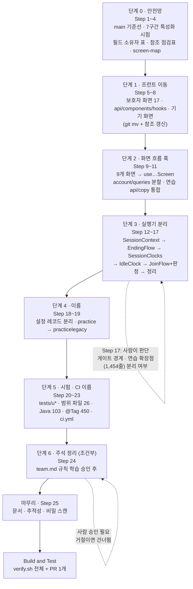
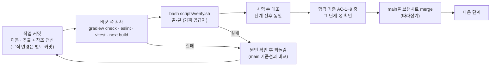
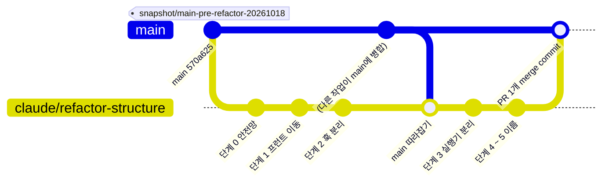
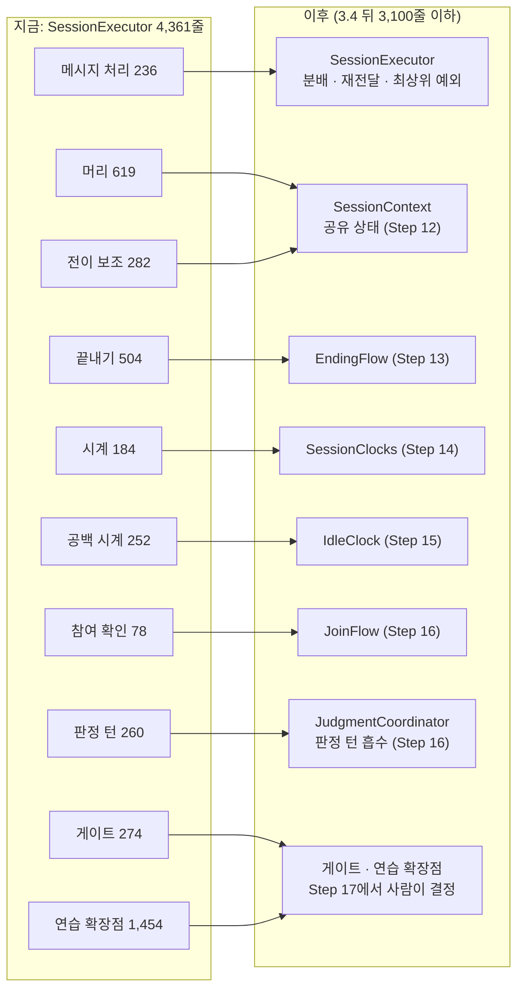
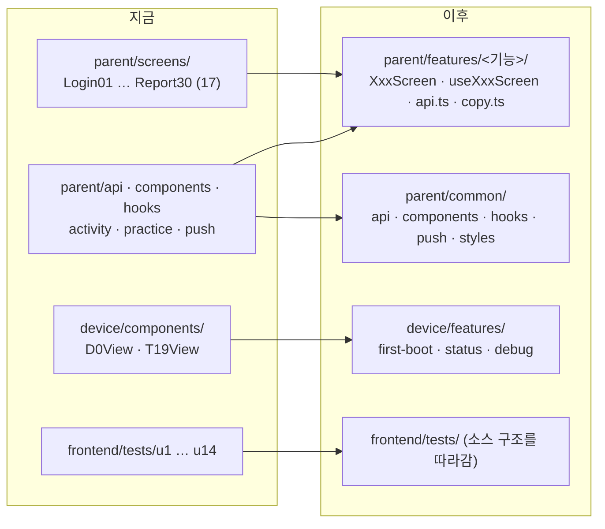

# 구조 · 이름 리팩토링 — 전체 계획 도식 (팀 공유용)

> 작성 2026-10-18 · 승인된 Code Generation 계획(`aidlc/spaces/default/intents/261018-structure-refactor/construction/code-generation/code-generation-plan.md`) 기준 · 기준 커밋 원격 `main` 570a625 · 작업 브랜치 `claude/refactor-structure`
> GitHub에서 열면 아래 mermaid 도식이 그림으로 보인다. 자세한 구조 전·후는 [`refactor-structure-before-after.md`](refactor-structure-before-after.md), 배경은 [`refactor-structure-proposal.md`](refactor-structure-proposal.md).
> **동작 · 계약 · 설정 키 · DB 스키마는 바꾸지 않는다.** 구조와 이름만 바꾼다.

## 1. 전체 로드맵 (25단계 · 7묶음)

## 2. 단계마다 반복하는 확인 루프

## 3. 브랜치 · 롤백

- 작업은 통합 브랜치에서만 한다. `main`에는 직접 올리지 않고, 끝에 PR 하나(merge commit)로 합친다.
- 롤백 기준점: 원격 `snapshot/main-pre-refactor-20261018`(570a625). 병합 전에는 `main`이 그대로이고, 병합 뒤에는 PR 하나를 되돌린다.

## 4. 실행기 분리 (단계 3)

- 한 세션을 한 스레드로 처리하는 모델은 그대로다. 새 스레드 · 잠금을 만들지 않는다.
- 클래스를 나누면 `SingleInstanceMarkerTest`의 `REALTIME_SHARE`(SI-2 · SI-9), `TimeLiteralScanTest` 허용 목록, ArchUnit, 범위 파일을 **같은 커밋**에서 고친다.

## 5. 프런트 구조 전 · 후 (요약)

기능 폴더 11개: `login` · `consent` · `child` · `home` · `device` · `free` · `live` · `done` · `practice` · `records` · `reports`.

## 6. 이름이 바뀌는 것 (단계 5)

| 무엇 | 지금 → 이후 (예) | 수 |
|---|---|---|
| 범위 파일 | `backend/coverage-scope/u12.txt` → `practice-flow.txt` | 백엔드 18 + 프런트 8 |
| 시험 태그 | `@Tag("u5b")` → `@Tag("practice-legacy")` | 450개 파일 |
| Java 클래스 | `U4aActivityApiIT` → `ActivityApiIT` (겹치면 `…기능이름…`) | 103개 (겹침 20건) |
| 프런트 시험 폴더 | `tests/u5b` → 소스 구조 폴더 + 시험 파일 목록 | 74개 시험 파일 |
| CI 작업 | `u5b-scope` → `practice-legacy-scope` 계열 | ci.yml |
| 바꾸지 **않는** 것 | Flyway 파일명 (`V7__u12_…`), 설정 키, 오류 코드, 시간 값, API · 이벤트 계약 | — |

유닛 번호 → 기능 이름 대응표 정본: `functional-spec.md` 3.1절 (u1 `skeleton`, u2 `parent-account`, … u12 `practice-flow`, u13 `jev-guardrail`, u14 `goal-result`, u15 `knowledge-graph`).

## 7. 합격 기준 (기계로 확인)

| ID | 단계 | 확인 | 시작 전 → 기대 |
|---|---|---|---|
| AC-1 | 1 | 화면 번호 · 유닛 번호가 든 프런트 파일, `parent/screens` 폴더 | 17 + 1 → 0, 폴더 없음 |
| AC-2 | 5 | 유닛 번호가 든 경로 · `@Tag` · CI 줄 | 230 / 450 / 17 → 0 |
| AC-3 | 2 | 대상 9개 `*Screen.tsx`의 `router.` · `catch` · `await` | 5~21건 → 0 |
| AC-4 | 3 | `SessionExecutor` 줄 수 | 4,361 → 3.4 뒤 3,100 이하 |
| AC-5 | 모든 | 바꾼 쪽 검사 + `verify.sh`, 시험 수 동일 | 통과 |
| AC-6 | 1 · 4 | ESLint 경계 · ArchUnit | 통과, 규칙이 비지 않음 |
| AC-7 | 6 | 건드린 파일의 결정 ID 주석 수 | 기준선보다 감소 (승인된 경우) |
| AC-8 | 5 | 프런트 범위 시험 수 | `practice-legacy` 3파일 32시험, `web-push` 6파일 89시험 동일 |
| AC-9 | 5 | `hashFiles` 조건 CI 단계 | 건너뛰기 아님(`success`) |

## 8. 팀이 이미 정한 것 / 아직 사람이 정할 것

| 이미 정함 (팀 승인) | 아직 사람이 정함 |
|---|---|
| 주석 규칙은 "무엇을 왜"로 바꾼다(건드린 파일부터) | **Step 17**: 게이트 경계, 연습 확장점 분리 여부 |
| 실행기는 작은 구역부터 분리 | **Step 24**: `team.md` 규칙 4개 개정 승인(거절이면 주석 정리 생략) |
| `practice` → `practicelegacy` | 원격 `main`의 브랜치 보호가 없는 것이 의도인지(팀 확인) |
| 유닛 번호 이름은 전부 변경 | `docs/units` 이력 문서는 고치지 않고 대응표로 안내(기본값) |
| 통합 브랜치 1개 + PR 1개, 단계마다 `verify.sh` | |
| 보호자 공통은 `parent/common`, 기기는 화면만 `features` | |

## 9. 진행 상태 (AI-DLC)

| 단계 | 상태 |
|---|---|
| Reverse Engineering | 완료 |
| Requirements Analysis | 완료 |
| Functional Design | 완료 (검토 READY) |
| **Code Generation · 계획 승인** | **완료** — 코드 변경은 아직 시작하지 않음 |
| Code Generation · 실행 (Step 1~25) | 대기 |
| Build and Test | 대기 |
| 운영 단계 (배포 파이프라인 · 실행) | 이 리팩토링은 배포를 다루지 않아 건너뜀 |
