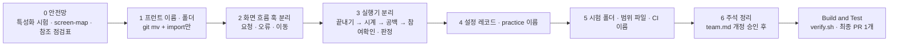

# 리팩토링 전·후 폴더 · 파일 구조 (팀 논의용)

> 작성 2026-10-18 · 기준 원격 `main` 570a625 · 작업 기록 `aidlc/spaces/default/intents/261018-structure-refactor/` · 브랜치 `claude/refactor-structure`
> 이 문서는 **설계안**이다. 코드는 아직 바꾸지 않았다. 아래 "팀이 정할 것"이 정해지면 AI-DLC Functional Design 문서(대상 구조 · 이동 규칙 · 단계 순서)로 확정한다.
> 배경 문서: 제안서 [`refactor-structure-proposal.md`](refactor-structure-proposal.md), 요구사항 `…/inception/requirements-analysis/requirements.md`, 코드 스캔 `aidlc/spaces/default/codekb/mujungi/code-structure.md`.

## 1. 한눈에

| 영역 | 문제 | 방향 |
|---|---|---|
| Realtime 세션 실행기 | `SessionExecutor.java` 4,361줄에 12개 구역이 모여 있음 | 역할별 협력 객체로 분리, 실행기는 사건 분배만 |
| 프런트 이름 | 화면 파일 17개 중 14개가 `Login01`·`Live12`처럼 번호로 끝남 | 번호 대신 기능 이름과 기능 폴더 |
| 프런트 화면 책임 | 요청 · 오류 변환 · 화면 이동이 한 화면 파일에 섞임 | 화면은 그리기만, 나머지는 `use…Screen` 훅 |
| 공통 분리 기준 | 연습만 `parent/practice/{api,startApi}.ts`처럼 위치 기준이 다름 | 기능 전용은 기능 폴더, 보호자 공통은 `parent/common` |
| 유닛 번호 이름 | `tests/u1…u14`, `coverage-scope/u5b.txt`, CI `u5b-scope`, `U4a…IT` 63개 | 기능 이름으로 변경 |
| 주석 | 결정 ID(J·BR·U…)가 SessionExecutor에 약 315개, 프런트에 약 547개 | "무엇을 왜"만 쓰고 ID는 문서 링크로 (team.md 규칙 개정 후) |

변하지 않는 것: 동작 · 오류 코드 · 설정 키 · 시간 값 · API · 이벤트 계약 · DB 스키마(Flyway 파일명 포함).

## 2. 프런트 `frontend/src`

### 지금 (Before)

```
src/
├─ app/                      Next.js 라우트 (parent 23개 · device · healthz)
├─ parent/
│  ├─ screens/               Login01 Consent02 Child03 Home04 Device05 Register05a
│  │                         Free08 Live12 Done17 Practice18 Records26 RecordDetail27
│  │                         ReportRange28 Report30 StopExpressions01 DevLogin LoginCallback
│  ├─ api/                   account activity apiClient csrf push queries reports results types
│  ├─ components/            16개 (BottomSheet, CodeInput, TranscriptList, MonthCalendar …)
│  ├─ hooks/                 useBackGuard useLivePolling useReportPolling useResultStatusPolling
│  ├─ activity/              homeActivity livePresentation donePresentation freeFailure
│  ├─ practice/              api startApi copy u5bCopy practiceStart practiceProgress
│  │                         usePracticeGoals PracticeHeader PracticeStartAction
│  ├─ push/                  browserPush pushWorker useNotificationEntry
│  └─ navigation.ts oauth.ts ParentProviders.tsx *.css
├─ device/
│  ├─ components/            D0View  T19View  DebugLog
│  └─ audio ws mic power runtime machine api  DeviceApp.tsx
└─ shared/                   copy errors protocol security styles timing toast
```

### 이후 (After, 설계안)

```
src/
├─ app/                      경로 유지, import만 갱신
├─ parent/
│  ├─ features/
│  │  ├─ login/      LoginScreen · LoginCallbackScreen · DevLoginScreen · api.ts
│  │  ├─ consent/    ConsentScreen · useConsentScreen · api.ts
│  │  ├─ child/      ChildScreen · StopExpressionsScreen · use…Screen · api.ts
│  │  ├─ home/       HomeScreen · useHomeScreen · presentation.ts
│  │  ├─ device/     DeviceScreen · DeviceRegisterScreen · use…Screen · CodeInput
│  │  ├─ free/       FreeTalkScreen · useFreeTalkScreen · failure.ts
│  │  ├─ live/       LiveScreen · useLiveScreen · useLivePolling · presentation.ts
│  │  ├─ done/       DoneScreen · useDoneScreen · useResultStatusPolling · presentation.ts
│  │  ├─ practice/   PracticeScreen · PracticeHeader · PracticeStartAction · api.ts(startApi 통합)
│  │  │              copy.ts(copy + u5bCopy 통합) · usePracticeGoals · practiceProgress …
│  │  ├─ records/    RecordsScreen · RecordDetailScreen · use…Screen · api.ts
│  │  └─ reports/    ReportScreen · ReportRangeScreen · useReportPolling · api.ts
│  └─ common/        보호자 전용 공통
│     ├─ api/        apiClient · csrf · queries · types
│     ├─ components/ 여러 기능이 쓰는 것만 (BottomSheet, StatusLine …)
│     ├─ hooks/      useBackGuard
│     └─ push/ navigation.ts oauth.ts ParentProviders.tsx
├─ device/
│  ├─ features/
│  │  ├─ first-boot/ FirstBootView   (옛 D0View)
│  │  ├─ status/     StatusView      (옛 T19View)
│  │  └─ debug/      DebugLog
│  └─ audio ws mic power runtime machine api  DeviceApp.tsx   그대로
└─ shared/           그대로 (copy errors protocol security styles timing toast)
```

### 화면 번호 → 새 이름 대응 (초안)

| 지금 | 이후 | 비고 |
|---|---|---|
| `Login01` · `LoginCallback` · `DevLogin` | `features/login/LoginScreen` · `LoginCallbackScreen` · `DevLoginScreen` | |
| `Consent02` | `features/consent/ConsentScreen` | |
| `Child03` · `StopExpressions01` | `features/child/ChildScreen` · `StopExpressionsScreen` | |
| `Home04` | `features/home/HomeScreen` | |
| `Device05` · `Register05a` | `features/device/DeviceScreen` · `DeviceRegisterScreen` | |
| `Free08` | `features/free/FreeTalkScreen` | |
| `Live12` | `features/live/LiveScreen` | |
| `Done17` | `features/done/DoneScreen` | |
| `Practice18` + `parent/practice/*` | `features/practice/PracticeScreen` + 같은 폴더 | `startApi`→`api.ts`, `u5bCopy`→`copy.ts` 통합 |
| `Records26` · `RecordDetail27` | `features/records/RecordsScreen` · `RecordDetailScreen` | |
| `ReportRange28` · `Report30` | `features/reports/ReportRangeScreen` · `ReportScreen` | |
| `D0View` · `T19View` | `device/features/first-boot/FirstBootView` · `status/StatusView` | |

화면 설계 v1.5j의 번호와 파일의 대응은 `docs/screen-map.md` 표 하나로 옮기고, 파일 이름에는 번호를 쓰지 않는다.

### 화면 책임 분리 (대상 9개 화면)

`Live12` · `Home04` · `Done17` · `Device05` · `Child03` · `Consent02` · `StopExpressions01` · `Free08` · `Register05a`는 요청 · 오류 변환 · 폴링 · 화면 이동을 `use…Screen` 훅으로 옮긴다. 화면 컴포넌트는 그리기와 입력 연결만 한다. 오류 문구 변환은 기존 `shared/errors/codeToCopy` 한 길을 유지한다. 현재 수치(코드 스캔): `Live12` 이동 9 · 요청 9 · 오류 처리 8, `Home04` 이동 10 · 요청 4.

## 3. 프런트 · tools 시험, 범위 파일

| 지금 | 이후 |
|---|---|
| `frontend/tests/u1, u2, u3, u4a, u5a, u5b, u6, u7, u14` (시험 약 74개) | 소스 구조를 따라가는 폴더: `tests/parent/features/live/…`, `tests/device/features/status/…`, `tests/shared/…` |
| `tests/u1/setup.ts`, `tests/u1/support`(9파일) | `tests/setup.ts`, `tests/support` (`vitest.config.ts` · `a-checks.sh` 문자열 참조도 같이) |
| `tools/tests/u1, u3, u4a, u4b, u11` | 기능 · 모듈 이름 폴더 |
| `frontend/coverage-scope/u1…u7.json` (8개) | 기능 이름 파일 (예 `practice-start.json`, `push-notification.json`) |

## 4. 백엔드 realtime `kr.mujoong.realtime`

### 지금 (Before)

```
session/   SessionExecutor.java  4,361줄
             머리(필드 · 생성자) 1~619 | 실행 | 외부 입구 | 메시지 처리 236 | 참여 확인 78
             U11 판정 턴 260 | 연습 확장점 1,454 | 공백 시계 · 기술 일시정지 252
             게이트 274 | 기기 표식 · 끝내기 504 | 시계 184 | 재전달 · 최상위 예외 57 | 전이 보조 282
           GuardrailCoordinator(759) · JudgmentCoordinator · StartSessionHandler · EndRequestHandler …
practice/      옛 연습 (U5b 레거시, 29파일)       practiceflow/  새 연습 (U12, 21파일)
config/        RealtimeProperties.java (570줄, 중첩 record 약 25개)
```

### 이후 (After, 설계안)

```
session/   SessionExecutor.java      사건을 받아 순서대로 분배 + 재전달 · 최상위 예외만
           SessionContext.java       공유 상태를 소유 (한 세션 한 스레드 모델 유지)
           EndingFlow.java           끝내기 (≈504줄)
           SessionClocks.java        시계 (≈184줄)
           IdleClock.java            공백 시계 · 기술 일시정지 (≈252줄)
           JoinFlow.java             참여 확인 (≈78줄)
           JudgmentCoordinator.java  판정 턴 흡수 (≈260줄)
           GuardrailCoordinator.java 게이트와의 경계만 설계 (옮길 범위는 설계에서 확정)
           ※ 머리 619줄 · 전이 보조 282줄은 SessionContext 또는 남는 실행기로 배정
           ※ 연습 확장점(≈1,454줄) 분리는 위 결과를 평가한 뒤 마지막 단계에서 결정
practicelegacy/  옛 practice/ 이름 변경          practiceflow/  그대로
config/          설정 레코드를 기능별 파일로 분리 (설정 키 · 바인딩 prefix는 불변)
```

나누는 순서: 끝내기 → 시계 → 공백 시계 → 참여 확인 · 판정 흡수. 협력 객체는 모두 실행기 스레드에서만 호출한다.

## 5. 이름이 묶인 곳 (이동한 커밋에서 같이 고침)

| 대상 | 변경 |
|---|---|
| 백엔드 `backend/coverage-scope/*.txt` 18개 (`u1…u15`, `u5b-core`) | 기능 이름. 예 `u5b`→`practice-legacy`, `u12`→`practice-flow`, `u13`→`jev-guardrail`, `u11`→`judgment-turn` |
| `.github/workflows/ci.yml` | `u5b-scope` 같은 작업 이름, `-PincludeTags` · `-PcoverageScope` 인자, `hashFiles` 경로, `ci-gate`의 needs |
| Java 시험 클래스 `U4aActivityApiIT` 등 63개 · `@Tag("u5b")` 태그 · 유닛 표식 파일 약 134개 | 기능 이름 (이름 충돌은 접미어로 구분하고 목록을 남긴다) |
| `SingleInstanceMarkerTest`의 `REALTIME_SHARE`(SI-2 · SI-9), `TimeLiteralScanTest` 허용 목록, `PracticeFlowArchTest` 패키지 문자열, `ConfigKeyContractTest`, ESLint glob · 예외 파일 경로 | 새 이름으로 같은 커밋에서 |
| `docs/`의 옛 경로 참조(경로 문서 18개, 화면 파일 이름 문서 3개, `SessionExecutor` 문서 약 15개) | 이력 문서를 고칠지는 팀이 정함 (아래 항목 9) |
| Flyway 파일명 `V7__u12_….sql` 등 | **바꾸지 않음** (R-M2) |
| `team.md` 규칙 4개 (화면 번호 접미 · `tests/<유닛>/`과 유닛 태그 · 주석 ID 인용 · 범위 파일 이름) | 학습 절차(§13)로만 개정 |

## 6. 진행 단계와 방식



- 지금까지 이 기록에서 정한 방식(잠정): 통합 브랜치 `claude/refactor-structure`에 단계별 커밋을 쌓고 끝에 PR 하나로 합친다. 단계(커밋 묶음)마다 `bash scripts/verify.sh`로 동작 불변을 확인한다.
- 이동(`git mv`)과 내용 변경은 커밋을 나눈다. 기존 시험 단언 · 커버리지 하한 · ArchUnit · 계약 대조 시험은 낮추거나 끄지 않는다.
- 롤백: 원격 `snapshot/main-pre-refactor-20261018`(570a625)과 PR 하나 되돌리기. `main`에는 직접 올리지 않는다.

## 7. 팀이 정할 것

아래는 이 기록에서 사람이 한 번 고른 값(잠정)과 함께 적었다. 팀 논의로 바뀔 수 있다.

| # | 결정 사항 | 지금까지의 선택(잠정) | 팀이 볼 점 |
|---|---|---|---|
| 1 | 주석 규칙을 "결정 ID 인용"에서 "무엇을 왜 + 문서 링크"로 바꾼다 | 바꾼다 (건드린 파일부터) | `team.md` 코드 스타일 절 개정이 필요 |
| 2 | `SessionExecutor`를 어디까지 나누나 | 끝내기 → 시계 → 공백 → 참여 확인 · 판정까지, 연습 확장점은 나중에 결정 | 연습 확장점(1,454줄)이 가장 크고 위험 |
| 3 | `practice`(옛)와 `practiceflow`(새) 구분 | 옛 것만 `practicelegacy`로 | 대안: 하위 패키지로 묶기, 이름 유지 + 문서 |
| 4 | 유닛 번호 이름의 범위 | **전부 변경** (CI 이름 · 범위 파일 · Java 시험 클래스 63개 · 태그 · 표식 파일 포함) | PR이 매우 커지고 이름 충돌 가능. 대안: CI가 부르는 이름까지만 |
| 5 | 프런트 범위 | 보호자 + 기기 모두 기능 폴더 | 기기는 화면 2개만 이동, 인프라 폴더는 그대로 |
| 6 | 브랜치 · PR 전략 | 통합 브랜치 하나 + PR 하나 | 대안: 단계별 브랜치 · 단계별 PR (충돌과 리뷰 크기가 작음, 팀 규칙 "짧게 사는 브랜치"와 맞음) |
| 7 | 병합 전 검증 | 단계마다 `verify.sh` | 약 7분 걸림(전체 끝-끝) |
| 8 | 보호자 공통 위치 | `parent/common` (shared는 보호자·기기 공용만) | 대안: `shared/api`로 옮기기 |
| 9 | `docs/`의 옛 경로 참조(이력 문서) | 미정 | 이력으로 두고 대응표로 안내할지, 같이 고칠지 |
| 10 | 원격 `main`에 브랜치 보호가 없음 | 확인 필요 (`team.md`는 `ci-gate` 필수라고 적음) | 의도인지, 보호를 만들 때 바뀐 CI 작업 이름 반영 필요 |
| 11 | 특성화 시험 | 실행기 처리 순서 6구간마다 고정 시험 1개 이상 | 이미 있는 시험으로 덮이는지 확인 필요 |

## 8. 알려진 위험

- 통합 브랜치 하나에 파일 이동 약 200개, 백엔드 분리, Java 시험 63개 이름 변경이 모이면 리뷰가 어렵고 `main`과의 충돌이 쌓인다. 단계마다 `main`을 브랜치로 merge해서 따라잡는 것이 안전하다.
- Java 시험 클래스 이름 변경 시 기존 이름과 겹칠 수 있다(예 `U4aActivityApiIT`와 이미 있는 `ActivityApiIT`).
- 현재 `CI skeleton`(`verify.sh`) 작업은 `main`의 최근 두 병합(#90, #92)에서 실패했다. 원인은 조사하지 않았다. 리팩토링 PR의 CI가 이 문제와 섞이지 않게 먼저 확인하는 것이 좋다.
- 코드 스캔이 확인하지 못한 것: 실행기 구역 간 호출 순서를 고정하는 특성화 시험의 존재, `Live12` 시험 위치, 브랜치 보호의 실제 필수 검사.

## 9. 현재 AI-DLC 진행 상태

| 단계 | 상태 |
|---|---|
| Reverse Engineering | 완료(승인). 코드 지식 베이스 9개 문서 게시 |
| Requirements Analysis | 완료(승인). 자문 검토가 Major 6건 · Minor 4건을 남김(승인 때 감수) |
| Functional Design | 질문 Q1 ~ Q5와 가정에 답함. 이 문서의 구조 확인 대기 중 (설계 문서는 아직 만들지 않음) |
| Code Generation · Build and Test | 대기 |
