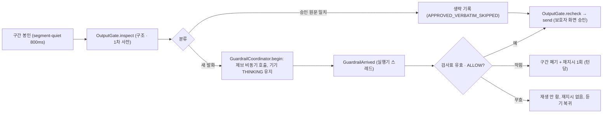

# U13 제브 게이트 — 기능 설계 (구현된 모습)

> 작업 기록 `261017-u13-jev-guardrail`의 승인된 기능 설계(`construction/functional-design/{functional-spec,rules,entities}.md`)에 Code Generation에서 정한 점을 합쳐 **코드에 들어간 모습**으로 옮긴 문서다. 승인 문서와 다르면 이 문서는 구현을 따른다. 흐름의 정본은 승인 문서이고 이 문서는 파생 보기다.
> 번호 체계: **설계 편차 `U13-D<n>`**(이 문서), **계약 편차 `(U13-<글자>)`**(`contracts/deviations.md`). 둘은 섞지 않는다.
> 증거 구분(R-M11): 이 단위의 모든 합격은 **테스트 대역**(가짜 제브 · 가짜 공급자)이다. 실제 제브는 한 번도 부르지 않았다.

## 1. 범위

GPT-Live가 그 자리에서 만든 말(새 발화)은 제브(외부 안전 검사)가 `ALLOW`한 것만 기기로 나간다. 검사는 실행기 스레드를 막지 않는다. 막히거나 늦거나 실패하면 그 말은 한 바이트도 나가지 않고, 아이는 '생각 중'을 유지하다가 같은 다음 행동을 한 번 다시 받는다.

하지 않는 것: 연습 상태 기계 · 역할 정책(U12), Luna 생성물 검사, GPT-Live 선 형식 변경, 기기 · 프런트 변경. 공급자 호출부는 core-api에 두지 않고 realtime-activity에만 둔다(R-F5).

## 2. 구성 요소

| 구성 요소 | 위치 | 책임 |
|---|---|---|
| `GuardrailClient`(포트) · `GuardrailVerdict` · `GuardrailRequest` | `guardrail/` | `check(request, deadline)`는 예외 없이 모든 실패를 `FAILED`로 완료한다. 자동 `ALLOW`는 없다 |
| `JevGuardrailClient`(실제 어댑터) · `JevHosts` · `JevModels` | `guardrail/` | HTTPS POST 한 번, 재시도 없음, `jev-budget` 상한, 키는 호출 때마다 환경에서 읽음, 리다이렉트 · 프록시 없음, 허용 호스트 상수(기동 + 보내기 직전 확인), 이동 별칭 모델 거부. 응답 변환은 `convert` 한 곳 |
| `StubGuardrailClient` · `UnavailableGuardrailClient` | `guardrail/` | 대역(`STUB_ALLOW`, 대역 표시) · 막힘으로 끝나는 비활성 구현 |
| `GuardrailRequestFactory` | `guardrail/` | 후보 + 익명 최근 맥락 3턴, 아이 이름 치환, 길이 상한, 지시문은 데이터 필드에만 |
| `GuardrailStartupRules` · `GuardrailConfiguration` · `GuardrailProperties` · `GuardrailMode` | `guardrail/` | 모드 × 프로필 × 키 규칙, 모드별 빈, 비실검사 기동 로그 |
| `GuardrailSupport`(기록) | `guardrail/` | 협력 객체에 필요한 장치 묶음. `DISABLED`(= OFF)가 기존 생성 경로의 기본값이라 `SessionExecutor.Services` 오버로드를 늘리지 않는다 |
| `ApprovedVerbatimPort` | `guardrail/` | 좁은 포트: 출력 전사가 승인 원문과 같으면 출처 사유 코드(`APPROVED_SPEECH` · `SESSION_SCRIPT`)를 돌려준다. 전사는 보관하지 않는다 |
| `GuardrailCoordinator`(+ `Env`) | `session/` | 검사 상태 기계, 검사표, 대기열 1칸, 턴 재지시, 무효 판정. 실행기 스레드 전용, 실행기와는 `Env`로만 닿는다 |
| `SessionMailbox.GuardrailArrived` | `session/` | 비동기 결과를 실행기 스레드로 돌린다(일반 편지함 `putFromProvider`, 안전 편지함 아님) |
| `GuardrailEventRecord` · `Repository` · `Recorder` · `DeletionParticipant` | `guardrail/` | 표 `guardrail_event`(realtime V6), 비동기 기록, 보호자 삭제 참여자(순서 185) |
| `TranscriptWriter.aiHold()` / `aiFinal(손잡이, …)` | `log/` | 검사 중인 AI 행을 보관 손잡이로 빼고 나중에 닫는다. `closeAll`이 보관 행도 닫는다 |
| `RealtimeMetrics` `mujoong.guardrail.*` | `observability/` | 5절 |

`SessionExecutor`는 호출 지점만 더했다(8곳). 상태 필드는 협력 객체에 두고 입력 묶음 열림 횟수 카운터만 실행기에 있다(NFR8).

## 3. 흐름

텍스트 대안: 구간이 봉인되면 `inspect`를 거치고, 승인 원문과 같으면 제브를 건너뛰며(생략 기록) 새 발화면 협력 객체가 제브를 비동기로 부른다. 결과는 실행기 스레드로 돌아와 검사표가 유효한 `ALLOW`일 때만 `recheck → send`로 나간다. 막히면 구간을 폐기하고 턴당 한 번 재지시하며, 무효면 재생도 재지시도 하지 않는다.

- 분류 순서: 연습이 출력을 쥐고 있으면 `pendingPracticeSpeech.matches`(원문 일치 → 통과, 아니면 기존 `GATE_PATTERN` 폐기, 제브 호출 0) → 레지스트리 `MATCHED`면 생략 → 그 밖(`UNKNOWN` 포함)은 새 발화로 검사.
- 검사표 유효 조건: 요청 id · 공급자 출력 세대 · 기기 프레임 세대 · 기기 연결 id · 상태(`ACTIVE`) · 출력 보류 · 입력 묶음 열림 횟수 · (연습) 승인 발화. 하나라도 달라지면 무효다.
- 대기열 1칸: 검사 중 도착한 새 구간은 inspect 통과 뒤 보관(차 있으면 `QUEUE_FULL` 폐기). 앞 검사가 유효한 ALLOW로 송신을 마칠 때만 꺼내 검사하고, 막힘 · 무효 · 포기면 세대와 무관하게 폐기한다.
- 재지시: 첫 막힘에서 마지막 서버 지시(판정 뒤 다음 행동 · `requestResponse`)를 기억해 둔 것이 있으면 같은 템플릿, 없으면 `RETRY_FREE_TURN`. 두 번째 막힘은 포기(고정 교정 문장 없음).
- 폐기 훅은 `discard()` 한 지점에 있다(사유가 `GUARDRAIL_*`가 아니고 협력 객체가 `RETRYING`이면 `IDLE`로). `begin`은 전용 `try/catch`를 가진다.

## 4. 규칙 요약

BR1.1 ~ BR9.3(51개)은 `rules.md`가 정본이다. 핵심만: 새 발화만 · `inspect` 뒤 `recheck` 앞 · 유효한 `ALLOW`만 송신 · 자동 `ALLOW` 없음 · 검사 1건 + 대기열 1칸 · 재지시 턴당 1회 · 승인 원문은 서버 기억으로만 생략 · 기록에 전사 원문 칸 없음 · demo · prod는 `REAL` + 키 + 허용 호스트 + 고정 모델이 아니면 기동 거부.

## 5. 지표 이름 · 종류 (BR8.5)

| 이름(Prometheus) | 종류 | 태그 | 값 |
|---|---|---|---|
| `mujoong.guardrail.calls` (`mujoong_guardrail_calls_total`) | Counter | `mode`, `source` | `mode` = `real` · `stub`, `source` = `new_utterance` · `approved_verbatim_skipped` |
| `mujoong.guardrail.latency` (`mujoong_guardrail_latency_seconds`) | Timer(히스토그램) | `mode` | 버킷 `100ms, 200ms, 300ms, 500ms, 800ms, 1s` (`application.yml`, 검사 상한 800ms가 경계) |
| `mujoong.guardrail.blocked` (`mujoong_guardrail_blocked_total`) | Counter | `mode`, `decision` | `decision` = `block` · `review` · `error` (시간 초과는 아래 `timeout`) |
| `mujoong.guardrail.timeout` (`mujoong_guardrail_timeout_total`) | Counter | `mode` | |
| `mujoong.guardrail.perceived.wait` (`mujoong_guardrail_perceived_wait_seconds`) | Timer(히스토그램) | `mode` | 말 끝 → 기기 첫 소리, 제브를 거친 턴만. 버킷은 `turn.first.audio`와 같다 |

OFF 모드에는 제브 단계가 없어 지표 값이 없다. 사용자 · 세션 식별자는 태그에 쓰지 않는다.

## 6. 설정과 환경 변수

| 키 | 환경 변수 | 비고 |
|---|---|---|
| `mujoong.guardrail.jev.mode` | `JEV_MODE` | 비면 프로필 기본값(demo · prod = `REAL`, 그 밖 = `STUB`) |
| `mujoong.guardrail.jev.base-url` | `JEV_BASE_URL` | 비밀 아님. 호스트는 코드 상수 허용 목록(`contracts/ai-io.md` 10.11) 안 |
| `mujoong.guardrail.jev.model` | `JEV_MODEL` | 비밀 아님. 고정 버전, `-latest` 거부 |
| `mujoong.guardrail.jev.pass-threshold` | `JEV_PASS_THRESHOLD` | 비밀 아님. 기본 0.5, `0 < x <= 1`. **임시 시험값** — AI 성능 시험으로 확정. 선 형식 정정에서 더함 |
| (환경 변수만) | `JEV_API_KEY` | 비밀. 호출 때마다 읽고 보관하지 않음 |
| `mujoong.timing.guardrail.jev-budget` | — | 800ms. 새 시간 키 없음(R-F7) |

호스트 전달: Parameter Store `/mujoong/demo/{JEV_API_KEY, JEV_BASE_URL, JEV_MODEL}` → `render-env` → `realtime.env`. 세 값은 demo에서 모두 필수다(`infra/RUNBOOK.md` 단계 4).

## 7. 설계 편차와 구현 중 정한 점

| ID | 내용 | 근거 |
|---|---|---|
| U13-D1 | ADR-006의 "`OutputGate` 안 한 단계"는 개념 표현이다. 동기 클래스 `OutputGate`는 바꾸지 않고 실행기 쪽 협력 객체가 `inspect`와 `recheck` 사이에 비동기로 이어 붙인다 | 코드 스캔 G1 |
| U13-D2 | 세션 종료 합계 로그 한 줄은 줄였다(새 사건 코드가 `contract-model`과 `log-hygiene-check` 허용 표를 바꾼다). 새 사건 코드는 없고 `appError` 사유 코드만 쓴다. 합계는 `guardrail_event` 집계와 지표로 낸다 | BR8.6 |
| U13-D3 | "그 장면 정리"는 자유대화에서 '턴 포기 + 기존 discard 마무리'로 구체화. 연습 장면 정리는 U12 몫 | Q1 답 |
| U13-D4 | 대기열 1칸 · AI 행 보관 손잡이 2개(사람이 추천과 다른 B를 고름) | Q2 답 B |
| U13-D5 | 모드 키는 하나다. 키 이름 · 허용값은 `ai-io.md`와 `ConfigKeyContractTest`에 같은 커밋으로(`(U13-a)`) | Q1 답 A |
| U13-D6 | 제브 재시도 분류 표 행("재시도 없음, 시간 초과는 막힘")과 스키마 예시 판 이름 정정(`(U13-b)`) | 가정 14 |
| U13-D7 | `GuardrailSupport.DISABLED`(= OFF)가 기존 생성 경로의 기본값 | BR1.6 |

구현 중 정한 점(승인 설계 문서는 고치지 않았다):

1. **앞 검사가 진행 중이거나 대기열에 구간이 있으면 승인 원문 구간도 새 발화로 검사한다.** 생략 경로로 앞질러 재생하지 않고 순서를 지키는 안전한 쪽이다(`GuardrailCoordinator.verbatimSource`). 제브를 건너뛰는 OFF 모드에서도 생략 기록은 없다.
2. **연습 재생 일치도 `APPROVED_VERBATIM_SKIPPED` 행을 남긴다.** 사유 코드 `PRACTICE_SPEECH`(연습이 쥔 `pendingPracticeSpeech`와 일치). 레지스트리 출처는 `APPROVED_SPEECH` · `SESSION_SCRIPT`다. 셋 모두 지연 0, 제브 호출 0이다.
3. **`GuardrailBlocked`는 `ExtensionEvent.Kind.GUARDRAIL_BLOCKED`에 값 record로 담긴다.** 연습의 두 번째 막힘에서 한 번 전달된다. 운영 호출자는 U12다.
4. **`GuardrailVerdict.Failure`에 `INVALID_REQUEST`를 더했다.** 후보 문장 길이 초과 등 요청을 만들 수 없을 때(부르지 않음, 막힘).
5. **협력 객체는 `session` 패키지**에 둔다(`Env`로만 실행기와 닿는 U11 `JudgmentCoordinator` 선례). `guardrail` 패키지는 `luna` · `voice` · `judgment`를 가져오지 않는다(`GuardrailPackageArchTest`).
6. **낡은 non-ALLOW(무효가 된 막힘)는 재지시 없이 기록만 한다.** 상태가 이미 바뀌었기 때문이다.
7. **`RealtimeStartupChecks` ↔ `guardrail` 패키지 순환**이 있다(Luna 선례와 같다). 기동 점검이 모드 규칙을 부르고 빈 설정이 점검 결과를 읽는다.
8. **R-17 결정:** 아키텍처 검토의 "discard 마무리가 `listeningAgain`까지 한다"는 연습 폐기 가지와 대기 문구 재생 가지에서 그대로 참이 아니다. 'discard의 기존 마무리(대기 문구 재생 또는 `listeningAgain`, 연습 폐기 가지는 연습 쪽이 마무리)가 이어지고, 협력 객체는 어느 쪽이든 `IDLE`'로 읽는다.
9. **`LatencyRecorder`는 한 턴만 안다(겹치는 턴 처리).** 턴 기록에 제브 검사 표시(모드 이름만, 후보 문장 없음)를 달고, 턴이 끝나 첫 소리 시각을 알면 같은 값을 체감 대기 지표에도 넣는다. 대기열에서 꺼낸 구간의 검사는 지연 기록을 소유하지 않는다(`ownsLatency = !fromQueue`). 첫 턴의 `gatePassed` 시각은 제브 대기를 포함하는 쪽으로 의미가 바뀐다.
10. **`recheck`(출력 레인 예약)는 유효한 ALLOW를 받은 뒤에 한다.** 대기 중에는 예약하지 않는다. `recheck`가 실패하면(레인 가득 참 등) 기존 폐기 흐름을 따르고 재지시는 하지 않는다(`recheckAndSend`가 거짓).
11. **검사 안전 타이머:** 제브 클라이언트가 규약을 어기고 영영 완료하지 않을 때를 위해 `SessionTimers.Kind.GUARDRAIL_CHECK`(= `jev-budget` 두 배)를 둔다. 만기 시 `TIMEOUT` 막힘으로 처리한다. 정상 어댑터는 `jev-budget`에서 이미 끝난다.

## 8. 저장 (realtime V6)

표 `guardrail_event` 하나: `id`(= 검사 요청 id), `guardian_id`, `session_id`(FK, `ON DELETE RESTRICT`), `mode`(`REAL` · `STUB`), `source_kind`(`NEW_UTTERANCE` · `APPROVED_VERBATIM_SKIPPED`), `decision`(`ALLOW` · `BLOCK` · `REVIEW` · `TIMEOUT` · `ERROR` · `VOIDED` · `QUEUE_FULL`), `reason_code`, `policy_version`, `latency_ms`, `created_at`. **전사 원문 칸이 없다.** 시각은 앱이 `MujoongClock`으로 바인딩한다. 기존 표 제약은 건드리지 않아 `infra/migration-approvals.txt` 대상이 아니다. 보호자 삭제 참여자 순서는 185.

## 9. 실제 제브에 대해 모르는 것

- **선 형식(정정됨):** 처음 구현은 경로 `/v1/guardrail/check`와 본문 · 응답 필드를 가정했으나 제브 공식 문서와 달랐다. 선 형식 정정(작업 기록 `261017-jev-adapter-format`, `contracts/ai-io.md` 10.12, `(U13-c)`)으로 어댑터는 `POST /v1/systemone`에 `model · state · questions`를 보내고 `answers.guardrail.choice · probabilities`를 읽어 내부 판정으로 바꾼다(라벨 8개 = 7개 범주 + `PASS`, 정책 판 `jev-guardrail-v2` = `policy-v2.json`, `policy-v1.json`은 이력으로만 남김). 판정은 `PASS` 1순위 + 확률 ≥ 문턱(설정 키 `mujoong.guardrail.jev.pass-threshold`, **임시 시험값 0.5**)일 때만 `ALLOW`, 그 밖의 `PASS`는 `REVIEW`, 다른 라벨 1순위는 `BLOCK`이다. 앞 절의 `policyVersion` 응답 비교와 `POLICY_MISMATCH`는 응답에 정책 판이 없어 더 쓰지 않는다. 이 설계 문서의 앞 절들은 정정 전 설명을 그대로 두고 이 절이 정본이다.
- 열린 항목(실호출로만 확정): 요청 `model`에 고정 버전이 받아들여지는지(공식 예시는 `-latest`, 우리 규칙은 거부), 오류 본문 모양, 확률 합 허용 오차(0.001 임시값), 문턱 0.5, 한국어 문안의 분류 품질(AC2.1.10 · AC2.1.16). `jevLiveTest`(`infra/RUNBOOK.md` 8.8)로 사람이 키를 넣고 확인한다.
