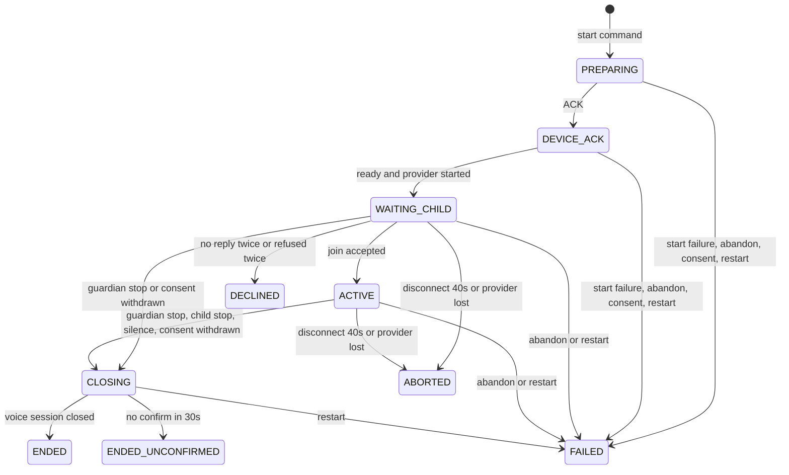

# U4b 활동 세션 Realtime 쪽 — 설계 (클라우드 세션, 2026-10-12)

> 조정자 지시(2026-10-12): SessionLifecycle 완성(상태 11 · 사유 8, NFR6 시간 규칙, B5 · B9 ~ B11, 마무리 인사, 재시작 시 FAILED, 결과 입력 스냅숏, SessionRecordCaptured 발행), U3 보고서가 남긴 U4 몫 셋(종료 의도 확정 뒤 마무리 전이 · 참여 판단 시계 연결 · Realtime 삭제 처리기), 진행 세션 CONSENT_WITHDRAWN 종료. U4a와의 계약(C8 내부 HTTP · 이벤트)은 `contracts/` 그대로 쓰고 realtime 스키마는 V3를 쓴다.
> 기준 순서: 화면 설계 v1.5j → 승인 산출물(unit-of-work U4 절 · stories US3.1 ~ US3.6 · US6.3 · US6.4 · US6.6 · US1.6 · components SessionLifecycle · contract-summary 5 · 6 · 7절 · interaction-spec 5절) → `contracts/` → U1 규칙(BR5.14 · BR6.5 ~ BR6.17) · U3 설계. 엔진(`/aidlc`)은 쓰지 않는다. 가정은 "준하 제안(가정) U4b-J<n>"으로 10절에 모았다.
> 코드를 바꾸기 전에 쓴 설계다. 조정자가 고치고 있는 U3 수정분(u3-fix, 리뷰 결함 1 · 2차)을 받은 뒤 구현하고, 그 수정과 어긋나는 곳은 구현하면서 이 문서를 고친다.

## 1. 범위와 경계

U1이 만든 세션 경로와 U3가 붙인 음성 경로 위에서 SessionLifecycle을 완성한다. Core 쪽(ActivityCoordinator · ActivityRecord · 08 · 12 · P1 ~ P3 · 17 · 04)은 U4a, 연습 진행(PracticeProtocol)은 U5b다.

| 영역 | U1 · U3가 한 것 | U4b가 완성하는 것 |
|---|---|---|
| 상태 기계 | PREPARING → DEVICE_ACK → ACTIVE → CLOSING → ENDED / ENDED_UNCONFIRMED, FAILED · ABORTED. 사유는 도착 상태가 정함(GUARDIAN_STOP · UNCONFIRMED · DISCONNECT · FAILED) | WAITING_CHILD · DECLINED와 CHILD_STOP · SILENCE · CONSENT_WITHDRAWN 경로까지 11상태 · 8사유 전부. 사유는 전이 사건이 정한다 |
| 시간 규칙 | 시작 응답 20초 · 마무리 확인 30초 · 끊김 40초(ACTIVE만) | 참여 대기 20초 + 재안내 뒤 20초, 공백 4분 경고 · 6분 종료, 점선 10초와 기술 일시정지, 끊김 40초를 WAITING_CHILD까지 |
| 참여 확인 | JoinTracker(판정 · 할 일만, 실행기에 붙지 않음) | 시작 안내 재생 → 응답 분류 → 재안내 · 되묻기 · 대안 → ACTIVE 또는 DECLINED. 이 동안 공급자 응답을 막는다 |
| 종료 의도 | StopIntentJudge, STOP이면 출력만 막고 ACTIVE 유지(U3-J24) | STOP → CLOSING(CHILD_STOP), CONFIRM → 승인 확인 질문 → 대답으로 확정하거나 대화를 잇는다 |
| 마무리 인사 | 보호자 끝내기의 CLOSING 순서(BR6.10) | 모든 마무리 사유와 DECLINED에 같은 인사 1회 |
| 끝 처리 | 재시작이면 FAILED(SERVER_RESTART) | 정산 → 결과 입력 스냅숏 저장 → SessionRecordCaptured, 늦은 전사 보완(AC3.6.11) |
| 진행 조회 | 말풍선 · 끊김 구간(U3) | technicalPause · silenceWarning |
| 삭제 | 참가자 둘(메시징 U1 · 음성 U3), 부르는 곳 없음 | DeletionRequested 처리기: 진행 세션 강제 정지 → 참가자 순서 → DeletionCompleted |

건드리지 않는 것: core 스키마 · `backend/core-api` · `/parent` · `frontend/src/parent/` · `aidlc/` · `README.md` · `contracts/README.md`. 기기 웹(`/device`)도 바꾸지 않는다. 기기 프로토콜에 필요한 값(CLOSE_TRANSPORT의 CHILD_STOP · SILENCE · CONSENT_WITHDRAWN · DECLINED, PLAY_APPROVED_CONTENT의 자유 코드)이 이미 있다.

## 2. 포함 스토리와 수용 기준 (Realtime 몫)

- **US6.3 시작 안내와 참여 확인**: AC6.3.1 ~ 6.3.9. 문구 내용은 Core 승인 문구이고 U4b는 재생 · 시계 · 판정 연결을 맡는다.
- **US6.4 종료 의도 · 마무리**: AC6.4.4 ~ 6.4.6(전이) · 6.4.8(종료 확정 뒤 이전 응답 재생 없음) · 6.4.9(확인 질문은 승인 문구).
- **US3.2 활동 진행 보기**: AC3.2.3 · 3.2.7 · 3.2.8 · 3.2.10 · 3.2.15 · 3.2.17 · 3.2.18 · 3.2.19의 Realtime 몫(상태 · 시계 · 진행 조회 값).
- **US3.3 끝내기**: AC3.3.3 ~ 3.3.5 · 3.3.7 · 3.3.8(WAITING_CHILD도 끝낼 수 있음).
- **US3.4 · US3.5 · US3.6**: AC3.4.1 · 3.4.3, AC3.5.1 · 3.5.3, AC3.6.9(사유) · 3.6.10 · 3.6.11(늦은 전사) · 3.6.12(confirmed).
- **US6.6 연결 끊김 대응**: AC6.6.1 ~ 6.6.9.
- **US1.6 계정 삭제**: AC1.6.3 · 1.6.6 · 1.6.7 · 1.6.8의 Realtime 쪽.
- B5(REQUESTED 10초)는 Core 사본 시한(BR6.12 ①, U4a)이라 U4b에 할 일이 없다.

## 3. 상태 기계 (11상태 · 8사유)

### 3.1 전이표

전이는 U1 BR6.8 방식을 그대로 쓴다: 조건부 UPDATE의 승자 하나만 성립하고, 전이마다 status_version + 1과 SessionStateChanged를 같은 트랜잭션에 쓰며, 종료 상태는 되돌아가지 않는다. REQUESTED는 Core 사본에만 있다.

| 사건 | 출발 | 도착 | end_reason | 부수 효과 |
|---|---|---|---|---|
| ACK | PREPARING | DEVICE_ACK | — | U1 그대로 |
| DEVICE_READY(OK) + 공급자 session.started | DEVICE_ACK | **WAITING_CHILD** | — | 입력 중계 시작(원음 기록 없음), 시작 안내 재생(U4b-R2) |
| 참여 응답(ACCEPT) | WAITING_CHILD | ACTIVE | — | started_at, 원음 기록 시작, 공급자 `session.response.create` |
| 참여 거절(무응답 2회 · 거부 2회, B17) | WAITING_CHILD | **DECLINED** | DECLINED | 마무리 인사 뒤 CLOSE_TRANSPORT(DECLINED), 전사 행 지움 |
| 보호자 끝내기 | WAITING_CHILD · ACTIVE | CLOSING | GUARDIAN_STOP | BR6.10 순서 |
| 동의 철회 끝내기 | WAITING_CHILD · ACTIVE | CLOSING | CONSENT_WITHDRAWN | BR6.10 순서, 그 뒤 아이 전사 · 원음 저장 안 함 |
| 종료 의도 확정 | ACTIVE | CLOSING | CHILD_STOP | BR6.10 순서 |
| 공백 6분 | ACTIVE | CLOSING | SILENCE | BR6.10 순서 |
| VOICE_SESSION_CLOSED | CLOSING | ENDED | 마무리 사유 그대로 | confirmed true |
| 마무리 확인 30초 | CLOSING | ENDED_UNCONFIRMED | UNCONFIRMED | 마무리 사유는 end_detail, 미확인 구간 |
| 끊김 40초 · 공급자 끊김 | WAITING_CHILD · ACTIVE | ABORTED | DISCONNECT | 끊김 구간은 열린 채 |
| 시작 시한 · 기기 불가 · 공급자 실패 · 송신 실패 | PREPARING · DEVICE_ACK | FAILED | FAILED | U1 그대로 |
| 동의 철회(시작 단계) | PREPARING · DEVICE_ACK | FAILED | CONSENT_WITHDRAWN | START_SESSION이 나갔으면 CLOSE_TRANSPORT(CONSENT_WITHDRAWN) |
| Core 취소(CORE_ABANDONED) | PREPARING · DEVICE_ACK · WAITING_CHILD · ACTIVE | FAILED | FAILED | U1 그대로에 WAITING_CHILD 추가 |
| 재시작 · 고아 · 실행기 최상위 예외 | PREPARING ~ CLOSING | FAILED | FAILED(SERVER_RESTART) | 결과 스냅숏(U4b-R11) |

CLOSING에 들어갈 때 end_reason에 마무리 사유를 쓴다. 그래서 SessionStateChanged(CLOSING)에 사유가 실리고 Core 17 '마무리 중'이 사유 줄을 낼 수 있다(AC3.6.1). ENDED는 그 사유를 그대로 두고, ENDED_UNCONFIRMED는 UNCONFIRMED로 덮고 처음 사유를 end_detail에 남긴다(AC3.6.9의 '기기 응답 없이 끝냈어요').

<!-- Text fallback: 세션은 Core 시작 명령으로 PREPARING이 되고 ACK로 DEVICE_ACK, 기기 준비와 공급자 시작이 모두 오면 WAITING_CHILD가 된다. WAITING_CHILD에서 참여 응답이면 ACTIVE, 무응답 두 번이나 거부 두 번이면 DECLINED, 보호자 끝내기나 동의 철회면 CLOSING이다. ACTIVE는 보호자 끝내기 · 아이 종료 의도 확정 · 공백 6분 · 동의 철회로 CLOSING이 된다. CLOSING은 기기 확인이면 ENDED, 30초 안에 확인이 없으면 ENDED_UNCONFIRMED다. WAITING_CHILD와 ACTIVE는 끊김 40초나 공급자 끊김이면 ABORTED다. PREPARING과 DEVICE_ACK는 시작 실패 · Core 취소 · 동의 철회 · 재시작으로, WAITING_CHILD와 ACTIVE는 Core 취소 · 재시작으로, CLOSING은 재시작으로 FAILED가 된다. -->

### 3.2 끝내기 요청 응답표 (`POST /internal/sessions/{id}/end`)

| 사유 \ 상태 | PREPARING · DEVICE_ACK | WAITING_CHILD · ACTIVE | CLOSING | 종료 상태 | 모르는 세션 |
|---|---|---|---|---|---|
| GUARDIAN_STOP | 409 SESSION_NOT_ACTIVE(U1) | 202 {CLOSING}, CLOSING(GUARDIAN_STOP) | 202 {CLOSING}, 재처리 없음 | 409 | 409(편차 (w)) |
| CONSENT_WITHDRAWN | 202 {}, FAILED(CONSENT_WITHDRAWN) | 202 {CLOSING}, CLOSING(CONSENT_WITHDRAWN) | 202 {CLOSING}, 사유는 처음 것, 그때부터 아이 전사 · 원음 저장 안 함 | 409 | 409 |
| CORE_ABANDONED | U1 (나): FAILED | U1 (나): FAILED(WAITING_CHILD 추가) | U1 (다): 그대로 202 {} | U1 (라): 202 {} | U1 (가): 묘비 202 {} |

응답 본문은 스키마 그대로다({status: CLOSING} 또는 {}). 같은 requestId · 다른 requestId 모두 멱등이다(AC3.3.8: 종료 요청 1건 · 기기 종료 명령 1회 · 전이 1회).

## 4. 시간 규칙 (NFR6, 값은 `contracts/timing.md` 한 곳)

| 키 | 값 | 시계 시작(t0) → 끝 | 상태 |
|---|---|---|---|
| `mujoong.timing.session.device-ack-timeout` | 20초 | U1 그대로. 셋이 다 오면 ACTIVE가 아니라 WAITING_CHILD로 간다 | U1 |
| `mujoong.timing.session.join-wait` | 20초 | 시작 안내(참여 질문) 재생 완료 보고 수신 → 응답 없으면 재안내 | 2절 → 1절 |
| `mujoong.timing.session.join-wait-after-reprompt` | 20초 | 재안내 · 되묻기 · 대안 재생 완료 → 응답 없으면 재안내(아직 안 썼으면) 또는 DECLINED | 2절 → 1절 |
| `mujoong.timing.session.silence-warning` | 4분 | 공백 누적(U4b-R6) → 12 경고 + 기기 안내 1회 | 2절 → 1절 |
| `mujoong.timing.session.silence-end` | 6분 | 공백 누적 → CLOSING(SILENCE) | 2절 → 1절 |
| `mujoong.timing.session.closing-confirm` | 30초 | U1 그대로. DECLINED 뒤 마무리 인사 대기 상한으로도 쓴다 | U1 |
| `mujoong.timing.device.gap-display` | 10초 | 마지막 기기 메시지 → 기술 일시정지 · 끊김 구간 시작 | 2절 → 1절 |
| `mujoong.timing.device.disconnect` | 40초 | 마지막 기기 메시지 → WAITING_CHILD · ACTIVE면 ABORTED(DISCONNECT). U1은 ACTIVE만 | U1 확장 |
| `mujoong.timing.session.stop-confirm-wait` | 20초 | 종료 확인 질문 재생 완료 → 대답 없으면 대화를 잇는다 | 신설(3절, U4b-J21) |
| `mujoong.timing.session.record-settle` | 2초 | 종료 전이 → 공급자 닫힘 확인 또는 이 시간 → 결과 스냅숏 | 신설(3절, U4b-J21) |
| `mujoong.session.deletion-stop-wait` | 5초 | 삭제 처리기의 진행 세션 강제 정지 대기 상한 | 신설(4절, U4b-J21) |

모든 키는 시험에서 줄여 주입한다(AC3.2.19). 경계값(19 · 21초, 3분 59초 · 4분 1초, 5분 59초 · 6분 1초, 9 · 11초, 39 · 41초)은 가변 시계 단위 시험으로 확인한다.

## 5. 업무 규칙 ↔ AC

| 규칙 | 내용 | AC · 근거 |
|---|---|---|
| U4b-R1 전이 · 사유 | 3.1 표의 전이만 성립한다. end_reason은 전이 사건이 정한다. CLOSING 진입 때 마무리 사유를 쓰고 ENDED는 유지, ENDED_UNCONFIRMED는 UNCONFIRMED로 덮고 처음 사유를 end_detail에 둔다. 표에 없는 전이는 무시하고 SessionEvent에 남긴다 | K5 · BR6.8 · AC3.6.9 · B12 |
| U4b-R2 참여 확인 | WAITING_CHILD에 들어가면 입력 중계를 열고(전사 분류용) 활동 종류에 맞는 시작 안내(INTRO_FREE_TALK · INTRO_PRACTICE)를 보낸다. 그 playbackId의 PLAYBACK_MARK가 COMPLETED · STOPPED · FAILED로 온 서버 수신 시각부터 참여 창을 연다. 창 안의 아이 확정 전사는 JoinTracker로 분류하고 할 일을 실행한다: 시작 → ACTIVE, 재안내 · 되묻기 → RE_PROMPT, 대안 → DECLINE_ALTERNATIVE, 거절 → DECLINED. 안내는 처음을 포함해 최대 3번이다. 이 단계의 아이 전사는 분류에만 쓰고 저장하지 않는다 | AC6.3.1 ~ 6.3.9 · AC3.5.1 · B17 · components '참여 확인 전에는 전사를 영속 저장하지 않는다' |
| U4b-R3 공급자 발언권 | WAITING_CHILD와 종료 확인 대기 동안 시작된 공급자 응답은 모두 `session.response.cancel`로 취소하고 출력은 기기로 보내지 않는다. 발언권을 모델에 돌려줄 때(ACTIVE 진입 · 확인 뒤 계속) `session.response.create`를 한 번 보낸다. 대화 지시문에 '참여가 확인되면 관심사나 일상 질문 하나로 시작한다'를 더한다 | AC6.3.6 · AC6.4.1 · AC6.3.9(만류 없음) · U4b-J3 |
| U4b-R4 종료 의도 | ACTIVE의 아이 확정 전사를 StopIntentJudge로 판정한다(기기 재생 중 전사는 판정하지 않음, U3-J24). STOP이면 CLOSING(CHILD_STOP). CONFIRM이면 STOP_CONFIRM을 재생하고 출력을 막은 뒤, 재생 완료부터 stop-confirm-wait 안의 첫 확정 전사가 STOP이거나 참여 분류 ACCEPT면 CHILD_STOP, 그 밖이거나 대답이 없으면 대화를 잇는다 | AC6.4.4 ~ 6.4.6 · 6.4.9 · AC6.3.7 · U4b-J6 |
| U4b-R5 마무리 순서 | 마무리 사유와 관계없이 BR6.10 ① ~ ④를 쓴다: STOP_OUTPUT → CLOSING 승인 문구 1회 → 그 마크 뒤 CLOSE_TRANSPORT(사유) → VOICE_SESSION_CLOSED면 ENDED, 30초면 ENDED_UNCONFIRMED. STOP_OUTPUT 사유는 GUARDIAN_STOP · CHILD_STOP · SILENCE는 같은 값, CONSENT_WITHDRAWN은 BEFORE_CLOSING이다(열거에 없음). DECLINED는 종료 상태로 먼저 바꾼 뒤 같은 인사 순서를 closing-confirm 상한 안에서 돌리고 CLOSE_TRANSPORT(DECLINED)로 끝낸다 | AC3.3.3 ~ 3.3.5 · AC6.3.4 · AC6.4.4 · components '어떤 종료든 마무리 인사 1회' · interaction-spec 5절 |
| U4b-R6 공백 시계 | ACTIVE에서만 잰다. 기준은 ACTIVE 진입(참여 응답 확정) 또는 아이의 빈 아닌 확정 전사다. 기기 재생 중 · 서버 출력 대기(열린 구간 · 게이트 대기 · 대기 문구) · 기술 일시정지 · 확인 질문 대기 동안은 세지 않고 리셋도 하지 않는다. 누적 4분이면 silenceWarning{silentSince, endsAt}을 켜고 SILENCE_WARNING을 한 번 재생한다. 누적 6분이면 CLOSING(SILENCE). 아이 확정 전사가 오면 리셋하고 경고를 끈다 | AC3.2.8 · 3.2.15 · 3.2.18 · AC6.6.5 · 6.6.6 · B9 |
| U4b-R7 끊김 시계 · 기술 일시정지 | 시계는 묶인 연결의 마지막 기기 메시지 수신 시각 하나다. WAITING_CHILD · ACTIVE에서 연결이 닫히면 바로, 열려 있어도 gap-display 동안 메시지가 없으면 technicalPause{kind: DEVICE, since: 마지막 메시지 시각}을 켜고 끊김 구간(DISCONNECT)을 연다. U3가 여는 구간과 같은 행이다. 메시지가 다시 오거나 다시 묶이면 구간을 닫고 일시정지를 끈다. 40초면 ABORTED(DISCONNECT)이고 구간은 열린 채 남는다. CLOSING에서는 끊김 전이가 없다. PREPARING · DEVICE_ACK의 끊김은 20초 시작 시한이 먼저 닫는다 | AC3.2.10 · AC6.6.1 ~ 6.6.4 · 6.6.7 ~ 6.6.9 · B10 · B11 · B18 |
| U4b-R8 끝내기 응답 | 3.2 표대로 답한다 | AC3.3.8 · J54 · BR6.7 · BR6.9 |
| U4b-R9 동의 철회 | 시작 단계는 FAILED(CONSENT_WITHDRAWN), WAITING_CHILD · ACTIVE는 CLOSING(CONSENT_WITHDRAWN)이고 마무리 인사와 기기 확인 30초는 그대로다. 철회를 받은 시각(termination_requested_at) 뒤 도착한 아이 전사와 원음 프레임은 저장하지 않는다 | AC1.6.3 · AC1.6.8 취지 · AC3.6.9(17 없음) |
| U4b-R10 재시작 · 고아 | BR6.13 그대로이고 WAITING_CHILD를 포함한다. 닫은 세션마다 결과 스냅숏을 만든다(R11) | A7 · BR6.13 · AC3.6.10 |
| U4b-R11 결과 입력 스냅숏 | 종료 전이 뒤 정산한다: 공급자를 닫고(session.close) 연결이 닫히거나 record-settle가 지나면 그 세션의 전사 기록기를 비운 뒤, 스냅숏 행과 SessionRecordCaptured Outbox를 한 트랜잭션에 쓴다. record 모양은 contract-summary 6절이다: utterances(확정 아이 전사 + 게이트를 통과한 AI 말과 승인 문구, seq 순, uncertain = review_needed) · gaps · recordScope{from, to} · practice(null, U5b) · audio(원음 메타, 저장 경로는 디렉터리 기준 상대 경로). DECLINED와 ACTIVE 전에 끝난 세션은 utterances · audio를 빈 배열로 둔다. snapshotHash는 record를 정규화한 JSON의 sha256이고 세션당 한 번(snapshotVersion 1)이다 | J6 · 계약 6절 · AC3.6.12 · FR3.5 |
| U4b-R12 늦은 사건 | 종료 전이 뒤 정산이 끝날 때까지 도착한 공급자의 아이 확정 전사는 발화 시작 시각이 ended_at보다 이르면 저장하고 아니면 버린다. 정산 뒤 전사 · 종료 세션의 기기 메시지 · 늦은 heartbeat · 중복 ACK는 전이 0회이고 기록하지 않는다 | AC3.6.11 · BR6.11 · AC6.6.8 |
| U4b-R13 진행 조회 | 내부 진행 조회가 실행기의 살아 있는 값 두 개(technicalPause · silenceWarning)를 읽는다. 실행기 스레드가 불변 값 하나로 바꿔 쓰고 조회는 그 값을 읽기만 한다. 종료 세션은 둘 다 null이다. gaps는 DB에서 읽고(U3) 미확인 구간이 더해진다 | AC3.2.8 · 3.2.10 · 3.2.17 · BR6.15 |
| U4b-R14 승인 문구 말풍선 | 기기에 보낸 승인 문구(시작 안내 · 재안내 · 대안 · 확인 질문 · 공백 안내 · 마무리 인사)는 보낸 순간 AI 전사 한 행(FINAL, approved_for_display true, 문구 원문)으로 남긴다. 대기 문구(WAITING_FILLER)는 남기지 않는다. DECLINED면 그 세션의 전사 행을 지운다 | C.S-12.11.4(참여 기다리는 중 말풍선) · AC3.5.1 · U4b-J1 |
| U4b-R15 빠진 승인 문구 | 시작 명령에서 필수는 CLOSING · WAITING_FILLER뿐이다. 다른 코드가 패키지에 없으면 그 재생만 건너뛰고(곧바로 재생이 끝난 것으로 본다) 시계와 횟수는 그대로 진행하며 SessionEvent `APPROVED_CONTENT_MISSING`{code}를 한 번 남긴다 | 시작 명령 스키마 · U4b-J18 |
| U4b-R16 삭제 처리기 | DeletionRequested를 받으면 ① 그 보호자의 비종료 세션 실행기를 강제 정지한다(입력 중계 · 원음 기록 닫기 · 타이머 · 공급자 닫기, 연결이 살아 있으면 CLOSE_TRANSPORT(CONSENT_WITHDRAWN), DB 전이 · 이벤트 · 스냅숏 없이, 상한 deletion-stop-wait) ② 음성 참가자(U3) → 세션 참가자(U4b: 스냅숏 · 세션 사건 · 종료 표현 · 전사 · 원음 행 · 끊김 구간 · 세션 행을 FK 순서로 실제 삭제) → 메시징 참가자(U1) ③ 마지막 트랜잭션에 DeletionCompleted{counts} Outbox ④ 그 행이 PUBLISHED가 되면 메시징 참가자를 한 번 더 부른다(BR5.14 (d)). 놓치면 하루 정리 작업이 지운다. 같은 deletionRequestId의 DeletionCompleted가 이미 있으면 다시 쓰지 않는다. 파일 삭제가 남으면 예외로 Inbox 재시도에 맡긴다 | AC1.6.3 · 1.6.6 · 1.6.7 · 1.6.8 · BR5.14 · U2 설계 R11 |
| U4b-R17 연습 확장점 | PRACTICE도 INTRO_PRACTICE와 참여 확인까지 같다. ACTIVE 뒤 연습 진행과 목표 끝 마무리는 U5b가 확장점 `PracticeSessionExtension`(세션마다 `PracticeSessionExtension.Factory`가 하나 만든다, 기본 `NoOpPracticeSessionExtension`)으로 붙인다. 들어오는 시점 다섯: onActive · onChildUtterance(종료 의도 판정보다 먼저) · onExtensionEvent(재생 완료 · 확장점 시계 · 비동기 결과) · onSettle · practiceRecord. 출력 능력(`PracticeOutput`): playApproved(시작 패키지 승인 문구) · instructProvider(검증된 `PracticeInstruction` 문장) · requestResponse · cancelResponse · holdOutput · schedule · cancel(확장점 시계, 기술 일시정지 때 멈춤) · post(비동기 결과). 금지: 상태 전이 · DB 쓰기 · 기기 원시 명령 — 상태는 Signal(NEXT_GOAL 계속 · LAST_GOAL은 CLOSING(CHILD_STOP, end_detail PRACTICE_COMPLETED))로만 바꾼다. 확장점 예외는 PRACTICE_EXTENSION_FAILED에 남기고 그 세션은 자유대화처럼 잇는다. 그 전까지 PRACTICE의 ACTIVE는 자유대화처럼 동작한다(Realtime 내부 시작 API는 아직 PRACTICE를 400으로 막는다 — U5b가 연다) | unit-of-work U4 · J17 · FD-Q1 · BR10.1 ~ BR10.6 |

## 6. 엔터티와 마이그레이션 (`V3__u4b_session_lifecycle.sql`, 더하기만)

| 표 | 열 | 근거 |
|---|---|---|
| `realtime_result_input_snapshot`(신설, components ResultInputSnapshot) | id · session_id(FK RESTRICT) · snapshot_version(1 이상, (session_id, snapshot_version) 유일) · final_status(종료 상태 다섯) · end_reason · confirmed · policy_version · cutoff_at · snapshot_hash(`sha256:` + 16진 64자) · input_json(jsonb, record) · captured_at · created_at | J6 · 계약 6절 |
| `realtime_activity_session` | 열 추가 없음. guardian_id 색인 추가(삭제 처리기 · 강제 정지 조회) | U4b-R16 |

V1 · V2는 손대지 않는다. 앱은 validate만 하므로 기동 스키마 점검(S2)이 최신 버전 3을 받게 한다. 세션 상태 CHECK는 V1이 이미 10개 상태를 허용한다.

## 7. API · 메시지 · 이벤트 (계약 경로 그대로, 더하기만)

- **C8 시작**: 그대로. approvedContent의 선택 코드(8절)를 쓴다.
- **C8 끝내기**: 3.2 응답표. 응답 본문은 스키마 그대로다.
- **C8 진행 조회**: technicalPause · silenceWarning을 채운다. 모양은 그대로다.
- **이벤트**: SessionStateChanged는 CLOSING에도 endReason(마무리 사유)을 싣고, 전이 시점에 일시정지 중이면 technicalPause를 싣는다. SessionRecordCaptured는 U4b-R11 모양이다. DeletionRequested를 받고 DeletionCompleted를 낸다.
- **기기 WSS**: 새 type · 값이 없다. PLAY_APPROVED_CONTENT로 INTRO_FREE_TALK · RE_PROMPT · DECLINE_ALTERNATIVE · STOP_CONFIRM · SILENCE_WARNING을 보낸다.
- **공급자 선 형식**: 서버 → 공급자 `session.response.create`를 더한다.
- **편차(`contracts/deviations.md`, U2와 같은 유닛 접두 기호)**
  - (U4b-a) `ai-io.md`: `session.response.create` — 새 값.
  - (U4b-b) `internal-api.yaml`: 끝내기 응답표 구체화(WAITING_CHILD 종료 가능, 시작 단계 CONSENT_WITHDRAWN은 202 {}와 FAILED(CONSENT_WITHDRAWN)) — 규칙 구체화.
  - (U4b-c) `events.asyncapi.yaml` · `event-payloads.schema.json`: CLOSING의 endReason과 SessionRecordCaptured.record 모양(contract-summary 6절, 선택 필드만) — 규칙 구체화.
  - (U4b-d) `events.asyncapi.yaml`: record.practice는 객체 또는 null(FD-Q4, U4b-J28) — 해석 명시.
- **시간 키**: `timing.md` 2절의 다섯 키를 1절로 옮기고, 3절에 둘(stop-confirm-wait · record-settle), 4절에 하나(session.deletion-stop-wait)를 더한다.

## 8. U4a · Core와 맞출 것 (조정자 전달용)

1. **시작 패키지의 승인 문구**: approvedContent에 INTRO_FREE_TALK · RE_PROMPT · DECLINE_ALTERNATIVE · STOP_CONFIRM · SILENCE_WARNING(연습이면 INTRO_PRACTICE)이 있어야 참여 확인 · 확인 질문 · 공백 안내 소리가 난다. 지금 시드(`infra/seed/001-reference.sql`)에는 CLOSING · WAITING_FILLER뿐이다. 없으면 U4b-R15대로 소리 없이 시계만 돈다. 문구의 정본은 Core 승인 문구와 NFR2 검사이고, 시작 안내의 질문 부분은 화면 설계 C.S-12.11.4 "안녕, 무중이야. 오늘 나랑 이야기할래?"다(AC6.3.1: AI와 대화한다는 사실 · 기록과 보호자 열람 · "무중아 그만할래" 안내 뒤 묻는다).
2. **끝내기**: WAITING_CHILD도 GUARDIAN_STOP에 202 {CLOSING}이다(12의 「이야기 끝내기」, C.S-12.11.5). CONSENT_WITHDRAWN은 3.2 표를 따른다.
3. **SessionStateChanged**: CLOSING에 endReason이 온다. DECLINED는 end_reason DECLINED(P3), ENDED_UNCONFIRMED는 UNCONFIRMED다.
4. **SessionRecordCaptured**: 세션당 한 번, 종료 뒤 정산(최대 record-settle) 다음에 온다. record 모양은 contract-summary 6절이다.
5. **진행 조회**: technicalPause · silenceWarning · gaps(DISCONNECT · UNCONFIRMED)가 채워진다.
6. **삭제**: DeletionRequested를 받으면 Realtime은 진행 세션을 더 기다리지 않고 강제 정지한 뒤 지운다(Core가 이미 끝내기를 보내고 30초를 기다렸다).

## 9. 구현 층과 시험 계획 (태그 `u4b`, 커버리지 범위 `backend/coverage-scope/u4b.txt` 줄 80% 이상)

층마다 모든 기존 시험이 통과하는 상태로 커밋한다. 프런트를 바꾸지 않으면 `frontend/coverage-scope/u4b.json`은 만들지 않는다.

| 층 | 만드는 것 | 시험 |
|---|---|---|
| L1 스키마 · 설정 | V3, 스냅숏 저장소, 새 키 여덟과 timing.md · application.yml · 시험 yml | RealtimeSchemaIT 확장, `ResultInputSnapshotRepositoryIT`, ConfigKeyContractTest |
| L2 전이표 · 끝내기 | 11상태 · 사건별 사유 전이표, CLOSING 사유 기록, 끝내기 응답표 · 동의 철회, 재시작 · 고아에 WAITING_CHILD | `TransitionTableU4bTest`(전이 · 사유 전부), `EndRequestU4bTest`(응답표 칸마다) |
| L3 참여 확인 | WAITING_CHILD 진입 · 시작 안내 · 참여 창 · 재안내 · 되묻기 · 대안 · DECLINED, 공급자 발언권, 승인 문구 말풍선, 빠진 문구. 활성화 경로가 바뀌므로 U1 · U3 시험 도우미와 tools(가짜 공급자 참여 턴 · response.create 기록, 끝-끝 C8)를 같은 층에서 새 경로로 맞춘다 | `SessionJoinU4bTest`(19 · 21초, 최대 3번, 불명확 · 주제 거부, 일시정지 중 멈춤), `SessionLifecycleU4bIT`, tools 시험, U1 회귀 |
| L4 종료 의도 · 공백 · 끊김 | CHILD_STOP 마무리, 확인 질문 흐름, 공백 시계와 경고 · 6분, 기술 일시정지 · 끊김 구간 · WAITING_CHILD 40초, 미확인 구간, 진행 조회 두 칸 | `SessionStopU4bTest`, `SilenceClockTest`(3:59 · 4:01 · 5:59 · 6:01, 멈춤 조건), `TechnicalPauseU4bTest`(9 · 11초, 39 · 41초), `SessionViewU4bIT` |
| L5 스냅숏 | 정산 · 스냅숏 · SessionRecordCaptured(종료 다섯 경로와 재시작), 늦은 전사 보완 | `ResultSnapshotBuilderTest`(해시 결정성 · DECLINED 빈 기록), `SessionRecordU4bIT`(스키마 검증 · Outbox · 재무장) |
| L6 삭제 처리기 | DeletionRequested 처리기 · 강제 정지 · 세션 참가자 · DeletionCompleted · 발행 뒤 메시징 정리 | `RealtimeDeletionHandlerIT`(진행 세션 있음 · 없음, 재시도 멱등, 파일 실패, 늦은 사건) |
| L7 문서 · 검증 | 편차 · ai-io · internal-api · timing · report, verify.sh 한 번 | U1 · U3 회귀, U4b 커버리지, 끝-끝 C1 ~ C12 |

U1 시험은 단언을 줄이지 않는다. 활성화 경로(ACTIVE 앞의 WAITING_CHILD), status_version 기대값, 전사 행 수(승인 문구 말풍선)처럼 U4b가 뜻대로 바꾸는 동작만 기대값을 고치고 report에 목록을 남긴다.

## 10. 가정 목록 — 준하 제안(가정)

| 번호 | 가정 | 근거 · 영향 |
|---|---|---|
| U4b-J1 | '참여 확인 전에는 전사를 영속 저장하지 않는다'의 전사는 아이 전사로 읽는다. 아이 말은 분류에만 쓰고, 기기에 보낸 승인 문구는 AI 말풍선으로 저장한다. DECLINED면 그 행도 지운다 | C.S-12.11.4가 참여 기다리는 중에 질문 말풍선을 보인다 · AC3.5.1 원문 기록 없음 |
| U4b-J2 | WAITING_CHILD 동안 입력 음성은 공급자로 중계하고(전사 분류용) 원음 파일은 쓰지 않는다. 원음 기록은 ACTIVE부터다 | 참여 전 아이 소리를 남기지 않는다 · U3 원음 기록은 동의된 세션만 |
| U4b-J3 | WAITING_CHILD · 확인 질문 대기 동안 공급자 응답은 취소 · 폐기하고, 발언권을 돌려줄 때 새 type `session.response.create`를 보낸다. 가짜 공급자는 받은 사실만 기록하고 옵션으로 열기 출력을 낸다. 실공급자 어댑터는 11/2에 맞춘다(V-2) | 승인 문구로만 진행하는 단계에 생성 발화가 섞이지 않게(NFR2 만류 금지) · ai-io 3절 J110 가정과 같은 성격 |
| U4b-J4 | 참여 창은 처음 질문 뒤 join-wait, 그 뒤 안내(재안내 · 되묻기 · 대안) 뒤 join-wait-after-reprompt로 잰다. '재생 완료'는 그 playbackId의 COMPLETED · STOPPED · FAILED를 서버가 받은 시각이다. JoinTracker를 두 창 시간을 받게 넓힌다 | AC6.3.3 · 계약 7절의 두 키 |
| U4b-J5 | 기술 일시정지 동안 참여 창 · 확인 질문 창 · 공백 시계는 멈췄다가 남은 시간부터 잇는다 | AC6.6.6(장애 시간을 공백으로 세지 않음)을 참여 창에도 같은 원리로 적용 |
| U4b-J6 | 확인 질문의 대답은 StopIntentJudge STOP 또는 참여 분류 ACCEPT(응 · 그래 · 좋아 등)면 종료 확정, 그 밖이거나 stop-confirm-wait 안에 대답이 없으면 대화를 잇는다 | AC6.3.7 '무응답 · 쉬고 싶다는 말만으로 종료를 확정하지 않는다' |
| U4b-J7 | CLOSING 진입 때 end_reason에 마무리 사유를 쓴다. ENDED_UNCONFIRMED는 UNCONFIRMED로 덮고 처음 사유는 end_detail에 둔다 | AC3.6.1(17 머리에 사유) · AC3.6.9 |
| U4b-J8 | DECLINED는 WAITING_CHILD에서 곧장 종료 상태로 간다(12가 17을 거치지 않고 P3). 마무리 인사는 종료 뒤 closing-confirm 상한 안에서 재생하고 그 마크 뒤 CLOSE_TRANSPORT(DECLINED)를 보낸다. 같은 기기에 새 세션이 오면 남은 순서를 버린다 | AC6.3.4 '다시 거부하면 마무리' · components '어떤 종료든 마무리 인사' |
| U4b-J9 | 동의 철회 끝내기: 시작 단계 FAILED(end_reason CONSENT_WITHDRAWN, 202 {}), WAITING_CHILD · ACTIVE는 CLOSING, CLOSING은 그대로, 종료 · 모르는 세션은 409. 철회 뒤 아이 전사 · 원음은 저장하지 않는다 | AC1.6.3 · 1.6.8 · 응답 스키마({status: CLOSING} 또는 {}) |
| U4b-J10 | 공백 시계가 멈추는 때: 기기 재생 중, 서버 출력 대기(열린 구간 · 게이트 대기 · 대기 문구), 기술 일시정지, 확인 질문 대기. 리셋은 아이의 빈 아닌 확정 전사뿐이다 | B9 · AC3.2.18 |
| U4b-J11 | 공백 경고의 기기 안내(OQ9)는 계약 7절 '기기 안내 1회'를 따라 SILENCE_WARNING이 패키지에 있을 때 한 번 재생한다. 안내 재생은 시계를 리셋하지 않는다 | OQ9는 Functional Design 몫 · 계약 7절 · AC6.6.5(재촉 아닌 승인 문구) |
| U4b-J12 | technicalPause는 기기 쪽(DEVICE)만 낸다. 공급자 끊김은 곧바로 ABORTED라 PROVIDER 일시정지가 생기지 않는다 | B18 · U3-R8 |
| U4b-J13 | 점선 10초와 연결 닫힘은 끊김 구간(DISCONNECT) 하나로 합친다(U3가 여는 행과 같은 행) | AC3.2.10 (a) · (b) |
| U4b-J14 | ENDED_UNCONFIRMED는 CLOSING 진입부터 ended_at까지를 UNCONFIRMED 구간으로 남긴다 | AC3.4.3 · AC6.6.4 · U3-J18 |
| U4b-J15 | 결과 스냅숏은 종료 뒤 정산(공급자 닫힘 또는 record-settle, 기록기 비움) 다음에 한 번 만든다. 정산 뒤 늦은 전사는 버리고 snapshotVersion은 1이다 | AC3.6.11을 정산 창 안에서 지킨다 · Core 쪽 판 관리 부담을 없앤다 |
| U4b-J16 | snapshotHash는 record를 키 정렬 · 공백 없는 JSON으로 직렬화한 UTF-8 바이트의 sha256이다 | 계약 6절 '정규화 JSON의 해시' |
| U4b-J17 | recordScope.from은 started_at(ACTIVE 전에 끝났으면 세션 생성 시각), to는 ended_at이다 | 계약 6절 |
| U4b-J18 | 빠진 승인 문구는 재생만 건너뛰고 시계 · 횟수는 그대로 진행한다 | 시작 명령 스키마의 필수는 CLOSING · WAITING_FILLER뿐 · 시드에 아직 없음 |
| U4b-J19 | 삭제 처리기는 진행 세션을 DB 전이 없이 강제 정지하고 바로 지운다(이벤트 · 스냅숏을 만들지 않는다). deletion-stop-wait를 넘기면 Inbox 재시도에 맡긴다 | 지울 기록을 다시 만들지 않는다 · AC1.6.8 |
| U4b-J20 | DeletionCompleted.counts는 sessions · transcripts · audioFiles · practiceRecords이고 practiceRecords는 U5b 전까지 0이다 | 계약 6절 |
| U4b-J21 | 계약 7절 밖 새 키 셋(stop-confirm-wait 20초 · record-settle 2초 · deletion-stop-wait 5초)을 timing.md 3 · 4절에 둔다 | NFR6 '시간 값은 한 곳' · 시간 상수 자동 검사 |
| U4b-J22 | 로그 사건 · 속성 표(OD-2)는 바꾸지 않는다. 새 시계 · 판정은 SessionEvent(JOIN_* · STOP_CONFIRM_* · SILENCE_* · TECHNICAL_PAUSE_* · RECORD_CAPTURED)로 남기고, payload에 전사 원문을 넣지 않는다 | U3-J10과 같은 이유(OD-2 원본은 `aidlc/`) · BR6.9 |
| U4b-J23 | 편차 기호는 U2처럼 (U4b-a)부터 쓴다. ContractFilesTest는 한 · 두 글자 기호만 단언하므로 유닛 접두 기호는 사람이 맞춘다 | main의 U2 편차 (U2-a) ~ (U2-k) |
| U4b-J24 | (갱신 2026-10-13) PR #2(U3)는 main에 합쳐졌다. U4b는 main에서 시작한 브랜치 `unit/u4b-activity-realtime`에서 층마다 시험을 돌리고 `feat(u4b): …`로 커밋한 뒤, main으로 PR을 열고 CI가 통과하면 합친다. 앞 문장('PR #2가 열려 있는 동안 푸시하지 않는다')은 폐기한다 | 유닛 작업 기록 261013-u4b-activity-realtime 요구사항 제약 절 · 검토 R-06 |
| U4b-J25 | PRACTICE는 INTRO_PRACTICE와 참여 확인까지 같고 ACTIVE 뒤는 U5b가 붙인다 | J17 |
| U4b-J26 | 시험 프로필의 새 시간 값은 U1 · U3 통합 시험이 우연히 닿지 않게 넉넉히 두고(예: 참여 대기 10초, 공백 경고 1분 · 종료 2분), U4b 통합 시험만 짧게 덮어쓴다. 경계값은 가변 시계 단위 시험으로 본다 | 시험이 부하에 흔들리지 않게(U3 보고서 4절) |
| U4b-J27 | (FD-Q3) STOP은 곧바로 CLOSING(CHILD_STOP)이다. U3의 '출력만 막고 ACTIVE 유지 → 적극적 계속이면 해제(CHILD_STOP_LIFTED)' 경로는 없앤다. '적극적 계속이면 대화를 잇는다'는 판단은 확인 질문 대기 안에서만 쓴다. U3 시험의 해제 경로 기대값은 새 경로로 바꿨다(보고서 6절 목록) | 기능 설계 FD-Q3(A) · U4b-R4 |
| U4b-J28 | (FD-Q4) record.practice는 언제나 객체 또는 null이다. 자유대화 · DECLINED · ACTIVE 전 종료 · U5b 전 PRACTICE는 null. 계약 6절 '빈 배열'은 utterances · audio에만 적용한다(편차 (U4b-d)) | 기능 설계 FD-Q4(A) |
| U4b-J29 | (FD-Q5) Realtime 삭제 참가자는 공통 인터페이스 `RealtimeDeletionParticipant`와 순서 값(음성 100 · 연습 150 자리 · 세션 200 · 메시징 900)을 둔다. 처리기는 순서대로 부르고 U5b는 순서 값 150으로 빈만 등록한다 | 기능 설계 FD-Q5(A) · U4b-R16 |
| U4b-J30 | (FD-Q6) 연습 마지막 목표 끝은 CHILD_STOP을 다시 쓰고 세션 행 end_detail에 PRACTICE_COMPLETED를 남긴다. 사유 열거는 그대로라 편차가 아니고 계약 이벤트 설명에 이 사용을 적었다 | 기능 설계 FD-Q6(A) · 검토 R-02 |
| U4b-J31 | (R-03) SessionRecordCaptured는 계약 스키마의 필수 칸을 모두 채운다 — guardianId · childId는 세션 행에서, termination은 세션 행 네 시각(없으면 null)에서 | 코드 생성 계획 R-03 · BR8.8 |
| U4b-J32 | (R-10) 연습 확장점의 출력 능력은 ACTIVE에서만 받는다. CLOSING · 정산 창 · 종료 상태의 호출은 거절하고 PRACTICE_EXTENSION_FAILED{reason: NOT_ACTIVE}에 남긴다. CLOSING · 정산 창 안의 확장점 사건은 전달하되 신호는 무시한다 | 코드 생성 계획 R-10 · BR10.4 |
| U4b-J33 | (R-11) 안내 재생 중(창이 열리기 전) 온 아이 확정 전사도 JoinTracker `reply()`로 곧바로 분류 · 처리한다(5354a32 동작). 결정표는 창 안과 같다 | 코드 생성 계획 R-11 · U4b-R2 |
| U4b-J34 | (R-12, 계획과 다름) 삭제 처리는 모든 DB 삭제가 Inbox 처리 한 트랜잭션 안이라 실패 시도는 부분 커밋이 없다. 그래서 처리 메모 칸에 앞 시도의 건수를 누적하지 않고(그런 칸도 없다) 재시도가 지울 행을 처음부터 다시 센다. 트랜잭션 밖에서 먼저 사라지는 원음 파일 때문에 audioFiles는 지운 파일 수가 아니라 음성 참가자가 삭제 표시한 원음 메타 행 수로 센다 | 코드 생성 계획 R-12 · BR9.4 |

## 11. U5b 실제 확장 연결 부록 (2026-10-14)

이 절은 U5b 통합 브랜치의 `PracticeRuntimeConfiguration` · `RuntimePracticeExtension` · `SessionExecutor` · `PracticeRecordProjector` 구현을 설명한다. 위의 U4b 단독 구현 이력은 보존한다. 실제 U5b가 출력권을 갖는 PRACTICE 경로에는 아래 규칙이 우선하며, FREE_TALK와 `controlsOutput() == false`인 기존 확장의 경로는 유지한다.

| 접점 | 연결된 동작 |
|---|---|
| 생성 · ACTIVE 진입 | `PracticeSessionExtension.Factory` 빈이 세션마다 RuntimePracticeExtension을 만든다. C8의 고정 목표/정의 버전/판정 기준과 첫 상황으로 프로토콜을 시작한다. `controlsOutput()`이 true이면 ACTIVE 직후 일반 `session.response.create`를 먼저 보내지 않는다. |
| 발화 능력 | 기존 PracticeOutput에 `speak(PracticeSpeech)` · `cancelSpeech(correlationId)`를 추가한다. 상황/도움 질문/Cue를 타입 있는 값으로 받고, 출력 상관 ID · 상황 ID · 목표 세대는 서버 안에서만 사용한다. 공급자에는 `ProviderRequestFactory.practiceSpeech`가 최소 역할/발화 데이터로 만든 기존 instructions.correct와 response.create를 보낸다. 상세 형식은 `contracts/ai-io.md` 8절이다. |
| 재생 증거 | `PLAYBACK_FACT`와 `PlaybackFact{speech,status,text,receivedAt}`를 추가한다. 실제 기기 STARTED/COMPLETED/STOPPED/FAILED를 각각 STARTED/COMPLETED/INTERRUPTED/FAILED로 넘기고 PROGRESS는 완료로 세지 않는다. U5b는 기존 PLAYBACK_DONE을 상황 노출/반응 기회의 근거로 쓰지 않는다. |
| 시각 · 일시정지 | 재생 사실의 서버 수신 시각을 노출/도움 시각과 반응 창 시작에 쓴다. 기술 일시정지와 STOP_CONFIRM 동안 U5b 진행 시계의 남은 시간을 보존하고 확장 사건을 보류한다. 계속할 때 남은 시간과 보류 사건을 잇는다. 이미 수락한 반응 판정의 별도 EvaluationClock/원래 시한은 연장하지 않는다. |
| 아이 발화 · 종료 의도 | 실제 U5b 출력권 경로는 종료 의도 판정을 먼저 한다. 종료 확인을 부른 발화와 확인 대답을 연습 답으로 다시 넘기지 않는다. 확인 질문을 시작하면 진행 중인 연습 발화를 INTERRUPTED로 남긴다. 계속하기에서 자유대화 응답을 요청하지 않는다. |
| 진행 조회 | `progress()`가 `goalIndex`(1부터) · `goalCount` · `goalName` · 공개 여섯 단계의 `stage`만 반환한다. 상황/도움 본문과 판정은 진행 응답에 넣지 않는다. LAST_GOAL은 기존 CLOSING(CHILD_STOP, end_detail PRACTICE_COMPLETED)을 사용한다. |
| 종료 · 정산 | `onStopping()`은 새 단계/출력/기회를 멈춘다. `settlementDelay(now)`는 이미 수락한 반응의 원래 판정 시한 안에서 기다리게 한다. `onSettle` 뒤 원본에서 practiceRecord를 투영한다. 확정되지 않은 반응이나 잘못된 원본이 있으면 null 스냅숏으로 성공 처리하지 않는다. |
| 실패 · 재시작 | 실제 U5b의 확장 오류는 진행을 멈추고 ACTIVE이면 기존 종료 경로로 들어간다. 정산 실패는 원본을 보존하며 RecordCaptureService의 PracticeRecordRecovery가 `JdbcPracticeRecordRecovery`를 통해 다시 정산한다. 원래 판정 시한을 넘긴 복구는 별도 오류로 관측하고 시한 내 성공으로 바꾸지 않는다. |
| 내부 기록 · 삭제 | goals에 시작 때 고정한 behaviorKey/behaviorVersion을 싣고, scenarios/responses/cues의 scenarioId 연결을 유지한다. 실제 노출된 상황만 scenarios에 들어간다. U5b 삭제 참가자 150이 연습 다섯 표를 세션 참가자 200보다 먼저 정리한다. |

이 연결은 공급자 선 형식에 새 type이나 기기 WSS 메시지를 추가하지 않는다. 실제 Cue/평가 공급자의 기본 빈은 미연결 실패이며, 장치·실공급자·부하 검증 결과는 U5b report.md에서 별도로 확인한다.
